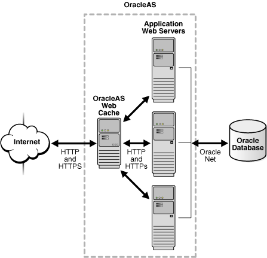
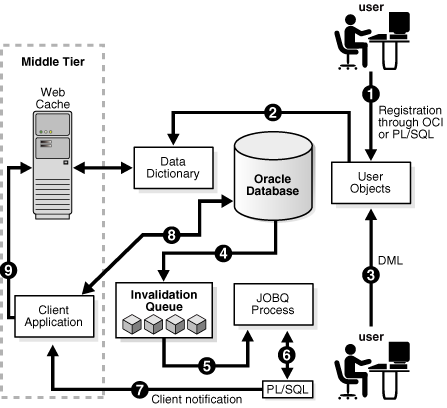

Continuous Query Notification (CQN) lets an application register queries with the database for either object change notification (the default) or query result change notification. An object referenced by a registered query is a registered object.

If a query is registered for object change notification (OCN), the database notifies the application whenever a transaction changes an object that the query references and commits, regardless of whether the query result changed.

If a query is registered for query result change notification (QRCN), the database notifies the application whenever a transaction changes the result of the query and commits.

A CQN registration associates a list of one or more queries with a notification type (OCN or QRCN) and a notification handler. To create a CQN registration, you can use either the PL/SQL interface or Oracle Call Interface (OCI). If you use the PL/SQL interface, the notification handler is a server-side PL/SQL stored procedure; if you use OCI, the notification handler is a client-side C callback procedure.

This chapter explains general CQN concepts and explains how to use the PL/SQL CQN interface.

Topics:

Note:

The terms OCN and QRCN refer to both the notification type and the notification itself: An application registers a query for OCN, and the database sends the application an OCN; an application registers a query for QRCN, and the database sends the application a QRCN.

See Also:

[Oracle Call Interface Programmer's Guide](https://docs.oracle.com/pls/topic/lookup?ctx=en/database/oracle/oracle-database/21/adfns&id=LNOCI13111) for information about using OCI for CQN

### 19.1 About Object Change Notification (OCN)

If an application registers a query for object change notification (OCN), the database sends the application an OCN whenever a transaction changes an object associated with the query and commits, regardless of whether the result of the query changed.

For example, if an application registers the query in Example 19-1 for OCN, and a user commits a transaction that changes the `EMPLOYEES` table, the database sends the application an OCN, even if the changed row or rows did not satisfy the query predicate (for example, if `DEPARTMENT_ID` = 5).

Example 19-1 Query to be Registered for Change Notification

```
SELECT EMPLOYEE_ID, SALARY
FROM EMPLOYEES
WHERE DEPARTMENT_ID = 10;
```

### 19.2 About Query Result Change Notification (QRCN)

Note:

For QRCN support, the `COMPATIBLE` initialization parameter of the database must be at least 11.0.0, and Automatic Undo Management (AUM) must be enabled (as it is by default).

If an application registers a query for query result change notification (QRCN), the database sends the application a QRCN whenever a transaction changes the result of the query and commits.

For example, if an application registers the query in Example 19-1 for QRCN, the database sends the application a QRCN only if the query result set changes; that is, if one of these data manipulation language (DML) statements commits:

- An `INSERT` or `DELETE` of a row that satisfies the query predicate (`DEPARTMENT_ID` = 10).
- An `UPDATE` to the `EMPLOYEE_ID` or `SALARY` column of a row that satisfied the query predicate (`DEPARTMENT_ID` = 10).
- An `UPDATE` to the `DEPARTMENT_ID` column of a row that changed its value from 10 to a value other than 10, causing the row to be deleted from the result set.
- An `UPDATE` to the `DEPARTMENT_ID` column of a row that changed its value to 10 from a value other than 10, causing the row to be added to the result set.

The default notification type is OCN. For QRCN, specify `QOS_QUERY` in the `QOSFLAGS` attribute of the `CQ_NOTIFICATION$_REG_INFO` object.

With QRCN, you have a choice of guaranteed mode (the default) or best-effort mode.

Topics:

- Guaranteed Mode
- Best-Effort Mode

See Also:

- [Oracle Database Administrator's Guide](https://docs.oracle.com/pls/topic/lookup?ctx=en/database/oracle/oracle-database/21/adfns&id=ADMIN11112) for information about the `COMPATIBLE` initialization parameter
- [Oracle Database Administrator's Guide](https://docs.oracle.com/pls/topic/lookup?ctx=en/database/oracle/oracle-database/21/adfns&id=ADMIN013) for information about AUM

#### 19.2.1 Guaranteed Mode

In guaranteed mode, there are no false positives: the database sends the application a QRCN only when the query result set is guaranteed to have changed.

For example, suppose that an application registered the query in Example 19-1 for QRCN, that employee 201 is in department 10, and that these statements are executed:

```
UPDATE EMPLOYEES
SET SALARY = SALARY + 10
WHERE EMPLOYEE_ID = 201;

UPDATE EMPLOYEES
SET SALARY = SALARY - 10
WHERE EMPLOYEE_ID = 201;

COMMIT;
```

Each `UPDATE` statement in the preceding transaction changes the query result set, but together they have no effect on the query result set; therefore, the database does not send the application a QRCN for the transaction.

For guaranteed mode, specify `QOS_QUERY`, but not `QOS_BEST_EFFORT`, in the `QOSFLAGS` attribute of the `CQ_NOTIFICATION$_REG_INFO` object.

Some queries are too complex for QRCN in guaranteed mode.

See Also:

Queries that Can Be Registered for QRCN in Guaranteed Mode for the characteristics of queries that can be registered in guaranteed mode

#### 19.2.2 Best-Effort Mode

Some queries that are too complex for guaranteed mode can be registered for QRCN in best-effort mode, in which CQN creates and registers simpler versions of them.

The following two examples demonstrate how this works:

- Example: Query Too Complex for QRCN in Guaranteed Mode
- Example: Query Whose Simplified Version Invalidates Objects

##### 19.2.2.1 Example: Query Too Complex for QRCN in Guaranteed Mode

The query in Example 19-2 is too complex for QRCN in guaranteed mode because it contains the aggregate function `SUM`.

Example 19-2 Query Too Complex for QRCN in Guaranteed Mode

```
SELECT SUM(SALARY)
FROM EMPLOYEES
WHERE DEPARTMENT_ID = 20;
```

In best-effort mode, CQN registers this simpler version of the query in this example:

```
SELECT SALARY
FROM EMPLOYEES
WHERE DEPARTMENT_ID = 20;
```

Whenever the result of the original query changes, the result of its simpler version also changes; therefore, no notifications are lost from the simplification. However, the simplification might cause false positives, because the result of the simpler version can change when the result of the original query does not.

In best-effort mode, the database:

- Minimizes the OLTP response overhead that is from notification-related processing, as follows:
	- For a single-table query, the database determines whether the query result has changed by which columns changed and which predicates the changed rows satisfied.
		- For a multiple-table query (a join), the database uses the primary-key/foreign-key constraint relationships between the tables to determine whether the query result has changed.
- Sends the application a QRCN whenever a DML statement changes the query result set, even if a subsequent DML statement nullifies the change made by the first DML statement.

The overhead minimization of best-effort mode infrequently causes false positives, even for queries that CQN does not simplify. For example, consider the query in this example and the transaction in Guaranteed Mode. In best-effort mode, CQN does not simplify the query, but the transaction generates a false positive.

##### 19.2.2.2 Example: Query Whose Simplified Version Invalidates Objects

Some types of queries are so simplified that invalidations are generated at object level; that is, whenever any object referenced in those queries changes. Examples of such queries are those that use unsupported column types or include subqueries. The solution to this problem is to rewrite the original queries.

For example, the query in Example 19-3 is too complex for QRCN in guaranteed mode because it includes a subquery.

Example 19-3 Query Whose Simplified Version Invalidates Objects

```
SELECT SALARY
FROM EMPLOYEES
WHERE DEPARTMENT_ID IN (
  SELECT DEPARTMENT_ID
  FROM DEPARTMENTS
  WHERE LOCATION_ID = 1700
);
```

In best-effort mode, CQN simplifies the query in this example to this:

```
SELECT * FROM EMPLOYEES, DEPARTMENTS;
```

The simplified query can cause objects to be invalidated. However, if you rewrite the original query as follows, you can register it in either guaranteed mode or best-effort mode:

```
SELECT SALARY
FROM EMPLOYEES, DEPARTMENTS
WHERE EMPLOYEES.DEPARTMENT_ID = DEPARTMENTS.DEPARTMENT_ID
  AND DEPARTMENTS.LOCATION_ID = 1700;
```

Queries that can be registered only in best-effort mode are described in Queries that Can Be Registered for QRCN Only in Best-Effort Mode.

The default for QRCN mode is guaranteed mode. For best-effort mode, specify `QOS_BEST_EFFORT` in the `QOSFLAGS` attribute of the `CQ_NOTIFICATION$_REG_INFO` object.

### 19.3 Events that Generate Notifications

#### 19.3.1 Committed DML Transactions

When the notification type is OCN, any DML transaction that changes one or more registered objects generates one notification for each object when it commits.

When the notification type is QRCN, any DML transaction that changes the result of one or more registered queries generates a notification when it commits. The notification includes the query IDs of the queries whose results changed.

For either notification type, the notification includes:

- Name of each changed table
- Operation type (`INSERT`, `UPDATE`, or `DELETE`)
- `ROWID` of each changed row, if the registration was created with the `ROWID` option and the number of modified rows was not too large.

See Also:

ROWID Option

#### 19.3.2 Committed DDL Statements

For both OCN and QRCN, these data definition language (DDL) statements, when committed, generate notifications:

- `ALTER` `TABLE`
- `TRUNCATE` `TABLE`
- `FLASHBACK` `TABLE`
- `DROP` `TABLE`

Note:

When the notification type is OCN, a committed `DROP` `TABLE` statement generates a `DROP` `NOTIFICATION`.

Any OCN registrations of queries on the dropped table become disassociated from that table (which no longer exists), but the registrations themselves continue to exist. If any of these registrations are associated with objects other than the dropped table, committed changes to those other objects continue to generate notifications. Registrations associated only with the dropped table also continue to exist, and their creator can add queries (and their referenced objects) to them.

An OCN registration is based on the version and definition of an object at the time the query was registered. If an object is dropped, registrations on that object are disassociated from it forever. If an object is created with the same name, and in the same schema, as the dropped object, the created object is not associated with OCN registrations that were associated with the dropped object.

When the notification type is QRCN:

- The notification includes:
	- Query IDs of the queries whose results have changed
		- Name of the modified table
		- Type of DDL operation
- Some DDL operations that invalidate registered queries can cause those queries to be deregistered.
	For example, suppose that this query is registered for QRCN:
	```
	SELECT COL1 FROM TEST_TABLE
	  WHERE COL2 = 1;
	```
	Suppose that `TEST_TABLE` has this schema:
	```
	(COL1 NUMBER, COL2 NUMBER, COL3 NUMBER)
	```
	This DDL statement, when committed, invalidates the query and causes it to be removed from the registration:
	```
	ALTER TABLE DROP COLUMN COL2;
	```

#### 19.3.3 Deregistration

For both OCN and QRCN, deregistration—removal of a registration from the database—generates a notification. The reasons that the database removes a registration are:

- Timeout
	If `TIMEOUT` is specified with a nonzero value when the queries are registered, the database purges the registration after the specified time interval.
	If `QOS_DEREG_NFY` is specified when the queries are registered, the database purges the registration after it generates its first notification.
- Loss of privileges
	If privileges are lost on an object associated with a registered query, and the notification type is OCN, the database purges the registration. (When the notification type is QRCN, the database removes that query from the registration, but does not purge the registration.)

A notification is not generated when a client application performs an explicit deregistration.

#### 19.3.4 Global Events

The global events `EVENT_STARTUP` and `EVENT_SHUTDOWN` generate notifications.

In an Oracle RAC environment, these events generate notifications:

- `EVENT_STARTUP` when the first instance of the database starts
- `EVENT_SHUTDOWN` when the last instance of the database shuts down
- `EVENT_SHUTDOWN_ANY` when any instance of the database shuts down

The preceding global events are constants defined in the `DBMS_CQ_NOTIFICATION` package.

See Also:

[Oracle Database PL/SQL Packages and Types Reference](https://docs.oracle.com/pls/topic/lookup?ctx=en/database/oracle/oracle-database/21/adfns&id=ARPLS201) for more information about the `DBMS_CQ_NOTIFICATION` package

### 19.4 Notification Contents

A notification contains some or all of this information:

- Type of event, which is one of:
	- Startup
		- Object change
		- Query result change
		- Deregistration
		- Shutdown
- Registration ID of affected registration
- Names of changed objects
- If `ROWID` option was specified, `ROWID` s of changed rows
- If the notification type is QRCN: Query IDs of queries whose results changed
- If notification resulted from a DML or DDL statement:
	- Array of names of modified tables
		- Operation type (for example, `INSERT` or `UPDATE`)

A notification does not contain the changed data itself. For example, the notification does not say that a monthly salary increased from 5000 to 6000. To obtain more recent values for the changed objects or rows or query results, the application must query the database.

### 19.5 Good Candidates for CQN

Good candidates for CQN are applications that cache the result sets of queries on infrequently changed objects in the middle tier, to avoid network round trips to the database. These applications can use CQN to register the queries to be cached. When such an application receives a notification, it can refresh its cache by rerunning the registered queries.

An example of such an application is a web forum. Because its users need not view content as soon as it is inserted into the database, this application can cache information in the middle tier and have CQN tell it when it when to refresh the cache.

Figure 19-1 illustrates a typical scenario in which the database serves data that is cached in the middle tier and then accessed over the Internet.

Figure 19-1 Middle-Tier Caching



> This graphic illustrates an OracleAS Web Cache interacting with web servers through HTTP and HTTPS, and with Oracle Database through Oracle Net.
>
> [  
> Copyright © 1996, 2023, Oracle and/or its affiliates.](https://docs.oracle.com/en/database/oracle/oracle-database/dcommon/html/cpyr.htm)


Applications in the middle tier require rapid access to cached copies of database objects while keeping the cache as current as possible in relation to the database. Cached data becomes obsolete when a transaction modifies the data and commits, thereby putting the application at risk of accessing incorrect results. If the application uses CQN, the database can publish a notification when a change occurs to registered objects with details on what changed. In response to the notification, the application can refresh cached data by fetching it from the back-end database.

Figure 19-2 illustrates the process by which middle-tier web clients receive and process notifications.

Figure 19-2 Basic Process of Continuous Query Notification (CQN)



> This graphic shows how a middle-tier application uses Continuous Query Notification. The steps of the process are described in the following text.
>
> [  
> Copyright © 1996, 2023, Oracle and/or its affiliates.](https://docs.oracle.com/en/database/oracle/oracle-database/dcommon/html/cpyr.htm)


Explanation of steps in Figure 19-2 (if registrations are created using PL/SQL and that the application has cached the result set of a query on `HR`.`EMPLOYEES`):

1. The developer uses PL/SQL to create a CQN registration for the query, which consists of creating a stored PL/SQL procedure to process notifications and then using the PL/SQL CQN interface to create a registration for the query, specifying the PL/SQL procedure as the notification handler.
2. The database populates the registration information in the data dictionary.
3. A user updates a row in the `HR`.`EMPLOYEES` table in the back-end database and commits the update, causing the query result to change. The data for `HR`.`EMPLOYEES` cached in the middle tier is now outdated.
4. The database adds a message that describes the change to an internal queue.
5. The database notifies a `JOBQ` background process of a notification message.
6. The `JOBQ` process runs the stored procedure specified by the client application. In this example, `JOBQ` passes the data to a server-side PL/SQL procedure. The implementation of the PL/SQL notification handler determines how the notification is handled.
7. Inside the server-side PL/SQL procedure, the developer can implement logic to notify the middle-tier client application of the changes to the registered objects. For example, it notifies the application of the `ROWID` of the changed row in `HR`.`EMPLOYEES`.
8. The client application in the middle tier queries the back-end database to retrieve the data in the changed row.
9. The client application updates the cache with the data.

### 19.6 Creating CQN Registrations

A CQN registration associates a list of one or more queries with a notification type and a notification handler.

The notification type is either OCN or QRCN.

To create a CQN registration, you can use one of two interfaces:

- PL/SQL interface
	If you use the PL/SQL interface, the notification handler is a server-side PL/SQL stored procedure.
- Oracle Call Interface (OCI)
	If you use OCI, the notification handler is a client-side C callback procedure.

After being created, a registration is stored in the database. In an Oracle RAC environment, it is visible to all database instances. Transactions that change the query results in any database instance generate notifications.

By default, a registration survives until the application that created it explicitly deregisters it or until the database implicitly purges it (from loss of privileges, for example).

### 19.7 Using PL/SQL to Create CQN Registrations

This section describes using PL/SQL to create CQN registrations. When you use the PL/SQL interface, the notification handler is a server-side PL/SQL stored procedure.

Topics:

- PL/SQL CQN Registration Interface
- CQN Registration Options
- Prerequisites for Creating CQN Registrations
- Queries that Can Be Registered for Object Change Notification (OCN)
- Queries that Can Be Registered for Query Result Change Notification (QRCN)
- Using PL/SQL to Register Queries for CQN
- Best Practices for CQN Registrations
- Troubleshooting CQN Registrations
- Deleting Registrations
- Configuring CQN: Scenario

#### 19.7.1 PL/SQL CQN Registration Interface

The PL/SQL CQN registration interface is implemented with the `DBMS_CQ_NOTIFICATION` package. You use the `DBMS_CQ_NOTIFICATION`.`NEW_REG_START` function to open a registration block. You specify the registration details, including the notification type and notification handler, as part of the `CQ_NOTIFICATION$_REG_INFO` object, which is passed as an argument to the `NEW_REG_START` procedure. Every query that you run while the registration block is open is registered with CQN. If you specified notification type QRCN, the database assigns a query ID to each query. You can retrieve these query IDs with the `DBMS_CQ_NOTIFICATION`.`CQ_NOTIFICATION_QUERYID` function. To close the registration block, you use the `DBMS_CQ_NOTIFICATION`.`REG_END` function.

#### 19.7.2 CQN Registration Options

You can change the CQN registration defaults with the options summarized in Table 19-1.

Table 19-1 Continuous Query Notification Registration Options

| Option | Description |
| --- | --- |
| Notification Type | Specifies QRCN (the default is OCN). |
| QRCN Mode <sup>Foot 1</sup> | Specifies best-effort mode (the default is guaranteed mode). |
| `ROWID` | Includes the value of the `ROWID` pseudocolumn for each changed row in the notification. |
| Operations Filter <sup>Foot 2</sup> | Publishes the notification only if the operation type matches the specified filter condition. |
| Transaction Lag <sup>Foot 2</sup> | Deprecated. Use Notification Grouping instead. |
| Notification Grouping | Specifies how notifications are grouped. |
| Reliable | Stores notifications in a persistent database queue (instead of in shared memory, the default). |
| Purge on Notify | Purges the registration after the first notification. |
| Timeout | Purges the registration after a specified time interval. |

<sup>Footnote 1</sup>

Applies only when notification type is QRCN.

<sup>Footnote 2</sup>

Applies only when notification type is OCN.

Topics:

- Notification Type Option
- QRCN Mode (QRCN Notification Type Only)
- ROWID Option
- Operations Filter Option (OCN Notification Type Only)
- Transaction Lag Option (OCN Notification Type Only)
- Notification Grouping Options
- Reliable Option
- Purge-on-Notify and Timeout Options

##### 19.7.2.1 Notification Type Option

The notification types are OCN and QRCN.

See Also:

- About Object Change Notification (OCN)
- About Query Result Change Notification (QRCN)

##### 19.7.2.2 QRCN Mode (QRCN Notification Type Only)

The QRCN mode option applies only when the notification type is QRCN. Instructions for setting the notification type to QRCN are in Notification Type Option.

QRCN modes are:
- guaranteed
- best-effort

The default is guaranteed mode. For best-effort mode, specify `QOS_BEST_EFFORT` in the `QOSFLAGS` attribute of the `CQ_NOTIFICATION$_REG_INFO` object.

See Also:

- Guaranteed Mode
- Best-Effort Mode

##### 19.7.2.3 ROWID Option

The `ROWID` option includes the value of the `ROWID` pseudocolumn (the rowid of the row) for each changed row in the notification. To include the `ROWID` option of each changed row in the notification, specify `QOS_ROWIDS` in the `QOSFLAGS` attribute of the `CQ_NOTIFICATION$_REG_INFO` object.

Note:

When you update a row in a table compressed with Hybrid Columnar Compression (HCC), the `ROWID` of the row changes. HCC, a feature of certain Oracle storage systems, is described in [Oracle Database Concepts](https://docs.oracle.com/pls/topic/lookup?ctx=en/database/oracle/oracle-database/21/adfns&id=CNCPT89198).

From the `ROWID` information in the notification, the application can retrieve the contents of the changed rows by performing queries of this form:

```
SELECT * FROM table_name_from_notification
WHERE ROWID = rowid_from_notification;
```

`ROWID` s are published in the external string format. For a regular heap table, the length of a `ROWID` is 18 character bytes. For an Index Organized Table (IOT), the length of the `ROWID` depends on the size of the primary key, and might exceed 18 bytes.

If the server does not have enough memory for the `ROWID` s, the notification might be "rolled up" into a `FULL-TABLE-NOTIFICATION`, indicated by a special flag in the notification descriptor. Possible reasons for a `FULL-TABLE-NOTIFICATION` are:

- Total shared memory consumption from `ROWID` s exceeds 1% of the dynamic shared pool size.
- Too many rows were changed in a single registered object within a transaction (the upper limit is approximately 80).
- Total length of the logical `ROWID` s of modified rows for an IOT is too large (the upper limit is approximately 1800 bytes).
- You specified the Notification Grouping option `NTFN_GROUPING_TYPE` with the value `DBMS_CQ_NOTIFICATION`.`NTFN_GROUPING_TYPE_SUMMARY`, described in Notification Grouping Options.

Because a `FULL-TABLE-NOTIFICATION` does not include `ROWID` s, the application that receives it must assume that the entire table (that is, all rows) might have changed.

##### 19.7.2.4 Operations Filter Option (OCN Notification Type Only)

The Operations Filter option applies only when the notification type is OCN.

The Operations Filter option enables you to specify the types of operations that generate notifications.

The default is all operations. To specify that only some operations generate notifications, use the `OPERATIONS_FILTER` attribute of the `CQ_NOTIFICATION$_REG_INFO` object. With the `OPERATIONS_FILTER` attribute, specify the type of operation with the constant that represents it, which is defined in the `DBMS_CQ_NOTIFICATION` package, as follows:

| Operation | Constant |
| --- | --- |
| `INSERT` | `DBMS_CQ_NOTIFICATION.INSERTOP` |
| `UPDATE` | `DBMS_CQ_NOTIFICATION.UPDATEOP` |
| `DELETE` | `DBMS_CQ_NOTIFICATION.DELETEOP` |
| `ALTEROP` | `DBMS_CQ_NOTIFICATION.ALTEROP` |
| `DROPOP` | `DBMS_CQ_NOTIFICATION.DROPOP` |
| `UNKNOWNOP` | `DBMS_CQ_NOTIFICATION.UNKNOWNOP` |
| All (default) | `DBMS_CQ_NOTIFICATION.ALL_OPERATIONS` |

To specify multiple operations, use bitwise `OR`. For example:

```
DBMS_CQ_NOTIFICATION.INSERTOP + DBMS_CQ_NOTIFICATION.DELETEOP
```

`OPERATIONS_FILTER` has no effect if you also specify `QOS_QUERY` in the `QOSFLAGS` attribute, because `QOS_QUERY` specifies notification type QRCN.

See Also:

[Oracle Database PL/SQL Packages and Types Reference](https://docs.oracle.com/pls/topic/lookup?ctx=en/database/oracle/oracle-database/21/adfns&id=ARPLS201) for more information about the `DBMS_CQ_NOTIFICATION` package

##### 19.7.2.5 Transaction Lag Option (OCN Notification Type Only)

The Transaction Lag option applies only when the notification type is OCN.

Note:

This option is deprecated. To implement flow-of-control notifications, use Notification Grouping Options.

The Transaction Lag option specifies the number of transactions by which the client application can lag behind the database. If the number is 0, every transaction that changes a registered object results in a notification. If the number is 5, every fifth transaction that changes a registered object results in a notification. The database tracks intervening changes at object granularity and includes them in the notification, so that the client does not lose them.

A transaction lag greater than 0 is useful only if an application implements flow-of-control notifications. Ensure that the application generates notifications frequently enough to satisfy the lag, so that they are not deferred indefinitely.

If you specify `TRANSACTION_LAG`, then notifications do not include `ROWID` s, even if you also specified `QOS_ROWIDS`.

##### 19.7.2.6 Notification Grouping Options

By default, notifications are generated immediately after the event that causes them.

Notification Grouping options, which are attributes of the `CQ_NOTIFICATION$_REG_INFO` object, are:

| Attribute | Description |
| --- | --- |
| `NTFN_GROUPING_CLASS` | Specifies the class by which to group notifications. The only allowed values are `DBMS_CQ_NOTIFICATION`.`NTFN_GROUPING_CLASS_TIME`, which groups notifications by time, and zero, which is the default (notifications are generated immediately after the event that causes them). |
| `NTFN_GROUPING_VALUE` | Specifies the time interval that defines the group, in seconds. For example, if this value is 900, notifications generated in the same 15-minute interval are grouped. |
| `NTFN_GROUPING_TYPE` | Specifies the type of grouping, which is either of:  - `DBMS_CQ_NOTIFICATION`.`NTFN_GROUPING_TYPE_SUMMARY`: All notifications in the group are summarized into a single notification. 	Note: The single notification does not include `ROWID` s, even if you specified the `ROWID` option. - `DBMS_CQ_NOTIFICATION`.`NTFN_GROUPING_TYPE_LAST`: Only the last notification in the group is published and the earlier ones discarded. |
| `NTFN_GROUPING_START_TIME` | Specifies when to start generating notifications. If specified as `NULL`, it defaults to the current system-generated time. |
| `NTFN_GROUPING_REPEAT_COUNT` | Specifies how many times to repeat the notification. Set to `DBMS_CQ_NOTIFICATION`.`NTFN_GROUPING_FOREVER` to receive notifications for the life of the registration. To receive at most n notifications during the life of the registration, set to n. |

Note:

Notifications generated by timeouts, loss of privileges, and global events might be published before the specified grouping interval expires. If they are, any pending grouped notifications are also published before the interval expires.

##### 19.7.2.7 Reliable Option

By default, a CQN registration is stored in shared memory. To store it in a persistent database queue instead—that is, to generate reliable notifications—specify `QOS_RELIABLE` in the `QOSFLAGS` attribute of the `CQ_NOTIFICATION$_REG_INFO` object.

The advantage of reliable notifications is that if the database fails after generating them, it can still deliver them after it restarts. In an Oracle RAC environment, a surviving database instance can deliver them.

The disadvantage of reliable notifications is that they have higher CPU and I/O costs than default notifications do.

##### 19.7.2.8 Purge-on-Notify and Timeout Options

By default, a CQN registration survives until the application that created it explicitly deregisters it or until the database implicitly purges it (from loss of privileges, for example).

To purge the registration after it generates its first notification, specify `QOS_DEREG_NFY` in the `QOSFLAGS` attribute of the `CQ_NOTIFICATION$_REG_INFO` object.

To purge the registration after n seconds, specify n in the `TIMEOUT` attribute of the `CQ_NOTIFICATION$_REG_INFO` object.

You can use the Purge-on-Notify and Timeout options together.

#### 19.7.3 Prerequisites for Creating CQN Registrations

These are prerequisites for creating CQN registrations:

- You must have these privileges:
	- `EXECUTE` privilege on the `DBMS_CQ_NOTIFICATION` package, whose subprograms you use to create a registration
		- `CHANGE` `NOTIFICATION` system privilege
		- `READ` or `SELECT` privilege on each object to be registered
	Loss of privileges on an object associated with a registered query generates a notification.
- You must be connected as a non-SYS user.
- You must not be in the middle of an uncommitted transaction.
- The `dml_locks` `init`.`ora` parameter must have a nonzero value (as its default value does).
	(This is also a prerequisite for receiving notifications.)

Note:

For QRCN support, the `COMPATIBLE` setting of the database must be at least 11.0.0.

See Also:

Deregistration

#### 19.7.4 Queries that Can Be Registered for Object Change Notification (OCN)

Most queries can be registered for OCN, including those executed as part of stored procedures and `REF` cursors.

Queries that cannot be registered for OCN are:

- Queries on fixed tables or fixed views
- Queries on user views
- Queries that contain database links (dblinks)
- Queries over materialized views

Note:

You can use synonyms in OCN registrations, but not in QRCN registrations.

#### 19.7.5 Queries that Can Be Registered for Query Result Change Notification (QRCN)

Some queries can be registered for QRCN in guaranteed mode, some can be registered for QRCN only in best-effort mode, and some cannot be registered for QRCN in either mode.

Topics:

- Queries that Can Be Registered for QRCN in Guaranteed Mode
- Queries that Can Be Registered for QRCN Only in Best-Effort Mode
- Queries that Cannot Be Registered for QRCN in Either Mode

See Also:

- Guaranteed Mode and
- Best-Effort Mode

##### 19.7.5.1 Queries that Can Be Registered for QRCN in Guaranteed Mode

To be registered for QRCN in guaranteed mode, a query must conform to these rules:

- Every column that it references is either a `NUMBER` data type or a `VARCHAR2` data type.
- Arithmetic operators in column expressions are limited to these binary operators, and their operands are columns with numeric data types:
	- `+` (addition)
		- `-` (subtraction, not unary minus)
		- `*` (multiplication)
		- `/` (division)
- Comparison operators in the predicate are limited to:
	- `<` (less than)
		- `<=` (less than or equal to)
		- `=` (equal to)
		- `>=` (greater than or equal to)
		- `>` (greater than)
		- `<>` or `!=` (not equal to)
		- `IS` `NULL`
		- `IS` `NOT` `NULL`
- Boolean operators in the predicate are limited to `AND`, `OR`, and `NOT`.
- The query contains no aggregate functions (such as `SUM`, `COUNT`, `AVERAGE`, `MIN`, and `MAX`).

Guaranteed mode supports most queries on single tables and some inner equijoins, such as:

```
SELECT SALARY FROM EMPLOYEES, DEPARTMENTS
  WHERE EMPLOYEES.DEPARTMENT_ID = DEPARTMENTS.DEPARTMENT_ID
    AND DEPARTMENTS.LOCATION_ID = 1700;
```

Note:

- Sometimes the query optimizer uses an execution plan that makes a query incompatible for guaranteed mode (for example, `OR` -expansion).
- Queries that can be registered in guaranteed mode can also be registered in best-effort mode, but results might differ, because best-effort mode can cause false positives even for queries that CQN does not simplify.

See Also:

- [Oracle Database SQL Language Reference](https://docs.oracle.com/pls/topic/lookup?ctx=en/database/oracle/oracle-database/21/adfns&id=SQLRF20035) for a list of SQL aggregate functions
- [Oracle Database SQL Tuning Guide](https://docs.oracle.com/pls/topic/lookup?ctx=en/database/oracle/oracle-database/21/adfns&id=TGSQL193) for information about the query optimizer
- Best-Effort Mode

##### 19.7.5.2 Queries that Can Be Registered for QRCN Only in Best-Effort Mode

A query that does any of the following can be registered for QRCN only in best-effort mode, and its simplified version generates notifications at object granularity:

- Refers to columns that have encryption enabled
- Has more than 10 items of the same type in the `SELECT` list
- Has expressions that include any of these:
	- String functions (such as `SUBSTR`, `LTRIM`, and `RTRIM`)
		- Arithmetic functions (such as `TRUNC`, `ABS`, and `SQRT`)
		- Pattern-matching conditions `LIKE` and `REGEXP_LIKE`
		- `EXISTS` or `NOT` `EXISTS` condition
- Has disjunctions involving predicates defined on columns from different tables. For example:
	```
	SELECT EMPLOYEE_ID, DEPARTMENT_ID
	  FROM EMPLOYEES, DEPARTMENTS
	    WHERE EMPLOYEES.EMPLOYEE_ID = 10
	      OR DEPARTMENTS.DEPARTMENT_ID = 'IT';
	```
- Has user rowid access. For example:
	```
	SELECT DEPARTMENT_ID
	  FROM DEPARTMENTS
	    WHERE ROWID = 'AAANkdAABAAALinAAF';
	```
- Has any join other than an inner join
- Has an execution plan that involves any of these:
	- Bitmap join, domain, or function-based indexes
		- `UNION` `ALL` or `CONCATENATION`
		(Either in the query itself, or as the result of an `OR` -expansion execution plan chosen by the query optimizer.)
		- `ORDER` `BY` or `GROUP` `BY`
		(Either in the query itself, or as the result of a `SORT` operation with an `ORDER` `BY` option in the execution plan chosen by the query optimizer.)
		- Partitioned index-organized table (IOT) with overflow segment
		- Clustered objects
		- Parallel execution

See Also:

[Oracle Database SQL Language Reference](https://docs.oracle.com/pls/topic/lookup?ctx=en/database/oracle/oracle-database/21/adfns&id=SQLRF006) for a list of SQL functions

##### 19.7.5.3 Queries that Cannot Be Registered for QRCN in Either Mode

A query that refers to any of the following cannot be registered for QRCN in either guaranteed or best-effort mode:

- Views
- Tables that are fixed, remote, or have Virtual Private Database (VPD) policies enabled
- `DUAL` (in the `SELECT` list)
- Synonyms
- Calls to user-defined PL/SQL subprograms
- Operators not listed in Queries that Can Be Registered for QRCN in Guaranteed Mode
- The aggregate function `COUNT`
	(Other aggregate functions are allowed in best-effort mode, but not in guaranteed mode.)
- Application contexts; for example:
	```
	SELECT SALARY FROM EMPLOYEES
	WHERE USER = SYS_CONTEXT('USERENV', 'SESSION_USER');
	```
- `SYSDATE`, `SYSTIMESTAMP`, or `CURRENT` `TIMESTAMP`

Also, a query that the query optimizer has rewritten using a materialized view cannot be registered for QRCN.

See Also:

[Oracle Database SQL Tuning Guide](https://docs.oracle.com/pls/topic/lookup?ctx=en/database/oracle/oracle-database/21/adfns&id=TGSQL193) for information about the query optimizer

#### 19.7.6 Using PL/SQL to Register Queries for CQN

To use PL/SQL to create a CQN registration, follow these steps:

1. Create a stored PL/SQL procedure to serve as the notification handler.
	See Creating a PL/SQL Notification Handler.
2. Create a `CQ_NOTIFICATION$_REG_INFO` object that specifies the name of the notification handler, the notification type, and other attributes of the registration.
	See Creating a CQ\_NOTIFICATION$\_REG\_INFO Object.
3. In your client application, use the `DBMS_CQ_NOTIFICATION`.`NEW_REG_START` function to open a registration block.
	See Oracle Database PL/SQL Packages and Types Reference for more information about the `CQ_NOTIFICATION$_REG_INFO` object and the functions `NEW_REG_START` and `REG_END`, all of which are defined in the `DBMS_CQ_NOTIFICATION` package.
4. Run the queries to register. (Do not run DML or DDL operations.)
	See the following topics for more information:
	- Identifying Individual Queries in a Notification
	- Adding Queries to an Existing Registration
5. Close the registration block, using the `DBMS_CQ_NOTIFICATION`.`REG_END` function.

##### 19.7.6.1 Creating a PL/SQL Notification Handler

The PL/SQL stored procedure that you create to serve as the notification handler must have this signature:

```
PROCEDURE schema_name.proc_name(ntfnds IN CQ_NOTIFICATION$_DESCRIPTOR)
```

In the preceding signature, `schema_name` is the name of the database schema, `proc_name` is the name of the stored procedure, and `ntfnds` is the notification descriptor.

The notification descriptor is a `CQ_NOTIFICATION$_DESCRIPTOR` object, whose attributes describe the details of the change (transaction ID, type of change, queries affected, tables modified, and so on).

The `JOBQ` process passes the notification descriptor, `ntfnds`, to the notification handler, `proc_name`, which handles the notification according to its application requirements. (This is step [^1] in Figure 19-2.)

Note:

The notification handler runs inside a job queue process. The `JOB_QUEUE_PROCESSES` initialization parameter specifies the maximum number of processes that can be created for the execution of jobs. You must set `JOB_QUEUE_PROCESSES` to a nonzero value to receive PL/SQL notifications.

See Also:

`JOB_QUEUE_PROCESSES`

##### 19.7.6.2 Creating a CQ\_NOTIFICATION$\_REG\_INFO Object

An object of type `CQ_NOTIFICATION$_REG_INFO` specifies the notification handler that the database runs when a registered objects changes. In SQL\*Plus, you can view its type attributes by running this statement:

```
DESC CQ_NOTIFICATION$_REG_INFO
```

Table 19-2 describes the attributes of `SYS`.`CQ_NOTIFICATION$_REG_INFO`.

Table 19-2 Attributes of CQ\_NOTIFICATION$\_REG\_INFO

| Attribute | Description |
| --- | --- |
| `CALLBACK` | Specifies the name of the PL/SQL procedure to be executed when a notification is generated (a notification handler). You must specify the name in the form `schema_name`.`procedure_name`, for example, `hr`.`dcn_callback`. |
| `QOSFLAGS` | Specifies one or more quality-of-service flags, which are constants in the `DBMS_CQ_NOTIFICATION` package. For their names and descriptions, see Table 19-3.  To specify multiple quality-of-service flags, use bitwise `OR`. For example: `DBMS_CQ_NOTIFICATION.QOS_RELIABLE + DBMS_CQ_NOTIFICATION.QOS_ROWIDS` |
| `TIMEOUT` | Specifies the timeout period for registrations. If set to a nonzero value, it specifies the time in seconds after which the database purges the registration. If `0` or `NULL`, then the registration persists until the client explicitly deregisters it.  Can be combined with the `QOSFLAGS` attribute with its `QOS_DEREG_NFY` flag. |
| `OPERATIONS_FILTER` | Applies only to OCN (described in About Object Change Notification (OCN)). Has no effect if you specify the `QOS_FLAGS` attribute with its `QOS_QUERY` flag.  Filters messages based on types of SQL statement. You can specify these constants in the `DBMS_CQ_NOTIFICATION` package:  - `ALL_OPERATIONS` notifies on all changes - `INSERTOP` notifies on inserts - `UPDATEOP` notifies on updates - `DELETEOP` notifies on deletes - `ALTEROP` notifies on `ALTER` `TABLE` operations - `DROPOP` notifies on `DROP` `TABLE` operations - `UNKNOWNOP` notifies on unknown operations  You can specify a combination of operations with a bitwise `OR`. For example: `DBMS_CQ_NOTIFICATION.INSERTOP` + `DBMS_CQ_NOTIFICATION.DELETEOP`. |
| `TRANSACTION_LAG` | Deprecated. To implement flow-of-control notifications, use the `NTFN_GROUPING_*` attributes.  Applies only to OCN (described in About Object Change Notification (OCN)). Has no effect if you specify the `QOS_FLAGS` attribute with its `QOS_QUERY` flag.  Specifies the number of transactions or database changes by which the client can lag behind the database. If 0, then the client receives an invalidation message as soon as it is generated. If 5, then every fifth transaction that changes a registered object results in a notification. The database tracks intervening changes at an object granularity and bundles the changes along with the notification. Thus, the client does not lose intervening changes.  Most applications that must be notified of changes to an object on transaction commit without further deferral are expected to chose 0 transaction lag. A nonzero transaction lag is useful only if an application implements flow control on notifications. When using nonzero transaction lag, Oracle recommends that the application workload has the property that notifications are generated at a reasonable frequency. Otherwise, notifications might be deferred indefinitely till the lag is satisfied.  If you specify `TRANSACTION_LAG`, then the `ROWID` level granularity is unavailable in the notification messages even if you specified `QOS_ROWIDS` during registration. |
| `NTFN_GROUPING_CLASS` | Specifies the class by which to group notifications. The only allowed value is `DBMS_CQ_NOTIFICATION`.`NTFN_GROUPING_CLASS_TIME`, which groups notifications by time. |
| `NTFN_GROUPING_VALUE` | Specifies the time interval that defines the group, in seconds. For example, if this value is 900, notifications generated in the same 15-minute interval are grouped. |
| `NTFN_GROUPING_TYPE` | Specifies either of these types of grouping:  - `DBMS_CQ_NOTIFICATION`.`NTFN_GROUPING_TYPE_SUMMARY`: All notifications in the group are summarized into a single notification. - `DBMS_CQ_NOTIFICATION`.`NTFN_GROUPING_TYPE_LAST`: Only the last notification in the group is published and the earlier ones discarded. |
| `NTFN_GROUPING_START_TIME` | Specifies when to start generating notifications. If specified as `NULL`, it defaults to the current system-generated time. |
| `NTFN_GROUPING_REPEAT_COUNT` | Specifies how many times to repeat the notification. Set to `DBMS_CQ_NOTIFICATION`.`NTFN_GROUPING_FOREVER` to receive notifications for the life of the registration. To receive at most n notifications during the life of the registration, set to n. |

The quality-of-service flags in Table 19-3 are constants in the `DBMS_CQ_NOTIFICATION` package. You can specify them with the `QOS_FLAGS` attribute of `CQ_NOTIFICATION$_REG_INFO` (see Table 19-2).

Table 19-3 Quality-of-Service Flags

| Flag | Description |
| --- | --- |
| `QOS_DEREG_NFY` | Purges the registration after the first notification. |
| `QOS_RELIABLE` | Stores notifications in a persistent database queue.  In an Oracle RAC environment, if a database instance fails, surviving database instances can deliver any queued notification messages.  Default: Notifications are stored in shared memory, which performs more efficiently. |
| `QOS_ROWIDS` | Includes the `ROWID` of each changed row in the notification. |
| `QOS_QUERY` | Registers queries for QRCN, described in About Query Result Change Notification (QRCN).  If a query cannot be registered for QRCN, an error is generated at registration time, unless you also specify `QOS_BEST_EFFORT`.  Default: Queries are registered for OCN, described in About Object Change Notification (OCN) |
| `QOS_BEST_EFFORT` | Used with `QOS_QUERY`. Registers simplified versions of queries that are too complex for query result change evaluation; in other words, registers queries for QRCN in best-effort mode, described in Best-Effort Mode.  To see which queries were simplified, query the static data dictionary view `DBA_CQ_NOTIFICATION_QUERIES` or `USER_CQ_NOTIFICATION_QUERIES`. These views give the `QUERYID` and the text of each registered query.  Default: Queries are registered for QRCN in guaranteed mode, described in Guaranteed Mode |

Suppose that you must invoke the procedure `HR`.`dcn_callback` whenever a registered object changes. In Example 19-4, you create a `CQ_NOTIFICATION$_REG_INFO` object that specifies that `HR`.`dcn_callback` receives notifications. To create the object you must have `EXECUTE` privileges on the `DBMS_CQ_NOTIFICATION` package.

Example 19-4 Creating a CQ\_NOTIFICATION$\_REG\_INFO Object

```
DECLARE
  v_cn_addr CQ_NOTIFICATION$_REG_INFO;

BEGIN
  -- Create object:

  v_cn_addr := CQ_NOTIFICATION$_REG_INFO (
    'HR.dcn_callback',                 -- PL/SQL notification handler
    DBMS_CQ_NOTIFICATION.QOS_QUERY     -- notification type QRCN
    + DBMS_CQ_NOTIFICATION.QOS_ROWIDS, -- include rowids of changed objects
    0,                          -- registration persists until unregistered
    0,                          -- notify on all operations
    0                           -- notify immediately
    );

  -- Register queries: ...
END;
/
```

##### 19.7.6.3 Identifying Individual Queries in a Notification

Any query in a registered list of queries can cause a continuous query notification. To know when a certain query causes a notification, use the `DBMS_CQ_NOTIFICATION`.`CQ_NOTIFICATION_QUERYID` function in the `SELECT` list of that query. For example:

```
SELECT EMPLOYEE_ID, SALARY, DBMS_CQ_NOTIFICATION.CQ_NOTIFICATION_QUERYID
FROM EMPLOYEES
WHERE DEPARTMENT_ID = 10;
```

Result:

```
EMPLOYEE_ID     SALARY CQ_NOTIFICATION_QUERYID
----------- ---------- -----------------------
        200       2800                       0
 
1 row selected.
```

When that query causes a notification, the notification includes the query ID.

##### 19.7.6.4 Adding Queries to an Existing Registration

To add queries to an existing registration, follow these steps:

1. Retrieve the registration ID of the existing registration.
	You can retrieve it from either saved output or a query of `*_CHANGE_NOTIFICATION_REGS`.
2. Open the existing registration by calling the procedure `DBMS_CQ_NOTIFICATION`.`ENABLE_REG` with the registration ID as the parameter.
3. Run the queries to register. (Do not run DML or DDL operations.)
4. Close the registration, using the `DBMS_CQ_NOTIFICATION`.`REG_END` function.
	Example 19-5 adds a query to an existing registration whose registration ID is 21.

Example 19-5 Adding a Query to an Existing Registration

```
DECLARE
  v_cursor SYS_REFCURSOR;

BEGIN
  -- Open existing registration
  DBMS_CQ_NOTIFICATION.ENABLE_REG(21);
  OPEN v_cursor FOR
    -- Run query to be registered
    SELECT DEPARTMENT_ID
      FROM HR.DEPARTMENTS;  -- register this query
  CLOSE v_cursor;
  -- Close registration
  DBMS_CQ_NOTIFICATION.REG_END;
END;
/
```

#### 19.7.7 Best Practices for CQN Registrations

For best CQN performance, follow these registration guidelines:

- Register few queries—preferably those that reference objects that rarely change.
	Extremely volatile registered objects cause numerous notifications, whose overhead slows OLTP throughput.
- Minimize the number of duplicate registrations of any given object, to avoid replicating a notification message for multiple recipients.

#### 19.7.8 Troubleshooting CQN Registrations

If you are unable to create a registration, or if you have created a registration but are not receiving the notifications that you expected, the problem might be one of these:

- The `JOB_QUEUE_PROCESSES` parameter is not set to a nonzero value.
	This prevents you from receiving PL/SQL notifications through the notification handler.
- You were connected as a SYS user when you created the registrations.
	You must be connected as a non-SYS user to create CQN registrations.
- You changed a registered object, but did not commit the transaction.
	Notifications are generated only when the transaction commits.
- The registrations were not successfully created in the database.
	To check, query the static data dictionary view `*_CHANGE_NOTIFICATION_REGS`. For example, this statement displays all registrations and registered objects for the current user:
	```
	SELECT REGID, TABLE_NAME FROM USER_CHANGE_NOTIFICATION_REGS;
	```
- Runtime errors occurred during the execution of the notification handler.
	If so, they were logged to the trace file of the `JOBQ` process that tried to run the procedure. The name of the trace file usually has this form:
	```
	ORACLE_SID_jnumber_PID.trc
	```
	For example, if the ORACLE\_SID is `dbs1` and the process ID (PID) of the `JOBQ` process is 12483, the name of the trace file is usually `dbs1_j000_12483`.`trc`.
	Suppose that a registration is created with `'chnf_callback` ' as the notification handler and registration ID 100. Suppose that `'chnf_callback` ' was not defined in the database. Then the `JOBQ` trace file might contain a message of the form:
	```
	****************************************************************************
	   Runtime error during execution of PL/SQL cbk chnf_callback for reg CHNF100.
	   Error in PLSQL notification of msgid:
	   Queue :
	   Consumer Name :
	   PLSQL function :chnf_callback
	   Exception Occured, Error msg:
	   ORA-00604: error occurred at recursive SQL level 2
	   ORA-06550: line 1, column 7: 
	   PLS-00201: identifier 'CHNF_CALLBACK' must be declared
	   ORA-06550: line 1, column 7:
	   PL/SQL: Statement ignored
	****************************************************************************
	```
	If runtime errors occurred during the execution of the notification handler, create a very simple version of the notification handler to verify that you are receiving notifications, and then gradually add application logic.
	An example of a very simple notification handler is:
	```
	REM Create table in HR schema to hold count of notifications received.
	CREATE TABLE nfcount(cnt NUMBER);
	INSERT INTO nfcount (cnt) VALUES(0);
	COMMIT;
	CREATE OR REPLACE PROCEDURE chnf_callback
	  (ntfnds IN CQ_NOTIFICATION$_DESCRIPTOR)
	IS
	BEGIN
	  UPDATE nfcount SET cnt = cnt+1;
	  COMMIT;
	END;
	/
	```
- There is a time lag between the commit of a transaction and the notification received by the end user.

#### 19.7.9 Deleting Registrations

To delete a registration, call the procedure `DBMS_CQ_NOTIFICATION`.`DEREGISTER` with the registration ID as the parameter. For example, this statement deregisters the registration whose registration ID is 21:

```
DBMS_CQ_NOTIFICATION.DEREGISTER(21);
```

Only the user who created the registration or the SYS user can deregister it.

#### 19.7.10 Configuring CQN: Scenario

In this scenario, you are a developer who manages a web application that provides employee data: name, location, phone number, and so on. The application, which runs on Oracle Application Server, is heavily used and processes frequent queries of the `HR`.`EMPLOYEES` and `HR`.`DEPARTMENTS` tables in the back-end database. Because these tables change relatively infrequently, the application can improve performance by caching the query results. Caching avoids a round trip to the back-end database and server-side execution latency.

You can use the `DBMS_CQ_NOTIFICATION` package to register queries based on `HR`.`EMPLOYEES` and `HR`.`DEPARTMENTS` tables. To configure CQN, you follow these steps:

1. Create a server-side PL/SQL stored procedure to process the notifications, as instructed in Creating a PL/SQL Notification Handler.
2. Register the queries on the `HR`.`EMPLOYEES` and `HR`.`DEPARTMENTS` tables for QRCN, as instructed in Registering the Queries.

After you complete these steps, any committed change to the result of a query registered in step [^3] causes the notification handler created in step [^2] to notify the web application of the change, whereupon the web application refreshes the cache by querying the back-end database.

##### 19.7.10.1 Creating a PL/SQL Notification Handler

Create a server-side stored PL/SQL procedure to process notifications as follows:

1. Connect to the database `AS` `SYSDBA`.
2. Grant the required privileges to `HR`:
	```
	GRANT EXECUTE ON DBMS_CQ_NOTIFICATION TO HR;
	GRANT CHANGE NOTIFICATION TO HR;
	```
3. Enable the `JOB_QUEUE_PROCESSES` parameter to receive notifications:
	```
	ALTER SYSTEM SET "JOB_QUEUE_PROCESSES"=4;
	```
4. Connect to the database as a non-SYS user (such as `HR`).
5. Create database tables to hold records of notification events received:
	```
	-- Create table to record notification events.
	DROP TABLE nfevents;
	CREATE TABLE nfevents (
	  regid      NUMBER,
	  event_type NUMBER
	);
	-- Create table to record notification queries:
	DROP TABLE nfqueries;
	CREATE TABLE nfqueries (
	  qid NUMBER,
	  qop NUMBER
	);
	-- Create table to record changes to registered tables:
	DROP TABLE nftablechanges;
	CREATE TABLE nftablechanges (
	  qid             NUMBER,
	  table_name      VARCHAR2(100),
	  table_operation NUMBER
	);
	-- Create table to record ROWIDs of changed rows:
	DROP TABLE nfrowchanges;
	CREATE TABLE nfrowchanges (
	  qid        NUMBER,
	  table_name VARCHAR2(100),
	  row_id     VARCHAR2(2000)
	);
	```
6. Create the procedure `HR`.`chnf_callback`, as shown in Example 19-6.

Example 19-6 Creating Server-Side PL/SQL Notification Handler

```
CREATE OR REPLACE PROCEDURE chnf_callback (
  ntfnds IN CQ_NOTIFICATION$_DESCRIPTOR
)
IS
  regid           NUMBER;
  tbname          VARCHAR2(60);
  event_type      NUMBER;
  numtables       NUMBER;
  operation_type  NUMBER;
  numrows         NUMBER;
  row_id          VARCHAR2(2000);
  numqueries      NUMBER;
  qid             NUMBER;
  qop             NUMBER;

BEGIN
  regid := ntfnds.registration_id;
  event_type := ntfnds.event_type;

  INSERT INTO nfevents (regid, event_type)
  VALUES (chnf_callback.regid, chnf_callback.event_type);

  numqueries :=0;

  IF (event_type = DBMS_CQ_NOTIFICATION.EVENT_QUERYCHANGE) THEN
    numqueries := ntfnds.query_desc_array.count;

    FOR i IN 1..numqueries LOOP  -- loop over queries
      qid := ntfnds.query_desc_array(i).queryid;
      qop := ntfnds.query_desc_array(i).queryop;

      INSERT INTO nfqueries (qid, qop)
      VALUES(chnf_callback.qid, chnf_callback.qop);

      numtables := 0;
      numtables := ntfnds.query_desc_array(i).table_desc_array.count;

      FOR j IN 1..numtables LOOP  -- loop over tables
        tbname :=
          ntfnds.query_desc_array(i).table_desc_array(j).table_name;
        operation_type :=
          ntfnds.query_desc_array(i).table_desc_array(j).Opflags;

        INSERT INTO nftablechanges (qid, table_name, table_operation) 
        VALUES (
          chnf_callback.qid,
          tbname,
          operation_type
        );

        IF (bitand(operation_type, DBMS_CQ_NOTIFICATION.ALL_ROWS) = 0) THEN
          numrows := ntfnds.query_desc_array(i).table_desc_array(j).numrows;
        ELSE
          numrows :=0;  -- ROWID info not available
        END IF;

        -- Body of loop does not run when numrows is zero.
        FOR k IN 1..numrows LOOP  -- loop over rows
          Row_id :=
 ntfnds.query_desc_array(i).table_desc_array(j).row_desc_array(k).row_id;

          INSERT INTO nfrowchanges (qid, table_name, row_id)
          VALUES (chnf_callback.qid, tbname, chnf_callback.Row_id);

        END LOOP;  -- loop over rows
      END LOOP;  -- loop over tables
    END LOOP;  -- loop over queries
  END IF;
  COMMIT;
END;
/
```

##### 19.7.10.2 Registering the Queries

After creating the notification handler, you register the queries for which you want to receive notifications, specifying `HR`.`chnf_callback` as the notification handler, as in Example 19-7.

Example 19-7 Registering a Query

```
DECLARE
  reginfo   CQ_NOTIFICATION$_REG_INFO;
  mgr_id    NUMBER;
  dept_id   NUMBER;
  v_cursor  SYS_REFCURSOR;
  regid     NUMBER;

BEGIN
  /* Register two queries for QRNC: */
  /* 1. Construct registration information.
        chnf_callback is name of notification handler.
        QOS_QUERY specifies result-set-change notifications. */

  reginfo := cq_notification$_reg_info (
    'chnf_callback',
    DBMS_CQ_NOTIFICATION.QOS_QUERY,
    0, 0, 0
  );

  /* 2. Create registration. */

  regid := DBMS_CQ_NOTIFICATION.new_reg_start(reginfo);

  OPEN v_cursor FOR
    SELECT dbms_cq_notification.CQ_NOTIFICATION_QUERYID, manager_id
    FROM HR.EMPLOYEES
    WHERE employee_id = 7902;
  CLOSE v_cursor;

  OPEN v_cursor FOR
    SELECT dbms_cq_notification.CQ_NOTIFICATION_QUERYID, department_id
    FROM HR.departments
    WHERE department_name = 'IT';
  CLOSE v_cursor;

  DBMS_CQ_NOTIFICATION.reg_end;
END;
/
```

View the newly created registration:

```
SELECT queryid, regid, TO_CHAR(querytext)
FROM user_cq_notification_queries;
```

Result is similar to:

```
QUERYID REGID                               TO_CHAR(QUERYTEXT)
------- ----- ------------------------------------------------
     22    41 SELECT HR.DEPARTMENTS.DEPARTMENT_ID
                FROM HR.DEPARTMENTS
                  WHERE HR.DEPARTMENTS.DEPARTMENT_NAME  = 'IT'

     21    41 SELECT HR.EMPLOYEES.MANAGER_ID
                FROM HR.EMPLOYEES
                  WHERE HR.EMPLOYEES.EMPLOYEE_ID  = 7902
```

Run this transaction, which changes the result of the query with `QUERYID` 22:

```
UPDATE DEPARTMENTS
SET DEPARTMENT_NAME = 'FINANCE'
WHERE department_name = 'IT';
```

The notification procedure `chnf_callback` (which you created in Example 19-6) runs.

Query the table in which notification events are recorded:

```
SELECT * FROM nfevents;
```

Result is similar to:

```
REGID EVENT_TYPE
----- ----------
   61          7
```

`EVENT_TYPE` 7 corresponds to `EVENT_QUERYCHANGE` (query result change).

Query the table in which changes to registered tables are recorded:

```
SELECT * FROM nftablechanges;
```

Result is similar to:

```
REGID     TABLE_NAME TABLE_OPERATION
----- -------------- ---------------
   42 HR.DEPARTMENTS               4
```

`TABLE_OPERATION` 4 corresponds to `UPDATEOP` (update operation).

Query the table in which `ROWID` s of changed rows are recorded:

```
SELECT * FROM nfrowchanges;
```

Result is similar to:

```
REGID     TABLE_NAME              ROWID
----- -------------- ------------------
   61 HR.DEPARTMENTS AAANkdAABAAALinAAF
```

### 19.8 Using OCI to Create CQN Registrations

This section describes using OCI to create CQN registrations. When you use OCI, the notification handler is a client-side C callback procedure.

Topics

- Using OCI for Query Result Set Notifications
- Using OCI to Register a Continuous Query Notification
- Using OCI Subscription Handle Attributes for Continuous Query Notification
- Using OCI for Client Initiated CQN Registrations
- OCI\_ATTR\_CQ\_QUERYID Attribute
- Using OCI Continuous Query Notification Descriptors
- Demonstrating Continuous Query Notification in an OCI Sample Program

#### 19.8.1 Using OCI for Query Result Set Notifications

To record QOS (quality of service flags) specific to continuous query (CQ) notifications, set the attribute `OCI_ATTR_SUBSCR_CQ_QOSFLAGS` on the subscription handle `OCI_HTYPE_SUBSCR`. To request that the registration is at query granularity, as opposed to object granularity, set the `OCI_SUBSCR_CQ_QOS_QUERY` flag bit on the attribute `OCI_ATTR_SUBSCR_CQ_QOSFLAGS`.

The pseudocolumn `CQ_NOTIFICATION_QUERY_ID` can be optionally specified to retrieve the query ID of a registered query. This does not automatically convert the granularity to query level. The value of the pseudocolumn on return is set to the unique query ID assigned to the query. The query ID pseudocolumn can be omitted for OCI-based registrations, in which case the query ID is returned as a `READ` attribute of the statement handle. (This attribute is called `OCI_ATTR_CQ_QUERYID`).

During notifications, the client-specified callback is invoked and the top-level notification descriptor is passed as an argument.

Information about the query IDs of the changed queries is conveyed through a special descriptor type called `OCI_DTYPE_CQDES`. A collection (`OCIColl`) of query descriptors is embedded inside the top-level notification descriptor. Each descriptor is of type `OCI_DTYPE_CQDES`. The query descriptor has the following attributes:

- `OCI_ATTR_CQDES_OPERATION` - can be one of `OCI_EVENT_QUERYCHANGE` or `OCI_EVENT_DEREG`.
- `OCI_ATTR_CQDES_QUERYID` - query ID of the changed query.
- `OCI_ATTR_CQDES_TABLE_CHANGES` - array of table descriptors describing DML operations on tables that led to the query result set change. Each table descriptor is of the type `OCI_DTYPE_TABLE_CHDES`.

See Also:

OCI\_DTYPE\_CHDES

#### 19.8.2 Using OCI to Register a Continuous Query Notification

The calling session must have the `CHANGE` `NOTIFICATION` system privilege and `SELECT` privileges on all objects that it attempts to register. A registration is a persistent entity that is recorded in the database, and is visible to all instances of Oracle RAC. If the registration was at query granularity, transactions that cause the query result set to change and commit in any instance of Oracle RAC generate notification.If the registration was at object granularity, transactions that modify registered objects in any instance of Oracle RAC generate notification.

Queries involving materialized views or nonmaterialized views are not supported.

The registration interface employs a callback to respond to changes in underlying objects of a query and uses a namespace extension (`DBCHANGE`) to AQ.

The steps in writing the registration are:

1. Create the environment in `OCI_EVENTS` and `OCI_OBJECT` mode.
2. Set the subscription handle attribute `OCI_ATTR_SUBSCR_NAMESPACE` to namespace `OCI_SUBSCR_NAMESPACE_DBCHANGE`.
3. Set the subscription handle attribute `OCI_ATTR_SUBSCR_CALLBACK` to store the OCI callback associated with the query handle. The callback has the following prototype:
	```
	void notification_callback (void *ctx, OCISubscription *subscrhp, 
	                            void *payload, ub4 paylen, void *desc, ub4 mode);
	```
	The parameters are described in " [Notification Callback in OCI](https://docs.oracle.com/pls/topic/lookup?ctx=en/database/oracle/oracle-database/21/adfns&id=LNOCI16723) " in Oracle Call Interface Programmer's Guide.
4. Optionally associate a client-specific context using `OCI_ATTR_SUBSCR_CTX` attribute.
5. Set the `OCI_ATTR_SUBSCR_TIMEOUT` attribute to specify a `ub4` timeout interval in seconds. If it is not set, there is no timeout.
6. Set the `OCI_ATTR_SUBSCR_QOSFLAGS` attribute, the QOS (quality of service) levels, with the following values:
	- The `OCI_SUBSCR_QOS_PURGE_ON_NTFN` flag allows the registration to be purged on the first notification.
	- The `OCI_SUBSCR_QOS_RELIABLE` flag allows notifications to be persistent. You can use surviving instances of Oracle RAC to send and retrieve continuous query notification messages, even after a node failure, because invalidations associated with this registration are queued persistently into the database. If `FALSE`, then invalidations are enqueued into a fast in-memory queue. This option describes the persistence of notifications and not the persistence of registrations. Registrations are automatically persistent by default.
7. Call `OCISubscriptionRegister()` to create a new registration in the `DBCHANGE` namespace. For Client Initiated CQN using the `OCISubscriptionRegister()`.
	See Also:
	Using OCI for Client Initiated CQN Registrations for more information about Client Initiated CQN.
8. Associate multiple query statements with the subscription handle by setting the attribute `OCI_ATTR_CHNF_REGHANDLE` of the statement handle, `OCI_HTYPE_STMT`. The registration is completed when the query is executed.
	See Also:
	Oracle Call Interface Programmer's Guide for more information about [`OCI_ATTR_CHNF_REGHANDLE`](https://docs.oracle.com/pls/topic/lookup?ctx=en/database/oracle/oracle-database/21/adfns&id=LNOCI17861)
9. Optionally unregister a subscription. The client can call the OCISubscriptionRegister() function with the subscription handle as a parameter.

A binding of a statement handle to a subscription handle is valid only for only the first execution of a query. If the application must use the same OCI statement handle for subsequent executions, it must repopulate the registration handle attribute of the statement handle. A binding of a subscription handle to a statement handle is permitted only when the statement is a query (determined at execute time). If a DML statement is executed as part of the execution, then an exception is issued.

#### 19.8.3 Using OCI for Client Initiated CQN Registrations

Applications can use client initiated connection mode to register and receive Change Query Notification(CQN).

This mode is designed to work with applications in the cloud but can also be used for applications running on premises. In this mode of notification delivery, the client application initiates a connection to the Oracle database server for receiving notifications. Applications do not require the database server to connect to the application. Client initiated connections do not need special network configuration, are easy to use and secure.

To initiate a CQN registration, your application client can use the OCI interface. Call `OCISubscriptionRegister()` function with the value of the mode set to `OCI_SECURE_NOTIFICATION` to register the application client. You can remove the registration with `OCISubscriptionUnRegister()` with the value of the mode set to `OCI_SECURE_NOTIFICATION`.

See Also:

Oracle Call Interface Programmer's Guide for more information about [OCISubscriptionRegister()](https://docs.oracle.com/pls/topic/lookup?ctx=en/database/oracle/oracle-database/21/adfns&id=LNOCI-GUID-36729D3E-E920-4FAA-8EAA-6E033F6D8930) and [OCISubscriptionUnRegister()](https://docs.oracle.com/pls/topic/lookup?ctx=en/database/oracle/oracle-database/21/adfns&id=LNOCI-GUID-C55B6743-4BB4-4E18-931C-5FBED94592D0)

#### 19.8.4 Using OCI Subscription Handle Attributes for Continuous Query Notification

The subscription handle attributes for continuous query notification can be divided into generic attributes (common to all subscriptions) and namespace-specific attributes (particular to continuous query notification).

The `WRITE` attributes on the statement handle can be modified only before the registration is created.

Generic Attributes - Common to All Subscriptions

`OCI_ATTR_SUBSCR_NAMESPACE` (`WRITE`) - Set this attribute to `OCI_SUBSCR_NAMESPACE_DBCHANGE` for subscription handles.

`OCI_ATTR_SUBSCR_CALLBACK` (`WRITE`) - Use this attribute to store the callback associated with the subscription handle. The callback is executed when a notification is received.

When a new continuous query notification message becomes available, the callback is invoked in the listener thread with `desc` pointing to a descriptor of type `OCI_DTYPE_CHDES` that contains detailed information about the invalidation.

`OCI_ATTR_SUBSCR_QOSFLAGS` - This attribute is a generic flag with the following values:

```
#define OCI_SUBSCR_QOS_RELIABLE             0x01                 /* reliable */
#define OCI_SUBSCR_QOS_PURGE_ON_NTFN        0x10      /* purge on first ntfn */
```
- `OCI_SUBSCR_QOS_RELIABLE` - Set this bit to allow notifications to be persistent. Therefore, you can use surviving instances of an Oracle RAC cluster to send and retrieve invalidation messages, even after a node failure, because invalidations associated with this registration ID are queued persistently into the database. If this bit is `FALSE`, then invalidations are enqueued in to a fast in-memory queue. This option describes the persistence of notifications and not the persistence of registrations. Registrations are automatically persistent by default.
- `OCI_SUBSCR_QOS_PURGE_ON_NTFN` - Set this bit to allow the registration to be purged on the first notification.

A parallel example is presented in Oracle Call Interface Programmer's Guide in [publish-subscribe registration functions in OCI](https://docs.oracle.com/pls/topic/lookup?ctx=en/database/oracle/oracle-database/21/adfns&id=LNOCI16715).

`OCI_ATTR_SUBSCR_CQ_QOSFLAGS` - This attribute describes the continuous query notification-specific QOS flags (mode is `WRITE`, data type is `ub4`), which are:

- `0x1 OCI_SUBSCR_CQ_QOS_QUERY` - Set this flag to indicate that query-level granularity is required. Generate notification only if the query result set changes. By default, this level of QOS has no false positives.
- `0x2 OCI_SUBSCR_CQ_QOS_BEST_EFFORT` - Set this flag to indicate that best effort filtering is acceptable. It can be used by caching applications. The database can use heuristics based on cost of evaluation and avoid full pruning in some cases.

`OCI_ATTR_SUBSCR_TIMEOUT` - Use this attribute to specify a `ub4` timeout value defined in seconds. If the timeout value is 0 or not specified, then the registration is active until explicitly unregistered.

Namespace- Specific or Feature-Specific Attributes

The following attributes are namespace-specific or feature-specific to the continuous query notification feature.

`OCI_ATTR_CHNF_TABLENAMES` (data type is `(OCIColl *)`) - These attributes are provided to retrieve the list of table names that were registered. These attributes are available from the subscription handle, after the query is executed.

`OCI_ATTR_CHNF_ROWIDS` - A Boolean attribute (default `FALSE`). If `TRUE`, then the continuous query notification message includes row-level details such as operation type and `ROWID`.

`OCI_ATTR_CHNF_OPERATIONS` - Use this `ub4` flag to selectively filter notifications based on operation type. This option is ignored if the registration is of query-level granularity. Flags stored are:

- `OCI_OPCODE_ALL` - All operations
- `OCI_OPCODE_INSERT` - Insert operations on the table
- `OCI_OPCODE_UPDATE` - Update operations on the table
- `OCI_OPCODE_DELETE` - Delete operations on the table

`OCI_ATTR_CHNF_CHANGELAG` - The client can use this `ub4` value to specify the number of transactions by which the client is willing to lag behind. The client can also use this option as a throttling mechanism for continuous query notification messages. When you choose this option, `ROWID` -level granularity of information is unavailable in the notifications, even if `OCI_ATTR_CHNF_ROWIDS` was `TRUE`. This option is ignored if the registration is of query-level granularity.

After the OCISubscriptionRegister() call is invoked, none of the preceding attributes (generic, name-specific, or feature-specific) can be modified on the registration already created. Any attempt to modify those attributes is not reflected on the registration already created, but it does take effect on newly created registrations that use the same registration handle.

See Also:

Oracle Call Interface Programmer's Guide for more information about [continuous query notification descriptor attributes](https://docs.oracle.com/pls/topic/lookup?ctx=en/database/oracle/oracle-database/21/adfns&id=LNOCI17976)

Notifications can be spaced out by using the grouping NTFN option. The relevant generic notification attributes are:

```
OCI_ATTR_SUBSCR_NTFN_GROUPING_VALUE
OCI_ATTR_SUBSCR_NTFN_GROUPING_TYPE
OCI_ATTR_SUBSCR_NTFN_GROUPING_START_TIME
OCI_ATTR_SUBSCR_NTFN_GROUPING_REPEAT_COUNT
```

#### 19.8.5 OCI\_ATTR\_CQ\_QUERYID Attribute

The attribute `OCI_ATTR_CQ_QUERYID` on the statement handle, `OCI_HTYPE_STMT`, obtains the query ID of a registered query after registration is made by the call to `OCIStmtExecute()`.

See Also:

Oracle Call Interface Programmer's Guide for more information about [`OCI_ATTR_CQ_QUERYID`](https://docs.oracle.com/pls/topic/lookup?ctx=en/database/oracle/oracle-database/21/adfns&id=LNOCI17862)

#### 19.8.6 Using OCI Continuous Query Notification Descriptors

The continuous query notification descriptor is passed into the `desc` parameter of the notification callback specified by the application. The following attributes are specific to continuous query notification. The OCI type constant of the continuous query notification descriptor is `OCI_DTYPE_CHDES`.

The notification callback receives the top-level notification descriptor, `OCI_DTYPE_CHDES`, as an argument. This descriptor in turn includes either a collection of `OCI_DTYPE_CQDES` or `OCI_DTYPE_TABLE_CHDES` descriptors based on whether the event type was `OCI_EVENT_QUERYCHANGE` or `OCI_EVENT_OBJCHANGE`. An array of table continuous query descriptors is embedded inside the continuous query descriptor for notifications of type `OCI_EVENT_QUERYCHANGE`. If `ROWID` level granularity of information was requested, each `OCI_DTYPE_TABLE_CHDES` contains an array of row-level continuous query descriptors (`OCI_DTYPE_ROW_CHDES`) corresponding to each modified `ROWID`.

##### 19.8.6.1 OCI\_DTYPE\_CHDES

This is the top-level continuous query notification descriptor type.

`OCI_ATTR_CHDES_DBNAME` (`oratext *`) - Name of the database (source of the continuous query notification)

`OCI_ATTR_CHDES_XID` (`RAW(8)`) - Message ID of the message

`OCI_ATTR_CHDES_NFYTYPE` - Flags describing the notification type:

- `0x0 OCI_EVENT_NONE` - No further information about the continuous query notification
- `0x1 OCI_EVENT_STARTUP` - Instance startup
- `0x2 OCI_EVENT_SHUTDOWN` - Instance shutdown
- `0x3 OCI_EVENT_SHUTDOWN_ANY` - Any instance shutdown - Oracle Real Application Clusters (Oracle RAC)
- `0x5 OCI_EVENT_DEREG` - Unregistered or timed out
- `0x6 OCI_EVENT_OBJCHANGE` - Object change notification
- `0x7 OCI_EVENT_QUERYCHANGE` - Query change notification

`OCI_ATTR_CHDES_TABLE_CHANGES` - A collection type describing operations on tables of data type `(OCIColl *)`. This attribute is present only if the `OCI_ATTR_CHDES_NFTYPE` attribute was of type `OCI_EVENT_OBJCHANGE`; otherwise, it is `NULL`. Each element of the collection is a table of continuous query descriptors of type `OCI_DTYPE_TABLE_CHDES`.

`OCI_ATTR_CHDES_QUERIES` - A collection type describing the queries that were invalidated. Each member of the collection is of type `OCI_DTYPE_CQDES`. This attribute is present only if the attribute `OCI_ATTR_CHDES_NFTYPE` was of type `OCI_EVENT_QUERYCHANGE`; otherwise, it is `NULL`.

###### 19.8.6.1.1 OCI\_DTYPE\_CQDES

This notification descriptor describes a query that was invalidated, usually in response to the commit of a DML or a DDL transaction. It has the following attributes:

- `OCI_ATTR_CQDES_OPERATION` (`ub4`, `READ`) - Operation that occurred on the query. It can be one of these values:
	- `OCI_EVENT_QUERYCHANGE` - Query result set change
		- `OCI_EVENT_DEREG` - Query unregistered
- `OCI_ATTR_CQDES_TABLE_CHANGES` (`OCIColl *`, `READ`) - A collection of table continuous query descriptors describing DML or DDL operations on tables that caused the query result set change. Each element of the collection is of type `OCI_DTYPE_TABLE_CHDES`.
- `OCI_ATTR_CQDES_QUERYID` (`ub8`, `READ`) - Query ID of the query that was invalidated.

###### 19.8.6.1.2 OCI\_DTYPE\_TABLE\_CHDES

This notification descriptor conveys information about changes to a table involved in a registered query. It has the following attributes:

- `OCI_ATTR_CHDES_TABLE_NAME` `(oratext *)` - Schema annotated table name.
- `OCI_ATTR_CHDES_TABLE_OPFLAGS` (`ub4`) - Flag field describing the operations on the table. Each of the following flag fields is in a separate bit position in the attribute:
	- `0x1 OCI_OPCODE_ALLROWS` - The table is completely invalidated.
		- `0x2 OCI_OPCODE_INSERT` - Insert operations on the table.
		- `0x4 OCI_OPCODE_UPDATE` - Update operations on the table.
		- `0x8 OCI_OPCODE_DELETE` - Delete operations on the table.
		- `0x10 OCI_OPCODE_ALTER` - Table altered (schema change). This includes DDL statements and internal operations that cause row migration.
		- `0x20 OCI_OPCODE_DROP` - Table dropped.
- `OCI_ATTR_CHDES_TABLE_ROW_CHANGES` - This is an embedded collection describing the changes to the rows within the table. Each element of the collection is a row continuous query descriptor of type `OCI_DTYPE_ROW_CHDES` that has the following attributes:
	- `OCI_ATTR_CHDES_ROW_ROWID` (`OraText *`) - String representation of a `ROWID`.
		- `OCI_ATTR_CHDES_ROW_OPFLAGS` - Reflects the operation type: `INSERT`, `UPDATE`, `DELETE`, or `OTHER`.

See Also:

Oracle Call Interface Programmer's Guide for more information about [continuous query notification descriptor attributes](https://docs.oracle.com/pls/topic/lookup?ctx=en/database/oracle/oracle-database/21/adfns&id=LNOCI17976)

#### 19.8.7 Demonstrating Continuous Query Notification in an OCI Sample Program

Example 19-8 is a simple OCI program, `demoquery.c`. See the comments in the listing. The calling session must have the `CHANGE` `NOTIFICATION` system privilege and `SELECT` privileges on all objects that it attempts to register.

Example 19-8 Program Listing That Demonstrates Continuous Query Notification

```
/* Copyright (c) 2010, Oracle. All rights reserved.  */
 
#ifndef S_ORACLE
# include <oratypes.h>
#endif
 
/**************************************************************************
 *This is a DEMO program. To test, compile the file to generate the executable
 *demoquery. Then demoquery can be invoked from a command prompt.
 *It will have the following output:
 
Initializing OCI Process
Registering query : select last_name, employees.department_id, department_name 
                     from employees, departments 
                     where employee_id = 200 
                     and employees.department_id = departments.department_id
Query Id 23
Waiting for Notifications

*Then from another session, log in as HR/<password> and perform the following
* DML transactions. It will cause two notifications to be generated.
 
update departments set department_name ='Global Admin' where department_id=10;
commit;
update departments set department_name ='Administration' where department_id=10;
commit;

*The demoquery program will now show the following output corresponding
*to the notifications received.
 
 
Query 23 is changed
Table changed is HR.DEPARTMENTS table_op 4
Row changed is AAAMBoAABAAAKX2AAA row_op 4
Query 23 is changed
Table changed is HR.DEPARTMENTS table_op 4
Row changed is AAAMBoAABAAAKX2AAA row_op 4
 
 
*The demo program waits for exactly 10 notifications to be received before
*logging off and unregistering the subscription.
 
***************************************************************************/
 
/*---------------------------------------------------------------------------
                     PRIVATE TYPES AND CONSTANTS
  ---------------------------------------------------------------------------*/

/*---------------------------------------------------------------------------
                     STATIC FUNCTION DECLARATIONS 
  ---------------------------------------------------------------------------*/
 
#include <stdio.h>
#include <stdlib.h>
#include <string.h>
#include <oci.h>
 
#define MAXSTRLENGTH 1024
#define bit(a,b) ((a)&(b))
 
static int notifications_processed = 0;
static OCISubscription *subhandle1 = (OCISubscription *)0;
static OCISubscription *subhandle2 = (OCISubscription *)0;
static void checker(/*_ OCIError *errhp, sword status _*/);
static void registerQuery(/*_ OCISvcCtx *svchp, OCIError *errhp, OCIStmt *stmthp,
                           OCIEnv *envhp _*/);
static void myCallback (/*_  dvoid *ctx, OCISubscription *subscrhp, 
                        dvoid *payload, ub4 *payl, dvoid *descriptor, 
                        ub4 mode _*/);
static int NotificationDriver(/*_ int argc, char *argv[]  _*/);
static sword status;
static boolean logged_on = FALSE;
static void processRowChanges(OCIEnv *envhp, OCIError *errhp, OCIStmt *stmthp, 
                               OCIColl *row_changes);
static void processTableChanges(OCIEnv *envhp, OCIError *errhp,
                 OCIStmt *stmthp, OCIColl *table_changes);
static void processQueryChanges(OCIEnv *envhp, OCIError *errhp, OCIStmt *stmthp,
                 OCIColl *query_changes);
static int nonractests2(/*_ int argc, char *argv[] _*/);
 
 
int main(int argc, char **argv)
{
 
  NotificationDriver(argc, argv);
  return 0;
}
 
 
int NotificationDriver(argc, argv)
int argc;
char *argv[];
{
  OCIEnv *envhp;
  OCISvcCtx *svchp, *svchp2;
  OCIError *errhp, *errhp2;
  OCISession *authp, *authp2;
  OCIStmt *stmthp, *stmthp2;
  OCIDuration dur, dur2;
  int i;
  dvoid *tmp;
  OCISession *usrhp;
  OCIServer *srvhp;
 
  printf("Initializing OCI Process\n");
/* Initialize the environment. The environment must be initialized
     with OCI_EVENTS and OCI_OBJECT to create a continuous query notification
     registration and receive notifications.
  */
  OCIEnvCreate( (OCIEnv **) &envhp, OCI_EVENTS|OCI_OBJECT, (dvoid *)0,
                    (dvoid * (*)(dvoid *, size_t)) 0,
                    (dvoid * (*)(dvoid *, dvoid *, size_t))0,
                    (void (*)(dvoid *, dvoid *)) 0,
                    (size_t) 0, (dvoid **) 0 );
 
  OCIHandleAlloc( (dvoid *) envhp, (dvoid **) &errhp, OCI_HTYPE_ERROR,
                         (size_t) 0, (dvoid **) 0);
   /* server contexts */
  OCIHandleAlloc((dvoid *) envhp, (dvoid **) &srvhp, OCI_HTYPE_SERVER, 
                 (size_t) 0, (dvoid **) 0);
  OCIHandleAlloc((dvoid *) envhp, (dvoid **) &svchp, OCI_HTYPE_SVCCTX,
                 (size_t) 0, (dvoid **) 0);
   checker(errhp,OCIServerAttach(srvhp, errhp, (text *) 0, (sb4) 0, 
                                 (ub4) OCI_DEFAULT));
  /* set attribute server context in the service context */
  OCIAttrSet( (dvoid *) svchp, (ub4) OCI_HTYPE_SVCCTX, (dvoid *)srvhp,
              (ub4) 0, (ub4) OCI_ATTR_SERVER, (OCIError *) errhp);
 
   /* allocate a user context handle */
  OCIHandleAlloc((dvoid *)envhp, (dvoid **)&usrhp, (ub4) OCI_HTYPE_SESSION,
                               (size_t) 0, (dvoid **) 0);
 
  OCIAttrSet((dvoid *)usrhp, (ub4)OCI_HTYPE_SESSION,
             (dvoid *)((text *)"HR"), (ub4)strlen((char *)"HR"), 
              OCI_ATTR_USERNAME, errhp);
 
 OCIAttrSet((dvoid *)usrhp, (ub4)OCI_HTYPE_SESSION,
            (dvoid *)((text *)"HR"), (ub4)strlen((char *)"HR"),  
             OCI_ATTR_PASSWORD, errhp);
   checker(errhp,OCISessionBegin (svchp, errhp, usrhp, OCI_CRED_RDBMS,
           OCI_DEFAULT));
   /* Allocate a statement handle */
  OCIHandleAlloc( (dvoid *) envhp, (dvoid **) &stmthp,
                                (ub4) OCI_HTYPE_STMT, 52, (dvoid **) &tmp);
 
  OCIAttrSet((dvoid *)svchp, (ub4)OCI_HTYPE_SVCCTX, (dvoid *)usrhp, (ub4)0,
                       OCI_ATTR_SESSION, errhp);
 
  registerQuery(svchp, errhp, stmthp, envhp);
  printf("Waiting for Notifications\n");
  while (notifications_processed !=10)
  {
    sleep(1);
  }
  printf ("Going to unregister HR\n");
  fflush(stdout);
  /* Unregister HR */
  checker(errhp,
           OCISubscriptionUnRegister(svchp, subhandle1, errhp, OCI_DEFAULT));
  checker(errhp, OCISessionEnd(svchp, errhp, usrhp, (ub4) 0));
   printf("HR Logged off.\n");
 
  if (subhandle1)
     OCIHandleFree((dvoid *)subhandle1, OCI_HTYPE_SUBSCRIPTION);
  if (stmthp)
     OCIHandleFree((dvoid *)stmthp, OCI_HTYPE_STMT);
  if (srvhp)
     OCIHandleFree((dvoid *) srvhp, (ub4) OCI_HTYPE_SERVER);
  if (svchp)
     OCIHandleFree((dvoid *) svchp, (ub4) OCI_HTYPE_SVCCTX);
  if (authp)
     OCIHandleFree((dvoid *) usrhp, (ub4) OCI_HTYPE_SESSION);
  if (errhp)
     OCIHandleFree((dvoid *) errhp, (ub4) OCI_HTYPE_ERROR);
  if (envhp)
     OCIHandleFree((dvoid *) envhp, (ub4) OCI_HTYPE_ENV);
 
 
  return 0;
 
}
 
void checker(errhp, status)
OCIError *errhp;
sword status;
{
  text errbuf[512];
  sb4 errcode = 0;
  int retval = 1;
 
  switch (status)
  {
  case OCI_SUCCESS:
    retval = 0;
    break;
  case OCI_SUCCESS_WITH_INFO:
    (void) printf("Error - OCI_SUCCESS_WITH_INFO\n");
    break;
 case OCI_NEED_DATA:
    (void) printf("Error - OCI_NEED_DATA\n");
    break;
  case OCI_NO_DATA:
    (void) printf("Error - OCI_NODATA\n");
    break;
  case OCI_ERROR:
    (void) OCIErrorGet((dvoid *)errhp, (ub4) 1, (text *) NULL, &errcode,
                        errbuf, (ub4) sizeof(errbuf), OCI_HTYPE_ERROR);
    (void) printf("Error - %.*s\n", 512, errbuf);
    break;
  case OCI_INVALID_HANDLE:
    (void) printf("Error - OCI_INVALID_HANDLE\n");
    break;
  case OCI_STILL_EXECUTING:
    (void) printf("Error - OCI_STILL_EXECUTE\n");
    break; 
  case OCI_CONTINUE:
    (void) printf("Error - OCI_CONTINUE\n");
    break; 
  default:
    break;
 }
  if (retval)
  {
    exit(1);
  }
}
 
 
void processRowChanges(OCIEnv *envhp, OCIError *errhp, OCIStmt *stmthp,
                         OCIColl *row_changes)
{
  dvoid **row_descp;
  dvoid *row_desc;
  boolean exist; 
  ub2 i, j;
  dvoid *elemind = (dvoid *)0;
  oratext *row_id;
  ub4 row_op;
 
 
   sb4 num_rows;
   if (!row_changes) return;
    checker(errhp, OCICollSize(envhp, errhp,
                    (CONST OCIColl *) row_changes, &num_rows));
    for (i=0; i<num_rows; i++)
    {
      checker(errhp, OCICollGetElem(envhp,
                     errhp, (OCIColl *) row_changes,
                     i, &exist, &row_descp, &elemind));
 
      row_desc = *row_descp;
      checker(errhp, OCIAttrGet (row_desc, 
                  OCI_DTYPE_ROW_CHDES, (dvoid *)&row_id,
                  NULL, OCI_ATTR_CHDES_ROW_ROWID, errhp));
      checker(errhp, OCIAttrGet (row_desc, 
                  OCI_DTYPE_ROW_CHDES, (dvoid *)&row_op, 
                  NULL, OCI_ATTR_CHDES_ROW_OPFLAGS, errhp));
 
      printf ("Row changed is %s row_op %d\n", row_id, row_op);
      fflush(stdout); 
    }  
}
 
void processTableChanges(OCIEnv *envhp, OCIError *errhp, OCIStmt *stmthp,
                         OCIColl *table_changes)
{
  dvoid **table_descp;
  dvoid *table_desc;
  dvoid **row_descp;
  dvoid *row_desc;
  OCIColl *row_changes = (OCIColl *)0;
  boolean exist; 
  ub2 i, j;
  dvoid *elemind = (dvoid *)0;
  oratext *table_name;
  ub4 table_op;
 
 
   sb4 num_tables;
   if (!table_changes) return;
    checker(errhp, OCICollSize(envhp, errhp,
                    (CONST OCIColl *) table_changes, &num_tables));
    for (i=0; i<num_tables; i++)
    {
      checker(errhp, OCICollGetElem(envhp,
                     errhp, (OCIColl *) table_changes,
                     i, &exist, &table_descp, &elemind));
 
      table_desc = *table_descp;
      checker(errhp, OCIAttrGet (table_desc, 
                  OCI_DTYPE_TABLE_CHDES, (dvoid *)&table_name,
                  NULL, OCI_ATTR_CHDES_TABLE_NAME, errhp));
      checker(errhp, OCIAttrGet (table_desc, 
                  OCI_DTYPE_TABLE_CHDES, (dvoid *)&table_op, 
                  NULL, OCI_ATTR_CHDES_TABLE_OPFLAGS, errhp));
      checker(errhp, OCIAttrGet (table_desc, 
                  OCI_DTYPE_TABLE_CHDES, (dvoid *)&row_changes, 
                  NULL, OCI_ATTR_CHDES_TABLE_ROW_CHANGES, errhp));
 
      printf ("Table changed is %s table_op %d\n", table_name,table_op);
      fflush(stdout); 
     if (!bit(table_op, OCI_OPCODE_ALLROWS))
       processRowChanges(envhp, errhp, stmthp, row_changes);
    }  
}
 
void processQueryChanges(OCIEnv *envhp, OCIError *errhp, OCIStmt *stmthp,
                         OCIColl *query_changes)
{
  sb4 num_queries;
  ub8 queryid;
  OCINumber qidnum;
  ub4 queryop;
  dvoid *elemind = (dvoid *)0;
  dvoid *query_desc;
  dvoid **query_descp;
  ub2 i;
  boolean exist;
  OCIColl *table_changes = (OCIColl *)0;
  
  if (!query_changes) return;
  checker(errhp, OCICollSize(envhp, errhp,
                     (CONST OCIColl *) query_changes, &num_queries));
  for (i=0; i < num_queries; i++)
  {
    checker(errhp, OCICollGetElem(envhp,
                     errhp, (OCIColl *) query_changes,
                     i, &exist, &query_descp, &elemind));
 
    query_desc = *query_descp;
    checker(errhp, OCIAttrGet (query_desc,
                  OCI_DTYPE_CQDES, (dvoid *)&queryid,
                  NULL, OCI_ATTR_CQDES_QUERYID, errhp));
    checker(errhp, OCIAttrGet (query_desc,
                  OCI_DTYPE_CQDES, (dvoid *)&queryop,
                  NULL, OCI_ATTR_CQDES_OPERATION, errhp));
    printf(" Query %d is changed\n", queryid);
    if (queryop == OCI_EVENT_DEREG)
      printf("Query Deregistered\n");
      checker(errhp, OCIAttrGet (query_desc,
                  OCI_DTYPE_CQDES, (dvoid *)&table_changes,
                  NULL, OCI_ATTR_CQDES_TABLE_CHANGES, errhp));
      processTableChanges(envhp, errhp, stmthp, table_changes);
 
 
   }
}
 
   
void myCallback (ctx, subscrhp, payload, payl, descriptor, mode)
dvoid *ctx;
OCISubscription *subscrhp;
dvoid *payload;
ub4 *payl; 
dvoid *descriptor;
ub4 mode;
{
  OCIColl *table_changes = (OCIColl *)0;
  OCIColl *row_changes = (OCIColl *)0;
  dvoid *change_descriptor = descriptor;
  ub4 notify_type;
  ub2 i, j;
  OCIEnv *envhp;
  OCIError *errhp;
  OCIColl *query_changes = (OCIColl *)0;
  OCIServer *srvhp;
  OCISvcCtx *svchp;
  OCISession *usrhp;
  dvoid     *tmp; 
  OCIStmt *stmthp;
 
 (void)OCIEnvInit( (OCIEnv **) &envhp, OCI_DEFAULT, (size_t)0, (dvoid **)0 );
  
  (void) OCIHandleAlloc( (dvoid *) envhp, (dvoid **) &errhp, OCI_HTYPE_ERROR,
                   (size_t) 0, (dvoid **) 0);
   /* server contexts */
  (void) OCIHandleAlloc( (dvoid *) envhp, (dvoid **) &srvhp, OCI_HTYPE_SERVER,
                   (size_t) 0, (dvoid **) 0);
 
  (void) OCIHandleAlloc( (dvoid *) envhp, (dvoid **) &svchp, OCI_HTYPE_SVCCTX,
                   (size_t) 0, (dvoid **) 0);
 
  OCIAttrGet (change_descriptor, OCI_DTYPE_CHDES, (dvoid *) &notify_type,
              NULL, OCI_ATTR_CHDES_NFYTYPE, errhp);
  fflush(stdout);
  if (notify_type == OCI_EVENT_SHUTDOWN ||
      notify_type == OCI_EVENT_SHUTDOWN_ANY)
  {
     printf("SHUTDOWN NOTIFICATION RECEIVED\n");
     fflush(stdout);
     notifications_processed++;
     return;
  }
 if (notify_type == OCI_EVENT_STARTUP)
  {
     printf("STARTUP NOTIFICATION RECEIVED\n");
     fflush(stdout);
     notifications_processed++; 
     return;
  }
  
  notifications_processed++;
  checker(errhp, OCIServerAttach( srvhp, errhp, (text *) 0, (sb4) 0,
                                  (ub4) OCI_DEFAULT));
 
  OCIHandleAlloc( (dvoid *) envhp, (dvoid **) &svchp, (ub4) OCI_HTYPE_SVCCTX,
                  52, (dvoid **) &tmp);
  /* set attribute server context in the service context */
  OCIAttrSet( (dvoid *) svchp, (ub4) OCI_HTYPE_SVCCTX, (dvoid *)srvhp,
              (ub4) 0, (ub4) OCI_ATTR_SERVER, (OCIError *) errhp);
 
  /* allocate a user context handle */
  OCIHandleAlloc((dvoid *)envhp, (dvoid **)&usrhp, (ub4) OCI_HTYPE_SESSION,
           (size_t) 0, (dvoid **) 0);
 
  OCIAttrSet((dvoid *)usrhp, (ub4)OCI_HTYPE_SESSION,
           (dvoid *)"HR", (ub4)strlen("HR"), OCI_ATTR_USERNAME, errhp);
 
  OCIAttrSet((dvoid *)usrhp, (ub4)OCI_HTYPE_SESSION,
           (dvoid *)"HR", (ub4)strlen("HR"),
           OCI_ATTR_PASSWORD, errhp);
 
  checker(errhp, OCISessionBegin (svchp, errhp, usrhp, OCI_CRED_RDBMS,
                                   OCI_DEFAULT));
 
  OCIAttrSet((dvoid *)svchp, (ub4)OCI_HTYPE_SVCCTX,
           (dvoid *)usrhp, (ub4)0, OCI_ATTR_SESSION, errhp);
 
  /* Allocate a statement handle */
  OCIHandleAlloc( (dvoid *) envhp, (dvoid **) &stmthp,
                  (ub4) OCI_HTYPE_STMT, 52, (dvoid **) &tmp);
 
  if (notify_type == OCI_EVENT_OBJCHANGE)
  {
    checker(errhp, OCIAttrGet (change_descriptor,
                OCI_DTYPE_CHDES, &table_changes, NULL,
                OCI_ATTR_CHDES_TABLE_CHANGES, errhp));
    processTableChanges(envhp, errhp, stmthp, table_changes);
  }
  else if (notify_type == OCI_EVENT_QUERYCHANGE)
  {
     checker(errhp, OCIAttrGet (change_descriptor,
                OCI_DTYPE_CHDES, &query_changes, NULL,
                OCI_ATTR_CHDES_QUERIES, errhp));
      processQueryChanges(envhp, errhp, stmthp, query_changes);
  }
   checker(errhp, OCISessionEnd(svchp, errhp, usrhp, OCI_DEFAULT));
  checker(errhp, OCIServerDetach(srvhp, errhp, OCI_DEFAULT));
 if (stmthp)
    OCIHandleFree((dvoid *)stmthp, OCI_HTYPE_STMT);
  if (errhp)
    OCIHandleFree((dvoid *)errhp, OCI_HTYPE_ERROR);
  if (srvhp)
    OCIHandleFree((dvoid *)srvhp, OCI_HTYPE_SERVER);
  if (svchp)
    OCIHandleFree((dvoid *)svchp, OCI_HTYPE_SVCCTX);
  if (usrhp)
    OCIHandleFree((dvoid *)usrhp, OCI_HTYPE_SESSION);
  if (envhp)
    OCIHandleFree((dvoid *)envhp, OCI_HTYPE_ENV);
 
}
 
void registerQuery(svchp, errhp, stmthp, envhp)
OCISvcCtx *svchp; 
OCIError *errhp; 
OCIStmt *stmthp;
OCIEnv *envhp;
{
  OCISubscription *subscrhp;
  ub4 namespace = OCI_SUBSCR_NAMESPACE_DBCHANGE;
  ub4 timeout = 60;
  OCIDefine *defnp1 = (OCIDefine *)0;
  OCIDefine *defnp2 = (OCIDefine *)0;
  OCIDefine *defnp3 = (OCIDefine *)0;
  OCIDefine *defnp4 = (OCIDefine *)0;
  OCIDefine *defnp5 = (OCIDefine *)0;
  int mgr_id =0;
text query_text1[] = "select last_name, employees.department_id, department_name \
 from employees,departments where employee_id = 200 and employees.department_id =\
  departments.department_id";
 
  ub4 num_prefetch_rows = 0;
  ub4 num_reg_tables;
  OCIColl *table_names;
  ub2 i;
  boolean rowids = TRUE;
  ub4 qosflags = OCI_SUBSCR_CQ_QOS_QUERY  ;
  int empno=0;
  OCINumber qidnum;
  ub8 qid;
  char outstr[MAXSTRLENGTH], dname[MAXSTRLENGTH];
  int q3out;
 
    fflush(stdout);
  /* allocate subscription handle */
  OCIHandleAlloc ((dvoid *) envhp, (dvoid **) &subscrhp,
                  OCI_HTYPE_SUBSCRIPTION, (size_t) 0, (dvoid **) 0);
  
  /* set the namespace to DBCHANGE */
  checker(errhp, OCIAttrSet (subscrhp, OCI_HTYPE_SUBSCRIPTION,
                  (dvoid *) &namespace, sizeof(ub4),
                  OCI_ATTR_SUBSCR_NAMESPACE, errhp));
  
  /* Associate a notification callback with the subscription */
  checker(errhp, OCIAttrSet (subscrhp, OCI_HTYPE_SUBSCRIPTION,
                  (void *)myCallback, 0, OCI_ATTR_SUBSCR_CALLBACK, errhp));
 /* Allow extraction of rowid information */
  checker(errhp, OCIAttrSet (subscrhp, OCI_HTYPE_SUBSCRIPTION,
                  (dvoid *)&rowids, sizeof(ub4), 
                  OCI_ATTR_CHNF_ROWIDS, errhp));
   
     checker(errhp, OCIAttrSet (subscrhp, OCI_HTYPE_SUBSCRIPTION,
                  (dvoid *)&qosflags, sizeof(ub4),
                  OCI_ATTR_SUBSCR_CQ_QOSFLAGS, errhp));
 
  /* Create a new registration in the DBCHANGE namespace */
  checker(errhp,
           OCISubscriptionRegister(svchp, &subscrhp, 1, errhp, OCI_DEFAULT));
 
  /* Multiple queries can now be associated with the subscription */
 
    subhandle1 = subscrhp;
 
 
    printf("Registering query : %s\n", (const signed char *)query_text1);
    /* Prepare the statement */
    checker(errhp, OCIStmtPrepare (stmthp, errhp, query_text1, 
            (ub4)strlen((const signed char *)query_text1), OCI_V7_SYNTAX,
            OCI_DEFAULT));
 
    checker(errhp,
           OCIDefineByPos(stmthp, &defnp1,
                  errhp, 1, (dvoid *)outstr, MAXSTRLENGTH * sizeof(char),
                  SQLT_STR, (dvoid *)0, (ub2 *)0, (ub2 *)0, OCI_DEFAULT));
    checker(errhp,
           OCIDefineByPos(stmthp, &defnp2,
                     errhp, 2, (dvoid *)&empno, sizeof(empno),
                     SQLT_INT, (dvoid *)0, (ub2 *)0, (ub2 *)0, OCI_DEFAULT));
    checker(errhp,
           OCIDefineByPos(stmthp, &defnp3,
                      errhp, 3, (dvoid *)&dname, sizeof(dname),
                     SQLT_STR, (dvoid *)0, (ub2 *)0, (ub2 *)0, OCI_DEFAULT));
 
    /* Associate the statement with the subscription handle */
    OCIAttrSet (stmthp, OCI_HTYPE_STMT, subscrhp, 0,
              OCI_ATTR_CHNF_REGHANDLE, errhp);
 
    /* Execute the statement, the execution performs object registration */
    checker(errhp, OCIStmtExecute (svchp, stmthp, errhp, (ub4) 1, (ub4) 0,
                 (CONST OCISnapshot *) NULL, (OCISnapshot *) NULL ,
                 OCI_DEFAULT));
    fflush(stdout);
 
    OCIAttrGet(stmthp, OCI_HTYPE_STMT, &qid, (ub4 *)0,
                OCI_ATTR_CQ_QUERYID, errhp);
    printf("Query Id %d\n", qid);
 
  /* commit */
  checker(errhp, OCITransCommit(svchp, errhp, (ub4) 0));
 
}
 
static void cleanup(envhp, svchp, srvhp, errhp, usrhp)
OCIEnv *envhp;
OCISvcCtx *svchp;
OCIServer *srvhp;
OCIError *errhp;
OCISession *usrhp;
{
  /* detach from the server */
  checker(errhp, OCISessionEnd(svchp, errhp, usrhp, OCI_DEFAULT));
  checker(errhp, OCIServerDetach(srvhp, errhp, (ub4)OCI_DEFAULT));
 
  if (usrhp)
    (void) OCIHandleFree((dvoid *) usrhp, (ub4) OCI_HTYPE_SESSION);
  if (svchp)
    (void) OCIHandleFree((dvoid *) svchp, (ub4) OCI_HTYPE_SVCCTX);
  if (srvhp)
    (void) OCIHandleFree((dvoid *) srvhp, (ub4) OCI_HTYPE_SERVER);
  if (errhp)
    (void) OCIHandleFree((dvoid *) errhp, (ub4) OCI_HTYPE_ERROR);
  if (envhp)
    (void) OCIHandleFree((dvoid *) envhp, (ub4) OCI_HTYPE_ENV);
 
}
```

### 19.9 Querying CQN Registrations

To see top-level information about all registrations, including their QOS options, query the static data dictionary view `*_CHANGE_NOTIFICATION_REGS`.

For example, you can obtain the registration ID for a client and the list of objects for which it receives notifications. To view registration IDs and table names for `HR`, use this query:

```
SELECT regid, table_name FROM USER_CHANGE_NOTIFICATION_REGS;
```

To see which queries are registered for QRCN, query the static data dictionary view `USER_CQ_NOTIFICATION_QUERIES` or `DBA_CQ_NOTIFICATION_QUERIES`. These views include information about any bind values that the queries use. In these views, bind values in the original query are included in the query text as constants. The query text is equivalent, but maybe not identical, to the original query that was registered.

See Also:

Oracle Database Reference for more information about the static data dictionary views [`USER_CHANGE_NOTIFICATION_REGS`](https://docs.oracle.com/pls/topic/lookup?ctx=en/database/oracle/oracle-database/21/adfns&id=REFRN23537) and [`DBA_CQ_NOTIFICATION_QUERIES`](https://docs.oracle.com/pls/topic/lookup?ctx=en/database/oracle/oracle-database/21/adfns&id=REFRN23626)

### 19.10 Interpreting Notifications

When a transaction commits, the database determines whether registered objects were modified in the transaction. If so, it runs the notification handler specified in the registration.

Topics:

#### 19.10.1 Interpreting a CQ\_NOTIFICATION$\_DESCRIPTOR Object

When a CQN registration generates a notification, the database passes a `CQ_NOTIFICATION$_DESCRIPTOR` object to the notification handler. The notification handler can find the details of the database change in the attributes of the `CQ_NOTIFICATION$_DESCRIPTOR` object.

In SQL\*Plus, you can list these attributes by connecting as `SYS` and running this statement:

```
DESC CQ_NOTIFICATION$_DESCRIPTOR
```

Table 19-4 summarizes the attributes of `CQ_NOTIFICATION$_DESCRIPTOR`.

Table 19-4 Attributes of CQ\_NOTIFICATION$\_DESCRIPTOR

| Attribute | Description |
| --- | --- |
| `REGISTRATION_ID` | The registration ID that was returned during registration. |
| `TRANSACTION_ID` | The ID for the transaction that made the change. |
| `DBNAME` | The name of the database in which the notification was generated. |
| `EVENT_TYPE` | The database event that triggers a notification. For example, the attribute can contain these constants, which correspond to different database events:  - `EVENT_NONE` - `EVENT_STARTUP` (Instance startup) - `EVENT_SHUTDOWN` (Instance shutdown - last instance shutdown for Oracle RAC) - `EVENT_SHUTDOWN_ANY` (Any instance shutdown for Oracle RAC) - `EVENT_DEREG` (Registration was removed) - `EVENT_OBJCHANGE` (Change to a registered table) - `EVENT_QUERYCHANGE` (Change to a registered result set) |
| `NUMTABLES` | The number of tables that were modified. |
| `TABLE_DESC_ARRAY` | This field is present only for OCN registrations. For QRCN registrations, it is `NULL`.  If `EVENT_TYPE` is `EVENT_OBJCHANGE`\]: a `VARRAY` of table change descriptors of type `CQ_NOTIFICATION$_TABLE`, each of which corresponds to a changed table. For attributes of `CQ_NOTIFICATION$_TABLE`, see Table 19-5.  Otherwise: `NULL`. |
| `QUERY_DESC_ARRAY` | This field is present only for QRCN registrations. For OCN registrations, it is `NULL`.  If `EVENT_TYPE` is `EVENT_QUERYCHANGE`\]: a `VARRAY` of result set change descriptors of type `CQ_NOTIFICATION$_QUERY`, each of which corresponds to a changed result set. For attributes of `CQ_NOTIFICATION$_QUERY`, see Table 19-6.  Otherwise: `NULL`. |

#### 19.10.2 Interpreting a CQ\_NOTIFICATION$\_TABLE Object

The `CQ_NOTIFICATION$_DESCRIPTOR` type contains an attribute called `TABLE_DESC_ARRAY`, which holds a `VARRAY` of table descriptors of type `CQ_NOTIFICATION$_TABLE`.

In SQL\*Plus, you can list these attributes by connecting as `SYS` and running this statement:

```
DESC CQ_NOTIFICATION$_TABLE
```

Table 19-5 summarizes the attributes of `CQ_NOTIFICATION$_TABLE`.

Table 19-5 Attributes of CQ\_NOTIFICATION$\_TABLE

| Attribute | Specifies... |
| --- | --- |
| `OPFLAGS` | The type of operation performed on the modified table. For example, the attribute can contain these constants, which correspond to different database operations:  - `ALL_ROWS` signifies that either the entire table is modified, as in a `DELETE` `*`, or row-level granularity of information is not requested or unavailable in the notification, and the recipient must assume that the entire table has changed - `UPDATEOP` signifies an update - `DELETEOP` signifies a deletion - `ALTEROP` signifies an `ALTER` `TABLE` - `DROPOP` signifies a `DROP` `TABLE` - `UNKNOWNOP` signifies an unknown operation |
| `TABLE_NAME` | The name of the modified table. |
| `NUMROWS` | The number of modified rows. |
| `ROW_DESC_ARRAY` | A `VARRAY` of row descriptors of type `CQ_NOTIFICATION$_ROW`, which Table 19-7 describes. If `ALL_ROWS` was set in the `opflags`, then the `ROW_DESC_ARRAY` member is `NULL`. |

#### 19.10.3 Interpreting a CQ\_NOTIFICATION$\_QUERY Object

The `CQ_NOTIFICATION$_DESCRIPTOR` type contains an attribute called `QUERY_DESC_ARRAY`, which holds a `VARRAY` of result set change descriptors of type `CQ_NOTIFICATION$_QUERY`.

In SQL\*Plus, you can list these attributes by connecting as `SYS` and running this statement:

```
DESC CQ_NOTIFICATION$_QUERY
```

Table 19-6 summarizes the attributes of `CQ_NOTIFICATION$_QUERY`.

Table 19-6 Attributes of CQ\_NOTIFICATION$\_QUERY

| Attribute | Specifies... |
| --- | --- |
| `QUERYID` | Query ID of the changed query. |
| `QUERYOP` | Operation that changed the query (either `EVENT_QUERYCHANGE` or `EVENT_DEREG`). |
| `TABLE_DESC_ARRAY` | A `VARRAY` of table change descriptors of type `CQ_NOTIFICATION$_TABLE`, each of which corresponds to a changed table that caused a change in the result set. For attributes of `CQ_NOTIFICATION$_TABLE`, see Table 19-5. |

#### 19.10.4 Interpreting a CQ\_NOTIFICATION$\_ROW Object

If the `ROWID` option was specified during registration, the `CQ_NOTIFICATION$_TABLE` type has a `ROW_DESC_ARRAY` attribute, a `VARRAY` of type `CQ_NOTIFICATION$_ROW` that contains the `ROWID` s for the changed rows. If `ALL_ROWS` was set in the `OPFLAGS` field of the `CQ_NOTIFICATION$_TABLE` object, then `ROWID` information is unavailable.

Table 19-7 summarizes the attributes of `CQ_NOTIFICATION$_ROW`.

Table 19-7 Attributes of CQ\_NOTIFICATION$\_ROW

| Attribute | Specifies... |
| --- | --- |
| `OPFLAGS` | The type of operation performed on the modified table. See the description of `OPFLAGS` in Table 19-5. |
| `ROW_ID` | The `ROWID` of the changed row. |

[^1]: The `JOBQ` process runs the stored procedure specified by the client application. In this example, `JOBQ` passes the data to a server-side PL/SQL procedure. The implementation of the PL/SQL notification handler determines how the notification is handled.

[^undefined]: Inside the server-side PL/SQL procedure, the developer can implement logic to notify the middle-tier client application of the changes to the registered objects. For example, it notifies the application of the `ROWID` of the changed row in `HR`.`EMPLOYEES`.

[^undefined]: The client application in the middle tier queries the back-end database to retrieve the data in the changed row.

[^undefined]: The client application updates the cache with the data.

[^2]: Create a server-side PL/SQL stored procedure to process the notifications, as instructed in Creating a PL/SQL Notification Handler.

[^3]: Register the queries on the `HR`.`EMPLOYEES` and `HR`.`DEPARTMENTS` tables for QRCN, as instructed in Registering the Queries.