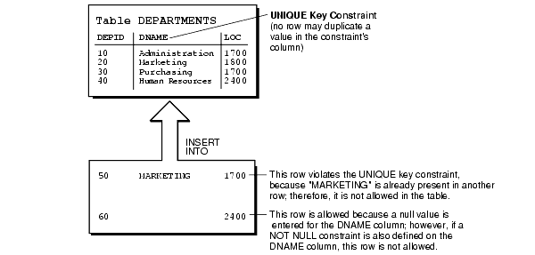
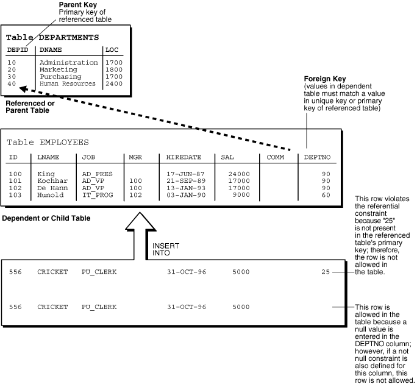

In a database application, maintaining data integrity means ensuring that the data in the tables that the application manipulates conform to the appropriate business rules. A business rule specifies a condition or relationship that must always be true or must always be false. For example, a business rule might be that no employee can have a salary over $100,000 or that every employee in the `EMPLOYEES` table must belong to a department in the `DEPARTMENTS` table. Business rules vary from company to company, because each company defines its own policies about salaries, employee numbers, inventory tracking, and so on.

There are several ways to ensure data integrity, and the one to use whenever possible is the integrity constraint (or constraint).

This chapter supplements this information:

Note:

This chapter applies to only to constraints on tables. Constraints on views do not help maintain data integrity or have associated indexes. Instead, they enable query rewrites on queries involving views, thereby improving performance when using materialized views and other data warehousing features.

See Also:

- [Oracle Database Concepts](https://docs.oracle.com/pls/topic/lookup?ctx=en/database/oracle/oracle-database/21/adfns&id=CNCPT021) for information about data integrity and constraints
- [Oracle Database Administrator's Guide](https://docs.oracle.com/pls/topic/lookup?ctx=en/database/oracle/oracle-database/21/adfns&id=ADMIN11537) for more information about managing constraints
- [Oracle Database SQL Language Reference](https://docs.oracle.com/pls/topic/lookup?ctx=en/database/oracle/oracle-database/21/adfns&id=SQLRF52180) for the syntactic and semantic information about constraints
- [Oracle Database SQL Language Reference](https://docs.oracle.com/pls/topic/lookup?ctx=en/database/oracle/oracle-database/21/adfns&id=SQLRF52181) for more information about constraints on views
- [Oracle Database Data Warehousing Guide](https://docs.oracle.com/pls/topic/lookup?ctx=en/database/oracle/oracle-database/21/adfns&id=DWHSG007) for information about using constraints in data warehouses
- [How the Correct Data Type Increases Data Integrity](sql-data-types.md) for more information about the role that data type plays in data integrity

Topics:

### 13.1 Enforcing Business Rules with Constraints

Whenever possible, enforce business rules with constraints. Constraints have the advantage of speed: Oracle Database can check that all the data in a table obeys a constraint faster than application code can do the equivalent checking.

Example 13-1 creates a table of departments, a table of employees, a constraint to enforce the rule that all values in the department table are unique, and a constraint to enforce the rule that every employee must work for a valid department.

Example 13-1 Enforcing Business Rules with Constraints

Create table of departments:

```
DROP TABLE dept_tab;
CREATE TABLE dept_tab (
  deptname VARCHAR2(20),
  deptno   INTEGER
);
```

Create table of employees:

```
DROP TABLE emp_tab;
CREATE TABLE emp_tab (
  empname VARCHAR2(80),
  empno   INTEGER,
  deptno  INTEGER
);
```

Create constraint to enforce rule that all values in department table are unique:

```
ALTER TABLE dept_tab ADD PRIMARY KEY (deptno);
```

Create constraint to enforce rule that every employee must work for a valid department:

```
ALTER TABLE emp_tab ADD FOREIGN KEY (deptno) REFERENCES dept_tab(deptno);
```

Now, whenever you insert an employee record into `emp_tab`, Oracle Database checks that its `deptno` value appears in `dept_tab`.

Suppose that instead of using a constraint to enforce the rule that every employee must work for a valid department, you use a trigger that queries `dept_tab` to check that it contains the `deptno` value of the employee record to be inserted into `emp_tab`. Because the query uses consistent read (CR), it might miss uncommitted changes from other transactions.

See Also:

- [Oracle Database SQL Language Reference](https://docs.oracle.com/pls/topic/lookup?ctx=en/database/oracle/oracle-database/21/adfns&id=SQLRF52180) for syntactic and semantic information about constraints
- [Oracle Database Concepts](https://docs.oracle.com/pls/topic/lookup?ctx=en/database/oracle/oracle-database/21/adfns&id=CNCPT33334) for the complete list of advantages of integrity constraints
- [Oracle Database Concepts](https://docs.oracle.com/pls/topic/lookup?ctx=en/database/oracle/oracle-database/21/adfns&id=CNCPT88945) for more information about using triggers to enforce business rules

### 13.2 Enforcing Business Rules with Both Constraints and Application Code

Enforcing business rules with both constraints and application code is recommended when application code can determine that data values are invalid without querying tables. The application code can provide immediate feedback to the user and reduce the load on the database by preventing attempts to insert invalid data into tables.

For Example 13-2, assume that Example 13-1 was run and then this column was added to the table `emp_tab`:

```
empgender VARCHAR2(1)
```

The only valid values for `empgender` are `'M'` and `'F'`. When someone tries to insert a row into `emp_tab` or update the value of `emp_tab`.`empgender`, application code can determine whether the new value for `emp_tab`.`empgender` is valid without querying a table. If the value is invalid, the application code can notify the user instead of trying to insert the invalid value, as in Example 13-2.

Example 13-2 Enforcing Business Rules with Both Constraints and Application Code

```
CREATE OR REPLACE PROCEDURE add_employee (
  e_name   emp_tab.empname%TYPE,
  e_gender emp_tab.empgender%TYPE,
  e_number emp_tab.empno%TYPE,
  e_dept   emp_tab.deptno%TYPE
) AUTHID DEFINER IS
BEGIN
  IF UPPER(e_gender) IN ('M','F') THEN
    INSERT INTO emp_tab VALUES (e_name, e_gender, e_number, e_dept);
  ELSE
    DBMS_OUTPUT.PUT_LINE('Gender must be M or F.');
  END IF;
END;
/
 
BEGIN
  add_employee ('Smith', 'H', 356, 20);
END;
/
```

Result:

```
Gender must be M or F.
```

### 13.3 Creating Indexes for Use with Constraints

When a unique or primary key constraint is enabled, Oracle Database creates an index automatically, but Oracle recommends that you create these indexes explicitly. If you want to use an index with a foreign key constraint, then you must create the index explicitly.

When a constraint can use an existing index, Oracle Database does not create an index for that constraint. Note that:

- A unique or primary key constraint can use either a unique index, an entire nonunique index, or the first few columns of a nonunique index.
- If a unique or primary key constraint uses a nonunique index, then no other unique or primary key constraint can use that nonunique index.
- The column order in the constraint and index need not match.
- The object number of the index used by a unique or primary key constraint is stored in `CDEF$`.`ENABLED` for that constraint. No static data dictionary view or dynamic performance view shows this information.
	If an enabled unique or primary key constraint is using an index, you cannot drop only the index. To drop the index, you must either drop the constraint itself or disable the constraint and then drop the index.

See Also:

- [Oracle Database Administrator's Guide](https://docs.oracle.com/pls/topic/lookup?ctx=en/database/oracle/oracle-database/21/adfns&id=ADMIN11725) for more information about indexes associated with constraints
- [Oracle Database Administrator's Guide](https://docs.oracle.com/pls/topic/lookup?ctx=en/database/oracle/oracle-database/21/adfns&id=ADMIN11546) for information about disabling and dropping constraints
- [Oracle Database Administrator's Guide](https://docs.oracle.com/pls/topic/lookup?ctx=en/database/oracle/oracle-database/21/adfns&id=ADMIN11723) for information about creating indexes explicitly
- [Using Indexes in Database Applications](indexes.md)
- [Oracle Database SQL Language Reference](https://docs.oracle.com/pls/topic/lookup?ctx=en/database/oracle/oracle-database/21/adfns&id=SQLRF01209) for information about creating indexes explicitly

### 13.4 When to Use NOT NULL Constraints

By default, a column can contain a `NULL` value. To ensure that the column never contains a `NULL` value, use the `NOT` `NULL` constraint.

Use a `NOT` `NULL` constraint in both of these situations:

- A column must contain a non- `NULL` value.
	For example, in the table `HR`.`EMPLOYEES`, each employee must have an employee ID. Therefore, the column `HR`.`EMPLOYEES`.`EMPLOYEE_ID` has a `NOT` `NULL` constraint, and nobody can insert a new employee record into `HR`.`EMPLOYEES` without specifying a non- `NULL` value for `EMPLOYEE_ID`. You can insert a new employee record into `HR`.`EMPLOYEES` without specifying a salary; therefore, the column `HR`.`EMPLOYEES`.`SALARY` does not have a `NOT` `NULL` constraint.
- You want to allow index scans of the table, or allow an operation that requires indexing all rows.
	Oracle Database indexes do not store keys whose values are all `NULL`. Therefore, for the preceding kinds of operations, at least one indexed column must have a `NOT` `NULL` constraint.

Example 13-3 uses the SQL\*Plus command `DESCRIBE` to show which columns of the `DEPARTMENTS` table have `NOT` `NULL` constraints, and then shows what happens if you try to insert `NULL` values in columns that have `NOT` `NULL` constraints.

Example 13-3 Inserting NULL Values into Columns with NOT NULL Constraints

```
DESCRIBE DEPARTMENTS;
```

Result:

```
Name                                      Null?    Type
----------------------------------------- -------- ------------

DEPARTMENT_ID                             NOT NULL NUMBER(4)
DEPARTMENT_NAME                           NOT NULL VARCHAR2(30)
MANAGER_ID                                         NUMBER(6)
LOCATION_ID                                        NUMBER(4)
```

Try to insert `NULL` into `DEPARTMENT_ID` column:

```
INSERT INTO DEPARTMENTS (
 DEPARTMENT_ID, DEPARTMENT_NAME, MANAGER_ID, LOCATION_ID
)
VALUES (NULL, 'Sales', 200, 1700);
```

Result:

```
VALUES (NULL, 'Sales', 200, 1700)
        *
ERROR at line 4:
ORA-01400: cannot insert NULL into ("HR"."DEPARTMENTS"."DEPARTMENT_ID")
```

Omitting a value for a column that cannot be `NULL` is the same as assigning it the value `NULL`:

```
INSERT INTO DEPARTMENTS (
  DEPARTMENT_NAME, MANAGER_ID, LOCATION_ID
)
VALUES ('Sales', 200, 1700);
```

Result:

```
INSERT INTO DEPARTMENTS (
*
ERROR at line 1:
ORA-01400: cannot insert NULL into ("HR"."DEPARTMENTS"."DEPARTMENT_ID")
```

You can prevent the preceding error by giving `DEPARTMENT_ID` a non- `NULL` default value.

You can combine `NOT` `NULL` constraints with other constraints to further restrict the values allowed in specific columns. For example, the combination of `NOT` `NULL` and `UNIQUE` constraints forces the input of values in the `UNIQUE` key, eliminating the possibility that data in a new conflicts with data in an existing row.

See Also:

- [Oracle Database SQL Language Reference](https://docs.oracle.com/pls/topic/lookup?ctx=en/database/oracle/oracle-database/21/adfns&id=SQLRF30038) for more information about `NOT` `NULL` constraint
- When to Use Default Column Values for more information about the usage of default column values
- UNIQUE and NOT NULL Constraints on the Foreign Key

### 13.5 When to Use Default Column Values

When an `INSERT` statement does not specify a value for a specific column, that column receives its default value. By default, that default value is `NULL`. You can change the default value when you define the column while creating the table or when you alter the column using the `ALTER` `TABLE` statement.

Note:

Giving a column a non- `NULL` default value does not ensure that the value of the column will never have the value `NULL`, as the `NOT` `NULL` constraint does.

Use a default column value in these situations:

- The column has a `NOT` `NULL` constraint.
	Giving the column a non- `NULL` default value prevents the error that would occur if someone inserted a row without specifying a value for the column.
- There is a most common value for the column.
	For example, if most departments in the company are in New York, then set the default value of the column `DEPARTMENTS`.`LOCATION` to `'NEW YORK'`.
- There is a non- `NULL` value that signifies no entry.
	For example, if the value zero in the column `EMPLOYEES`.`SALARY` means that the salary has not yet been determined, then set the default value of that column to zero.
	A default column value that signifies no entry can simplify testing. For example, it lets you change this test:
	```
	IF (employees.salary IS NOT NULL) AND (employees.salary < 50000)
	```
	To this test:
	```
	IF employees.salary < 50000
	```
- You want to automatically record the names of users who modify a table.
	For example, suppose that you allow users to insert rows into a table through a view. You give the base table a column named `inserter` (which need not be included in the definition of the view), to store the name of the user who inserted the row. To record the user name automatically, define a default value that invokes the `USER` function. For example:
	```
	CREATE TABLE audit_trail (
	  value1   NUMBER,
	  value2   VARCHAR2(32),
	  inserter VARCHAR2(30) DEFAULT USER);
	```

See Also:

- [Oracle Database SQL Language Reference](https://docs.oracle.com/pls/topic/lookup?ctx=en/database/oracle/oracle-database/21/adfns&id=SQLRF01604) for more information about the `INSERT` statement
- [Oracle Database SQL Language Reference](https://docs.oracle.com/pls/topic/lookup?ctx=en/database/oracle/oracle-database/21/adfns&id=SQLRF01402) for more information about the `CREATE` `TABLE` statement
- [Oracle Database SQL Language Reference](https://docs.oracle.com/pls/topic/lookup?ctx=en/database/oracle/oracle-database/21/adfns&id=SQLRF01001) for more information about the `ALTER` `TABLE` statement
- When to Use NOT NULL Constraints for information about the `NOT` `NULL` constraint

### 13.6 Choosing a Primary Key for a Table (PRIMARY KEY Constraint)

The primary key of a table uniquely identifies each row and ensures that no duplicate rows exist (and typically, this is its only purpose). Therefore, a primary key value cannot be `NULL`.

A table can have at most one primary key, but that key can have multiple columns (that is, it can be a composite key). To designate a primary key, use the `PRIMARY` `KEY` constraint.

Whenever practical, choose as the primary key a single column whose values are generated by a sequence.

The second-best choice for a primary key is a single column whose values are all of the following:

- Unique
- Never changed
- Never `NULL`
- Short and numeric (and therefore easy to type)

Minimize your use of composite primary keys, whose values are long and cannot be generated by a sequence.

See Also:

- [Oracle Database Concepts](https://docs.oracle.com/pls/topic/lookup?ctx=en/database/oracle/oracle-database/21/adfns&id=CNCPT1646) for general information about primary key constraints
- [Oracle Database SQL Language Reference](https://docs.oracle.com/pls/topic/lookup?ctx=en/database/oracle/oracle-database/21/adfns&id=SQLRF52197) for complete information about primary key constraints, including restrictions
- [Oracle Database SQL Language Reference](https://docs.oracle.com/pls/topic/lookup?ctx=en/database/oracle/oracle-database/21/adfns&id=SQLRF00253) for information about sequences

### 13.7 When to Use UNIQUE Constraints

Use a `UNIQUE` constraint (which designates a unique key) on any column or combination of columns (except the primary key) where duplicate non- `NULL` values are not allowed. For example:

| Unique Key | Primary Key |
| --- | --- |
| Employee Social Security Number | Employee number |
| Truck license plate number | Truck number |
| Customer phone number (country code column, area code column, and local phone number column) | Customer number |
| Department name column and location column | Department number |

Figure 13-1 shows a table with a `UNIQUE` constraint, a row that violates the constraint, and a row that satisfies it.

Figure 13-1 Rows That Violate and Satisfy a UNIQUE Constraint



> ```
> DEPNO   DNAME       LOC
> -----   ---------   --------
> 20      RESEARCH    DALLAS
> 30      SALES       NEW YORK
> 40      MARKETING   BOSTON
> -       UNIQUE      -
> ```
>
> UNIQUE is a constraint that means no row can duplicate a value in the constraint's column.)
>
> ```
> DEPNO   DNAME   LOC        COMMENTS
> -----   -----   --------   --------
> 50      SALES   NEW YORK   1
> 60      N/A     BOSTON     2
> ```
> 1. This row violates the UNIQUE key constraint, because SALES is already present in another row; therefore, it is not allowed in the table.
> 2. This row is allowed because a NULL value is entered for the DNAME column; however, if a NOT NULL constraint is defined on the DNAME column, this row is not allowed.


See Also:

- [Oracle Database Concepts](https://docs.oracle.com/pls/topic/lookup?ctx=en/database/oracle/oracle-database/21/adfns&id=CNCPT1642) for general information about `UNIQUE` constraints
- [Oracle Database SQL Language Reference](https://docs.oracle.com/pls/topic/lookup?ctx=en/database/oracle/oracle-database/21/adfns&id=SQLRF52195) for complete information about `UNIQUE` constraints, including restrictions

### 13.8 Enforcing Referential Integrity with FOREIGN KEY Constraints

When two tables share one or more columns, you use can use a `FOREIGN` `KEY` constraint to enforce referential integrity—that is, to ensure that the shared columns always have the same values in both tables.

Note:

A `FOREIGN` `KEY` constraint is also called a referential integrity constraint, and its `CONSTRAINT_TYPE` is `R` in the static data dictionary views `*_CONSTRAINTS`.

Designate one table as the referenced or parent table and the other as the dependent or child table. In the parent table, define either a `PRIMARY` `KEY` or `UNIQUE` constraint on the shared columns. In the child table, define a `FOREIGN` `KEY` constraint on the shared columns. The shared columns now comprise a foreign key. Defining additional constraints on the foreign key affects the parent-child relationship.

Figure 13-2 shows a foreign key defined on the department number. It guarantees that every value in this column must match a value in the primary key of the department table. This constraint prevents erroneous department numbers from getting into the employee table.

Figure 13-2 shows parent and child tables that share one column, a row that violates the `FOREIGN` `KEY` constraint, and a row that satisfies it.

Figure 13-2 Rows That Violate and Satisfy a FOREIGN KEY Constraint



> Referenced or parent table (DEPTNO is its primary key):
>
> ```
> Table DEPARTMENTS
>
> DEPTNO   DNAME       LOC
> ------   -----       --------
> 20       RESEARCH    DALLAS
> 30       SALES       NEW YORK
> 40       MARKETING   BOSTON
> ```
>
> Dependent or child table (DEPTNO is a foreign key; values in dependent table must match a value in unique key or primary key of referenced table):
>
> ```
> Table EMPLOYEES
>
> EMPNO  ENAME  JOB       MGR   HIREDATE   SAL       COMM    DEPTNO  COMMENT
> -----  -----  --------  ----  ---------  --------  ------  ------  -------
> 7329   SMITH  CEO       N/A   17-DEC-85  9,000.00  N/A     20
> 7499   ALLEN  VP-SALES  7329  20-FEB-90  7,500.00  100.00  30
> 7521   WARD   MANAGER   7499  22-FEB-90  5,000.00  200.00  30
> 7586   JONES  SALESMAN  7521  02-APR-90  2,975.00  400.00  20
> 7571   FORD   MANAGER   7499  23-FEB-90  5,000.00  200.00  50      1
> 7571   FORD   MANAGER   7499  23-FEB-90  5,000.00  200.00  N/A     2
> ```
> 1. This row violates the referential constraint because "50" is not present in the referenced table's primary key; therefore, the row is now allowed in the table.
> 2. This row is allowed in the table because a null value is entered in the DEPTNO column; however, if a not null constraint is also defined for this column, this row is not allowed.


Topics:

- FOREIGN KEY Constraints and NULL Values
- Defining Relationships Between Parent and Child Tables
- Rules for Multiple FOREIGN KEY Constraints
- Deferring Constraint Checks

See Also:

- [Oracle Database Concepts](https://docs.oracle.com/pls/topic/lookup?ctx=en/database/oracle/oracle-database/21/adfns&id=CNCPT1649) for general information about foreign key constraints
- [Oracle Database SQL Language Reference](https://docs.oracle.com/pls/topic/lookup?ctx=en/database/oracle/oracle-database/21/adfns&id=SQLRF52199) for complete information about foreign key constraints, including restrictions
- Defining Relationships Between Parent and Child Tables

#### 13.8.1 FOREIGN KEY Constraints and NULL Values

Foreign keys allow key values that are all `NULL`, even if there are no matching `PRIMARY` or `UNIQUE` keys.

- By default (without any `NOT` `NULL` or `CHECK` clauses), the `FOREIGN` `KEY` constraint enforces the match none rule for composite foreign keys in the ANSI/ISO standard.
- To enforce the match full rule for `NULL` values in composite foreign keys, which requires that all components of the key be `NULL` or all be non- `NULL`, define a `CHECK` constraint that allows only all `NULL` or all non- `NULL` values in the composite foreign key. For example, with a composite key comprised of columns `A`, `B`, and `C`:
	```
	CHECK ((A IS NULL AND B IS NULL AND C IS NULL) OR
	       (A IS NOT NULL AND B IS NOT NULL AND C IS NOT NULL))
	```
- In general, it is not possible to use declarative referential integrity to enforce the match partial rule for `NULL` values in composite foreign keys, which requires the non- `NULL` portions of the key to appear in the corresponding portions in the primary or unique key of a single row in the referenced table. You can often use triggers to handle this case.
	See Also:
	[Oracle Database PL/SQL Language Reference](https://docs.oracle.com/pls/topic/lookup?ctx=en/database/oracle/oracle-database/21/adfns&id=LNPLS020) for more information about triggers

#### 13.8.2 Defining Relationships Between Parent and Child Tables

Several relationships between parent and child tables can be determined by the other types of constraints defined on the foreign key in the child table.

No Constraints on the Foreign Key

When no other constraints are defined on the foreign key, any number of rows in the child table can reference the same parent key value. This model allows nulls in the foreign key.

This model establishes a one-to-many relationship between the parent and foreign keys that allows undetermined values (nulls) in the foreign key. An example of such a relationship is shown in Figure 13-2 between the `employee` and `department` tables. Each department (parent key) has many employees (foreign key), and some employees might not be in a department (nulls in the foreign key).

NOT NULL Constraint on the Foreign Key

When nulls are not allowed in a foreign key, each row in the child table must explicitly reference a value in the parent key because nulls are not allowed in the foreign key.

Any number of rows in the child table can reference the same parent key value, so this model establishes a one-to-many relationship between the parent and foreign keys. However, each row in the child table must have a reference to a parent key value; the absence of a value (a null) in the foreign key is not allowed. The same example in the previous section illustrates such a relationship. However, in this case, employees must have a reference to a specific department.

UNIQUE Constraint on the Foreign Key

When a `UNIQUE` constraint is defined on the foreign key, only one row in the child table can reference a given parent key value. This model allows nulls in the foreign key.

This model establishes a one-to-one relationship between the parent and foreign keys that allows undetermined values (nulls) in the foreign key. For example, assume that the employee table had a column named `MEMBERNO`, referring to an employee membership number in the company insurance plan. Also, a table named `INSURANCE` has a primary key named `MEMBERNO`, and other columns of the table keep respective information relating to an employee insurance policy. The `MEMBERNO` in the employee table must be both a foreign key and a unique key:

- To enforce referential integrity rules between the `EMP_TAB` and `INSURANCE` tables (the `FOREIGN KEY` constraint)
- To guarantee that each employee has a unique membership number (the `UNIQUE` key constraint)

UNIQUE and NOT NULL Constraints on the Foreign Key

When both `UNIQUE` and `NOT` `NULL` constraints are defined on the foreign key, only one row in the child table can reference a given parent key value, and because `NULL` values are not allowed in the foreign key, each row in the child table must explicitly reference a value in the parent key.

This model establishes a one-to-one relationship between the parent and foreign keys that does not allow undetermined values (nulls) in the foreign key. If you expand the previous example by adding a `NOT` `NULL` constraint on the `MEMBERNO` column of the employee table, in addition to guaranteeing that each employee has a unique membership number, you also ensure that no undetermined values (nulls) are allowed in the `MEMBERNO` column of the employee table.

#### 13.8.3 Rules for Multiple FOREIGN KEY Constraints

Oracle Database allows a column to be referenced by multiple `FOREIGN` `KEY` constraints; there is no limit on the number of dependent keys. This situation might be present if a single column is part of two different composite foreign keys.

#### 13.8.4 Deferring Constraint Checks

When Oracle Database checks a constraint, it signals an error if the constraint is not satisfied. To defer checking constraints until the end of the current transaction, use the `SET` `CONSTRAINTS` statement.

Note:

You cannot use the `SET` `CONSTRAINTS` statement inside a trigger.

When deferring constraint checks:

- Select appropriate data.
	You might want to defer constraint checks on `UNIQUE` and `FOREIGN` keys if the data you are working with has any of these characteristics:
	- Tables are snapshots.
		- Some tables contain a large amount of data being manipulated by another application, which might not return the data in the same order.
- Update cascade operations on foreign keys.
- Ensure that constraints are deferrable.
	After identifying the appropriate tables, ensure that their `FOREIGN`, `UNIQUE` and `PRIMARY` key constraints are created `DEFERRABLE`.
- Within the application that manipulates the data, set all constraints deferred before you begin processing any data, as follows:
	```
	SET CONSTRAINTS ALL DEFERRED;
	```
- (Optional) Check for constraint violations immediately before committing the transaction.
	Immediately before the `COMMIT` statement, run the `SET` `CONSTRAINTS` `ALL` `IMMEDIATE` statement. If there are any problems with a constraint, this statement fails, and identifies the constraint that caused the error. If you commit while constraints are violated, the transaction rolls back and you get an error message.

In Example 13-4, the `PRIMARY` and `FOREIGN` keys of the table `emp` are created `DEFERRABLE` and then deferred.

Example 13-4 Deferring Constraint Checks

```
DROP TABLE dept; 
CREATE TABLE dept (
  deptno NUMBER PRIMARY KEY,
  dname  VARCHAR2 (30)
);
 
DROP TABLE emp; 
CREATE TABLE emp (
  empno  NUMBER,
  ename  VARCHAR2(30),
  deptno NUMBER,
  CONSTRAINT pk_emp_empno PRIMARY KEY (empno) DEFERRABLE,
  CONSTRAINT fk_emp_deptno FOREIGN KEY (deptno)
  REFERENCES dept(deptno) DEFERRABLE);
 
INSERT INTO dept (deptno, dname) VALUES (10, 'Accounting');
INSERT INTO dept (deptno, dname) VALUES (20, 'SALES');
 
INSERT INTO emp (empno, ename, deptno) VALUES (1, 'Corleone', 10);
INSERT INTO emp (empno, ename, deptno) VALUES (2, 'Costanza', 20);
COMMIT;
 
SET CONSTRAINTS ALL DEFERRED;
 
UPDATE dept
SET deptno = deptno + 10
WHERE deptno = 20;
```

Query:

```
SELECT * from dept
ORDER BY deptno;
```

Result:

```
DEPTNO DNAME
---------- ------------------------------
        10 Accounting
        30 SALES
 
2 rows selected.
```

Update:

```
UPDATE emp
SET deptno = deptno + 10
WHERE deptno = 20;
```

Result:

```
1 row updated.
```

Query:

```
SELECT * from emp
ORDER BY deptno;
```

Result:

```
EMPNO ENAME                              DEPTNO
---------- ------------------------------ ----------
         1 Corleone                               10
         2 Costanza                               30
 
2 rows selected.
```

The `SET` `CONSTRAINTS` applies only to the current transaction, and its setting lasts for the duration of the transaction, or until another `SET` `CONSTRAINTS` statement resets the mode. The `ALTER` `SESSION` `SET` `CONSTRAINTS` statement applies only for the current session. The defaults specified when you create a constraint remain while the constraint exists.

See Also:

[Oracle Database SQL Language Reference](https://docs.oracle.com/pls/topic/lookup?ctx=en/database/oracle/oracle-database/21/adfns&id=SQLRF01703) for more information about the `SET` `CONSTRAINTS` statement

### 13.9 Minimizing Space and Time Overhead for Indexes Associated with Constraints

When you create a `UNIQUE` or `PRIMARY` key, Oracle Database checks to see if an existing index enforces uniqueness for the constraint. If there is no such index, the database creates one.

When Oracle Database uses a unique index to enforce a constraint, and constraints associated with the unique index are dropped or disabled, the index is dropped. To preserve the statistics associated with the index (which would take a long time to re-create), specify the `KEEP` `INDEX` clause on the `DROP` `CONSTRAINT` statement.

While enabled foreign keys reference a `PRIMARY` or `UNIQUE` key, you cannot disable or drop the `PRIMARY` or `UNIQUE` key constraint or the index.

Note:

`UNIQUE` and `PRIMARY` keys with deferrable constraints must all use nonunique indexes.

To use existing indexes when creating unique and primary key constraints, include `USING` `INDEX` in the `CONSTRAINT` clause.

See Also:

[Oracle Database SQL Language Reference](https://docs.oracle.com/pls/topic/lookup?ctx=en/database/oracle/oracle-database/21/adfns&id=SQLRF52180) for more details and examples of integrity constraints

### 13.10 Guidelines for Indexing Foreign Keys

Index foreign keys unless the matching unique or primary key is never updated or deleted.

See Also:

[Oracle Database Concepts](https://docs.oracle.com/pls/topic/lookup?ctx=en/database/oracle/oracle-database/21/adfns&id=CNCPT1657) for more information about indexing foreign keys

### 13.11 Referential Integrity in a Distributed Database

The declaration of a referential constraint cannot specify a foreign key that references a primary or unique key of a remote table.

However, you can maintain parent/child table relationships across nodes using triggers.

See Also:

[Oracle Database PL/SQL Language Reference](https://docs.oracle.com/pls/topic/lookup?ctx=en/database/oracle/oracle-database/21/adfns&id=LNPLS020) for more information about triggers that enforce referential integrity

Note:

If you decide to define referential integrity across the nodes of a distributed database using triggers, be aware that network failures can make both the parent table and the child table inaccessible.

For example, assume that the child table is in the `SALES` database, and the parent table is in the `HQ` database.

If the network connection between the two databases fails, then some data manipulation language (DML) statements against the child table (those that insert rows or update a foreign key value) cannot proceed, because the referential integrity triggers must have access to the parent table in the `HQ` database.

### 13.12 When to Use CHECK Constraints

Use `CHECK` constraints when you must enforce integrity rules based on logical expressions, such as comparisons. Never use `CHECK` constraints when any of the other types of constraints can provide the necessary checking.

See Also:

Choosing Between CHECK and NOT NULL Constraints

Examples of `CHECK` constraints include:

- A `CHECK` constraint on employee salaries so that no salary value is greater than 10000.
- A `CHECK` constraint on department locations so that only the locations " `BOSTON` ", " `NEW` `YORK` ", and " `DALLAS` " are allowed.
- A `CHECK` constraint on the salary and commissions columns to prevent the commission from being larger than the salary.

#### 13.12.1 Restrictions on CHECK Constraints

A `CHECK` constraint requires that a condition be true or unknown for every row of the table. If a statement causes the condition to evaluate to false, then the statement is rolled back. The condition of a `CHECK` constraint has these limitations:

- The condition must be a Boolean expression that can be evaluated using the values in the row being inserted or updated.
- The condition cannot contain subqueries or sequences.
- The condition cannot include the `SYSDATE`, `UID`, `USER`, or `USERENV` SQL functions.
- The condition cannot contain the pseudocolumns `LEVEL` or `ROWNUM`.
- The condition cannot contain the `PRIOR` operator.
- The condition cannot contain a user-defined function.

See Also:

- [Oracle Database SQL Language Reference](https://docs.oracle.com/pls/topic/lookup?ctx=en/database/oracle/oracle-database/21/adfns&id=SQLRF00251) for information about the `LEVEL` pseudocolumn
- [Oracle Database SQL Language Reference](https://docs.oracle.com/pls/topic/lookup?ctx=en/database/oracle/oracle-database/21/adfns&id=SQLRF00255) for information about the `ROWNUM` pseudocolumn
- [Oracle Database SQL Language Reference](https://docs.oracle.com/pls/topic/lookup?ctx=en/database/oracle/oracle-database/21/adfns&id=SQLRF007) for information about the `PRIOR` operator (used in hierarchical queries)

#### 13.12.2 Designing CHECK Constraints

When using `CHECK` constraints, remember that a `CHECK` constraint is violated only if the condition evaluates to false; true and unknown values (such as comparisons with nulls) do not violate a check condition. Ensure that any `CHECK` constraint that you define is specific enough to enforce the rule.

For example, consider this `CHECK` constraint:

```
CHECK (Sal > 0 OR Comm >= 0)
```

At first glance, this rule may be interpreted as "do not allow a row in the employee table unless the employee salary is greater than zero or the employee commission is greater than or equal to zero." But if a row is inserted with a null salary, that row does not violate the `CHECK` constraint, regardless of whether the commission value is valid, because the entire check condition is evaluated as unknown. In this case, you can prevent such violations by placing `NOT` `NULL` constraints on both the `SAL` and `COMM` columns.

Note:

If you are not sure when unknown values result in `NULL` conditions, review the truth tables for the logical conditions in [Oracle Database SQL Language Reference](https://docs.oracle.com/pls/topic/lookup?ctx=en/database/oracle/oracle-database/21/adfns&id=SQLRF005)

#### 13.12.3 Rules for Multiple CHECK Constraints

A single column can have multiple `CHECK` constraints that reference the column in its definition. There is no limit to the number of `CHECK` constraints that can be defined that reference a column.

The order in which the constraints are evaluated is not defined, so be careful not to rely on the order or to define multiple constraints that conflict with each other.

#### 13.12.4 Choosing Between CHECK and NOT NULL Constraints

According to the ANSI/ISO standard, a `NOT` `NULL` constraint is an example of a `CHECK` constraint, where the condition is:

```
CHECK (column_name IS NOT NULL)
```

Therefore, you can write `NOT` `NULL` constraints for a single column using either a `NOT` `NULL` constraint or a `CHECK` constraint. The `NOT` `NULL` constraint is easier to use than the `CHECK` constraint.

In the case where a composite key can allow only all `NULL` or all non- `NULL` values, you must use a `CHECK` constraint. For example, this `CHECK` constraint allows a key value in the composite key made up of columns `C1` and `C2` to contain either all nulls or all values:

```
CHECK ((C1 IS NULL AND C2 IS NULL) OR (C1 IS NOT NULL AND C2 IS NOT NULL))
```

### 13.13 Examples of Defining Constraints

Example 13-5 and Example 13-6 show how to create simple constraints during the prototype phase of your database design. In these examples, each constraint is given a name. Naming the constraints prevents the database from creating multiple copies of the same constraint, with different system-generated names, if the data definition language (DDL) statement runs multiple times.

Example 13-5 creates tables and their constraints at the same time, using the `CREATE` `TABLE` statement.

Example 13-5 Defining Constraints with the CREATE TABLE Statement

```
DROP TABLE DeptTab;
CREATE TABLE DeptTab (
  Deptno  NUMBER(3) CONSTRAINT pk_DeptTab_Deptno PRIMARY KEY,
  Dname   VARCHAR2(15),
  Loc     VARCHAR2(15),
  CONSTRAINT u_DeptTab_Dname_Loc UNIQUE (Dname, Loc),
  CONSTRAINT c_DeptTab_Loc
    CHECK (Loc IN ('NEW YORK', 'BOSTON', 'CHICAGO')));
 
DROP TABLE EmpTab;
CREATE TABLE EmpTab (
  Empno    NUMBER(5) CONSTRAINT pk_EmpTab_Empno PRIMARY KEY,
  Ename    VARCHAR2(15) NOT NULL,
  Job      VARCHAR2(10),
  Mgr      NUMBER(5) CONSTRAINT r_EmpTab_Mgr REFERENCES EmpTab,
  Hiredate DATE,
  Sal      NUMBER(7,2),
  Comm     NUMBER(5,2),
  Deptno   NUMBER(3) NOT NULL
  CONSTRAINT r_EmpTab_DeptTab REFERENCES DeptTab ON DELETE CASCADE);
```

Example 13-6 creates constraints for existing tables, using the `ALTER` `TABLE` statement.

You cannot create a validated constraint on a table if the table contains rows that violate the constraint.

Example 13-6 Defining Constraints with the ALTER TABLE Statement

```
-- Create tables without constraints:

DROP TABLE DeptTab; 
CREATE TABLE DeptTab (
  Deptno  NUMBER(3),
  Dname   VARCHAR2(15),
  Loc     VARCHAR2(15)
);
 
DROP TABLE EmpTab; 
CREATE TABLE EmpTab (
  Empno    NUMBER(5),
  Ename    VARCHAR2(15),
  Job      VARCHAR2(10),
  Mgr      NUMBER(5),
  Hiredate DATE,
  Sal      NUMBER(7,2),
  Comm     NUMBER(5,2),
  Deptno   NUMBER(3)
);
 
--Define constraints with the ALTER TABLE statement:

ALTER TABLE DeptTab
ADD CONSTRAINT pk_DeptTab_Deptno PRIMARY KEY (Deptno);
 
ALTER TABLE EmpTab
ADD CONSTRAINT fk_DeptTab_Deptno
FOREIGN KEY (Deptno) REFERENCES DeptTab;
 
ALTER TABLE EmpTab MODIFY (Ename VARCHAR2(15) NOT NULL);
```

#### 13.13.1 Privileges Needed to Define Constraints

If you have the `CREATE` `TABLE` or `CREATE` `ANY` `TABLE` system privilege, then you can define constraints on the tables that you create.

If you have the `ALTER` `ANY` `TABLE` system privilege, then you can define constraints on any existing table.

If you have the `ALTER` object privilege for a specific table, then you can define constraints on that table.

`UNIQUE` and `PRIMARY` `KEY` constraints require that the table owner has either the `UNLIMITED` `TABLESPACE` system privilege or a quota for the tablespace that contains the associated index.

You can define `FOREIGN` `KEY` constraints if the parent table or view is in your schema or you have the `REFERENCES` privilege on the columns of the referenced key in the parent table or view.

See Also:

Privileges Required to Create FOREIGN KEY Constraints

#### 13.13.2 Naming Constraints

Assign names to constraints `NOT` `NULL`, `UNIQUE`, `PRIMARY` `KEY`, `FOREIGN` `KEY`, and `CHECK` using the `CONSTRAINT` option of the constraint clause. This name must be unique among the constraints that you own. If you do not specify a constraint name, one is assigned automatically by Oracle Database.

Choosing your own name makes error messages for constraint violations more understandable, and prevents the creation of duplicate constraints with different names if the SQL statements are run more than once.

See the previous examples of the `CREATE` `TABLE` and `ALTER` `TABLE` statements for examples of the `CONSTRAINT` option of the `constraint` clause. The name of each constraint is included with other information about the constraint in the data dictionary.

See Also:

" Viewing Information About Constraints " for examples of static data dictionary views

### 13.14 Enabling and Disabling Constraints

This section explains the mechanisms and procedures for manually enabling and disabling constraints.

**enabled constraint**. When a constraint is enabled, the corresponding rule is enforced on the data values in the associated columns. The definition of the constraint is stored in the data dictionary.

**disabled constraint**. When a constraint is disabled, the corresponding rule is not enforced. The definition of the constraint is still stored in the data dictionary.

An integrity constraint represents an assertion about the data in a database. This assertion is always true when the constraint is enabled. The assertion might not be true when the constraint is disabled, because data that violates the integrity constraint can be in the database.

Topics:

- Why Disable Constraints?
- Creating Enabled Constraints (Default)
- Creating Disabled Constraints
- Enabling Existing Constraints
- Disabling Existing Constraints
- Guidelines for Enabling and Disabling Key Constraints
- Fixing Constraint Exceptions

#### 13.14.1 Why Disable Constraints?

During day-to-day operations, keep constraints enabled. In certain situations, temporarily disabling the constraints of a table makes sense for performance reasons. For example:

- When loading large amounts of data into a table using SQL\*Loader
- When performing batch operations that make massive changes to a table (such as changing each employee number by adding 1000 to the existing number)
- When importing or exporting one table at a time

Temporarily turning off constraints can speed up these operations.

#### 13.14.2 Creating Enabled Constraints (Default)

When you define an integrity constraint (using either `CREATE` `TABLE` or `ALTER` `TABLE`), Oracle Database enables the constraint by default. For code clarity, you can explicitly enable the constraint by including the `ENABLE` clause in its definition, as in Example 13-7.

Example 13-7 Creating Enabled Constraints

```
/* Use CREATE TABLE statement to create enabled constraint
   (ENABLE keyword is optional): */
 
DROP TABLE t1; 
CREATE TABLE t1 (Empno NUMBER(5) PRIMARY KEY ENABLE);
 
/* Create table without constraint
   and then use ALTER TABLE statement to add enabled constraint
   (ENABLE keyword is optional): */

DROP TABLE t2;
CREATE TABLE t2 (Empno NUMBER(5));
 
ALTER TABLE t2 ADD PRIMARY KEY (Empno) ENABLE;
```

Include the `ENABLE` clause when defining a constraint for a table to be populated a row at a time by individual transactions. This ensures that data is always consistent, and reduces the performance overhead of each DML statement.

An `ALTER` `TABLE` statement that tries to enable an integrity constraint fails if an existing row of the table violates the integrity constraint. The statement rolls back and the constraint definition is neither stored nor enabled.

See Also:

Fixing Constraint Exceptions, for more information about rows that violate constraints

#### 13.14.3 Creating Disabled Constraints

You define and disable an integrity constraint (using either `CREATE` `TABLE` or `ALTER` `TABLE`), by including the `DISABLE` clause in its definition, as in Example 13-8.

Example 13-8 Creating Disabled Constraints

```
/* Use CREATE TABLE statement to create disabled constraint */
 
DROP TABLE t1; 
CREATE TABLE t1 (Empno NUMBER(5) PRIMARY KEY DISABLE);
 
/* Create table without constraint
   and then use ALTER TABLE statement to add disabled constraint */
 
DROP TABLE t2; 
CREATE TABLE t2 (Empno NUMBER(5));
 
ALTER TABLE t2 ADD PRIMARY KEY (Empno) DISABLE;
```

Include the `DISABLE` clause when defining a constraint for a table to have large amounts of data inserted before anybody else accesses it, particularly if you must cleanse data after inserting it, or must fill empty columns with sequence numbers or parent/child relationships.

An `ALTER` `TABLE` statement that defines and disables a constraint never fails, because its rule is not enforced.

#### 13.14.4 Enabling Existing Constraints

After you have cleansed the data and filled the empty columns, you can enable constraints that were disabled during data insertion.

To enable an existing constraint, use the `ALTER` `TABLE` statement with the `ENABLE` clause, as in Example 13-9.

Example 13-9 Enabling Existing Constraints

```
-- Create table with disabled constraints:
 
DROP TABLE DeptTab;
CREATE TABLE DeptTab (
  Deptno  NUMBER(3) PRIMARY KEY DISABLE,
  Dname   VARCHAR2(15),
  Loc     VARCHAR2(15),
  CONSTRAINT uk_DeptTab_Dname_Loc UNIQUE (Dname, Loc) DISABLE,
  CONSTRAINT c_DeptTab_Loc
  CHECK (Loc IN ('NEW YORK', 'BOSTON', 'CHICAGO')) DISABLE
);
 
-- Enable constraints:
 
 ALTER TABLE DeptTab
ENABLE PRIMARY KEY
ENABLE CONSTRAINT uk_DeptTab_Dname_Loc
ENABLE CONSTRAINT c_DeptTab_Loc;
```

An `ALTER` `TABLE` statement that attempts to enable an integrity constraint fails if any of the table rows violate the integrity constraint. The statement is rolled back and the constraint is not enabled.

See Also:

Fixing Constraint Exceptions, for more information about rows that violate constraints

#### 13.14.5 Disabling Existing Constraints

If you must perform a large insert or update when a table contains data, you can temporarily disable constraints to improve performance of the bulk operation.

To disable an existing constraint, use the `ALTER` `TABLE` statement with the `DISABLE` clause, as in Example 13-10.

Example 13-10 Disabling Existing Constraints

```
-- Create table with enabled constraints:
 
DROP TABLE DeptTab; 
CREATE TABLE DeptTab (
  Deptno  NUMBER(3) PRIMARY KEY ENABLE,
  Dname   VARCHAR2(15),
  Loc     VARCHAR2(15),
  CONSTRAINT uk_DeptTab_Dname_Loc UNIQUE (Dname, Loc) ENABLE,
  CONSTRAINT c_DeptTab_Loc
  CHECK (Loc IN ('NEW YORK', 'BOSTON', 'CHICAGO')) ENABLE
);
 
-- Disable constraints:
 
ALTER TABLE DeptTab
DISABLE PRIMARY KEY
DISABLE CONSTRAINT uk_DeptTab_Dname_Loc
DISABLE CONSTRAINT c_DeptTab_Loc;
```

#### 13.14.6 Guidelines for Enabling and Disabling Key Constraints

When enabling or disabling `UNIQUE`, `PRIMARY` `KEY`, and `FOREIGN` `KEY` constraints, be aware of several important issues and prerequisites. `UNIQUE` key and `PRIMARY` `KEY` constraints are usually managed by the database administrator.

See Also:

[Oracle Database Administrator's Guide](https://docs.oracle.com/pls/topic/lookup?ctx=en/database/oracle/oracle-database/21/adfns&id=ADMIN11537) and Managing FOREIGN KEY Constraints

#### 13.14.7 Fixing Constraint Exceptions

If a row of a table disobeys an integrity constraint, then this row is in violation of the constraint and is called an **exception** to the constraint. If any exceptions exist, then the constraint cannot be enabled. The rows that violate the constraint must be updated or deleted before the constraint can be enabled.

You can identify exceptions for a specific integrity constraint as you try to enable the constraint.

See Also:

Fixing Constraint Exceptions, for more information about this procedure

When you try to create or enable a constraint, and the statement fails because integrity constraint exceptions exist, the statement is rolled back. You cannot enable the constraint until all exceptions are either updated or deleted. To determine which rows violate the integrity constraint, include the `EXCEPTIONS` option in the `ENABLE` clause of a `CREATE` `TABLE` or `ALTER` `TABLE` statement.

See Also:

[Oracle Database Administrator's Guide](https://docs.oracle.com/pls/topic/lookup?ctx=en/database/oracle/oracle-database/21/adfns&id=ADMIN11537) for more information about responding to constraint exceptions

### 13.15 Modifying Constraints

Starting with Oracle8i, you can modify an existing constraint with the `MODIFY` `CONSTRAINT` clause, as in Example 13-11.

See Also:

[Oracle Database SQL Language Reference](https://docs.oracle.com/pls/topic/lookup?ctx=en/database/oracle/oracle-database/21/adfns&id=SQLRF01001) for information about the parameters you can modify

Example 13-11 Modifying Constraints

```
/* Create & then modify a CHECK constraint: */
 
DROP TABLE X1Tab;
CREATE TABLE X1Tab (
  a1 NUMBER
  CONSTRAINT c_X1Tab_a1 CHECK (a1>3)
  DEFERRABLE DISABLE
);
 
ALTER TABLE X1Tab
MODIFY CONSTRAINT c_X1Tab_a1 ENABLE;
 
ALTER TABLE X1Tab
MODIFY CONSTRAINT c_X1Tab_a1 RELY;
 
ALTER TABLE X1Tab
MODIFY CONSTRAINT c_X1Tab_a1 INITIALLY DEFERRED;
 
ALTER TABLE X1Tab
MODIFY CONSTRAINT c_X1Tab_a1 ENABLE NOVALIDATE;
 
/* Create & then modify a PRIMARY KEY constraint: */
 
DROP TABLE t1; 
CREATE TABLE t1 (a1 INT, b1 INT);
 
ALTER TABLE t1
ADD CONSTRAINT pk_t1_a1 PRIMARY KEY(a1) DISABLE;
 
ALTER TABLE t1
MODIFY PRIMARY KEY INITIALLY IMMEDIATE
USING INDEX PCTFREE = 30 ENABLE NOVALIDATE;
 
ALTER TABLE t1
MODIFY PRIMARY KEY ENABLE NOVALIDATE;
```

### 13.16 Renaming Constraints

One property of a constraint that you can modify is its name. Situations in which you would rename a constraint include:

- You want to clone a table and its constraints.
	Constraint names must be unique, even across multiple schemas. Therefore, the constraints in the original table cannot have the same names as those in the cloned table.
- You created a constraint with a default system-generated name, and now you want to give it a name that is easy to remember, so that you can easily enable and disable it.

Example 13-12 shows how to find the system-generated name of a constraint and change it.

Example 13-12 Renaming a Constraint

```
DROP TABLE T;
CREATE TABLE T (
  C1 NUMBER PRIMARY KEY,
  C2 NUMBER
);
```

Query:

```
SELECT CONSTRAINT_NAME FROM USER_CONSTRAINTS
WHERE TABLE_NAME = 'T'
AND CONSTRAINT_TYPE = 'P';
```

Result (system-generated name of constraint name varies):

```
CONSTRAINT_NAME
------------------------------
SYS_C0013059
 
1 row selected.
```

Rename constraint from name reported in preceding query to `T_C1_PK`:

```
ALTER TABLE T
RENAME CONSTRAINT SYS_C0013059
TO T_C1_PK;
```

Query:

```
SELECT CONSTRAINT_NAME FROM USER_CONSTRAINTS
WHERE TABLE_NAME = 'T'
AND CONSTRAINT_TYPE = 'P';
```

Result:

```
CONSTRAINT_NAME
------------------------------
T_C1_PK
 
1 row selected.
```

### 13.17 Dropping Constraints

You can drop a constraint using the `DROP` clause of the `ALTER` `TABLE` statement. Situations in which you would drop a constraint include:

- The constraint enforces a rule that is no longer true.
- The constraint is no longer needed.

To drop a constraint and all other integrity constraints that depend on it, specify `CASCADE`.

Example 13-13 Dropping Constraints

```
-- Create table with constraints:

DROP TABLE DeptTab; 
CREATE TABLE DeptTab (
  Deptno  NUMBER(3) PRIMARY KEY,
  Dname   VARCHAR2(15),
  Loc     VARCHAR2(15),
  CONSTRAINT uk_DeptTab_Dname_Loc UNIQUE (Dname, Loc),
  CONSTRAINT c_DeptTab_Loc
  CHECK (Loc IN ('NEW YORK', 'BOSTON', 'CHICAGO'))
);
 
-- Drop constraints:
 
ALTER TABLE DeptTab
DROP PRIMARY KEY
DROP CONSTRAINT uk_DeptTab_Dname_Loc
DROP CONSTRAINT c_DeptTab_Loc;
```

When dropping `UNIQUE`, `PRIMARY` `KEY`, and `FOREIGN` `KEY` constraints, be aware of several important issues and prerequisites. `UNIQUE` and `PRIMARY` `KEY` constraints are usually managed by the database administrator.

See Also:

- [Oracle Database SQL Language Reference](https://docs.oracle.com/pls/topic/lookup?ctx=en/database/oracle/oracle-database/21/adfns&id=SQLRF01001) for more information about the `DROP` clause of the `ALTER` `TABLE` statement.
- [Oracle Database Administrator's Guide](https://docs.oracle.com/pls/topic/lookup?ctx=en/database/oracle/oracle-database/21/adfns&id=ADMIN11549) for more information about dropping constraints.
- [Oracle Database SQL Language Reference](https://docs.oracle.com/pls/topic/lookup?ctx=en/database/oracle/oracle-database/21/adfns&id=SQLRF01806) for information about the `CASCADE` `CONSTRAINTS` clause of the `DROP` `TABLE` statement, which drops all referential integrity constraints that refer to primary and unique keys in the dropped table

### 13.18 Managing FOREIGN KEY Constraints

`FOREIGN` `KEY` constraints enforce relationships between columns in different tables. Therefore, they cannot be enabled if the constraint of the referenced primary or unique key is not present or not enabled.

#### 13.18.1 Data Types and Names for Foreign Key Columns

You must use the same data type for corresponding columns in the dependent and referenced tables. The column names need not match.

#### 13.18.2 Limit on Columns in Composite Foreign Keys

Because foreign keys reference primary and unique keys of the parent table, and `PRIMARY` `KEY` and `UNIQUE` key constraints are enforced using indexes, composite foreign keys are limited to 32 columns.

#### 13.18.3 Foreign Key References Primary Key by Default

If the column list is not included in the `REFERENCES` option when defining a `FOREIGN` `KEY` constraint (single column or composite), then Oracle Database assumes that you intend to reference the primary key of the specified table. Alternatively, you can explicitly specify the column(s) to reference in the parent table within parentheses. Oracle Database automatically checks to verify that this column list references a primary or unique key of the parent table. If it does not, then an informative error is returned.

#### 13.18.4 Privileges Required to Create FOREIGN KEY Constraints

To create a `FOREIGN` `KEY` constraint, the creator of the constraint must have privileged access to the parent and child tables.

- **Parent Table** The creator of the referential integrity constraint must own the parent table or have `REFERENCES` object privileges on the columns that constitute the parent key of the parent table.
- **Child Table** The creator of the referential integrity constraint must have the ability to create tables (that is, the `CREATE` `TABLE` or `CREATE` `ANY` `TABLE` system privilege) or the ability to alter the child table (that is, the `ALTER` object privilege for the child table or the `ALTER` `ANY` `TABLE` system privilege).

In both cases, necessary privileges cannot be obtained through a role; they must be explicitly granted to the creator of the constraint.

These restrictions allow:

- The owner of the child table to explicitly decide which constraints are enforced and which other users can create constraints
- The owner of the parent table to explicitly decide if foreign keys can depend on the primary and unique keys in her tables

#### 13.18.5 Choosing How Foreign Keys Enforce Referential Integrity

Oracle Database allows different types of referential integrity actions to be enforced, as specified with the definition of a `FOREIGN` `KEY` constraint:

- **Prevent Delete or Update of Parent Key** The default setting prevents the deletion or update of a parent key if there is a row in the child table that references the key. For example:
	```
	CREATE TABLE Emp_tab (
	FOREIGN KEY (Deptno) REFERENCES Dept_tab);
	```
- **Delete Child Rows When Parent Key Deleted** The `ON` `DELETE` `CASCADE` action allows parent key data that is referenced from the child table to be deleted, but not updated. When data in the parent key is deleted, all rows in the child table that depend on the deleted parent key values are also deleted. To specify this referential action, include the `ON` `DELETE` `CASCADE` option in the definition of the `FOREIGN` `KEY` constraint. For example:
	```
	CREATE TABLE Emp_tab (
	FOREIGN KEY (Deptno) REFERENCES Dept_tab
	ON DELETE CASCADE);
	```
- **Set Foreign Keys to Null When Parent Key Deleted** The `ON` `DELETE` `SET` `NULL` action allows data that references the parent key to be deleted, but not updated. When referenced data in the parent key is deleted, all rows in the child table that depend on those parent key values have their foreign keys set to `NULL`. To specify this referential action, include the `ON` `DELETE` `SET` `NULL` option in the definition of the `FOREIGN` `KEY` constraint. For example:
	```
	CREATE TABLE Emp_tab (
	FOREIGN KEY (Deptno) REFERENCES Dept_tab  
	ON DELETE SET NULL);
	```

### 13.19 Viewing Information About Constraints

To find the names of constraints, what columns they affect, and other information to help you manage them, query the static data dictionary views `*_CONSTRAINTS` and `*_CONS_COLUMNS`, as in Example 13-14.

See Also:

Oracle Database Reference for information about [`*_CONSTRAINTS`](https://docs.oracle.com/pls/topic/lookup?ctx=en/database/oracle/oracle-database/21/adfns&id=REFRN20047) and [`*_CONS_COLUMNS`](https://docs.oracle.com/pls/topic/lookup?ctx=en/database/oracle/oracle-database/21/adfns&id=REFRN20045)

Example 13-14 Viewing Information About Constraints

```
DROP TABLE DeptTab;
CREATE TABLE DeptTab (
  Deptno  NUMBER(3) PRIMARY KEY,
  Dname   VARCHAR2(15),
  Loc     VARCHAR2(15),
  CONSTRAINT uk_DeptTab_Dname_Loc UNIQUE (Dname, Loc),
  CONSTRAINT c_DeptTab_Loc
  CHECK (Loc IN ('NEW YORK', 'BOSTON', 'CHICAGO'))
);
 
DROP TABLE EmpTab; 
CREATE TABLE EmpTab (
  Empno    NUMBER(5) PRIMARY KEY,
  Ename    VARCHAR2(15) NOT NULL,
  Job      VARCHAR2(10),
  Mgr      NUMBER(5) CONSTRAINT r_EmpTab_Mgr
             REFERENCES EmpTab ON DELETE CASCADE,
  Hiredate DATE,
  Sal      NUMBER(7,2),
  Comm     NUMBER(5,2),
  Deptno   NUMBER(3) NOT NULL
  CONSTRAINT r_EmpTab_Deptno REFERENCES DeptTab
);
 
-- Format columns (optional):
 
COLUMN CONSTRAINT_NAME   FORMAT A20;
COLUMN CONSTRAINT_TYPE   FORMAT A4 HEADING 'TYPE';
COLUMN TABLE_NAME        FORMAT A10;
COLUMN R_CONSTRAINT_NAME FORMAT A17;
COLUMN SEARCH_CONDITION  FORMAT A40;
COLUMN COLUMN_NAME       FORMAT A12;
```

List accessible constraints in DeptTab and EmpTab:

```
SELECT CONSTRAINT_NAME, CONSTRAINT_TYPE, TABLE_NAME, R_CONSTRAINT_NAME
FROM USER_CONSTRAINTS
WHERE (TABLE_NAME = 'DEPTTAB' OR TABLE_NAME = 'EMPTAB')
ORDER BY CONSTRAINT_NAME;
```

Result:

```
CONSTRAINT_NAME      TYPE TABLE_NAME R_CONSTRAINT_NAME
-------------------- ---- ---------- -----------------
C_DEPTTAB_LOC        C    DEPTTAB
R_EMPTAB_DEPTNO      R    EMPTAB     SYS_C006286
R_EMPTAB_MGR         R    EMPTAB     SYS_C006290
SYS_C006286          P    DEPTTAB
SYS_C006288          C    EMPTAB
SYS_C006289          C    EMPTAB
SYS_C006290          P    EMPTAB
UK_DEPTTAB_DNAME_LOC U    DEPTTAB
 
8 rows selected.
```

Distinguish between `NOT` `NULL` and `CHECK` constraints in `DeptTab` and `EmpTab`:

```
SELECT CONSTRAINT_NAME, SEARCH_CONDITION
FROM USER_CONSTRAINTS
WHERE (TABLE_NAME = 'DEPTTAB' OR TABLE_NAME = 'EMPTAB')
AND CONSTRAINT_TYPE = 'C'
ORDER BY CONSTRAINT_NAME;
```

Result:

```
CONSTRAINT_NAME      SEARCH_CONDITION
-------------------- ----------------------------------------
C_DEPTTAB_LOC        Loc IN ('NEW YORK', 'BOSTON', 'CHICAGO')
SYS_C006288          "ENAME" IS NOT NULL
SYS_C006289          "DEPTNO" IS NOT NULL
 
3 rows selected.
```

For `DeptTab` and `EmpTab`, list columns that constitute constraints:

```
SELECT CONSTRAINT_NAME, TABLE_NAME, COLUMN_NAME
FROM USER_CONS_COLUMNS
WHERE (TABLE_NAME = 'DEPTTAB' OR TABLE_NAME = 'EMPTAB')
ORDER BY CONSTRAINT_NAME;
```

Result:

```
CONSTRAINT_NAME      TABLE_NAME COLUMN_NAME
-------------------- ---------- ------------
C_DEPTTAB_LOC        DEPTTAB    LOC
R_EMPTAB_DEPTNO      EMPTAB     DEPTNO
R_EMPTAB_MGR         EMPTAB     MGR
SYS_C006286          DEPTTAB    DEPTNO
SYS_C006288          EMPTAB     ENAME
SYS_C006289          EMPTAB     DEPTNO
SYS_C006290          EMPTAB     EMPNO
UK_DEPTTAB_DNAME_LOC DEPTTAB    LOC
UK_DEPTTAB_DNAME_LOC DEPTTAB    DNAME
 
9 rows selected.
```

Note that:

- Some constraint names are user specified (such as `UK_DEPTTAB_DNAME_LOC`), while others are system specified (such as `SYS_C006290`).
- Each constraint type is denoted with a different character in the `CONSTRAINT_TYPE` column. This table summarizes the characters used for each constraint type:
	| Constraint Type | Character |
	| --- | --- |
	| `PRIMARY` `KEY` | `P` |
	| `UNIQUE` `KEY` | `U` |
	| `FOREIGN` `KEY` | `R` |
	| `CHECK`, `NOT` `NULL` | `C` |
	Note:
	An additional constraint type is indicated by the character " `V` " in the `CONSTRAINT_TYPE` column. This constraint type corresponds to constraints created using the `WITH` `CHECK` `OPTION` for views.

These constraints are explicitly listed in the `SEARCH_CONDITION` column:

- `NOT` `NULL` constraints
- The conditions for user-defined `CHECK` constraints