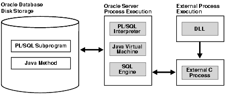

This chapter explains how you can develop database applications that call external procedures written in other programming languages.

Topics:

### 22.1 Overview of Multilanguage Programs

Oracle Database lets you work in different languages:

- PL/SQL, as described in the [Oracle Database PL/SQL Language Reference](https://docs.oracle.com/pls/topic/lookup?ctx=en/database/oracle/oracle-database/21/adfns&id=LNPLS-GUID-2FBCFBBE-6B42-4DB8-83F3-55B63B75B1EB)
- C, through the Oracle Call Interface (OCI), as described in the [Oracle Call Interface Programmer's Guide](https://docs.oracle.com/pls/topic/lookup?ctx=en/database/oracle/oracle-database/21/adfns&id=LNOCI-GUID-27645179-6957-4004-8BB8-38775266B038)
- C++, through the Oracle C++ Call Interface (OCCI), as described in the [Oracle C++ Call Interface Programmer's Guide](https://docs.oracle.com/pls/topic/lookup?ctx=en/database/oracle/oracle-database/21/adfns&id=LNCPP-GUID-99077609-BFCC-4FF7-9D23-C45623DDD465)
- C or C++, through the Pro\*C/C++ precompiler, as described in the [Pro\*C/C++ Programmer's Guide](https://docs.oracle.com/pls/topic/lookup?ctx=en/database/oracle/oracle-database/21/adfns&id=LNPCC-GUID-20CBCC27-EC6B-4651-92CC-7E008BD73611)
- COBOL, through the Pro\*COBOL precompiler, as described in the [Pro\*COBOL Programmer's Guide](https://docs.oracle.com/pls/topic/lookup?ctx=en/database/oracle/oracle-database/21/adfns&id=LNPCB-GUID-5B383B0F-9628-443B-8CB7-D2C01607EED6)
- Visual Basic, through Oracle Provider for OLE DB, as described in [Oracle Provider for OLE DB Developer's Guide for Microsoft Windows](https://docs.oracle.com/pls/topic/lookup?ctx=en/database/oracle/oracle-database/21/adfns&id=OLEDB003).
- .NET, through Oracle Data Provider for.NET, as described in [Oracle Data Provider for.NET Developer's Guide for Microsoft Windows](https://docs.oracle.com/pls/topic/lookup?ctx=en/database/oracle/oracle-database/21/adfns&id=ODPNT-GUID-635BAE6C-7D0B-4CF2-ADD8-8DB531B9C52E)
- Java, through the JDBC and SQLJ client-side application programming interfaces (APIs). See [Oracle Database JDBC Developer’s Guide](https://docs.oracle.com/pls/topic/lookup?ctx=en/database/oracle/oracle-database/21/adfns&id=JJDBC-GUID-864DB502-5E50-4044-8132-33D6AAF8927A) and [Oracle Database SQLJ Developer’s Guide](https://docs.oracle.com/pls/topic/lookup?ctx=en/database/oracle/oracle-database/21/adfns&id=JSQLJ-GUID-B85E73E1-E3B4-45DA-A07A-40678F164AAE).
- Java in the database, as described in [Oracle Database Java Developer’s Guide](https://docs.oracle.com/pls/topic/lookup?ctx=en/database/oracle/oracle-database/21/adfns&id=JJDEV-GUID-912A14D4-2621-4955-85BD-A04E17EE6D21). This includes the use of Java stored procedures (Java methods published to SQL and stored in the database), as described in a chapter in [Oracle Database Java Developer’s Guide](https://docs.oracle.com/pls/topic/lookup?ctx=en/database/oracle/oracle-database/21/adfns&id=JJDEV13234).
	The Oracle JVM Web Call-Out utility is also available for generating Java classes to represent database entities, such as SQL objects and PL/SQL packages, in a Java client program; publishing from SQL, PL/SQL, and server-side Java to web services; and enabling the invocation of external web services from inside the database. See [Oracle Database Java Developer’s Guide](https://docs.oracle.com/pls/topic/lookup?ctx=en/database/oracle/oracle-database/21/adfns&id=JJDEV-GUID-E66168C4-6043-4A49-9062-A4937B76ABC0).

How can you choose between these different implementation possibilities? Each of these languages offers different advantages: ease of use, the availability of programmers with specific expertise, the need for portability, and the existence of legacy code are powerful determinants.

The choice might narrow depending on how your application must work with Oracle Database:

- PL/SQL is a powerful development tool, specialized for SQL transaction processing.
- Some computation-intensive tasks are executed most efficiently in a lower level language, such as C.
- For both portability and security, you might select Java.
- For familiarity with Microsoft programming languages, you might select.NET.

Most significantly for performance, only PL/SQL and Java methods run within the address space of the server. C/C++ and.NET methods are dispatched as external procedures, and run on the server system but outside the address space of the database server. Pro\*COBOL and Pro\*C/C++ are precompilers, and Visual Basic accesses Oracle Database through Oracle Provider for OLE DB and subsequently OCI, which is implemented in C.

Taking all these factors into account suggests that there might be situations in which you might need to implement your application in multiple languages. For example, because Java runs within the address space of the server, you might want to import existing Java applications into the database, and then leverage this technology by calling Java functions from PL/SQL and SQL.

PL/SQL external procedures enable you to write C procedure calls as PL/SQL bodies. These C procedures are callable directly from PL/SQL, and from SQL through PL/SQL procedure calls. The database provides a special-purpose interface, the call specification, that lets you call external procedures from other languages. While this service is designed for intercommunication between SQL, PL/SQL, C, and Java, it is accessible from any base language that can call these languages. For example, your procedure can be written in a language other than Java or C, and if C can call your procedure, then SQL or PL/SQL can use it. Therefore, if you have a candidate C++ procedure, use a C++ `extern` `"C"` statement in that procedure to make it callable by C.

Therefore, the strengths and capabilities of different languages are available to you, regardless of your programmatic environment. You are not restricted to one language with its inherent limitations. External procedures promote reusability and modularity because you can deploy specific languages for specific purposes.

### 22.2 What Is an External Procedure?

An **external procedure** is a procedure stored in a dynamic link library (DLL). You register the procedure with the base language, and then call it to perform special-purpose processing.

For example, when you work in PL/SQL, the language loads the library dynamically at runtime, and then calls the procedure as if it were a PL/SQL procedure. These procedures participate fully in the current transaction and can call back to the database to perform SQL operations.

The procedures are loaded only when necessary, so memory is conserved. The decoupling of the call specification from its implementation body means that the procedures can be enhanced without affecting the calling programs.

External procedures let you:

- Isolate execution of client applications and processes from the database instance to ensure that problems on the client side do not adversely affect the database
- Move computation-bound programs from client to server where they run faster (because they avoid the round trips of network communication)
- Interface the database server with external systems and data sources
- Extend the functionality of the database server itself

Note:

The external library (DLL file) must be statically linked. In other words, it must not reference external symbols from other external libraries (DLL files). Oracle Database does not resolve such symbols, so they can cause your external procedure to fail.

See Also:

[Oracle Database Security Guide](https://docs.oracle.com/pls/topic/lookup?ctx=en/database/oracle/oracle-database/21/adfns&id=DBSEG656) for information about securing external procedures

### 22.3 Overview of Call Specification for External Procedures

You publish external procedures through call specifications, which provide a superset of the `AS` `EXTERNAL` function through the `AS` `LANGUAGE` clause. `AS` `LANGUAGE` call specifications allow the publishing of external C procedures. (Java class methods are not external procedures, but they still use call specifications.)

Note:

To support legacy applications, call specifications also enable you to publish with the `AS` `EXTERNAL` clause. For application development, however, using the `AS` `LANGUAGE` clause is recommended.

In general, call specifications enable:

- Dispatching the appropriate C or Java target procedure
- Data type conversions
- Parameter mode mappings
- Automatic memory allocation and cleanup
- Purity constraints to be specified, where necessary, for package functions called from SQL.
- Calling Java methods or C procedures from database triggers
- Location flexibility: you can put `AS` `LANGUAGE` call specifications in package or type specifications, or package (or type) bodies to optimize performance and hide implementation details

To use an existing program as an external procedure, load, publish, and then call it.

### 22.4 Loading External Procedures

To make your external C procedures or Java methods available to PL/SQL, you must first load them.

Note:

You can load external C procedures only on platforms that support either DLLs or dynamically loadable shared libraries (such as Solaris.`so` libraries).

When an application calls an external C procedure, Oracle Database or Oracle Listener starts the external procedure agent, `extproc`. Using the network connection established by Oracle Database or Oracle Listener, the application passes this information to `extproc`:

- Name of DLL or shared library
- Name of external procedure
- Any parameters for the external procedure

Then `extproc` loads the DLL or the shared library, runs the external procedure, and passes any values that the external procedure returns back to the application. The application and `extproc` must reside on the same computer.

`extproc` can call procedures in any library that complies with the calling standard used.

Note:

The default configuration for external procedures no longer requires a network listener to work with Oracle Database and `extproc`. Oracle Database now spawns `extproc` directly, eliminating the risk that Oracle Listener might spawn `extproc` unexpectedly. This default configuration is recommended for maximum security.

You must change this default configuration, so that Oracle Listener spawns `extproc`, if you use any of these:

- A multithreaded `extproc` agent
- Oracle Database in shared mode on Windows
- An `AGENT` clause in the `LIBRARY` specification or an `AGENT` `IN` clause in the `PROCEDURE` specification that redirects external procedures to a different `extproc` agent

See Also:

CALLING STANDARD for more information about the calling standard

Changing the default configuration requires additional network configuration steps.

To configure your database to use external procedures that are written in C, or that can be called from C applications, you or your database administrator must follow these steps:

1. Define the C Procedures
2. Set Up the Environment
3. Identify the DLL
4. Publish the External Procedures

#### 22.4.1 Define the C Procedures

Define the C procedures using one of these prototypes:

- Kernighan & Ritchie style prototypes; for example:
	```
	void C_findRoot(x)
	 float x;
	...
	```
- ISO/ANSI prototypes other than numeric data types that are less than full width (such as `float`, `short`, `char`); for example:
	```
	void C_findRoot(double x)
	...
	```
- Other data types that do not change size under default argument promotions.
	This example changes size under default argument promotions:
	```
	void C_findRoot(float x)
	...
	```

#### 22.4.2 Set Up the Environment

When you use the default configuration for external procedures, Oracle Database spawns `extproc` directly. You need not make configuration changes for `listener`.`ora` and `tnsnames`.`ora`. Define the environment variables to be used by external procedures in the file `extproc`.`ora` (located at `$ORACLE_HOME/hs/admin` on UNIX operating systems and at `ORACLE_HOME\hs\admin` on Windows), using this syntax:

```
SET name=value (environment_variable_name value)
```

Set the `EXTPROC_DLLS` environment variable, which restricts the DLLs that `extproc` can load, to one of these values:

- `NULL`; for example:
	```
	SET EXTPROC_DLLS=
	```
	This setting, the default, allows `extproc` to load only the DLLs that are in directory `$ORACLE_HOME` / `bin` or `$ORACLE_HOME` / `lib`.
- `ONLY:` followed by a colon-separated (semicolon-separated on Windows systems) list of DLLs; for example:
	```
	SET EXTPROC_DLLS=ONLY:DLL1:DLL2
	```
	This setting allows `extproc` to load only the DLLs named DLL1 and DLL2. This setting provides maximum security.
- A colon-separated (semicolon-separated on Windows systems) list of DLLs; for example:
	```
	SET EXTPROC_DLLS=DLL1:DLL2
	```
	This setting allows `extproc` to load the DLLs named DLL1 and DLL2 and the DLLs that are in directory `$ORACLE_HOME` / `bin` or `$ORACLE_HOME` / `lib`.
- `ANY`; for example:
	```
	SET EXTPROC_DLLS=ANY
	```
	This setting allows `extproc` to load any DLL.

Set the `ENFORCE_CREDENTIAL` environment variable, which enforces the usage of credentials when spawning an `extproc` process. The `ENFORCE_CREDENTIAL` value can be `TRUE` or `FALSE` (the default). For a discussion of `ENFORCE_CREDENTIAL` and the expected behaviors of an `extproc` process based on possible authentication and impersonation scenarios, see the information about securing external procedures in [Oracle Database Security Guide](https://docs.oracle.com/pls/topic/lookup?ctx=en/database/oracle/oracle-database/21/adfns&id=DBSEG755).

To change the default configuration for external procedures and have your `extproc` agent spawned by Oracle Listener, configure your database to use external procedures that are written in C, or can be called from C applications, as follows.

Note:

To use credentials for extproc, you cannot use Oracle Listener to spawn the `extproc` agent.

1. Set configuration parameters for the agent, named `extproc` by default, in the configuration files `tnsnames`.`ora` and `listener`.`ora`. This establishes the connection for the external procedure agent, `extproc`, when the database is started.
2. Start a listener process exclusively for external procedures.
	The Listener sets a few required environment variables (such as `ORACLE_HOME`, `ORACLE_SID`, and `LD_LIBRARY_PATH`) for `extproc`. It can also define specific environment variables in the `ENVS` section of its `listener`.`ora` entry, and these variables are passed to the agent process. Otherwise, it provides the agent with a "clean" environment. The environment variables set for the agent are independent of those set for the client and server. Therefore, external procedures, which run in the agent process, cannot read environment variables set for the client or server processes.
	Note:
	It is possible for you to set and read environment variables themselves by using the standard C procedures `setenv` and `getenv`, respectively. Environment variables, set this way, are specific to the agent process, which means that they can be read by all functions executed in that process, but not by any other process running on the same host.
3. Determine whether the agent for your external procedure is to run in dedicated mode (the default) or multithreaded mode.
	In dedicated mode, one "dedicated" agent is launched for each session. In multithreaded mode, a single multithreaded `extproc` agent is launched. The multithreaded `extproc` agent handles calls using different threads for different users. In a configuration where many users can call the external procedures, using a multithreaded `extproc` agent is recommended to conserve system resources.
	If the agent is to run in dedicated mode, additional configuration of the agent process is not necessary.
	If the agent is to run in multithreaded mode, your database administrator must configure the database system to start the agent in multithreaded mode (as a multithreaded `extproc` agent). To do this configuration, use the agent control utility, `agtctl`. For example, start `extproc` using this command:
	```
	agtctl startup extproc agent_sid
	```
	where `agent_sid` is the system identifier that this `extproc` agent services. An entry for this system identifier is typically added as an entry in the file `tnsnames`.`ora`.

Note:

- If you use a multithreaded `extproc` agent, the library you call must be thread-safe—to avoid errors such as a damaged call stack.
- The database server, the agent process, and the listener process that spawns the agent process must all reside on the same host.
- By default, the agent process runs on the same database instance as your main application. In situations where reliability is critical, you might want to run the agent process for the external procedure on a separate database instance (still on the same host), so that any problems in the agent do not affect the primary database server. To do so, specify the separate database instance using a database link.

[Figure F-1](https://docs.oracle.com/pls/topic/lookup?ctx=en/database/oracle/oracle-database/21/adfns&id=LNOCI949) in Oracle Call Interface Programmer's Guide illustrates the architecture of the multithreaded `extproc` agent.

See Also:

[Oracle Call Interface Programmer's Guide](https://docs.oracle.com/pls/topic/lookup?ctx=en/database/oracle/oracle-database/21/adfns&id=LNOCI953) for more information about using `agtctl` for `extproc` administration

#### 22.4.3 Identify the DLL

In this context, a DLL is any dynamically loadable operating-system file that stores external procedures.

For security reasons, your DBA controls access to the DLL. Using the `CREATE` `LIBRARY` statement, the DBA creates a schema object called an alias library, which represents the DLL. Then, if you are an authorized user, the DBA grants you `EXECUTE` privileges on the alias library. Alternatively, the DBA might grant you `CREATE` `ANY` `LIBRARY` privileges, in which case you can create your own alias libraries using this syntax:

```
CREATE LIBRARY [schema_name.]library_name
  {IS | AS} 'file_path'
  [AGENT 'agent_link'];
```

Note:

The `ANY` privileges are very powerful and must not be granted lightly. For more information, see:

- [Oracle Database Security Guide](https://docs.oracle.com/pls/topic/lookup?ctx=en/database/oracle/oracle-database/21/adfns&id=DBSEG004) for information about managing system privileges, including `ANY`
- [Oracle Database Security Guide](https://docs.oracle.com/pls/topic/lookup?ctx=en/database/oracle/oracle-database/21/adfns&id=DBSEG009) for guidelines for securing user accounts and privileges

Oracle recommends that you specify the path to the DLL using a directory object, rather than only the DLL name. In this example, you create alias library `c_utils`, which represents DLL `utils`.`so`:

```
CREATE LIBRARY C_utils AS 'utils.so' IN DLL_DIRECTORY;
```

where `DLL_DIRECTORY` is a directory object that refers to `'/DLLs'`.

As an alternative, you can specify the full path to the DLL, as in this example:

```
CREATE LIBRARY C_utils AS '/DLLs/utils.so';
```

To allow flexibility in specifying the DLLs, you can specify the root part of the path as an environment variable using the notation `${` `VAR_NAME` `}`, and set up that variable in the `ENVS` section of the `listener`.`ora` entry.

In this example, the agent specified by the name `agent_link` is used to run any external procedure in the library `C_Utils`:

```
create database link agent_link using 'agent_tns_alias';
create or replace library C_utils is
  '${EP_LIB_HOME}/utils.so' agent 'agent_link';
```

The environment variable `EP_LIB_HOME` is expanded by the agent to the appropriate path for that instance, such as `/usr/bin/dll`. Variable `EP_LIB_HOME` must be set in the file `listener`.`ora`, for the agent to be able to access it.

For security reasons, `extproc`, by default, loads only DLLs that are in directory `$ORACLE_HOME/bin` or `$ORACLE_HOME/lib`. Also, only local sessions—that is, Oracle Database client processes that run on the same system—are allowed to connect to `extproc`.

To load DLLs from other directories, set the environment variable `EXTPROC_DLLS`. The value for this environment variable is a colon-separated (semicolon-separated on Windows systems) list of DLL names qualified with the complete path. For example:

```
EXTPROC_DLLS=/private1/home/johndoe/dll/myDll.so:/private1/home/johndoe/dll/newDll.so
```

While you can set up environment variables for `extproc` through the `ENVS` parameter in the file `listener`.`ora`, you can also set up environment variables in the `extproc` initialization file `extproc`.`ora` in directory ` $ORACLE_HOME/hs/admin`. When both `extproc`.`ora` and `ENVS` parameter in `listener`.`ora` are used, the environment variables defined in `extproc`.`ora` take precedence. See the Oracle Net manual for more information about the `EXTPROC` feature.

Note:

In `extproc.ora` on a Windows system, specify the path using a drive letter and using a double backslash (`\\`) for each backslash in the path. (The first backslash in each double backslash serves as an escape character.)

#### 22.4.4 Publish the External Procedures

You find or write an external C procedure, and add it to the DLL. When the procedure is in the DLL, you publish it using the call specification mechanism described in Publishing External Procedures.

### 22.5 Publishing External Procedures

Oracle Database can use only external procedures that are published through a call specification, which maps names, parameter types, and return types for your Java class method or C external procedure to their SQL counterparts. It is written like any other PL/SQL stored procedure except that, in its body, instead of declarations and a `BEGIN` `END` block, you code the `AS` `LANGUAGE` clause.

The `AS` `LANGUAGE` clause specifies:

- Which language the procedure is written in
- For a Java method:
	- The signature of the Java method
- For a C procedure:
	- The alias library corresponding to the DLL for a C procedure
		- The name of the C procedure in a DLL
		- Various options for specifying how parameters are passed
		- Which parameter (if any) holds the name of the external procedure agent, `extproc`, for running the procedure on a different system

You begin the declaration using the normal `CREATE` `OR` `REPLACE` syntax for a procedure, function, package specification, package body, type specification, or type body.

The call specification follows the name and parameter declarations. Its syntax is:

```
{IS | AS} LANGUAGE {C | JAVA}
```

This is then followed by either:

```
NAME  java_string_literal_name
```

Where java\_string\_literal\_name is the signature of your Java method

Or by:

```
{ LIBRARY library_name [ NAME c_string_literal_name ] |
  [ NAME c_string_literal_name ] LIBRARY library_name }
[ AGENT IN ( argument [, argument]... ) ]
[ WITH CONTEXT ]
[ PARAMETERS (external_parameter[, external_parameter]...) ];
```

Where `library_name` is the name of your alias library, `c_string_literal_name` is the name of your external C procedure, and `external_parameter` stands for:

```
{  CONTEXT 
 | SELF [{TDO | property}]
 | {parameter_name | RETURN} [property] [BY REFERENCE] [external_datatype]}
```

`property` stands for:

```
{INDICATOR [{STRUCT | TDO}] | LENGTH | DURATION | MAXLEN | CHARSETID | CHARSETFORM}
```

Note:

Unlike Java, C does not understand SQL types; therefore, the syntax is more intricate

Topics:

- AS LANGUAGE Clause for Java Class Methods
- AS LANGUAGE Clause for External C Procedures

#### 22.5.1 AS LANGUAGE Clause for Java Class Methods

The `AS` `LANGUAGE` clause is the interface between PL/SQL and a Java class method.

#### 22.5.2 AS LANGUAGE Clause for External C Procedures

These subclauses tell PL/SQL where to locate the external C procedure, how to call it, and what to pass to it:

- LIBRARY
- NAME
- LANGUAGE
- CALLING STANDARD
- WITH CONTEXT
- PARAMETERS
- " AGENT IN "

Of the preceding subclauses, only `LIBRARY` is required.

##### 22.5.2.1 LIBRARY

Specifies a local alias library. (You cannot use a database link to specify a remote library.) The library name is a PL/SQL identifier. Therefore, if you enclose the name in double quotation marks, then it becomes case-sensitive. (By default, the name is stored in upper case.) You must have `EXECUTE` privileges on the alias library.

##### 22.5.2.2 NAME

Specifies the external C procedure to be called. If you enclose the procedure name in double quotation marks, then it becomes case-sensitive. (By default, the name is stored in upper case.) If you omit this subclause, then the procedure name defaults to the upper-case name of the PL/SQL procedure.

Note:

The terms `LANGUAGE` and `CALLING` `STANDARD` apply only to the superseded `AS` `EXTERNAL` clause.

##### 22.5.2.3 LANGUAGE

Specifies the third-generation language in which the external procedure was written. If you omit this subclause, then the language name defaults to C.

##### 22.5.2.4 CALLING STANDARD

Specifies the calling standard under which the external procedure was compiled. The supported calling standard is C. If you omit this subclause, then the calling standard defaults to C.

##### 22.5.2.5 WITH CONTEXT

Specifies that a context pointer is passed to the external procedure. The context data structure is opaque to the external procedure but is available to service procedures called by the external procedure.

##### 22.5.2.6 PARAMETERS

Specifies the positions and data types of parameters passed to the external procedure. It can also specify parameter properties, such as current length and maximum length, and the preferred parameter passing method (by value or by reference).

##### 22.5.2.7 AGENT IN

Specifies which parameter holds the name of the agent process that runs this procedure. This is intended for situations where the external procedure agent, `extproc`, runs using multiple agent processes, to ensure robustness if the agent process of one external procedure fails. You can pass the name of the agent process (corresponding to the name of a database link), and if `tnsnames`.`ora` and `listener`.`ora` are set up properly across both instances, the external procedure is called on the other instance. Both instances must be on the same host.

This is similar to the `AGENT` clause of the `CREATE` `LIBRARY` statement; specifying the value at runtime through `AGENT` `IN` allows greater flexibility.

When the agent name is specified this way, it overrides any agent name declared in the alias library. If no agent name is specified, the default is the `extproc` agent on the same instance as the calling program.

### 22.6 Publishing Java Class Methods

Java classes and their methods are stored in RDBMS libunits in which you can load Java sources, binaries and resources using the `LOADJAVA` utility or the `CREATEJAVA` SQL statements. Libunits can be considered analogous to DLLs written, for example, in C—although they map one-to-one with Java classes, whereas DLLs can contain multiple procedures.

The `NAME` -clause string uniquely identifies the Java method. The PL/SQL function or procedure and Java must have corresponding parameters. If the Java method takes no parameters, then you must code an empty parameter list for it.

When you load Java classes into the RDBMS, they are not published to SQL automatically. This is because only selected public static methods can be explicitly published to SQL. However, all methods can be invoked from other Java classes residing in the database, provided they have proper authorization.

Suppose you want to publish this Java method named `J_calcFactorial`, which returns the factorial of its argument:

```
package myRoutines.math;
public class Factorial {
   public static int J_calcFactorial (int n) {
      if (n == 1) return 1;
      else return n * J_calcFactorial(n - 1);
   }
}
```

This call specification publishes Java method `J_calcFactorial` as PL/SQL stored function `plsToJavaFac_func`, using SQL\*Plus:

```
CREATE OR REPLACE FUNCTION Plstojavafac_func (N NUMBER) RETURN NUMBER AS
   LANGUAGE JAVA
   NAME 'myRoutines.math.Factorial.J_calcFactorial(int) return int';
```

### 22.7 Publishing External C Procedures

In this example, you write a PL/SQL standalone function named `plsCallsCdivisor_func` that publishes C function `Cdivisor_func` as an external function:

```
CREATE OR REPLACE FUNCTION Plscallscdivisor_func (
/* Find greatest common divisor of x and y: */
 x     PLS_INTEGER, 
 y     PLS_INTEGER) 
RETURN PLS_INTEGER 
AS LANGUAGE C
   LIBRARY C_utils
   NAME "Cdivisor_func"; /* Quotation marks preserve case. */
```

### 22.8 Locations of Call Specifications

For both Java class methods and external C procedures, call specifications can be specified in any of these locations:

- Standalone PL/SQL procedures
- PL/SQL Package Specifications
- PL/SQL Package Bodies
- ADT Specifications
- ADT Bodies

Topics:

- Example: Locating a Call Specification in a PL/SQL Package
- Example: Locating a Call Specification in a PL/SQL Package Body
- Example: Locating a Call Specification in an ADT Specification
- Example: Locating a Call Specification in an ADT Body
- Example: Java with AUTHID
- Example: C with Optional AUTHID
- Example: Mixing Call Specifications in a Package

Note:

In these examples, the `AUTHID` and `SQL_NAME_RESOLVE` clauses might be required to fully stipulate a call specification.

See Also:

- [Oracle Database PL/SQL Language Reference](https://docs.oracle.com/pls/topic/lookup?ctx=en/database/oracle/oracle-database/21/adfns&id=LNPLS00812) for more information about calling external procedures from PL/SQL
- [Oracle Database SQL Language Reference](https://docs.oracle.com/pls/topic/lookup?ctx=en/database/oracle/oracle-database/21/adfns&id=SQLRF01108) for more information about the SQL `CALL` statement

#### 22.8.1 Example: Locating a Call Specification in a PL/SQL Package

```
CREATE OR REPLACE PACKAGE Demo_pack 
AUTHID DEFINER 
AS
   PROCEDURE plsToC_demoExternal_proc (x PLS_INTEGER, y VARCHAR2, z DATE) 
   AS LANGUAGE C
      NAME "C_demoExternal"
      LIBRARY SomeLib
      WITH CONTEXT
      PARAMETERS(CONTEXT, x INT, y STRING, z OCIDATE);
END;
```

#### 22.8.2 Example: Locating a Call Specification in a PL/SQL Package Body

```
CREATE OR REPLACE PACKAGE Demo_pack 
   AUTHID CURRENT_USER
AS 
   PROCEDURE plsToC_demoExternal_proc(x PLS_INTEGER, y VARCHAR2, z DATE);
END;
 
CREATE OR REPLACE PACKAGE BODY Demo_pack 
   SQL_NAME_RESOLVE CURRENT_USER
AS
   PROCEDURE plsToC_demoExternal_proc (x PLS_INTEGER, y VARCHAR2, z DATE)
   AS LANGUAGE JAVA
      NAME 'pkg1.class4.methodProc1(int,java.lang.String,java.sql.Date)';
END;
```

#### 22.8.3 Example: Locating a Call Specification in an ADT Specification

Note:

For examples in this topic to work, you must set up this data structure (which requires that you have the privilege `CREATE` `ANY` `LIBRARY`):

```
CREATE OR REPLACE LIBRARY SOMELIB AS '/tmp/lib.so';
```

```
CREATE OR REPLACE TYPE Demo_typ 
AUTHID DEFINER 
AS OBJECT
   (Attribute1   VARCHAR2(2000), SomeLib varchar2(20),
   MEMBER PROCEDURE plsToC_demoExternal_proc (x PLS_INTEGER, y VARCHAR2, z DATE) 
   AS LANGUAGE C
      NAME "C_demoExternal"
      LIBRARY SomeLib
      WITH CONTEXT
    --  PARAMETERS(CONTEXT, x INT, y STRING, z OCIDATE)
      PARAMETERS(CONTEXT, x INT, y STRING, z OCIDATE, SELF)
);
```

#### 22.8.4 Example: Locating a Call Specification in an ADT Body

```
CREATE OR REPLACE TYPE Demo_typ 
AUTHID CURRENT_USER 
AS OBJECT
   (attribute1 NUMBER,
   MEMBER PROCEDURE plsToJ_demoExternal_proc (x PLS_INTEGER, y VARCHAR2, z DATE)
);

CREATE OR REPLACE TYPE BODY Demo_typ 
AS
   MEMBER PROCEDURE plsToJ_demoExternal_proc (x PLS_INTEGER, y VARCHAR2, z DATE)
   AS LANGUAGE JAVA
      NAME 'pkg1.class4.J_demoExternal(int,java.lang.String,java.sql.Date)';
END;
```

#### 22.8.5 Example: Java with AUTHID

Here is an example of a publishing a Java class method in a standalone PL/SQL procedure.

```
CREATE OR REPLACE PROCEDURE plsToJ_demoExternal_proc (x PLS_INTEGER, y VARCHAR2, z DATE)
   AUTHID CURRENT_USER 
AS LANGUAGE JAVA
   NAME 'pkg1.class4.methodProc1(int,java.lang.String,java.sql.Date)';
```

#### 22.8.6 Example: C with Optional AUTHID

Here is an example of `AS` `EXTERNAL` publishing a C procedure in a standalone PL/SQL program, in which the `AUTHID` clause is optional. This maintains compatibility with the external procedures of Oracle Database version 8.0.

```
CREATE OR REPLACE PROCEDURE plsToC_demoExternal_proc (x PLS_INTEGER, y VARCHAR2, z DATE) 
AS 
   EXTERNAL
   NAME "C_demoExternal"
   LIBRARY SomeLib
   WITH CONTEXT
   PARAMETERS(CONTEXT, x INT, y STRING, z OCIDATE);
```

#### 22.8.7 Example: Mixing Call Specifications in a Package

```
CREATE OR REPLACE PACKAGE Demo_pack 
AUTHID DEFINER 
AS 
   PROCEDURE plsToC_InBodyOld_proc (x PLS_INTEGER, y VARCHAR2, z DATE);
   PROCEDURE plsToC_demoExternal_proc (x PLS_INTEGER, y VARCHAR2, z DATE); 
   PROCEDURE plsToC_InBody_proc (x PLS_INTEGER, y VARCHAR2, z DATE);
   PROCEDURE plsToJ_InBody_proc (x PLS_INTEGER, y VARCHAR2, z DATE);

   PROCEDURE plsToJ_InSpec_proc (x PLS_INTEGER, y VARCHAR2, z DATE)
   IS LANGUAGE JAVA
      NAME 'pkg1.class4.J_InSpec_meth(int,java.lang.String,java.sql.Date)';

PROCEDURE C_InSpec_proc (x PLS_INTEGER, y VARCHAR2, z DATE) 
   AS LANGUAGE C
      NAME "C_demoExternal"
      LIBRARY SomeLib
      WITH CONTEXT
      PARAMETERS(CONTEXT, x INT, y STRING, z OCIDATE);
END;

CREATE OR REPLACE PACKAGE BODY Demo_pack 
AS 
PROCEDURE plsToC_InBodyOld_proc (x PLS_INTEGER, y VARCHAR2, z DATE) 
   AS EXTERNAL
      NAME "C_InBodyOld"
      LIBRARY SomeLib
      WITH CONTEXT
      PARAMETERS(CONTEXT, x INT, y STRING, z OCIDATE); 
PROCEDURE plsToC_demoExternal_proc (x PLS_INTEGER, y VARCHAR2, z DATE) 
   AS LANGUAGE C
      NAME "C_demoExternal"
      LIBRARY SomeLib
      WITH CONTEXT
      PARAMETERS(CONTEXT, x INT, y STRING, z OCIDATE);
   
PROCEDURE plsToC_InBody_proc (x PLS_INTEGER, y VARCHAR2, z DATE) 
   AS LANGUAGE C
      NAME "C_InBody"
      LIBRARY SomeLib
      WITH CONTEXT
      PARAMETERS(CONTEXT, x INT, y STRING, z OCIDATE);
PROCEDURE plsToJ_InBody_proc (x PLS_INTEGER, y VARCHAR2, z DATE)
   IS LANGUAGE JAVA
      NAME 'pkg1.class4.J_InBody_meth(int,java.lang.String,java.sql.Date)';
END;
```

### 22.9 Passing Parameters to External C Procedures with Call Specifications

Call specifications allow a mapping between PL/SQL and C data types.

Passing parameters to an external C procedure is complicated by several circumstances:

- The available set of PL/SQL data types does not correspond one-to-one with the set of C data types.
- Unlike C, PL/SQL includes the RDBMS concept of nullity. Therefore, PL/SQL parameters can be `NULL`, whereas C parameters cannot.
- The external procedure might need the current length or maximum length of `CHAR`, `LONG` `RAW`, `RAW`, and `VARCHAR2` parameters.
- The external procedure might need character set information about `CHAR`, `VARCHAR2`, and `CLOB` parameters.
- PL/SQL might need the current length, maximum length, or null status of values returned by the external procedure.

Note:

The maximum number of parameters that you can pass to a C external procedure is 128. However, if you pass float or double parameters by value, then the maximum is less than 128. How much less depends on the number of such parameters and your operating system. To get a rough estimate, count each float or double passed by value as two parameters.

Topics:

- Specifying Data Types
- External Data Type Mappings
- Passing Parameters BY VALUE or BY REFERENCE
- Declaring Formal Parameters
- Overriding Default Data Type Mapping
- Specifying Properties

See Also:

Specifying Data Types for more information about data type mappings.

#### 22.9.1 Specifying Data Types

Do not pass parameters to an external procedure directly. Instead, pass them to the PL/SQL procedure that published the external procedure, specifying PL/SQL data types for the parameters. PL/SQL data types map to default external data types, as shown in Table 22-1.

Note:

The PL/SQL data types `BINARY_INTEGER` and `PLS_INTEGER` are identical. For simplicity, this guide uses " `PLS_INTEGER` " to mean both `BINARY_INTEGER` and `PLS_INTEGER`.

Table 22-1 Parameter Data Type Mappings

| PL/SQL Data Type | Supported External Types | Default External Type |
| --- | --- | --- |
| ``` BINARY_INTEGER BOOLEAN PLS_INTEGER ``` | ``` [UNSIGNED] CHAR [UNSIGNED] SHORT [UNSIGNED] INT [UNSIGNED] LONG SB1, SB2, SB4 UB1, UB2, UB4 SIZE_T ``` | ``` INT ``` |
| ``` NATURALFoot 1 NATURALNFoot 1 POSITIVEFoot 1 POSITIVENFoot 1 SIGNTYPEFoot 1 ``` | ``` [UNSIGNED] CHAR [UNSIGNED] SHORT [UNSIGNED] INT [UNSIGNED] LONG SB1, SB2, SB4 UB1, UB2, UB4 SIZE_T ``` | ``` UNSIGNED INT ``` |
| ``` FLOAT REAL ``` | ``` FLOAT ``` | ``` FLOAT ``` |
| ``` DOUBLE PRECISION ``` | ``` DOUBLE ``` | ``` DOUBLE ``` |
| ``` CHAR  CHARACTER LONG NCHAR NVARCHAR2 ROWID VARCHAR  VARCHAR2 ``` | ``` STRING OCISTRING ``` | ``` STRING ``` |
| ``` LONG RAW  RAW ``` | ``` RAW OCIRAW ``` | ``` RAW ``` |
| ``` BFILE  BLOB  CLOB NCLOB ``` | ``` OCILOBLOCATOR ``` | ``` OCILOBLOCATOR ``` |
| ``` NUMBER DECFoot 1 DECIMALFoot 1 INTFoot 1 INTEGERFoot 1 NUMERICFoot 1 SMALLINTFoot 1 ``` | ``` OCINUMBER ``` | ``` OCINUMBER ``` |
| ``` DATE ``` | ``` OCIDATE ``` | ``` OCIDATE ``` |
| ``` TIMESTAMP TIMESTAMP WITH TIME ZONE TIMESTAMP WITH LOCAL TIME ZONE ``` | ``` OCIDateTime ``` | ``` OCIDateTime ``` |
| ``` INTERVAL DAY TO SECOND INTERVAL YEAR TO MONTH ``` | ``` OCIInterval ``` | ``` OCIInterval ``` |
| ``` composite object types: ADTs ``` | ``` dvoid ``` | ``` dvoid ``` |
| ``` composite object types: collections (associative arrays, varrays, nested tables) ``` | ``` OCICOLL ``` | ``` OCICOLL ``` |

<sup>Footnote 1</sup>

This PL/SQL type compiles only if you use `AS` `EXTERNAL` in your call spec.

#### 22.9.2 External Data Type Mappings

Each external data type maps to a C data type, and the data type conversions are performed implicitly. To avoid errors when declaring C prototype parameters, see Table 22-2, which shows the C data type to specify for a given external data type and PL/SQL parameter mode. For example, if the external data type of an `OUT` parameter is `STRING`, then specify the data type char \* in your C prototype.

Table 22-2 External Data Type Mappings

| External Data Type Corresponding to PL/SL Type | If Mode is IN or RETURN, Specify in C Prototype... | If Mode is IN by Reference or RETURN by Reference, Specify in C Prototype... | If Mode is IN OUT or OUT, Specify in C Prototype... |
| --- | --- | --- | --- |
| ``` CHAR ``` | ``` char ``` | ``` char * ``` | ``` char * ``` |
| ``` UNSIGNED CHAR ``` | ``` unsigned char ``` | ``` unsigned char * ``` | ``` unsigned char * ``` |
| ``` SHORT ``` | ``` short ``` | ``` short * ``` | ``` short * ``` |
| ``` UNSIGNED SHORT ``` | ``` unsigned short ``` | ``` unsigned short * ``` | ``` unsigned short * ``` |
| ``` INT ``` | ``` int ``` | ``` int * ``` | ``` int * ``` |
| ``` UNSIGNED INT ``` | ``` unsigned int ``` | ``` unsigned int * ``` | ``` unsigned int * ``` |
| ``` LONG ``` | ``` long ``` | ``` long * ``` | ``` long * ``` |
| ``` UNSIGNED LONG ``` | ``` unsigned long ``` | ``` unsigned long * ``` | ``` unsigned long * ``` |
| ``` CHAR ``` | ``` char ``` | ``` char * ``` | ``` char * ``` |
| ``` UNSIGNED CHAR ``` | ``` unsigned char ``` | ``` unsigned char * ``` | ``` unsigned char * ``` |
| ``` SHORT ``` | ``` short ``` | ``` short * ``` | ``` short * ``` |
| ``` UNSIGNED SHORT ``` | ``` unsigned short ``` | ``` unsigned short * ``` | ``` unsigned short * ``` |
| ``` INT ``` | ``` int ``` | ``` int * ``` | ``` int * ``` |
| ``` UNSIGNED INT ``` | ``` unsigned int ``` | ``` unsigned int * ``` | ``` unsigned int * ``` |
| ``` LONG ``` | ``` long ``` | ``` long * ``` | ``` long * ``` |
| ``` UNSIGNED LONG ``` | ``` unsigned long ``` | ``` unsigned long * ``` | ``` unsigned long * ``` |
| ``` SIZE_T ``` | ``` size_t ``` | ``` size_t * ``` | ``` size_t * ``` |
| ``` SB1 ``` | ``` sb1 ``` | ``` sb1 * ``` | ``` sb1 * ``` |
| ``` UB1 ``` | ``` ub1 ``` | ``` ub1 * ``` | ``` ub1 * ``` |
| ``` SB2 ``` | ``` sb2 ``` | ``` sb2 * ``` | ``` sb2 * ``` |
| ``` UB2 ``` | ``` ub2 ``` | ``` ub2 * ``` | ``` ub2 * ``` |
| ``` SB4 ``` | ``` sb4 ``` | ``` sb4 * ``` | ``` sb4 * ``` |
| ``` UB4 ``` | ``` ub4 ``` | ``` ub4 * ``` | ``` ub4 * ``` |
| ``` FLOAT ``` | ``` float ``` | ``` float * ``` | ``` float * ``` |
| ``` DOUBLE ``` | ``` double ``` | ``` double * ``` | ``` double * ``` |
| ``` STRING ``` | ``` char * ``` | ``` char * ``` | ``` char * ``` |
| ``` RAW ``` | ``` unsigned char * ``` | ``` unsigned char * ``` | ``` unsigned char * ``` |
| ``` OCILOBLOCATOR ``` | ``` OCILobLocator * ``` | ``` OCILobLocator ** ``` | ``` OCILobLocator ** ``` |
| ``` OCINUMBER ``` | ``` OCINumber * ``` | ``` OCINumber * ``` | ``` OCINumber * ``` |
| ``` OCISTRING ``` | ``` OCIString * ``` | ``` OCIString * ``` | ``` OCIString * ``` |
| ``` OCIRAW ``` | ``` OCIRaw * ``` | ``` OCIRaw * ``` | ``` OCIRaw * ``` |
| ``` OCIDATE ``` | ``` OCIDate * ``` | ``` OCIDate * ``` | ``` OCIDate * ``` |
| ``` OCICOLL ``` | ``` OCIColl * or OCIArray * or OCITable * ``` | ``` OCIColl ** or OCIArray ** or OCITable ** ``` | ``` OCIColl ** or OCIArray ** or OCITable ** ``` |
| ``` OCITYPE ``` | ``` OCIType * ``` | ``` OCIType * ``` | ``` OCIType * ``` |
| ``` TDO ``` | ``` OCIType * ``` | ``` OCIType * ``` | ``` OCIType * ``` |
| ``` ADT (final types) ``` | ``` dvoid* ``` | ``` dvoid* ``` | ``` dvoid* ``` |
| ``` ADT (nonfinal types) ``` | ``` dvoid* ``` | ``` dvoid* ``` | ``` dvoid** ``` |

Composite data types are not self describing. Their description is stored in a **Type Descriptor Object** (TDO). Objects and indicator structs for objects have no predefined OCI data type, but must use the data types generated by Oracle Database's **Object** **Type** **Translator** (OTT). The optional TDO argument for `INDICATOR`, and for composite objects, in general, has the C data type, OCIType \*.

`OCICOLL` for `REF` and collection arguments is optional and exists only for completeness. You cannot map a `REF` or collection type onto any other data type, or any other data type onto a `REF` or collection type.

#### 22.9.3 Passing Parameters BY VALUE or BY REFERENCE

If you specify `BY` `VALUE`, then scalar `IN` and `RETURN` arguments are passed by value (which is also the default). Alternatively, you might have them passed by reference by specifying `BY` `REFERENCE`.

By default, or if you specify `BY` `REFERENCE`, then scalar `IN` `OUT`, and `OUT` arguments are passed by reference. Specifying `BY` `VALUE` for `IN` `OUT`, and `OUT` arguments is not supported for C. The usefulness of the `BY` `REFERENCE` / `VALUE` clause is restricted to external data types that are, by default, passed by value. This is true for `IN`, and `RETURN` arguments of these external types:

```
[UNSIGNED] CHAR
[UNSIGNED] SHORT
[UNSIGNED] INT
[UNSIGNED] LONG
SIZE_T
SB1
SB2
SB4
UB1
UB2
UB4
FLOAT
DOUBLE
```

All `IN` and `RETURN` arguments of external types not on this list, all `IN` `OUT` arguments, and all `OUT` arguments are passed by reference.

#### 22.9.4 Declaring Formal Parameters

Generally, the PL/SQL procedure that publishes an external procedure declares a list of formal parameters, as this example shows:

Note:

You might need to set up this data structure for examples in this topic to work:

```
CREATE LIBRARY MathLib AS '/tmp/math.so';
```

```
CREATE OR REPLACE FUNCTION Interp_func (
/* Find the value of y at x degrees using Lagrange interpolation: */ 
   x    IN FLOAT, 
   y    IN FLOAT) 
RETURN FLOAT AS 
   LANGUAGE C
   NAME "Interp_func"
   LIBRARY MathLib;
```

Each formal parameter declaration specifies a name, parameter mode, and PL/SQL data type (which maps to the default external data type). That might be all the information the external procedure needs. If not, then you can provide more information using the `PARAMETERS` clause, which lets you specify:

- Nondefault external data types
- The current or maximum length of a parameter
- `NULL` / `NOT` `NULL` indicators for parameters
- Character set IDs and forms
- The position of parameters in the list
- How `IN` parameters are passed (by value or by reference)

If you decide to use the `PARAMETERS` clause, keep in mind:

- For every formal parameter, there must be a corresponding parameter in the `PARAMETERS` clause.
- If you include the `WITH` `CONTEXT` clause, then you must specify the parameter `CONTEXT`, which shows the position of the context pointer in the parameter list.
- If the external procedure is a function, then you might specify the `RETURN` parameter, but it must be in the last position. If `RETURN` is not specified, the default external type is used.

#### 22.9.5 Overriding Default Data Type Mapping

In some cases, you can use the `PARAMETERS` clause to override the default data type mappings. For example, you can remap the PL/SQL data type `BOOLEAN` from external data type `INT` to external data type `CHAR`.

#### 22.9.6 Specifying Properties

You can also use the `PARAMETERS` clause to pass more information about PL/SQL formal parameters and function results to an external procedure. Do this by specifying one or more of these properties:

```
INDICATOR [{STRUCT | TDO}]
LENGTH
DURATION
MAXLEN
CHARSETID
CHARSETFORM
SELF
```

Table 22-3 shows the allowed and the default external data types, PL/SQL data types, and PL/SQL parameter modes allowed for a given property. `MAXLEN` (used to specify data returned from C back to PL/SQL) cannot be applied to an `IN` parameter.

Table 22-3 Properties and Data Types

| Property | Allowed External Types (C) | Default External Type (C) | Allowed PL/SQL Types | Allowed PL/SQL Modes | Default PL/SQL Passing Method |
| --- | --- | --- | --- | --- | --- |
| ``` INDICATOR ``` | ``` SHORT ``` | ``` SHORT ``` | ``` all scalars ``` | ``` IN IN OUT OUT RETURN ``` | ``` BY VALUE BY REFERENCE BY REFERENCE BY REFERENCE ``` |
| ``` LENGTH ``` | ``` [UNSIGNED] SHORT [UNSIGNED] INT [UNSIGNED] LONG ``` | ``` INT ``` | ``` CHAR LONG RAW RAW VARCHAR2 ``` | ``` IN IN OUT OUT RETURN ``` | ``` BY VALUE BY REFERENCE BY REFERENCE BY REFERENCE ``` |
| ``` MAXLEN ``` | ``` [UNSIGNED] SHORT [UNSIGNED] INT [UNSIGNED] LONG ``` | ``` INT ``` | ``` CHAR LONG RAW RAW VARCHAR2 ``` | ``` IN OUT OUT RETURN ``` | ``` BY REFERENCE BY REFERENCE BY REFERENCE ``` |
| ``` CHARSETID CHARSETFORM ``` | ``` UNSIGNED SHORT UNSIGNED INT UNSIGNED LONG ``` | ``` UNSIGNED INT ``` | ``` CHAR CLOB VARCHAR2 ``` | ``` IN IN OUT OUT RETURN ``` | ``` BY VALUE BY REFERENCE BY REFERENCE BY REFERENCE ``` |

In this example, the `PARAMETERS` clause specifies properties for the PL/SQL formal parameters and function result:

```
CREATE OR REPLACE FUNCTION plsToCparse_func  (
   x   IN PLS_INTEGER,
   Y   IN OUT CHAR) 
RETURN CHAR AS LANGUAGE C
   LIBRARY c_utils 
   NAME "C_parse" 
   PARAMETERS (
      x,            -- stores value of x
      x INDICATOR,  -- stores null status of x 
      y,            -- stores value of y
      y LENGTH,     -- stores current length of y
      y MAXLEN,     -- stores maximum length of y
      RETURN INDICATOR,
      RETURN);
```

With this `PARAMETERS` clause, the C prototype becomes:

```
char  *C_parse( int x, short x_ind, char *y, int *y_len, int *y_maxlen,
  short *retind );
```

The additional parameters in the C prototype correspond to the `INDICATOR` (for `x`), `LENGTH` (of `y`), and `MAXLEN` (of `y`), and the `INDICATOR` for the function result in the `PARAMETERS` clause. The parameter `RETURN` corresponds to the C function identifier, which stores the result value.

Topics:

##### 22.9.6.1 INDICATOR

An `INDICATOR` is a parameter whose value indicates whether another parameter is `NULL`. PL/SQL does not need indicators, because the RDBMS concept of nullity is built into the language. However, an external procedure might need to determine if a parameter or function result is `NULL`. Also, an external procedure might need to signal the server that a returned value is `NULL`, and must be treated accordingly.

In such cases, you can use the property `INDICATOR` to associate an indicator with a formal parameter. If the PL/SQL procedure is a function, then you can also associate an indicator with the function result, as shown in Specifying Properties.

To check the value of an indicator, you can use the constants `OCI_IND_NULL` and `OCI_IND_NOTNULL`. If the indicator equals `OCI_IND_NULL`, then the associated parameter or function result is `NULL`. If the indicator equals `OCI_IND_NOTNULL`, then the parameter or function result is not `NULL`.

For `IN` parameters, which are inherently read-only, `INDICATOR` is passed by value (unless you specify `BY` `REFERENCE`) and is read-only (even if you specify `BY` `REFERENCE`). For `OUT`, `IN` `OUT`, and `RETURN` parameters, `INDICATOR` is passed by reference by default.

The `INDICATOR` can also have a `STRUCT` or TDO option. Because specifying `INDICATOR` as a property of an object is not supported, and because arguments of objects have complete indicator structs instead of `INDICATOR` scalars, you must specify this by using the `STRUCT` option. You must use the type descriptor object (TDO) option for composite objects and collections,

##### 22.9.6.2 LENGTH and MAXLEN

In PL/SQL, there is no standard way to indicate the length of a `RAW` or string parameter. However, you might want to pass the length of such a parameter to and from an external procedure. Using the properties `LENGTH` and `MAXLEN`, you can specify parameters that store the current length and maximum length of a formal parameter.

Note:

With a parameter of type `RAW` or `LONG` `RAW`, you must use the property `LENGTH`. Also, if that parameter is `IN` `OUT` and `NULL` or `OUT` and `NULL`, then you must set the length of the corresponding C parameter to zero.

For `IN` parameters, `LENGTH` is passed by value (unless you specify `BY` `REFERENCE`) and is read-only. For `OUT`, `IN` `OUT`, and `RETURN` parameters, `LENGTH` is passed by reference.

`MAXLEN` does not apply to `IN` parameters. For `OUT`, `IN` `OUT`, and `RETURN` parameters, `MAXLEN` is passed by reference and is read-only.

##### 22.9.6.3 CHARSETID and CHARSETFORM

Oracle Database provides globalization support, which lets you process single‐byte and multibyte character data and convert between character sets. It also lets your applications run in different language environments.

By default, if the server and agent use the exact same `$ORACLE_HOME` value, the agent uses the same globalization support settings as the server (including any settings that were specified with `ALTER` `SESSION` statements).

If the agent is running in a separate `$ORACLE_HOME` (even if the same location is specified by two different aliases or symbolic links), the agent uses the same globalization support settings as the server except for the character set; the default character set for the agent is defined by the `NLS_LANG` and `NLS_NCHAR` environment settings for the agent.

The properties `CHARSETID` and `CHARSETFORM` identify the nondefault character set from which the character data being passed was formed. With `CHAR`, `CLOB`, and `VARCHAR2` parameters, you can use `CHARSETID` and `CHARSETFORM` to pass the character set ID and form to the external procedure.

For `IN` parameters, `CHARSETID` and `CHARSETFORM` are passed by value (unless you specify `BY` `REFERENCE`) and are read-only (even if you specify `BY` `REFERENCE`). For `OUT`, `IN` `OUT`, and `RETURN` parameters, `CHARSETID` and `CHARSETFORM` are passed by reference and are read-only.

The OCI attribute names for these properties are `OCI_ATTR_CHARSET_ID` and `OCI_ATTR_CHARSET_FORM`.

See Also:

- [Oracle Call Interface Programmer's Guide](https://docs.oracle.com/pls/topic/lookup?ctx=en/database/oracle/oracle-database/21/adfns&id=LNOCI050) for more information about `OCI_ATTR_CHARSET_ID` and `OCI_ATTR_CHARSET_FORM`
- [Oracle Database Globalization Support Guide](https://docs.oracle.com/pls/topic/lookup?ctx=en/database/oracle/oracle-database/21/adfns&id=NLSPG465) for more information about using national language data with the OCI

##### 22.9.6.4 Repositioning Parameters

Remember, each formal parameter of the external procedure must have a corresponding parameter in the `PARAMETERS` clause. Their positions can differ, because PL/SQL associates them by name, not by position. However, the `PARAMETERS` clause and the C prototype for the external procedure must have the same number of parameters, and they must be in the same order.

##### 22.9.6.5 SELF

`SELF` is the always-present argument of an object type's member procedure, namely the object instance itself. In most cases, this argument is implicit and is not listed in the argument list of the PL/SQL procedure. However, `SELF` must be explicitly specified as an argument of the `PARAMETERS` clause.

For example, assume that you want to create a `Person` object, consisting of a person's name and date of birth, and then create a table of this object type. You eventually want to determine the age of each `Person` object in this table.

1. In SQL\*Plus, the `Person` object type can be created by:
	```
	CREATE OR REPLACE TYPE Person1_typ AS OBJECT (
	  Name_     VARCHAR2(30),
	  B_date    DATE,
	  MEMBER FUNCTION calcAge_func RETURN NUMBER
	);
	/
	```
2. Declare the body of the member function as follows:
	```
	CREATE OR REPLACE TYPE BODY Person1_typ AS
	  MEMBER FUNCTION calcAge_func RETURN NUMBER
	  AS LANGUAGE C
	  NAME "age"
	  LIBRARY agelib
	  WITH CONTEXT
	  PARAMETERS (
	    CONTEXT,
	    SELF,
	    SELF INDICATOR STRUCT,
	    SELF TDO,
	    RETURN INDICATOR
	  );
	END;
	/
	```
	(Typically, the member function is implemented in PL/SQL, but in this example it is an external procedure.)
	The `calcAge_func` member function takes no arguments and returns a number. A member function is always called on an instance of the associated object type. The object instance itself always is an implicit argument of the member function. To refer to the implicit argument, the `SELF` keyword is used. This is incorporated into the external procedure syntax by supporting references to `SELF` in the parameters clause.
3. Create and populate the matching table.
	```
	CREATE TABLE Person_tab OF Person1_typ;
	INSERT INTO Person_tab
	VALUES ('BOB', TO_DATE('14-MAY-85'));
	INSERT INTO Person_tab
	VALUES ('JOHN', TO_DATE('22-DEC-71'));
	```
4. Retrieve the information of interest from the table.
	```
	SELECT p.name, p.b_date, p.calcAge_func() FROM Person_tab p; 
	NAME                           B_DATE    P.CALCAGE_ 
	------------------------------ --------- ---------- 
	BOB                            14-MAY-85          0 
	JOHN                           22-DEC-71          0
	```

This is sample C code that implements the `external` member function and the Object-Type-Translator (OTT)-generated `struct` definitions:

```
#include <oci.h>

struct PERSON 
{ 
    OCIString   *NAME; 
    OCIDate      B_DATE; 
}; 
typedef struct PERSON PERSON; 
 
struct PERSON_ind 
{ 
    OCIInd    _atomic; 
    OCIInd    NAME; 
    OCIInd    B_DATE; 
}; 
typedef struct PERSON_ind PERSON_ind; 
 
OCINumber *age (ctx, person_obj, person_obj_ind, tdo, ret_ind) 
OCIExtProcContext *ctx; 
PERSON         *person_obj; 
PERSON_ind     *person_obj_ind; 
OCIType        *tdo; 
OCIInd         *ret_ind; 
{ 
    sword      err; 
    text       errbuf[512]; 
    OCIEnv    *envh; 
    OCISvcCtx *svch; 
    OCIError  *errh; 
    OCINumber *age; 
    int        inum = 0;
    sword      status;
  
    /* get OCI Environment */
    err = OCIExtProcGetEnv( ctx, &envh, &svch, &errh ); 

    /* initialize return age to 0 */
    age = (OCINumber *)OCIExtProcAllocCallMemory(ctx, sizeof(OCINumber));
    status = OCINumberFromInt(errh, &inum, sizeof(inum), OCI_NUMBER_SIGNED,
                              age);
    if (status != OCI_SUCCESS)
    {
      OCIExtProcRaiseExcp(ctx, (int)1476);
      return (age);
    }

    /* return NULL if the person object is null or the birthdate is null */
    if ( person_obj_ind->_atomic == OCI_IND_NULL || 
         person_obj_ind->B_DATE  == OCI_IND_NULL ) 
    { 
        *ret_ind = OCI_IND_NULL;
        return (age); 
    } 

    /* The actual implementation to calculate the age is left to the reader,
       but an easy way of doing this is a callback of the form:
            select trunc(months_between(sysdate, person_obj->b_date) / 12) 
            from DUAL;   
    */ 
    *ret_ind = OCI_IND_NOTNULL;
    return (age);
}
```

##### 22.9.6.6 BY REFERENCE

In C, you can pass `IN` scalar parameters by value (the value of the parameter is passed) or by reference (a pointer to the value is passed). When an external procedure expects a pointer to a scalar, specify `BY` `REFERENCE` phrase to pass the parameter by reference:

```
CREATE OR REPLACE PROCEDURE findRoot_proc (
   x IN DOUBLE PRECISION)
AS LANGUAGE C
   LIBRARY c_utils
   NAME "C_findRoot"
   PARAMETERS (
      x BY REFERENCE);
```

In this case, the C prototype is:

```
void C_findRoot(double *x);
```

The default (used when there is no `PARAMETERS` clause) is:

```
void C_findRoot(double x);
```

##### 22.9.6.7 WITH CONTEXT

By including the `WITH` `CONTEXT` clause, you can give an external procedure access to information about parameters, exceptions, memory allocation, and the user environment. The `WITH` `CONTEXT` clause specifies that a context pointer is passed to the external procedure. For example, if you write this PL/SQL function:

```
CREATE OR REPLACE FUNCTION getNum_func (
   x IN REAL) 
RETURN PLS_INTEGER AS LANGUAGE C
   LIBRARY c_utils
   NAME "C_getNum"
   WITH CONTEXT
   PARAMETERS (
      CONTEXT,
      x BY REFERENCE,
      RETURN INDICATOR);
```

The C prototype is:

```
int C_getNum(
   OCIExtProcContext *with_context, 
   float *x, 
   short *retind);
```

The context data structure is opaque to the external procedure; but, is available to service procedures called by the external procedure.

If you also include the `PARAMETERS` clause, then you must specify the parameter `CONTEXT`, which shows the position of the context pointer in the parameter list. If you omit the `PARAMETERS` clause, then the context pointer is the first parameter passed to the external procedure.

##### 22.9.6.8 Interlanguage Parameter Mode Mappings

PL/SQL supports the `IN`, `IN` `OUT`, and `OUT` parameter modes, and the `RETURN` clause for procedures returning values.

### 22.10 Running External Procedures with CALL Statements

Now that you have published your Java class method or external C procedure, you are ready to call it.

Do not call an external procedure directly. Instead, use the `CALL` statement to call the PL/SQL procedure that published the external procedure.

Such calls, which you code in the same manner as a call to a regular PL/SQL procedure, can appear in:

- Anonymous blocks
- Standalone and package procedures
- Methods of an object type
- Database triggers
- SQL statements (calls to package functions only).

Any PL/SQL block or procedure running on the server side, or on the client side, (for example, in a tool such as Oracle Forms) can call an external procedure. On the server side, the external procedure runs in a separate process address space, which safeguards your database. Figure 22-1 shows how Oracle Database and external procedures interact.

Figure 22-1 Oracle Database and External Procedures



> This figure shows:
>
> - A cylinder representing Oracle Database disk storage, containing a PL/SQL subprogram and a Java method
> - A box representing an Oracle Server process execution, containing the PL/SQL Interpreter, the Java Virtual Machine, and the SQL Engine
> - Two boxes representing an External Process Execution: one containing DLL and the other containing an external C process
>
> Interactions are shown using arrows between these objects: a double arrow between the database cylinder and the Oracle Server Process Execution box, a double arrow between this box and the External C Process box, and an arrow directed from the DLL box to the External C Process box.


Topics:

#### 22.10.1 Preconditions for External Procedures

Before calling external procedures, consider the privileges, permissions, and synonyms that exist in the execution environment.

Topics:

- Privileges of External Procedures
- Managing Permissions
- Creating Synonyms for External Procedures

##### 22.10.1.1 Privileges of External Procedures

When external procedures are called through `CALL` specifications, they run with definer's privileges, rather than invoker privileges.

A program running with invoker privileges is not bound to a particular schema. It runs at the calling site and accesses database items (such as tables and views) with the caller's visibility and permissions. However, a program running with definer's privileges is bound to the schema in which it is defined. It runs at the defining site, in the definer's schema, and accesses database items with the definer's visibility and permissions.

##### 22.10.1.2 Managing Permissions

To call an external procedure, a user must have the `EXECUTE` privilege on its call specification. To grant this privilege, use the `GRANT` statement. For example, this statement allows the user johndoe to call the external procedure whose call specification is `plsToJ_demoExternal_proc`:

```
GRANT EXECUTE ON plsToJ_demoExternal_proc TO johndoe;
```

Grant the `EXECUTE` privilege on a call specification only to users who must call the procedure.

See Also:

[Oracle Database SQL Language Reference](https://docs.oracle.com/pls/topic/lookup?ctx=en/database/oracle/oracle-database/21/adfns&id=SQLRF01603) for more information about `GRANT` statement

##### 22.10.1.3 Creating Synonyms for External Procedures

For convenience, you or your DBA can create synonyms for external procedures using the `CREATE` `PUBLIC` `SYNONYM` statement. In this example, your DBA creates a public synonym, which is accessible to all users. If `PUBLIC` is not specified, then the synonym is private and accessible only within its schema.

```
CREATE PUBLIC SYNONYM Rfac FOR johndoe.RecursiveFactorial;
```

#### 22.10.2 CALL Statement Syntax

Call the external procedure through the SQL `CALL` statement. You can run the `CALL` statement interactively from SQL\*Plus. The syntax is:

```
CALL [schema.][{object_type_name | package_name}]procedure_name[@dblink_name]
   [(parameter_list)] [INTO :host_variable][INDICATOR][:indicator_variable];
```

This is equivalent to running a procedure `myproc` using a SQL statement of the form " `SELECT` `myproc(`...`)` `FROM` `DUAL`," except that the overhead associated with performing the `SELECT` is not incurred.

For example, here is an anonymous PL/SQL block that uses dynamic SQL to call `plsToC_demoExternal_proc`, which you published. PL/SQL passes three parameters to the external C procedure `C_demoExternal_proc`.

```
DECLARE
   xx NUMBER(4);
   yy VARCHAR2(10);
   zz DATE; 
 BEGIN 
 EXECUTE IMMEDIATE
 'CALL plsToC_demoExternal_proc(:xxx, :yyy, :zzz)' USING xx,yy,zz;
 END;
```

The semantics of the `CALL` statement are identical to the that of an equivalent `BEGIN` `END` block.

Note:

`CALL` is the only SQL statement that cannot be put, by itself, in a PL/SQL `BEGIN` `END` block. It can be part of an `EXECUTE` `IMMEDIATE` statement within a `BEGIN` `END` block.

#### 22.10.3 Calling Java Class Methods

To call the `J_calcFactorial` class method published in Publishing Java Class Methods:

1. Declare and initialize two SQL\*Plus host variables:
	```
	VARIABLE x NUMBER
	VARIABLE y NUMBER
	EXECUTE :x := 5;
	```
2. Call `J_calcFactorial`:
	```
	CALL J_calcFactorial(:x) INTO :y;
	PRINT y
	```

Result:

```
Y
------
   120
```

#### 22.10.4 Calling External C Procedures

To call an external C procedure, PL/SQL must find the path of the appropriate DLL. The PL/SQL engine retrieves the path from the data dictionary, based on the library alias from the `AS` `LANGUAGE` clause of the procedure declaration.

Next, PL/SQL alerts a Listener process which, in turn, spawns a session-specific agent. By default, this agent is named `extproc`, although you can specify other names in the `listener`.`ora` file. The Listener hands over the connection to the agent, and PL/SQL passes to the agent the name of the DLL, the name of the external procedure, and any parameters.

Then, the agent loads the DLL and runs the external procedure. Also, the agent handles service calls (such as raising an exception) and callbacks to Oracle Database. Finally, the agent passes to PL/SQL any values returned by the external procedure.

Note:

Although some DLL caching takes place, your DLL might not remain in the cache; therefore, do not store global variables in your DLL.

After the external procedure completes, the agent remains active throughout your Oracle Database session; when you log off, the agent is stopped. Consequently, you incur the cost of launching the agent only once, no matter how many calls you make. Still, call an external procedure only when the computational benefits outweigh the cost.

Here, you call PL/SQL function `plsCallsCdivisor_func`, which you published in Publishing External C Procedures, from an anonymous block. PL/SQL passes the two integer parameters to external function `Cdivisor_func`, which returns their greatest common divisor.

```
DECLARE
   g    PLS_INTEGER;
   a    PLS_INTEGER;
   b    PLS_INTEGER;
CALL plsCallsCdivisor_func(a, b); 
IF g IN (2,4,8) THEN ...
```

### 22.11 Handling Errors and Exceptions in Multilanguage Programs

The PL/SQL compiler raises compile-time exceptions if an `AS` `EXTERNAL` call specification is found in a `TYPE` or `PACKAGE` specification.

C programs can raise exceptions through the `OCIExtproc` functions.

### 22.12 Using Service Routines with External C Procedures

When called from an external procedure, a service routine can raise exceptions, allocate memory, and call OCI handles for callbacks to the server. To use a service routine, you must specify the `WITH` `CONTEXT` clause, which lets you pass a context structure to the external procedure. The context structure is declared in header file `ociextp`.`h` as follows:

```
typedef struct OCIExtProcContext OCIExtProcContext;
```

Note:

`ociextp.h` is located in `$ORACLE_HOME/plsql/public` on Linux and UNIX.

Service procedures:

#### 22.12.1 OCIExtProcAllocCallMemory

The `OCIExtProcAllocCallMemory` service routine allocates n bytes of memory for the duration of the external procedure call. Any memory allocated by the function is freed automatically as soon as control returns to PL/SQL.

Note:

Do not have the external procedure call the C function `free` to free memory allocated by this service routine, as this is handled automatically.

The C prototype for this function is as follows:

```
dvoid *OCIExtProcAllocCallMemory(
   OCIExtProcContext *with_context, 
   size_t amount);
```

The parameters `with_context` and `amount` are the context pointer and number of bytes to allocate, respectively. The function returns an untyped pointer to the allocated memory. A return value of zero indicates failure.

In SQL\*Plus, suppose you publish external function `plsToC_concat_func`, as follows:

```
CREATE OR REPLACE FUNCTION plsToC_concat_func ( 
   str1 IN VARCHAR2,  
   str2 IN VARCHAR2)  
RETURN VARCHAR2 AS LANGUAGE C 
NAME "concat" 
LIBRARY stringlib 
WITH CONTEXT 
PARAMETERS ( 
CONTEXT,  
str1   STRING,  
str1   INDICATOR short,  
str2   STRING,  
str2   INDICATOR short,  
RETURN INDICATOR short,  
RETURN LENGTH short,  
RETURN STRING);
```

When called, `C_concat` concatenates two strings, then returns the result:

```
select plsToC_concat_func('hello ', 'world') from DUAL; 
PLSTOC_CONCAT_FUNC('HELLO','WORLD') 
-----------------------------------------------------------------------------
hello world
```

If either string is `NULL`, the result is also `NULL`. As this example shows, `C_concat` uses `OCIExtProcAllocCallMemory` to allocate memory for the result string:

```
#include <stdio.h>
#include <stdlib.h>
#include <string.h>
#include <oci.h>
#include <ociextp.h>

char *concat(ctx, str1, str1_i, str2, str2_i, ret_i, ret_l) 
OCIExtProcContext *ctx; 
char   *str1; 
short  str1_i; 
char   *str2; 
short  str2_i; 
short  *ret_i; 
short  *ret_l; 
{ 
  char *tmp; 
  short len; 
  /* Check for null inputs. */ 
  if ((str1_i == OCI_IND_NULL) || (str2_i == OCI_IND_NULL)) 
  { 
      *ret_i = (short)OCI_IND_NULL; 
      /* PL/SQL has no notion of a NULL ptr, so return a zero-byte string. */  
      tmp = OCIExtProcAllocCallMemory(ctx, 1);  
      tmp[0] = '\0';  
      return(tmp);  
  } 
  /* Allocate memory for result string, including NULL terminator. */ 
  len = strlen(str1) + strlen(str2); 
  tmp = OCIExtProcAllocCallMemory(ctx, len + 1); 
 
  strcpy(tmp, str1); 
  strcat(tmp, str2); 
 
  /* Set NULL indicator and length. */ 
  *ret_i = (short)OCI_IND_NOTNULL; 
  *ret_l = len; 
  /* Return pointer, which PL/SQL frees later. */ 
  return(tmp); 
} 

#ifdef LATER
static void checkerr (/*_ OCIError *errhp, sword status _*/);

void checkerr(errhp, status)
OCIError *errhp;
sword status;
{
  text errbuf[512];
  sb4 errcode = 0;

  switch (status)
  {
  case OCI_SUCCESS:
    break;
  case OCI_SUCCESS_WITH_INFO:
    (void) printf("Error - OCI_SUCCESS_WITH_INFO\n");
    break;
  case OCI_NEED_DATA:
    (void) printf("Error - OCI_NEED_DATA\n");
    break;
  case OCI_NO_DATA:
    (void) printf("Error - OCI_NODATA\n");
    break;
  case OCI_ERROR:
    (void) OCIErrorGet((dvoid *)errhp, (ub4) 1, (text *) NULL, &errcode,
                        errbuf, (ub4) sizeof(errbuf), OCI_HTYPE_ERROR);
    (void) printf("Error - %.*s\n", 512, errbuf);
    break;
  case OCI_INVALID_HANDLE:
    (void) printf("Error - OCI_INVALID_HANDLE\n");
    break;
  case OCI_STILL_EXECUTING:
    (void) printf("Error - OCI_STILL_EXECUTE\n");
    break;
  case OCI_CONTINUE:
    (void) printf("Error - OCI_CONTINUE\n");
    break;
  default:
    break;
  }
}

char *concat(ctx, str1, str1_i, str2, str2_i, ret_i, ret_l)
OCIExtProcContext *ctx;
char   *str1;
short  str1_i;
char   *str2;
short  str2_i;
short  *ret_i;
short  *ret_l;
{
  char *tmp;
  short len;
  /* Check for null inputs. */
  if ((str1_i == OCI_IND_NULL) || (str2_i == OCI_IND_NULL))
  {
      *ret_i = (short)OCI_IND_NULL;
      /* PL/SQL has no notion of a NULL ptr, so return a zero-byte string. */ 
      tmp = OCIExtProcAllocCallMemory(ctx, 1); 
      tmp[0] = '\0'; 
      return(tmp); 
  }
  /* Allocate memory for result string, including NULL terminator. */
  len = strlen(str1) + strlen(str2);
  tmp = OCIExtProcAllocCallMemory(ctx, len + 1);

  strcpy(tmp, str1);
  strcat(tmp, str2);

  /* Set NULL indicator and length. */
  *ret_i = (short)OCI_IND_NOTNULL;
  *ret_l = len;
  /* Return pointer, which PL/SQL frees later. */
  return(tmp);
}

/*======================================================================*/
int main(char *argv, int argc)
{
  OCIExtProcContext *ctx;
  char           *str1;
  short          str1_i;
  char           *str2;
  short          str2_i;
  short          *ret_i;
  short          *ret_l;
  /* OCI Handles */
  OCIEnv        *envhp;
  OCIServer     *srvhp;
  OCISvcCtx     *svchp;
  OCIError      *errhp;
  OCISession    *authp;
  OCIStmt       *stmthp;
  OCILobLocator *clob, *blob;
  OCILobLocator *Lob_loc;

  /* Initialize and Logon */
  (void) OCIInitialize((ub4) OCI_DEFAULT, (dvoid *)0,
                       (dvoid * (*)(dvoid *, size_t)) 0,
                       (dvoid * (*)(dvoid *, dvoid *, size_t))0,
                       (void (*)(dvoid *, dvoid *)) 0 );

  (void) OCIEnvInit( (OCIEnv **) &envhp, 
                    OCI_DEFAULT, (size_t) 0, 
                    (dvoid **) 0 );

  (void) OCIHandleAlloc( (dvoid *) envhp, (dvoid **) &errhp, OCI_HTYPE_ERROR, 
                   (size_t) 0, (dvoid **) 0);

  /* Server contexts */
  (void) OCIHandleAlloc( (dvoid *) envhp, (dvoid **) &srvhp, OCI_HTYPE_SERVER,
                   (size_t) 0, (dvoid **) 0);

  /* Service context */
  (void) OCIHandleAlloc( (dvoid *) envhp, (dvoid **) &svchp, OCI_HTYPE_SVCCTX,
                   (size_t) 0, (dvoid **) 0);

  /* Attach to Oracle Database */
  (void) OCIServerAttach( srvhp, errhp, (text *)"", strlen(""), 0);

  /* Set attribute server context in the service context */
  (void) OCIAttrSet ((dvoid *) svchp, OCI_HTYPE_SVCCTX, 
                     (dvoid *)srvhp, (ub4) 0,
                    OCI_ATTR_SERVER, (OCIError *) errhp);

  (void) OCIHandleAlloc((dvoid *) envhp, 
                        (dvoid **)&authp, (ub4) OCI_HTYPE_SESSION,
                        (size_t) 0, (dvoid **) 0);
 
  (void) OCIAttrSet((dvoid *) authp, (ub4) OCI_HTYPE_SESSION,
                 (dvoid *) "samp", (ub4)4,
                 (ub4) OCI_ATTR_USERNAME, errhp);
 
  (void) OCIAttrSet((dvoid *) authp, (ub4) OCI_HTYPE_SESSION,
                 (dvoid *) "password", (ub4) 4,
                 (ub4) OCI_ATTR_PASSWORD, errhp);

  /* Begin a User Session */
  checkerr(errhp, OCISessionBegin ( svchp,  errhp, authp, OCI_CRED_RDBMS, 
                          (ub4) OCI_DEFAULT));

  (void) OCIAttrSet((dvoid *) svchp, (ub4) OCI_HTYPE_SVCCTX,
                   (dvoid *) authp, (ub4) 0,
                   (ub4) OCI_ATTR_SESSION, errhp);

  /* -----------------------User Logged In------------------------------*/
  printf ("user logged in \n");

  /* allocate a statement handle */
  checkerr(errhp, OCIHandleAlloc( (dvoid *) envhp, (dvoid **) &stmthp,
           OCI_HTYPE_STMT, (size_t) 0, (dvoid **) 0));

  checkerr(errhp, OCIDescriptorAlloc((dvoid *)envhp, (dvoid **) &Lob_loc, 
                                     (ub4) OCI_DTYPE_LOB, 
                                     (size_t) 0, (dvoid **) 0)); 

  /* ------- subprogram called  here-----------------------*/ 
  printf ("calling concat...\n");
  concat(ctx, str1, str1_i, str2, str2_i, ret_i, ret_l);

  return 0;
}

#endif
```

#### 22.12.2 OCIExtProcRaiseExcp

The `OCIExtProcRaiseExcp` service routine raises a predefined exception, which must have a valid Oracle Database error number in the range 1..32,767. After doing any necessary cleanup, your external procedure must return immediately. (No values are assigned to `OUT` or `IN` `OUT` parameters.) The C prototype for this function follows:

```
int OCIExtProcRaiseExcp(
   OCIExtProcContext *with_context, 
   size_t errnum);
```

The parameters `with_context` and `error_number` are the context pointer and Oracle Database error number. The return values `OCIEXTPROC_SUCCESS` and `OCIEXTPROC_ERROR` indicate success or failure.

In SQL\*Plus, suppose you publish external procedure `plsTo_divide_proc`, as follows:

```
CREATE OR REPLACE PROCEDURE plsTo_divide_proc (
   dividend IN PLS_INTEGER, 
   divisor  IN PLS_INTEGER, 
   result   OUT FLOAT) 
AS LANGUAGE C
   NAME "C_divide"
   LIBRARY MathLib
   WITH CONTEXT
   PARAMETERS (
      CONTEXT, 
      dividend INT, 
      divisor  INT, 
      result   FLOAT);
```

When called, `C_divide` finds the quotient of two numbers. As this example shows, if the divisor is zero, `C_divide` uses `OCIExtProcRaiseExcp` to raise the predefined exception `ZERO_DIVIDE`:

```
void C_divide (ctx, dividend, divisor, result)
OCIExtProcContext *ctx;
int    dividend;
int    divisor;
float  *result;
{
  /* Check for zero divisor. */
  if (divisor == (int)0) 
  {
    /* Raise exception ZERO_DIVIDE, which is Oracle Database error 1476. */
    if (OCIExtProcRaiseExcp(ctx, (int)1476) == OCIEXTPROC_SUCCESS)
    {
      return;
    }
    else
    {
      /* Incorrect parameters were passed. */
      assert(0);
    }
  }
  *result = (float)dividend / (float)divisor;
}
```

#### 22.12.3 OCIExtProcRaiseExcpWithMsg

The `OCIExtProcRaiseExcpWithMsg` service routine raises a user-defined exception and returns a user-defined error message. The C prototype for this function follows:

```
int OCIExtProcRaiseExcpWithMsg(
   OCIExtProcContext *with_context, 
   size_t  error_number,
   text   *error_message, 
   size_t  len);
```

The parameters `with_context`, `error_number`, and `error_message` are the context pointer, Oracle Database error number, and error message text. The parameter `len` stores the length of the error message. If the message is a null-terminated string, then `len` is zero. The return values `OCIEXTPROC_SUCCESS` and `OCIEXTPROC_ERROR` indicate success or failure.

In the previous example, you published external procedure `plsTo_divide_proc`. In this example, you use a different implementation. With this version, if the divisor is zero, then `C_divide` uses `OCIExtProcRaiseExcpWithMsg` to raise a user-defined exception:

```
void C_divide (ctx, dividend, divisor, result)
OCIExtProcContext *ctx;
int    dividend;
int    divisor;
float  *result;
  /* Check for zero divisor. */
  if (divisor == (int)0) 
  {
    /* Raise a user-defined exception, which is Oracle Database error 20100,
       and return a null-terminated error message. */
    if (OCIExtProcRaiseExcpWithMsg(ctx, (int)20100, 
          "divisor is zero", 0) == OCIEXTPROC_SUCCESS)
    {
      return;
    }
    else
    {
      /*  Incorrect parameters were passed. */
      assert(0);
    }
  }
  *result = dividend / divisor;

}
```

### 22.13 Doing Callbacks with External C Procedures

To enable callbacks, use the function OCIExtProcGetEnv.

Topics:

- OCIExtProcGetEnv
- Object Support for OCI Callbacks
- Restrictions on Callbacks
- Debugging External C Procedures
- Example: Calling an External C Procedure
- Global Variables in External C Procedures
- Static Variables in External C Procedures
- Restrictions on External C Procedures

#### 22.13.1 OCIExtProcGetEnv

The `OCIExtProcGetEnv` service routine enables OCI callbacks to the database during an external procedure call. The environment handles obtained by using this function reuse the existing connection to go back to the database. If you must establish a new connection to the database, you cannot use these handles; instead, you must create your own.

The C prototype for this function follows:

```
sword OCIExtProcGetEnv ( OCIExtProcContext *with_context,
   OCIEnv envh,
   OCISvcCtx svch,
   OCIError errh )
```

The parameter `with_context` is the context pointer, and the parameters `envh`, `svch`, and `errh` are the OCI environment, service, and error handles, respectively. The return values `OCIEXTPROC_SUCCESS` and `OCIEXTPROC_ERROR` indicate success or failure.

Both external C procedures and Java class methods can call-back to the database to do SQL operations. For a working example, see Example: Calling an External C Procedure.

Note:

Callbacks are not necessarily a same-session phenomenon; you might run an SQL statement in a different session through `OCIlogon`.

An external C procedure running on Oracle Database can call a service routine to obtain OCI environment and service handles. With the OCI, you can use callbacks to run SQL statements and PL/SQL subprograms, fetch data, and manipulate LOBs. Callbacks and external procedures operate in the same user session and transaction context, and so have the same user privileges.

In SQL\*Plus, suppose you run this script:

```
CREATE TABLE Emp_tab (empno NUMBER(10))

CREATE PROCEDURE plsToC_insertIntoEmpTab_proc (
   empno PLS_INTEGER)
AS LANGUAGE C
   NAME "C_insertEmpTab"
   LIBRARY insert_lib
   WITH CONTEXT
   PARAMETERS (
      CONTEXT, 
      empno LONG);
```

Later, you might call service routine `OCIExtProcGetEnv` from external procedure `plsToC_insertIntoEmpTab_proc`, as follows:

```
#include <stdio.h>
#include <stdlib.h>
#include <oratypes.h>
#include <oci.h>   /* includes ociextp.h */
...
void C_insertIntoEmpTab (ctx, empno) 
OCIExtProcContext *ctx; 
long empno; 
{ 
  OCIEnv    *envhp; 
  OCISvcCtx *svchp; 
  OCIError  *errhp; 
  int        err; 
  ... 
  err = OCIExtProcGetEnv(ctx, &envhp, &svchp, &errhp); 
  ... 
}
```

If you do not use callbacks, you need not include `oci`.`h`; instead, include `ociextp`.`h`.

#### 22.13.2 Object Support for OCI Callbacks

To run object-related callbacks from your external procedures, the OCI environment in the `extproc` agent is fully initialized in object mode. You retrieve handles to this environment with the `OCIExtProcGetEnv` procedure.

The object runtime environment lets you use static and dynamic object support provided by OCI. To use static support, use the OTT to generate C structs for the appropriate object types, and then use conventional C code to access the object attributes.

For those objects whose types are unknown at external procedure creation time, an alternative, dynamic, way of accessing objects is first to call `OCIDescribeAny` to obtain attribute and method information about the type. Then, `OCIObjectGetAttr` and `OCIObjectSetAttr` can be called to retrieve and set attribute values.

Because the current external procedure model is stateless, `OCIExtProcGetEnv` must be called in every external procedure that wants to run callbacks, or call `OCIExtProc`. service routines. After every external procedure call, the callback mechanism is cleaned up and all OCI handles are freed.

#### 22.13.3 Restrictions on Callbacks

With callbacks, this SQL statements and OCI subprograms are not supported:

- Transaction control statements such as `COMMIT`
- Data definition statements such as `CREATE`
- These object-oriented OCI subprograms:
	```
	OCIObjectNew 
	OCIObjectPin 
	OCIObjectUnpin 
	OCIObjectPinCountReset 
	OCIObjectLock 
	OCIObjectMarkUpdate 
	OCIObjectUnmark 
	OCIObjectUnmarkByRef 
	OCIObjectAlwaysLatest 
	OCIObjectNotAlwaysLatest 
	OCIObjectMarkDeleteByRef 
	OCIObjectMarkDelete 
	OCIObjectFlush 
	OCIObjectFlushRefresh 
	OCIObjectGetTypeRef 
	OCIObjectGetObjectRef 
	OCIObjectExists 
	OCIObjectIsLocked 
	OCIObjectIsDirtied 
	OCIObjectIsLoaded 
	OCIObjectRefresh 
	OCIObjectPinTable 
	OCIObjectArrayPin 
	OCICacheFlush, 
	OCICacheFlushRefresh, 
	OCICacheRefresh 
	OCICacheUnpin 
	OCICacheFree 
	OCICacheUnmark 
	OCICacheGetObjects 
	OCICacheRegister
	```
- Polling-mode OCI subprograms such as `OCIGetPieceInfo`
- These OCI subprograms:
	```
	OCIEnvInit
	OCIInitialize
	OCIPasswordChange
	OCIServerAttach
	OCIServerDetach
	OCISessionBegin
	OCISessionEnd
	OCISvcCtxToLda
	OCITransCommit
	OCITransDetach
	OCITransRollback
	OCITransStart
	```

Also, with OCI subprogram `OCIHandleAlloc`, these handle types are not supported:

```
OCI_HTYPE_SERVER 
OCI_HTYPE_SESSION 
OCI_HTYPE_SVCCTX 
OCI_HTYPE_TRANS
```

#### 22.13.4 Debugging External C Procedures

Usually, when an external procedure fails, its prototype is faulty. In other words, the prototype does not match the one generated internally by PL/SQL. This can happen if you specify an incompatible C data type. For example, to pass an `OUT` parameter of type `REAL`, you must specify `float *`. Specifying `float`, `double` `*`, or any other C data type results in a mismatch.

In such cases, you might get:

```
lost RPC connection to external routine agent
```

This error, which means that `extproc` terminated abnormally because the external procedure caused a core dump. To avoid errors when declaring C prototype parameters, see the preceding tables.

To help you debug external procedures, PL/SQL provides the utility package `DEBUG_EXTPROC`. To install the package, run the script `dbgextp`.`sql`, which you can find in the PL/SQL demo directory. (For the location of the directory, see your Oracle Database Installation or User's Guide.)

To use the package, follow the instructions in `dbgextp`.`sql`. Your Oracle Database account must have `EXECUTE` privileges on the package and `CREATE` `LIBRARY` privileges.

Note:

`DEBUG_EXTPROC` works only on platforms with debuggers that can attach to a running process.

#### 22.13.5 Example: Calling an External C Procedure

Also in the PL/SQL demo directory is the script `extproc`.`sql`, which demonstrates the calling of an external procedure. The companion file `extproc`.`c` contains the C source code for the external procedure.

To run the demo, follow the instructions in `extproc`.`sql`. You must use the `SCOTT` account, which must have `CREATE` `LIBRARY` privileges.

#### 22.13.6 Global Variables in External C Procedures

A global variable is declared outside of a function, and its value is shared by all functions of a program. Therefore, in external procedures, all functions in a DLL share the value of the global variable. Global variables are also used to store data that is intended to persist beyond the lifetime of a function. However, Oracle discourages the use of global variables for two reasons:

- Threading
	In the nonthreaded configuration of the agent process, one function is active at a time. For the multithreaded `extproc` agent, multiple functions can be active at the same time, and they might try to access the global variable concurrently, with unsuccessful results.
- DLL caching
	Suppose that function `func1` tries to pass data to function `func2` by storing the data in a global variable. After `func1` completes, the DLL cache might be unloaded, causing all global variables to lose their values. Then, when `func2` runs, the DLL is reloaded, and all global variables are initialized to 0.

#### 22.13.7 Static Variables in External C Procedures

There are two types of static variables: external and internal. An external static variable is a special case of a global variable, so its usage is discouraged. Internal static variables are local to a particular function, but remain in existence rather than coming and going each time the function is activated. Therefore, they provide private, permanent storage within a single function. These variables are used to pass on data to subsequent calls to the same function. But, because of the DLL caching feature mentioned in Global Variables in External C Procedures, the DLL might be unloaded and reloaded between calls, which means that the internal static variable loses its value.

:

Template `makefile` in the RDBMS subdirectory `/public` for help creating a dynamic link library

When calling external procedures:

- Never write to `IN` parameters or overflow the capacity of `OUT` parameters. (PL/SQL does no runtime checks for these error conditions.)
- Never read an `OUT` parameter or a function result.
- Always assign a value to `IN` `OUT` and `OUT` parameters and to function results. Otherwise, your external procedure will not return successfully.
- If you include the `WITH` `CONTEXT` and `PARAMETERS` clauses, then you must specify the parameter `CONTEXT`, which shows the position of the context pointer in the parameter list.
- If you include the `PARAMETERS` clause, and if the external procedure is a function, then you must specify the parameter `RETURN` in the last position.
- For every formal parameter, there must be a corresponding parameter in the `PARAMETERS` clause. Also, ensure that the data types of parameters in the `PARAMETERS` clause are compatible with those in the C prototype, because no implicit conversions are done.
- With a parameter of type `RAW` or `LONG` `RAW`, you must use the property `LENGTH`. Also, if that parameter is `IN` `OUT` or `OUT` and null, then you must set the length of the corresponding C parameter to zero.

#### 22.13.8 Restrictions on External C Procedures

These restrictions apply to external procedures:

- This feature is available only on platforms that support DLLs.
- Only C procedures and procedures callable from C code are supported.
- External procedure callouts combined with distributed transactions is not supported.
- In the `LIBRARY` subclause, you cannot use a database link to specify a remote library.
- The maximum number of parameters that you can pass to a external procedure is 128. However, if you pass float or double parameters by value, then the maximum is less than 128. How much less depends on the number of such parameters and your operating system. To get a rough estimate, count each float or double passed by value as two parameters.