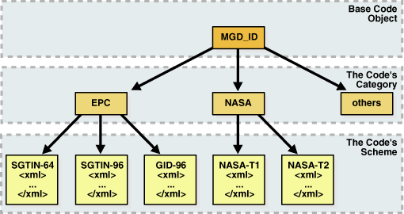
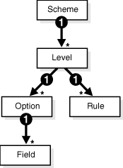

The Identity Code Package is a feature in the Oracle Database that offers tools and techniques to store, retrieve, encode, decode, and translate between various product or identity codes, including Electronic Product Code (EPC), in an Oracle Database. The Identity Code Package provides data types, metadata tables and views, and PL/SQL packages for storing EPC standard RFID tags or new types of RFID tags in a user table.

The Identity Code Package empowers Oracle Database with the knowledge to recognize EPC coding schemes, support efficient storage and component level retrieval of EPC data, and comply with the EPCglobal Tag Data Translation 1.0 (TDT) standard that defines how to decode, encode, and translate between various EPC RFID tag representations.

The Identity Code Package also provides an extensible framework that allows developers to use pre-existing coding schemes with their applications that are not included in the EPC standard and make the Oracle Database adaptable to these older systems and to any evolving identity codes that may some day be part of a future EPC standard.

The Identity Code Package also lets developers create their own identity codes by first registering the encoding category, registering the encoding type, and then registering the components associated with each encoding type.

Topics:

### 26.1 Identity Concepts

A database object `MGD_ID` is defined that lets users use EPC standard identity codes and use their own existing identity codes. The `MGD_ID` object serves as the base code object to which belong certain categories, or types of the RFID tag, such as the EPC category, NASA category, and many other categories. Each category has a set of tag schemes or documents that define tag representation structures and their components. For the EPC category, the metadata needed to define encoding schemes (SGTIN-64, SGTIN-96, GID-96, and so on) representing different encoding types (defined in the EPC standard v1.1) is loaded by default into the database. Users can define encoding their own categories and schemes as shown in Figure 26-1 and load these into the database as well.

Figure 26-1 RFID Code Categories and Their Schemes



> This graphic shows the MGD\_ID base code object as the uppermost box, the RFID code categories beneath it (labeled as boxes EPC, NASA, and others), then beneath these code category boxes, the respective scheme boxes. So beneath the EPC category box are the scheme boxes labeled SGTIN-64, SGTIN-96, and GID-96 and beneath the NASA category box are the scheme boxes labeled NASA-T1 and NASA-T2. Each level of boxes in the hierarchy is connected with downward pointing arrows to indicate their relationship.


An `MGD_ID` object contains two attributes, a category\_id and a list of components consisting of name-value pairs. When `MGD_ID` objects are stored, the tag representation must be parsed into these component name-value pairs upon object creation.

EPC standard version 1.1 defines one General Identifier type (GID) that is independent of any known, existing code schemes, five Domain Identifier types that are based on EAN.UCC specifications, and the identity type United States Department of Defense (USDOD). The five EAN.UCC based identity types are the serialized global trade identification number (SGTIN), the serial shipping container code (SSCC), the serialized global location number (SGLN), the global returnable asset identifier (GRAI) and the global individual asset identifier (GIAI).

Except GID, which has one bit-level encoding, all the other identity types each have two encodings depending on their length: 64-bit and 96-bit. So in total there are thirteen different standard encodings for EPC tags. Also, tags can be encoded in representations other than binary, such as the tag URI and pure identity representations.

Each EPC encoding has its own structure and organization, see Table 26-1. The EPC encoding structure field names relate to the names in the parameter\_list parameter name-value pairs in the Identity Code Package API. For example, for SGTIN-64, the structure field names are Filter Value, Company Prefix Index, Item Reference, and Serial Number.

Table 26-1 General Structure of EPC Encodings

| Encoding Name | Header Length in bits | Field Names (parameter\_list name-value pairs) and (length in bits) |
| --- | --- | --- |
| GID-96 | 8 | General Manager Number (8), Object Class (24), Serial Number (36) |
| SGTIN-64 | 2 | Filter Value (3), Company Prefix Index (14), Item Reference 20), Serial Number (25) |
| SGTIN-96 | 8 | Filter Value (3), Partition (3), Company Prefix (20-40), Item Reference (24-4), Serial Number (38) |
| SSCC-64 | 8 | Filter Value (3), Company Prefix Index (14), Serial Reference (39) |
| SSCC-96 | 8 | Filter Value (3), Partition (3), Company Prefix (20-40), Serial Reference (38-18), Unallocated (24) |
| SGLN-64 | 8 | Filter Value (3), Company Prefix Index (14), Location Reference (20), Serial Number (19) |
| SGLN-96 | 8 | Filter Value (3), Partition (3), Company Prefix (20-40), Location Reference (21-1), Serial Number (41) |
| GRAI-64 | 8 | Filter Value (3), Company Prefix Index (14), Asset Type (20), Serial Number (19) |
| GRAI-96 | 8 | Filter Value (3), Partition (3), Company Prefix (20-40), Asset Type (24-4), Serial Number (38) |
| GIAI-64 | 8 | Filter Value (3), Company Prefix Index (14), Individual Asset Reference (39) |
| GIAI-96 | 8 | Filter Value (3), Partition (3), Company Prefix (20-40), Individual Asset Reference (62-42) |
| USDOD-64 | 8 | Filter Value (2), Government Managed Identifier (30), Serial Number (24) |
| USDOD-96 | 8 | Filter Value (4), Government Managed Identifier (48), Serial Number (36) |

EPCglobal defines eleven tag schemes (GID-96, SGTIN-64, SGTIN-96, and so on). Each of these schemes has various representations; today, the most often used are BINARY, TAG\_URI, and PURE\_IDENTITY. For example, information in an SGTIN-64 can be represented in these ways:

```
BINARY: 1001100000000000001000001110110001000010000011111110011000110010
PURE_IDENTITY:  urn:epc:id:sgtin:0037000.030241.1041970
TAG_URI: urn:epc:tag:sgtin-64:3.0037000.030241.1041970
LEGACY: gtin=00037000302414;serial=1041970
ONS_HOSTNAME: 030241.0037000.sgtin.id.example.com
```

Some representations contain all information about the tag (`BINARY` and `TAG_URI`), while other representations contain partial information (`PURE_IDENTITY`). It is therefore possible to translate a tag from its `TAG_URI` to its `PURE_IDENTITY` representation, but it is not possible to translate in the other direction without more information being provided, namely the filter value must be supplied.

EPCglobal released a Tag Data Translation 1.0 (TDT) standard that defines how to decode, encode, and translate between various EPC RFID tag representations. Decoding refers to parsing a given representation into field/value pairs, and encoding refers to reconstructing representations from these fields. Translating refers to decoding one representation and instantly encoding it into another.TDT defines this information using a set of XML files, each referred to as a scheme. For example, the SGTIN-64 scheme defines how to decode, encode, and translate between various SGTIN-64 representations, such as binary and pure identity. For details about the EPCglobal TDT schema, see the EPCglobal Tag Data Translation specification.

A key feature of the TDT specification is its ability to define any EPC scheme using the same XML schema. This approach creates a standard way of defining EPC metadata that RFID applications can then use to write their parsers, encoders, and translators. When the application is written according to the TDT specification, it must be able to update its set of EPC tag schemes and modify its action according to the metadata.

The Oracle Database metadata structure is similar, but not identical to the TDT standard. To fit the EPCglobal TDT specification, the Oracle RFID package must be able to ingest any TDT compatible scheme and seamlessly translate it into the generic Oracle Database defined metadata. See the `EPC_TO_ORACLE` Function in Table 26-4 for more information.

Reconstructing tag representation from fields, or in other words, encoding tag data into predefined representations is easily accomplished using the `MGD_ID`.`format` function. Likewise, the decoding of tag representations into `MGD_ID` objects and then encoding these objects into tag representations is also easily accomplished using the `MGDID`.`translate` function. See the `FORMAT` Member Function and the `TRANSLATE` Static Function in Table 26-3 for more information.

Because the EPCglobal TDT standard is powerful and highly extensible, the Oracle RFID standard metadata is a close relative of the TDT specification. Developers can refer to this Oracle Database TDT XML schema to define their own tag structures.

Figure 26-2 shows the Oracle Database Tag Data Translation Markup Language Schema diagram.

Figure 26-2 Oracle Database Tag Data Translation Markup Language Schema



> This graphic shows the TDT markup language schema beginning with the upper most box labeled IDCodeTranslator. The text that follows describes this schema.
>
> [  
> Copyright © 1996, 2023, Oracle and/or its affiliates.](https://docs.oracle.com/en/database/oracle/oracle-database/dcommon/html/cpyr.htm)


The top level element in a tag data translation xml is 'scheme'. Each scheme defines various tag encoding representations, or levels. SGTIN-64 and GID-96 are examples of tag encoding schemes, and `BINARY` or `PURE_IDENTITY` are examples of levels within these schemes. Each level has a set of options that define how to parse various representations into fields, and rules that define how to derive values for fields that require additional work, such as an external table lookup or the concatenation of other parsed fields. See the EPCGlobal Tag Translator Specification for more information.

See Also:

- See Electronic Product Code (EPC) Concepts for a brief description of EPC concepts
- See Oracle Database Tag Data Translation Schema for the actual Oracle Database TDT XML schema

### 26.2 What Is the Identity Code Package?

The Identity Code Package provides an extensible framework that supports the current RFID tags with the standard family of EPC bit encodings for the supported encoding types and new and evolving tag encodings that are not included in the current EPC standard.

The Identity Code Package defines these ADTs:

- `MGD_ID` -- defines these (see `MGD_ID` ADT in Table 26-2 for more information):
	- Two attributes, `category_id` and `components`.
		- Four `MGD_ID` constructor functions for constructing identity code type objects to represent RFID tags.
		- A set of member subprograms for operating on these ADTs.
	Using the Identity Code Package describes how to use these ADTs and member functions.
	Identity Code Package Types and DBMS\_MGD\_ID\_UTL Package briefly describe the reference information for these ADTs along with a set of utility subprograms.
- `MGD_ID_COMPONENT` — defines two attributes, `comp_name`, which identifies the name of the component and `comp_value`, which identifies the components value.
- `MGD_ID_COMPONENT_VARRAY` — defines an array type that can store up to 128 elements of `MGD_IDCOMPONENT` type, which is used in two constructor functions for creating an identity code type object with a list of components.

The Identity Code Package supports EPC spec v1.1 by supplying the predefined `EPC_ENCODING_CATEGORY` encoding\_category attribute definition with its bit-encoding structures for the supported encoding types. This information is stored as meta information in the supplied encoding metadata views, `MGD_USR_ID_CATEGORY`, `MGD_USR_ID_SCHEME`, the read-only views `MGD_ID_CATEGORY`, `MGD_ID_SCHEME`, and their underlying tables: `MGD_ID_CATEGORY_TAB`, `MGD_ID_SCHEME_TAB`, `MGD_ID_XML_VALIDATOR`. See these topics and files for more information:

- Electronic Product Code (EPC) Concepts describes the EPC spec v1.1 product code and its family of coding schemes.
- Identity Code Metadata Tables and Views describes the structure of the identity code meta tables and views and how metadata are used by the Identity Code Package to interpret the various RFID tags.
- The `mgdmeta`.`sql` file describes the meta table data for the `EPC_ENCODING_CATEGORY` categories and each of its specific encoding schemes.

After storing many thousands of RFID tags into the column of `MGD_ID` column type of your user table, you can improve query performance by creating an index on this column. See these topics for more information:

- Building a Function-Based Index Using the Member Functions of the MGD\_ID Column Type describes how to create a function based index or bitmap function based index using the member functions of the `MGD_ID` ADT.

The Identity Code Package provides a utility package that consists of various utility subprograms. See this topic for more information:

- Identity Code Package Types and DBMS\_MGD\_ID\_UTL Package describes each of the member subprograms. A proxy utility sets and removes proxy information. A metadata utility gets a category ID, refreshes a tag scheme for a category, removes a tag scheme for a category, and validates a tag scheme. A conversion utility translates standard EPCglobal Tag Data Translation (TDT) files into Oracle Database TDT files.

The Identity Code Package is extensible and lets you create your own identity code types for your new or evolving RFID tags. You can define your identity code types, `catagory_id` attribute values, and components structures for your own encoding types. See these topics for more information:

- Creating a Category of Identity Codes describes how to create your own identity codes by first registering the encoding category, and then registering the schemes associated to the encoding category.
- Identity Code Metadata Tables and Views describes the structure of the identity code meta tables and views and how to register meta information by storing it in the supplied metadata tables and views.

See Also:

See [Oracle Database PL/SQL Packages and Types Reference](https://docs.oracle.com/pls/topic/lookup?ctx=en/database/oracle/oracle-database/21/adfns&id=ARPLS413) for detailed reference information.

### 26.3 Using the Identity Code Package

Topics:

- Storing RFID Tags in Oracle Database Using MGD\_ID ADT
- Building a Function-Based Index Using the Member Functions of the MGD\_ID Column Type
- Using MGD\_ID ADT Functions
- Defining a Category of Identity Codes and Adding Encoding Schemes to an Existing Category

#### 26.3.1 Storing RFID Tags in Oracle Database Using MGD\_ID ADT

Topics:

- Creating a Table with MGD\_ID Column Type and Storing EPC Tag Encodings in the Column
- Constructing MGD\_ID Objects to Represent RFID Tags
- Inserting an MGD\_ID Object into a Database Table
- Querying MGD\_ID Column Type

##### 26.3.1.1 Creating a Table with MGD\_ID Column Type and Storing EPC Tag Encodings in the Column

You can create tables using `MGD_ID` as the column type to represent RFID tags, for example:

Example 1. Using the `MGD_ID` column type:

```
CREATE TABLE Warehouse_info (
             Code          MGD_ID,
             Arrival_time  TIMESTAMP, 
             Location      VARCHAR2(256);
             ...);
```

SQL\*Plus command:

```
describe warehouse_info;
```

Result:

```
Name                                      Null?    Type
----------------------------------------- -------- ----------------------------
CODE                                      NOT NULL MGDSYS.MGD_ID
ARRIVAL_TIME                                       TIMESTAMP(6)
LOCATION                                           VARCHAR2(256)
```

##### 26.3.1.2 Constructing MGD\_ID Objects to Represent RFID Tags

There are several ways to construct `MGD_ID` objects:

- Constructing an MGD\_ID Object (SGTIN-64) Passing in the Category ID and a List of Components
- Constructing an MGD\_ID object (SGTIN-64) and Passing in the Category ID\_ the Tag Identifier\_ and the List of Additional Required Parameters
- Constructing an MGD\_ID object (SGTIN-64) and Passing in the Category Name\_ Category Version (if null\_ then the latest version is used)\_ and a List of Components
- Constructing an MGD\_ID object (SGTIN-64) and Passing in the Category Name and Category Version\_ the Tag Identifier\_ and the List of Additional Required Parameters

###### 26.3.1.2.1 Constructing an MGD\_ID Object (SGTIN-64) Passing in the Category ID and a List of Components

If a RFID tag complies to the EPC standard, an `MGD_ID` object can be created using its category ID and a list of components. For example:

```
call DBMS_MGD_ID_UTL.set_proxy('example.com', '80');
call DBMS_MGD_ID_UTL.refresh_category('1');
select MGD_ID ('1', 
               MGD_ID_COMPONENT_VARRAY(
               MGD_ID_COMPONENT('companyprefix','0037000'),
               MGD_ID_COMPONENT('itemref','030241'),
               MGD_ID_COMPONENT('serial','1041970'),
               MGD_ID_COMPONENT('schemes','SGTIN-64')
              )
             ) from DUAL;
call DBMS_MGD_ID_UTL.remove_proxy();

@constructor11.sql
.
.
.
MGD_ID ('1', MGD_ID_COMPONENT_VARRAY
        (MGD_ID_COMPONENT('companyprefix', '0037000'),
        MGD_ID_COMPONENT('itemref', '030241'), 
        MGD_ID_COMPONENT('serial', '1041970'),
        MGD_ID_COMPONENT('schemes', 'SGTIN-64')))
.
.
.
```

###### 26.3.1.2.2 Constructing an MGD\_ID object (SGTIN-64) and Passing in the Category ID, the Tag Identifier, and the List of Additional Required Parameters

Use this constructor when there is a list of additional parameters required to create the `MGD_ID` object. For example:

```
call DBMS_MGD_ID_UTL.set_proxy('example.com', '80');
call DBMS_MGD_ID_UTL.refresh_category('1');
select MGD_ID('1', 
              'urn:epc:id:sgtin:0037000.030241.1041970', 
              'filter=3;scheme=SGTIN-64') from DUAL;
call DBMS_MGD_ID_UTL.remove_proxy();

@constructor22.sql
.
.
.
MGD_ID('1', MGD_ID_COMPONENT_VARRAY(MGD_ID_COMPONENT('filter', '3'), 
       MGD_ID_COMPONENT('schemes', 'SGTIN-64'), 
       MGD_ID_COMPONENT('companyprefixlength', '7'), 
       MGD_ID_COMPONENT('companyprefix', '0037000'), 
       MGD_ID_COMPONENT('scheme', 'SGTIN-64'), 
       MGD_ID_COMPONENT('serial', '1041970'), 
       MGD_ID_COMPONENT('itemref', '030241')))
.
.
.
```

###### 26.3.1.2.3 Constructing an MGD\_ID object (SGTIN-64) and Passing in the Category Name, Category Version (if null, then the latest version is used), and a List of Components

Use this constructor when a category version must be specified along with a category ID and a list of components. For example:

```
call DBMS_MGD_ID_UTL.set_proxy('example.com', '80');
call DBMS_MGD_ID_UTL.refresh_category
  (DBMS_MGD_ID_UTL.get_category_id('EPC', NULL));
select MGD_ID('EPC', NULL, 
              MGD_ID_COMPONENT_VARRAY(
              MGD_ID_COMPONENT('companyprefix','0037000'),
              MGD_ID_COMPONENT('itemref','030241'),
              MGD_ID_COMPONENT('serial','1041970'),
              MGD_ID_COMPONENT('schemes','SGTIN-64')
             )
            ) from DUAL;
call DBMS_MGD_ID_UTL.remove_proxy();

@constructor33.sql
.
.
.
MGD_ID('1', MGD_ID_COMPONENT_VARRAY
             (MGD_ID_COMPONENT('companyprefix', '0037000'),
              MGD_ID_COMPONENT('itemref', '030241'), 
              MGD_ID_COMPONENT('serial', '1041970'),
              MGD_ID_COMPONENT('schemes', 'SGTIN-64')
             )
       )
.
.
.
```

###### 26.3.1.2.4 Constructing an MGD\_ID object (SGTIN-64) and Passing in the Category Name and Category Version, the Tag Identifier, and the List of Additional Required Parameters

Use this constructor when the category version and an additional list of parameters is required.

```
call DBMS_MGD_ID_UTL.set_proxy('example.com', '80');
call DBMS_MGD_ID_UTL.refresh_category
  (DBMS_MGD_ID_UTL.get_category_id('EPC', NULL));
select MGD_ID('EPC', NULL,
              'urn:epc:id:sgtin:0037000.030241.1041970', 
              'filter=3;scheme=SGTIN-64') from DUAL;
call DBMS_MGD_ID_UTL.remove_proxy();

@constructor44.sql
.
.
.
MGD_ID('1', MGD_ID_COMPONENT_VARRAY
       (MGD_ID_COMPONENT('filter', '3'),
        MGD_ID_COMPONENT('schemes', 'SGTIN-64'), 
        MGD_ID_COMPONENT('companyprefixlength', '7'), 
        MGD_ID_COMPONENT('companyprefix', '0037000'), 
        MGD_ID_COMPONENT('scheme', 'SGTIN-64'), 
        MGD_ID_COMPONENT('serial', '1041970'), 
        MGD_ID_COMPONENT('itemref', '030241')
       )
      )
.
.
.
```

##### 26.3.1.3 Inserting an MGD\_ID Object into a Database Table

This example shows how to populate the `WAREHOUSE_INFO` table by inserting each `MGD_ID` object into the table along with the additional column values:

```
call DBMS_MGD_ID_UTL.set_proxy('example.com', '80');

call DBMS_MGD_ID_UTL.refresh_category
  (DBMS_MGD_ID_UTL.get_category_id('EPC', NULL));

INSERT INTO WAREHOUSE_INFO (code, arrival_time, location)
   values (MGDSYS.MGD_ID ('EPC',
                          NULL,
                          'urn:epc:id:sgtin:0037000.030241.1041970',
                          null
                         ),
           SYSDATE,
           'SHELF_123');

INSERT INTO WAREHOUSE_INFO (code, arrival_time, location)
  values (MGDSYS.MGD_ID ('EPC',
                         NULL,
                         'urn:epc:id:sgtin:0037000.053021.1012353',
                         null
                        ),
          SYSDATE,
          'SHELF_456');
INSERT INTO WAREHOUSE_INFO (code, arrival_time, location)
  values (MGDSYS.MGD_ID ('EPC',
                         NULL,
                         'urn:epc:id:sgtin:0037000.020140.10174832',
                         null
                        ),
          SYSDATE,
          'SHELF_1034');

COMMITT;
call DBMS_MGD_ID_UTL.remove_proxy();
```

##### 26.3.1.4 Querying MGD\_ID Column Type

There are three ways to query on `MGD_ID` column type.

- Query the `MGD_ID` column type. Find all items with item reference 030241.
	```
	SELECT location, wi.code.get_component('itemref') as itemref, 
	                 wi.code.get_component('serial') as serial 
	FROM warehouse_info wi WHERE wi.code.get_component('itemref') = '030241';
	LOCATION       |ITEMREF   |SERIAL
	---------------|----------|----------
	SHELF_123      |030241    |1041970
	```
- Query using the member functions of the `MGD_ID` ADT. Select the pure identity representations of all RFID tags in the table.
	```
	SELECT wi.code.format(null,'PURE_IDENTITY')
	   as PURE_IDENTITY FROM warehouse_info wi;
	PURE_IDENTITY
	-------------------------------------------------------------------------------
	urn:epc:id:sgtin:0037000.030241.1041970
	urn:epc:id:gid:0037000.053021.1012353
	urn:epc:id:sgtin:0037000.020140.10174832
	```
	See Using the get\_component Function with the MGD\_ID Object for more information and see Table 26-3 for a list of member functions.

#### 26.3.2 Building a Function-Based Index Using the Member Functions of the MGD\_ID Column Type

You can improve the performance of queries based on a certain component of the RFID tags by creating a function-based index that uses the `get_component` member function or its variation convenience functions. For example:

```
CREATE INDEX warehouseinfo_idx2
  on warehouse_info(code.get_component('itemref'));
```

You can also improve the performance of queries based on a certain component of the RFID tags by creating a bitmap function based index that uses the `get_component` member function or its variation convenience functions. For example:

```
CREATE BITMAP INDEX warehouseinfo_idx3
  on warehouse_info(code.get_component('serial'));
```

#### 26.3.3 Using MGD\_ID ADT Functions

The `MGD_ID` ADT contains member subprograms that operate on these ADTs. See Table 26-2 for `MGD_ID_COMPONENT`, `MGD_ID_COMPONENT_VARRAY`, `MGD_ID` ADT reference information. See the `mgdtyp`.`sql` file for the `MGD_ID` ADT definition and its member subprograms.

Topics:

##### 26.3.3.1 Using the get\_component Function with the MGD\_ID Object

The `get_component` function is defined as follows:

```
MEMBER FUNCTION get_component(component_name IN VARCHAR2)
   RETURN VARCHAR2 DETERMINISTIC,
```

Each component in a identity code has a name. It is defined when the code type is registered.

The `get_component` function takes the name of the component, `component_name` as a parameter, uses the metadata registered in the metadata table to analyze the identity code, and returns the component with the name `component_name`.

The `get_component` function can be used in a SQL query. For example, find the current location of the coded item for the component named `itemref`; or, in other words find all items with the item reference of 03024. Because the code tag has encoded `itemref` as a component, you can use this SQL query:

```
SELECT location,
       w.code.get_component('itemref') as itemref,
       w.code.get_component('serial')  as serial
FROM   warehouse_info w
       WHERE  w.code.get_component('itemref')  = '030241';

LOCATION       |ITEMREF   |SERIAL
---------------|----------|----------
SHELF_123      |030241    |1041970
```

See Table 26-3 for a list of other member functions.

See Also:

Defining a Category of Identity Codes and Adding Encoding Schemes to an Existing Category for more information about how to create a identity code type

##### 26.3.3.2 Parsing Tag Data from Standard Representations

RFID readers read the bit strings stored in the tags. The tag data and other information, such as the reader ID and the time stamp, first go through an edge server to be processed, normalized, and preliminarily filtered. Then, in many application scenarios, the information must be persistently stored and later on be retrieved. The Oracle Database understands the code structures representations of various EPC tags as described in Table 26-1 because these code representation schemes defined in the EPC Standard are preregistered. This gives the Oracle Database the ability to understand all the EPC code schemes and parse various tag representations into fields. Users can also register their own coding structures for the identity codes that use other encoding technologies. In this way the system is extensible.

As mentioned in Identity Concepts, each of the EPCGlobal tag schemes (GID-96, SGTIN-64, SGTIN-96, and so on) has various representations with the most often used being `BINARY`, `TAG_URI`, and `PURE_IDENTITY`.

Some representations contain all the information about the tag (`BINARY` and `TAG_URI`), while representations contain partial information (`PURE_IDENTITY`). It is therefore possible to translate a tag from it's `TAG_URI` to it's `PURE_IDENTITY` representation, but it is not possible to translate in the other direction (`PURE_IDENTITY` to `TAG_URI`) without supplying more information, namely the filter value.

One MGD\_ID constructor takes in four fields, the category name (such as EPC), the category version, the tag identifier (for EPC, the identifier must be in a representation previously described), and a parameter list for any additional parameters required to parse the tag representation. For example, this code creates an MGD\_ID object from its BINARY representation.

```
SELECT MGD_ID 
   ('EPC',
    null,
    '1001100000000000001000001110110001000010000011111110011000110010',
    null
   )
   AS NEW_RFID_CODE FROM DUAL;

NEW_RFID_CODE(CATEGORY_ID, COMPONENTS(NAME, VALUE))
--------------------------------------------------------------------------------
MGD_ID ('1', 
        MGD_ID_COMPONENT_VARRAY(MGD_ID_COMPONENT('filter', '3'), 
        MGD_ID_COMPONENT('schemes', 'SGTIN-64'), 
        MGD_ID_COMPONENT('companyprefixlength', '7'), 
        MGD_ID_COMPONENT('companyprefix', '0037000'), 
        MGD_ID_COMPONENT('companyprefixindex', '1'), 
        MGD_ID_COMPONENT('serial', '1041970'), 
        MGD_ID_COMPONENT('itemref', '030241')
       )
      )
```

For example, an identical object can be created if the call is done with the TAG\_URI representation of the tag as follows with the addition of the value of the filter value:

```
SELECT MGD_ID ('EPC',
                null,
                'urn:epc:tag:sgtin-64:3.0037000.030241.1041970',
                null
              )
  as NEW_RFID_CODE FROM DUAL;

NEW_RFID_CODE(CATEGORY_ID, COMPONENTS(NAME, VALUE))
--------------------------------------------------------------------------------
MGD_ID ('1', 
        MGD_ID_COMPONENT_VARRAY (
         ( MGD_ID_COMPONENT('filter', '3'), 
           MGD_ID_COMPONENT('schemes', 'SGTIN-64'), 
           MGD_ID_COMPONENT('companyprefixlength', '7'), 
           MGD_ID_COMPONENT('companyprefix', '0037000'), 
           MGD_ID_COMPONENT('serial', '1041970'), 
           MGD_ID_COMPONENT('itemref', '030241')
         )
       )
```

##### 26.3.3.3 Reconstructing Tag Representations from Fields

Another useful feature of the Identity Code package is the ability to encode tag data into predefined representations. For example, a warehouse wants to send certain inventory to a retailer, but first it wants to send an invoice that tells the retailer what inventory to expect. The invoice can be a list of pure identity URIs that the warehouse intends to send. If all the inventory in the `WAREHOUSE_INFO` table is to be sent, this example constructs the desired URIs:

```
SELECT wi.code.format (null,'PURE_IDENTITY') 
  as PURE_IDENTITY FROM warehouse_info wi;

PURE_IDENTITY
--------------------------------------------------------------------------------
urn:epc:id:sgtin:0037000.030241.1041970
urn:epc:id:gid:0037000.053021.1012353
urn:epc:id:sgtin:0037000.020140.10174832
```

##### 26.3.3.4 Translating Between Tag Representations

The Identity Code package can decode tag representations into MGD\_ID objects and encode these objects into tag representations. These two steps can be combined into one step using the `MGD_ID`.`translate` function. Static translation allows for the conversion of an RFID tag from one representation to another. For example:

```
SELECT MGD_ID.translate ('EPC',
                         null,
                         'urn:epc:id:sgtin:0037000.030241.1041970',
                         'filter=3;scheme=SGTIN-64',
                         'BINARY'
                        )
  as BINARY FROM DUAL;

BINARY
--------------------------------------------------------------------------------
1001100000000000001000001110110001000010000011111110011000110010
```

In this example, the binary representation contains more information than the pure identity representation. Specifically, it also contains the filter value and in this case the scheme value must also be specified to distinguish SGTIN-64 from SGTIN-96. Thus, the function call must provide the missing filter parameter information and specify the scheme name in order for translation call to succeed.

#### 26.3.4 Defining a Category of Identity Codes and Adding Encoding Schemes to an Existing Category

Topics:

- Creating a Category of Identity Codes
- Adding Two Metadata Schemes to a Newly Created Category

##### 26.3.4.1 Creating a Category of Identity Codes

Because the EPCglobal TDT standard is powerful and highly extensible, the Oracle Database RFID standard metadata is a close relative of the TDT specification. Thus, the Identity Code package is extensible: You can create your own categories and tag structures using generic metadata. To create a category of identity codes, use the `DBMS_MGD_ID_UTIL`.`create_category` function.

For example, suppose you want to create a category called `MGD_SAMPLE_CATEGORY`, which has two types of tags, a `CONTRACTOR_TAG` and an `EMPLOYEE_TAG`. This category and its two metadata schemes might be used within a company that must grant different access privileges to people who are full time employees from those who are contractors, and thus require that their security software be able to identify quickly between the two badge types at an RFID reader. This script creates a category named `MGD_SAMPLE_CATEGORY`, with a 1.0 category version, having an agency name as Oracle, with a URI as `http://www.oracle.com/mgd/sample`. See Adding Two Metadata Schemes to a Newly Created Category for an example.

##### 26.3.4.2 Adding Two Metadata Schemes to a Newly Created Category

Next, create an `CONTRACTOR_TAG` metadata scheme such as:

```
<?xml version="1.0" encoding="UTF-8"?>
<TagDataTranslation version="0.04" date="2005-04-18T16:05:00Z" 
                    xmlns:xsi="http://www.w3.org/2001/XMLSchema" 
                    xmlns="oracle.mgd.idcode">
 <scheme name="CONTRACTOR_TAG" optionKey="1" xmlns="">
  <level type="URI" prefixMatch="mycompany.contractor.">
   <option optionKey="1" pattern="mycompany.contractor.([0-9]*).([0-9]*)" 
           grammar="''mycompany.contractor.'' contractorID ''.'' divisionID">
    <field seq="1" characterSet="[0-9]*" name="contractorID"/>
    <field seq="2" characterSet="[0-9]*" name="divisionID"/>
   </option>
  </level>
  <level type="BINARY" prefixMatch="11">
   <option optionKey="1" pattern="11([01]{7})([01]{6})" 
           grammar="''11'' contractorID divisionID ">
    <field seq="1" characterSet="[01]*" name="contractorID"/>
    <field seq="2" characterSet="[01]*" name="divisionID"/>
   </option>
  </level>
 </scheme>
</TagDataTranslation>
```

The `CONTRACTOR_TAG` scheme contains two encoding levels, or ways in which the tag can be represented. The first level is `URI` and the second level is `BINARY`. The `URI` representation starts with the prefix " `mycompany`.`contractor`." and is then followed by two numeric fields separated by a period. The names of the two fields are `contractorID` and `divisionID`. The pattern field in the option tag defines the parsing structure of the tag `URI` representation, and the grammar field defines how to reconstruct the URI representation. The `BINARY` representation can be understood in a similar fashion. This representation starts with the prefix "01" and is then followed by the same two fields, `contractorID` and `divisionID`, this time, in their respective binary formats. Given this XML metadata structure, contractor tags can now be decoded from their `URI` and `BINARY` representations and the resulting fields can be re-encoded into one of these representations.

The `EMPLOYEE_TAG` scheme is defined in a similar fashion and is shown as follows.

```
<?xml version="1.0" encoding="UTF-8"?>
<TagDataTranslation version="0.04" date="2005-04-18T16:05:00Z" 
                    xmlns:xsi="http://www.w3.org/2001/XMLSchema" 
                    xmlns="oracle.mgd.idcode">
 <scheme name="EMPLOYEE_TAG" optionKey="1" xmlns="">
  <level type="URI" prefixMatch="mycompany.employee.">
   <option optionKey="1" pattern="mycompany.employee.([0-9]*).([0-9]*)" 
           grammar="''mycompany.employee.'' employeeID ''.'' divisionID">
    <field seq="1" characterSet="[0-9]*" name="employeeID"/>
    <field seq="2" characterSet="[0-9]*" name="divisionID"/>
   </option>
  </level>
  <level type="BINARY" prefixMatch="01">
   <option optionKey="1" pattern="01([01]{7})([01]{6})" 
           grammar="''01'' employeeID divisionID ">
    <field seq="1" characterSet="[01]*" name="employeeID"/>
    <field seq="2" characterSet="[01]*" name="divisionID"/>
   </option>
  </level>
 </scheme>
</TagDataTranslation>;
```

To add these schemes to the category ID previously created, use the `DBMS_MGD_ID_UTIL`.`add_scheme` function.

This script creates the `MGD_SAMPLE_CATEGORY` category, adds a contractor scheme and an employee scheme to the `MGD_SAMPLE_CATEGORY` category, validates the `MGD_SAMPLE_CATEGORY` scheme, tests the tag translation of the contractor scheme and the employee scheme, then removes the contractor scheme, tests the tag translation of the contractor scheme and this returns the expected exception for the removed contractor scheme, tests the tag translation of the employee scheme and this returns the expected values, then removes the `MGD_SAMPLE_CATEGORY` category:

```
--contents of add_scheme2.sql
SET LINESIZE 160
CALL DBMS_MGD_ID_UTL.set_proxy('example.com', '80');
---------------------------------------------------------------------
---CREATE CATEGORY, ADD_SCHEME, REMOVE_SCHEME, REMOVE_CATEGORY-------
---------------------------------------------------------------------
DECLARE
  amt          NUMBER;
  buf          VARCHAR2(32767);
  pos          NUMBER;
  tdt_xml      CLOB;
  validate_tdtxml VARCHAR2(1042);
  category_id  VARCHAR2(256);
BEGIN
  -- remove the testing category if it exists
  DBMS_MGD_ID_UTL.remove_category('MGD_SAMPLE_CATEGORY', '1.0');
  -- create the testing category 'MGD_SAMPLE_CATEGORY', version 1.0
  category_id := DBMS_MGD_ID_UTL.CREATE_CATEGORY('MGD_SAMPLE_CATEGORY', '1.0', 'Oracle', 
'http://www.oracle.com/mgd/sample');
  -- add contractor scheme to the category
  DBMS_LOB.CREATETEMPORARY(tdt_xml, true);
  DBMS_LOB.OPEN(tdt_xml, DBMS_LOB.LOB_READWRITE);
 
  buf := '<?xml version="1.0" encoding="UTF-8"?>
<TagDataTranslation version="0.04" date="2005-04-18T16:05:00Z" 
                    xmlns:xsi="http://www.w3.org/2001/XMLSchema" 
                    xmlns="oracle.mgd.idcode">
 <scheme name="CONTRACTOR_TAG" optionKey="1" xmlns="">
  <level type="URI" prefixMatch="mycompany.contractor.">
   <option optionKey="1" pattern="mycompany.contractor.([0-9]*).([0-9]*)" 
           grammar="''mycompany.contractor.'' contractorID ''.'' divisionID">
    <field seq="1" characterSet="[0-9]*" name="contractorID"/>
    <field seq="2" characterSet="[0-9]*" name="divisionID"/>
   </option>
  </level>
  <level type="BINARY" prefixMatch="11">
   <option optionKey="1" pattern="11([01]{7})([01]{6})" 
           grammar="''11'' contractorID divisionID ">
    <field seq="1" characterSet="[01]*" name="contractorID"/>
    <field seq="2" characterSet="[01]*" name="divisionID"/>
   </option>
  </level>
 </scheme>
</TagDataTranslation>';

  amt := length(buf);
  pos := 1;
  DBMS_LOB.WRITE(tdt_xml, amt, pos, buf);
  DBMS_LOB.CLOSE(tdt_xml);

  DBMS_MGD_ID_UTL.ADD_SCHEME(category_id, tdt_xml);

  -- add employee scheme to the category
  DBMS_LOB.CREATETEMPORARY(tdt_xml, true);
  DBMS_LOB.OPEN(tdt_xml, DBMS_LOB.LOB_READWRITE);
 
  buf := '<?xml version="1.0" encoding="UTF-8"?>
<TagDataTranslation version="0.04" date="2005-04-18T16:05:00Z" 
                    xmlns:xsi="http://www.w3.org/2001/XMLSchema" 
                    xmlns="oracle.mgd.idcode">
 <scheme name="EMPLOYEE_TAG" optionKey="1" xmlns="">
  <level type="URI" prefixMatch="mycompany.employee.">
   <option optionKey="1" pattern="mycompany.employee.([0-9]*).([0-9]*)" 
           grammar="''mycompany.employee.'' employeeID ''.'' divisionID">
    <field seq="1" characterSet="[0-9]*" name="employeeID"/>
    <field seq="2" characterSet="[0-9]*" name="divisionID"/>
   </option>
  </level>
  <level type="BINARY" prefixMatch="01">
   <option optionKey="1" pattern="01([01]{7})([01]{6})" 
           grammar="''01'' employeeID divisionID ">
    <field seq="1" characterSet="[01]*" name="employeeID"/>
    <field seq="2" characterSet="[01]*" name="divisionID"/>
   </option>
  </level>
 </scheme>
</TagDataTranslation>';

  amt := length(buf);
  pos := 1;
  DBMS_LOB.WRITE(tdt_xml, amt, pos, buf);
  DBMS_LOB.CLOSE(tdt_xml);
  DBMS_MGD_ID_UTL.ADD_SCHEME(category_id, tdt_xml);

  -- validate the scheme
  dbms_output.put_line('Validate the MGD_SAMPLE_CATEGORY Scheme');
  validate_tdtxml := DBMS_MGD_ID_UTL.validate_scheme(tdt_xml);
  dbms_output.put_line(validate_tdtxml);
  dbms_output.put_line('Length of scheme xml is: '||DBMS_LOB.GETLENGTH(tdt_xml));

  -- test tag translation of contractor scheme
  dbms_output.put_line(
    mgd_id.translate('MGD_SAMPLE_CATEGORY', NULL, 
                     'mycompany.contractor.123.45', 
                     NULL, 'BINARY'));

  dbms_output.put_line(
    mgd_id.translate('MGD_SAMPLE_CATEGORY', NULL, 
                     '111111011101101',
                     NULL, 'URI'));

  -- test tag translation of employee scheme
  dbms_output.put_line(
    mgd_id.translate('MGD_SAMPLE_CATEGORY', NULL, 
                     'mycompany.employee.123.45', 
                     NULL, 'BINARY'));

  dbms_output.put_line(
    mgd_id.translate('MGD_SAMPLE_CATEGORY', NULL, 
                     '011111011101101',
                     NULL, 'URI'));

  DBMS_MGD_ID_UTL.REMOVE_SCHEME(category_id, 'CONTRACTOR_TAG');

  -- Test tag translation of contractor scheme. Doesn't work any more.
  BEGIN
    dbms_output.put_line(
      mgd_id.translate('MGD_SAMPLE_CATEGORY', NULL, 
                       'mycompany.contractor.123.45', 
                       NULL, 'BINARY'));

    dbms_output.put_line(
      mgd_id.translate('MGD_SAMPLE_CATEGORY', NULL, 
                       '111111011101101',
                       NULL, 'URI'));
  EXCEPTION 
    WHEN others THEN
      dbms_output.put_line('Contractor tag translation failed: '||SQLERRM);
  END;

  -- Test tag translation of employee scheme. Still works.
  BEGIN
    dbms_output.put_line(
      mgd_id.translate('MGD_SAMPLE_CATEGORY', NULL, 
                       'mycompany.employee.123.45', 
                       NULL, 'BINARY'));
    dbms_output.put_line(
      mgd_id.translate('MGD_SAMPLE_CATEGORY', NULL, 
                       '011111011101101',
                       NULL, 'URI'));
  EXCEPTION 
    WHEN others THEN
      dbms_output.put_line('Employee tag translation failed: '||SQLERRM);
  END;

  -- remove the testing category, which also removes all the associated schemes
  DBMS_MGD_ID_UTL.remove_category('MGD_SAMPLE_CATEGORY', '1.0');
END;
/
SHOW ERRORS;
call DBMS_MGD_ID_UTL.remove_proxy();

@add_scheme3.sql
.
.
.
Validate the MGD_SAMPLE_CATEGORY Scheme
EMPLOYEE_TAG;URI,BINARY;divisionID,employeeID
Length of scheme xml is: 933
111111011101101
mycompany.contractor.123.45
011111011101101
mycompany.employee.123.45
Contractor tag translation failed: ORA-55203: Tag data translation level not found
ORA-06512: at "MGDSYS.DBMS_MGD_ID_UTL", line 54
ORA-06512: at "MGDSYS.MGD_ID", line 242
ORA-29532: Java call terminated by uncaught Java
exception: oracle.mgd.idcode.exceptions.TDTLevelNotFound: Matching level not
found for any configured scheme
011111011101101
mycompany.employee.123.45
.
.
.
```

### 26.4 Identity Code Package Types

Table 26-2 describes the Identity Code Package ADTs.

Table 26-2 Identity Code Package ADTs

| ADT Name | Description |
| --- | --- |
| [`MGD_ID_COMPONENT`](https://docs.oracle.com/pls/topic/lookup?ctx=en/database/oracle/oracle-database/21/adfns&id=ARPLS412) ADT | A data type that specifies the name and value pair attributes that define a component. |
| [`MGD_ID_COMPONENT_VARRAY`](https://docs.oracle.com/pls/topic/lookup?ctx=en/database/oracle/oracle-database/21/adfns&id=ARPLS413) ADT | A data type that specifies a list of up to 128 components as name-value attribute pairs used in two constructor functions for creating an identity code type object. |
| [`MGD_ID`](https://docs.oracle.com/pls/topic/lookup?ctx=en/database/oracle/oracle-database/21/adfns&id=ARPLS414) ADT | Represents an identity code type that specifies the category identifier for the code category for this identity code and its list of components. |

Table 26-3 describes the subprograms in the `MGD_ID` ADT.

All the values and names passed to the subprograms defined in the `MGD_ID` ADT are case-insensitive unless otherwise noted. To preserve case, enclose values in double quotation marks.

Table 26-3 MGD\_ID ADT Subprograms

| Subprogram | Description |
| --- | --- |
| [`MGD_ID`](https://docs.oracle.com/pls/topic/lookup?ctx=en/database/oracle/oracle-database/21/adfns&id=ARPLS415) Constructor Function | Creates an identity code type object, `MGD_ID`, and returns self. |
| [`FORMAT`](https://docs.oracle.com/pls/topic/lookup?ctx=en/database/oracle/oracle-database/21/adfns&id=ARPLS416) Member Function | Returns a representation of an identity code given an `MGD_ID` component. |
| [`GET_COMPONENT`](https://docs.oracle.com/pls/topic/lookup?ctx=en/database/oracle/oracle-database/21/adfns&id=ARPLS417) Member Function | Returns the value of an `MGD_ID` component. |
| [`TO_STRING`](https://docs.oracle.com/pls/topic/lookup?ctx=en/database/oracle/oracle-database/21/adfns&id=ARPLS418) Member Function | Concatenates the `category_id` parameter value with the components name-value attribute pair. |
| [`TRANSLATE`](https://docs.oracle.com/pls/topic/lookup?ctx=en/database/oracle/oracle-database/21/adfns&id=ARPLS419) Static Function | Translates one `MGD_ID` representation of an identity code into a different `MGD_ID` representation. |

### 26.5 DBMS\_MGD\_ID\_UTL Package

Table 26-4 describes the Utility subprograms in the ` DBMS_MGD_ID_UTL` package.

All the values and names passed to the subprograms defined in the `MGD_ID` ADT are case-insensitive unless otherwise noted. To preserve case, enclose values in double quotation marks.

Table 26-4 DBMS\_MGD\_ID\_UTL Package Utility Subprograms

| Subprogram | Description |
| --- | --- |
| [`ADD_SCHEME`](https://docs.oracle.com/pls/topic/lookup?ctx=en/database/oracle/oracle-database/21/adfns&id=ARPLS420) Procedure | Adds a tag data translation scheme to an existing category. |
| [`CREATE_CATEGORY`](https://docs.oracle.com/pls/topic/lookup?ctx=en/database/oracle/oracle-database/21/adfns&id=ARPLS421) Function | Creates a category or a version of a category. |
| [`EPC_TO_ORACLE`](https://docs.oracle.com/pls/topic/lookup?ctx=en/database/oracle/oracle-database/21/adfns&id=ARPLS422) Function | Converts the EPCglobal tag data translation (TDT) XML to Oracle Database tag data translation XML. |
| [`GET_CATEGORY_ID`](https://docs.oracle.com/pls/topic/lookup?ctx=en/database/oracle/oracle-database/21/adfns&id=ARPLS423) Function | Returns the category ID given the category name and the category version. |
| [`GET_COMPONENTS`](https://docs.oracle.com/pls/topic/lookup?ctx=en/database/oracle/oracle-database/21/adfns&id=ARPLS424) Function | Returns all relevant separated component names separated by semicolon (';') for the specified scheme. |
| [`GET_ENCODINGS`](https://docs.oracle.com/pls/topic/lookup?ctx=en/database/oracle/oracle-database/21/adfns&id=ARPLS425) Function | Returns a list of semicolon (';') separated encodings (formats) for the specified scheme. |
| [`GET_JAVA_LOGGING_LEVEL`](https://docs.oracle.com/pls/topic/lookup?ctx=en/database/oracle/oracle-database/21/adfns&id=ARPLS426) Function | Returns an integer representing the current Java trace logging level. |
| [`GET_PLSQL_LOGGING_LEVEL`](https://docs.oracle.com/pls/topic/lookup?ctx=en/database/oracle/oracle-database/21/adfns&id=ARPLS427) Function | Returns an integer representing the current PL/SQL trace logging level. |
| [`GET_SCHEME_NAMES`](https://docs.oracle.com/pls/topic/lookup?ctx=en/database/oracle/oracle-database/21/adfns&id=ARPLS428) Function | Returns a list of semicolon (';') separated scheme names for the specified category. |
| [`GET_TDT_XML`](https://docs.oracle.com/pls/topic/lookup?ctx=en/database/oracle/oracle-database/21/adfns&id=ARPLS429) Function | Returns the Oracle Database tag data translation XML for the specified scheme. |
| [`GET_VALIDATOR`](https://docs.oracle.com/pls/topic/lookup?ctx=en/database/oracle/oracle-database/21/adfns&id=ARPLS430) Function | Returns the Oracle Database tag data translation schema. |
| [`REFRESH_CATEGORY`](https://docs.oracle.com/pls/topic/lookup?ctx=en/database/oracle/oracle-database/21/adfns&id=ARPLS431) Function | Refreshes the metadata information about the Java stack for the specified category. |
| [`REMOVE_CATEORY`](https://docs.oracle.com/pls/topic/lookup?ctx=en/database/oracle/oracle-database/21/adfns&id=ARPLS432) Function | Removes a category including all the related TDT XML. |
| [`REMOVE_PROXY`](https://docs.oracle.com/pls/topic/lookup?ctx=en/database/oracle/oracle-database/21/adfns&id=ARPLS433) Procedure | Unsets the host and port of the proxy server. |
| [`REMOVE_SCHEME`](https://docs.oracle.com/pls/topic/lookup?ctx=en/database/oracle/oracle-database/21/adfns&id=ARPLS434) Procedure | Removes the tag scheme for a category. |
| [`SET_JAVA_LOGGING_LEVEL`](https://docs.oracle.com/pls/topic/lookup?ctx=en/database/oracle/oracle-database/21/adfns&id=ARPLS435) Procedure | Sets the Java logging level. |
| [`SET_PLSQL_LOGGING_LEVEL`](https://docs.oracle.com/pls/topic/lookup?ctx=en/database/oracle/oracle-database/21/adfns&id=ARPLS436) Procedure | Sets the PL/SQL tracing logging level. |
| [`SET_PROXY`](https://docs.oracle.com/pls/topic/lookup?ctx=en/database/oracle/oracle-database/21/adfns&id=ARPLS463) Procedure | Sets the host and port of the proxy server for Internet access. |
| [`VALIDATE_SCHEME`](https://docs.oracle.com/pls/topic/lookup?ctx=en/database/oracle/oracle-database/21/adfns&id=ARPLS464) Function | Validates the input tag data translation XML against the Oracle Database tag data translation schema. |

### 26.6 Identity Code Metadata Tables and Views

This topic describes the structure of identity code metadata tables and views and explains how the metadata are used by the Identity Code Package to interpret the various RFID tags. The creation of these meta tables, views, and triggers is done automatically during the Identity Code Package installation.

Encoding metadata views are used to store encoding categories and schemes. Application developers can insert the meta information of their own identity codes into these views. The `MGD_ID` ADT is designed to understand the encodings if the metadata for the encodings are stored in the meta tables. If an application developer uses only the encodings defined in the EPC specification v1.1, the developer does not have to worry about the meta tables because product codes specified in EPC spec v1.1 are predefined.

There are two encoding metadata views:

- `user_mgd_id_category` stores the encoding category information defined by the session user.
- `user_mgd_id_scheme` stores the encoding type information defined by the session user.

You can query the following read-only views to see the system's predefined encoding metadata and the metadata defined by the user:

- `mgd_id_category` lets you query the encoding category information defined by the system or the session user
- `mgd_id_scheme` lets you query the encoding type information defined by the system or the session user.

The underlying metadata tables for the preceding views are:

- `mgd_id_xml_validator`
- `mgd_id_category_tab`
- `mgd_id_scheme_tab`

Users other than the Identity Code Package system users cannot operate on these tables. Users must not use the metadata tables directly. They must use the read-only views and the metadata functions described in the `DBMS_MGD_ID_UTL` package.

See Also:

[Oracle Database PL/SQL Packages and Types Reference](https://docs.oracle.com/pls/topic/lookup?ctx=en/database/oracle/oracle-database/21/adfns&id=ARPLS283) for information about the `DBMS_MGD_ID_UTL` package

Metadata View Definitions

Table 26-5, Table 26-6, Table 26-7, and Table 26-8 describe the metadata view definitions for the `MGD_ID_CATEGORY`, `USER_ID_CATEGORY`, `MGD_ID_SCHME`, and `USER_MGD_ID_SCHME` respectively as defined in the `mgdview`.`sql` file.

Table 26-5 Definition and Description of the MGD\_ID\_CATEGORY Metadata View

| Column Name | Data Type | Description |
| --- | --- | --- |
| `CATEGORY_ID` | `NUMBER(4)` | Category identifier |
| `CATEGORY_NAME` | `VARCHAR2(256)` | Category name |
| `AGENCY` | `VARCHAR2(256)` | Organization that defined the category |
| `VERSION` | `VARCHAR2(256)` | Category version |
| `URI` | `VARCHAR2(256)` | URI that describes the category |

Table 26-6 Definition and Description of the USER\_MGD\_ID\_CATEGORY Metadata View

| Column Name | Data Type | Description |
| --- | --- | --- |
| `CATEGORY_ID` | `NUMBER(4)` | Category identifier |
| `CATEGORY_NAME` | `VARCHAR2(256)` | Category name |
| `AGENCY` | `VARCHAR2(256)` | Organization that defined the category |
| `VERSION` | `VARCHAR2(256)` | Category version |
| `URI` | `VARCHAR2(256)` | URI that describes the category |

Table 26-7 Definition and Description of the MGD\_ID\_SCHEME Metadata View

| Column Name | Data Type | Description |
| --- | --- | --- |
| `CATEGORY_ID` | `NUMBER(4)` | Category identifier |
| `TYPE_NAME` | `VARCHAR2(256)` | Encoding scheme name, for example, SGTIN-96, GID-96, and so on |
| `TDT_XML` | `CLOB` | Tag data translation XML for this encoding scheme |
| `ENCODINGS` | `VARCHAR2(256)` | Encodings separated by a comma (,), for example, `LEGACY`, `TAG_ENCODING`, `PURE_IDENTITY`, `BINARY` (for SGTIN-96) |
| `COMPONENTS` | `VARCHAR2(1024)` | Relevant component names, extracted from each level and then combined. Each is separated by a comma (,). For example, objectclass, generalmanager, serial (for GID-96) |

Table 26-8 Definition and Description of the USER\_MGD\_ID\_SCHEME Metadata View

| Column Name | Data Type | Description |
| --- | --- | --- |
| `CATEGORY_ID` | `NUMBER(4)` | Category identifier |
| `TYPE_NAME` | `VARCHAR2(256)` | Encoding scheme name, for example, SGTIN-96, GID-96, and so on |
| `TDT_XML` | `CLOB` | Tag data translation XML for this encoding scheme |
| `ENCODINGS` | `VARCHAR2(256)` | Encodings separated by a comma (,), for example, `LEGACY`, `TAG_ENCODING`, `PURE_IDENTITY`, `BINARY` (for SGTIN-96) |
| `COMPONENTS` | `VARCHAR2(1024)` | Relevant component names, extracted from each level and then combined. Each is separated by a comma (,). For example, objectclass, generalmanager, serial (for GID-96) |

### 26.7 Electronic Product Code (EPC) Concepts

Topics:

- RFID Technology and EPC v1.1 Coding Schemes
- Product Code Concepts and Their Current Use

#### 26.7.1 RFID Technology and EPC v1.1 Coding Schemes

Radio Frequency Identification (RFID) technology continues to gain momentum with suppliers, distributors, manufacturers, and retailers for its ability to eliminate line-of-site processes and automate critical supply chain transactions. Electronic Product Code (EPC), an identification scheme for universally identifying objects using RFID tags and other means, is gaining widespread acceptance as an emerging standard. Its capabilities enable companies to reduce warehouse and distribution costs through improved inventory control and extended supply chain visibility.

The standardized EPC Identifier is a metacoding scheme designed to support the needs of various industries. Therefore, the EPC represents a family of coding schemes and a means to make them unique across all possible EPC-compliant tags. EPC Version 1.1 includes these specific coding schemes:

- General Identifier (GID)
- Serialized version of the EAN.UCC Global Trade Item Number (GTIN)
- EAN.UCC Serial Shipping Container Code (SSCC)
- EAN.UCC Global Location Number (GLN)
- EAN.UCC Global Returnable Asset Identifier (GRAI)
- EAN.UCC Global Individual Asset Identifier (GIAI)

RFID applications require the storage of a large volume of EPC data into a database. The efficient use of EPC data also requires that the database recognizes the different coding schemes of EPC data.

EPC is an emerging standard. It does not cover all the numbering schemes used in the various industries and is itself still evolving (the changes from EPC version 1.0 to EPC version 1.1 are significant).

Identity Code Package empowers the Oracle Database with the knowledge to recognize EPC coding schemes. It makes the Oracle Database a database system that not only provides efficient storage and component level retrieval for EPC data, but also has features to support EPC data encoding and decoding, and conversion between bit encoding and URI encoding.

Identity Code Package provides an extensible framework that allows developers to define their own coding schemes that are not included in the EPC standard. This extensibility feature also makes the Oracle Database adaptable to the evolving future EPC standard.

This chapter describes the requirement of storing, retrieving, encoding and decoding various product codes, including EPC, in an Oracle Database and shows how the Identity Code Package solution meets all these requirements by providing data types, metadata tables, and PL/SQL packages for these purposes.

#### 26.7.2 Product Code Concepts and Their Current Use

This topic describes these product codes:

- Electronic Product Code (EPC)
- Global Trade Identification Number (GTIN) and Serializable Global Trade Identification Number (SGTIN)
- Serial Shipping Container Code (SSCC)
- Global Location Number (GLN) and Serializable Global Location Number (SGLN)
- Global Returnable Asset Identifier (GRAI)
- Global Individual Asset Identifier (GIAI)
- RFID EPC Network

##### 26.7.2.1 Electronic Product Code (EPC)

The Electronic Product Code™ (EPC™) is an identification scheme for universally identifying physical objects using Radio Frequency Identification (RFID) tags and other means. The standardized EPC data consists of an EPC (or EPC Identifier) that uniquely identifies an individual object, and an optional Filter Value when judged to be necessary to enable effective and efficient reading of the EPC tags. In addition to this standardized data, certain classes of EPC tags allow user-defined data.

The EPC Identifier is a meta-coding scheme designed to support the needs of various industries by accommodating both existing coding schemes where possible and defining schemes where necessary. The various coding schemes are referred to as Domain Identifiers, to indicate that they provide object identification within certain domains such as a particular industry or group of industries. As such, EPC represents a family of coding schemes (or "namespaces") and a means to make them unique across all possible EPC-compliant tags.

The EPCGlobal EPC Data Standards Version 1.1 defines the abstract content of the Electronic Product Code, and its concrete realization in the form of RFID tags, Internet URIs, and other representations. In EPC Version 1.1, the specific coding schemes include a General Identifier (GID), a serialized version of the EAN.UCC Global Trade Item Number (GTIN®), the EAN.UCC Serial Shipping Container Code (SSCC®), the EAN.UCC Global Location Number (GLN®), the EAN.UCC Global Returnable Asset Identifier (GRAI®), and the EAN.UCC Global Individual Asset Identifier (GIAI®).

###### 26.7.2.1.1 EPC Pure Identity

The EPC pure identity is the identity associated with a specific physical or logical entity, independent of any particular encoding vehicle such as an RF tag, bar code or database field. As such, a pure identity is an abstract name or number used to identify an entity. A pure identity consists of the information required to uniquely identify a specific entity, and no more.

###### 26.7.2.1.2 EPC Encoding

EPC encoding is a pure identity with more information, such as filter value, rendered into a specific syntax (typically consisting of value fields of specific sizes). A given pure identity might have several possible encodings, such as a Barcode Encoding, various Tag Encodings, and various URI Encodings. Encodings can also incorporate additional data besides the identity (such as the Filter Value used in some encodings), in which case the encoding scheme specifies what additional data it can hold.

For example, the Serial Shipping Container Code (SSCC) format as defined by the EAN.UCC System is an example of a pure identity. An SSCC encoded into the EPC- SSCC 96-bit format is an example of an encoding.

###### 26.7.2.1.3 EPC Tag Bit-Level Encoding

EPC encoding on a tag is a string of bits, consisting of a tiered, variable length header followed by a series of numeric fields whose overall length, structure, and function are completely determined by the header value.

###### 26.7.2.1.4 EPC Identity URI

The EPC identity URI is a representation of a pure identity as a Uniform Resource Identifier (URI).

###### 26.7.2.1.5 EPC Tag URI Encoding

The EPC tag URI encoding represents a specific EPC tag bit-level encoding, for example, `urn:epc:tag:sgtin-64:3.0652642.800031.400`.

###### 26.7.2.1.6 EPC Encoding Procedure

The EPC encoding procedure generates an EPC tag bit-level encoding using various information.

###### 26.7.2.1.7 EPC Decoding Procedure

The EPC decoding procedure converts an EPC tag bit-level encoding to an EAN.UCC code.

##### 26.7.2.2 Global Trade Identification Number (GTIN) and Serializable Global Trade Identification Number (SGTIN)

A Global Trade Identification Number (GTIN) is used for the unique identification of trade items worldwide within the EAN.UCC system. The Serialized Global Trade Identification Number (SGTIN) is an identity type in EPC standard version1.1. It is based on the EAN.UCC GTIN code defined in the General EAN.UCC Specifications \[GenSpec5.0\]. A GTIN identifies a particular class of object, such as a particular kind of product or SKU. The combination of GTIN and a unique serial number is called a Serialized GTIN (SGTIN).

##### 26.7.2.3 Serial Shipping Container Code (SSCC)

The Serial Shipping Container Code (SSCC) is defined by the General EAN.UCC Specifications \[GenSpec5.0\]. The unique identification of logistics units is achieved in the EAN.UCC system by the use of the SSCC. The SSCC is intended for assignment to individual objects.

##### 26.7.2.4 Global Location Number (GLN) and Serializable Global Location Number (SGLN)

The Global Location Number (GLN) is defined by the General EAN.UCC Specifications \[GenSpec5.0\]. A GLN can represent either a discrete, unique physical location such as a dock door or a warehouse slot, or an aggregate physical location such as an entire warehouse. Also, a GLN can represent a logical entity such as an organization that performs a business function (for example, placing an order). The combination of GLN and a unique serial number is called a Serialized GLN (SGLN). However, until the EAN.UCC community determines the appropriate way to extend GLN, the serial number field is reserved and must not be used.

##### 26.7.2.5 Global Returnable Asset Identifier (GRAI)

A returnable asset is a reusable package or transport equipment of a certain value. Global Returnable Asset Identifier is (GRAI) is defined by the General EAN.UCC Specifications \[GenSpec5.0\] for the unique identification of a returnable asset.

##### 26.7.2.6 Global Individual Asset Identifier (GIAI)

The Global Individual Asset Identifier (GIAI) is defined by the General EAN.UCC Specifications \[GenSpec5.0\]. Unlike the GTIN, the GIAI is intended for assignment to individual objects. Global Individual Asset Identifier (GIAI) uniquely identifies an entity that is part of the fixed inventory of a company. The GIAI identifies any fixed asset of an organization.

##### 26.7.2.7 RFID EPC Network

The RFID EPC network identifies, tracks, and locates assets. Physical objects are identified by a unique RFID enabled EPC.

### 26.8 Oracle Database Tag Data Translation Schema

The Oracle Database Tag Data Translation Schema is closely related to the EPCglobal TDT schema, however it is not exact. The Oracle Database TDT is shown as follows:

```
<?xml version="1.0" encoding="UTF-8"?>
<xsd:schema targetNamespace="oracle.mgd.idcode" 
   xmlns:xsd="http://www.w3.org/2001/XMLSchema"
     xmlns:tdt="oracle.mgd.idcode" elementFormDefault="qualified" 
       attributeFormDefault="unqualified" version="1.0">

 <xsd:simpleType name="InputFormatList">
  <xsd:restriction base="xsd:string">
   <xsd:enumeration value="BINARY"/>
   <xsd:enumeration value="STRING"/>
  </xsd:restriction>
 </xsd:simpleType>

 <xsd:simpleType name="LevelTypeList">
  <xsd:restriction base="xsd:string">
  </xsd:restriction>
 </xsd:simpleType>
 <xsd:simpleType name="SchemeNameList">
  <xsd:restriction base="xsd:string">
  </xsd:restriction>
 </xsd:simpleType>

 <xsd:simpleType name="ModeList">
  <xsd:restriction base="xsd:string">
   <xsd:enumeration value="EXTRACT"/>
   <xsd:enumeration value="FORMAT"/>
  </xsd:restriction>
 </xsd:simpleType>

 <xsd:simpleType name="CompactionMethodList">
  <xsd:restriction base="xsd:string">
   <xsd:enumeration value="32-bit"/>
   <xsd:enumeration value="16-bit"/>
   <xsd:enumeration value="8-bit"/>
   <xsd:enumeration value="7-bit"/>
   <xsd:enumeration value="6-bit"/>
   <xsd:enumeration value="5-bit"/>
  </xsd:restriction>
 </xsd:simpleType>

 <xsd:simpleType name="PadDirectionList">
  <xsd:restriction base="xsd:string">
   <xsd:enumeration value="LEFT"/>
   <xsd:enumeration value="RIGHT"/>
  </xsd:restriction>
 </xsd:simpleType>

 <xsd:complexType name="Field">
  <xsd:attribute name="seq" type="xsd:integer" use="required"/>
  <xsd:attribute name="name" type="xsd:string" use="required"/>
  <xsd:attribute name="bitLength" type="xsd:integer"/>
  <xsd:attribute name="characterSet" type="xsd:string" use="required"/>
  <xsd:attribute name="compaction" type="tdt:CompactionMethodList"/>
  <xsd:attribute name="compression" type="xsd:string"/>
  <xsd:attribute name="padChar" type="xsd:string"/>
  <xsd:attribute name="padDir" type="tdt:PadDirectionList"/>
  <xsd:attribute name="decimalMinimum" type="xsd:long"/>
  <xsd:attribute name="decimalMaximum" type="xsd:long"/>
  <xsd:attribute name="length" type="xsd:integer"/>
 </xsd:complexType>

 <xsd:complexType name="Option">
  <xsd:sequence>
   <xsd:element name="field" type="tdt:Field" maxOccurs="unbounded"/>
  </xsd:sequence>
  <xsd:attribute name="optionKey" type="xsd:string" use="required"/>
  <xsd:attribute name="pattern" type="xsd:string"/>
  <xsd:attribute name="grammar" type="xsd:string" use="required"/>
 </xsd:complexType>

 <xsd:complexType name="Rule">
  <xsd:attribute name="type" type="tdt:ModeList" use="required"/>
  <xsd:attribute name="inputFormat" type="tdt:InputFormatList" use="required"/>
  <xsd:attribute name="seq" type="xsd:integer" use="required"/>
  <xsd:attribute name="newFieldName" type="xsd:string" use="required"/>
  <xsd:attribute name="characterSet" type="xsd:string" use="required"/>
  <xsd:attribute name="padChar" type="xsd:string"/>
  <xsd:attribute name="padDir" type="tdt:PadDirectionList"/>
  <xsd:attribute name="decimalMinimum" type="xsd:long"/>
  <xsd:attribute name="decimalMaximum" type="xsd:long"/>
  <xsd:attribute name="length" type="xsd:string"/>
  <xsd:attribute name="function" type="xsd:string" use="required"/>
  <xsd:attribute name="tableURI" type="xsd:string"/>
  <xsd:attribute name="tableParams" type="xsd:string"/>
  <xsd:attribute name="tableXPath" type="xsd:string"/>
  <xsd:attribute name="tableSQL" type="xsd:string"/>
 </xsd:complexType>

 <xsd:complexType name="Level">
  <xsd:sequence>
   <xsd:element name="option" type="tdt:Option" minOccurs="1" 
     maxOccurs="unbounded"/>
   <xsd:element name="rule" type="tdt:Rule" minOccurs="0" 
     maxOccurs="unbounded"/>
  </xsd:sequence>
  <xsd:attribute name="type" type="tdt:LevelTypeList" use="required"/>
  <xsd:attribute name="prefixMatch" type="xsd:string"/>
  <xsd:attribute name="requiredParsingParameters" type="xsd:string"/>
  <xsd:attribute name="requiredFormattingParameters" type="xsd:string"/>
 </xsd:complexType>

 <xsd:complexType name="Scheme">
  <xsd:sequence>
   <xsd:element name="level" type="tdt:Level" minOccurs="4" maxOccurs="5"/>
  </xsd:sequence>
  <xsd:attribute name="name" type="tdt:SchemeNameList" use="required"/>
  <xsd:attribute name="optionKey" type="xsd:string" use="required"/>
 </xsd:complexType>
 <xsd:complexType name="TagDataTranslation">
  <xsd:sequence>
   <xsd:element name="scheme" type="tdt:Scheme" maxOccurs="unbounded"/>
  </xsd:sequence>
  <xsd:attribute name="version" type="xsd:string" use="required"/>
  <xsd:attribute name="date" type="xsd:dateTime" use="required"/>
 </xsd:complexType>
 <xsd:element name="TagDataTranslation" type="tdt:TagDataTranslation"/>
</xsd:schema>
```