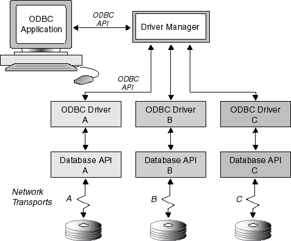
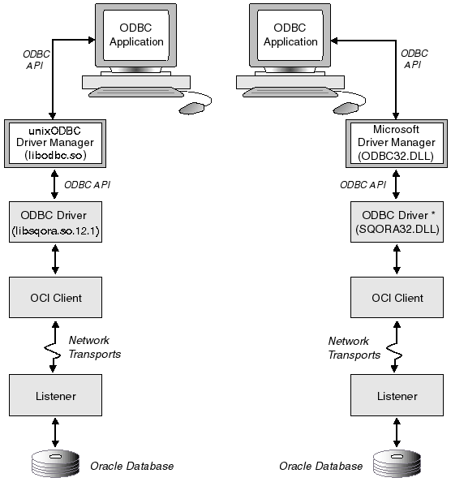
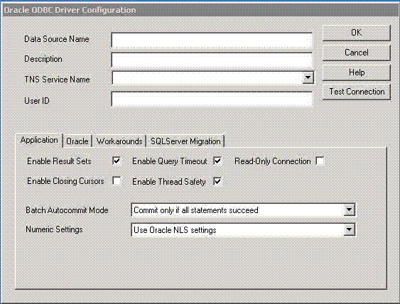
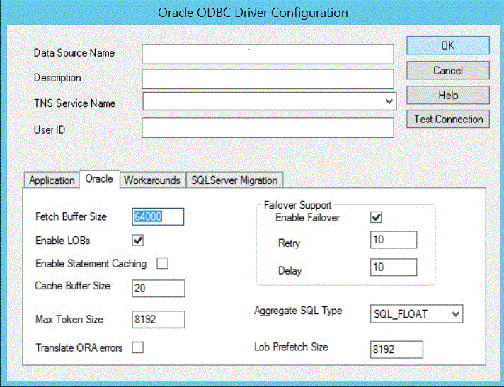
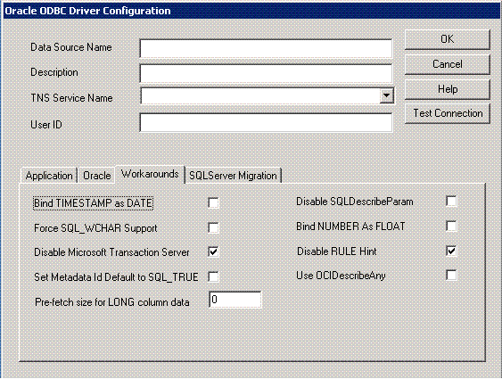
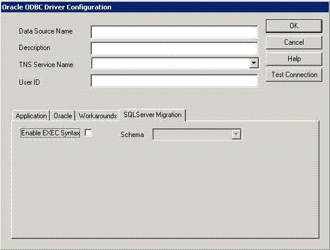

### 25.1 About Oracle ODBC Driver

What is ODBC?

Open Database Connectivity (ODBC) provides a standard interface that allows one application to access many different data sources. The application's source code does not have to be recompiled for each data source. A database driver links the application to a specific data source. A database driver is a dynamic-link library that an application can invoke on demand to gain access to a particular data source. Therefore, the application can access any data source for which a database driver exists.

The ODBC interface defines the following:

- A library of ODBC function calls that allows an application to connect to a data source, execute structured query language (SQL) statements, and retrieve results.
- SQL syntax based on the SQL-99 specification.
- A standard set of error codes.
- A standard way to connect to and log in to a data source.
- A standard representation for data types.

The following figure shows the components of the ODBC model. The model begins with an ODBC application making a call to the Driver Manager through the ODBC application program interface (API). The Driver Manager can be either the Microsoft Driver Manager or the unixODBC Driver Manager. Still using the ODBC API, the Driver Manager makes a call to the ODBC Driver. The ODBC Driver accesses the database over a network communications link using the database API. This figure shows an ODBC application accessing three separate databases.

Figure 25-1 Components of the ODBC Model



> This graphic shows an ODBC application accessing three separate databases. An ODBC application makes a call to the Driver Manager through the ODBC API. The Driver Manager can be either the Microsoft Driver Manager or the unixODBC Driver Manager. Still using the ODBC API, the Driver Manager makes a call to the ODBC Driver. The ODBC Driver accesses the database over a network communications link using the database API.


Related Topic

What is the Oracle ODBC Driver

### 25.2 For All Users

#### 25.2.1 Oracle ODBC Driver

##### 25.2.1.1 What Is the Oracle ODBC Driver

The Oracle ODBC Driver enables ODBC applications on Microsoft Windows, as well as UNIX platforms like Linux, Solaris, and IBM Advanced Interactive eXecutive (AIX) read and write access to Oracle® databases through the ODBC interface using Oracle Net Services software.

The Oracle ODBC Driver uses the Oracle Call Interface (OCI) client and server software to submit requests to and receive responses from the data source. Oracle Net Services communications protocol is used for communications between the OCI client and the Oracle server.

The Oracle ODBC Driver translates ODBC SQL syntax into syntax that can be used to access the data source. When the results are returned from the data source, the Oracle ODBC Driver translates them back to ODBC SQL syntax.

The following figure shows the Oracle ODBC Driver architecture as described in the preceding paragraphs.

Figure 25-2 Oracle ODBC Driver Architecture



> This graphic shows mirror images of the Oracle ODBC Driver architecture as a series of boxes connected by arrows pointing in both directions between the boxes to show the flow of information as requests to the server and responses from the server. The left side shows the UNIX platform and the right side shows the Windows platform.
>
> An ODBC application represented as the top-most box sends a request using the ODBC API to the ODBC Driver Manager, represented as the next box. The ODBC Driver Manager is the unixODBC Driver Manager (libodbc.so) for UNIX and the Microsoft Driver Manager (ODBC32.DLL) for Windows. The ODBC Driver Manager in turn sends the request using the ODBC API to the ODBC Driver represented as the next box. The ODBC Driver is libsqora.so.11.1 for UNIX and SQORA32.DLL for Windows. The Oracle ODBC Driver translates ODBC SQL syntax into syntax that can be used to access the data source and sends the request to the OCI client represented as the next box. The OCI client in turn sends the request over the network transport, represented by a squiggly line to the database listener, represented as a box. The database listener passes the request on to the Database server, which is the data source and is represented by a series of cylinders lying atop one another.
>
> The SQL query received as the request is run on the Database server and the results are returned from the data source through the OCI client over the network transport back to the Oracle ODBC Driver, which translates the results back to ODBC SQL syntax. The ODBC Driver then passes the translated results using the ODBC API on to the ODBC Driver Manager, which in turn passes the results back to the ODBC application.
>
> Thus, the Oracle ODBC Driver enables ODBC applications read and write access to Oracle databases through the ODBC interface.


\* The Oracle ODBC Resource data definition language (DLL) file (`sqres` `xx``.dll`), where `xx` represents the language abbreviation, contains all pertinent language information; the default resource file used is `sqresus.dll`.

For more information about the OCI client and server software, refer to the OCI documentation.

Related Topics

Configuring the Data Source

Connecting to a Data Source

Driver Conformance Levels

New and Changed Features

Files Created by the Installation

##### 25.2.1.2 New and Changed Features

The ODBC Driver Release Notes contains the details of all new and changed features. See [ODBC Driver Release Notes](https://docs.oracle.com/pls/topic/lookup?ctx=en/database/oracle/oracle-database/21/adfns&id=ODBCR) for more information

##### 25.2.1.3 Features Not Supported

Features Not Supported by the current Oracle ODBC Driver.

The Oracle ODBC Driver does not support the following ODBC 3.0 features:

- Interval data types
- Shared connections
- Shared environments

The Oracle ODBC Driver does not support the following SQL string functions:

- `BIT_LENGTH`
- `CHAR_LENGTH`
- `CHARACTER_LENGTH`
- `DIFFERENCE`
- `OCTET_LENGTH`
- `POSITION`

The Oracle ODBC Driver does not support the following SQL numeric functions

- `ACOS`
- `ASIN`
- `ATAN`
- `ATAN2`
- `COT`
- `DEGREES`
- `RADIANS`
- `RAND`
- `ROUND`

The Oracle ODBC Driver does not support the following SQL time, date, and interval functions:

- `CURRENT_DATE`
- `CURRENT_TIME`
- `CURRENT_TIMESTAMP`
- `EXTRACT`
- `TIMESTAMPDIFF`

##### 25.2.1.4 Files Created by the Installation

The following table describes the files that are installed by the Oracle ODBC Driver kit.

Table 25-1 Files Installed by the Oracle ODBC Driver Kit

| Description | File Name for Windows Installation | File Name for UNIX Installation |
| --- | --- | --- |
| Oracle ODBC Database Access DLL | `sqora32.dll` | libsqora.so.nn.n (where nn.n reflects a version number; for example, libsqora.so.20.1) |
| Oracle ODBC Driver Setup DLL | `sqoras32.dll` | None |
| Oracle ODBC Resource DLL | `sqresus.dll` | None |
| Oracle ODBC Resource DLL for Japanese | `sqresja.dll` | None |
| Oracle ODBC Driver message file | `oraodbcus.msb` | `oraodbcus.msb` |
| Oracle ODBC Driver message file for Japanese | `oraodbcja.msb` | `oraodbcja.msb` |
| Oracle ODBC Driver release notes | [Oracle Database ODBC Driver Release Notes](https://docs.oracle.com/pls/topic/lookup?ctx=en/database/oracle/oracle-database/21/adfns&id=ODBCR-GUID-3CCF5B7E-BC73-4935-8B6B-214831BB31C3) | [Oracle Database ODBC Driver Release Notes](https://docs.oracle.com/pls/topic/lookup?ctx=en/database/oracle/oracle-database/21/adfns&id=ODBCR-GUID-3CCF5B7E-BC73-4935-8B6B-214831BB31C3) |
| Oracle ODBC Driver Instant Client Release Notes | `ODBC_IC_Readme_Win.html` | `ODBC_IC_Readme_Unix.html` |
| Oracle ODBC Driver help file | `sqora.htm` | `sqora.htm` |
| Oracle ODBC Driver help file for Japanese | `sqora.htm` | `sqora.htm` |
| Oracle ODBC Driver Instant Client install script | `odbc_install.exe` | `odbc_update_ini.sh` |
| Oracle ODBC Driver Instant Client uninstall script | `odbc_uninstall.exe` | None |

Microsoft Driver Manager and Administrator Files

See the Microsoft ODBC 3.52 Software Development Kit and Programmer's Reference for the list of files that are installed with Microsoft's ODBC 3.52 Components.

The Microsoft ODBC components are packages in the Microsoft Data Access Component (MDAC) kit. Oracle ODBC driver on Windows has been tested using MDAC version 2.8.

unixODBC Driver Manager and Administrator Files

See the unixODBC readme and INSTALL files for the list of files that are installed with unixODBC Driver Manager.

See Also:

- [`MDAC Kit`](https://docs.oracle.com/pls/topic/lookup?ctx=en/database/oracle/oracle-database/21/adfns&id=mdac_kit) to download MDAC kit
- [Unix ODBC Driver Manager](https://docs.oracle.com/pls/topic/lookup?ctx=en/database/oracle/oracle-database/21/adfns&id=unix_odbc) to download unixODBC Driver

##### 25.2.1.5 Driver Conformance Levels

ODBC defines Conformance Levels for drivers in two areas:

- ODBC application programming interface (API)
- ODBC SQL-99 syntax

The Oracle ODBC Driver supports all core API functionality and a limited set of Level 1 and Level 2 functionality.

The Oracle ODBC Driver is broadly compatible with the SQL-99 Core specification which is a superset of the SQL-92 Entry Level specification. Applications must call SQLGetInfo with the appropriate information type to retrieve a list of SQL-99 supported features.

See Also:

API Conformance for more information about core API functionality support

##### 25.2.1.6 Known Limitations

The following are not supported by Oracle ODBC driver:

- ODBC ASYNC interface
- Control-C to cancel execution in an application

#### 25.2.2 Configuration Tasks

Topics:

##### 25.2.2.1 Configuring Oracle Net Services

Before Configuring the Data Source, you must configure network database services so there is an entry for each Transparent Network Substrate (TNS) Service Name. To do this, use Oracle Net Configuration Assistant (NETCA).

Using NETCA, you can create an entry in the tnsnames.ora file for each TNS Service Name. NETCA is installed when you install Oracle Net Services.

##### 25.2.2.2 Configuring the Data Source

Note:

The following configuration steps are for Windows users. Unix users must use the `odbc_update_ini.sh` file to create a DSN.

After installing the Oracle ODBC Driver and Configuring Oracle Net Services, and before using the Oracle ODBC Driver, you must configure the data source.

Before an application can communicate with the data source, you must provide configuration information. The configuration information informs the Oracle ODBC Driver as to which information you want to access.

The data source consists of the data that you want to access, its associated operating system, database management system, and network platform used to access the database management system. The data source for requests submitted by the Oracle ODBC Driver is an Oracle database and supports transports available under Oracle Net Services.

To configure or add an Oracle data source:

After you have installed the Oracle ODBC Driver, use the ODBC Data Source Administrator to configure or add an Oracle data source for each of your Oracle databases. The Oracle ODBC Driver uses the information you enter when you add the data source to access the data. Follow these steps:

1. From the start menu, select Programs, Administrative Tools, Data Sources (ODBC). A list of installed drivers is displayed.
2. Click Add in the Create New Data Source window and then select the Oracle ODBC Driver in the list of installed drivers.
3. Click Finish. The Oracle ODBC Driver Configuration Dialog Box is displayed. You must enter the DSN and TNS Service Name. You can provide the other information requested in the dialog box, or you can leave the fields blank and provide the information when you run the application.
4. After you have entered the data, click OK or click Return.

You can change or delete a data source at any time. The following subtopics explain how to add, change, or delete a data source.

To modify an Oracle data source:

1. From the start menu, select Programs, Administrative Tools, Data Sources(ODBC).
2. In the ODBC Data Source Administrator dialog box, select the data source from the Data Sources list and click Configure. The Oracle ODBC Driver Configuration dialog box is displayed.
3. In the Oracle ODBC Driver Configuration Dialog Box, modify the option values as necessary and click OK.

To delete an Oracle data source:

1. From the start menu, select Programs, Administrative Tools, Data Sources(ODBC).
2. In the ODBC Data Source Administrator dialog box, select the data source you want to delete from the Data Sources list.
3. Click Remove, and then click Yes to confirm the deletion.

##### 25.2.2.3 Oracle ODBC Driver Configuration Dialog Box

Note:

The Oracle ODBC Driver Configuration dialog box is available only for Microsoft Windows users.

The following screenshot shows an example of the Oracle ODBC Driver Configuration dialog box.

Figure 25-3 Oracle ODBC Driver Configuration Dialog Box



> This graphic shows the Oracle ODBC Driver Configuration screen where you can enter setup options. The fields are described in the text that follows.
>
> [  
> Copyright © 1996, 2023, Oracle and/or its affiliates.](https://docs.oracle.com/en/database/oracle/oracle-database/dcommon/html/cpyr.htm)


The following list is an explanation of the main setup options and fields found on the Oracle ODBC Driver Configuration dialog box shown in the preceding graphic. The tabs found on the lower half of this dialog box are described in subsequent topics.

- Data Source Name (DSN) - The name used to identify the data source to ODBC. For example, "odbc-pc". You must enter a DSN.
- Description - A description or comment about the data in the data source. For example, "Hire date, salary history, and current review of all employees." The Description field is optional.
- TNS Service Name - The location of the Oracle database from which the ODBC driver will retrieve data. This is the same name entered in Configuring Oracle Net Services using the Oracle Net Configuration Assistant (NETCA). For more information, see the NETCA documentation and About Using the Oracle ODBC Driver for the First Time. The TNS Service Name can be selected from a pull-down list of available TNS names. For example, "ODBC-PC". You must enter a TNS Service Name.
- User ID - The user name of the account on the server used to access the data. For example, "scott". The User ID field is optional.

You must enter the DSN and the TNS Service Name. You can provide the other information requested in the dialog box or you can leave the fields blank and provide the information when you run the application.

In addition to the main setup options previously described, there is a Test Connection button available. The Test Connection button verifies whether the ODBC environment is configured properly by connecting to the database specified by the DSN definition. When you press the Test Connection button, you are prompted for the username and password.

For an explanation of the Options tabs found on the lower half of the Oracle ODBC Driver Configuration dialog box, click any of these links:

Application Options

Oracle Options

Workarounds Options

SQL Server Migration Options

Application Options

The following screenshot shows an example of the Application Options tab found on the Oracle ODBC Driver Configuration dialog box.

Figure 25-4 The Application Options Tab of the Oracle ODBC Driver Configuration Dialog Box


> This graphic shows the Oracle ODBC Driver Configuration screen where you can enter setup options. The fields are described in the text that follows.
>
> [  
> Copyright © 1996, 2023, Oracle and/or its affiliates.](https://docs.oracle.com/en/database/oracle/oracle-database/dcommon/html/cpyr.htm)


The following list is an explanation of the fields found on the Application Options tab shown in the preceding graphic:

- Enable Result Sets - Enables the processing of Oracle Result Sets. If Result Sets are not required for your application, Result Set support can be disabled. There is a small performance penalty for procedures called from packages not containing Result Sets. Result Sets are enabled by default.
- Enable Query Timeout - Enables query timeout for SQL queries. By default, the Oracle ODBC Driver supports the `SQL_ATTR_QUERY_TIMEOUT` attribute for the SQLSetStmtAttr function. If this box is not checked, the Oracle ODBC Driver responds with a "not capable" message. Query Timeout is enabled by default.
- Read-Only Connection - Check this box to force read-only access. The default is write access.
- Enable Closing Cursors - Enables closing cursors. By default, closing cursors is disabled (the field is empty), meaning a call to close a cursor does not force the closing of OCI cursors when this behavior is not desired because it can cause an unnecessary performance hit. Enable closing cursors when you want to force the closing of OCI cursors upon a call to close a cursor.

Note:

There is an impact on performance each time a cursor is closed.

- Enable Thread Safety - Thread safety can be disabled for a data source. If thread safety is not required, disabling this option eliminates the overhead of using thread safety. By default, thread safety is enabled.
- Batch Autocommit Mode - By default, commit is executed only if all statements succeed.
- Numeric Settings - Allows you to choose the numeric settings that determine the decimal and group separator characters when receiving and returning numeric data that is bound as strings. This option allows you to choose Oracle NLS settings (the default setting), Microsoft default regional settings (to provide a way to mirror the Oracle OLE DB driver's behavior for greater interoperability), or US numeric settings (which are necessary when using MS Access or DAO (Database Access Objects) in non-US environments).

See Also:

Oracle ODBC Driver Configuration Dialog Box for the main configuration setup options

Oracle Options

The following screenshot shows an example of the Oracle Options tab found on the Oracle ODBC Driver Configuration dialog box.

Figure 25-5 The Oracle Options Tab of the Oracle ODBC Driver Configuration Dialog Box



> This graphic shows the Oracle tab as part of the Oracle ODBC Driver Configuration dialog box. The fields are described in the text that follows.
>
> [  
> Copyright © 1996, 2023, Oracle and/or its affiliates.](https://docs.oracle.com/en/database/oracle/oracle-database/dcommon/html/cpyr.htm)


The following list is an explanation of the fields found on the Oracle Options tab shown in the preceding graphic:

- Fetch Buffer Size - The amount of memory used to determine how many rows of data the ODBC Driver prefetches at a time from an Oracle database regardless of the number of rows the application program requests in a single query. However, the number of prefetched rows depends on the width and number of columns specified in a single query. Applications that typically fetch fewer than 20 rows of data at a time improve their response time, particularly over slow network connections or to heavily loaded servers. Setting Fetch Buffer Size too high can make response time worse or consume large amounts of memory.

Note:

When `LONG` and LOB data types are present, the number of rows prefetched by the ODBC Driver is not determined by the Fetch Buffer Size. The inclusion of the `LONG` and LOB data types minimizes the performance improvement and could result in excessive memory use. The ODBC Driver disregards Fetch Buffer Size and prefetches a set number of rows only in the presence of the `LONG` and LOB data types.

- Enable LOBs - Enables the writing of Oracle LOBs. If writing Oracle LOBs is not required for your application, LOB support can be disabled. There is a small performance penalty for insert and update statements when LOBs are enabled. LOB writing is enabled by default but disabled for Oracle databases that do not support the LOB data type.
- Enable Statement Caching - Enables statement caching feature, which increases the performance of parsing the query, in case the user has to parse the same text of query and related parameters multiple times. The default is disabled.
- Cache Buffer Size - The statement cache has a maximum size (number of statements) that can be modified by an attribute on the service context, `OCI_ATTR_STMTCACHESIZE`. The default cache buffer size is 20 that are used only if statement caching option is enabled. Setting cache buffer size to 0 disables statement caching feature.
- Max Token Size - Sets the token size to the nearest multiple of 1 KB (1024 bytes) beginning at 4 KB (4096 bytes). The default size is 8 KB (8192 bytes). The maximum value that can be set is 128 KB (131068 bytes).
- Translate ORA errors - Any migrated third party ODBC application, which is using the SQL Translation Framework feature, expects that errors returned by the server to be in their native database format, then users can enable this option to receive native errors based on the error translation registered with SQL Translation Profile.
- The Failover area of the Oracle Options tab contains the following fields:
	- Enable Failover - Enables Oracle Fail Safe and Oracle Parallel Server failover retry. This option in an enhancement to the failover capabilities of Oracle Fail Safe and Oracle Parallel Server. Enable this option to configure additional failover retries. The default is enabled.
		- Retry - The number of times the connection failover is attempted. The default is 10 attempts.
		- Delay - The number of seconds to delay between failover attempts. The default is 10 seconds.
- Aggregate SQL Type - Specifes the number type return for aggregate functions: `SQL_FLOAT`, `SQL_DOUBLE`, or ` SQL_DECIMAL`.
- Lob Prefetch Size - Sets the amount of LOB data (in bytes) to prefetch from the database at one time. The default size is 8192.

Note:

Oracle Fail Safe is deprecated and it can be desupported and unavailable in a future release. Oracle recommends that you evaluate other single-node failover options, such as Oracle RAC One Node

Note:

See the Oracle Fail Safe and Oracle Parallel Server documentation on how to set up and use both of these products.

See Also:

Oracle ODBC Driver Configuration Dialog Box for the main configuration setup options

Workarounds Options

The following screenshot shows an example of the Workarounds Options tab found on the Oracle ODBC Driver Configuration dialog box.

Figure 25-6 The Workarounds Options Tab of the Oracle ODBC Driver Configuration Dialog Box



> This graphic shows the Workarounds tab as part of the Oracle ODBC Driver Configuration dialog box. The fields are described in the text that follows.
>
> [  
> Copyright © 1996, 2023, Oracle and/or its affiliates.](https://docs.oracle.com/en/database/oracle/oracle-database/dcommon/html/cpyr.htm)


The following list is an explanation of the fields found on the Workarounds Options tab shown in the preceding graphic:

- Bind TIMESTAMP as DATE - Check this box to force the Oracle ODBC Driver to bind `SQL_TIMESTAMP` parameters as the Oracle `DATE` type instead of as the Oracle `TIMESTAMP` type (the default).
- Force SQL\_WCHAR Support - Check this box to enable SQLDescribeCol, SQLColumns, and SQLProcedureColumns to unconditionally return the data type of `SQL_WCHAR` for `SQL_CHAR` columns; `SQL_WVARCHAR` for `SQL_VARCHAR` columns; and `SQL_WLONGVARCHAR` for `SQL_LONGVARCHAR` columns. This feature enables Unicode support in applications that rely on the results of these ODBC calls (for example, ADO). This support is disabled by default.
- Disable Microsoft Transaction Server - Clear the check in this box to enable Microsoft Transaction Server (MTS) support. By default, MTS support is disabled.
- Set Metadata Id Default to SQL\_TRUE - Check this box to change the default value of the `SQL_ATTR_METADATA_ID` connection and statement attribute at connection time to `SQL_TRUE`. Under normal circumstances, `SQL_ATTR_METADATA_ID` would default to `SQL_FALSE`. ODBC calls made by the application to specifically change the value of the attribute after connection time are unaffected by this option and complete their functions as expected. By default, this option is off.
- Prefetch size for LONG column data - Set this value to prefetch `LONG ` or `LONG RAW` data to improve performance of ODBC applications. This enhancement improves the performance of Oracle ODBC driver up to 10 times, depending on the prefetch size set by the user. The default value is 0. The maximum value that you can set is 64 KB (65536 bytes).
	If the value of prefetch size is greater than 65536, the data fetched is only 65536 bytes. If you have `LONG ` or `LONG RAW` data in the database that is greater that 65536 bytes, then set the prefetch size to 0 (the default value), which causes single-row fetch and fetches complete `LONG` data. If you pass a buffer size less than the prefetch size in nonpolling mode, a data truncation error occurs if the `LONG` data size in the database is greater than the buffer size.
- Disable SQLDescribeParam - If the `SQLDescribeParam` function is enabled, the `SQL_VARCHAR` data type is returned for all parameters. If the Force SQL\_WCHAR Support function is also enabled, the `SQL_WVARCHAR` data type is returned for all parameters. By default, this function is enabled.
- Bind NUMBER as FLOAT - Check this box to force the Oracle ODBC Driver to bind `NUMBER` column containing `FLOAT` data as Float instead of as the Binary Float (the default).
- Disable RULE Hint - Clear the check in this box to enable `RULE Hint` specified with catalogue queries. By default, `RULE Hint` option is disabled.
- Use OCIDescribeAny - Check this box to gain a performance improvement by forcing the driver to use `OCIDescribeAny()` when an application makes heavy calls to small packaged procedures that return `REF CURSORS`.

See Also:

- Implementation of Data Types (Advanced) for more information about DATE and TIMESTAMP
- Implementation of ODBC API Functions for more information about the `SQL_ATTR_METADATA_ID` attribute
- Oracle ODBC Driver Configuration Dialog Box for the main configuration setup options

SQL Server Migration Options

The following screenshot shows an example of the SQL Server Migration Options tab found on the Oracle ODBC Driver Configuration dialog box.

Figure 25-7 The SQL Server Migration Options Tab of the Oracle ODBC Driver Configuration Dialog Box



> This graphic shows the SQL Server Migration tab as part of the Oracle ODBC Driver Configuration dialog box. The fields are described in the text that follows.
>
> [  
> Copyright © 1996, 2023, Oracle and/or its affiliates.](https://docs.oracle.com/en/database/oracle/oracle-database/dcommon/html/cpyr.htm)


The fields of the SQL Server Migration Options tab in the preceding graphic are:

- EXEC Syntax Enabled, which enables support for SQL Server EXEC syntax. A subprogram call specified in an EXEC statement is translated to its equivalent Oracle subprogram call before being processed by an Oracle database server. By default this option is disabled.
- Schema, which is the translated Oracle subprogram assumed to be defined in the user's default schema. However, if all subprograms from the same SQL Server database are migrated to the same Oracle schema with their database name as the schema name, then set this field to database. If all subprograms owned by the same SQL Server user are defined in the same Oracle schema, then set this field to owner. This field is empty by default.

See Also:

Oracle ODBC Driver Configuration Dialog Box for the main configuration setup options

#### 25.2.3 Modifying the oraodbc.ini File

Topics:

- Reducing Lock Timeout

##### 25.2.3.1 Reducing Lock Timeout

An Oracle server waits indefinitely for lock conflicts between transactions to be resolved. You can limit the amount of time that an Oracle server waits for locks to be resolved by setting the Oracle ODBC Driver's `LockTimeOut` entry in the `oraodbc.ini` file. The value you enter for the `LockTimeOut` parameter is the number of seconds after which an Oracle server times out if it cannot obtain the requested locks. In the following example, the Oracle server times out after 60 seconds:

```
[Oracle ODBC Driver Common]
LockTimeOut=60
```

#### 25.2.4 Connecting to a Data Source

Topics:

Connecting to an Oracle Data Source

##### 25.2.4.1 Connecting to an Oracle Data Source

To connect to a Data Source, the Oracle ODBC Driver requires that the OCI client software be installed on your computer and the corresponding listener be running on the Oracle server. Oracle Net Services for Windows is a Dynamic Linked Library (DLL) based application. For more information about Oracle Net Services, see the Oracle Net Services documentation.

As part of the connection process, an application can prompt you for information. If an application prompts you for information about an Oracle data source, do the following:

1. In the TNS Service Name box, enter the name of the TNS service.
2. In the User Name box, enter the name you use to access an Oracle Database.
3. In the Password box, enter the password you use to access an Oracle Database.
4. Click OK.

An application must connect to a data source to access the data in it. Different applications connect to data sources at different times. For example, an application might connect to a data source only at your request, or it might connect automatically when it starts. For information about when an application connects to a data source, see the documentation for that application.

For additional information, click any of these links:
- For all users:
	- Configuring the Data Source
- For programmers:
	- SQLDriverConnect Implementation
		- Data Source Configuration Options

#### 25.2.5 Troubleshooting

Topics:

- About Using the Oracle ODBC Driver for the First Time
- Expired Password

##### 25.2.5.1 About Using the Oracle ODBC Driver for the First Time

Describes useful information about using the Oracle ODBC Driver for the first time.

See the Oracle ODBC Driver developer home [ODBC Developer Center](https://docs.oracle.com/pls/topic/lookup?ctx=en/database/oracle/oracle-database/21/adfns&id=otn_odbc_developer_center) where you can find additional information about Oracle ODBC Driver features, resources, such as the Oracle Instant Client ODBC Installation Guide, the Oracle Instant Client ODBC download site, the Oracle ODBC discussion forum, the Oracle ODBC Driver Development Guide and information about some related technologies.

##### 25.2.5.2 Expired Password

This section contains information about expired passwords.

Expired Password Behavior

If you try to connect to the database and your password has expired, you are prompted to change your password. Upon making a successful password change, you are connected to the database. However, if you try to connect to the database with a `SQLDriverConnect` call with a `SQL_DRIVER_NOPROMPT` parameter value, the Oracle ODBC Driver does not prompt you for the password change. Instead, an error condition results, producing an error message and number that indicates that the password has expired.

### 25.3 For Advanced Users

#### 25.3.1 Creating Oracle ODBC Driver TNS Service Names

To create Oracle ODBC Driver TNS Service Names with Oracle Net Services, use the Oracle Net Configuration Assistant (NETCA), which is installed when you install Oracle Net Services. NETCA creates Oracle ODBC Driver TNS Service Name entries in the tnsnames.ora file.

#### 25.3.2 SQL Statements

The Oracle ODBC Driver is broadly compatible with the SQL-99 Core specification which is a superset of the SQL-92 Entry Level specification. In addition to Oracle's grammar, the vendor-specific escape sequences outlined in Appendix C of the ODBC specifications are also supported. In accordance with the design of ODBC, the Oracle ODBC Driver passes native SQL syntax to the Oracle database.

See Also:

- Data Types for advanced users
- Implementation of the ODBC SQL Syntax
	for programmers

#### 25.3.3 Data Types

The Oracle ODBC Driver maps Oracle database data types to ODBC SQL data types.

Note:

All conversions in Appendix D of the Microsoft ODBC 3.52 Software Development Kit and Programmer's Reference are supported for the ODBC SQL data types listed from a call to `SQLGetInfo` with the appropriate information type.

See Also:

- For advanced users:
	- Implementation of Data Types (Advanced)
		- Limitations on Data Types
		- SQL Statements
- For programmers:
	- Implementation of Data Types (Programming)

#### 25.3.4 Implementation of Data Types (Advanced)

Topics:

- DATE and TIMESTAMP
- Floating Point Data Types

DATE and TIMESTAMP

The semantics of Oracle `DATE` and `TIMESTAMP` data types do not correspond exactly with the ODBC data types with the same names. The Oracle `DATE` data type contains both date and time information while the `SQL_DATE` data type contains only date information. The Oracle `TIMESTAMP` data type also contains date and time information, but it has greater precision in fractional seconds. The ODBC Driver reports the data types of both Oracle `DATE` and `TIMESTAMP` columns as `SQL_TIMESTAMP` to prevent information loss. Similarly the ODBC Driver binds `SQL_TIMESTAMP` parameters as Oracle `TIMESTAMP` values.

Floating Point Data Types

When connected to a 10.1 or later Oracle server, the ODBC Driver maps the Oracle floating point data types `BINARY_FLOAT` and `BINARY_DOUBLE` to the ODBC data types `SQL_REAL` and `SQL_DOUBLE`, respectively. In previous releases, `SQL_REAL` and `SQL_DOUBLE` mapped to the generic Oracle numeric data type.

#### 25.3.5 Limitations on Data Types

The Oracle ODBC Driver and the Oracle database impose limitations on data types. The following table describes these limitations.

Table 25-2 Oracle ODBC Driver and Oracle Database Limitations on Data Types

| Limited Data Type | Description |
| --- | --- |
| Literals | Oracle Database limits literals in SQL statements to 32K bytes. |
| SQL\_LONGVARCHAR and SQL\_WLONGVARCHAR | Oracle's limit for `SQL_LONGVARCHAR` data where the column type is `LONG` is 2,147,483,647 bytes. Oracle's limit for the `SQL_LONGVARCHAR` data where the column type is `CLOB` is 4 gigabytes. The limiting factor is the client workstation memory. |
| SQL\_LONGVARCHAR and SQL\_LONGVARBINARY | Oracle database allows only a single long data column per table. The long data types are `SQL_LONGVARCHAR` (`LONG`) and `SQL_LONGVARBINARY` (`LONG RAW`). Oracle recommends you use `CLOB` and `BLOB` columns instead. There is no restriction on the number of `CLOB` and `BLOB` columns in a table. |

#### 25.3.6 Error Messages

When an error occurs, the Oracle ODBC Driver returns the native error number, the `SQLSTATE` (an ODBC error code), and an error message. The driver derives this information both from errors detected by the driver and errors returned by the Oracle server.

Native Error

For errors that occur in the data source, the Oracle ODBC Driver returns the native error returned to it by the Oracle server. When the Oracle ODBC Driver or the Driver Manager detects an error, the Oracle ODBC Driver returns a native error of zero.

SQLSTATE

For errors that occur in the data source, the Oracle ODBC Driver maps the returned native error to the appropriate `SQLSTATE`. When the Oracle ODBC Driver detects an error, it generates the appropriate `SQLSTATE`. When the Driver Manager detects an error, it generates the appropriate `SQLSTATE`.

Error Message

For errors that occur in the data source, the Oracle ODBC Driver returns an error message based on the message returned by the Oracle server. For errors that occur in the Oracle ODBC Driver or the Driver Manager, the Oracle ODBC Driver returns an error message based on the text associated with the `SQLSTATE`.

Error messages have the following format:

```
[vendor] [ODBC-component] [data-source] error-message
```

The prefixes in brackets ( \[ \] ) identify the source of the error. The following table shows the values of these prefixes returned by the Oracle ODBC Driver. When the error occurs in the data source, the \[vendor\] and \[ODBC-component\] prefixes identify the vendor and name of the ODBC component that received the error from the data source.

Table 25-3 Error Message Values of Prefixes Returned by the Oracle ODBC Driver

| Error Source | Prefix | Value |
| --- | --- | --- |
| Driver Manager | \[vendor\]\[ODBC-component\]\[data-source\] | \[Microsoft/unixODBC\]\[ODBC Driver Manager\]N/A |
| Oracle ODBC Driver | \[vendor\]\[ODBC-component\]\[data-source\] | \[ORACLE\]\[ODBC Driver\]N/A |
| Oracle server | \[vendor\]\[ODBC-component\]\[data-source\] | \[ORACLE\]\[ODBC Driver\]N/A |

For example, if the error message does not contain the \[Ora\] prefix shown in the following format, the error is an Oracle ODBC Driver error and should be self-explanatory.

```
[Oracle][ODBC]Error message text here
```

If the error message contains the \[Ora\] prefix shown in the following format, it is not an Oracle ODBC Driver error.

Note:

Although the error message contains the \[Ora\] prefix, the actual error may be coming from one of several sources.

```
[Oracle][ODBC][Ora]Error message text here
```

If the error message text starts with the following prefix, you can obtain more information about the error in the Oracle server documentation.

```
ORA-
```

Oracle Net Services errors and Trace logging are located under the `ORACLE_HOME` `\NETWORK` directory on Windows systems or the `ORACLE_HOME` `/NETWORK` directory on UNIX systems where the OCI software is installed and specifically in the log and trace directories respectively. Database logging is located under the `ORACLE_HOME` `\RDBMS` directory on Windows systems or the `ORACLE_HOME` `/rdbms` directory on UNIX systems where the Oracle server software is installed.

See the Oracle server documentation for more information about server error messages.

### 25.4 For Programmers

Topics:

- Format of the Connection String
- SQLDriverConnect Implementation
- Reducing Lock Timeout in a Program
- Linking with odbc32.lib (Windows) or libodbc.so (UNIX)
- Information About rowids
- Rowids in a WHERE Clause
- Enabling Result Sets
- Enabling EXEC Syntax
- Enabling Event Notification for Connection Failures in an Oracle RAC Environment
- Using Implicit Results Feature Through ODBC
- About Supporting Oracle TIMESTAMP WITH TIME ZONE and TIMESTAMP WITH LOCAL TIME ZONE Column Type in ODBC
- About the Effect of Setting ORA\_SDTZ in Oracle Clients (OCI, SQL\*Plus, Oracle ODBC Driver, and Others)
- Supported Functionality
- Unicode Support
- Performance and Tuning

#### 25.4.1 Format of the Connection String

The following table describes keywords that can be included in the connection string argument of the `SQLDriverConnect` function call. Missing keywords are read from the Administrator entry for the data source. Values specified in the connection string override those contained in the Administrator entry. See the Microsoft ODBC 3.52 Software Development Kit and Programmer's Reference for more information about the `SQLDriverConnect` function.

Table 25-4 Keywords that Can Be Included in the Connection String Argument of the SQLDriverConnect Function Call

| Keyword | Meaning | Comments |
| --- | --- | --- |
| DSN | ODBC Data Source Name | User-supplied name. |
| DBQ | TNS Service Name | User-supplied name. |
| UID | User ID or User Name | User-supplied name. |
| PWD | Password | User-supplied password. Specify PWD=; for an empty password. |
| DBA | Database Attribute | W=write access.  R=read-only access. |
| APA | Applications Attributes | T=Thread Safety Enabled.  F=Thread Safety Disabled. |
| RST | Result Sets | T=Result Sets Enabled.  F=Result Sets Disabled. |
| QTO | Query Timeout Option | T=Query Timeout Enabled.  F=Query Timeout Disabled. |
| CSR | Close Cursor | T=Close Cursor Enabled.  F=Close Cursor Disabled. |
| BNF | Bind `NUMBER` as `FLOAT` | T=Bind `NUMBER` as `FLOAT`.  F=Bind `NUMBER` as `NUMBER`. |
| DRH | Disable Rule Hint | T=Disable Rule Hint.  F=Enable Rule Hint. |
| BAM | Batch Autocommit Mode | IfAllSuccessful=Commit only if all statements are successful (old behavior).  UpToFirstFailure=Commit up to first failing statement (V7 ODBC behavior).  AllSuccessful=Commit all successful statements (only when connected to an Oracle database; against other databases, same behavior as V7). |
| FBS | Fetch Buffer Size | User-supplied numeric value (specify a value in bytes of 0 or greater).  The default is 60,000 bytes. |
| FEN | Failover | T=Failover Enabled.  F=Failover Disabled. |
| FRC | Failover Retry Count | User-supplied numeric value.  The default is 10. |
| FDL | Failover Delay | User-supplied numeric value.  The default is 10. |
| LOB | LOB Writes | T=LOBs Enabled.  F=LOBs Disabled. |
| MTS | Microsoft Transaction Server Support | T=Disabled.  F=Enabled. |
| FWC | Force `SQL_WCHAR` Support | T=Force `SQL_WCHAR` Enabled.  F=Force `SQL_WCHAR` Disabled. |
| EXC | EXEC Syntax | T=EXEC Syntax Enabled.  F=EXEC Syntax Disabled. |
| XSM | Schema Field | Default=Default.  Database=Database Name.  Owner=Owner Name. |
| MDI | Set Metadata ID Default | T= `SQL_ATTR_METADATA_ID` defaults to `SQL_TRUE`.  F= `SQL_ATTR_METADATA_ID` defaults to `SQL_FALSE`. |
| DPM | Disable `SQLDescribeParam` | T= `SQLDescribeParam` Disabled.  F= `SQLDescribeParam` Enabled. |
| BTD | Bind `TIMESTAMP` as `DATE` | T=Bind `SQL_TIMESTAMP` as Oracle `DATE`  F=Bind `SQL_TIMESTAMP` as Oracle `TIMESTAMP` |
| NUM | Numeric Settings | NLS=Use Oracle NLS numeric settings (to determine the decimal and group separator).  MS=Use Microsoft regional settings.  US=Use US settings. |
| ODA | Use `OCIDescribeAny( )` | T= Use `OCIDescribeAny()` call to gain performance improvement when application makes heavy calls to small packaged procedures that return `REF CURSORS`.  F= Do not use `OCIDescribeAny()`. By default, use `OCIDescribeAny()` value is `FALSE`. |
| STE | SQL Translate ORA Errors  Specifies whether the Oracle ODBC Driver is to translate the Oracle error codes | T=Translate ORA errors.  F=Do not translate any ORA error. By default, `SQLTranslateErrors` is `FALSE`. |
| TSZ | Token Size | User-supplied numeric value.  Sets the token size to the nearest multiple of 1 KB (1024 bytes) beginning at 4 KB (4096 bytes). The default size is 8 KB (8192 bytes). The maximum value that can be set is 128 KB (131068 bytes). |

If the following keyword is specified in the connection string, the Oracle ODBC Driver does not read values defined from the Administrator:

```
DRIVER={Oracle ODBC Driver}
```

Examples of valid connection strings are:

```
1) DSN=Personnel;UID=Kotzwinkle;PWD=;2) DRIVER={Oracle ODBC Driver};UID=Kotzwinkle;PWD=whatever;DBQ=instl_alias;DBA=W;
```

See Also:

- Connecting to an Oracle Data Source for all users
- SQLDriverConnect Implementation for programmers

#### 25.4.2 SQLDriverConnect Implementation

The following table describes the keywords required by the SQLDriverConnect connection string.

Table 25-5 Keywords Required by the SQLDriverConnect Connection String

| Keyword | Description |
| --- | --- |
| DSN | The name of the data source. |
| DBQ | The TNS Service Name. See Creating Oracle ODBC Driver TNS Service Names. For more information, see the Oracle Net Services documentation. |
| UID | The user login ID or user name. |
| PWD | The user-specified password. |

#### 25.4.3 Reducing Lock Timeout in a Program

The Oracle server waits indefinitely for lock conflicts between transactions to be resolved. You can limit the amount of time that the Oracle server waits for locks to be resolved by calling the ODBC `SQLSetConnectAttr` function before connecting to the data source. Specify a nonzero value for the `SQL_ATTR_QUERY_TIMEOUT` attribute in the ODBC `SQLSetStmtAttr function`.

If you specify a lock timeout value using the ODBC `SQLSetConnectAttr` function, it overrides any value specified in the `oraodbc.ini` file.

See Also:

Reducing Lock Timeout for more information on specifying a value in the `oraodbc.ini` file

#### 25.4.4 Linking with odbc32.lib (Windows) or libodbc.so (UNIX)

For Windows platforms, when you link your program, you must link it with the import library `odbc32.lib`.

For UNIX platforms, an ODBC application must be linked to `libodbc.so`.

#### 25.4.5 Information About rowids

The ODBC `SQLSpecialColumns` function returns information about the columns in a table. When used with the Oracle ODBC Driver, it returns information about the Oracle rowids associated with an Oracle table.

#### 25.4.6 Rowids in a WHERE Clause

Rowids can be used in the `WHERE` clause of an SQL statement. However, the rowid value must be presented in a parameter marker.

#### 25.4.7 Enabling Result Sets

Oracle reference cursors (Result Sets) allow an application to retrieve data using stored procedures and stored functions. The following information identifies how to use reference cursors to enable Result Sets through ODBC.

- The ODBC syntax for calling stored procedures must be used. Native PL/SQL is not supported through ODBC. The following identifies how to call the procedure or function without a package and within a package. The package name in this case is RSET.
	```
	Procedure call: 
	{CALL Example1(?)}
	{CALL RSET.Example1(?)} 
	Function Call: 
	{? = CALL Example1(?)}
	{? = CALL RSET.Example1(?)}
	```
- The PL/SQL reference cursor parameters are omitted when calling the procedure. For example, assume procedure Example2 is defined to have four parameters. Parameters 1 and 3 are reference cursor parameters and parameters 2 and 4 are character strings. The call is specified as:
	```
	{CALL RSET.Example2("Literal 1", "Literal 2")}
	```

The following example application shows how to return a Result Set using the Oracle ODBC Driver:

```
/*
 * Sample Application using Oracle reference cursors via ODBC
 *
 * Assumptions:
 *
 * 1) Oracle Sample database is present with data loaded for the EMP table.
 * 2) Two fields are referenced from the EMP table ename and mgr.
 * 3) A data source has been setup to access the sample database.
 *
 * Program Description:
 *
 * Abstract:
 *
 * This program demonstrates how to return result sets using
 * Oracle stored procedures
 *
 * Details:
 *
 * This program:
 * Creates an ODBC connection to the database.
 * Creates a Packaged Procedure containing two result sets.
 * Executes the procedure and retrieves the data from both result sets.
 * Displays the data to the user.
 * Deletes the package then logs the user out of the database.
 *
 *
 * The following is the actual PL/SQL this code generates to
 * create the stored procedures.
 *
 * DROP PACKAGE ODBCRefCur;
 *
 * CREATE PACKAGE ODBCRefCur AS
 * TYPE ename_cur IS REF CURSOR;
 * TYPE mgr_cur IS REF CURSOR;
 * PROCEDURE EmpCurs(Ename IN OUT ename_cur, Mgr IN OUT mgr_cur, pjob IN VARCHAR2);
 * END;
 *
 * CREATE or REPLACE PACKAGE BODY ODBCRefCur AS
 * PROCEDURE EmpCurs(Ename IN OUT ename_cur, Mgr IN OUT mgr_cur, pjob IN VARCHAR2)
 * AS
 * BEGIN
 * IF NOT Ename%ISOPEN
 * THEN
 * OPEN Ename for SELECT ename from emp;
 * END IF;
 * IF NOT Mgr%ISOPEN
 * THEN
 * OPEN Mgr for SELECT mgr from emp where job = pjob;
 * END IF;
 * END;
 * END;
 *
 */

/* Include Files */
#ifdef WIN32
  #include <windows.h>
#endif
#include <stdio.h>
#include <sql.h>
#include <sqlext.h>
 
/* Defines */
#define JOB_LEN 9
#define DATA_LEN 100
#define SQL_STMT_LEN 500
 
/* Procedures */
void DisplayError(SWORD HandleType, SQLHANDLE hHandle, char *Module);
 
/* Main Program */
int main()
{
  SQLHENV hEnv;
  SQLHDBC hDbc;
  SQLHSTMT hStmt;
  SQLRETURN rc;
  char *DefUserName ="scott";
  char *DefPassWord ="tiger";
  SQLCHAR ServerName[DATA_LEN];
  SQLCHAR *pServerName=ServerName;
  SQLCHAR UserName[DATA_LEN];
  SQLCHAR *pUserName=UserName;
  SQLCHAR PassWord[DATA_LEN];
  SQLCHAR *pPassWord=PassWord;
  char Data[DATA_LEN];
  SQLINTEGER DataLen;
  char error[DATA_LEN];
  char *charptr;
  SQLCHAR SqlStmt[SQL_STMT_LEN];
  SQLCHAR *pSqlStmt=SqlStmt;
  char *pSalesMan = "SALESMAN";
  SQLINTEGER sqlnts=SQL_NTS;

  /* Allocate the Environment Handle */
  rc = SQLAllocHandle( SQL_HANDLE_ENV, SQL_NULL_HANDLE, &hEnv );
  if (rc != SQL_SUCCESS)
  {
    printf( "Cannot Allocate Environment Handle/n");
    printf( "/nHit Return to Exit/n");
    charptr = gets ((char *)error);
    exit(1);
  }

  /* Set the ODBC Version */
  rc = SQLSetEnvAttr(hEnv, SQL_ATTR_ODBC_VERSION, (void *)SQL_OV_ODBC3, 0);
  if (rc != SQL_SUCCESS)
  {
    printf("Cannot Set ODBC Version/n");
    printf("/nHit Return to Exit/n");
    charptr = gets((char *)error);
    exit(1);
  }

  /* Allocate the Connection handle */
  rc = SQLAllocHandle(SQL_HANDLE_DBC, hEnv, &hDbc);
  if (rc != SQL_SUCCESS)
  {
    printf("Cannot Allocate Connection Handle/n");
    printf("/nHit Return to Exit/n");
    charptr = gets((char*) error);
    exit(1);
  }

  /* Get User Information */
  lstrcpy((char*) pUserName, DefUserName);
  lstrcpy((char*) pPassWord, DefPassWord);

  /* Data Source name */
  printf( "/nEnter the ODBC Data Source Name/n" );
  charptr = gets((char*) ServerName);

  /* User Name */
  printf("/nEnter User Name Default [%s]/n", pUserName);
  charptr = gets((char*) UserName);
  if (*charptr == '/0')
  {
    lstrcpy((char*) pUserName, (char*) DefUserName);
  }

  /* Password */
  printf ("/nEnter Password Default [%s]/n", pPassWord);
  charptr = gets((char*) PassWord);
  if (*charptr == '/0')
  {
    lstrcpy((char*) pPassWord, (char*) DefPassWord);
  }

  /* Connection to the database */
  rc = SQLConnect(hDbc, pServerName, (SQLSMALLINT) lstrlen((char *)pServerName), pUserName,
                  (SQLSMALLINT) lstrlen((char*)pUserName), pPassWord,
                  (SQLSMALLINT) lstrlen((char *)pPassWord));
  if (rc != SQL_SUCCESS)
  {
    DisplayError(SQL_HANDLE_DBC, hDbc, "SQLConnect");
  }
 
  /* Allocate a Statement */
  rc = SQLAllocHandle(SQL_HANDLE_STMT, hDbc, &hStmt);
  if (rc != SQL_SUCCESS)
  {
    printf( "Cannot Allocate Statement Handle/n");
    printf( "/nHit Return to Exit/n");
    charptr = gets((char *)error);
    exit(1);
  }

  /* Drop the Package */
  lstrcpy((char *) pSqlStmt, "DROP PACKAGE ODBCRefCur");
  rc = SQLExecDirect(hStmt, pSqlStmt, lstrlen((char *)pSqlStmt));

  /* Create the Package Header */
  lstrcpy((char *) pSqlStmt, "CREATE PACKAGE ODBCRefCur AS/n" );
  lstrcat((char *) pSqlStmt, " TYPE ename_cur IS REF CURSOR;/n" );
  lstrcat((char *) pSqlStmt, " TYPE mgr_cur IS REF CURSOR;/n" );
  lstrcat((char *) pSqlStmt, " PROCEDURE EmpCurs (Ename IN OUT ename_cur," );
  lstrcat((char *) pSqlStmt, " Mgr IN OUT mgr_cur,pjob IN VARCHAR2);/n/n");
  lstrcat((char *) pSqlStmt, "END;/n" );

  rc = SQLExecDirect(hStmt, pSqlStmt, lstrlen((char *)pSqlStmt));
  if (rc != SQL_SUCCESS)
  {
    DisplayError(SQL_HANDLE_STMT, hStmt, "SQLExecDirect");
  }

  /* Create the Package Body */
  lstrcpy((char *) pSqlStmt, "CREATE PACKAGE BODY ODBCRefCur AS/n" );
  lstrcat((char *) pSqlStmt, " PROCEDURE EmpCurs (Ename IN OUT ename_cur," );
  lstrcat((char *) pSqlStmt, " Mgr IN OUT mgr_cur, pjob IN VARCHAR2)/n" );
  lstrcat((char *) pSqlStmt, " AS/n" );
  lstrcat((char *) pSqlStmt, " BEGIN/n" );
  lstrcat((char *) pSqlStmt, " IF NOT Ename%ISOPEN/n" );
  lstrcat((char *) pSqlStmt, " THEN/n" );
  lstrcat((char *) pSqlStmt, " OPEN Ename for SELECT ename from emp;/n" );
  lstrcat((char *) pSqlStmt, " END IF;/n/n" );
  lstrcat((char *) pSqlStmt, " IF NOT Mgr%ISOPEN/n THEN/n" );
  lstrcat((char *) pSqlStmt, " OPEN Mgr for SELECT mgr from emp where job = pjob;/n");
  lstrcat((char *) pSqlStmt, " END IF;/n" );
  lstrcat((char *) pSqlStmt, " END;/n" );

  lstrcat((char *) pSqlStmt, "END;/n" );

  rc = SQLExecDirect(hStmt, pSqlStmt, lstrlen((char *)pSqlStmt));
  if(rc != SQL_SUCCESS)
    DisplayError(SQL_HANDLE_STMT, hStmt, "SQLExecDirect");

  /* Bind the Parameter */
  rc = SQLBindParameter(hStmt, 1, SQL_PARAM_INPUT, SQL_C_CHAR, SQL_CHAR, JOB_LEN, 0, pSalesMan, 0, &sqlnts);

  /* Call the Store Procedure which executes the Result Sets */
  lstrcpy( (char *) pSqlStmt, "{CALL ODBCRefCur.EmpCurs(?)}");

  rc = SQLExecDirect(hStmt, pSqlStmt, lstrlen((char *)pSqlStmt));
  if(rc != SQL_SUCCESS)
    DisplayError(SQL_HANDLE_STMT, hStmt, "SQLExecDirect");

  /* Bind the Data */
  rc = SQLBindCol(hStmt, 1, SQL_C_CHAR, Data, sizeof(Data), &DataLen);
  if(rc != SQL_SUCCESS)
    DisplayError(SQL_HANDLE_STMT, hStmt, "SQLBindCol");
 
  /* Get the data for Result Set 1 */
  printf("/nEmployee Names/n/n");

  while(rc == SQL_SUCCESS)
  {
    rc = SQLFetch(hStmt);
    if(rc == SQL_SUCCESS)
      printf("%s/n", Data);
    else
      if(rc != SQL_NO_DATA)
        DisplayError(SQL_HANDLE_STMT, hStmt, "SQLFetch");
  }

  printf( "/nFirst Result Set - Hit Return to Continue/n");
  charptr = gets ((char *)error);

  /* Get the Next Result Set */
  rc = SQLMoreResults( hStmt );
  if(rc != SQL_SUCCESS)
    DisplayError(SQL_HANDLE_STMT, hStmt, "SQLMoreResults");

  /* Get the data for Result Set 2 */
  printf("/nManagers/n/n");
  while (rc == SQL_SUCCESS)
  {
    rc = SQLFetch(hStmt);
    if(rc == SQL_SUCCESS)
      printf("%s/n", Data);
    else
      if (rc != SQL_NO_DATA)
        DisplayError(SQL_HANDLE_STMT, hStmt, "SQLFetch");
  }

  printf("/nSecond Result Set - Hit Return to Continue/n");
  charptr = gets((char *)error);

  /* Should Be No More Results Sets */
  rc = SQLMoreResults( hStmt );
  if (rc != SQL_NO_DATA)
    DisplayError(SQL_HANDLE_STMT, hStmt, "SQLMoreResults");

  /* Drop the Package */
  lstrcpy((char *)pSqlStmt, "DROP PACKAGE ODBCRefCur");
  rc = SQLExecDirect(hStmt, pSqlStmt, lstrlen((char *)pSqlStmt));

  /* Free handles close connections to the database */
  SQLFreeHandle( SQL_HANDLE_STMT, hStmt );
  SQLDisconnect( hDbc );
  SQLFreeHandle( SQL_HANDLE_DBC, hDbc );
  SQLFreeHandle( SQL_HANDLE_ENV, hEnv );

  printf( "/nAll Done - Hit Return to Exit/n");
  charptr = gets ((char *)error);
  return(0);
}
 
/* Display Error Messages */
void DisplayError( SWORD HandleType, SQLHANDLE hHandle, char *Module )
{
  SQLCHAR MessageText[255];
  SQLCHAR SQLState[80];
  SQLRETURN rc=SQL_SUCCESS;
  LONG NativeError;
  SWORD RetLen;
  SQLCHAR error[25];
  char *charptr;

  rc = SQLGetDiagRec(HandleType, hHandle, 1, SQLState, &NativeError, MessageText, 255, &RetLen);
  printf( "Failure Calling %s/n", Module );
  if (rc == SQL_SUCCESS || rc == SQL_SUCCESS_WITH_INFO)
  {
    printf( "/t/t/t State: %s/n", SQLState);
    printf( "/t/t/t Native Error: %d/n", NativeError );
    printf( "/t/t/t Error Message: %s/n", MessageText );
  }

  printf( "/nHit Return to Exit/n");
  charptr = gets ((char *)error);
  exit(1);
}
```

#### 25.4.8 Enabling EXEC Syntax

If the syntax of your SQL Server `EXEC` statement can be readily translated to an equivalent Oracle procedure call without change, the Oracle ODBC Driver can translate it if you enable this option.

The complete name of a SQL Server procedure consists of up to four identifiers:

- server name
- database name
- owner name
- procedure name

The format for the name is:

```
[[[server.][database].][owner_name].]procedure_name
```

During the migration of the SQL Server database to Oracle, the definition of each SQL Server procedure (or function) is converted to its equivalent Oracle syntax and is defined in a schema in Oracle. Migrated procedures are often reorganized (and created in schemas) in one of these ways:

- All procedures are migrated to one schema (the default option).
- All procedures defined in one SQL Server database are migrated to the schema named with that database name.
- All procedures owned by one user are migrated to the schema named with that user's name.

To support these three ways of organizing migrated procedures, you can specify one of these schema name options for translating procedure names. Object names in the translated Oracle procedure call are not case-sensitive.

#### 25.4.9 Enabling Event Notification for Connection Failures in an Oracle RAC Environment

If the `SQL_ORCLATTR_FAILOVER_CALLBACK` and `SQL_ORCLATTR_FAILOVER_HANDLE` attributes of the ` SQLSetConnectAttr` function are set when a connection failure occurs in an Oracle Real Application Clusters (Oracle RAC) Database environment, event notification is enabled. Both attributes are set using the `SQLSetConnectAttr` function. The symbols for the new attributes are defined in the file sqora.h.

The `SQL_ORCLATTR_FAILOVER_CALLBACK` attribute specifies the address of a routine to call when a failure event takes place.

The `SQL_ORCLATTR_FAILOVER_HANDLE` attribute specifies a context handle that is passed as a parameter in the callback routine. This attribute is necessary for the ODBC application to determine which connection the failure event is taking place on.

The function prototype for the callback routine is:

```
void failover_callback(void *handle, SQLINTEGER fo_code)
```

The 'handle' parameter is the value that was set by the `SQL_ORCLATTR_FAILOVER_HANDLE` attribute. Null is returned if the attribute has not been set.

The `fo_code` parameter identifies the failure event which is taking place. The failure events map directly to the events defined in the OCI programming interface. The list of possible events is:

- `ODBC_FO_BEGIN`
- `ODBC_FO_ERROR`
- `ODBC_FO_ABORT`
- `ODBC_FO_REAUTH`
- `ODBC_FO_END`

The following is a sample program which demonstrates using this feature:

```
/*
  NAME
  ODBCCallbackTest
 
  DESCRIPTION
  Simple program to demonstrate the connection failover callback feature.
 
  PUBLIC FUNCTION(S)
  main
 
  PRIVATE FUNCTION(S)
 
  NOTES
 
  Command Line: ODBCCallbackTest filename [odbc-driver]
 
*/
 
#include <windows.h>
#include <tchar.h>
#include <malloc.h>
#include <stdio.h>
#include <string.h>
#include <sql.h>
#include <sqlext.h>
#include "sqora.h"
 
/*
** Function Prototypes
*/
void display_errors(SQLSMALLINT HandleType, SQLHANDLE Handle);
void failover_callback(void *Handle, SQLINTEGER fo_code);
 
/*
** Macros
*/
#define ODBC_STS_CHECK(sts) \
  if (sts != SQL_SUCCESS) \
{ \
  display_errors(SQL_HANDLE_ENV, hEnv); \
  display_errors(SQL_HANDLE_DBC, hDbc); \
  display_errors(SQL_HANDLE_STMT, hStmt); \
  return FALSE; \
}
 
/*
** ODBC Handles
*/
SQLHENV *hEnv = NULL; // ODBC Environment Handle
SQLHANDLE *hDbc = NULL; // ODBC Connection Handle
SQLHANDLE *hStmt = NULL; // ODBC Statement Handle
 
/*
** Connection Information
*/
TCHAR *dsn = _T("odbctest");
TCHAR *uid = _T("scott");
TCHAR *pwd = _T("tiger");
TCHAR *szSelect = _T("select * from emp");
 
/*
** MAIN Routine
*/
main(int argc, char **argv)
{
  SQLRETURN rc;
 
  /*
  ** Allocate handles
  */
  rc = SQLAllocHandle(SQL_HANDLE_ENV, SQL_NULL_HANDLE, (SQLHANDLE *)&hEnv);
  ODBC_STS_CHECK(rc)
 
  rc = SQLSetEnvAttr(hEnv, SQL_ATTR_ODBC_VERSION, (SQLPOINTER)SQL_OV_ODBC3, 0);
  ODBC_STS_CHECK(rc);
 
  rc = SQLAllocHandle(SQL_HANDLE_DBC, hEnv, (SQLHANDLE *)&hDbc);
  ODBC_STS_CHECK(rc);
 
  /*
  ** Connect to the database
  */
  rc = SQLConnect(hDbc, dsn, (SQLSMALLINT)_tcslen(dsn),
  uid, (SQLSMALLINT)_tcslen(uid),
  pwd, (SQLSMALLINT)_tcslen(pwd));
  ODBC_STS_CHECK(rc);
 
  /*
  ** Set the connection failover attributes
  */
  rc = SQLSetConnectAttr(hDbc, SQL_ORCLATTR_FAILOVER_CALLBACK, &failover_callback, 0);
  ODBC_STS_CHECK(rc);
 
  rc = SQLSetConnectAttr(hDbc, SQL_ORCLATTR_FAILOVER_HANDLE, hDbc, 0);
  ODBC_STS_CHECK(rc);
 
  /*
  ** Allocate the statement handle
  */
  rc = SQLAllocHandle(SQL_HANDLE_STMT, hDbc, (SQLHANDLE *)&hStmt);
  ODBC_STS_CHECK(rc);
 
  /*
  ** Wait for connection failovers
  */
   while (TRUE)
  {
   Sleep(5000);
   rc = SQLExecDirect(hStmt,szSelect, _tcslen(szSelect));
   ODBC_STS_CHECK(rc);
 
   rc = SQLFreeStmt(hStmt, SQL_CLOSE);
   ODBC_STS_CHECK(rc);
  }
 
  /*
  ** Free up the handles and close the connection
  */
  rc = SQLFreeHandle(SQL_HANDLE_STMT, hStmt);
  ODBC_STS_CHECK(rc);
 
  rc = SQLDisconnect(hDbc);
  ODBC_STS_CHECK(rc);
 
  rc = SQLFreeHandle(SQL_HANDLE_DBC, hDbc);
  ODBC_STS_CHECK(rc);
 
  rc = SQLFreeHandle(SQL_HANDLE_ENV, hEnv);
  ODBC_STS_CHECK(rc);
 
  return TRUE;
}
 
/*
** Failover Callback Routine
*/
void failover_callback(void *Handle, SQLINTEGER fo_code)
{
  switch(fo_code)
  {
  case ODBC_FO_BEGIN:
    printf("ODBC_FO_BEGIN recevied\n");
    break;
   
  case ODBC_FO_ERROR:
    printf("ODBC_FO_ERROR recevied\n");
    break;
  
  case ODBC_FO_ABORT:
    printf("ODBC_FO_ABORT recevied\n");
    break;
  
  case ODBC_FO_REAUTH:
    printf("ODBC_FO_REAUTH recevied\n");
    break;
  
  case ODBC_FO_END:
    printf("ODBC_FO_END recevied\n");
    break;
  
  default:
    printf("Invalid or unknown ODBC failover code recevied\n");
    break;
  } 
  return;
 
}
 
/*
** Retrieve the errors associated with the handle passed
** and display them.
*/
void display_errors(SQLSMALLINT HandleType, SQLHANDLE Handle)
{
  SQLTCHAR MessageText[256];
  SQLTCHAR SqlState[5+1];
  SQLSMALLINT i=1;
  SQLINTEGER NativeError;
  SQLSMALLINT TextLength;
  SQLRETURN sts = SQL_SUCCESS;
 
  if (Handle == NULL) return;
 
  /* Make sure all SQLState text is null terminated */
  SqlState[5] = '\0';
 
  /*
  ** Fetch and display all diagnostic records that exist for this handle
  */
  while (sts == SQL_SUCCESS)
  {
    NativeError = 0;
    TextLength = 0;

    sts = SQLGetDiagRec(HandleType, Handle, i, SqlState, &NativeError, (SQLTCHAR *)&MessageText, sizeof(MessageText), &TextLength);
    if (sts == SQL_SUCCESS)
    {
      printf("[%s]%s\n", SqlState, MessageText);
      if (NativeError != 0)
        printf("Native Error Code: %d\n", NativeError);
      i++;
    }
  } 
  return;
}
```

#### 25.4.10 Using Implicit Results Feature Through ODBC

Use this option when you migrate any third party ODBC application to Oracle Database and you want to use implicit results functionality as supported by the previous vendor. Oracle ODBC driver supports implicit results with stored procedures or an anonymous PL/SQL block. For the current release, implicit results are returned only for `SELECT` statements.

The following code example shows an example ODBC test case using an anonymous SQL script for implicit results.

```
const char *query1="declare \
                  c1 sys_refcursor; \
                  c2 sys_refcursor; \
                  begin \
                  open c1 for select empno,ename from emp where rownum<=3; \
                  dbms_sql.return_result(c1); \
                  open c2 for select empno,ename from emp where rownum<=3; \
                  dbms_sql.return_result(c2); end; ";
 
int main( )
{
  ...
   ...
 //Allocate all required handles and establish a connection to the database.
 
 //Prepare and execute the above anonymous PL/SQL block
    SQLPrepare (hstmt, (SQLCHAR *) query1, SQL_NTS);
    SQLExecute(hstmt);
 
 //Bind the columns for the results from the first SELECT statement in an anonymous block.
    SQLBindCol (hstmt, 1, SQL_C_ULONG, &eno, 0, &jind);
    SQLBindCol (hstmt, 2, SQL_C_CHAR, empname, sizeof (empname),&enind);
 
 //Fetch implicit results through the SQLFetch( ) call.
    while((retCode = SQLFetch(hstmt)) != SQL_NO_DATA)
    {
 //Do whatever you want to do with the data.
    }
 
     retCode = SQLMoreResults(hstmt);
 
     if(retCode == SQL_SUCCESS)
    {
      printf("SQLMoreResults returned with SQL_SUCCESS\n");
 
 //Bind the columns for the results from the second SELECT statement in an anonymous block.
    SQLBindCol (hstmt, 1, SQL_C_ULONG, &eno, 0, &jind);
    SQLBindCol (hstmt, 2, SQL_C_CHAR, empname, sizeof (empname),&enind);
 
 //Fetch implicit results through the SQLFetch( ) call.
    while((retCode = SQLFetch(hstmt)) != SQL_NO_DATA)
    {
 //Do whatever you want to do with data.
    }
  }
}
```

#### 25.4.11 About Supporting Oracle TIMESTAMP WITH TIME ZONE and TIMESTAMP WITH LOCAL TIME ZONE Column Type in ODBC

The time zone is dictated by the system variable `ORA_SDTZ`. The system variable can be set to `'OS_TZ'`, `'DB_TZ'`, or a valid time zone value.. When `ORA_SDTZ` is set to `'OS_TZ'`, the operating system time zone is used. If it is set to `'DB_TZ'`, the default time zone set in the database is used.

By default when `ORA_SDTZ` is not set, the operating system time zone is used.

Note:

When setting the `ORA_SDTZ` variable in a Microsoft Windows environment -- in the Registry, among system environment variables, or in a command prompt window -- do not enclose the time zone value in quotes.

See Also:

[Oracle Database Globalization Support Guide](https://docs.oracle.com/pls/topic/lookup?ctx=en/database/oracle/oracle-database/21/adfns&id=NLSPG-GUID-7A1BA319-767A-43CC-A579-4DAC7063B243) for information about Datetime data types and time zone support

Fetching Data from These Time Zone Columns Using the Variable of ODBC Data Type TIMESTAMP\_STRUCT

The following example demonstrates how to fetch data from `TIMESTAMP WITH TIME ZONE` and `TIMESTAMP WITH LOCAL TIME ZONE` column using the variable of ODBC datatype `TIMESTAMP_STRUCT`.

Example 25-1 How to Fetch Data from TIMESTAMP WITH TIME ZONE and TIMESTAMP WITH LOCAL TIME ZONE Columns Using the Variable of ODBC Data Type TIMESTAMP\_STRUCT

```
int main() 
{ 
... 
...  
 /* TSTAB table's DDL statement:  
  * ---------------------------  
  * CREATE TABLE TSTAB (COL_TSTZ  TIMESTAMP WITH TIME ZONE,  
  *                     COL_TSLTZ TIMESTAMP WITH LOCAL TIME ZONE);  
  *  
  * Insert statement:  
  * ----------------  
  * Sample #1:  
  * ---------  
  * INSERT INTO TSTAB VALUES (TIMESTAMP '2010-03-13 03:47:30.123456 America/Los_Angeles'  
  *                           TIMESTAMP '2010-04-14 04:47:30.123456 America/Los_Angeles');  
  *  
  * Sample #2:  
  * ---------  
  * INSERT INTO TSTAB VALUES ('22-NOV-1963 12:30:00.000000 PM',  
  *                           '24-NOV-1974 02:30:00.000000 PM');  
  *  
  * Refer Oracle Database documentations to know more details about TIMESTAMP  
  * WITH TIME ZONE and TIMESTAMP WITH LOCAL TIME ZONE columns.  
  */   
 SQLCHAR sqlSelQuery[] = "SELECT COL_TSTZ, COL_TSLTZ FROM TSTAB";   
 TIMESTAMP_STRUCT timestampcol1;   
 TIMESTAMP_STRUCT timestampcol2; 
... 
...  
  /* Allocate the ODBC statement handle. */ 
  SQLAllocHandle(SQL_HANDLE_STMT, hdbc, &hstmt);  

  /* Execute the statement sqlSelQuery. */ 
  SQLExecDirect(hstmt, sqlSelQuery, SQL_NTS); 
 
  /* Bind the variable to read the value from the TIMESTAMP WITH TIME ZONE column. */ 
  SQLBindCol(hstmt, 1, SQL_C_TIMESTAMP, &timestampcol1, sizeof(timestampcol1), NULL); 
 
  /* Bind the variable to read the value from the TIMESTAMP WITH LOCAL TIME ZONE column. */ 
  SQLBindCol(hstmt, 2, SQL_C_TIMESTAMP, &timestampcol2, sizeof(timestampcol2), NULL); 
... 
... 
  /* Fetch data from the TSTAB table. */ 
  retcode = SQLFetch(hstmt);  
  /* Values of column COL_TSTZ and COL_TSLTZ are available in variables  
  * timestampcol1 and timestampcol2 respectively. Refer to Microsoft ODBC  
  * documentation for more information about data type TIMESTAMP_STRUCT. */ 

... 
... 
  /* Close the statement. */ 
  SQLFreeStmt(hstmt, SQL_CLOSE); 
  /* Free the statement handle. */ 
  SQLFreeHandle(SQL_HANDLE_STMT, hstmt); ... ... }
```

Example 25-2 How to Insert Data into TIMESTAMP WITH TIME ZONE and TIMESTAMP WITH LOCAL TIME ZONE Columns

```
int main() 
{ 
... 
...   
 SQLCHAR sqlInsQuery[]   = "INSERT INTO TSTAB VALUES (?, ?)";   
 TIMESTAMP_STRUCT timestampcol1;   
 TIMESTAMP_STRUCT timestampcol2; 
... 
...  
 /* Input the value for column COL_TSTZ in table TSTAB. */ 
  timestampcol1.year = 2000; 
  timestampcol1.month = 1; 
  timestampcol1.day   = 1; 
  timestampcol1.hour  = 0; 
  timestampcol1.minute = 0;
  timestampcol1.second = 1; 
  timestampcol1.fraction = 1000; 
 
 /* Input the value for column COL_TSLTZ in table TSTAB. */ 
  timestampcol1.year = 2012; 
  timestampcol1.month = 2; 
  timestampcol1.day   = 5; 
  timestampcol1.hour  = 10; 
  timestampcol1.minute = 30; 
  timestampcol1.second = 10; 
  timestampcol1.fraction = 1000; 
... 
... 
  /* Allocate the ODBC statement handle. */ 
  SQLAllocHandle(SQL_HANDLE_STMT, hdbc, &hstmt); 
... 
... 
  /* Bind the input value for column COL_TSTZ. */ 
  SQLBindParameter(hstmt, 1, SQL_PARAM_INPUT, SQL_C_TIMESTAMP, SQL_TIMESTAMP,   
    0, 0, &timestampcol1, sizeof(timestampcol1), NULL);
  
  /* Bind the input value for column COL_TSLTZ. */ 
  SQLBindParameter(hstmt, 2, SQL_PARAM_INPUT, SQL_C_TIMESTAMP, SQL_TIMESTAMP,  
    0, 0, &timestampcol2, sizeof(timestampcol2), NULL); 
... 
... 
  /* Execute the statement sqlInsQuery. */ 
  SQLExecDirect(hstmt, sqlInsQuery, SQL_NTS);
  
  /* Close the statement. */ 
  SQLFreeStmt(hstmt, SQL_CLOSE); 
  /* Free the statement handle. */ 
  SQLFreeHandle(SQL_HANDLE_STMT, hstmt); 
... 
... 
}
```

#### 25.4.12 About the Effect of Setting ORA\_SDTZ in Oracle Clients (OCI, SQL\*Plus, Oracle ODBC Driver, and Others)

Describes the effect of setting the system variable `ORA_SDTZ` in Oracle Clients.

The time zone is dictated by the system variable `ORA_SDTZ`.

The following sections describe the effects of not setting and setting the system variable `ORA_SDTZ` in Oracle Clients (OCI, SQL\*Plus, Oracle ODBC Driver, and others). The examples in these sections are run in India (GMT+5:30) time zone.

See Also:

[Oracle Database Globalization Support Guide](https://docs.oracle.com/pls/topic/lookup?ctx=en/database/oracle/oracle-database/21/adfns&id=NLSPG263) for more information about setting the session time zone

Environment Setup

To set up the environment, create the following table with `TSLTZ` (TIMESTAMP WITH LOCAL TIME ZONE) column and insert the value of `01/01/2016 00:00` GMT into the `TSLTZ` column as follows:

Example 25-3 How to Set Up the Environment

The following example sets up the environment for the example sections that follow.

```
SQL> create table timezone_demo(col1 TIMESTAMP WITH LOCAL TIME ZONE);

Table created.

SQL> INSERT INTO TIMEZONE_DEMO VALUES(TIMESTAMP '2016-01-01 00:00:00.000000 ETC/GREENWICH');

1 row created.
```

When ORA\_SDTZ Is Not Set in the Environment

When `ORA_SDTZ` is not set in the environment, then the operating system (OS) time zone setting is taken as the default time zone for Oracle Clients. For example:

Example 25-4 What Happens When ORA\_SDTZ Is Not Set

```
C:\Users\example.ORADEV>set ORA_SDTZ=

C:\Users\example.ORADEV>sqlplus scott/password@//host01.example.com:1521/ORCL12C1

SQL*Plus: Release 12.1.0.2.0 Production on Fri Apr 22 12:03:52 2016

Copyright (c) 1982, 2014, Oracle. All rights reserved.

Last Successful login time: Fri Apr 22 2016 11:47:12 +05:30

Connected to:
Oracle Database 12c Enterprise Edition Release 12.1.0.2.0 - 64bit Production
With the Partitioning, OLAP, Advanced Analytics and Real Application Testing options

SQL> select sessiontimezone from dual;

SESSIONTIMEZONE
---------------------------------------------------------------------------
+05:30

SQL> select * from timezone_demo;

COL1
---------------------------------------------------------------------------
01-JAN-16 05.30.00.000000 AM
```

Setting ORA\_SDTZ to the Operating System (OS) Timezone in the Environment

When `ORA_SDTZ` is set to the operating system (OS) Time zone, the Oracle Client’s user session is set to the OS time zone setting. You can either unset it in the environment or set `ORA_SDTZ` to `OS_TZ`. For example:

Example 25-5 What Happens When ORA\_SDTZ Is Set to the Operating System (OS) Timezone

```
C:\Users\example.ORADEV>set ORA_SDTZ=OS_TZ

C:\Users\example.ORADEV>sqlplus scott/password@//host01.example.com:1521/ORCL12C1

SQL*Plus: Release 12.1.0.2.0 Production on Fri Apr 22 11:42:36 2016

Copyright (c) 1982, 2014, Oracle. All rights reserved.

Last Successful login time: Fri Apr 22 2016 11:42:09 +05:30

Connected to:
Oracle Database 12c Enterprise Edition Release 12.1.0.2.0 - 64bit Production
With the Partitioning, OLAP, Advanced Analytics and Real Application Testing options

SQL> select sessiontimezone from dual;

SESSIONTIMEZONE
---------------------------------------------------------------------------
+05:30

SQL> select * from timezone_demo;

COL1
---------------------------------------------------------------------------
01-JAN-16 05.30.00.000000 AM
```

Setting ORA\_SDTZ to a Specific Time Zone in the Environment

The Oracle Client can be set to retrieve the time stamp value adjusted to a specific time zone (for example, Helsinki Time Zone). To do this, you can set
```
ORA_SDTZ
```
to the Oracle Time Zone region name for the corresponding time zone (Oracle Time Zone Region Name for Helsinki Time Zone is `Europe/Helsinki`). For example:

Example 25-6 What Happens When ORA\_SDTZ Is Set to a Specific Time Zone

```
C:\Users\example.ORADEV>set ORA_SDTZ=Europe/Helsinki

C:\Users\example.ORADEV>sqlplus scott/password@//host01.example.com:1521/ORCL12C1

SQL*Plus: Release 12.1.0.2.0 Production on Fri Apr 22 11:47:10 2016

Copyright (c) 1982, 2014, Oracle. All rights reserved.

Last Successful login time: Fri Apr 22 2016 09:16:18 EUROPE/HELSINKI EEST

Connected to:
Oracle Database 12c Enterprise Edition Release 12.1.0.2.0 - 64bit Production
With the Partitioning, OLAP, Advanced Analytics and Real Application Testing options
SQL> select sessiontimezone from dual;

SESSIONTIMEZONE
---------------------------------------------------------------------------
Europe/Helsinki

SQL> select * from timezone_demo;

COL1
---------------------------------------------------------------------------
01-JAN-16 02.00.00.000000 AM
```

#### 25.4.13 Supported Functionality

##### 25.4.13.1 API Conformance

Oracle ODBC Driver release 9.2.0.0.0 and higher supports all Core, Level 2, and Level 1 functions.

Also, Oracle ODBC Driver release 9.2.0.0.0 and higher supports translation DLLs.

The following topics describe the ODBC API functions implemented by the Oracle ODBC Driver.

See Also:

- Error Messages for advanced users
- Implementation of ODBC API Functions for programmers

##### 25.4.13.2 Implementation of ODBC API Functions

The following table describes how the Oracle ODBC Driver implements specific functions:

Table 25-6 How Oracle ODBC Driver Implements Specific Functions

| Function | Description |
| --- | --- |
| `SQLConnect` | SQLConnect requires only a DBQ, user ID, and password. |
| `SQLDriverConnect` | SQLDriverConnect uses the DSN, DBQ, UID, and PWD keywords. |
| `SQLMoreResults` | Implements ODBC support for implicit results. This is a new API implemented for Oracle Database 12c Release 1 (12.1.0.1). See [SQLMoreResults Function](https://docs.oracle.com/pls/topic/lookup?ctx=en/database/oracle/oracle-database/21/adfns&id=sql_more_results_function) for more information. |
| `SQLSpecialColumns` | If `SQLSpecialColumns` is called with the `SQL_BEST_ROWID` attribute, it returns the rowid column. |
| `SQLProcedures` and `SQLProcedureColumns` | See the information that follows. |
| All catalog functions | If the `SQL_ATTR_METADATA_ID` statement attribute is `SQL_TRUE`, a string argument is treated as an identifier argument, and its case is not significant. In this case, the underscore ("\_") and the percent sign ("%") are treated as the actual character, not as a search pattern character. On the other hand, if this attribute is `SQL_FALSE`, it is either an ordinary argument or a pattern value argument and is treated literally, and its case is significant. |

##### 25.4.13.3 Implementation of the ODBC SQL Syntax

If a comparison predicate has a parameter marker as the second expression in the comparison and the value of that parameter is `SQL_NULL_DATA` with `SQLBindParameter`, the comparison fails. This is consistent with the null predicate syntax in ODBC SQL.

##### 25.4.13.4 Implementation of Data Types (Programming)

For programmers, the noteworthy part of the implementation of the data types concerns the `CHAR`, `VARCHAR`, and `VARCHAR2` data types.

For an `fSqlType` value of `SQL_VARCHAR`, `SQLGetTypeInfo` returns the Oracle database data type `VARCHAR2`. For an fSqlType value of `SQL_CHAR`, `SQLGetTypeInfo` returns the Oracle database data type `CHAR`.

#### 25.4.14 Unicode Support

##### 25.4.14.1 Unicode Support Within the ODBC Environment

The Microsoft or unixODBC ODBC Driver Manager (Driver Manager) makes all ODBC drivers, regardless if they support Unicode, appear as if they are Unicode compliant. This allows ODBC applications to be written independent of the Unicode capabilities of underlying ODBC drivers.

The extent to which the Driver Manager can emulate Unicode support for ANSI ODBC drivers is limited by the conversions possible between the Unicode data and the local code page. Data loss is possible when the Driver Manager is converting from Unicode to the local code page. Full Unicode support is not possible unless the underlying ODBC driver supports Unicode. The Oracle ODBC Driver provides full Unicode support.

##### 25.4.14.2 Unicode Support in ODBC API

The ODBC API supports both Unicode and ANSI entry points using the "W" and "A" suffix convention. An ODBC application developer need not explicitly call entry points with the suffix. An ODBC application that is compiled with the UNICODE and \_UNICODE preprocessor definitions generates the appropriate calls. For example, a call to `SQLPrepare` is compiled as `SQLPrepareW`.

The C data type, `SQL_C_WCHAR`, was added to the ODBC interface to allow applications to specify that an input parameter is encoded as Unicode or to request column data returned as Unicode. The macro `SQL_C_TCHAR` is useful for applications that must be built as both Unicode and ANSI. The `SQL_C_TCHAR` macro compiles as `SQL_C_WCHAR` for Unicode applications and as `SQL_C_CHAR` for ANSI applications.

The SQL data types, `SQL_WCHAR`, `SQL_WVARCHAR`, and `SQL_WLONGVARCHAR`, have been added to the ODBC interface to represent columns defined in a table as Unicode. Potentially, these values are returned from calls to `SQLDescribeCol`, `SQLColAttribute`, `SQLColumns`, and `SQLProcedureColumns`.

Unicode encoding is supported for SQL column types `NCHAR`, `NVARCHAR2`, and `NCLOB`. Also, Unicode encoding is also supported for SQL column types `CHAR` and `VARCHAR2` if the character semantics are specified in the column definition.

The ODBC Driver supports these SQL column types and maps them to ODBC SQL data types.

The following table lists the supported SQL data types and the equivalent ODBC SQL data type.

Table 25-7 Supported SQL Data Types and the Equivalent ODBC SQL Data Type

| SQL Data Types | ODBC SQL Data Types |
| --- | --- |
| `CHAR` | `SQL_CHAR` or `SQL_WCHAR` <sup>Foot 1</sup> |
| `VARCHAR2` | `SQL_VARCHAR` or `SQL_WVARCHAR` <sup>Foot 2</sup> |
| `NCHAR` | `SQL_WCHAR` |
| `NVARCHAR2` | `SQL_WVARCHAR` |
| `NCLOB` | `SQL_WLONGVARCHAR` |

<sup>Footnote 1</sup>

`CHAR` maps to `SQL_WCHAR` if the character semantics were specified in the column definition and if the character set for the database is Unicode.

<sup>Footnote 2</sup>

`VARCHAR2` maps to `SQL_WVARCHAR` if the character semantics were specified in the column definition and if the character set for the database is Unicode.

##### 25.4.14.3 Unicode Functions in the Driver Manager

The Driver Manager performs the following functions when it detects that the underlying ODBC driver does not support Unicode:

- Convert Unicode function calls to ANSI function calls before calling the ANSI ODBC driver. String arguments are converted from Unicode to the local code page. For example, a call to `SQLPrepareW` is converted to call `SQLPrepare`. The text of the SQL statement parameter is converted from Unicode to the local code page.
- Convert return parameters that are character data from the local code page to Unicode. For example, returning the column name through `SQLColAttribute`.
- Convert data from the local code page to Unicode for columns bound as `SQL_C_WCHAR`.
- Convert data from Unicode to the local code page for input parameters bound as `SQL_C_WCHAR`.

##### 25.4.14.4 SQLGetData Performance

The `SQLGetData` function allows an ODBC application to specify the data type to receive a column as after the data has been fetched. OCI requires the Oracle ODBC Driver to specify the data type before it is fetched. In this case, the Oracle ODBC Driver uses the knowledge it has about the data type of the column as defined in the database to determine how to best default to fetching the column through OCI.

If a column that contains character data is not bound by `SQLBindCol`, the Oracle ODBC Driver must determine if it must fetch the column as Unicode or as the local code page. The driver could default to receiving the column as Unicode, however, this may result in as many as two unnecessary conversions. For example, if the data were encoded in the database as ANSI, there would be an ANSI to Unicode conversion to fetch the data into the Oracle ODBC Driver. If the ODBC application then requested the data as `SQL_C_CHAR`, there would be an additional conversion to revert the data back to its original encoding.

The default encoding of the Oracle client is used when fetching data. However, an ODBC application can overwrite this default and fetch the data as Unicode by binding the column or the parameter as the `WCHAR` data type.

##### 25.4.14.5 Unicode Samples

As the Oracle ODBC Driver itself was implemented using TCHAR macros, Oracle recommends that ODBC application programs use TCHAR to take advantage of the driver.

The following links are program examples showing how to use TCHAR, which becomes the `WCHAR` data type in case you compile with `UNICODE` and `_UNICODE`.

Example 1: Connection to Database

No difference other than specifying Unicode literals for `SQLConnect`.

```
SQLHENV envHnd;
SQLHDBC conHnd;
SQLHSTMT stmtHnd;
RETCODE rc;

rc = SQL_SUCCESS;

// ENV is allocated
rc = SQLAllocHandle(SQL_HANDLE_ENV, SQL_NULL_HANDLE, &envHnd);
// Connection Handle is allocated
rc = SQLAllocHandle(SQL_HANDLE_DBC, envHnd, &conHnd);
rc = SQLConnect(conHnd, _T("stpc19"), SQL_NTS, _T("scott"), SQL_NTS, _T("tiger"),
 SQL_NTS);
.
.
.
if (conHnd)
{
  SQLDisconnect(conHnd);
  SQLFreeHandle(SQL_HANDLE_DBC, conHnd);
}
if (envHnd)
  SQLFreeHandle(SQL_HANDLE_ENV, envHnd);
```

Example 2: Simple Retrieval

The following example retrieves the employee names and the job titles from the `EMP` table. With the exception that you must specify TCHAR compliant data to every ODBC function, there is no difference to the ANSI case. If the case is a Unicode application, you have to specify the length of the buffer to the `BYTE` length when you call `SQLBindCol` (for example, `sizeof(ename)` ).

```
/*
** Execute SQL, bind columns, and Fetch.
** Procedure:
**
** SQLExecDirect
** SQLBindCol
** SQLFetch
**
 */
static SQLTCHAR *sqlStmt = _T("SELECT ename, job FROM emp");
SQLTCHAR ename[50];
SQLTCHAR job[50];
SQLINTEGER enamelen, joblen;
 
_tprintf(_T("Retrieve ENAME and JOB using SQLBindCol 1.../n[%s]/n"), sqlStmt);
 
/* Step 1: Prepare and Execute */
rc = SQLExecDirect(stmtHnd, sqlStmt, SQL_NTS); /* select */
checkSQLErr(envHnd, conHnd, stmtHnd, rc);
 
/* Step 2: Bind Columns */
rc = SQLBindCol(stmtHnd, 1, SQL_C_TCHAR, ename, sizeof(ename), &enamelen);
checkSQLErr(envHnd, conHnd, stmtHnd, rc);
 
rc = SQLBindCol(stmtHnd, 2, SQL_C_TCHAR, job, sizeof(job), &joblen);
checkSQLErr(envHnd, conHnd, stmtHnd, rc);
 
do
{
  /* Step 3: Fetch Data */
  rc = SQLFetch(stmtHnd);
  if (rc == SQL_NO_DATA)
    break;
  checkSQLErr(envHnd, conHnd, stmtHnd, rc);
  _tprintf(_T("ENAME = %s, JOB = %s/n"), ename, job);
} while (1);
_tprintf(_T("Finished Retrieval/n/n"));
```

Example 3: Retrieval Using SQLGetData (Binding After Fetch)

This example shows how to use `SQLGetData`. For those who are not familiar with ODBC programming, the fetch is allowed before binding the data using `SQLGetData`, unlike in an OCI program. There is no difference to the ANSI application in terms of Unicode-specific issues.

```
/*
** Execute SQL, bind columns, and Fetch.
** Procedure:
**
** SQLExecDirect
** SQLFetch
** SQLGetData
 */
static SQLTCHAR *sqlStmt = _T("SELECT ename,job FROM emp"); // same as Case 1.
SQLTCHAR ename[50];
SQLTCHAR job[50];
 
_tprintf(_T("Retrieve ENAME and JOB using SQLGetData.../n[%s]/n"), sqlStmt);
if (rc != SQL_SUCCESS)
{
  _tprintf(_T("Failed to allocate STMT/n"));
  goto exit2;
}
 
/* Step 1: Prepare and Execute */
rc = SQLExecDirect(stmtHnd, sqlStmt, SQL_NTS); // select
checkSQLErr(envHnd, conHnd, stmtHnd, rc);

do
{
  /* Step 2: Fetch */
  rc = SQLFetch(stmtHnd);
  if (rc == SQL_NO_DATA)
    break;

  checkSQLErr(envHnd, conHnd, stmtHnd, rc);

  /* Step 3: GetData */
  rc = SQLGetData(stmtHnd, 1, SQL_C_TCHAR, (SQLPOINTER)ename, sizeof(ename), NULL);
  checkSQLErr(envHnd, conHnd, stmtHnd, rc);
  
  rc = SQLGetData(stmtHnd, 2, SQL_C_TCHAR, (SQLPOINTER)job, sizeof(job), NULL);
  checkSQLErr(envHnd, conHnd, stmtHnd, rc);

  _tprintf(_T("ENAME = %s, JOB = %s/n"), ename, job);

} while (1);

_tprintf(_T("Finished Retrieval/n/n"));
```

Example 4: Simple Update

This example shows how to update data. Likewise, the length of data for `SQLBindParameter` has to be specified with the `BYTE` length, even in the case of a Unicode application.

```
/
*
** Execute SQL, bind columns, and Fetch.
** Procedure:
**
** SQLPrepare
** SQLBindParameter
** SQLExecute
*/

static SQLTCHAR *sqlStmt = _T("INSERT INTO emp(empno,ename,job) VALUES(?,?,?)");
static SQLTCHAR *empno = _T("9876"); // Emp No
static SQLTCHAR *ename = _T("ORACLE"); // Name
static SQLTCHAR *job = _T("PRESIDENT"); // Job
 
_tprintf(_T("Insert User ORACLE using SQLBindParameter.../n[%s]/n"), sqlStmt);
 
/* Step 1: Prepare */

rc = SQLPrepare(stmtHnd, sqlStmt, SQL_NTS);
checkSQLErr(envHnd, conHnd, stmtHnd, rc);
 
/* Step 2: Bind Parameter */

rc = SQLBindParameter(stmtHnd, 1, SQL_PARAM_INPUT, SQL_C_TCHAR, SQL_DECIMAL,4, 0, (SQLPOINTER)empno, 0, NULL);
checkSQLErr(envHnd, conHnd, stmtHnd, rc);

rc = SQLBindParameter(stmtHnd, 2, SQL_PARAM_INPUT, SQL_C_TCHAR, SQL_CHAR, lstrlen(ename)*sizeof(TCHAR), 0, (SQLPOINTER)ename, lstrlen(ename)*sizeof(TCHAR), NULL);
checkSQLErr(envHnd, conHnd, stmtHnd, rc);
 
rc = SQLBindParameter(stmtHnd, 3, SQL_PARAM_INPUT, SQL_C_TCHAR, SQL_CHAR, lstrlen(job)*sizeof(TCHAR), 0, (SQLPOINTER)job, lstrlen(job)*sizeof(TCHAR), NULL);
checkSQLErr(envHnd, conHnd, stmtHnd, rc);
 
/* Step 3: Execute */

rc = SQLExecute(stmtHnd);
checkSQLErr(envHnd, conHnd, stmtHnd, rc);
```

Example 5: Update and Retrieval for Long Data (CLOB)

This example may be the most complicated case to update and retrieve data for long data, like `CLOB`, in Oracle. Because the length of data must be the `BYTE` length, `lstrlen(TCHAR data)*sizeof(TCHAR)` is needed to derive the `BYTE` length.

```
/*
** Execute SQL, bind columns, and Fetch.
** Procedure:
**
** SQLPrepare
** SQLBindParameter
** SQLExecute
** SQLParamData
** SQLPutData
**
** SQLExecDirect
** SQLFetch
** SQLGetData
 */

static SQLTCHAR *sqlStmt1 = _T("INSERT INTO clobtbl(clob1) VALUES(?)");
static SQLTCHAR *sqlStmt2 = _T("SELECT clob1 FROM clobtbl");
SQLTCHAR clobdata[1001];
SQLTCHAR resultdata[1001];
SQLINTEGER ind = SQL_DATA_AT_EXEC;
SQLTCHAR *bufp;
SQLTCHAR ch;
int clobdatalen, chunksize, dtsize, retchklen, i, len;
 
_tprintf(_T("Insert CLOB1 using SQLPutData.../n[%s]/n"), sqlStmt1);
 
/* Set CLOB Data *

for (i=0, ch=_T('A'); i< sizeof(clobdata)/sizeof(SQLTCHAR); ++i, ++ch)
{
  if (ch > _T('Z'))
  ch = _T('A');
  clobdata[i] = ch;
}

clobdata[sizeof(clobdata)/sizeof(SQLTCHAR)-1] = _T('/0');
clobdatalen = lstrlen(clobdata);
chunksize = clobdatalen / 7;
 
/* Step 1: Prepare */
rc = SQLPrepare(stmtHnd, sqlStmt1, SQL_NTS);
checkSQLErr(envHnd, conHnd, stmtHnd, rc);
 
/* Step 2: Bind Parameter with SQL_DATA_AT_EXEC */
rc = SQLBindParameter(stmtHnd, 1, SQL_PARAM_INPUT, SQL_C_TCHAR, SQL_LONGVARCHAR, clobdatalen*sizeof(TCHAR), 0, (SQLPOINTER)clobdata, clobdatalen*sizeof(TCHAR), &ind);
checkSQLErr(envHnd, conHnd, stmtHnd, rc);
 
/* Step 3: Execute */
rc = SQLExecute(stmtHnd);
checkSQLErr(envHnd, conHnd, stmtHnd, rc);
sdhamoth: Continuation:

 
/* Step 4: ParamData (initiation) */
rc = SQLParamData(stmtHnd, (SQLPOINTER*)&bufp);
checkSQLErr(envHnd, conHnd, stmtHnd, rc);
 
for (dtsize=0, bufp = clobdata; dtsize < clobdatalen; dtsize += chunksize, bufp += chunksize)
{
  if (dtsize+chunksize<clobdatalen)
    len = chunksize;
  else
    len = clobdatalen-dtsize;
 
  /* Step 5: PutData */
  rc = SQLPutData(stmtHnd, (SQLPOINTER)bufp, len*sizeof(TCHAR));
  checkSQLErr(envHnd, conHnd, stmtHnd, rc);
}
 
/* Step 6: ParamData (termination) */
rc = SQLParamData(stmtHnd, (SQLPOINTER*)&bufp);
checkSQLErr(envHnd, conHnd, stmtHnd, rc);
 
rc = SQLFreeStmt(stmtHnd, SQL_CLOSE);
_tprintf(_T("Finished Update/n/n"));

rc = SQLAllocStmt(conHnd, &stmtHnd);
if (rc != SQL_SUCCESS)
{
  _tprintf(_T("Failed to allocate STMT/n"));
  goto exit2;
}
 
/* Clear Result Data */
memset(resultdata, 0, sizeof(resultdata));
chunksize = clobdatalen / 15; /* 15 times to put */
 
/* Step 1: Prepare */
rc = SQLExecDirect(stmtHnd, sqlStmt2, SQL_NTS); /* select */
checkSQLErr(envHnd, conHnd, stmtHnd, rc);
 
/* Step 2: Fetch */
rc = SQLFetch(stmtHnd);
checkSQLErr(envHnd, conHnd, stmtHnd, rc);
 
for(dtsize=0, bufp = resultdata; dtsize < sizeof(resultdata)/sizeof(TCHAR) && rc != SQL_NO_DATA; dtsize += chunksize-1, bufp += chunksize-1)
{
  if (dtsize+chunksize<sizeof(resultdata)/sizeof(TCHAR))
    len = chunksize;
  else
    len = sizeof(resultdata)/sizeof(TCHAR)-dtsize;
 
  /* Step 3: GetData */
  rc = SQLGetData(stmtHnd, 1, SQL_C_TCHAR, (SQLPOINTER)bufp, len*sizeof(TCHAR), &retchklen);
}

if (!_tcscmp(resultdata, clobdata))
{
  _tprintf(_T("Succeeded!!/n/n"));
}
else
{
  _tprintf(_T("Failed!!/n/n"));
}
```

#### 25.4.15 Performance and Tuning

Topics:

- General ODBC Programming Tips
- Data Source Configuration Options
- DATE and TIMESTAMP Data Types

##### 25.4.15.1 General ODBC Programming Tips

This section describes some general programming tips to improve the performance of an ODBC application.

- Enable connection pooling if the application will frequently connect and disconnect from a data source. Reusing pooled connections is extremely efficient compared to reestablishing a connection.
- Minimize the number of times a statement must be prepared. Where possible, use bind parameters to make a statement reusable for different parameter values. Preparing a statement once and executing it several times is much more efficient than preparing the statement for every `SQLExecute`.
- Do not include columns in a `SELECT` statement if you know the application will not retrieve them; especially `LONG` columns. Due to the nature of the database server protocols, the ODBC Driver must fetch the entire contents of a `LONG` column if it is included in the `SELECT` statement, regardless if the application binds the column or does a `SQLGetData`.
- If you are performing transactions that do not update the data source, set the ` SQL_ATTR_ACCESS_MODE` attribute of the ODBC `SQLSetConnectAttr` function to `SQL_MODE_READ_ONLY`.
- If you are not using ODBC escape clauses, set the `SQL_ATTR_NOSCAN` attribute of the ODBC `SQLSetConnectAttr` function or the ODBC `SQLSetStmtAttr` function to true.
- Use the ODBC `SQLFetchScroll` function instead of the ODBC `SQLFetch` function for retrieving data from tables that have a large number of rows.
- Enable OCI statement caching when the same SQL statements are used multiple times (`StatementCache=T`).
- Binding `NUMBER` columns as `FLOAT` speeds up query execution (`BindAsFLOAT=T`).
- While fetching `LONG` or `LONG RAW` set `MaxLargeData=<value>` for optimum performance.
- Setting `UseOCIDescribeAny=T` for applications making heavy calls to small packaged procedures that return `Ref Cursor` improves performance.

##### 25.4.15.2 Data Source Configuration Options

This topic discusses performance implications of the following ODBC data source configuration options:

Topics:

Enable Result Sets

This option enables the support of returning result sets (for example, `RefCursor`) from procedure calls. The default is enabling the returning of result sets.

The ODBC Driver must query the database server to determine the set of parameters for a procedure and their data types to determine if there are any `RefCursor` parameters. This query incurs an additional network round trip the first time any procedure is prepared and executed.

Enable LOBs

This option enables the support of inserting and updating LOBs. The default is enabled.

The ODBC Driver must query the database server to determine the data types of each parameter in an `INSERT` or `UPDATE` statement to determine if there are any LOB parameters. This query incurs an additional network round trip the first time any `INSERT` or `UPDATE` is prepared and executed.

Bind TIMESTAMP as DATE

Binds `SQL_TIMESTAMP` parameters as the appropriate Oracle data type. If this option is `TRUE`, `SQL_TIMESTAMP` binds as the Oracle `DATE` data type. If this option is `FALSE`, `SQL_TIMESTAMP` binds as the Oracle `TIMESTAMP` data type (which is the default).

Enable Closing Cursors

The `SQL_CLOSE` option of the ODBC function, `SQLFreeStmt`, is supposed to close associated cursors with a statement and discard all pending results. The application can reopen the cursor by executing the statement again without doing a `SQLPrepare` again. A typical scenario for this is an application that is idle for a while but reuses the same SQL statement. While the application is idle, it might free up associated server resources.

The Oracle Call Interface (OCI), on which the Oracle ODBC Driver is layered, does not support the functionality of closing cursors. So, by default, the `SQL_CLOSE` option has no effect in the Oracle ODBC Driver. The cursor and associated resources remain open on the database server.

Enabling this option causes the associated cursor to be closed on the database server. However, this results in the parse context of the SQL statement being lost. The ODBC application can execute the statement again without calling `SQLPrepare`. However, internally the ODBC Driver must prepare and execute the statement all over. Enabling this option severely impacts performance of applications that prepare a statement once and execute it repeatedly.

Enable this option only if freeing the resources on the server is absolutely necessary.

Enable Thread Safety

If an application is single-threaded, this option can be disabled. By default, the ODBC Driver ensures that access to all internal structures (environment, connection, statement) are thread-safe. Single-threaded applications can eliminate some of the thread safety overhead by disabling this option. Disabling this option typically shows a minor performance improvement.

Fetch Buffer Size

Set the Fetch Buffer Size in the Oracle Options tab of the Oracle ODBC Driver Configuration Dialog Box to a value specified in bytes. This value determines how many rows of data at a time the ODBC Driver prefetches from an Oracle database to the client's cache, regardless of the number of rows the application program requests in a single query, thus improving performance.

Applications that typically fetch fewer than 20 rows of data at a time improve their response time, particularly over slow network connections or to heavily loaded servers. Setting this too high can worsen response time or consume large amounts of memory. The default is 64,000 bytes. Choose a value that works best for your application.

Note:

When `LONG` and LOB data types are present, the number of rows prefetched by the ODBC Driver is not determined by the Fetch Buffer Size. The inclusion of the `LONG` and LOB data types minimizes the performance improvement and could result in excessive memory use. The ODBC Driver disregards the Fetch Buffer Size and prefetch a set number of rows in the presence of the `LONG` and LOB data types.

##### 25.4.15.3 DATE and TIMESTAMP Data Types

If a `DATE` column in the database is used in a `WHERE` clause and the column has an index, there can be an impact on performance. For example:

```
SELECT * FROM EMP WHERE HIREDATE = ?
```

In this example, an index on the `HIREDATE` column could be used to make the query execute quickly. But, because `HIREDATE` is actually a `DATE` value and the ODBC Driver is supplying the parameter value as `TIMESTAMP`, the Oracle server's query optimizer must apply a conversion function. To prevent incorrect results (as might happen if the parameter value had nonzero fractional seconds), the optimizer applies the conversion to the `HIREDATE` column resulting in the following statement:

```
SELECT * FROM EMP WHERE TO_TIMESTAMP(HIREDATE) = ?
```

Unfortunately, this has the effect of disabling the use of the index on the `HIREDATE` column and instead the server performs a sequential scan of the table. If the table has many rows, this can take a long time. As a workaround for this situation, the ODBC Driver has the connection option to `Bind TIMESTAMP as DATE`. When this option is enabled, the ODBC Driver binds `SQL_TIMESTAMP` parameters as the Oracle `DATE` data type instead of the Oracle `TIMESTAMP` data type. This allows the query optimizer to use any index on the `DATE` columns.

Note:

This option is intended for use only with Microsoft Access or other similar programs that bind `DATE` columns as `TIMESTAMP` columns. Do not use this option when there are actual `TIMESTAMP` columns present or when data loss may occur. Microsoft Access executes such queries using whatever columns are selected as the primary key.

See Also:

Implementation of Data Types (Advanced)