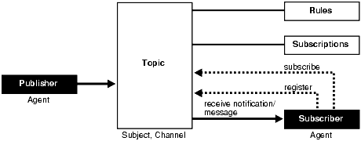

### 24.1 Introduction to the Publish-Subscribe Model

Because the database is the most significant resource of information within the enterprise, Oracle created a publish-subscribe solution for enterprise information delivery and messaging to complement this role.

Networking technologies and products enable a high degree of connectivity across a large number of computers, applications, and users. In these environments, it is important to provide asynchronous communications for the class of distributed systems that operate in a loosely-coupled and autonomous fashion, and which require operational immunity from network failures. This requirement is filled by various middleware products that are characterized as messaging, message-oriented middleware (MOM), message queuing, or publish-subscribe.

Applications that communicate through a publish and subscribe paradigm require the sending applications (publishers) to publish messages without explicitly specifying recipients or having knowledge of intended recipients. Similarly, receiving applications (subscribers) must receive only those messages that the subscriber has registered an interest in.

This decoupling between senders and recipients is usually accomplished by an intervening entity between the publisher and the subscriber, which serves as a level of indirection. This intervening entity is a queue that represents a subject or channel. Figure 24-1 illustrates publish and subscribe functionality.

Figure 24-1 Oracle Publish-Subscribe Functionality



> This figure shows 5 boxes with 6 lines connecting them:
>
> 1. An arrow from a Publisher (Agent) box to a Topic (Subject Channel) box
> 2. A "receive notification/message" arrow from the Topic to a Subscriber (Agent) box
> 3. A "register" arrow from the Subscriber to the Topic
> 4. A "subscribe" arrow from the Subscriber to the Topic
> 5. A line between the Topic box and a Subscriptions box
> 6. A line between the Topic box and a Rules box


A subscriber subscribes to a queue by expressing interest in messages enqueued to that queue and by using a subject- or content-based rule as a filter. This results in a set of rule-based subscriptions associated with a given queue.

At runtime, publishers post messages to various queues. The queue (in other words, the delivery mechanisms of the underlying infrastructure) then delivers messages that match the various subscriptions to the appropriate subscribers.

### 24.2 Publish-Subscribe Architecture

#### 24.2.1 Database Events

Database events support declarative definitions for publishing database events, detection, and runtime publication of such events. This feature enables active publication of information to end-users in an event-driven manner, to complement the traditional pull-oriented approaches to accessing information.

See Also:

[Oracle Database PL/SQL Language Reference](https://docs.oracle.com/pls/topic/lookup?ctx=en/database/oracle/oracle-database/21/adfns&id=LNPLS2014)

#### 24.2.2 Oracle Advanced Queuing

Oracle Advanced Queuing (AQ) supports a queue-based publish-subscribe paradigm. Database queues serve as a durable store for messages, along with capabilities to allow publish and subscribe based on queues. A rules-engine and subscription service dynamically route messages to recipients based on expressed interest. This allows decoupling of addressing between senders and receivers to complement the existing explicit sender-receiver message addressing.

See Also:

[Oracle Database Advanced Queuing User's Guide](https://docs.oracle.com/pls/topic/lookup?ctx=en/database/oracle/oracle-database/21/adfns&id=ADQUE1400)

#### 24.2.3 Client Notification

Client notifications support asynchronous delivery of messages to interested subscribers, enabling database clients to register interest in certain queues, and it enables these clients to receive notifications when publications on such queues occur. Asynchronous delivery of messages to database clients is in contrast to the traditional polling techniques used to retrieve information.

See Also:

[Oracle Call Interface Programmer's Guide](https://docs.oracle.com/pls/topic/lookup?ctx=en/database/oracle/oracle-database/21/adfns&id=LNOCI090)

### 24.3 Publish-Subscribe Concepts

queue

A queue is an entity that supports the notion of named subjects of interest. Queues can be characterized as persistent or nonpersistent (lightweight).

A persistent queue serves as a durable container for messages. Messages are delivered in a deferred and reliable mode.

The underlying infrastructure of a nonpersistent, or lightweight, queue pushes the messages published to connected clients in a lightweight, at-best-once, manner.

agent

Publishers and subscribers are internally represented as agents.

An **agent** is a persistent logical subscribing entity that expresses interest in a queue through a subscription. An agent has properties, such as an associated subscription, an address, and a delivery mode for messages. In this context, an agent is an electronic proxy for a publisher or subscriber.

client

A **client** is a transient physical entity. The attributes of a client include the physical process where the client programs run, the node name, and the client application logic. Several clients can act on behalf of a single agent. The same client, if authorized, can act on behalf of multiple agents.

rule on a queue

A rule on a queue is specified as a conditional expression using a predefined set of operators on the message format attributes or on the message header attributes. Each queue has an associated message content format that describes the structure of the messages represented by that queue. The message format might be unstructured (`RAW`) or it might have a well-defined structure (ADT). This allows both subject- or content-based subscriptions.

subscriber

Subscribers (agents) can specify subscriptions on a queue using a rule. Subscribers are durable and are stored in a catalog.

database event publication framework

The database represents a significant source for publishing information. An event framework is proposed to allow declarative definition of database event publication. As these predefined events occur, the framework detects and publishes such events. This allows active delivery of information to end-users in an event-driven manner as part of the publish-subscribe capability.

registration

Registration is the process of associated delivery information by a given client, acting on behalf of an agent. There is an important distinction between the subscription and registration related to the agent/client separation.

Subscription indicates an interest in a particular queue by an agent. It does not specify where and how delivery must occur. Delivery information is a physical property that is associated with a client, and it is a transient manifestation of the logical agent (the subscriber). A specific client process acting on behalf of an agent registers delivery information by associating a host and port, indicating where the delivery is to be done, and a callback, indicating how there delivery is to be done.

publishing a message

Publishers publish messages to queues by using the appropriate queuing interfaces. The interfaces might depend on which model the queue is implemented on. For example, an enqueue call represents the publishing of a message.

rules engine

When a message is posted or published to a given queue, a rules engine extracts the set of candidate rules from all rules defined on that queue that match the published message.

subscription services

Corresponding to the list of candidate rules on a given queue, the set of subscribers that match the candidate rules can be evaluated. In turn, the set of agents corresponding to this subscription list can be determined and notified.

posting

The queue notifies all registered clients of the appropriate published messages. This concept is called **posting**. When the queue must notify all interested clients, it posts the message to all registered clients.

receiving a message

A subscriber can receive messages through any of these mechanisms:

- A client process acting on behalf of the subscriber specifies a callback using the registration mechanism. The posting mechanism then asynchronously invokes the callback when a message matches the subscriber's subscription. The message content can be passed to the callback function (nonpersistent queues only).
- A client process acting on behalf of the subscriber specifies a callback using the registration mechanism. The posting mechanism then asynchronously invokes the callback function, but without the full message content. This serves as a notification to the client, which subsequently retrieves the message content in a pull fashion (persistent queues only).
- A client process acting on behalf of the subscriber simply retrieves messages from the queue in a periodic or other appropriate manner. While the messages are deferred, there is no asynchronous delivery to the end-client.

### 24.4 Examples of a Publish-Subscribe Mechanism

This example shows how database events, client notification, and AQ work to implement publish-subscribe.

- Create under the user schema, `pubsub`, with all objects necessary to support a publish-subscribe mechanism. In this particular code, the Agent `snoop` subscribe to messages that are published at logon events. To use AQ functionality, user `pubsub` needs `AQ_ADMINISTRATOR_ROLE` privileges and `EXECUTE` privilege on `DBMS_AQ` and `DBMS_AQADM`.
```
Rem ------------------------------------------------------
REM create queue table for persistent multiple consumers:
Rem ------------------------------------------------------

Rem  Create or replace a queue table
BEGIN
DBMS_AQADM.CREATE_QUEUE_TABLE(
   Queue_table        =>  'Pubsub.Raw_msg_table', 
   Multiple_consumers =>   TRUE,
   Queue_payload_type =>  'RAW',
   Compatible         =>  '8.1');
END;
/
Rem ------------------------------------------------------
Rem  Create a persistent queue for publishing messages:
Rem ------------------------------------------------------

Rem  Create a queue for logon events
BEGIN
   DBMS_AQADM.CREATE_QUEUE(
         Queue_name     =>   'Pubsub.Logon',
         Queue_table    =>   'Pubsub.Raw_msg_table',
         Comment        =>   'Q for error triggers');
END;
/

Rem ------------------------------------------------------
Rem  Start the queue:
Rem ------------------------------------------------------

BEGIN
   DBMS_AQADM.START_QUEUE('pubsub.logon');
END;
/

Rem ------------------------------------------------------
Rem  define new_enqueue for convenience:
Rem ------------------------------------------------------

CREATE OR REPLACE PROCEDURE New_enqueue(
               Queue_name      IN VARCHAR2,
               Payload         IN RAW ,
               Correlation     IN VARCHAR2 := NULL,
               Exception_queue IN VARCHAR2 := NULL)
AS

Enq_ct     DBMS_AQ.Enqueue_options_t;
Msg_prop   DBMS_AQ.Message_properties_t;
Enq_msgid  RAW(16);
Userdata   RAW(1000);
 
BEGIN
   Msg_prop.Exception_queue := Exception_queue;
   Msg_prop.Correlation := Correlation;
   Userdata := Payload;

DBMS_AQ.ENQUEUE(Queue_name, Enq_ct, Msg_prop, Userdata, Enq_msgid);
END;
/

Rem ------------------------------------------------------
Rem  add subscriber with rule based on current user name, 
Rem  using correlation_id
Rem ------------------------------------------------------

 
DECLARE
Subscriber Sys.Aq$_agent;
BEGIN
   Subscriber := sys.aq$_agent('SNOOP', NULL, NULL);
DBMS_AQADM.ADD_SUBSCRIBER(
    Queue_name         => 'Pubsub.logon',
    Subscriber         => subscriber,
    Rule               => 'CORRID = ''HR'' ');
END;
/

Rem ------------------------------------------------------
Rem  create a trigger on logon on database:
Rem ------------------------------------------------------

Rem  create trigger on after logon:
CREATE OR REPLACE TRIGGER pubsub.Systrig2
   AFTER LOGON
   ON DATABASE
   BEGIN
      New_enqueue('Pubsub.Logon', HEXTORAW('9999'), Dbms_standard.login_user);
   END;
/
```
- After subscriptions are created, the next step is for the client to register for notification using callback functions. This is done using the Oracle Call Interface (OCI). This code performs necessary steps for registration. The initial steps of allocating and initializing session handles are omitted here for sake of clarity:
```
ub4 namespace = OCI_SUBSCR_NAMESPACE_AQ;

/* callback function for notification of logon of user 'HR' on database: */

ub4 notifySnoop(ctx, subscrhp, pay, payl, desc, mode)
dvoid *ctx;
OCISubscription *subscrhp;
dvoid *pay;
ub4 payl;
dvoid *desc;
ub4 mode;
{
    printf("Notification : User HR Logged on\n");
}

int main()
{
    OCISession *authp = (OCISession *) 0;
    OCISubscription *subscrhpSnoop = (OCISubscription *)0;

    /*****************************************************
       Initialize OCI Process/Environment
       Initialize Server Contexts
       Connect to Server
       Set Service Context
    ******************************************************/

    /* Registration Code Begins */

    /* Each call to initSubscriptionHn allocates 
           and Initialises a Registration Handle */

   
    initSubscriptionHn(    &subscrhpSnoop,    /* subscription handle */
        "ADMIN:PUBSUB.SNOOP", /* subscription name */ 
                  /* <agent_name>:<queue_name> */
        (dvoid*)notifySnoop); /* callback function */

     /*****************************************************
       The Client Process does not need a live Session for Callbacks
       End Session and Detach from Server
     ******************************************************/

    OCISessionEnd ( svchp,  errhp, authp, (ub4) OCI_DEFAULT);

    /* detach from server */
    OCIServerDetach( srvhp, errhp, OCI_DEFAULT);

    while (1)     /* wait for callback */
        sleep(1);

}

void initSubscriptionHn (subscrhp,
subscriptionName,
func)

OCISubscription **subscrhp;
char* subscriptionName;
dvoid * func;
{

    /* allocate subscription handle: */

    (void) OCIHandleAlloc((dvoid *) envhp, (dvoid **)subscrhp, 
        (ub4) OCI_HTYPE_SUBSCRIPTION,
        (size_t) 0, (dvoid **) 0);

    /* set subscription name in handle: */

    (void) OCIAttrSet((dvoid *) *subscrhp, (ub4) OCI_HTYPE_SUBSCRIPTION,
        (dvoid *) subscriptionName, 
        (ub4) strlen((char *)subscriptionName),
        (ub4) OCI_ATTR_SUBSCR_NAME, errhp);

    /* set callback function in handle: */

    (void) OCIAttrSet((dvoid *) *subscrhp, (ub4) OCI_HTYPE_SUBSCRIPTION,
        (dvoid *) func, (ub4) 0,
        (ub4) OCI_ATTR_SUBSCR_CALLBACK, errhp);

    (void) OCIAttrSet((dvoid *) *subscrhp, (ub4) OCI_HTYPE_SUBSCRIPTION,
        (dvoid *) 0, (ub4) 0,
        (ub4) OCI_ATTR_SUBSCR_CTX, errhp);

    /* set namespace in handle: */

    (void) OCIAttrSet((dvoid *) *subscrhp, (ub4) OCI_HTYPE_SUBSCRIPTION,
        (dvoid *) &namespace, (ub4) 0,
        (ub4) OCI_ATTR_SUBSCR_NAMESPACE, errhp);

    checkerr(errhp, OCISubscriptionRegister(svchp, subscrhp, 1, errhp,

        OCI_DEFAULT));
}
```

If user `HR` logs on to the database, the client is notified, and the call back function `notifySnoop` is invoked.