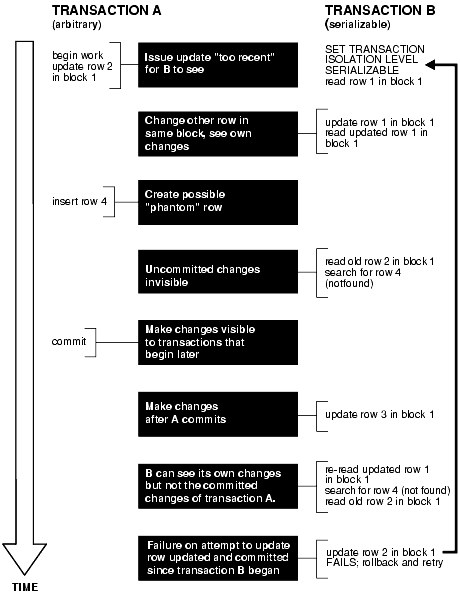
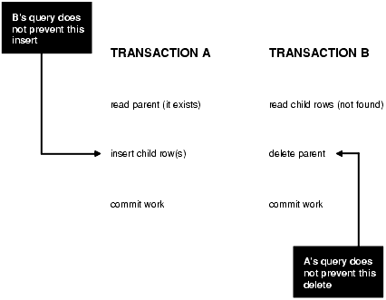
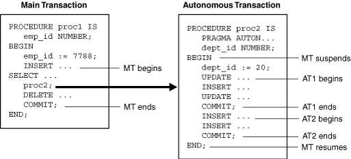
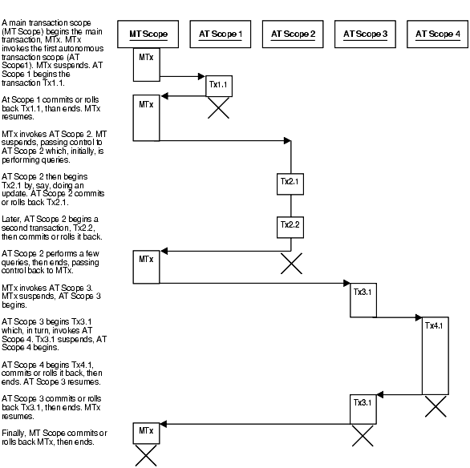
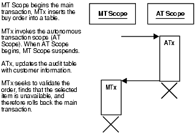
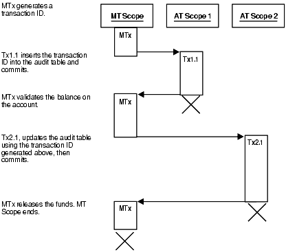
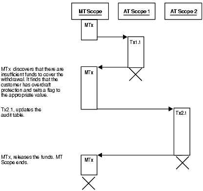
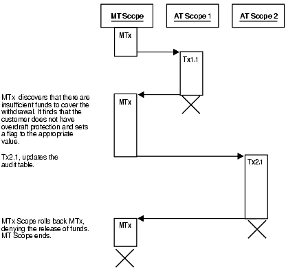

This chapter explains what application developers must know about how Oracle Database processes SQL statements.

Topics:

See Also:

[Oracle Database Concepts](https://docs.oracle.com/pls/topic/lookup?ctx=en/database/oracle/oracle-database/21/adfns&id=CNCPT015)

### 9.1 Description of SQL Statement Processing

This topic explains what happens during each stage of processing the execution of a SQL statement, using a data manipulation language (DML) statement as an example.

Assume that you are using a Pro\*C program to increase the salary for all employees in a department. The program has connected to Oracle Database and you are connected to the HR schema, which owns the `employees` table. You can embed this SQL statement in your program:

```
EXEC SQL UPDATE employees SET salary = 1.10 * salary
  WHERE department_id = :department_id;
```

The program provides a value for the bind variable placeholder `:department_id`, which the SQL statement uses when it runs.

Topics:

- Stages of SQL Statement Processing
- Shared SQL Areas

#### 9.1.1 Stages of SQL Statement Processing

Note:

DML statements use all stages. Transaction management, session management, and system management SQL statements use only `stage 2` and `stage 8`.

1. Open or create a cursor.
	A program interface call opens or creates a cursor, in expectation of a SQL statement. Most applications create the cursor implicitly (automatically). Precompiler programs can create the cursor either implicitly or explicitly.
2. Parse the statement.
	The user process passes the SQL statement to Oracle Database, which loads a parsed representation of the statement into the shared SQL area. Oracle Database can catch many errors during parsing.
	Note:
	For a data definition language (DDL) statement, parsing includes data dictionary lookup and execution.
3. Determine if the statement is a query.
4. If the statement is a query, describe its results.
	Note:
	This stage is necessary only if the characteristics of the result are unknown; for example, when a user enters the query interactively.
	Oracle Database determines the characteristics (data types, lengths, and names) of the result.
5. If the statement is a query, define its output.
	You specify the location, size, and data type of variables defined to receive each fetched value. These variables are called **define variables**. Oracle Database performs data type conversion if necessary.
6. Bind any variables.
	Oracle Database has determined the meaning of the SQL statement but does not have enough information to run it. Oracle Database needs values for any bind variable placeholders in the statement. In the example, Oracle Database needs a value for `:department_id`. The process of obtaining these values is called binding variables.
	A program must specify the location (memory address) of the value. End users of applications may be unaware that they are specifying values for bind variable placeholders, because the Oracle Database utility can prompt them for the values.
	Because the program specifies the location of the value (that is, binds by reference), it need not rebind the variable before rerunning the statement, even if the value changes. Each time Oracle Database runs the statement, it gets the value of the variable from its address.
	You must also specify a data type and length for each value (unless they are implied or defaulted) if Oracle Database must perform data type conversion.
7. (Optional) Parallelize the statement.
	Oracle Database can parallelize queries and some data definition language (DDL) operations (for example, index creation, creating a table with a subquery, and operations on partitions). Parallelization causes multiple server processes to perform the work of the SQL statement so that it can complete faster.
8. Run the statement.
	Oracle Database runs the statement. If the statement is a query or an `INSERT` statement, the database locks no rows, because no data is changing. If the statement is an `UPDATE` or `DELETE` statement, the database locks all rows that the statement affects, until the next `COMMIT`, `ROLLBACK`, or `SAVEPOINT` for the transaction, thereby ensuring data integrity.
	For some statements, you can specify multiple executions to be performed. This is called array processing. Given n number of executions, the bind and define locations are assumed to be the beginning of an array of size n.
9. If the statement is a query, fetch its rows.
	Oracle Database selects rows and, if the query has an `ORDER` `BY` clause, orders the rows. Each successive fetch retrieves another row of the result set, until the last row has been fetched.
10. Close the cursor.
	Oracle Database closes the cursor.

Note:

To rerun a transaction management, session management, or system management SQL statement, use another `EXECUTE` statement.

#### 9.1.2 Shared SQL Areas

Oracle Database automatically detects when applications send similar SQL statements to the database. The SQL area used to process the first occurrence of the statement is shared—that is, used for processing subsequent occurrences of that same statement. Therefore, only one shared SQL area exists for a unique statement. Because shared SQL areas are shared memory areas, any Oracle Database process can use a shared SQL area. The sharing of SQL areas reduces memory use on the database server, thereby increasing system throughput.

In determining whether statements are similar or identical, Oracle Database compares both SQL statements issued directly by users and applications and recursive SQL statements issued internally by DDL statements.

See Also:

- [Oracle Database Concepts](https://docs.oracle.com/pls/topic/lookup?ctx=en/database/oracle/oracle-database/21/adfns&id=CNCPT1226) for more information about shared SQL areas
- [Oracle Database SQL Tuning Guide](https://docs.oracle.com/pls/topic/lookup?ctx=en/database/oracle/oracle-database/21/adfns&id=TGSQL-GUID-B653E5F3-F078-4BBC-9516-B892960046A2) for more information about shared SQL

### 9.2 Grouping Operations into Transactions

Topics:

- Deciding How to Group Operations in Transactions
- Improving Transaction Performance
- Managing Commit Redo Action
- Determining Transaction Outcome After a Recoverable Outage

See Also:

[Oracle Database Concepts](https://docs.oracle.com/pls/topic/lookup?ctx=en/database/oracle/oracle-database/21/adfns&id=CNCPT016) for basic information about transactions

#### 9.2.1 Deciding How to Group Operations in Transactions

Typically, deciding how to group operations in transactions is the concern of application developers who use programming interfaces to Oracle Database. When deciding how to group transactions:

- Define transactions such that work is accomplished in logical units and data remains consistent.
- Ensure that data in all referenced tables is in a consistent state before the transaction begins and after it ends.
- Ensure that each transaction consists only of the SQL statements or PL/SQL blocks that comprise one consistent change to the data.

For example, suppose that you write a web application that lets users transfer funds between accounts. The transaction must include the debit to one account, executed by one SQL statement, and the credit to another account, executed by another SQL statement. Both statements must fail or succeed as a unit of work; one statement must not be committed without the other. Do not include unrelated actions, such as a deposit to one account, in the transaction.

#### 9.2.2 Improving Transaction Performance

As an application developer, you must try to improve performance. Consider using these performance enhancement techniques when designing and writing your application:

- For each transaction:
	1. If you can use a single SQL statement, then do so.
		2. If you cannot use a single SQL statement but you can use PL/SQL, then use as little PL/SQL as possible.
		3. If you cannot use PL/SQL (because it cannot do what you must do; for example, read a directory), then use Java.
		4. If you cannot use Java (for example, if it is too slow) or you have existing third-generation language (3GL) code, then use an external C subprogram.
- Establish standards for writing SQL statements so that you can take advantage of shared SQL areas.
	Oracle Database recognizes identical SQL statements and lets them share memory areas, reducing memory usage on the database server and increasing system throughput.
- Collect statistics that Oracle Database can use to implement a cost-based approach to SQL statement optimization, and use additional hints to the optimizer as needed.
	To collect most statistics, use the `DBMS_STATS` package, which lets you collect statistics in parallel, collect global statistics for partitioned objects, and tune your statistics collection in other ways.
	To collect statistics unrelated to the cost-based optimizer (such as information about free list blocks), use the SQL statement `ANALYZE`.
- Before beginning a transaction, invoke `DBMS_APPLICATION_INFO` procedures to record the name of the transaction in the database for later use when tracking its performance with Oracle Trace and the SQL trace facility.
- Increase user productivity and query efficiency by including user-written PL/SQL functions in SQL expressions. For details, see.

See Also:

- [Oracle Database Concepts](https://docs.oracle.com/pls/topic/lookup?ctx=en/database/oracle/oracle-database/21/adfns&id=CNCPT016) for more information about transaction management
- [PL/SQL for Application Developers](plsql-for-application-developers.md)
- [Developing Applications with Multiple Programming Languages](external-procedures.md)
- [Oracle Database SQL Language Reference](https://docs.oracle.com/pls/topic/lookup?ctx=en/database/oracle/oracle-database/21/adfns&id=SQLRF01105) for more information about hints and `ANALYZE` statement
- [Oracle Database PL/SQL Packages and Types Reference](https://docs.oracle.com/pls/topic/lookup?ctx=en/database/oracle/oracle-database/21/adfns&id=ARPLS-GUID-4AA6AA30-CAEE-4DCD-B214-9AD51D0229B4) for more information about `DBMS_STATS` package and `DBMS_APPLICATION_INFO` package
- [Invoking Stored PL/SQL Functions from SQL Statements](coding-subprograms-and-packages.md)

#### 9.2.3 Managing Commit Redo Action

When a transaction updates Oracle Database, it generates a corresponding redo entry. Oracle Database buffers the redo entry to the redo log until the transaction completes. When the transaction commits, the log writer process (LGWR) writes redo records to disk for the buffered redo entries of all changes in the transaction. By default, Oracle Database writes the redo entries to disk before the call returns to the client. This action causes a latency in the commit, because the application must wait for the redo entries to be persistent on disk.

Oracle Database lets you change the handling of commit redo to fit the needs of your application. If your application requires very high transaction throughput and you are willing to trade commit durability for lower commit latency, then you can change the default `COMMIT` options so that the application need not wait for the database to write data to the online redo logs.

Table 9-1 describes the `COMMIT` options.

Caution:

With the `NOWAIT` option, a failure that occurs after the commit message is received, but before the redo log records are written, can falsely indicate to a transaction that its changes are persistent.

Table 9-1 COMMIT Statement Options

| Option | Effect |
| --- | --- |
| `WAIT` (default) | Ensures that the `COMMIT` statement returns only after the corresponding redo information is persistent in the online redo log. When the client receives a successful return from this `COMMIT` statement, the transaction has been committed to durable media.  A failure that occurs after a successful write to the log might prevent the success message from returning to the client, in which case the client cannot tell whether the transaction committed. |
| `NOWAIT` (alternative to `WAIT`) | The `COMMIT` statement returns to the client regardless of whether the write to the redo log has completed. This behavior can increase transaction throughput. |
| `BATCH` (alternative to `IMMEDIATE`) | Buffers the redo information to the redo log with concurrently running transactions. After collecting sufficient redo information, initiates a disk write to the redo log. This behavior is called group commit, because it writes redo information for multiple transactions to the log in a single I/O operation. |
| `IMMEDIATE` (default) | LGWR writes the transaction redo information to the log. Because this operation option forces a disk I/O, it can reduce transaction throughput. |

To change the `COMMIT` options, use either the `COMMIT` statement or the appropriate initialization parameter.

Note:

You cannot change the default `IMMEDIATE` and `WAIT` action for distributed transactions.

If your application uses Oracle Call Interface (OCI), then you can modify redo action by setting these flags in the `OCITransCommit` function in your application:

- `OCI_TRANS_WRITEWAIT`
- `OCI_TRANS_WRITENOWAIT`
- `OCI_TRANS_WRITEBATCH`
- `OCI_TRANS_WRITEIMMED`

Caution:

`OCI_TRANS_WRITENOWAIT` can cause silent transaction loss with shutdown termination, startup force, and any instance or node failure. On an Oracle RAC system, asynchronously committed changes might not be immediately available to read on other instances.

The specification of the `NOWAIT` and `BATCH` options has a small window of vulnerability in which Oracle Database can roll back a transaction that your application views as committed. Your application must be able to tolerate these scenarios:

- The database host fails, which causes the database to lose redo entries that were buffered but not yet written to the online redo logs.
- A file I/O problem prevents LGWR from writing buffered redo entries to disk. If the redo logs are not multiplexed, then the commit is lost.

See Also:

- [Oracle Call Interface Programmer's Guide](https://docs.oracle.com/pls/topic/lookup?ctx=en/database/oracle/oracle-database/21/adfns&id=LNOCI13112) for information about the `OCITransCommit` function
- [Oracle Database SQL Language Reference](https://docs.oracle.com/pls/topic/lookup?ctx=en/database/oracle/oracle-database/21/adfns&id=SQLRF01110)
- [Oracle Database Reference](https://docs.oracle.com/pls/topic/lookup?ctx=en/database/oracle/oracle-database/21/adfns&id=REFRN00102) for information about initialization parameters

#### 9.2.4 Determining Transaction Outcome After a Recoverable Outage

A recoverable outage is a system, hardware, communication, or storage failure that breaks the connection between your application (the client) and Oracle Database (the server). After an outage, your application receives a disconnection error message. The transaction that was running when the connection broke is the in-flight transaction, which may or may not have been committed or run to completion.

To recover from the outage, your application must determine the outcome of the in-flight transaction—whether it was committed and whether it made its intended session state changes. If the transaction was not committed, then the application can either resubmit the transaction or return the uncommitted status to the end user. If the transaction was committed, then the application can return the committed status, rather than the disconnection error, to the end user. If the transaction was both committed and completed, then the application may be able to continue by taking a new session and re-establishing the session state.

The Oracle Database feature that provides your application with the outcome of the in-flight transaction and can be used to ensure that it is not duplicated is Transaction Guard, and its application program interface (API) is the PL/SQL procedure `DBMS_APP_CONT.GET_LTXID_OUTCOME`.

Topics:

- Understanding Transaction Guard
- Understanding DBMS\_APP\_CONT.GET\_LTXID\_OUTCOME
- Using Transaction Guard

##### 9.2.4.1 Understanding Transaction Guard

Transaction Guard is an Oracle Database tool that you can use to provide your application with the outcome of the in-flight transaction after an outage. The application can use Transaction Guard to provide the end user with a known outcome after an outage—committed or not committed—and, optionally, to replay the transaction if it did not commit and the states are correct.

Transaction Guard provides the transaction outcome through its API, the PL/SQL procedure `DBMS_APP_CONT.GET_LTXID_OUTCOME`.

Transaction Guard relies on the logical transaction identifier (LTXID), a globally unique identifier that identifies the last in-flight transaction on a session that failed. The database records the LTXID when the transaction is committed, and returns a new LTXID to the client with the commit message (for each client round trip). The client driver always holds the LTXID that will be used at the next `COMMIT`.

Note:

- Use Transaction Guard only to find the outcome of a session that failed due to a recoverable error, to replace the communication error with the real outcome.
- Do not use Transaction Guard on your own session.
- Do not use Transaction Guard on a live session.
	To stop a live session, use `ALTER` `SYSTEM` `KILL` `SESSION` `IMMEDIATE` at the local or remote instance.

See Also:

Understanding DBMS\_APP\_CONT.GET\_LTXID\_OUTCOME

###### 9.2.4.1.1 How Transaction Guard Uses the LTXID

Transaction Guard uses the LTXID as follows:

- While a transaction is running, both Oracle Database (the server) and your application (the client) hold the LTXID to be used at the next `COMMIT`.
- When the transaction is committed, Oracle Database records the LTXID with the transaction. If the LTXID has already been committed or has been blocked, then the database raises error, preventing duplication of the transaction.
- The LTXID persists in Oracle Database for the time specified by the `RETENTION_TIMEOUT` parameter. The default is 24 hours. To change this value:
	- When running Real Application Clusters, use Server Control Utility (SRVCTL).
		- When not using Real Application Clusters, use the `DBMS_SERVICE` package.
	If the transaction is remote or distributed, then its LTXID persists in the local database.
	The LTXID is transferred to Data Guard and Active Data Guard in the standard redo apply.
- After a recoverable error:
	- If the transaction has not been committed, then Oracle Database blocks its LTXID to ensure that an earlier in-flight transaction with the same LTXID cannot be committed.
		This behavior allows the application to return the uncommitted result to the user, who can then decide what to do, and also allows the application to safely replay the application if desirable.
		- If the transaction has been committed, then the application can return this result to the end user, and if the state is correct, the application may be able to continue.
- If the transaction is rolled back, then Oracle Database reuses its LTXID.

See Also:

- [Transaction Guard Coverage](transaction-guard.md), for a list of the sources whose commits Transaction Guard supports
- [Transaction Guard Exclusions](transaction-guard.md), for a list of the sources whose commits Transaction Guard does not support
- [Oracle Real Application Clusters Administration and Deployment Guide](https://docs.oracle.com/pls/topic/lookup?ctx=en/database/oracle/oracle-database/21/adfns&id=RACAD005) for more information about SRVCTL
- [Oracle Database PL/SQL Packages and Types Reference](https://docs.oracle.com/pls/topic/lookup?ctx=en/database/oracle/oracle-database/21/adfns&id=ARPLS092) for more information about `DBMS_SERVICE` package

##### 9.2.4.2 Understanding DBMS\_APP\_CONT.GET\_LTXID\_OUTCOME

The PL/SQL procedure `DBMS_APP_CONT.GET_LTXID_OUTCOME` is the API of Transaction Guard. After an outage, your application can reconnect to Oracle Database and then invoke this procedure to determine the outcome of the in-flight transaction.

`DBMS_APP_CONT.GET_LTXID_OUTCOME` has these parameters:

| Parameter Name | Data Type | Parameter Mode | Value |
| --- | --- | --- | --- |
| `CLIENT_LTXID` | `RAW` | `IN` | LTXID of the in-flight transaction |
| `COMMITTED` | `BOOLEAN` | `OUT` | `TRUE` if the in-flight transaction was committed, `FALSE` otherwise |
| `USER_CALL_COMPLETED` | `BOOLEAN` | `OUT` | `TRUE` if the in-flight transaction completed, `FALSE` otherwise |

Topics:

###### 9.2.4.2.1 CLIENT\_LTXID Parameter

Before your application (the client) can invoke `DBMS_APP_CONT.GET_LTXID_OUTCOME` with the LTXID of the in-flight transaction, it must get the last LTXID in use at the client driver by using a client driver. The client driver holds the LTXID of the transaction next to be committed. In this case, the LTXID is for the in-flight transaction at the time of the outage. Use `getLTXID` for JDBC-Thin driver, `LogicalTransactionId` for ODP.NET, and `OCI_ATTR_GET` with LTXID for OCI and OCCI.

The JDBC-Thin driver also provides a callback that is triggered each time the LTXID at the client driver changes. The callback can be used to maintain the current LTXID to be used. The callback is particularly useful for application servers and applications that must block repeated executions.

Note:

Your application must get the LTXID immediately before passing it to `DBMS_APP_CONT.GET_LTXID_OUTCOME`. Getting the LTXID in advance could lead to passing an earlier LTXID to `DBMS_APP_CONT.GET_LTXID_OUTCOME`, causing the request to be rejected.

See Also:

- [Oracle Database JDBC Developer’s Guide](https://docs.oracle.com/pls/topic/lookup?ctx=en/database/oracle/oracle-database/21/adfns&id=JJDBC28026)
- [Oracle Call Interface Programmer's Guide](https://docs.oracle.com/pls/topic/lookup?ctx=en/database/oracle/oracle-database/21/adfns&id=LNOCI72990)
- [Oracle Data Provider for.NET Developer's Guide for Microsoft Windows](https://docs.oracle.com/pls/topic/lookup?ctx=en/database/oracle/oracle-database/21/adfns&id=ODPNT-GUID-635BAE6C-7D0B-4CF2-ADD8-8DB531B9C52E)

###### 9.2.4.2.2 COMMITTED Parameter

After `DBMS_APP_CONT.GET_LTXID_OUTCOME` returns control to your application, your application can check the value of the actual parameter that corresponds to the formal parameter `COMMITTED` to determine whether the in-flight transaction was committed.

If the value of the actual parameter is `TRUE`, then the transaction was committed.

If the value of the actual parameter is `FALSE`, then the transaction was not committed. Therefore, it is safe for the application to return the code `UNCOMMITTED` to the end user or use it to replay the transaction.

To ensure that an earlier session does not commit the transaction after the application returns `UNCOMMITTED`, `DBMS_APP_CONT.GET_LTXID_OUTCOME` blocks the LTXID. Blocking the LTXID allows the end user to make a decision based on the uncommitted status, or the application to replay the transaction, and prevents duplicate transactions.

###### 9.2.4.2.3 USER\_CALL\_COMPLETED Parameter

Some transactions return information upon completion. For example: A transaction that uses commit on success (auto-commit) might returns the number of affected rows, or for a `SELECT` statement, the rows themselves; a transaction that invokes a PL/SQL subprogram that has `OUT` parameters returns the values of those parameters; and a transaction that invokes a PL/SQL function returns the function value. Also, a transaction that invokes a PL/SQL subprogram might execute a `COMMIT` statement and then do more work.

If your application needs information that the in-flight transaction returns upon completion, or session state changes that the transaction does after committing its database changes, then your application must determine whether the in-flight transaction completed, which it can do by checking the value of the actual parameter that corresponds to the formal parameter `USER_CALL_COMPLETED`.

If the value of the actual parameter is `TRUE`, then the transaction completed, and your application has the information and work that it must continue.

If the value of the actual parameter is `FALSE`, then the call from the client may not have completed. Therefore, your application might not have the information and work that it must continue.

###### 9.2.4.2.4 Exceptions

If your application (the client) and Oracle Database (the server) are no longer synchronized, then the `DBMS_APP_CONT.GET_LTXID_OUTCOME` procedure raises one of these exceptions:

| Exception | Explanation |
| --- | --- |
| `ORA-14950 - SERVER_AHEAD` | The server is ahead of the client; that is, the LTXID that your application passed to `DBMS_APP_CONT.GET_LTXID_OUTCOME` identifies a transaction that is older than the in-flight transaction.  Your application must get the LTXID immediately before passing it to `DBMS_APP_CONT.GET_LTXID_OUTCOME`. |
| `ORA-14951 - CLIENT_AHEAD` | The client is ahead of the server. Either the server was "flashed back" to an earlier state, was recovered using media recovery, or is a standby database that was opened earlier and has lost data. |
| `ORA-14906 - SAME_SESSION` | Executing `GET_LTXID_OUTCOME` is not supported on the session that owns the LTXID, because the execution would block further processing on that session. |
| `ORA-14909 - COMMIT_BLOCKED` | Your session has been blocked from committing by another user with the same username using `GET_LTXID_OUTCOME`. `GET_LTXID_OUTCOME` should be called only on dead sessions. Blocking a live session is better achieved using `ALTER` `SYSTEM` `KILL` `SESSION` `IMMEDIATE`. For help, contact your application administrator. |
| `ORA-14952 GENERAL ERROR` | `DBMS_APP_CONT.GET_LTXID_OUTCOME` cannot determine the outcome of the in-flight transaction. An error occurred during transaction processing, and the error stack shows the error detail. |

See Also:

- [Using Oracle Flashback Technology](flashback.md)
- [Oracle Data Guard Concepts and Administration](https://docs.oracle.com/pls/topic/lookup?ctx=en/database/oracle/oracle-database/21/adfns&id=SBYDB-GUID-5E73667D-4A56-445E-911F-1E99092DD8D7) for information about media recovery and standby databases

##### 9.2.4.3 Using Transaction Guard

After your application (the client) receives an error message, it must follow these steps to use Transaction Guard:

1. Determine if the error is due to an outage (recoverable).
	For instructions, see the documentation for your client driver— `OCI_ATTRIBUTE` for OCI, OCCI, and ODP.NET; `isRecoverable` for JDBC.
2. If the error is recoverable, then use the API of the client driver to get the logical transaction identifier (LTXID) of the in-flight transaction.
	For instructions, see the documentation for your client driver.
3. Reconnect to the database.
	The session that your application acquires can be either new or pooled.
4. Invoke `DBMS_APP_CONT.GET_LTXID_OUTCOME` with the LTXID from step [^1].
5. Check the value of the actual parameter that corresponds to the formal parameter `COMMITTED`.
	If the value is `TRUE`, then tell the application that the in-flight transaction was committed. The application can return this result to the user, or continue if the state is correct.
	If the value is `FALSE`, then the application can return `UNCOMMITTED` or a similar message to the user so that the user can choose the next step. Optionally, the application can replay the transaction for the user. For example:
	1. If necessary, clean up state changes on the client side.
		2. Resubmit the in-flight transaction.
	If you do not resubmit the in-flight transaction, and the application needs neither information that the in-flight transaction returns upon completion nor work that the transaction does after committing its database changes, then continue. Otherwise, check the value of the actual parameter that corresponds to the formal parameter `USER_CALL_COMPLETED`.
	If the value is `TRUE`, then continue.
	If the value is `FALSE`, then tell the application user that the application cannot continue.

### 9.3 Ensuring Repeatable Reads with Read-Only Transactions

By default, Oracle Database guarantees statement-level read consistency, but not transaction-level read consistency. With statement-level read consistency, queries in a statement produce consistent data for the duration of the statement, not reflecting changes by other statements. With transaction-level read consistency (repeatable reads), queries in the transaction produce consistent data for the duration of the transaction, not reflecting changes by other transactions.

To ensure transaction-level read consistency for a transaction that does not include DML statements, specify that the transaction is read-only. The queries in a read-only transaction see only changes committed before the transaction began, so query results are consistent for the duration of the transaction.

A read-only transaction provides transaction-level read consistency without acquiring additional data locks. Therefore, while the read-only transaction is querying data, other transactions can query and update the same data.

A read-only transaction begins with this statement:

```
SET TRANSACTION READ ONLY [ NAME string ];
```

Only DDL statements can precede the `SET` `TRANSACTION` `READ` `ONLY` statement. After the `SET` `TRANSACTION` `READ` `ONLY` statement successfully runs, the transaction can include only `SELECT` (without `FOR` `UPDATE`), `COMMIT`, `ROLLBACK`, or non-DML statements (such as `SET` `ROLE`, `ALTER` `SYSTEM`, and `LOCK` `TABLE`). A `COMMIT`, `ROLLBACK`, or DDL statement ends the read-only transaction.

See Also:

[Oracle Database SQL Language Reference](https://docs.oracle.com/pls/topic/lookup?ctx=en/database/oracle/oracle-database/21/adfns&id=SQLRF01705) for more information about the `SET` `TRANSACTION` statement

Long-running queries sometimes fail because undo information required for consistent read (CR) operations is no longer available. This situation occurs when active transactions overwrite committed undo blocks.

Automatic undo management lets your database administrator (DBA) explicitly control how long the database retains undo information, using the parameter `UNDO_RETENTION`. For example, if `UNDO_RETENTION` is 30 minutes, then the database retains all committed undo information for at least 30 minutes, ensuring that all queries running for 30 minutes or less do not encounter the OER error "snapshot too old."

See Also:

- [Oracle Database Concepts](https://docs.oracle.com/pls/topic/lookup?ctx=en/database/oracle/oracle-database/21/adfns&id=CNCPT221) for more information about read consistency
- [Oracle Database Administrator's Guide](https://docs.oracle.com/pls/topic/lookup?ctx=en/database/oracle/oracle-database/21/adfns&id=ADMIN014) for information about long-running queries and resumable space allocation

### 9.4 Locking Tables Explicitly

Oracle Database has default locking mechanisms that ensure data concurrency, data integrity, and statement-level read consistency. However, you can override these mechanisms by locking tables explicitly. Locking tables explicitly is useful in situations such as these:

- A transaction in your application needs exclusive access to a resource, so that the transaction does not have to wait for other transactions to complete.
- Your application needs transaction-level read consistency (repeatable reads).

To override default locking at the transaction level, use any of these SQL statements:

- `LOCK` `TABLE`
- `SELECT` with the `FOR` `UPDATE` clause
- `SET` `TRANSACTION` with the `READ` `ONLY` or `ISOLATION` `LEVEL` `SERIALIZABLE` option

Locks acquired by these statements are released after the transaction is committed or rolled back.

The initialization parameter `DML_LOCKS` determines the maximum number of DML locks. Although its default value is usually enough, you might need to increase it if you use explicit locks.

Note:

If you override the default locking of Oracle Database at any level, ensure that data integrity is guaranteed, data concurrency is acceptable, and deadlocks are either impossible or appropriately handled.

Topics:

#### 9.4.1 Privileges Required to Acquire Table Locks

No special privileges are required to acquire any type of table lock on a table in your own schema. To acquire a table lock on a table in another schema, you must have either the `LOCK` `ANY` `TABLE` system privilege or any object privilege (for example, `SELECT` or `UPDATE`) for the table.

#### 9.4.2 Choosing a Locking Strategy

A transaction explicitly acquires the specified table locks when a `LOCK` `TABLE` statement is executed. A `LOCK` `TABLE` statement explicitly overrides default locking. When a `LOCK` `TABLE` statement is issued on a view, the underlying base tables are locked. This statement acquires exclusive table locks for the `employees` and `departments` tables on behalf of the containing transaction:

```
LOCK TABLE employees, departments IN EXCLUSIVE MODE NOWAIT;
```

You can specify several tables or views to lock in the same mode; however, only a single lock mode can be specified for each `LOCK` `TABLE` statement.

Note:

When a table is locked, all rows of the table are locked. No other user can modify the table.

In the `LOCK` `TABLE` statement, you can also indicate how long you want to wait for the table lock:

- If you do not want to wait, specify either `NOWAIT` or `WAIT 0`.
	You acquire the table lock only if it is immediately available; otherwise, an error notifies you that the lock is unavailable now.
- To wait up to n seconds to acquire the table lock, specify `WAIT` `n`, where n is greater than 0 and less than or equal to 100000.
	If the table lock is still unavailable after n seconds, an error notifies you that the lock is unavailable now.
- To wait indefinitely to acquire the lock, specify neither `NOWAIT` nor `WAIT`.
	The database waits indefinitely until the table is available, locks it, and returns control to you. When the database is running DDL statements concurrently with DML statements, a timeout or deadlock can sometimes result. The database detects such timeouts and deadlocks and returns an error.

See Also:

- Explicitly Acquiring Row Locks
- [Oracle Database SQL Language Reference](https://docs.oracle.com/pls/topic/lookup?ctx=en/database/oracle/oracle-database/21/adfns&id=SQLRF01605)

Topics:

- When to Lock with ROW SHARE MODE and ROW EXCLUSIVE MODE
- When to Lock with SHARE MODE
- When to Lock with SHARE ROW EXCLUSIVE MODE
- When to Lock with EXCLUSIVE MODE

##### 9.4.2.2 When to Lock with SHARE MODE

`SHARE` `MODE` table locks are rather restrictive data locks. You might use these locks if:

- Your transaction only queries the table, and requires a consistent set of the table data for the duration of the transaction.
- You can hold up other transactions that try to update the locked table, until all transactions that hold `SHARE` `MODE` locks on the table either commit or roll back.
- Other transactions might acquire concurrent `SHARE` `MODE` table locks on the same table, also giving them the option of transaction-level read consistency.
	Caution:
	Your transaction might not update the table later in the same transaction. However, if multiple transactions concurrently hold share table locks for the same table, no transaction can update the table (even if row locks are held as the result of a `SELECT` `FOR` `UPDATE` statement). Therefore, if concurrent share table locks on the same table are common, updates cannot proceed and deadlocks are common. In this case, use share row exclusive or exclusive table locks instead.

Scenario: Tables `employees` and `budget_tab` require a consistent set of data in a third table, `departments`. For a given department number, you want to update the information in `employees` and `budget_tab`, and ensure that no members are added to the department between these two transactions.

Solution: Lock the `departments` table in `SHARE` `MODE`, as shown in Example 9-1. Because the `departments` table is rarely updated, locking it probably does not cause many other transactions to wait long.

Example 9-1 LOCK TABLE with SHARE MODE

```
-- Create and populate table:
 
DROP TABLE budget_tab;
CREATE TABLE budget_tab (
  sal     NUMBER(8,2),
  deptno  NUMBER(4)
);
 
INSERT INTO budget_tab (sal, deptno)
  SELECT salary, department_id
  FROM employees;
 
-- Lock departments and update employees and budget_tab:
 
LOCK TABLE departments IN SHARE MODE;
 
UPDATE employees
  SET salary = salary * 1.1
  WHERE department_id IN
    (SELECT department_id FROM departments WHERE location_id = 1700);
 
UPDATE budget_tab
SET sal = sal * 1.1
WHERE deptno IN
  (SELECT department_id FROM departments WHERE location_id = 1700);
 
COMMIT;  -- COMMIT releases lock
```

##### 9.4.2.4 When to Lock with EXCLUSIVE MODE

You might use an `EXCLUSIVE` `MODE` table if:

- Your transaction requires immediate update access to the locked table. When your transaction holds an exclusive table lock, other transactions cannot lock specific rows in the locked table.
- Your transaction also ensures transaction-level read consistency for the locked table until the transaction is committed or rolled back.
- You are not concerned about low levels of data concurrency, making transactions that request exclusive table locks wait in line to update the table sequentially.

#### 9.4.3 Letting Oracle Database Control Table Locking

If you let Oracle Database control table locking, your application needs less programming logic, but also has less control than if you manage the table locks yourself.

Issuing the statement `SET` `TRANSACTION` `ISOLATION` `LEVEL` `SERIALIZABLE` or `ALTER` `SESSION` `ISOLATION` `LEVEL` `SERIALIZABLE` preserves ANSI serializability without changing the underlying locking protocol. This technique gives concurrent access to the table while providing ANSI serializability. Getting table locks greatly reduces concurrency.

See Also:

- [Oracle Database SQL Language Reference](https://docs.oracle.com/pls/topic/lookup?ctx=en/database/oracle/oracle-database/21/adfns&id=SQLRF01705) for information about the `SET` `TRANSACTION` statement
- [Oracle Database SQL Language Reference](https://docs.oracle.com/pls/topic/lookup?ctx=en/database/oracle/oracle-database/21/adfns&id=SQLRF00901) for information about the `ALTER` `SESSION` statements

Change the settings for these parameters only when an instance is shut down. If multiple instances are accessing a single database, then all instances must use the same setting for these parameters.

#### 9.4.4 Explicitly Acquiring Row Locks

You can override default locking with a `SELECT` statement that includes the `FOR` `UPDATE` clause. This statement acquires exclusive row locks for selected rows (as an `UPDATE` statement does), in anticipation of updating the selected rows in a subsequent statement.

You can use a `SELECT` `FOR` `UPDATE` statement to lock a row without changing it. For example, several triggers in Oracle Database PL/SQL Language Reference show how to implement referential integrity. In the `EMP_DEPT_CHECK` trigger, the row that contains the referenced parent key value is locked to guarantee that it remains for the duration of the transaction; if the parent key is updated or deleted, referential integrity is violated.

`SELECT` `FOR` `UPDATE` statements are often used by interactive programs that let a user modify fields of one or more specific rows (which might take some time); row locks are acquired so that only a single interactive program user is updating the rows at any given time.

If a `SELECT` `FOR` `UPDATE` statement is used when defining a cursor, the rows in the return set are locked when the cursor is opened (before the first fetch) rather than being locked as they are fetched from the cursor. Locks are released only when the transaction that opened the cursor is committed or rolled back, not when the cursor is closed.

Each row in the return set of a `SELECT` `FOR` `UPDATE` statement is locked individually; the `SELECT` `FOR` `UPDATE` statement waits until the other transaction releases the conflicting row lock. If a `SELECT` `FOR` `UPDATE` statement locks many rows in a table, and if the table experiences much update activity, it might be faster to acquire an `EXCLUSIVE` table lock instead.

Note:

The return set for a `SELECT` `FOR` `UPDATE` might change while the query is running; for example, if columns selected by the query are updated or rows are deleted after the query started. When this happens, `SELECT` `FOR` `UPDATE` acquires locks on the rows that did not change, gets a read-consistent snapshot of the table using these locks, and then restarts the query to acquire the remaining locks.

If your application uses the `SELECT` `FOR` `UPDATE` statement and cannot guarantee that a conflicting locking request will not result in user-caused deadlocks—for example, through ensuring that concurrent DML statements on a table never affect the return set of the query of a `SELECT` `FOR` `UPDATE` statement—then code the application always to handle such a deadlock (ORA-00060) in an appropriate manner.

By default, the `SELECT` `FOR` `UPDATE` statement waits until the requested row lock is acquired. To change this behavior, use the `NOWAIT`, `WAIT`, or `SKIP` `LOCKED` clause of the `SELECT` `FOR` `UPDATE` statement. For information about these clauses, see Oracle Database SQL Language Reference.

See Also:

- [Oracle Database PL/SQL Language Reference](https://docs.oracle.com/pls/topic/lookup?ctx=en/database/oracle/oracle-database/21/adfns&id=LNPLS020)
- [Oracle Database SQL Language Reference](https://docs.oracle.com/pls/topic/lookup?ctx=en/database/oracle/oracle-database/21/adfns&id=SQLRF01702)

#### 9.4.5 Examples of Concurrency Under Explicit Locking

[Table 9-2](https://docs.oracle.com/en/database/oracle/oracle-database/21/adfns/sql-processing-for-application-developers.html#GUID-545CF5D2-1C85-470D-8D8A-CBF86EE95DA6__BEJHACAH "This table shows how Oracle Database maintains data concurrency, integrity, and consistency when the LOCK TABLE statement and the SELECT statement with the FOR UPDATE clause are used. For brevity, the message text for ORA-00054 (\"resource busy and acquire with NOWAIT specified\") is not included. User-entered text is bold.") shows how Oracle Database maintains data concurrency, integrity, and consistency when the `LOCK` `TABLE` statement and the `SELECT` statement with the `FOR` `UPDATE` clause are used. For brevity, the message text for ORA-00054 ("resource busy and acquire with `NOWAIT` specified") is not included. User-entered text is bold.

Note:

In tables compressed with Hybrid Columnar Compression (HCC), DML statements lock compression units rather than rows.

Table 9-2 Examples of Concurrency Under Explicit Locking

| Time Point | Transaction 1 | Transaction 2 |
| --- | --- | --- |
| 1 | ``` LOCK TABLE hr.departments IN ROW SHARE MODE;  Statement processed. ``` |  |
| 2 |  | ``` DROP TABLE hr.departments;  DROP TABLE hr.departments *  ORA-00054 ```  (Exclusive DDL lock not possible because Transaction 1 has table locked.) |
| 3 |  | ``` LOCK TABLE hr.departments IN EXCLUSIVE MODE NOWAIT;   ORA-00054 ``` |
| 4 |  | ``` SELECT location_id FROM hr.departments WHERE department_id = 20 FOR UPDATE OF location_id;   LOCATION_ID ----------- DALLAS   1 row selected. ``` |
| 5 | ``` UPDATE hr.departments SET location_id = 'NEW YORK' WHERE department_id = 20; ```  (Waits because Transaction 2 locked same rows.) |  |
| 6 |  | ``` ROLLBACK; ```  (Releases row locks.) |
| 7 | ``` 1 row processed.  ROLLBACK; ``` |  |
| 8 | ``` LOCK TABLE hr.departments IN ROW EXCLUSIVE MODE;   Statement processed. ``` |  |
| 9 |  | ``` LOCK TABLE hr.departments IN EXCLUSIVE MODE NOWAIT;   ORA-00054 ``` |
| 10 |  | ``` LOCK TABLE hr.departments IN SHARE ROW EXCLUSIVE MODE NOWAIT;   ORA-00054 ``` |
| 11 |  | ``` LOCK TABLE hr.departments IN SHARE ROW EXCLUSIVE MODE NOWAIT;   ORA-00054 ``` |
| 12 |  | ``` UPDATE hr.departments SET location_id = 'NEW YORK' WHERE department_id = 20;   1 row processed. ``` |
| 13 |  | ``` ROLLBACK; ``` |
| 14 | ``` SELECT location_id FROM hr.departments WHERE department_id = 20 FOR UPDATE OF location_id;   LOCATION_ID ----------- DALLAS   1 row selected. ``` |  |
| 15 |  | ``` UPDATE hr.departments SET location_id = 'NEW YORK' WHERE department_id = 20;   1 row processed. ```  (Waits because Transaction 1 locked same rows.) |
| 16 | ``` ROLLBACK; ``` |  |
| 17 |  | ``` 1 row processed. ```  (Conflicting locks were released.)  ``` ROLLBACK; ``` |
| 18 | ``` LOCK TABLE hr.departments IN ROW SHARE MODE   Statement processed. ``` |  |
| 19 |  | ``` LOCK TABLE hr.departments IN EXCLUSIVE MODE NOWAIT;   ORA-00054 ``` |
| 20 |  | ``` LOCK TABLE hr.departments IN SHARE ROW EXCLUSIVE MODE NOWAIT;   ORA-00054 ``` |
| 21 |  | ``` LOCK TABLE hr.departments IN SHARE MODE;   Statement processed. ``` |
| 22 |  | ``` SELECT location_id FROM hr.departments WHERE department_id = 20;   LOCATION_ID ----------- DALLAS   1 row selected. ``` |
| 23 |  | ``` SELECT location_id FROM hr.departments WHERE department_id = 20 FOR UPDATE OF location_id;   LOCATION_ID ----------- DALLAS   1 row selected. ``` |
| 24 |  | ``` UPDATE hr.departments SET location_id = 'NEW YORK' WHERE department_id = 20; ```  (Waits because Transaction 1 has conflicting table lock.) |
| 25 | ``` ROLLBACK; ``` |  |
| 26 |  | ``` 1 row processed. ```  (Conflicting table lock released.)  ``` ROLLBACK; ``` |
| 27 | ``` LOCK TABLE hr.departments IN SHARE ROW EXCLUSIVE MODE;   Statement processed. ``` |  |
| 28 |  | ``` LOCK TABLE hr.departments IN EXCLUSIVE MODE NOWAIT;   ORA-00054 ``` |
| 29 |  | ``` LOCK TABLE hr.departments IN SHARE ROW EXCLUSIVE MODE NOWAIT;   ORA-00054 ``` |
| 30 |  | ``` LOCK TABLE hr.departments IN SHARE MODE NOWAIT;   ORA-00054 ``` |
| 31 |  | ``` LOCK TABLE hr.departments IN ROW EXCLUSIVE MODE NOWAIT;   ORA-00054 ``` |
| 32 |  | ``` LOCK TABLE hr.departments IN SHARE MODE NOWAIT;   ORA-00054 ``` |
| 33 |  | ``` SELECT location_id FROM hr.departments WHERE department_id = 20;   LOCATION_ID ----------- DALLAS   1 row selected. ``` |
| 34 |  | ``` SELECT location_id FROM hr.departments WHERE department_id = 20 FOR UPDATE OF location_id;   LOCATION_ID ----------- DALLAS   1 row selected. ``` |
| 35 |  | ``` UPDATE hr.departments SET location_id = 'NEW YORK' WHERE department_id = 20; ```  (Waits because Transaction 1 has conflicting table lock.) |
| 36 | ``` UPDATE hr.departments SET location_id = 'NEW YORK' WHERE department_id = 20; ```  (Waits because Transaction 2 locked same rows.) | (Deadlock.) |
| 37 | ``` Cancel operation.  ROLLBACK; ``` |  |
| 38 |  | ``` 1 row processed. ``` |
| 39 | ``` LOCK TABLE hr.departments IN EXCLUSIVE MODE; ``` |  |
| 40 |  | ``` LOCK TABLE hr.departments IN EXCLUSIVE MODE;  ORA-00054 ``` |
| 41 |  | ``` LOCK TABLE hr.departments IN ROW EXCLUSIVE MODE NOWAIT;  ORA-00054 ``` |
| 42 |  | ``` LOCK TABLE hr.departments IN SHARE MODE;  ORA-00054 ``` |
| 43 |  | ``` LOCK TABLE hr.departments IN ROW EXCLUSIVE MODE NOWAIT;  ORA-00054 ``` |
| 44 |  | ``` LOCK TABLE hr.departments IN ROW SHARE MODE NOWAIT;  ORA-00054 ``` |
| 45 |  | ``` SELECT location_id FROM hr.departments WHERE department_id = 20;   LOCATION_ID ----------- DALLAS   1 row selected. ``` |
| 46 |  | ``` SELECT location_id FROM hr.departments WHERE department_id = 20 FOR UPDATE OF location_id; ```  (Waits because Transaction 1 has conflicting table lock.) |
| 47 | ``` UPDATE hr.departments SET department_id = 30 WHERE department_id = 20;   1 row processed. ``` |  |
| 48 | ``` COMMIT; ``` |  |
| 49 |  | ``` 0 rows selected. ```  (Transaction 1 released conflicting lock.) |
| 50 | ``` SET TRANSACTION READ ONLY; ``` |  |
| 51 | ``` SELECT location_id FROM hr.departments WHERE department_id = 10;   LOCATION_ID ----------- BOSTON ``` |  |
| 52 |  | ``` UPDATE hr.departments SET location_id = 'NEW YORK' WHERE department_id = 10;   1 row processed. ``` |
| 53 | ``` SELECT location_id FROM hr.departments WHERE department_id = 10;   LOCATION_ID ----------- BOSTON ```  (Transaction 1 does not see uncommitted data.) |  |
| 54 |  | ``` COMMIT; ``` |
| 55 | ``` SELECT location_id FROM hr.departments WHERE department_id = 10;   LOCATION_ID ----------- BOSTON ```  (Same result even after Transaction 2 commits.) |  |
| 56 | ``` COMMIT; ``` |  |
| 57 | ``` SELECT location_id FROM hr.departments WHERE department_id = 10;   LOCATION_ID ----------- NEW YORK ```  (Sees committed data.) |  |

See Also:

[Oracle Database Concepts](https://docs.oracle.com/pls/topic/lookup?ctx=en/database/oracle/oracle-database/21/adfns&id=CNCPT89198)

### 9.5 Using Oracle Lock Management Services (User Locks)

Your applications can use Oracle Lock Management services (user locks) by invoking subprograms the `DBMS_LOCK` package. An application can request a lock of a specific mode, give it a unique name (recognizable in another subprogram in the same or another instance), change the lock mode, and release it. Because a reserved user lock is an Oracle Database lock, it has all the features of a database lock, such as deadlock detection. Ensure that any user locks used in distributed transactions are released upon `COMMIT`, otherwise an undetected deadlock can occur.

See Also:

[Oracle Database PL/SQL Packages and Types Reference](https://docs.oracle.com/pls/topic/lookup?ctx=en/database/oracle/oracle-database/21/adfns&id=ARPLS021) for detailed information about the `DBMS_LOCK` package

Topics:

- When to Use User Locks
- Viewing and Monitoring Locks

#### 9.5.1 When to Use User Locks

User locks can help:

- Provide exclusive access to a device, such as a terminal
- Provide application-level enforcement of read locks
- Detect when a lock is released and clean up after the application
- Synchronize applications and enforce sequential processing

Example 9-2 shows how the Pro\*COBOL precompiler uses locks to ensure that there are no conflicts when multiple people must access a single device.

Example 9-2 How the Pro\*COBOL Precompiler Uses Locks

```
****************************************************************** 
* Print Check                                                    * 
* Any cashier may issue a refund to a customer returning goods.  * 
* Refunds under $50 are given in cash, more than $50 by check.   * 
* This code prints the check. One printer is opened by all       * 
* the cashiers to avoid the overhead of opening and closing it   * 
* for every check, meaning that lines of output from multiple    * 
* cashiers can become interleaved if you do not ensure exclusive * 
* access to the printer. The DBMS_LOCK package is used to        * 
* ensure exclusive access.                                       * 
****************************************************************** 
CHECK-PRINT 
*    Get the lock "handle" for the printer lock. 
   MOVE "CHECKPRINT" TO LOCKNAME-ARR. 
   MOVE 10 TO LOCKNAME-LEN. 
   EXEC SQL EXECUTE 
      BEGIN DBMS_LOCK.ALLOCATE_UNIQUE ( :LOCKNAME, :LOCKHANDLE ); 
      END; END-EXEC. 
*   Lock the printer in exclusive mode (default mode).
   EXEC SQL EXECUTE 
      BEGIN DBMS_LOCK.REQUEST ( :LOCKHANDLE ); 
      END; END-EXEC. 
*   You now have exclusive use of the printer, print the check. 
  ... 
*   Unlock the printer so other people can use it 
EXEC SQL EXECUTE 
      BEGIN DBMS_LOCK.RELEASE ( :LOCKHANDLE ); 
      END; END-EXEC.
```

#### 9.5.2 Viewing and Monitoring Locks

Table 9-3 describes the Oracle Database facilities that display locking information for ongoing transactions within an instance.

Table 9-3 Ways to Display Locking Information

| Tool | Description |
| --- | --- |
| Performance Monitoring Data Dictionary Views | See [Oracle Database Administrator's Guide](https://docs.oracle.com/pls/topic/lookup?ctx=en/database/oracle/oracle-database/21/adfns&id=ADMIN11256). |
| `UTLLOCKT`.`SQL` | The `UTLLOCKT`.`SQL` script displays a simple character lock wait-for graph in tree structured fashion. Using any SQL tool (such as SQL\*Plus) to run the script, it prints the sessions in the system that are waiting for locks and the corresponding blocking locks. The location of this script file is operating system dependent. (You must have run the `CATBLOCK`.`SQL` script before using `UTLLOCKT`.`SQL`.) |

### 9.6 Using Serializable Transactions for Concurrency Control

By default, Oracle Database permits concurrently running transactions to modify, add, or delete rows in the same table, and in the same data block. When transaction A changes a table, the changes are invisible to concurrently running transactions until transaction A commits them. If transaction A tries to update or delete a row that transaction B has locked (by issuing a DML or `SELECT` `FOR` `UPDATE` statement), then the DML statement that A issued waits until B either commits or rolls back the transaction. This concurrency model, which provides higher concurrency and thus better performance, is appropriate for most applications.

However, some rare applications require serializable transactions. Serializable transactions run concurrently in serialized mode. In serialized mode, concurrent transactions can make only the database changes that they could make if they were running serially (that is, one at a time). If a serialized transaction tries to change data that another transaction changed after the serialized transaction began, then error ORA-08177 occurs.

When a serializable transaction fails with ORA-08177, the application can take any of these actions:

- Commit the work executed to that point.
- Run additional, different, statements, perhaps after rolling back to a prior savepoint in the transaction.
- Roll back the transaction and then rerun it.
	The transaction gets a transaction snapshot and the operation is likely to succeed.
	Tip:
	To minimize the performance overhead of rolling back and re running transactions, put DML statements that might conflict with concurrent transactions near the beginning of the transaction.

Note:

Serializable transactions do not work with deferred segment creation or interval partitioning. Trying to insert data into an empty table with no segment created, or into a partition of an interval partitioned table that does not yet have a segment, causes an error.

Topics:

#### 9.6.1 Transaction Interaction and Isolation Level

The ANSI/ISO SQL standard defines three kinds of transaction interaction:

| Transaction Interaction | Definition |
| --- | --- |
| Dirty read | Transaction A reads uncommitted changes made by transaction B. |
| Unrepeatable read | Transaction A reads data, transaction B changes the data and commits the changes, and transaction A rereads the data and sees the changes. |
| Phantom read | Transaction A runs a query, transaction B inserts new rows and commits the change, and transaction A repeats the query and sees the new rows. |

The kinds of interactions that a transaction can have is determined by its isolation level. The ANSI/ISO SQL standard defines four transaction isolation levels. Table 9-4 shows what kind of interactions are possible at each isolation level.

Table 9-4 ANSI/ISO SQL Isolation Levels and Possible Transaction Interactions

| Isolation Level | Dirty Read | Unrepeatable Read | Phantom Read |
| --- | --- | --- | --- |
| `READ` `UNCOMMITTED` | Possible | Possible | Possible |
| `READ` `COMMITTED` | Not possible | Possible | Possible |
| `REPEATABLE` `READ` | Not possible | Not possible | Possible |
| `SERIALIZABLE` | Not possible | Not possible | Not possible |

Table 9-5 shows which ANSI/ISO SQL transaction isolation levels Oracle Database provides.

Table 9-5 ANSI/ISO SQL Isolation Levels Provided by Oracle Database

| Isolation Level | Provided by Oracle Database |
| --- | --- |
| `READ` `UNCOMMITTED` | No. Oracle Database never permits "dirty reads." Some other database products use this undesirable technique to improve throughput, but it is not required for high throughput with Oracle Database. |
| `READ` `COMMITTED` | Yes, by default. In fact, because an Oracle Database query sees only data that was committed at the beginning of the query (the snapshot time), Oracle Database offers more consistency than the ANSI/ISO SQL standard for `READ` `COMMITTED` isolation requires. |
| `REPEATABLE` `READ` | Yes, if you set the transaction isolation level to `SERIALIZABLE`. |
| `SERIALIZABLE` | Yes, if you set the transaction isolation level to `SERIALIZABLE`. |

Figure 9-1 shows how an arbitrary transaction (that is, one that is either `SERIALIZABLE` or `READ` `COMMITTED`) interacts with a serializable transaction.

Figure 9-1 Interaction Between Serializable Transaction and Another Transaction



> This illustration shows a time line for two transactions, Transaction A (arbitrary) and Transaction B (serializable).
>
> Transaction A issues an update that is too recent for Transaction B to see. Transaction B changes the other row in the same block, and sees its own changes. Transaction A creates a possible "phantom row." Uncommitted changes are invisible to Transaction B, so Transaction A commits, making changes visible to transactions that begin later.
>
> Transaction B makes changes after Transaction A commits. Transaction B can see its own changes, but not the committed changes of Transaction A, so the attempt to update the row fails, after which Transaction B rolls back and retries.


#### 9.6.2 Setting Isolation Levels

To set the transaction isolation level for every transaction in your session, use the `ALTER` `SESSION` statement.

To set the transaction isolation level for a specific transaction, use the `ISOLATION` `LEVEL` clause of the `SET` `TRANSACTION` statement. The `SET` `TRANSACTION` statement, must be the first statement in the transaction.

Note:

If you set the transaction isolation level to `SERIALIZABLE`, then you must use the `ALTER` `TABLE` statement to set the `INITRANS` parameter to at least 3. Use higher values for tables for which many transactions update the same blocks. For more information about `INITRANS`.

See Also:

[Oracle Database SQL Language Reference](https://docs.oracle.com/pls/topic/lookup?ctx=en/database/oracle/oracle-database/21/adfns&id=SQLRF-GUID-049B7AE8-11E1-4110-B3E4-D117907D77AC)

#### 9.6.3 Serializable Transactions and Referential Integrity

Because Oracle Database does not use read locks, even in `SERIALIZABLE` transactions, data read by one transaction can be overwritten by another. Therefore, transactions that perform database consistency checks at the application level must not assume that the data they read does not change during the transaction (even though such changes are invisible to the transaction). Code your application-level consistency checks carefully, even when using `SERIALIZABLE` transactions.

In Figure 9-2, transactions A and B (which are either `READ` `COMMITTED` or `SERIALIZABLE`) perform application-level checks to maintain the referential integrity of the parent/child relationship between two tables. Transaction A queries the parent table to check that it has a row with a specific primary key value before inserting corresponding child rows into the child table. Transaction B queries the child table to check that no child rows exist for a specific primary key value before deleting the corresponding parent row from the parent table. Both transactions assume (but do not ensure) that the data they read does not change before the transaction completes.

Figure 9-2 Referential Integrity Check



> This illustration shows Transaction A and Transaction B. Transaction A has a read operation followed by an insert operation. Transaction B has a read operation followed by a delete operation. The read issued by Transaction A does not prevent Transaction B from deleting the parent row, and Transaction B's query for child rows does not prevent Transaction A from inserting child rows.


The query by transaction A does not prevent transaction B from deleting the parent row, and the query by transaction B does not prevent transaction A from inserting child rows. Therefore, this can happen:

1. Transaction A queries the parent table and finds the specified parent row.
2. Transaction B queries the child table and finds no child rows for the specified parent row.
3. Having found the specified parent row, transaction A inserts the corresponding child rows into the child table.
4. Having found no child rows for the specified parent row, transaction B deletes the specified parent row from the parent table.
	Now the child rows that transaction A inserted in step [^2] have no parent row.

The preceding result can occur even if both A and B are `SERIALIZABLE` transactions, because neither transaction prevents the other from changing the data that it reads to check consistency.

Ensuring that data queried by one transaction is not concurrently changed or deleted by another requires more transaction isolation than the ANSI/ISO SQL standard `SERIALIZABLE` isolation level provides. However, in Oracle Database:

- Transaction A can use a `SELECT` `FOR` `UPDATE` statement to query and lock the parent row, thereby preventing transaction B from deleting it.
- Transaction B can prevent transaction A from finding the parent row (thereby preventing A from inserting the child rows) by reversing the order of its processing steps. That is, transaction B can:
	1. Delete the parent row.
		2. Query the child table.
		3. If the deleted parent row has child rows in the child table, then roll back the deletion of the parent row.

Alternatively, you can enforce referential integrity with a trigger. Instead of having transaction A query the parent table, define on the child table a row-level `BEFORE` `INSERT` trigger that does this:

- Queries the parent table with a `SELECT` `FOR` `UPDATE` statement, thereby ensuring that if the parent row exists, then it remains in the database for the duration of the transaction that inserts the child rows.
- Rejects the insertion of the child rows if the parent row does not exist.

A trigger runs SQL statements in the context of the triggering statement (that is, the triggering and triggered statements see the database in the same state). Therefore, if a `READ` `COMMITTED` transaction runs the triggering statement, then the triggered statements see the database as it was when the triggering statement began to execute. If a `SERIALIZABLE` transaction runs the triggering statement, then the triggered statements see the database as it was at the beginning of the transaction. In either case, using `SELECT` `FOR` `UPDATE` in the trigger correctly enforces referential integrity.

See Also:

- [Oracle Database SQL Language Reference](https://docs.oracle.com/pls/topic/lookup?ctx=en/database/oracle/oracle-database/21/adfns&id=SQLRF55370) for information about the `FOR` `UPDATE` clause of the `SELECT` statement
- [Oracle Database PL/SQL Language Reference](https://docs.oracle.com/pls/topic/lookup?ctx=en/database/oracle/oracle-database/21/adfns&id=LNPLS770) for more information about using triggers to maintain referential integrity between parent and child tables

#### 9.6.4 READ COMMITTED and SERIALIZABLE Isolation Levels

Oracle Database provides two transaction isolation levels, `READ` `COMMITTED` and `SERIALIZABLE`. Both levels provide a high degree of consistency and concurrency, reduce contention, and are designed for real-world applications. This topic compares them and explains how to choose between them.

Topics:

- Transaction Set Consistency Differences
- Choosing Transaction Isolation Levels

##### 9.6.4.1 Transaction Set Consistency Differences

An operation (query or transaction) is **transaction set consistent** if all of its read operations return data written by the same set of committed transactions. When an operation is not transaction set consistent, some of its read operations reflect the changes of one set of transactions and others reflect the changes of other sets of transactions; that is, the operation sees the database in a state that reflects no single set of committed transactions.

Topics:

- Oracle Database
- Other Database Systems

###### 9.6.4.1.1 Oracle Database

Oracle Database transactions with `READ` `COMMITTED` isolation level are transaction set consistent on an individual-statement basis, because all rows that a query reads must be committed before the query begins.

Oracle Database transactions with `SERIALIZABLE` isolation level are transaction set consistent on an individual-transaction basis, because all statements in a `SERIALIZABLE` transaction run on an image of the database as it was at the beginning of the transaction.

###### 9.6.4.1.2 Other Database Systems

In other database systems, a single query with `READ` `UNCOMMITTED` isolation level is not transaction set consistent, because it might see only a subset of the changes made by another transaction. For example, a join of a master table with a detail table can see a master record inserted by another transaction, but not the corresponding details inserted by that transaction (or the reverse). `READ` `COMMITTED` isolation level avoids this problem, providing more consistency than read-locking systems do.

In read-locking systems, at the cost of preventing concurrent updates, the `REPEATABLE` `READ` isolation level provides transaction set consistency at the statement level, but not at the transaction level. Due to the absence of phantom read protection, two queries in the same transaction can see data committed by different sets of transactions. In these systems, only the throughput-limiting and deadlock-susceptible `SERIALIZABLE` isolation level provides transaction set consistency at the transaction level.

##### 9.6.4.2 Choosing Transaction Isolation Levels

The choice of transaction isolation level depends on performance and consistency needs and application coding requirements. There is a trade-off between concurrency (transaction throughput) and consistency. Consider the application and workload when choosing isolation levels for its transactions. Different transactions can have different isolation levels.

For environments with many concurrent users rapidly submitting transactions, consider expected transaction arrival rate, response time demands, and required degree of consistency.

`READ` `COMMITTED` isolation can provide considerably more concurrency with a somewhat increased risk of inconsistent results (from unrepeatable and phantom reads) for some transactions.

`SERIALIZABLE` isolation provides somewhat more consistency (by protecting against phantoms and unrepeatable reads), which might be important where a read/write transaction runs a query more than once. However, `SERIALIZABLE` isolation requires applications to check for the "cannot serialize access" error, and this checking can significantly reduce throughput in an environment with many concurrent transactions accessing the same data for update.

As explained in Serializable Transactions and Referential Integrity reads do not block writes in either `READ` `COMMITTED` or `SERIALIZABLE` transactions.

Table 9-6 summarizes the similarities and differences between `READ` `COMMITTED` and `SERIALIZABLE` transactions.

Table 9-6 Comparison of READ COMMITTED and SERIALIZABLE Transactions

| Operation | READ COMMITTED | SERIALIZABLE |
| --- | --- | --- |
| Dirty write | Not Possible | Not Possible |
| Dirty read | Not Possible | Not Possible |
| Unrepeatable read | Possible | Not Possible |
| Phantom read | Possible | Not Possible |
| Compliant with ANSI/ISO SQL 92 | Yes | Yes |
| Read snapshot time | Statement | Transaction |
| Transaction set consistency | Statement level | Transaction level |
| Row-level locking | Yes | Yes |
| Readers block writers | No | No |
| Writers block readers | No | No |
| Different-row writers block writers | No | No |
| Same-row writers block writers | Yes | Yes |
| Waits for blocking transaction | Yes | Yes |
| Subject to "cannot serialize access" error | No | Yes |
| Error after blocking transaction terminates | No | No |
| Error after blocking transaction commits | No | Yes |

See Also:

Serializable Transactions and Referential Integrity

### 9.7 Nonblocking and Blocking DDL Statements

The distinction between nonblocking and blocking DDL statements matters only for DDL statements that change either tables or indexes (which depend on tables).

When a session issues a DDL statement that affects object X, the session waits until every concurrent DML statement that references X is either committed or rolled back.

While the session waits, concurrent sessions might issue new DML statements. If the DDL statement is nonblocking, then the new DML statements execute immediately. If the DDL statement is blocking, then the new DML statements execute after the DDL statement completes, either successfully or with an error.

The `DDL_LOCK_TIMEOUT` parameter affects blocking DDL statements (but not nonblocking DDL statements). Therefore, a blocking DDL statement can complete with error `ORA-00054` (resource busy and acquire with `NOWAIT` specified or timeout expired).

A DDL statement that applies to a partition of a table is blocking for that partition but nonblocking for other partitions of the same table.

Note:

If supplemental logging is enabled at database level, then the database treats nonblocking DDL statements like blocking DDL statements.

Caution:

Do not issue a nonblocking DDL statement in an autonomous transaction. See Autonomous Transactions for information about autonomous transactions

See Also:

- [Oracle Database Reference](https://docs.oracle.com/pls/topic/lookup?ctx=en/database/oracle/oracle-database/21/adfns&id=REFRN10267) for information about the `DDL_LOCK_TIMEOUT` parameter
- [B Automatic and Manual Locking Mechanisms During SQL Operations](https://docs.oracle.com/pls/topic/lookup?ctx=en/database/oracle/oracle-database/21/adfns&id=SQLRF55501) for a list of nonblocking DDL statements
- [ALTER DATABASE](https://docs.oracle.com/pls/topic/lookup?ctx=en/database/oracle/oracle-database/21/adfns&id=SQLRF52506) for information about enabling and disabling supplemental logging

### 9.8 Autonomous Transactions

Caution:

Do not issue a nonblocking DDL statement in an autonomous transaction.

An **autonomous transaction** (AT) is an independent transaction started by another transaction, the **main transaction** (MT). An autonomous transaction lets you suspend the main transaction, do SQL operations, commit or roll back those operations, and then resume the main transaction.

For example, in a stock purchase transaction, you might want to commit customer information regardless of whether the purchase succeeds. Or, you might want to log error messages to a debug table even if the transaction rolls back. Autonomous transactions let you do such tasks.

An autonomous transaction runs within an **autonomous scope**; that is, within the scope of an autonomous routine—a routine that you mark with the `AUTONOMOUS_TRANSACTION` pragma. In this context, a routine is one of these:

- Schema-level (not nested) anonymous PL/SQL block
- Standalone, package, or nested subprogram
- Method of an ADT
- Noncompound trigger

An autonomous routine can commit multiple autonomous transactions.

Figure 9-3 shows how control flows from the main transaction (`proc1`) to an autonomous routine (`proc2`) and back again. The autonomous routine commits two transactions (AT1 and AT2) before control returns to the main transaction.

Figure 9-3 Transaction Control Flow



> This figure shows how control flows from a main transaction (MT) to an autonomous transaction (AT) and back again.
>
> The autonomous transaction commits two transactions, AT1 and AT2, before control returns to the main transaction. When control enters the executable section of the autonomous transaction (BEGIN), the main transaction suspends. When control exits the autonomous transaction (END), the main transaction resumes. COMMIT and ROLLBACK statements in an autonomous transaction end the active transaction, but they do not end the autonomous transaction.


When you enter the executable section of an autonomous transaction, the main transaction suspends. When you exit the transaction, the main transaction resumes. `COMMIT` and `ROLLBACK` end the active autonomous transaction but do not exit the autonomous transaction. As Figure 9-3 shows, when one transaction ends, the next SQL statement begins another transaction.

More characteristics of autonomous transactions:

- The changes an autonomous transaction effects do not depend on the state or the eventual disposition of the main transaction. For example:
	- An autonomous transaction does not see changes made by the main transaction.
		- When an autonomous transaction commits or rolls back, it does not affect the outcome of the main transaction.
- The changes an autonomous transaction effects are visible to other transactions as soon as that autonomous transaction commits. Therefore, users can access the updated information without having to wait for the main transaction to commit.
- Autonomous transactions can start other autonomous transactions.

Figure 9-4 shows some possible sequences that autonomous transactions can follow.

Figure 9-4 Possible Sequences of Autonomous Transactions



> A main transaction scope (MT Scope) begins the main transaction, MTx. MTx invokes the first autonomous transaction scope (AT Scope1). MTx suspends. AT Scope 1 begins the transaction Tx1.1.
>
> 1. AT Scope 1 commits or rolls back Tx1.1, then ends MTx resumes.
> 2. MTx invokes AT Scope 2. MT suspends, passing control to AT Scope 2, which initially is performing queries.
> 3. AT Scope 2 then begins Tx2.1 by, say, doing an update. AT Scope 2 commits or rolls back Tx2.1.
> 4. Later, AT Scope 2 begins a second transaction, Tx2.2, then commits or rolls it back.
> 5. AT Scope 2 performs a few queries, then ends, passing control back to MTx.
> 6. MTx invokes AT Scope 3. MTx suspends, AT Scope 3 begins.
> 7. AT Scope 3 begins Tx3.1, which in turn, invokes AT Scope 4. Tx3.1 suspends, AT Scope 4 begins.
> 8. AT Scope 4 begins Tx4.1, commits or rolls it back, then ends. AT Scope 3 resumes.
> 9. AT Scope 3 commits or rolls back Tx3.1, then ends. MTx resumes.
> 10. MT Scope commits or rolls back MTx, then ends.


Topics:

- Examples of Autonomous Transactions
- Declaring Autonomous Routines

See Also:

- [Oracle Database PL/SQL Language Reference](https://docs.oracle.com/pls/topic/lookup?ctx=en/database/oracle/oracle-database/21/adfns&id=LNPLS00609) for detailed information about autonomous transactions
- Nonblocking and Blocking DDL Statements for information about nonblocking DDL statements

#### 9.8.1 Examples of Autonomous Transactions

This section shows examples of autonomous transactions.

Topics:

- Ordering a Product
- Withdrawing Money from a Bank Account

As these examples show, there are four possible outcomes when you use autonomous and main transactions (see Table 9-7). There is no dependency between the outcome of an autonomous transaction and that of a main transaction.

Table 9-7 Possible Transaction Outcomes

| Autonomous Transaction | Main Transaction |
| --- | --- |
| Commits | Commits |
| Commits | Rolls back |
| Rolls back | Commits |
| Rolls back | Rolls back |

##### 9.8.1.1 Ordering a Product

Figure 9-5 shows an example of a customer ordering a product. The customer information (such as name, address, phone) is committed to a customer information table—even though the sale does not go through.

Figure 9-5 Example: A Buy Order



> 1. MT Scope begins the main transaction, MTx inserts the buy order into a table.
> 2. MTx invokes the autonomous transaction scope (AT Scope). When AT Scope begins, MT Scope suspends.
> 3. ATx updates the audit table with customer information.
> 4. MTx seeks to validate the order, finds that the selected item is unavailable, and therefore rolls back the main transaction.


##### 9.8.1.2 Withdrawing Money from a Bank Account

In this example, a customer tries to withdraw money from a bank account. In the process, a main transaction invokes one of two autonomous transaction scopes (AT Scope 1 or AT Scope 2).

The possible scenarios for this transaction are:

- Scenario 1: Sufficient Funds
- Scenario 2: Insufficient Funds with Overdraft Protection
- Scenario 3: Insufficient Funds Without Overdraft Protection

###### 9.8.1.2.1 Scenario 1: Sufficient Funds

There are sufficient funds to cover the withdrawal, so the bank releases the funds (see Figure 9-6).

Figure 9-6 Bank Withdrawal—Sufficient Funds



> 1. MTx generates a transaction ID.
> 2. Tx1.1 inserts the transaction ID into the audit table and commits.
> 3. MTx validates the balance on the account.
> 4. Tx2.1 updates the audit table using the transaction ID generated earlier, then commits.
> 5. MTx releases the funds. MT Scope ends.
>
> [  
> Copyright © 1996, 2023, Oracle and/or its affiliates.](https://docs.oracle.com/en/database/oracle/oracle-database/dcommon/html/cpyr.htm)


###### 9.8.1.2.2 Scenario 2: Insufficient Funds with Overdraft Protection

There are insufficient funds to cover the withdrawal, but the customer has overdraft protection, so the bank releases the funds (see Figure 9-7).

Figure 9-7 Bank Withdrawal—Insufficient Funds with Overdraft Protection



> 1. MTx discovers that there are insufficient funds to cover the withdrawal. It finds that the customer has overdraft protection and sets a flag to the appropriate value.
> 2. Tx2.1 updates the audit table.
> 3. MTx releases the funds.
> 4. MT Scope ends.
>
> [  
> Copyright © 1996, 2023, Oracle and/or its affiliates.](https://docs.oracle.com/en/database/oracle/oracle-database/dcommon/html/cpyr.htm)


###### 9.8.1.2.3 Scenario 3: Insufficient Funds Without Overdraft Protection

There are insufficient funds to cover the withdrawal and the customer does not have overdraft protection, so the bank withholds the requested funds (see Figure 9-8).

Figure 9-8 Bank Withdrawal—Insufficient Funds Without Overdraft Protection



> 1. MTx discovers that there are insufficient funds to cover the withdrawal. It finds that the customer does not have overdraft protection and sets a flag to the appropriate value.
> 2. Tx2.1 updates the audit table.
> 3. MTx Scope rolls back MTx, denying the releases of funds.
> 4. MT Scope ends.
>
> [  
> Copyright © 1996, 2023, Oracle and/or its affiliates.](https://docs.oracle.com/en/database/oracle/oracle-database/dcommon/html/cpyr.htm)


#### 9.8.2 Declaring Autonomous Routines

To declare an autonomous routine, use `PRAGMA` `AUTONOMOUS_TRANSACTION`, which instructs the PL/SQL compiler to mark the routine as autonomous.

See Also:

[Oracle Database PL/SQL Language Reference](https://docs.oracle.com/pls/topic/lookup?ctx=en/database/oracle/oracle-database/21/adfns&id=LNPLS01302) for more information about `PRAGMA` `AUTONOMOUS_TRANSACTION`

In Example 9-3, the function `balance` is autonomous.

Example 9-3 Marking a Package Subprogram as Autonomous

```
-- Create table for package to use:
 
DROP TABLE accounts;
CREATE TABLE accounts (account INTEGER, balance REAL);
 
-- Create package:
 
CREATE OR REPLACE PACKAGE banking AS
  FUNCTION balance (acct_id INTEGER) RETURN REAL;
  -- Additional functions and packages
END banking;
/
CREATE OR REPLACE PACKAGE BODY banking AS
  FUNCTION balance (acct_id INTEGER) RETURN REAL IS
    PRAGMA AUTONOMOUS_TRANSACTION;
    my_bal  REAL;
  BEGIN
    SELECT balance INTO my_bal FROM accounts WHERE account=acct_id;
    RETURN my_bal;
  END;
  -- Additional functions and packages
END banking;
/
```

### 9.9 Resuming Execution After Storage Allocation Errors

When a long-running transaction is interrupted by a storage allocation error, the application can suspend the statement that encountered the problem, correct the problem, and then resume executing the statement. This capability, called **resumable storage allocation**, avoids time-consuming rollbacks. It also makes it unnecessary to split the operation into smaller pieces and write code to track its progress.

Topics:

- What Operations Have Resumable Storage Allocation?
- Handling Suspended Storage Allocation

#### 9.9.1 What Operations Have Resumable Storage Allocation?

Queries, DML statements, and some DDL statements have resumable storage allocation after these kinds of errors:

- Out-of-space errors, such as ORA-01653.
- Space-limit errors, such as ORA-01628.
- Space-quota errors, such as ORA-01536.

Resumable storage allocation is possible whether the operation is performed directly by a SQL statement or within SQL\*Loader, a stored subprogram, an anonymous PL/SQL block, or an OCI call such as `OCIStmtExecute`.

In dictionary-managed tablespaces, you cannot resume an index- or table-creating operation that encounters the limit for rollback segments or the maximum number of extents. You must use locally managed tablespaces and automatic undo management in combination with resumable storage allocation.

#### 9.9.2 Handling Suspended Storage Allocation

When a statement in an application is suspended because of a storage allocation error, the application does not receive an error code. Therefore, either the application must use an `AFTER` `SUSPEND` trigger or the DBA must periodically check for suspended statements.

After the problem is corrected (usually by the DBA), the suspended statement automatically resumes execution. If the timeout period expires before the problem is corrected, then the statement raises a `SERVERERROR` exception.

Topics:

- Using an AFTER SUSPEND Trigger in the Application
- Checking for Suspended Statements

##### 9.9.2.1 Using an AFTER SUSPEND Trigger in the Application

In the application, an `AFTER` `SUSPEND` trigger can get information about the problem by invoking subprograms in the `DBMS_RESUMABLE` package. Then the trigger can send the information to an operator, using email (for example).

To reduce the chance of out-of-space errors within the trigger itself, declare the trigger as an autonomous transaction. As an autonomous transaction, the trigger uses a rollback segment in the `SYSTEM` tablespace. If the trigger encounters a deadlock condition because of locks held by the suspended statement, then the trigger terminates and the application receives the original error code, as if the statement were never suspended. If the trigger encounters an out-of-space condition, then both the trigger and the suspended statement are rolled back. To prevent rollback, use an exception handler in the trigger to wait for the statement to resume.

The trigger in Example 9-4 handles storage errors within the database. For some kinds of errors, the trigger terminates the statement and alerts the DBA, using e‐mail. For other errors, which might be temporary, the trigger specifies that the statement waits for eight hours before resuming, expecting the storage problem to be fixed by then. To run this example, you must connect to the database as `SYSDBA`.

See Also:

- [Oracle Database PL/SQL Packages and Types Reference](https://docs.oracle.com/pls/topic/lookup?ctx=en/database/oracle/oracle-database/21/adfns&id=ARPLS143)
- [Oracle Database PL/SQL Language Reference](https://docs.oracle.com/pls/topic/lookup?ctx=en/database/oracle/oracle-database/21/adfns&id=LNPLS020)

Example 9-4 AFTER SUSPEND Trigger Handles Suspended Storage Allocation

```
-- Create table used by trigger body
 
DROP TABLE rbs_error;
CREATE TABLE rbs_error (
  SQL_TEXT VARCHAR2(64),
  ERROR_MSG VARCHAR2(64),
  SUSPEND_TIME VARCHAR2(64)
);
 
-- Resumable Storage Allocation

CREATE OR REPLACE TRIGGER suspend_example
  AFTER SUSPEND
  ON DATABASE
DECLARE
  cur_sid           NUMBER;
  cur_inst          NUMBER;
  err_type          VARCHAR2(64);
  object_owner      VARCHAR2(64);
  object_type       VARCHAR2(64);
  table_space_name  VARCHAR2(64);
  object_name       VARCHAR2(64);
  sub_object_name   VARCHAR2(64);
  msg_body          VARCHAR2(64);
  ret_value         BOOLEAN;
  error_txt         VARCHAR2(64);
  mail_conn         UTL_SMTP.CONNECTION;
BEGIN
 SELECT DISTINCT(SID) INTO cur_sid FROM V$MYSTAT;
 cur_inst := USERENV('instance');
 ret_value := DBMS_RESUMABLE.SPACE_ERROR_INFO
              (err_type,
              object_owner,
              object_type,
              table_space_name,
              object_name,
              sub_object_name);
 IF object_type = 'ROLLBACK SEGMENT' THEN
   INSERT INTO rbs_error
     (SELECT SQL_TEXT, ERROR_MSG, SUSPEND_TIME
      FROM DBA_RESUMABLE
      WHERE SESSION_ID = cur_sid
      AND INSTANCE_ID = cur_inst);

    SELECT ERROR_MSG INTO error_txt
    FROM DBA_RESUMABLE
    WHERE SESSION_ID = cur_sid
    AND INSTANCE_ID = cur_inst;

    msg_body :=
     'Space error occurred: Space limit reached for rollback segment '
     || object_name || ' on ' || to_char(SYSDATE, 'Month dd, YYYY, HH:MIam')
     || '. Error message was: ' || error_txt;

    mail_conn := UTL_SMTP.OPEN_CONNECTION('localhost', 25);
    UTL_SMTP.HELO(mail_conn, 'localhost');
    UTL_SMTP.MAIL(mail_conn, 'sender@localhost');
    UTL_SMTP.RCPT(mail_conn, 'recipient@localhost');
    UTL_SMTP.DATA(mail_conn, msg_body);
    UTL_SMTP.QUIT(mail_conn);
    DBMS_RESUMABLE.ABORT(cur_sid);
  ELSE
    DBMS_RESUMABLE.SET_TIMEOUT(3600*8);
  END IF;
  COMMIT;
END;
/
```

##### 9.9.2.2 Checking for Suspended Statements

If the application does not use an `AFTER` `SUSPEND` trigger, then the DBA must periodically check for suspended statements, using the static data dictionary view `DBA_RESUMABLE`.

The DBA can get additional information from the dynamic performance view `V$_SESSION_WAIT`.

See Also:

- `DBA_RESUMABLE`
- `V$_SESSION_WAIT`

[^1]: If the error is recoverable, then use the API of the client driver to get the logical transaction identifier (LTXID) of the in-flight transaction.

For instructions, see the documentation for your client driver.

[^undefined]: Reconnect to the database.

The session that your application acquires can be either new or pooled.

[^undefined]: Invoke `DBMS_APP_CONT.GET_LTXID_OUTCOME` with the LTXID from step 2.

[^undefined]: Check the value of the actual parameter that corresponds to the formal parameter `COMMITTED`.

If the value is `TRUE`, then tell the application that the in-flight transaction was committed. The application can return this result to the user, or continue if the state is correct.

If the value is `FALSE`, then the application can return `UNCOMMITTED` or a similar message to the user so that the user can choose the next step. Optionally, the application can replay the transaction for the user. For example:

1. If necessary, clean up state changes on the client side.
2. Resubmit the in-flight transaction.

If you do not resubmit the in-flight transaction, and the application needs neither information that the in-flight transaction returns upon completion nor work that the transaction does after committing its database changes, then continue. Otherwise, check the value of the actual parameter that corresponds to the formal parameter `USER_CALL_COMPLETED`.

If the value is `TRUE`, then continue.

If the value is `FALSE`, then tell the application user that the application cannot continue.

[^2]: Having found the specified parent row, transaction A inserts the corresponding child rows into the child table.

[^undefined]: Having found no child rows for the specified parent row, transaction B deletes the specified parent row from the parent table.

Now the child rows that transaction A inserted in step 3 have no parent row.