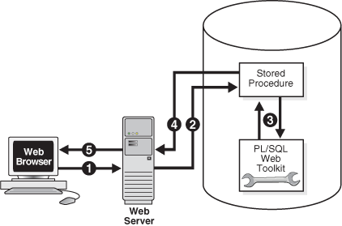
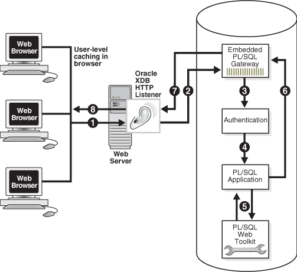

Note:

The use of the technologies described in this chapter is suitable for applications that require tight control of the HTTP communication and HTML generation. For others applications, you are encouraged to use Oracle Application Express, which provides more features and a convenient graphical interface to ease application development.

This chapter explains how to develop PL/SQL web applications, which let you make your database available on the intranet.

Topics:

See Also:

[Oracle Application Express App Builder User's Guide](https://docs.oracle.com/pls/topic/lookup?ctx=en/database/oracle/oracle-database/21/adfns&id=HTMDB-GUID-3D645140-7A61-4853-B975-218F3B99F687) for information about using Oracle Application Express

### 18.1 Overview of PL/SQL Web Applications

Typically, a web application written in PL/SQL is a set of stored subprograms that interact with web browsers through HTTP. A set of interlinked, dynamically generated HTML pages forms the user interface of a web application.

The program flow of a PL/SQL web application is similar to that in a CGI PERL script. Developers often use CGI scripts to produce web pages dynamically, but such scripts are often not optimal for accessing the database. Delivering web content with PL/SQL stored subprograms provides the power and flexibility of database processing. For example, you can use data manipulation language (DML) statements, dynamic SQL statements, and cursors. You also eliminate the process overhead of forking a new CGI process to handle each HTTP request.

Figure 18-1 illustrates the generic process for a PL/SQL web application.

Figure 18-1 PL/SQL Web Application



> The process includes these steps:
>
> 1. A user visits a web page, follows a hypertext link, or submits data in a form, which causes the browser to send a HTTP request for a URL to an HTTP server.
> 2. The HTTP server calls a stored subprogram on an Oracle Database according to the data encoded in the URL. The data in the URL takes the form of parameters to be passed to the stored subprogram.
> 3. The stored subprogram invokes subprograms in the PL/SQL Web Toolkit. Typically, subprograms such as `HTP`.`Print` generate web pages dynamically. A generated web page varies depending on the database contents and the input parameters.
> 4. The subprograms pass the dynamically generated page to the web server.
> 5. The web server delivers the page to the client.


### 18.2 Implementing PL/SQL Web Applications

You can implement a web browser-based application entirely in PL/SQL with PL/SQL Gateway or with PL/SQL Web Toolkit.

Topics:

- PL/SQL Gateway
- PL/SQL Web Toolkit

#### 18.2.1 PL/SQL Gateway

The PL/SQL gateway enables a web browser to invoke a PL/SQL stored subprogram through an HTTP listener. The gateway is a platform on which PL/SQL users develop and deploy PL/SQL web applications.

##### 18.2.1.1 mod\_plsql

`mod_plsql` is one implementation of the PL/SQL gateway. The module is a plug-in of Oracle HTTP Server and enables web browsers to invoke PL/SQL stored subprograms. Oracle HTTP Server is a component of both Oracle Application Server and the database.

The `mod_plsql` plug-in enables you to use PL/SQL stored subprograms to process HTTP requests and generate responses. In this context, an HTTP request is a URL that includes parameter values to be passed to a stored subprogram. PL/SQL gateway translates the URL, invokes the stored subprogram with the parameters, and returns output (typically HTML) to the client.

Some advantages of using `mod_plsql` over the embedded form of the PL/SQL gateway are:

- You can run it in a firewall environment in which the Oracle HTTP Server runs on a firewall-facing host while the database is hosted behind a firewall. You cannot use this configuration with the embedded gateway.
- The embedded gateway does not support `mod_plsql` features such as dynamic HTML caching, system monitoring, and logging in the Common Log Format.

##### 18.2.1.2 Embedded PL/SQL Gateway

You can use an embedded version of the PL/SQL gateway that runs in the XML DB HTTP Listener in the database. It provides the core features of `mod_plsql` in the database but does not require the Oracle HTTP Server. You configure the embedded PL/SQL gateway with the `DBMS_EPG` package in the PL/SQL Web Toolkit.

Some advantages of using the embedded gateway instead of `mod_plsql` are:

- You can invoke PL/SQL web applications like Application Express without installing Oracle HTTP Server, thereby simplifying installation, configuration, and administration of PL/SQL based web applications.
- You use the same configuration approach that is used to deliver content from Oracle XML DB in response to FTP and HTTP requests.

#### 18.2.2 PL/SQL Web Toolkit

This set of PL/SQL packages is a generic interface that enables you to use stored subprograms invoked by `mod_plsql` at run time.

In response to a browser request, a PL/SQL subprogram updates or retrieves data from Oracle Database according to the user input. It then generates an HTTP response to the browser, typically in the form of a file download or HTML to be displayed. The PL/SQL Web Toolkit API enables stored subprograms to perform actions such as:

- Obtain information about an HTTP request
- Generate HTTP headers such as content-type and mime-type
- Set browser cookies
- Generate HTML pages

Table 18-1 describes commonly used PL/SQL Web Toolkit packages.

Table 18-1 Commonly Used Packages in the PL/SQL Web Toolkit

| Package | Description of Contents |
| --- | --- |
| [`HTF`](https://docs.oracle.com/pls/topic/lookup?ctx=en/database/oracle/oracle-database/21/adfns&id=ARPLS390) | Function versions of the subprograms in the `htp` package. The function versions do not directly generate output in a web page. Instead, they pass their output as return values to the statements that invoke them. Use these functions when you must nest function calls. |
| [`HTP`](https://docs.oracle.com/pls/topic/lookup?ctx=en/database/oracle/oracle-database/21/adfns&id=ARPLS391) | Subprograms that generate HTML tags. For example, the procedure `htp`.`anchor` generates the HTML anchor tag, `<A>`. |
| [`OWA_CACHE`](https://docs.oracle.com/pls/topic/lookup?ctx=en/database/oracle/oracle-database/21/adfns&id=ARPLS386) | Subprograms that enable the PL/SQL gateway cache feature to improve performance of your PL/SQL web application.  You can use this package to enable expires-based and validation-based caching with the PL/SQL gateway file system. |
| [`OWA_COOKIE`](https://docs.oracle.com/pls/topic/lookup?ctx=en/database/oracle/oracle-database/21/adfns&id=ARPLS387) | Subprograms that send and retrieve HTTP cookies to and from a client web browser. Cookies are strings a browser uses to maintain state between HTTP calls. State can be maintained throughout a client session or longer if a cookie expiration date is included. |
| [`OWA_CUSTOM `](https://docs.oracle.com/pls/topic/lookup?ctx=en/database/oracle/oracle-database/21/adfns&id=ARPLS388) | The authorize function used by cookies. |
| [`OWA_IMAGE `](https://docs.oracle.com/pls/topic/lookup?ctx=en/database/oracle/oracle-database/21/adfns&id=ARPLS392) | Subprograms that obtain the coordinates where a user clicked an image. Use this package when you have an image map whose destination links invoke a PL/SQL gateway. |
| [`OWA_OPT_LOCK`](https://docs.oracle.com/pls/topic/lookup?ctx=en/database/oracle/oracle-database/21/adfns&id=ARPLS393) | Subprograms that impose database optimistic locking strategies to prevent lost updates. Lost updates can otherwise occur if a user selects, and then attempts to update, a row whose values were changed in the meantime by another user. |
| [`OWA_PATTERN`](https://docs.oracle.com/pls/topic/lookup?ctx=en/database/oracle/oracle-database/21/adfns&id=ARPLS398) | Subprograms that perform string matching and string manipulation with regular expressions. |
| [`OWA_SEC`](https://docs.oracle.com/pls/topic/lookup?ctx=en/database/oracle/oracle-database/21/adfns&id=ARPLS395) | Subprograms used by the PL/SQL gateway for authenticating requests. |
| [`OWA_TEXT`](https://docs.oracle.com/pls/topic/lookup?ctx=en/database/oracle/oracle-database/21/adfns&id=ARPLS396) | Subprograms used by package `OWA_PATTERN` for manipulating strings. You can also use them directly. |
| [`OWA_UTIL`](https://docs.oracle.com/pls/topic/lookup?ctx=en/database/oracle/oracle-database/21/adfns&id=ARPLS397) | These types of utility subprograms:  - Dynamic SQL utilities to produce pages with dynamically generated SQL code. - HTML utilities to retrieve the values of CGI environment variables and perform URL redirects. - Date utilities for correct date-handling. Date values are simple strings in HTML, but must be properly treated as an Oracle Database data type. |
| [`WPG_DOCLOAD`](https://docs.oracle.com/pls/topic/lookup?ctx=en/database/oracle/oracle-database/21/adfns&id=ARPLS200) | Subprograms that download documents from a document repository that you define using the DAD configuration. |

See Also:

[Oracle Database PL/SQL Packages and Types Reference](https://docs.oracle.com/pls/topic/lookup?ctx=en/database/oracle/oracle-database/21/adfns&id=ARPLS-GUID-4AA6AA30-CAEE-4DCD-B214-9AD51D0229B4) for syntax, descriptions, and examples for the PL/SQL Web Toolkit packages

### 18.3 Using mod\_plsql Gateway to Map Client Requests to a PL/SQL Web Application

As explained in detail in the [Oracle HTTP Server mod\_plsql User's Guide](https://docs.oracle.com/pls/topic/lookup?ctx=en/database/oracle/oracle-database/21/adfns&id=YPMOD), `mod_plsql` maps web client requests to PL/SQL stored subprograms over HTTP. See this documentation for instructions.

See Also:

- [Oracle HTTP Server mod\_plsql User's Guide](https://docs.oracle.com/pls/topic/lookup?ctx=en/database/oracle/oracle-database/21/adfns&id=YPMOD) to learn how to configure and use `mod_plsql`
- [Oracle Fusion Middleware Administrator's Guide for Oracle HTTP Server](https://docs.oracle.com/pls/topic/lookup?ctx=en/database/oracle/oracle-database/21/adfns&id=HSADM767) for information about the `mod_plsql` module

### 18.4 Using Embedded PL/SQL Gateway

The embedded gateway functions very similar to the `mod_plsql` gateway.

Topics:

- How Embedded PL/SQL Gateway Processes Client Requests
- Installing Embedded PL/SQL Gateway
- Configuring Embedded PL/SQL Gateway
- Invoking PL/SQL Stored Subprograms Through Embedded PL/SQL Gateway
- Securing Application Access with Embedded PL/SQL Gateway
- Restrictions in Embedded PL/SQL Gateway
- Using Embedded PL/SQL Gateway: Scenario

See Also:

[Oracle HTTP Server mod\_plsql User's Guide](https://docs.oracle.com/pls/topic/lookup?ctx=en/database/oracle/oracle-database/21/adfns&id=YPMOD)

#### 18.4.1 How Embedded PL/SQL Gateway Processes Client Requests

Figure 18-2 illustrates the process by which the embedded gateway handles client HTTP requests.

Figure 18-2 Processing Client Requests with Embedded PL/SQL Gateway



> This graphic depicts an Oracle Database that uses the embedded PL/SQL gateway to process client requests. The steps of the process are described in the following text.
>
> [  
> Copyright © 1996, 2023, Oracle and/or its affiliates.](https://docs.oracle.com/en/database/oracle/oracle-database/dcommon/html/cpyr.htm)


The explanation of the steps in Figure 18-2 is as follows:

1. The Oracle XML DB HTTP Listener receives a request from a client browser to request to invoke a PL/SQL subprogram. The subprogram can either be written directly in PL/SQL or indirectly generated when a PL/SQL Server Page is uploaded to the database and compiled.
2. The XML DB HTTP Listener routes the request to the embedded PL/SQL gateway as specified in its virtual-path mapping configuration.
3. The embedded gateway uses the HTTP request information and the gateway configuration to determine which database account to use for authentication.
4. The embedded gateway prepares the call parameters and invokes the PL/SQL subprogram in the application.
5. The PL/SQL subprogram generates an HTML page out of relational data and the PL/SQL Web Toolkit accessed from the database.
6. The application sends the page to the embedded gateway.
7. The embedded gateway sends the page to the XML DB HTTP Listener.
8. The XML DB HTTP Listener sends the page to the client browser.

Unlike `mod_plsql`, the embedded gateway processes HTTP requests with the Oracle XML DB Listener. This listener is the same server-side process as the Oracle Net Listener and supports Oracle Net Services, HTTP, and FTP.

Configure general HTTP listener settings through the XML DB interface (for instructions, see [Oracle XML DB Developer's Guide](https://docs.oracle.com/pls/topic/lookup?ctx=en/database/oracle/oracle-database/21/adfns&id=ADXDB2510)). Configure the HTTP listener either by using Oracle Enterprise Manager Cloud Control (Cloud Control) or by editing the `xdbconfig`.`xml` file. Use the `DBMS_EPG` package for all embedded PL/SQL gateway configuration, for example, creating or setting attributes for a DAD.

#### 18.4.2 Installing Embedded PL/SQL Gateway

The embedded gateway requires these components:

- XML DB HTTP Listener
- PL/SQL Web Toolkit

The embedded PL/SQL gateway is installed as part of Oracle XML DB. If you are using a preconfigured database created during an installation or by the Database Configuration Assistant (DBCA), then Oracle XML DB is installed and configured.

The PL/SQL Web Toolkit is part of the standard installation of the database, so no supplementary installation is necessary.

See Also:

[Oracle XML DB Developer's Guide](https://docs.oracle.com/pls/topic/lookup?ctx=en/database/oracle/oracle-database/21/adfns&id=ADXDB2700) for information about manually adding Oracle XML DB to an existing database

#### 18.4.3 Configuring Embedded PL/SQL Gateway

You configure `mod_plsql` by editing the Oracle HTTP Server configuration files. Because the embedded gateway is installed as part of the Oracle XML DB HTTP Listener, you manage the embedded gateway as a servlet through the Oracle XML DB servlet management interface.

The configuration interface to the embedded gateway is the PL/SQL package `DBMS_EPG`. This package modifies the underlying `xdbconfig`.`xml` configuration file that XML DB uses. The default values of the embedded gateway configuration parameters are sufficient for most users.

Topics:

- Configuring Embedded PL/SQL Gateway: Overview
- Configuring User Authentication for Embedded PL/SQL Gateway

##### 18.4.3.1 Configuring Embedded PL/SQL Gateway: Overview

As in `mod_plsql`, each request for a PL/SQL stored subprogram is associated with a Database Access Descriptor (DAD). A DAD is a set of configuration values used for database access. A DAD specifies information such as:

- The database account to use for authentication
- The subprogram to use for uploading and downloading documents

In the embedded PL/SQL gateway, a DAD is represented as a servlet in the XML DB HTTP Listener configuration. Each DAD attribute maps to an XML element in the configuration file `xdbconfig`.`xml`. The value of the DAD attribute corresponds to the element content. For example, the `database-username` DAD attribute corresponds to the `<database-username>` XML element; if the value of the DAD attribute is `HR` it corresponds to `<database-username>HR<database-username>`. DAD attribute names are case-sensitive.

Use the `DBMS_EPG` package to perform these embedded PL/SQL gateway configurations:

1. Create a DAD with the `DBMS_EPG`.`CREATE_DAD` procedure.
2. Set DAD attributes with the `DBMS_EPG`.`SET_DAD_ATTRIBUTE` procedure.
	All DAD attributes are optional. If you do not specify an attribute, it has its initial value.

Table 18-2 lists the embedded PL/SQL gateway attributes and the corresponding `mod_plsql` DAD parameters. Enumeration values in the "Legal Values" column are case-sensitive.

Table 18-2 Mapping Between mod\_plsql and Embedded PL/SQL Gateway DAD Attributes

| mod\_plsql DAD Attribute | Embedded PL/SQL Gateway DAD Attribute | Multiple Occurrences | Legal Values |
| --- | --- | --- | --- |
| `PlsqlAfterProcedure` | `after-procedure` | No | String |
| `PlsqlAlwaysDescribeProcedure` | `always-describe-procedure` | No | Enumeration of On, Off |
| `PlsqlAuthenticationMode` | `authentication-mode` | No | Enumeration of Basic, SingleSignOn, GlobalOwa, CustomOwa, PerPackageOwa |
| `PlsqlBeforeProcedure` | `before-procedure` | No | String |
| `PlsqlBindBucketLengths` | `bind-bucket-lengths` | Yes | Unsigned integer |
| `PlsqlBindBucketWidths` | `bind-bucket-widths` | Yes | Unsigned integer |
| `PlsqlCGIEnvironmentList` | `cgi-environment-list` | Yes | String |
| `PlsqlCompatibilityMode` | `compatibility-mode` | No | Unsigned integer |
| `PlsqlDatabaseUsername` | `database-username` | No | String |
| `PlsqlDefaultPage` | `default-page` | No | String |
| `PlsqlDocumentPath` | `document-path` | No | String |
| `PlsqlDocumentProcedure` | `document-procedure` | No | String |
| `PlsqlDocumentTablename` | `document-table-name` | No | String |
| `PlsqlErrorStyle` | `error-style` | No | Enumeration of ApacheStyle, ModplsqlStyle, DebugStyle |
| `PlsqlExclusionList` | `exclusion-list` | Yes | String |
| `PlsqlFetchBufferSize` | `fetch-buffer-size` | No | Unsigned integer |
| `PlsqlInfoLogging` | `info-logging` | No | Enumeration of InfoDebug |
| `PlsqlInputFilterEnable` | `input-filter-enable` | No | String |
| `PlsqlMaxRequestsPerSession` | `max-requests-per-session` | No | Unsigned integer |
| `PlsqlNLSLanguage` | `nls-language` | No | String |
| `PlsqlOWADebugEnable` | `owa-debug-enable` | No | Enumeration of On, Off |
| `PlsqlPathAlias` | `path-alias` | No | String |
| `PlsqlPathAliasProcedure` | `path-alias-procedure` | No | String |
| `PlsqlRequestValidationFunction` | `request-validation-function` | No | String |
| `PlsqlSessionCookieName` | `session-cookie-name` | No | String |
| `PlsqlSessionStateManagement` | `session-state-management` | No | Enumeration of StatelessWithResetPackageState, StatelessWithFastRestPackageState, StatelessWithPreservePackageState |
| `PlsqlTransferMode` | `transfer-mode` | No | Enumeration of Char, Raw |
| `PlsqlUploadAsLongRaw` | `upload-as-long-raw` | No | String |

The default values of the DAD attributes are sufficient for most users of the embedded gateway. `mod_plsql` users do not need these attributes:

- `PlsqlDatabasePassword`
- `PlsqlDatabaseConnectString` (because the embedded gateway does not support logon to external databases)

Like the DAD attributes, the global configuration parameters are optional. Table 18-3 describes the `DBMS_EPG` global attributes and the corresponding `mod_plsql` global parameters.

Table 18-3 Mapping Between mod\_plsql and Embedded PL/SQL Gateway Global Attributes

| mod\_plsql DAD Attribute | Embedded PL/SQL Gateway DAD Attribute | Multiple Occurrences | Legal Values |
| --- | --- | --- | --- |
| `PlsqlLogLevel` | `log-level` | No | Unsigned integer |
| `PlsqlMaxParameters` | `max-parameters` | No | Unsigned integer |

See Also:

- [Oracle Fusion Middleware Administrator's Guide for Oracle HTTP Server](https://docs.oracle.com/pls/topic/lookup?ctx=en/database/oracle/oracle-database/21/adfns&id=HSADM168) for detailed descriptions of the `mod_plsql` DAD attributes. See this documentation for default values and usage notes.
- [Oracle Database PL/SQL Packages and Types Reference](https://docs.oracle.com/pls/topic/lookup?ctx=en/database/oracle/oracle-database/21/adfns&id=ARPLS193) to learn about the `DBMS_EPG` package
- [Oracle XML DB Developer's Guide](https://docs.oracle.com/pls/topic/lookup?ctx=en/database/oracle/oracle-database/21/adfns&id=ADXDB2700) for an account of the `xdbconfig`.`xml` file

##### 18.4.3.2 Configuring User Authentication for Embedded PL/SQL Gateway

Because it uses the XML DB authentication schemes, the embedded gateway handles database authentication differently from `mod_plsql`. In particular, it does not store database passwords in a DAD.

Note:

To serve a PL/SQL web application on the Internet but maintain the database behind a firewall, do not use the embedded PL/SQL gateway to run the application; use `mod_plsql`.

Use the `DBMS_EPG` package to configure database authentication.

Topics:

- Configuring Static Authentication with DBMS\_EPG
- Configuring Dynamic Authentication with DBMS\_EPG
- Configuring Anonymous Authentication with DBMS\_EPG
- Determining the Authentication Mode of a DAD
- Examples: Creating and Configuring DADs
- Example: Determining the Authentication Mode for a DAD
- Example: Determining the Authentication Mode for All DADs
- Example: Showing DAD Authorizations that Are Not in Effect
- Examining Embedded PL/SQL Gateway Configuration

###### 18.4.3.2.1 Configuring Static Authentication with DBMS\_EPG

Static authentication is for the `mod_plsql` user who stores database user names and passwords in the DAD so that the browser user is not required to enter database authentication information.

To configure static authentication, follow these steps:

1. Log on to the database as an XML DB administrator (that is, a user with the `XDBADMIN` role assigned).
2. Create the DAD. For example, this procedure creates a DAD invoked `HR_DAD` and maps the virtual path to / `hrweb` /:
	```
	EXEC DBMS_EPG.CREATE_DAD('HR_DAD', '/hrweb/*');
	```
3. For this step, you need the `ALTER` `ANY` `USER` system privilege. Set the DAD attribute `database-username` to the database account whose privileges must be used by the DAD. For example, this procedure specifies that the DAD named `HR_DAD` has the privileges of the `HR` account:
	```
	EXEC DBMS_EPG.SET_DAD_ATTRIBUTE('HR_DAD', 'database-username', 'HR');
	```
	The DAD attribute `database-username` is case-sensitive.
4. Assign the DAD the privileges of the database user specified in the previous step. This authorization enables end users to invoke procedures and access document tables through the embedded PL/SQL gateway with the privileges of the authorized account. For example:
	```
	EXEC DBMS_EPG.AUTHORIZE_DAD('HR_DAD', 'HR');
	```
	Alternatively, you can log off as the user with `XDBADMIN` privileges, log on as the database user whose privileges must be used by the DAD, and then use this command to assign these privileges to the DAD:
	```
	EXEC DBMS_EPG.AUTHORIZE_DAD('HR_DAD');
	```
	Note:
	Multiple users can authorize the same DAD. The `database-username` attribute setting of the DAD determines which user's privileges to use.

Unlike `mod_plsql`, the embedded gateway connects to the database as the special user `ANONYMOUS`, but accesses database objects with the user privileges assigned to the DAD. The database rejects access if the browser user attempts to connect explicitly with the HTTP `Authorization` header.

Note:

The account `ANONYMOUS` is locked after XML DB installation. To use static authentication with the embedded PL/SQL gateway, first unlock this account.

###### 18.4.3.2.2 Configuring Dynamic Authentication with DBMS\_EPG

Dynamic authentication is for the `mod_plsql` user who does not store database user names and passwords in the DAD.

In dynamic authentication, a database user does not have to authorize the embedded gateway to use its privileges to access database objects. Instead, browser users must supply the database authentication information through the HTTP Basic Authentication scheme.

The action of the embedded gateway depends on whether the `database-username` attribute is set for the DAD. If the attribute is not set, then the embedded gateway connects to the database as the user supplied by the browser client. If the attribute is set, then the database restricts access to the user specified in the `database-username` attribute.

To set up dynamic authentication, follow these steps:

1. Log on to the database as a an XML DB administrator (that is, a user with the `XDBADMIN` role).
2. Create the DAD. For example, this procedure creates a DAD invoked `DYNAMIC_DAD` and maps the virtual path to `/hrweb/`:
	```
	EXEC DBMS_EPG.CREATE_DAD('DYNAMIC_DAD', '/hrweb/*');
	```
3. Optionally, set the DAD attribute `database-username` to the database account whose privileges must be used by the DAD. The browser prompts the user to enter the username and password for this account when accessing the DAD. For example, this procedure specifies that the DAD named `DYNAMIC_DAD` has the privileges of the `HR` account:
	```
	EXEC DBMS_EPG.SET_DAD_ATTRIBUTE('DYNAMIC_DAD', 'database-username', 'HR');
	```
	The attribute `database-username` is case-sensitive.

WARNING:

Passwords sent through the HTTP Basic Authentication scheme are not encrypted. Configure the embedded gateway to use the HTTPS protocol to protect the passwords sent by the browser clients.

###### 18.4.3.2.3 Configuring Anonymous Authentication with DBMS\_EPG

Anonymous authentication is for the `mod_plsql` user who creates a special DAD database user for database logon, but stores the application procedures and document tables in a different schema and grants access to the procedures and document tables to PUBLIC.

To set up anonymous authentication, follow these steps:

1. Log on to the database as an XML DB administrator, that is, a user with the `XDBADMIN` role assigned.
2. Create the DAD. For example, this procedure creates a DAD invoked `HR_DAD` and maps the virtual path to `/hrweb/`:
	```
	EXEC DBMS_EPG.CREATE_DAD('HR_DAD', '/hrweb/*');
	```
3. Set the DAD attribute `database-username` to `ANONYMOUS`. For example:
	```
	EXEC DBMS_EPG.SET_DAD_ATTRIBUTE('HR_DAD', 'database-username', 'ANONYMOUS');
	```
	Both `database-username` and `ANONYMOUS` are case-sensitive.
	You need not authorize the embedded gateway to use `ANONYMOUS` privileges to access database objects, because `ANONYMOUS` has no system privileges and owns no database objects.

###### 18.4.3.2.4 Determining the Authentication Mode of a DAD

If you know the name of a DAD, then the authentication mode for this DAD depends on these factors:

- Does the DAD exist?
- Is the `database-username` attribute for the DAD set?
- Is the DAD authorized to use the privilege of the `database-username` user?
- Is the `database-username` attribute the one that the user authorized to use the DAD?

Table 18-4 shows how the answers to the preceding questions determine the authentication mode.

Table 18-4 Authentication Possibilities for a DAD

| DAD Exists? | database-username set? | User authorized? | Mode |
| --- | --- | --- | --- |
| Yes | Yes | Yes | Static |
| Yes | Yes | No | Dynamic restricted |
| Yes | No | Does not matter | Dynamic |
| Yes | Yes (to `ANONYMOUS`) | Does not matter | Anonymous |
| No |  |  | N/A |

For example, assume that you create a DAD named `MY_DAD`. If the `database-username` attribute for `MY_DAD` is set to `HR`, but the `HR` user does not authorize `MY_DAD`, then the authentication mode for `MY_DAD` is dynamic and restricted. A browser user who attempts to run a PL/SQL subprogram through `MY_DAD` is prompted to enter the `HR` database username and password.

The `DBA_EPG_DAD_AUTHORIZATION` view shows which users have authorized use of a DAD. The `DAD_NAME` column displays the name of the DAD; the `USERNAME` column displays the user whose privileges are assigned to the DAD. The DAD authorized might not exist.

See Also:

[Oracle Database Reference](https://docs.oracle.com/pls/topic/lookup?ctx=en/database/oracle/oracle-database/21/adfns&id=REFRN23709) for more information about the `DBA_EPG_DAD_AUTHORIZATION` view

###### 18.4.3.2.5 Examples: Creating and Configuring DADs

Example 18-1 does this:

- Creates a DAD with static authentication for database user `HR` and assigns it the privileges of the `HR` account, which then authorizes it.
- Creates a DAD with dynamic authentication that is not restricted to any user.
- Creates a DAD with dynamic authentication that is restricted to the `HR` account.

The creation and authorization of a DAD are independent; therefore you can:

- Authorize a DAD that does not exist (it can be created later)
- Authorize a DAD for which you are not the user (however, the authorization does not take effect until the DAD `database-user` attribute is changed to your username)

Example 18-2 creates a DAD with static authentication for database user `HR` and assigns it the privileges of the `HR` account. Then:

- Instead of authorizing that DAD, the database user `HR` authorizes a nonexistent DAD.
	Although the user might have done this by mistake, no error occurs, because the nonexistent DAD might be created later.
- The database user `OE` authorizes the DAD (whose `database-user` attribute is set to `HR`.
	No error occurs, but the authorization does not take effect until the DAD `database-user` attribute is changed to `OE`.

Example 18-1 Creating and Configuring DADs

```
------------------------------------------------------------------------
--- DAD with static authentication
------------------------------------------------------------------------

CONNECT SYSTEM AS SYSDBA
PASSWORD: password
EXEC DBMS_EPG.CREATE_DAD('Static_Auth_DAD', '/static/*');
EXEC DBMS_EPG.SET_DAD_ATTRIBUTE('Static_Auth_DAD', 'database-username', 'HR');
GRANT EXECUTE ON DBMS_EPG TO HR;

-- Authorization
CONNECT HR
PASSWORD: password
EXEC DBMS_EPG.AUTHORIZE_DAD('Static_Auth_DAD');

------------------------------------------------------------------------
-- DAD with dynamic authentication
------------------------------------------------------------------------

CONNECT SYSTEM AS SYSDBA
PASSWORD: password
EXEC DBMS_EPG.CREATE_DAD('Dynamic_Auth_DAD', '/dynamic/*');

-------------------------------------------------------------------------
-- DAD with dynamic authentication restricted
-------------------------------------------------------------------------

EXEC DBMS_EPG.CREATE_DAD('Dynamic_Auth_DAD_Restricted', '/dynamic/*');
EXEC DBMS_EPG.SET_DAD_ATTRIBUTE
  ('Dynamic_Auth_DAD_Restricted', 'database-username', 'HR');
```

Example 18-2 Authorizing DADs to be Created or Changed Later

```
REM Create DAD with static authentication for database user HR

CONNECT SYSTEM AS SYSDBA
PASSWORD: password
EXEC DBMS_EPG.CREATE_DAD('Static_Auth_DAD', '/static/*');
EXEC DBMS_EPG.SET_DAD_ATTRIBUTE('Static_Auth_DAD', 'database-username', 'HR');
GRANT EXECUTE ON DBMS_EPG TO HR;

REM Database user HR authorizes DAD that does not exist

CONNECT HR
PASSWORD: password
EXEC DBMS_EPG.AUTHORIZE_DAD('Static_Auth_DAD_Typo');

REM Database user OE authorizes DAD with database-username 'HR'

CONNECT OE
PASSWORD: password
EXEC DBMS_EPG.AUTHORIZE_DAD('Static_Auth_DAD');
```

###### 18.4.3.2.6 Example: Determining the Authentication Mode for a DAD

Example 18-3 creates a PL/SQL procedure, `show_dad_auth_status`, which accepts the name of a DAD and reports its authentication mode. If the specified DAD does not exist, the procedure exits with an error.

Assume that you have run the script in Example 18-1 to create and configure various DADs. The output is:

```
SET SERVEROUTPUT ON;
BEGIN
  show_dad_auth_status('Static_Auth_DAD');
END;
/
'Static_Auth_DAD' is set up for static authentication for user 'HR'.
```

Example 18-3 Determining the Authentication Mode for a DAD

```
CREATE OR REPLACE PROCEDURE show_dad_auth_status (p_dadname VARCHAR2) IS
  v_daduser VARCHAR2(128);
  v_cnt     PLS_INTEGER;
BEGIN
  -- Determine DAD user
  v_daduser := DBMS_EPG.GET_DAD_ATTRIBUTE(p_dadname, 'database-username');

  -- Determine whether DAD authorization exists for DAD user
  SELECT COUNT(*)
    INTO v_cnt
      FROM DBA_EPG_DAD_AUTHORIZATION da
        WHERE da.DAD_NAME = p_dadname
          AND da.USERNAME = v_daduser;

  -- If DAD authorization exists for DAD user, authentication mode is static
  IF (v_cnt > 0) THEN
    DBMS_OUTPUT.PUT_LINE (
      '''' || p_dadname ||
      ''' is set up for static authentication for user ''' ||
      v_daduser || '''.');
    RETURN;
  END IF;

  -- If no DAD authorization exists for DAD user, authentication mode is dynamic

  -- Determine whether dynamic authentication is restricted to particular user
  IF (v_daduser IS NOT NULL) THEN
    DBMS_OUTPUT.PUT_LINE (
      '''' || p_dadname ||
      ''' is set up for dynamic authentication for user ''' ||
      v_daduser || ''' only.');
  ELSE
    DBMS_OUTPUT.PUT_LINE (
      '''' || p_dadname ||
      ''' is set up for dynamic authentication for any user.');
  END IF;
END;
/
```

###### 18.4.3.2.7 Example: Determining the Authentication Mode for All DADs

The anonymous block in Example 18-4 reports the authentication modes of all registered DADs. It invokes the `show_dad_auth_status` procedure from Example 18-3.

If you have run the script in Example 18-1 to create and configure various DADs, the output of Example 18-4 is:

```
---------- Authorization Status for All DADs ----------
'Static_Auth_DAD' is set up for static auth for user 'HR'.
'Dynamic_Auth_DAD' is set up for dynamic auth for any user.
'Dynamic_Auth_DAD_Restricted' is set up for dynamic auth for user 'HR' only.
```

Example 18-4 Showing the Authentication Mode for All DADs

```
DECLARE
  v_dad_names DBMS_EPG.VARCHAR2_TABLE;
BEGIN
  DBMS_OUTPUT.PUT_LINE
    ('---------- Authorization Status for All DADs ----------');
  DBMS_EPG.GET_DAD_LIST(v_dad_names);

  FOR i IN 1..v_dad_names.count LOOP
    show_dad_auth_status(v_dad_names(i));
  END LOOP;
END;
/
```

###### 18.4.3.2.8 Example: Showing DAD Authorizations that Are Not in Effect

The anonymous block in Example 18-5 reports DAD authorizations that are not in effect. A DAD authorization is not in effect in either of these situations:

- The user who authorizes the DAD is not the user specified by the `database-username` attribute of the DAD
- The user authorizes a DAD that does not exist

If you have run the script in Example 18-2 to create and configure various DADs, the output of Example 18-5 (reformatted to fit on the page) is:

```
---------- DAD Authorizations Not in Effect ----------
DAD authorization of 'Static_Auth_DAD' by user 'OE' is not in effect
  because DAD user is 'HR'.
DAD authorization of 'Static_Auth_DAD_Typo' by user 'HR' is not in effect
  because DAD does not exist.
```

Example 18-5 Showing DAD Authorizations that Are Not in Effect

```
DECLARE
  v_dad_names DBMS_EPG.VARCHAR2_TABLE;
  v_dad_user  VARCHAR2(128);
  v_dad_found BOOLEAN;
BEGIN 
  DBMS_OUTPUT.PUT_LINE
    ('---------- DAD Authorizations Not in Effect ----------');
  DBMS_EPG.GET_DAD_LIST(v_dad_names);

  FOR r IN (SELECT * FROM DBA_EPG_DAD_AUTHORIZATION) LOOP  -- Outer loop
    v_dad_found := FALSE;
    FOR i IN 1..v_dad_names.count LOOP  -- Inner loop
      IF (r.DAD_NAME = v_dad_names(i)) THEN
        v_dad_user :=
          DBMS_EPG.GET_DAD_ATTRIBUTE(r.DAD_NAME, 'database-username');

        -- Is database-username the user for whom DAD is authorized?
        IF (r.USERNAME <> v_dad_user) THEN
          DBMS_OUTPUT.PUT_LINE (
            'DAD authorization of ''' || r.dad_name ||
            ''' by user ''' || r.username || '''' ||
            ' is not in effect because DAD user is ' ||
            '''' || v_dad_user || '''.');
        END IF;
        v_dad_found := TRUE;
        EXIT;  -- Inner loop
      END IF;
    END LOOP;  -- Inner loop

    -- Does DAD exist?
    IF (NOT v_dad_found) THEN
      DBMS_OUTPUT.PUT_LINE (
       'DAD authorization of ''' || r.dad_name ||
       ''' by user ''' || r.username ||
       ''' is not in effect because the DAD does not exist.');
    END IF;
  END LOOP;  -- Outer loop
END;
/
```

###### 18.4.3.2.9 Examining Embedded PL/SQL Gateway Configuration

When you are connected to the database as a user with system privileges, this script helps you examine the configuration of the embedded PL/SQL gateway:

```
$ORACLE_HOME/rdbms/admin/epgstat.sql
```

Example 18-6 shows the output of the `epgstat`.`sql` script for Example 18-1 when the `ANONYMOUS` account is locked.

Example 18-6 epgstat.sql Script Output for Example 18-1

Command to run script:

```
@$ORACLE_HOME/rdbms/admin/epgstat.sql
```

Result:

```
+--------------------------------------+
| XDB protocol ports:                  |
|  XDB is listening for the protocol   |
|  when the protocol port is nonzero.  |
+--------------------------------------+

HTTP Port FTP Port
--------- --------
        0        0

1 row selected.

+---------------------------+
| DAD virtual-path mappings |
+---------------------------+

Virtual Path                     DAD Name
-------------------------------- --------------------------------
/dynamic/*                       Dynamic_Auth_DAD_Restricted
/static/*                        Static_Auth_DAD

2 rows selected.

+----------------+
| DAD attributes |
+----------------+

DAD Name        DAD Param             DAD Value
------------    --------------------- ----------------------------------------
Dynamic_Auth    database-username     HR
_DAD_Restric
ted

Static_Auth_    database-username     HR
DAD

2 rows selected.

+---------------------------------------------------+
| DAD authorization:                                |
|  To use static authentication of a user in a DAD, |
|  the DAD must be authorized for the user.         |
+---------------------------------------------------+

DAD Name                         User Name
-------------------------------- --------------------------------
Static_Auth_DAD                  HR
                                 OE
Static_Auth_DAD_Typo             HR

3 rows selected.

+----------------------------+
| DAD authentication schemes |
+----------------------------+

DAD Name             User Name                        Auth Scheme
-------------------- -------------------------------- ------------------
Dynamic_Auth_DAD                                      Dynamic
Dynamic_Auth_DAD_Res HR                               Dynamic Restricted
tricted

Static_Auth_DAD      HR                               Static

3 rows selected.

+--------------------------------------------------------+
| ANONYMOUS user status:                                 |
|  To use static or anonymous authentication in any DAD, |
|  the ANONYMOUS account must be unlocked.               |
+--------------------------------------------------------+

Database User   Status
--------------- --------------------
ANONYMOUS       EXPIRED & LOCKED

1 row selected.

+-------------------------------------------------------------------+
| ANONYMOUS access to XDB repository:                               |
|  To allow public access to XDB repository without authentication, |
|  ANONYMOUS access to the repository must be allowed.              |
+-------------------------------------------------------------------+

Allow repository anonymous access?
----------------------------------
false

1 row selected.
```

#### 18.4.4 Invoking PL/SQL Stored Subprograms Through Embedded PL/SQL Gateway

The basic steps for invoking PL/SQL subprograms through the embedded PL/SQL gateway are the same as for the `mod_plsql` gateway. See [Oracle HTTP Server mod\_plsql User's Guide](https://docs.oracle.com/pls/topic/lookup?ctx=en/database/oracle/oracle-database/21/adfns&id=YPMOD002) for instructions. You must adapt the `mod_plsql` instructions slightly for use with the embedded gateway. For example, invoke the embedded gateway in a browser by entering the URL in this format:

```
protocol://hostname[:port]/virt-path/[[!][schema.][package.]proc_name[?query_str]]
```

The placeholder `virt-path` stands for the virtual path that you configured in `DBMS_EPG`.`CREATE_DAD`. The `mod_plsql` documentation uses `DAD_location` instead of `virt-path`.

See Also:

- [Oracle HTTP Server mod\_plsql User's Guide](https://docs.oracle.com/pls/topic/lookup?ctx=en/database/oracle/oracle-database/21/adfns&id=YPMOD002) for the following topics:
	- Transaction mode
	- Supported data types
	- Parameter-passing scheme
	- File upload and download support
	- Path-aliasing
	- Common Gateway Interface (CGI) environment variables

#### 18.4.5 Securing Application Access with Embedded PL/SQL Gateway

The embedded gateway shares the same protection mechanism with `mod_plsql`.

See Also:

[Oracle HTTP Server mod\_plsql User's Guide](https://docs.oracle.com/pls/topic/lookup?ctx=en/database/oracle/oracle-database/21/adfns&id=YPMOD003)

#### 18.4.6 Restrictions in Embedded PL/SQL Gateway

The `mod_plsql` restrictions apply equally to the embedded gateway. Also, the embedded version of the gateway does not support these features:

- Dynamic HTML caching
- System monitoring
- Authentication modes other than Basic

See Also:

- [Oracle HTTP Server mod\_plsql User's Guide](https://docs.oracle.com/pls/topic/lookup?ctx=en/database/oracle/oracle-database/21/adfns&id=YPMOD414) for more information about restrictions
- [Oracle HTTP Server mod\_plsql User's Guide](https://docs.oracle.com/pls/topic/lookup?ctx=en/database/oracle/oracle-database/21/adfns&id=YPMOD331) for information about authentication modes

#### 18.4.7 Using Embedded PL/SQL Gateway: Scenario

This section illustrates how to write a simple application that queries the `hr`.`employees` table and delivers HTML output to a web browser through the PL/SQL gateway. It assumes that you have both XML DB and the sample schemas installed.

To write and run the program follow these steps:

1. Log on to the database as a user with `ALTER` `USER` privileges and ensure that the database account `ANONYMOUS` is unlocked. The `ANONYMOUS` account, which is locked by default, is required for static authentication. If the account is locked, then use this SQL statement to unlock it:
	```
	ALTER USER anonymous ACCOUNT UNLOCK;
	```
2. Log on to the database as an XML DB administrator, that is, a user with the `XDBADMIN` role.
	To determine which users and roles were granted the `XDADMIN` role, query the data dictionary:
	```
	SELECT *
	FROM DBA_ROLE_PRIVS
	WHERE GRANTED_ROLE = 'XDBADMIN';
	```
3. Create the DAD. For example, this procedure creates a DAD invoked `HR_DAD` and maps the virtual path to `/plsql/`:
	```
	EXEC DBMS_EPG.CREATE_DAD('HR_DAD', '/plsql/*');
	```
4. Set the DAD attribute `database-username` to the database user whose privileges must be used by the DAD. For example, this procedure specifies that the DAD `HR_DAD` accesses database objects with the privileges of user `HR`:
	```
	EXEC DBMS_EPG.SET_DAD_ATTRIBUTE('HR_DAD', 'database-username', 'HR');
	```
	The attribute `database-username` is case-sensitive.
5. Grant `EXECUTE` privilege to the database user whose privileges must be used by the DAD (so that he or she can authorize the DAD). For example:
	```
	GRANT EXECUTE ON DBMS_EPG TO HR;
	```
6. Log off as the XML DB administrator and log on to the database as the database user whose privileges must be used by the DAD (for example, `HR`).
7. Authorize the embedded PL/SQL gateway to invoke procedures and access document tables through the DAD. For example:
	```
	EXEC DBMS_EPG.AUTHORIZE_DAD('HR_DAD');
	```
8. Create a sample PL/SQL stored procedure invoked `print_employees`. This program creates an HTML page that includes the result set of a query of `hr`.`employees`:
	```
	CREATE OR REPLACE PROCEDURE print_employees IS
	  CURSOR emp_cursor IS
	    SELECT last_name, first_name
	      FROM hr.employees
	        ORDER BY last_name;
	BEGIN
	  HTP.PRINT('<html>');
	  HTP.PRINT('<head>');
	  HTP.PRINT('<meta http-equiv="Content-Type" content="text/html">');
	  HTP.PRINT('<title>List of Employees</title>');
	  HTP.PRINT('</head>'); 
	  HTP.PRINT('<body TEXT="#000000" BGCOLOR="#FFFFFF">');
	  HTP.PRINT('<h1>List of Employees</h1>');
	  HTP.PRINT('<table width="40%" border="1">');
	  HTP.PRINT('<tr>');
	  HTP.PRINT('<th align="left">Last Name</th>');
	  HTP.PRINT('<th align="left">First Name</th>');
	  HTP.PRINT('</tr>');
	  FOR emp_record IN emp_cursor LOOP
	    HTP.PRINT('<tr>');
	    HTP.PRINT('<td>' || emp_record.last_name  || '</td>');
	    HTP.PRINT('<td>' || emp_record.first_name || '</td>');
	  END LOOP;
	  HTP.PRINT('</table>');
	  HTP.PRINT('</body>');
	  HTP.PRINT('</html>');
	END;
	/
	```
9. Ensure that the Oracle Net listener can accept HTTP requests. You can determine the status of the listener on Linux and UNIX by running this command at the system prompt:
	```
	lsnrctl status | grep HTTP
	```
	Output (reformatted from a single line to multiple lines from page size constraints):
	```
	(DESCRIPTION=
	  (ADDRESS=(PROTOCOL=tcp)(HOST=example.com)(PORT=8080))
	  (Presentation=HTTP)
	  (Session=RAW)
	)
	```
	If you do not see the HTTP service started, then you can add these lines to your initialization parameter file (replacing `listener_name` with the name of your Oracle Net local listener), then restart the database and the listener:
	```
	dispatchers="(PROTOCOL=TCP)"
	local_listener=listener_name
	```
10. Run the `print_employees` program from your web browser. For example, you can use this URL, replacing `host` with the name of your host computer and `port` with the value of the `PORT` parameter in the previous step:
	```
	http://host:port/plsql/print_employees
	```
	For example, if your host is `test`.`com` and your HTTP port is `8080`, then enter:
	```
	http://example.com:8080/plsql/print_employees
	```
	The web browser returns an HTML page with a table that includes the first and last name of every employee in the `hr`.`employees` table.

### 18.5 Generating HTML Output with PL/SQL

Traditionally, PL/SQL web applications use function calls to generate each HTML tag for output. These functions are part of the PL/SQL Web Toolkit packages that come with Oracle Database. Example 18-7 shows how to generate a simple HTML page by calling the `HTP` functions that correspond to each HTML tag.

An alternative to making function calls that correspond to each tag is to use the `HTP`.`PRINT` function to print both text and tags. Example 18-8 illustrates this technique.

Example 18-7 Using HTP Functions to Generate HTML Tags

```
CREATE OR REPLACE PROCEDURE html_page IS
BEGIN
  HTP.HTMLOPEN;                            -- generates <HTML>
  HTP.HEADOPEN;                            -- generates <HEAD>
  HTP.TITLE('Title');                      -- generates <TITLE>Hello</TITLE>
  HTP.HEADCLOSE;                           -- generates </HTML> 

  -- generates <BODY TEXT="#000000" BGCOLOR="#FFFFFF">
  HTP.BODYOPEN( cattributes => 'TEXT="#000000" BGCOLOR="#FFFFFF"');

  -- generates <H1>Heading in the HTML File</H1>
  HTP.HEADER(1, 'Heading in the HTML File');

  HTP.PARA;                                 -- generates <P>        
  HTP.PRINT('Some text in the HTML file.'); 
  HTP.BODYCLOSE;                            -- generates </BODY>
  HTP.HTMLCLOSE;                            -- generates </HTML>
END;
/
```

Example 18-8 Using HTP.PRINT to Generate HTML Tags

```
CREATE OR REPLACE PROCEDURE html_page2 IS
BEGIN
  HTP.PRINT('<html>');
  HTP.PRINT('<head>');
  HTP.PRINT('<meta http-equiv="Content-Type" content="text/html">');
  HTP.PRINT('<title>Title of the HTML File</title>');
  HTP.PRINT('</head>');
  HTP.PRINT('<body TEXT="#000000" BGCOLOR="#FFFFFF">');
  HTP.PRINT('<h1>Heading in the HTML File</h1>');
  HTP.PRINT('<p>Some text in the HTML file.');
  HTP.PRINT('</body>');
  HTP.PRINT('</html>');
END;
/
```

### 18.6 Passing Parameters to PL/SQL Web Applications

To be useful in a wide variety of situations, a web application must be interactive enough to allow user choices. To keep the attention of impatient web surfers, streamline the interaction so that users can specify these choices very simply, without excessive decision-making or data entry.

The main methods of passing parameters to PL/SQL web applications are:

- Using HTML form tags. The user fills in a form on one web page, and all the data and choices are transmitted to a stored subprogram when the user clicks the `Submit` button on the page.
- Hard-coded in the URL. The user clicks on a link, and a set of predefined parameters are transmitted to a stored subprogram. Typically, you include separate links on your web page for all the choices that the user might want.

Topics:

- Passing List and Dropdown-List Parameters from an HTML Form
- Passing Option and Check Box Parameters from an HTML Form
- Passing Entry-Field Parameters from an HTML Form
- Passing Hidden Parameters from an HTML Form
- Uploading a File from an HTML Form
- Submitting a Completed HTML Form
- Handling Missing Input from an HTML Form
- Maintaining State Information Between Web Pages

#### 18.6.1 Passing List and Dropdown-List Parameters from an HTML Form

List boxes and drop-down lists are implemented with the HTML tag `<SELECT>`.

Use a list box for a large number of choices or to allow multiple selections. List boxes are good for showing items in alphabetical order so that users can find an item quickly without reading all the choices.

Use a drop-down list in these situations:

- There are a small number of choices
- Screen space is limited.
- Choices are in an unusual order.

The drop-down captures the attention of first-time users and makes them read the items. If you keep the choices and order consistent, then users can memorize the motion of selecting an item from the drop-down list, allowing them to make selections quickly as they gain experience.

Example 18-9 shows a simple drop-down list.

Example 18-9 HTML Drop-Down List

```
<form>
<select name="seasons">
<option value="winter">Winter
<option value="spring">Spring
<option value="summer">Summer
<option value="fall">Fall
</select>
```

#### 18.6.2 Passing Option and Check Box Parameters from an HTML Form

Options pass either a null value (if none of the options in a group is checked), or the value specified on the option that is checked.

To specify a default value for a set of options, you can include the `CHECKED` attribute in an `INPUT` tag, or include a `DEFAULT` clause on the parameter within the stored subprogram. When setting up a group of options, be sure to include a choice that indicates "no preference", because after selecting a option, the user can select a different one, but cannot clear the selection completely. For example, include a "Don't Care" or "Don't Know" selection along with "Yes" and "No" choices, in case someone makes a selection and then realizes it was wrong.

Check boxes need special handling, because your stored subprogram might receive a null value, a single value, or multiple values:

All the check boxes with the same `NAME` attribute comprise a check box group. If none of the check boxes in a group is checked, the stored subprogram receives a null value for the corresponding parameter.

If one check box in a group is checked, the stored subprogram receives a single `VARCHAR2` parameter.

If multiple check boxes in a group are checked, the stored subprogram receives a parameter with the PL/SQL type `TABLE` `OF` `VARCHAR2`. You must declare a type like `TABLE` `OF` `VARCHAR2`, or use a predefined one like `OWA_UTIL`.`IDENT_ARR`. To retrieve the values, use a loop:

```
CREATE OR REPLACE PROCEDURE handle_checkboxes (
  checkboxes owa_util.ident_arr
) AS
BEGIN
  FOR i IN 1..checkboxes.count
  LOOP
    htp.print('<p>Check Box value: ' || checkboxes(i));
  END LOOP;
END;
/
```

#### 18.6.3 Passing Entry-Field Parameters from an HTML Form

Entry fields require the most validation, because a user might enter data in the wrong format, out of range, and so on. If possible, validate the data on the client side using a client-side JavaScript function, and format it correctly for the user or prompt them to enter it again.

For example:

- You might prevent the user from entering alphabetic characters in a numeric entry field, or from entering characters after reaching a length limit.
- You might silently remove spaces and dashes from a credit card number if the stored subprogram expects the value in that format.
- You might inform the user immediately when they type a number that is too large, so that they can retype it.

Because you cannot rely on such validation to succeed, code the stored subprograms to deal with these cases anyway. Rather than forcing the user to use the `Back` button when they enter wrong data, display a single page with an error message and the original form with all the other values filled in.

For sensitive information such as passwords, a special form of the entry field, `<INPUT TYPE=PASSWORD>`, hides the text as it is typed in.

The procedure in Example 18-10 accepts two strings as input. The first time the procedure is invoked, the user sees a simple form prompting for the input values. When the user submits the information, the same procedure is invoked again to check if the input is correct. If the input is OK, the procedure processes it. If not, the procedure prompts for input, filling in the original values for the user.

Example 18-10 Passing Entry-Field Parameters from an HTML Form

```
DROP TABLE name_zip_table;
CREATE TABLE name_zip_table (
  name     VARCHAR2(100),
  zipcode  NUMBER
);

-- Store a name and associated zip code in the database.

CREATE OR REPLACE PROCEDURE associate_name_with_zipcode
  (name VARCHAR2 := NULL,
   zip  VARCHAR2 := NULL)
AS
BEGIN
  -- Each entry field must contain a value. Zip code must be 6 characters.
  -- (In a real program you perform more extensive checking.)

  IF name IS NOT NULL AND zip IS NOT NULL AND length(zip) = 6 THEN
    INSERT INTO name_zip_table (name, zipcode) VALUES (name, zip);

    HTP.PRINT('<p>The person ' || HTP.ESCAPE_SC(name) ||
              ' has the zip code ' || HTP.ESCAPE_SC(zip) || '.');

    -- If input was OK, stop here. User does not see form again.
    RETURN;
  END IF;

  -- If user entered incomplete or incorrect data, show error message.

  IF (name IS NULL AND zip IS NOT NULL)
    OR (name IS NOT NULL AND zip IS NULL)
      OR (zip IS NOT NULL AND length(zip) != 6)
  THEN
    HTP.PRINT('<p><b>Please reenter data. Fill all fields,
               and use 6-digit zip code.</b>');
  END IF;

  -- If user entered no data or incorrect data, show error message
  -- & make form invoke same procedure to check input values.

  HTP.FORMOPEN('HR.associate_name_with_zipcode', 'GET');
  HTP.PRINT('<p>Enter your name:</td>');

  HTP.PRINT('<td valign=center><input type=text name=name value="' ||
            HTP.ESCAPE_SC(name) || '">');

  HTP.PRINT('<p>Enter your zip code:</td>');

  HTP.PRINT('<td valign=center><input type=text name=zip value="' ||
            HTP.ESCAPE_SC(zip) || '">');

  HTP.FORMSUBMIT(NULL, 'Submit');
  HTP.FORMCLOSE;
END;
/
```

#### 18.6.4 Passing Hidden Parameters from an HTML Form

One technique for passing information through a sequence of stored subprograms, without requiring the user to specify the same choices each time, is to include hidden parameters in the form that invokes a stored subprogram. The first stored subprogram places information, such as a user name, into the HTML form that it generates. The value of the hidden parameter is passed to the next stored subprogram, as if the user had entered it through a option or entry field.

Other techniques for passing information from one stored subprogram to another include:

- Sending a "cookie" containing the persistent information to the browser. The browser then sends this same information back to the server when accessing other web pages from the same site. Cookies are set and retrieved through the HTTP headers that are transferred between the browser and the web server before the HTML text of each web page.
- Storing the information in the database itself, where later stored subprograms can retrieve it. This technique involves some extra overhead on the database server, and you must still find a way to keep track of each user as multiple users access the server at the same time.

#### 18.6.5 Uploading a File from an HTML Form

You can use an HTML form to choose a file on a client system, and transfer it to the server. A stored subprogram can insert the file into the database as a `CLOB`, `BLOB`, or other type that can hold large amounts of data.

The PL/SQL Web Toolkit and the PL/SQL gateway have the notion of a "document table" that holds uploaded files.

See Also:

mod\_plsql User's Guide

#### 18.6.6 Submitting a Completed HTML Form

By default, an HTML form must have a `Submit` button, which transmits the data from the form to a stored subprogram or CGI program. You can label this button with text of your choice, such as "Search", "Register", and so on.

You can have multiple forms on the same page, each with its own form elements and `Submit` button. You can even have forms consisting entirely of hidden parameters, where the user makes no choice other than clicking the button.

Using JavaScript or other scripting languages, you can eliminate the Submit button and have the form submitted in response to some other action, such as selecting from a drop-down list. This technique is best when the user makes a single selection, and the confirmation step of the `Submit` button is not essential.

#### 18.6.7 Handling Missing Input from an HTML Form

When an HTML form is submitted, your stored subprogram receives null parameters for any form elements that are not filled in. For example, null parameters can result from an empty entry field, a set of check boxes, options, or list items with none checked, or a `VALUE` parameter of "" (empty quotation marks).

Regardless of any validation you do on the client side, use code stored subprograms to handle the possibility that some parameters are null:

- Specify an initial value in all parameter declarations, to prevent an exception when the stored subprogram is invoked with a missing form parameter. You can set the initial value to zero for numeric values (when that makes sense), and to `NULL` when you want to check whether the user specifies a value.
- Before using an input parameter value that has the initial value `NULL`, check if it is null.
- Make the subprogram generate sensible results even when not all input parameters are specified. You might leave some sections out of a report, or display a text string or image in a report to indicate where parameters were not specified.
- Provide a way to fill in the missing values and run the stored subprogram again, directly from the results page. For example, include a link that invokes the same stored subprogram with an additional parameter, or display the original form with its values filled in as part of the output.

#### 18.6.8 Maintaining State Information Between Web Pages

Web applications are particularly concerned with the idea of **state**, the set of data that is current at a particular moment in time. It is easy to lose state information when switching from one web page to another, which might result in asking the user to make the same choices repeatedly.

You can pass state information between dynamic web pages using HTML forms. The information is passed as a set of name-value pairs, which are turned into stored subprogram parameters for you.

If the user has to make multiple selections, or one selection from many choices, or it is important to avoid an accidental selection, use an HTML form. After the user makes and reviews all the choices, they confirm the choices with the `Submit` button. Subsequent pages can use forms with hidden parameters (`<INPUT TYPE=HIDDEN>` tags) to pass these choices from one page to the next.

If the user is considering one or two choices, or the decision points are scattered throughout the web page, you can save the user from hunting around for the `Submit` button by representing actions as hyperlinks and including any necessary name-value pairs in the query string (the part after the `?` within a URL).

An alternative way to main state information is to use Oracle Application Server and its `mod_ose` module. This approach lets you store state information in package variables that remain available as a user moves around a website.

See Also:

The Oracle Application Server documentation set at:

```
http://www.oracle.com/technetwork/indexes/documentation/index.html
```

### 18.7 Performing Network Operations in PL/SQL Subprograms

Oracle provides packages that allow PL/SQL subprograms to perform a set of network operations using PL/SQL: sending email, getting a host name or address, using TCP/IP connections, retrieving HTTP URL contents, and using table, image maps, cookies, and CGI variables.

Topics:

- Internet Protocol Version 6 (IPv6) Support
- Sending E-Mail from PL/SQL
- Getting a Host Name or Address from PL/SQL
- Using TCP/IP Connections from PL/SQL
- Retrieving HTTP URL Contents from PL/SQL
- Using Tables\_ Image Maps\_ Cookies\_ and CGI Variables from PL/SQL

#### 18.7.1 Internet Protocol Version 6 (IPv6) Support

As of Oracle Database 11g Release 2 (11.2.0.1), PL/SQL network utility packages support IPv6 addresses.

The package interfaces have not changed: Any interface parameter that expects a network host accepts an IPv6 address in string form, and any interface that returns an IP address can return an IPv6 address.

However, applications that use network addresses might need small changes, and recompilation, to accommodate IPv6 addresses. An IPv6 address has 128 bits, while an IPv4 address has 32 bits. In a URL, an IPv6 address must be enclosed in brackets. For example:

```
http://[2001:0db8:85a3:08d3:1319:8a2e:0370:7344]/
```

See Also:

- [Oracle Database Net Services Administrator's Guide](https://docs.oracle.com/pls/topic/lookup?ctx=en/database/oracle/oracle-database/21/adfns&id=NETAG999) for detailed information about IPv6 support in Oracle Database
- [Oracle Database PL/SQL Packages and Types Reference](https://docs.oracle.com/pls/topic/lookup?ctx=en/database/oracle/oracle-database/21/adfns&id=ARPLS-GUID-4C1C3180-3C8F-41F9-BFB7-A65AD6930035) for information about IPv6 support in specific PL/SQL network utility packages

#### 18.7.2 Sending E-Mail from PL/SQL

Using the `UTL_SMTP` package, a PL/SQL subprogram can send e-mail, as in Example 18-11.

See Also:

[Oracle Database PL/SQL Packages and Types Reference](https://docs.oracle.com/pls/topic/lookup?ctx=en/database/oracle/oracle-database/21/adfns&id=ARPLS074) for detailed information about the `UTL_SMTP` package

Example 18-11 Sending E-Mail from PL/SQL

```
CREATE OR REPLACE PROCEDURE send_test_message
IS
  mailhost   VARCHAR2(64) := 'mailhost.example.com';
  sender     VARCHAR2(64) := 'me@example.com';
  recipient  VARCHAR2(64) := 'you@example.com';
  mail_conn  UTL_SMTP.CONNECTION;
BEGIN
  mail_conn := UTL_SMTP.OPEN_CONNECTION(mailhost, 25); -- 25 is the port
  UTL_SMTP.HELO(mail_conn, mailhost);
  UTL_SMTP.MAIL(mail_conn, sender);
  UTL_SMTP.RCPT(mail_conn, recipient);
 
  UTL_SMTP.OPEN_DATA(mail_conn);
  UTL_SMTP.WRITE_DATA(mail_conn, 'This is a test message.' || chr(13));
  UTL_SMTP.WRITE_DATA(mail_conn, 'This is line 2.' || chr(13));
  UTL_SMTP.CLOSE_DATA(mail_conn);
 
  /* If message were in single string, open_data(), write_data(),
     and close_data() could be in a single call to data(). */
 
  UTL_SMTP.QUIT(mail_conn);
EXCEPTION
  WHEN OTHERS THEN
   -- Insert error-handling code here
   RAISE;
END;
/
```

#### 18.7.3 Getting a Host Name or Address from PL/SQL

Using the `UTL_INADDR` package, a PL/SQL subprogram can determine the host name of the local system or the IP address of a given host name.

See Also:

[Oracle Database PL/SQL Packages and Types Reference](https://docs.oracle.com/pls/topic/lookup?ctx=en/database/oracle/oracle-database/21/adfns&id=ARPLS071) for detailed information about the `UTL_INADDR` package

#### 18.7.4 Using TCP/IP Connections from PL/SQL

Using the `UTL_TCP` package, a PL/SQL subprogram can open TCP/IP connections to systems on the network, and read or write to the corresponding sockets.

See Also:

[Oracle Database PL/SQL Packages and Types Reference](https://docs.oracle.com/pls/topic/lookup?ctx=en/database/oracle/oracle-database/21/adfns&id=ARPLS075) for detailed information about the `UTL_TCP` package

#### 18.7.5 Retrieving HTTP URL Contents from PL/SQL

Using the `UTL_HTTP` package, a PL/SQL subprogram can:

- Retrieve the contents of an HTTP URL
	The contents are usually in the form of HTML-tagged text, but might be any kind of file that can be downloaded from a web server (for example, plain text or a JPEG image).
- Control HTTP session details (such as headers, cookies, redirects, proxy servers, IDs and passwords for protected sites, and CGI parameters)
- Speed up multiple accesses to the same website, using HTTP 1.1 persistent connections

A PL/SQL subprogram can construct and interpret URLs for use with the `UTL_HTTP` package by using the functions `UTL_URL`.`ESCAPE` and `UTL_URL`.`UNESCAPE`.

The PL/SQL procedure in Example 18-12 uses the `UTL_HTTP` package to retrieve the contents of an HTTP URL.

This block shows examples of calls to the procedure in Example 18-12, but the URLs are for nonexistent pages. Substitute URLs from your own web server.

```
BEGIN
  show_url('http://www.oracle.com/no-such-page.html');
  show_url('http://www.oracle.com/protected-page.html');
  show_url
    ('http://www.oracle.com/protected-page.html','username','password');
END;
/
```

See Also:

- [Oracle Database PL/SQL Packages and Types Reference](https://docs.oracle.com/pls/topic/lookup?ctx=en/database/oracle/oracle-database/21/adfns&id=ARPLS070) for detailed information about the `UTL_HTTP` package
- [Oracle Database PL/SQL Packages and Types Reference](https://docs.oracle.com/pls/topic/lookup?ctx=en/database/oracle/oracle-database/21/adfns&id=ARPLS073) for detailed information about `UTL_URL`.`ESCAPE` and `UTL_URL`.`UNESCAPE`

Example 18-12 Retrieving HTTP URL Contents from PL/SQL

```
CREATE OR REPLACE PROCEDURE show_url
  (url      IN VARCHAR2,
  username IN VARCHAR2 := NULL,
  password IN VARCHAR2 := NULL)
AS
  req        UTL_HTTP.REQ;
  resp       UTL_HTTP.RESP;
  name_      VARCHAR2(256);
  value_     VARCHAR2(1024);
  data_      VARCHAR2(255);
  my_scheme  VARCHAR2(256);
  my_realm   VARCHAR2(256);
  my_proxy   BOOLEAN;
BEGIN
  -- When going through a firewall, pass requests through this host.
  -- Specify sites inside the firewall that do not need the proxy host.
 
  UTL_HTTP.SET_PROXY('proxy.example.com', 'corp.example.com');
 
  -- Ask UTL_HTTP not to raise an exception for 4xx and 5xx status codes,
  -- rather than just returning the text of the error page.
 
  UTL_HTTP.SET_RESPONSE_ERROR_CHECK(FALSE);
 
  -- Begin retrieving this web page.
 req := UTL_HTTP.BEGIN_REQUEST(url);
 
  -- Identify yourself.
  --  Some sites serve special pages for particular browsers.
  UTL_HTTP.SET_HEADER(req, 'User-Agent', 'Mozilla/4.0');
 
  -- Specify user ID and password for pages that require them.
  IF (username IS NOT NULL) THEN
    UTL_HTTP.SET_AUTHENTICATION(req, username, password);
  END IF;
 
  -- Start receiving the HTML text.
  resp := UTL_HTTP.GET_RESPONSE(req);
 
  -- Show status codes and reason phrase of response.
  DBMS_OUTPUT.PUT_LINE('HTTP response status code: ' || resp.status_code);
  DBMS_OUTPUT.PUT_LINE
    ('HTTP response reason phrase: ' || resp.reason_phrase);
 
  -- Look for client-side error and report it.
  IF (resp.status_code >= 400) AND (resp.status_code <= 499) THEN
 
  -- Detect whether page is password protected
  -- and you didn't supply the right authorization.
 
  IF (resp.status_code = UTL_HTTP.HTTP_UNAUTHORIZED) THEN
  UTL_HTTP.GET_AUTHENTICATION(resp, my_scheme, my_realm, my_proxy);
  IF (my_proxy) THEN
    DBMS_OUTPUT.PUT_LINE('Web proxy server is protected.');
    DBMS_OUTPUT.PUT('Please supply the required ' || my_scheme ||
      ' authentication username for realm ' || my_realm ||
      ' for the proxy server.');
  ELSE
    DBMS_OUTPUT.PUT_LINE('Web page ' || url || ' is protected.');
    DBMS_OUTPUT.PUT('Please supplied the required ' || my_scheme ||
      ' authentication username for realm ' || my_realm ||
      ' for the web page.');
  END IF;
  ELSE
    DBMS_OUTPUT.PUT_LINE('Check the URL.');
  END IF;
 
  UTL_HTTP.END_RESPONSE(resp);
    RETURN;
 
  -- Look for server-side error and report it.
  ELSIF (resp.status_code >= 500) AND (resp.status_code <= 599) THEN
    DBMS_OUTPUT.PUT_LINE('Check if the website is up.');
    UTL_HTTP.END_RESPONSE(resp);
    RETURN;
  END IF;
 
  -- HTTP header lines contain information about cookies, character sets,
  -- and other data that client and server can use to customize each
  -- session.
 
  FOR i IN 1..UTL_HTTP.GET_HEADER_COUNT(resp) LOOP
    UTL_HTTP.GET_HEADER(resp, i, name_, value_);
    DBMS_OUTPUT.PUT_LINE(name_ || ': ' || value_);
  END LOOP;
 
  -- Read lines until none are left and an exception is raised.
  LOOP
    UTL_HTTP.READ_LINE(resp, value_);
    DBMS_OUTPUT.PUT_LINE(value_);
  END LOOP;
EXCEPTION
  WHEN UTL_HTTP.END_OF_BODY THEN
  UTL_HTTP.END_RESPONSE(resp);
END;
/
```

#### 18.7.6 Using Tables, Image Maps, Cookies, and CGI Variables from PL/SQL

Using packages supplied by Oracle, and the `mod_plsql` plug-in of Oracle HTTP Server (OHS), a PL/SQL subprogram can format the results of a query in an HTML table, produce an image map, set and get HTTP cookies, check the values of CGI variables, and perform other typical web operations.

Documentation for these packages is not part of the database documentation library. The location of the documentation depends on your application server. To get started with these packages, look at their subprogram names and parameters using the SQL\*Plus `DESCRIBE` statement:

```
DESCRIBE HTP;
DESCRIBE HTF;
DESCRIBE OWA_UTIL;
```