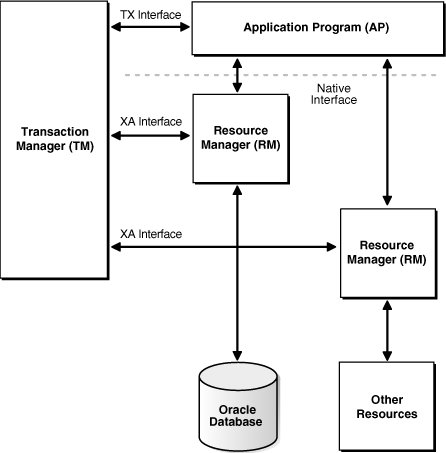

Note:

Avoid using XA if possible, for these reasons:

- XA can degrade performance.
- XA can cause in-doubt transactions.
- XA might be unable to take advantage of Oracle Database 12c Release 1 (12.1.0.1) features that enhance the ability of applications to continue after recoverable outages.

It might be possible to avoid using XA even when that seems avoidable (for example, if Oracle and non-Oracle resources must be used in the same transaction).

This chapter explains how to use the Oracle XA library. Typically, you use this library in applications that work with transaction monitors. The XA features are most useful in applications in which transactions interact with multiple databases.

Topics:

See Also:

- Distributed TP: The XA Specification, for an overview of XA, including basic architecture. Access at [`https://www2.opengroup.org/ogsys/jsp/publications/PublicationDetails.jsp?publicationid=11144`](https://www2.opengroup.org/ogsys/jsp/publications/PublicationDetails.jsp?publicationid=11144).
- [Oracle Call Interface Programmer's Guide](https://docs.oracle.com/pls/topic/lookup?ctx=en/database/oracle/oracle-database/21/adfns&id=LNOCI350) for background and reference information about the Oracle XA library
- The Oracle Database platform-specific documentation for information about library linking filenames
- README for changes, bugs, and restrictions in the Oracle XA library for your platform

### 23.1 X/Open Distributed Transaction Processing (DTP)

The X/Open Distributed Transaction Processing (DTP) architecture defines a standard architecture or interface that enables multiple application programs (APs) to share resources provided by multiple, and possibly different, resource managers (RMs). It coordinates the work between APs and RMs into global transactions.

The Oracle XA library conforms to the X/Open software architecture's XA interface specification. The Oracle XA library is an external interface that enables a client-side transaction manager (TM) that is not an Oracle client-side TM to coordinate global transactions, thereby allowing inclusion of database RMs that are not Oracle Database RMs in distributed transactions. For example, a client application can manage an Oracle Database transaction and a transaction in an NTFS file system as a single, global transaction.

Figure 23-1 illustrates a possible X/Open DTP model.

Figure 23-1 Possible DTP Model



> This figure shows 6 boxes with 7 lines connecting them:
>
> 1. A "TX Interface" double arrow between a Transaction Manager box and an Application Program box
> 2. An "XA Interface" double arrow between the Transaction Manager and a Resource Manager box
> 3. A double arrow between the Application Program and the Resource Manager
> 4. An "XA Interface" double arrow between the Transaction Manager and a Resource box
> 5. A "Native Interface" double arrow between the Application Program and the Resource
> 6. An arrow from the Resource to a box called Other
> 7. A line between the Resource Manager and an Oracle (Database) box


Topics:

- DTP Terminology
- Required Public Information

#### 23.1.1 DTP Terminology

- Resource Manager (RM)
- Distributed Transaction
- Branch
- Transaction Manager (TM)
- Transaction Processing Monitor (TPM)
- Two-Phase Commit Protocol
- Application Program (AP)
- TX Interface
- Tight and Loose Coupling
- Dynamic and Static Registration

Resource Manager (RM)

A resource manager controls a shared, recoverable resource that can be returned to a consistent state after a failure. Examples are relational databases, transactional queues, and transactional file systems. Oracle Database is an RM and uses its online redo log and undo segments to return to a consistent state after a failure.

Distributed Transaction

A distributed transaction, also called a **global transaction**, is a client transaction that involves updates to multiple distributed resources and requires "all-or-none" semantics across distributed RMs.

Branch

A branch is a unit of work contained within one RM. Multiple branches comprise a global transaction. For Oracle Database, each branch maps to a local transaction inside the database server.

Transaction Manager (TM)

A transaction manager provides an API for specifying the boundaries of the transaction and manages commit and recovery. The TM implements a two-phase commit engine to provide "all-or-none" semantics across distributed RMs.

An **external TM** is a middle-tier component that resides outside Oracle Database. Normally, the database is its own internal TM. Using a standards-based TM enables Oracle Database to cooperate with other heterogeneous RMs in a single transaction.

Transaction Processing Monitor (TPM)

A TM is usually provided by a transaction processing monitor (TPM), such as:

- Oracle Tuxedo
- IBM Transarc Encina
- IBM CICS

A TPM coordinates the flow of transaction requests between the client processes that issue requests and the back-end servers that process them. Basically, a TPM coordinates transactions that require the services of several different types of back-end processes, such as application servers and RMs distributed over a network.

The TPM synchronizes any commits or rollbacks required to complete a distributed transaction. The TM portion of the TPM is responsible for controlling when distributed commits and rollbacks take place. Thus, if a distributed application program takes advantage of a TPM, then the TM portion of the TPM is responsible for controlling the two-phase commit protocol. The RMs enable the TMs to perform this task.

Because the TM controls distributed commits or rollbacks, it must communicate directly with Oracle Database (or any other RM) through the XA interface. It uses Oracle XA library subprograms, which are described in " Oracle XA Library Subprograms ", to tell Oracle Database how to process the transaction, based on its knowledge of all RMs in the transaction.

Two-Phase Commit Protocol

The Oracle XA library interface follows the two-phase commit protocol. The sequence of events is as follows:

1. In the prepare phase, the TM asks each RM to guarantee that it can commit any part of the transaction. If this is possible, then the RM records its prepared state and replies affirmatively to the TM. If it is not possible, then the RM might roll back any work, reply negatively to the TM, and forget about the transaction. The protocol allows the application, or any RM, to roll back the transaction unilaterally until the prepare phase completes.
2. In phase two, the TM records the commit decision and issues a commit or rollback to all RMs participating in the transaction. TM can issue a commit for an RM only if all RMs have replied affirmatively to phase one.

Application Program (AP)

An application program defines transaction boundaries and specifies actions that constitute a transaction. For example, an AP can be a precompiler or Oracle Call Interface (OCI) program. The AP operates on the RM resource through its native interface, for example, SQL.

TX Interface

An application program starts and completes all transaction control operations through the TM through an interface called **TX**. The AP does not directly use the XA interface. APs are not aware of branches that fork in the middle-tier: application threads do not explicitly join, leave, suspend, and resume branch work, instead the TM portion of the transaction processing monitor manages the branches of a global transaction for APs. Ultimately, APs call the TM to commit all-or-none.

Note:

The naming conventions for the TX interface and associated subprograms are vendor-specific. For example, the `tx_open` call might be referred to as `tp_open` on your system. In some cases, the calls might be implicit, for example, at the entry to a transactional RPC. See the documentation supplied with the transaction processing monitor for details.

Tight and Loose Coupling

Application threads are tightly coupled if the RM considers them as a single entity for all isolation semantic purposes. Tightly coupled branches must see changes in each other. Furthermore, an external client must either see all changes of a tightly coupled set or none of the changes. If application threads are not tightly coupled, then they are loosely coupled.

Dynamic and Static Registration

Oracle Database supports both dynamic and static registration. In dynamic registration, the RM runs an application callback before starting any work. In static registration, you must call `xa_start` for each RM before starting any work, even if some RMs are not involved.

#### 23.1.2 Required Public Information

As a resource manager, Oracle Database must publish the information described in Table 23-1.

Table 23-1 Required XA Features Published by Oracle Database

| XA Feature | Oracle Database Details |
| --- | --- |
| `xa_switch_t` structures | The Oracle Database `xa_switch_t` structure name is `xaosw` for static registration and `xaoswd` for dynamic registration. These structures contain entry points and other information for the resource manager. |
| `xa_switch_t` resource manager | The Oracle Database resource manager name within the `xa_switch_t` structure is `Oracle_XA`. |
| Close string | The close string used by `xa_close` is ignored and can be null. |
| Open string | For the description of the format of the open string that `xa_open` uses, see Defining the xa\_open String. |
| Libraries | Libraries needed to link applications using Oracle XA have platform-specific names. The procedure is similar to linking an ordinary precompiler or OCI program except that you might have to link any TPM-specific libraries.  If you are not using Precompilers (such as Pro\*C/C++, Pro\*COBOL, and others), then link with `$ORACLE_HOME/rdbms/lib/xaonsl.o` or `$ORACLE_HOME/rdbms/lib32/xaonsl.o` (for 32 bit application on 64 bit platforms). |
| Requirements | None. The functionality to support XA is part of both Standard Edition and Enterprise Edition. |

### 23.2 Oracle XA Library Subprograms

The Oracle XA library subprograms enable a TM to tell Oracle Database how to process transactions. Generally, the TM must open the resource by using `xa_open`. Typically, the opening of the resource results from the AP call to `tx_open`. Some TMs might call `xa_open` implicitly when the application begins.

Similarly, there is a close (using `xa_close`) that occurs when the application is finished with the resource. The close might occur when the AP calls `tx_close` or when the application terminates.

The TM instructs the RMs to perform several other tasks, which include:

- Starting a transaction and associating it with an ID
- Rolling back a transaction
- Preparing and committing a transaction

Topics:

- Oracle XA Library Subprograms
- Oracle XA Interface Extensions

#### 23.2.1 Oracle XA Library Subprograms

XA Library subprograms are described in Table 23-2.

Table 23-2 XA Library Subprograms

| XA Subprogram | Description |
| --- | --- |
| `xa_open` | Connects to the RM. |
| `xa_close` | Disconnects from the RM. |
| `xa_start` | Starts a transaction and associates it with the given transaction ID (XID), or associates the process with an existing transaction. |
| `xa_end` | Disassociates the process from the given XID. |
| `xa_rollback` | Rolls back the transaction associated with the given XID. |
| `xa_prepare` | Prepares the transaction associated with the given XID. This is the first phase of the two-phase commit protocol. |
| `xa_commit` | Commits the transaction associated with the given XID. This is the second phase of the two-phase commit protocol. |
| `xa_recover` | Retrieves a list of prepared, heuristically committed, or heuristically rolled back transactions. |
| `xa_forget` | Forgets the heuristically completed transaction associated with the given XID. |

In general, the AP need not worry about the subprograms in Table 23-2 except to understand the role played by the `xa_open` string.

#### 23.2.2 Oracle XA Interface Extensions

Oracle Database's XA interface includes some additional functions, which are described in Table 23-3.

Table 23-3 Oracle XA Interface Extensions

| Function | Description |
| --- | --- |
| `OCISvcCtx *xaoSvcCtx(text *dbname)` | Returns the OCI service handle for a given XA connection. The `dbname` parameter must be the same as the `DB` parameter passed in the `xa_open` string. OCI applications can use this routing instead of the `sqlld2` calls to obtain the connection handle. Hence, OCI applications need not link with the `sqllib` library. The service handle can be converted to the Version 7 OCI logon data area (LDA) by using `OCISvcCtxToLda` \[Version 8 OCI\]. Client applications must remember to convert the Version 7 LDA to a service handle by using `OCILdaToSvcCtx` after completing the OCI calls. |
| `OCIEnv *xaoEnv(text *dbname)` | Returns the OCI environment handle for a given XA connection. The `dbname` parameter must be the same as the `DB` parameter passed in the `xa_open` string. |
| `int xaosterr(OCISvcCtx *SvcCtx,sb4 error)` | Converts an Oracle Database error code to an XA error code (applicable only to dynamic registration). The first parameter is the service handle used to run the work in the database. The second parameter is the error code that was returned from Oracle Database. Use this function to determine if the error returned from an OCI statement was caused because the `xa_start` failed. The function returns XA\_OK if the error was not generated by the XA module or a valid XA error if the error was generated by the XA module. |

### 23.3 Developing and Installing XA Applications

This section explains how to develop and install Oracle XA applications:

- DBA or System Administrator Responsibilities
- Application Developer Responsibilities
- Defining the xa\_open String
- Developing and Installing XA Applications
- Managing Transaction Control with Oracle XA
- Migrating Precompiler or OCI Applications to TPM Applications
- Managing Oracle XA Library Thread Safety
- Using the DBMS\_XA Package

#### 23.3.1 DBA or System Administrator Responsibilities

The responsibilities of the DBA or system administrator are:

1. Define the open string, with help from the application developer.
2. Ensure that the static data dictionary view `DBA_PENDING_TRANSACTIONS` exists and grant the `READ` or `SELECT` privilege to the view for all Oracle users specified in the `xa_open` string.
	Grant `FORCE` `TRANSACTION` privilege to the Oracle user who might commit or roll back pending (in-doubt) transactions that he or she created, using the command `COMMIT` `FORCE` `local_tran_id` or `ROLLBACK` `FORCE` `local_tran_id`.
	Grant `FORCE` `ANY` `TRANSACTION` privilege to the Oracle user who might commit or roll back XA transactions created by other users. For example, if user A might commit or roll back a transaction that was created by user B, user A must have `FORCE` `ANY` `TRANSACTION` privilege.
	In Oracle Database version 7 client applications, all Oracle Database accounts used by Oracle XA library must have the `SELECT` privilege on the dynamic performance view `V$XATRANS$`. This view must have been created during the XA library installation. If necessary, you can manually create the view by running the SQL script `xaview`.`sql` as Oracle Database user `SYS`.
3. Using the open string information, install the RM into the TPM configuration. Follow the TPM vendor instructions.
	The DBA or system administrator must be aware that a TPM system starts the process that connects to Oracle Database. See your TPM documentation to determine what environment exists for the process and what user ID it must have. Ensure that correct values are set for `$ORACLE_HOME` and `$ORACLE_SID` in this environment.
4. Grant the user ID write permission to the directory in which the system is to write the XA trace file.
5. Start the relevant database instances to bring Oracle XA applications on-line. Perform this task before starting any TPM servers.

See Also:

- Defining the xa\_open String for information about how to define open string, and specify an Oracle System Identifier (SID) or a trace directory that is different from the defaults
- Your Oracle Database platform-specific documentation for the location of the `catxpend`.`sql` script

#### 23.3.2 Application Developer Responsibilities

The responsibilities of the application developer are:

1. Define the open string with help from the DBA or system administrator, as explained in Defining the xa\_open String..
2. Develop the applications.
	Observe special restrictions on transaction-oriented SQL statements for precompilers.
	See Also:
	Developing and Installing XA Applications
3. Link the application according to TPM vendor instructions.

#### 23.3.3 Defining the xa\_open String

The open string is used by the transaction monitor to open the database. The maximum number of characters in an open string is 256.

Topics:

- Syntax of the xa\_open String
- Required Fields for the xa\_open String
- Optional Fields for the xa\_open String

##### 23.3.3.1 Syntax of the xa\_open String

You can define an open string with the syntax shown in Example 23-1.

These strings shows sample parameter settings:

```
ORACLE_XA+DB=MANAGERS+SqlNet=SID1+ACC=P/username/password
  +SesTM=10+LogDir=/usr/local/xalog
ORACLE_XA+DB=PAYROLL+SqlNet=SID2+ACC=P/username/password
  +SesTM=10+LogDir=/usr/local/xalog
ORACLE_XA+SqlNet=SID3+ACC=P/username/password
  +SesTM=10+LogDir=/usr/local/xalog
```

These topics describe valid parameters for the `required_fields` and `optional_fields` placeholders:

- Required Fields for the xa\_open String
- Optional Fields for the xa\_open String

Note:

- You can enter the required fields and optional fields in any order when constructing the open string.
- All field names are case insensitive. Whether their values are case-sensitive depends on the platform.
- There is no way to use the plus character (`+`) as part of the actual information string.

Example 23-1 xa\_open String

```
ORACLE_XA{+required_fields...} [+optional_fields...]
```

##### 23.3.3.2 Required Fields for the xa\_open String

The `required_fields` placeholder in Example 23-1 refers to any of the name-value pairs described in Table 23-4.

Table 23-4 Required Fields of xa\_open string

| Syntax Element | Description |
| --- | --- |
| `Acc=P//` | Specifies that no explicit user or password information is provided and that the operating system authentication form is used. |
| `Acc=P/` `user` `/` `password` | Specifies the user name and password for a valid Oracle Database account. As described in DBA or System Administrator Responsibilities, ensure that HR has the `READ` or `SELECT` privilege on the `DBA_PENDING_TRANSACTIONS` table. |
| `SesTm=` `session_time_limit` | Specifies the maximum number of seconds allowed in a transaction between one service and the next, or between a service and the commit or rollback of the transaction, before the system terminates the transaction. For example, `SesTM=15` indicates that the session idle time limit is 15 seconds.  For example, if the TPM uses remote subprogram calls between the client and the servers, then `SesTM` applies to the time between the completion of one RPC and the initiation of the next RPC, or the `tx_commit`, or the `tx_rollback`.  The value of `0` indicates no limit. Entering a value of `0` is strongly discouraged. It might tie up resources for a long time if something goes wrong. Also, if a child process has `SesTM=0`, then the `SesTM` setting is not effective after the parent process is terminated. |

See Also:

[Oracle Database Administrator's Guide](https://docs.oracle.com/pls/topic/lookup?ctx=en/database/oracle/oracle-database/21/adfns&id=ADMIN11046) for more information about administrator authentication

##### 23.3.3.3 Optional Fields for the xa\_open String

The `optional_fields` placeholder in Example 23-1 refers to any of the name-value pairs described in Table 23-5.

Table 23-5 Optional Fields in the xa\_open String

| Syntax Element | Description |
| --- | --- |
| `NoLocal= true \| false` | Specifies whether local transactions are allowed. The default value is `false`. If the application must disallow local transactions, then set the value to `true`. |
| `DB=` `db_name` | Specifies the name used by Oracle Database precompilers to identify the database. For example, `DB=payroll` specifies that the database name is `payroll` and that the application server program uses that name in `AT` clauses.  Application programs that use only the default database for the Oracle Database precompiler (that is, they do not use the `AT` clause in their SQL statements) must omit the `DB=` `db_name` clause in the open string. Applications that use explicitly named databases must indicate that database name in their `DB=` `db_name` field. Oracle Database Version 7 OCI programs must call the `sqlld2` function to obtain the correct context for logon data area (`Lda_Def`), which is the equivalent of an OCI service context. Version 8 and higher OCI programs must call the `xaoSvcCtx` function to get the `OCISvcCtx` service context.  The `db_name` is not the SID and is not used to locate the database to be opened. Rather, it correlates the database opened by this open string with the name used in the application program to run SQL statements. The SID is set from either the environment variable `ORACLE_SID` of the TPM application server or the SID given in the Oracle Net clause in the open string. The Oracle Net clause is described later in this section.Some TPM vendors provide a way to name a group of servers that use the same open string. You might find it convenient to choose the same name both for that purpose and for db\_name. |
| `LogDir=` `log_dir` | Specifies the path name on the local system where the Oracle XA library error and tracing information is to be logged. The default is `$ORACLE_HOME/rdbms/log ` if `ORACLE_HOME` is set; otherwise, it specifies the current directory. For example, `LogDir=/xa_trace` indicates that the logging information is located under the `/xa_trace` directory. Ensure that the directory exists and the application server can write to it. |
| `Objects= true` \| `false` | Specifies whether the application is initialized in object mode. The default value is false. If the application must use certain API calls that require object mode, such as `OCIRawAssignBytes`, then set the value to `true`. |
| `MaxCur=` `maximum_#_of_open_cursors` | Specifies the number of cursors to be allocated when the database is opened. It serves the same purpose as the precompiler option `maxopencursors`. For example, `MaxCur=5` indicates that the precompiler tries to keep five open cursors cached. This parameter overrides the precompiler option `maxopencursors` that you might have specified in your source code or at compile time. |
| `SqlNet=` `db_link` | Specifies the Oracle Net database link to use to log on to the system. This string must be an entry in `tnsnames.ora`. For example, the string `SqlNet=inst1_disp` might connect to a shared server at instance 1 if so defined in `tnsnames.ora`.  You can use the `SqlNet` parameter to specify the `ORACLE_SID` in cases where you cannot control the server environment variable. You must also use it when the server must access multiple Oracle Database instances. To use the Oracle Net string without actually accessing a remote database, use the Pipe driver. For example, specify `SqlNet=localsid1`, where `localsid1` is an alias defined in the `tnsnames.ora` file. |
| `Loose_Coupling=true \| false` | Specifies whether locks are shared. Oracle Database transaction branches within the same global transaction can be coupled tightly or loosely. If branches are loosely coupled, then they do not share locks. Set the value to `true` for loosely coupled branches. If branches are tightly coupled, then they share locks. Set the value to `false` for tightly coupled branches. The default value is `false`.  Note: When running Oracle RAC, if transaction branches land on different Oracle RAC instances, then they are loosely coupled even if `Loose_Coupling=false`. |
| `SesWt=` `session_wait_limit` | Specifies the number of seconds Oracle Database waits for a transaction branch that is being used by another session before `XA_RETRY` is returned. The default value is 60 seconds. |
| `Threads=true` \| `false` | Specifies whether the application is multithreaded. The default value is `false`. If the application is multithreaded, then the setting is `true`. |
| `FAN=true` \| `false` | Specifies whether the application will use Fast Application Notification (FAN). The default value is `false`. If the application will use FAN, then the setting is `true`. |

See Also:

[Oracle Database Administrator's Guide](https://docs.oracle.com/pls/topic/lookup?ctx=en/database/oracle/oracle-database/21/adfns&id=ADMIN13178) for information about FAN

#### 23.3.4 Using Oracle XA with Precompilers

When used in an Oracle XA application, cursors are valid only for the duration of the transaction. Explicit cursors must be opened after the transaction begins, and closed before the commit or rollback.

You have these options when interfacing with precompilers:

- Using Precompilers with the Default Database
- Using Precompilers with a Named Database

The examples in this topic use the precompiler Pro\*C/C++.

##### 23.3.4.1 Using Precompilers with the Default Database

To interface to a precompiler with the default database, ensure that the `DB` = `db_name` field used in the open string is not present. The absence of this field indicates the default connection. Only one default connection is allowed for each process.

This is an example of an open string identifying a default Pro\*C/C++ connection:

```
ORACLE_XA+SqlNet=maildb+ACC=P/username/password
  +SesTM=10+LogDir=/usr/local/logs
```

The `DB` = `db_name` is absent, indicating an empty database ID string.

The syntax of a SQL statement is:

```
EXEC SQL UPDATE Emp_tab SET Sal = Sal*1.5;
```

##### 23.3.4.2 Using Precompilers with a Named Database

To interface to a precompiler with a named database, include the `DB` = `db_name` field in the open string. Any database you refer to must reference the same `db_name` you specified in the corresponding open string.

An application might include the default database and one or more named databases. For example, suppose you want to update an employee's salary in one database, his department number (`DEPTNO`) in another, and his manager in a third database. Configure the open strings in the transaction manager as shown in Example 23-2.

Example 23-2 Sample Open String Configuration

```
ORACLE_XA+DB=MANAGERS+SqlNet=SID1+ACC=P/username/password
  +SesTM=10+LogDir=/usr/local/xalog
ORACLE_XA+DB=PAYROLL+SqlNet=SID2+ACC=P/username/password
  +SesTM=10+LogDir=/usr/local/xalog
ORACLE_XA+SqlNet=SID3+ACC=P/username/password
  +SesTM=10+LogDir=/usr/local/xalog
```

There is no `DB` = `db_name` field in the last open string in Example 23-2.

In the application server program, enter declarations such as:

```
EXEC SQL DECLARE PAYROLL DATABASE;
EXEC SQL DECLARE MANAGERS DATABASE;
```

Again, the default connection (corresponding to the third open string that does not contain the `DB` field) needs no declaration.

When doing the update, enter statements similar to these:

```
EXEC SQL AT PAYROLL UPDATE Emp_Tab SET Sal=4500 WHERE Empno=7788;
EXEC SQL AT MANAGERS UPDATE Emp_Tab SET Mgr=7566 WHERE Empno=7788;
EXEC SQL UPDATE Emp_Tab SET Deptno=30 WHERE Empno=7788;
```

There is no `AT` clause in the last statement because it is referring to the default database.

In Oracle Database precompilers release 1.5.3 or later, you can use a character host variable in the `AT` clause, as this example shows:

```
EXEC SQL BEGIN DECLARE SECTION;
  DB_NAME1 CHARACTER(10);
  DB_NAME2 CHARACTER(10);
EXEC SQL END DECLARE SECTION;
    ...
SET DB_NAME1 = 'PAYROLL'
SET DB_NAME2 = 'MANAGERS'
    ...
EXEC SQL AT :DB_NAME1 UPDATE...
EXEC SQL AT :DB_NAME2 UPDATE...
```

Caution:

Do not have XA applications create connections other than those created through `xa_open`. Work performed on non-XA connections is outside the global transaction and must be committed separately.

#### 23.3.5 Using Oracle XA with OCI

Oracle Call Interface applications that use the Oracle XA library must not call `OCISessionBegin` to log on to the resource manager. Rather, the logon must be done through the TPM. The applications can run the function `xaoSvcCtx` to obtain the service context structure when they must access the resource manager.

In applications that must pass the environment handle to OCI functions, you can also call `xaoEnv` to find that handle.

Because an application server can have multiple concurrent open Oracle Database resource managers, it must call the function `xaoSvcCtx` with the correct arguments to obtain the correct service context.

See Also:

[Oracle Call Interface Programmer's Guide](https://docs.oracle.com/pls/topic/lookup?ctx=en/database/oracle/oracle-database/21/adfns&id=LNOCI-GUID-27645179-6957-4004-8BB8-38775266B038)

#### 23.3.6 Managing Transaction Control with Oracle XA

When you use the XA library, transactions are not controlled by the SQL statements that commit or roll back transactions. Rather, they are controlled by an API accepted by the TM that starts and stops transactions. You call the API that is provided by the transaction manager, including the TX interface listed in Table 23-6, but not the XA Library Subprograms listed in Table 23-2.

The TMs typically control the transactions through the XA interface. This interface includes the functions described in Table 23-2.

Table 23-6 TX Interface Functions

| TX Function | Description |
| --- | --- |
| `tx_open` | Logs into the resource manager(s) |
| `tx_close` | Logs out of the resource manager(s) |
| `tx_begin` | Starts a transaction |
| `tx_commit` | Commits a transaction |
| `tx_rollback` | Rolls back the transaction |

Most TPM applications use a client/server architecture in which an application client requests services and an application server provides them. The examples shown in " Examples of Precompiler Applications " use such a client/server model. A service is a logical unit of work that, for Oracle Database as the resource manager, comprises a set of SQL statements that perform a related unit of work.

For example, when a service named "credit" receives an account number and the amount to be credited, it runs SQL statements to update information in certain tables in the database. Also, a service might request other services. For example, a "transfer fund" service might request services from a "credit" and "debit" service.

Typically, application clients request services from the application servers to perform tasks within a transaction. For some TPM systems, however, the application client itself can offer its own local services. As shown in " Examples of Precompiler Applications ", you can encode transaction control statements within either the client or the server.

To have multiple processes participating in the same transaction, the TPM provides a communication API that enables transaction information to flow between the participating processes. Examples of communications APIs include RPC, pseudo-RPC functions, and send/receive functions.

Because the leading vendors support different communication functions, these examples use the communication pseudo-function `tpm_service` to generalize the communications API.

X/Open includes several alternative methods for providing communication functions in their preliminary specification. At least one of these alternatives is supported by each of the leading TPM vendors.

#### 23.3.7 Examples of Precompiler Applications

These examples illustrate precompiler applications. Assume that the application server has logged onto the RMs system, in a TPM-specific manner. Example 23-3 shows a transaction started by an application server.

Example 23-3 Transaction Started by an Application Server

```
/***** Client: *****/
tpm_service("ServiceName");              /*Request Service*/

/***** Server: *****/
ServiceName()
{
  <get service specific data>
  tx_begin();                             /* Begin transaction boundary */
  EXEC SQL UPDATE ...;

  /* This application server temporarily becomes */
  /* a client and requests another service. */

  tpm_service("AnotherService");
  tx_commit();                             /* Commit the transaction */
  <return service status back to the client>
}
```

Example 23-4 shows a transaction started by an application client.

Example 23-4 Transaction Started by an Application Client

```
/***** Client: *****/
tx_begin();                            /* Begin transaction boundary */
tpm_service("Service1");
tpm_service("Service2");
tx_commit();                           /* Commit the transaction */

/***** Server: *****/
Service1()
{
  <get service specific data>
  EXEC SQL UPDATE ...;
  <return service status back to the client>
}
Service2()
{
  <get service specific data>
  EXEC SQL UPDATE ...;
  ...
  <return service status back to client>
}
```

#### 23.3.8 Migrating Precompiler or OCI Applications to TPM Applications

To migrate existing precompiler or OCI applications to a TPM application that uses the Oracle XA library, you must:

1. Reorganize the application into a framework of "services" so that application clients request services from application servers. Some TPMs require the application to use the `tx_open` and `tx_close` functions, whereas other TPMs do the logon and logoff implicitly.
	If you do not specify the `SqlNet` parameter in your open string, then the application uses the default Oracle Net driver. Thus, ensure that the application server is brought up with the `ORACLE_HOME` and `ORACLE_SID` environment variables properly defined. This is accomplished in a TPM-specific fashion. See your TPM vendor documentation for instructions on how to accomplish this.
2. Ensure that the application replaces the regular connect and disconnect statements. For example, replace the connect statements `EXEC` `SQL` `CONNECT` (for precompilers) or `OCISessionBegin`, `OCIServerAttach`, and `OCIEnvCreate` (for OCI) with `tx_open`. Replace the disconnect statements `EXEC` `SQL` `COMMIT` / `ROLLBACK` `WORK RELEASE` (for precompilers) or `OCISessionEnd` / `OCIServerDetach` (for OCI) with `tx_close`.
3. Ensure that the application replaces the regular commit or rollback statements for any global transactions and begins the transaction explicitly.
	For example, replace the `COMMIT` / `ROLLBACK` statements `EXEC` `SQL` `COMMIT` / `ROLLBACK` `WORK` (for precompilers), or `OCITransCommit` `/` `OCITransRollback` (for OCI) with ` tx_commit/tx_rollback` and start the transaction by calling `tx_begin`.
	Note:
	The preceding is true only for global rather than local transactions. Commit or roll back local transactions with the Oracle API.
4. Ensure that the application resets the fetch state before ending a transaction. In general, use `release_cursor=no`. Use `release_cursor=yes` only when you are certain that a statement will run only once.

Table 23-7 lists the TPM functions that replace regular Oracle Database statements when migrating precompiler or OCI applications to TPM applications.

Table 23-7 TPM Replacement Statements

| Regular Oracle Database Statements | TPM Functions |
| --- | --- |
| `CONNECT` `user` / `password` | `tx_open` (possibly implicit) |
| implicit start of transaction | `tx_begin` |
| `SQL` | Service that runs the SQL |
| `COMMIT` | `tx_commit` |
| `ROLLBACK` | `tx_rollback` |
| disconnect | `tx_close` (possibly implicit) |

#### 23.3.9 Managing Oracle XA Library Thread Safety

If you use a transaction monitor that supports threads, then the Oracle XA library enables you to write applications that are thread-safe. Nevertheless, keep certain issues in mind.

A **thread of control** (or thread) refers to the set of connections to resource managers. In an nonthreaded system, each process is considered a thread of control because each process has its own set of connections to RMs and maintains its own independent resource manager table. In a threaded system, each thread has an autonomous set of connections to RMs and each thread maintains a private RM table. This private table must be allocated for each thread and deallocated when the thread terminates, even if the termination is abnormal.

Note:

In Oracle Database, each thread that accesses the database must have its own connection.

Topics:

- Specifying Threading in the Open String
- Restrictions on Threading in Oracle XA

##### 23.3.9.1 Specifying Threading in the Open String

The `xa_open` string provides the clause `Threads=`. You must specify this clause as `true` to enable the use of threads by the TM. The default is `false`. In most cases, the TM creates the threads; the application does not know when a thread is created. Therefore, it is advisable to allocate a service context on the stack within each service that is written for a TM application. Before doing any Oracle Database-related calls in that service, you must call the `xaoSvcCtx` function to retrieve the initialized OCI service context. You can then use this context for OCI calls within the service.

##### 23.3.9.2 Restrictions on Threading in Oracle XA

These restrictions apply when using threads:

- Any Pro\* or OCI code that runs as part of the application server process on the transaction monitor cannot be threaded unless the transaction monitor is explicitly told when each application thread is started. This is typically accomplished by using a special C compiler provided by the TM vendor.
- The Pro\* statements `EXEC` `SQL` `ALLOCATE` and `EXEC` `SQL` `USE` are not supported. Therefore, when threading is enabled, you cannot use embedded SQL statements across non-XA connections.
- If one thread in a process connects to Oracle Database through XA, then all other threads in the process that connect to Oracle Database must also connect through XA. You cannot connect through `EXEC` `SQL` `CONNECT` in one thread and through `xa_open` in another thread.

#### 23.3.10 Using the DBMS\_XA Package

PL/SQL applications can use the Oracle XA library with the `DBMS_XA` package.

In Example 23-5, one PL/SQL session starts a transaction but does not commit it, a second session resumes the transaction, and a third session commits the transaction. All three sessions are connected to the `HR` schema.

Example 23-5 Using the DBMS\_XA Package

```
REM Session 1 starts a transaction and does some work.
DECLARE
  rc  PLS_INTEGER;
  oer PLS_INTEGER;
  xae EXCEPTION;
BEGIN
  rc  := DBMS_XA.XA_START(DBMS_XA_XID(123), DBMS_XA.TMNOFLAGS);

  IF rc!=DBMS_XA.XA_OK THEN
    oer := DBMS_XA.XA_GETLASTOER();
    DBMS_OUTPUT.PUT_LINE('ORA-' || oer || ' occurred, XA_START failed');
    RAISE xae;
  ELSE DBMS_OUTPUT.PUT_LINE('XA_START(new xid=123)     OK');
  END IF;

  UPDATE employees SET salary=salary*1.1 WHERE employee_id = 100;
  rc  := DBMS_XA.XA_END(DBMS_XA_XID(123), DBMS_XA.TMSUSPEND);

  IF rc!=DBMS_XA.XA_OK THEN
    oer := DBMS_XA.XA_GETLASTOER();
    DBMS_OUTPUT.PUT_LINE('ORA-' || oer || ' occurred, XA_END failed');
    RAISE xae;
  ELSE DBMS_OUTPUT.PUT_LINE('XA_END(suspend xid=123)   OK');
  END IF;

  EXCEPTION
    WHEN OTHERS THEN
      DBMS_OUTPUT.PUT_LINE
       ('XA error('||rc||') occurred, rolling back the transaction ...');
      rc := DBMS_XA.XA_END(DBMS_XA_XID(123), DBMS_XA.TMSUCCESS);
      rc := DBMS_XA.XA_ROLLBACK(DBMS_XA_XID(123));

      IF rc != DBMS_XA.XA_OK THEN
        oer := DBMS_XA.XA_GETLASTOER();
        DBMS_OUTPUT.PUT_LINE('XA-'||rc||', ORA-' || oer ||
         ' XA_ROLLBACK does not return XA_OK');
        raise_application_error(-20001, 'ORA-'||oer||
         ' error in rolling back a failed transaction');
      END IF;

      raise_application_error(-20002, 'ORA-'||oer||
       ' error in transaction processing, transaction rolled back');
END;
/
SHOW ERRORS
DISCONNECT

REM Session 2 resumes the transaction and does some work.
DECLARE
  rc  PLS_INTEGER;
  oer PLS_INTEGER;
  s   NUMBER;
  xae EXCEPTION;
BEGIN
  rc  := DBMS_XA.XA_START(DBMS_XA_XID(123), DBMS_XA.TMRESUME);

  IF rc!=DBMS_XA.XA_OK THEN
    oer := DBMS_XA.XA_GETLASTOER();
    DBMS_OUTPUT.PUT_LINE('ORA-' || oer || ' occurred, xa_start failed');
    RAISE xae;
  ELSE DBMS_OUTPUT.PUT_LINE('XA_START(resume xid=123)  OK');
  END IF;

  SELECT salary INTO s FROM employees WHERE employee_id = 100;
  DBMS_OUTPUT.PUT_LINE('employee_id = 100, salary = ' || s);
  rc  := DBMS_XA.XA_END(DBMS_XA_XID(123), DBMS_XA.TMSUCCESS);

  IF rc!=DBMS_XA.XA_OK THEN
    oer := DBMS_XA.XA_GETLASTOER();
    DBMS_OUTPUT.PUT_LINE('ORA-' || oer || ' occurred, XA_END failed');
    RAISE xae;
  ELSE DBMS_OUTPUT.PUT_LINE('XA_END(detach xid=123)    OK');
  END IF;

  EXCEPTION
    WHEN OTHERS THEN
      DBMS_OUTPUT.PUT_LINE
       ('XA error('||rc||') occurred, rolling back the transaction ...');
      rc := DBMS_XA.XA_END(DBMS_XA_XID(123), DBMS_XA.TMSUCCESS);
      rc := DBMS_XA.XA_ROLLBACK(DBMS_XA_XID(123));

      IF rc != DBMS_XA.XA_OK THEN
        oer := DBMS_XA.XA_GETLASTOER();
        DBMS_OUTPUT.PUT_LINE('XA-'||rc||', ORA-' || oer ||
         ' XA_ROLLBACK does not return XA_OK');
        raise_application_error(-20001, 'ORA-'||oer||
         ' error in rolling back a failed transaction');
      END IF;

      raise_application_error(-20002, 'ORA-'||oer||
       ' error in transaction processing, transaction rolled back');
END;
/
SHOW ERRORS
DISCONNECT

REM Session 3 commits the transaction.
DECLARE
  rc  PLS_INTEGER;
  oer PLS_INTEGER;
  xae EXCEPTION;
BEGIN
  rc  := DBMS_XA.XA_COMMIT(DBMS_XA_XID(123), TRUE);

  IF rc!=DBMS_XA.XA_OK THEN
    oer := DBMS_XA.XA_GETLASTOER();
    DBMS_OUTPUT.PUT_LINE('ORA-' || oer || ' occurred, XA_COMMIT failed');
    RAISE xae;
  ELSE DBMS_OUTPUT.PUT_LINE('XA_COMMIT(commit xid=123)  OK');
  END IF;

  EXCEPTION
    WHEN xae THEN
      DBMS_OUTPUT.PUT_LINE
       ('XA error('||rc||') occurred, rolling back the transaction ...');
      rc := DBMS_XA.XA_ROLLBACK(DBMS_XA_XID(123));

      IF rc != DBMS_XA.XA_OK THEN
        oer := DBMS_XA.XA_GETLASTOER();
        DBMS_OUTPUT.PUT_LINE('XA-'||rc||', ORA-' || oer ||
         ' XA_ROLLBACK does not return XA_OK');
        raise_application_error(-20001, 'ORA-'||oer||
         ' error in rolling back a failed transaction');
      END IF;

      raise_application_error(-20002, 'ORA-'||oer||
       ' error in transaction processing, transaction rolled back');
END;
/
SHOW ERRORS
DISCONNECT
QUIT
```

See Also:

[Oracle Database PL/SQL Packages and Types Reference](https://docs.oracle.com/pls/topic/lookup?ctx=en/database/oracle/oracle-database/21/adfns&id=ARPLS209) for more information about `DBMS_XA` package

### 23.4 Troubleshooting XA Applications

Topics:

- Accessing Oracle XA Trace Files
- Managing In-Doubt or Pending Oracle XA Transactions
- Using SYS Account Tables to Monitor Oracle XA Transactions

#### 23.4.1 Accessing Oracle XA Trace Files

The Oracle XA library logs any error and tracing information to its trace file. This information is useful in supplementing the XA error codes. For example, it can indicate whether an `xa_open` failure is caused by an incorrect open string, failure to find the Oracle Database instance, or a logon authorization failure.

The name of the trace file is `xa_` `db_namedate`.`trc`, where `db_name` is the database name specified in the open string field `DB` = `db_name`, and `date` is the date when the information is logged to the trace file. If you do not specify `DB` = `db_name` in the open string, then it automatically defaults to `NULL`.

For example, `xa_NULL06022005`.`trc` indicates a trace file that was created on June 2, 2005. Its `DB` field was not specified in the open string when the resource manager was opened. The filename `xa_Finance12152004`.`trc` indicates a trace file was created on December 15, 2004. Its `DB` field was specified as "Finance" in the open string when the resource manager was opened.

Note:

Multiple Oracle XA library resource managers with the same `DB` field and `LogDir` field in their open strings log all trace information that occurs on the same day to the same trace file.

Suppose that a trace file contains these contents:

```
1032.12345.2:  ORA-01017:  invalid username/password;  logon denied
1032.12345.2:  xaolgn:  XAER_INVAL;  logon denied
```

Table 23-8 explains the meaning of each element.

Table 23-8 Sample Trace File Contents

| String | Description |
| --- | --- |
| `1032` | The time when the information is logged. |
| `12345` | The process ID (PID). |
| `2` | Resource manager ID |
| `xaolgn` | Name of module |
| `XAER_INVAL` | Error returned as specified in the XA standard |
| ORA-01017 | Oracle Database information that was returned |

Topics:

- xa\_open String DbgFl
- Trace File Locations

##### 23.4.1.1 xa\_open String DbgFl

Normally, the XA trace file is opened only if an error is detected. The `xa_open` string `DbgFl` provides a tracing facility to record additional detail about the XA library. By default, its value is zero. You can set it to any combination of these values:

- `0x1`, which enables you to trace the entry and exit to each subprogram in the XA interface. This value can be useful in seeing exactly which XA calls the TP Monitor is making and which transaction identifier it is generating.
- `0x2`, which enables you to trace the entry to and exit from other nonpublic XA library programs. This is generally useful only to Oracle Database developers.
- `0x4`, which enables you to trace various other "interesting" calls made by the XA library, such as specific calls to the OCI. This is generally useful only to Oracle Database developers.

Note:

The flags are independent bits of an `ub4`, so to obtain printout from two or more flags, you must set a combined value of the flags.

##### 23.4.1.2 Trace File Locations

The XA application determines a location for the trace file according to this algorithm:

1. The `LogDir` directory specified in the open string.
2. If you do not specify `LogDir` in the open string, then the Oracle XA application attempts to create the trace file in this directory (if the Oracle home is accessible):
	- `%ORACLE_HOME%\rdbms\trace` on Windows
		- `$ORACLE_HOME/rdbms/log` on Linux and UNIX
3. If the Oracle XA application cannot determine where the Oracle home is located, then the application creates the trace file in the current working directory.

#### 23.4.2 Managing In-Doubt or Pending Oracle XA Transactions

In-doubt or pending transactions are transactions that were prepared but not committed to the database. In general, the TM provided by the TPM system resolves any failure and recovery of in-doubt or pending transactions. The DBA might have to override an in-doubt transaction if these situations occur:

- It is locking data that is required by other transactions.
- It is not resolved in a reasonable amount of time.

See the TPM documentation for more information about overriding in-doubt transactions in such circumstances and about how to decide whether to commit or roll back the in-doubt transaction.

#### 23.4.3 Using SYS Account Tables to Monitor Oracle XA Transactions

These views under the Oracle Database `SYS` account contain transactions generated by regular Oracle Database applications and Oracle XA applications:

- `DBA_PENDING_TRANSACTIONS`
- `V$GLOBAL_TRANSACTION`
- `DBA_2PC_PENDING`
- `DBA_2PC_NEIGHBORS`

For transactions generated by Oracle XA applications, this column information applies specifically to the `DBA_2PC_NEIGHBORS` table:

- The `DBID` column is always `xa_orcl`
- The `DBUSER_OWNER` column is always `db_name` `xa`.`oracle`.`com`

Remember that the db\_name is always specified as `DB` = `db_name` in the open string. If you do not specify this field in the open string, then the value of this column is `NULLxa`.`oracle`.`com` for transactions generated by Oracle XA applications.

For example, this SQL statement provide more information about in-doubt transactions generated by Oracle XA applications:

```
SELECT * 
FROM DBA_2PC_PENDING p, DBA_2PC_NEIGHBORS n
WHERE p.LOCAL_TRAN_ID = n.LOCAL_TRAN_ID
AND n.DBID = 'xa_orcl';
```

Alternatively, if you know the format `ID` used by the transaction processing monitor, then you can use `DBA_PENDING_TRANSACTIONS` or `V$GLOBAL_TRANSACTION`. Whereas `DBA_PENDING_TRANSACTIONS` gives a list of prepared transactions, `V$GLOBAL_TRANSACTION` provides a list of all active global transactions.

### 23.5 Oracle XA Issues and Restrictions

Topics:

#### 23.5.1 Using Database Links in Oracle XA Applications

Oracle XA applications can access other Oracle Database instances through database links with these restrictions:

- They must use the shared server configuration.
	The transaction processing monitors (TPMs) use shared servers to open the connection to an Oracle Database A. Then the operating system network connection required for the database link is opened by the dispatcher instead of a dedicated server process. This allows different services or threads to operate on the transaction.
	If this restriction is not satisfied, then when you use database links within an XA transaction, it creates an operating system network connection between the dedicated server process and the other Oracle Database B. Because this network connection cannot be moved from one dedicated server process to another, you cannot detach from this dedicated server process of database A. Then when you access the database B through a database link, you receive an ORA-24777 error.
- The other database being accessed must be another Oracle Database.

If these restrictions are satisfied, Oracle Database allows such links and propagates the transaction protocol (prepare, rollback, and commit) to the other Oracle Database instances.

If using the shared server configuration is not possible, then access the remote database through the Pro\*C/C++ application by using `EXEC` `SQL` `AT` syntax.

The `init.ora` parameter `OPEN_LINKS_PER_INSTANCE` specifies the number of open database link connections that can be migrated. These `dblink` connections are used by XA transactions so that the connections are cached after a transaction is committed. Another transaction can use the database link connection if the user who created the connection also created the transaction. This parameter is different from the `init`.`ora` parameter `OPEN_LINKS`, which specifies the maximum number of concurrent open connections (including database links) to remote databases in one session. The `OPEN_LINKS` parameter does not apply to XA applications.

#### 23.5.2 Managing Transaction Branches in Oracle XA Applications

Oracle Database transaction branches within the same global transaction can be coupled tightly or loosely. If the transaction branches are **tightly coupled**, then they share locks. Consequently, pre- `COMMIT` updates in one transaction branch are visible in other branches that belong to the same global transaction. In loosely coupled transaction branches, the branches do not share locks and do not see updates in other branches.

In a tightly coupled branch, Oracle Database obtains the DX lock before running any statement. Because the system does not obtain a lock before running the statement, loosely coupled transaction branches result in greater concurrency. The disadvantage is that all transaction branches must go through the two phases of commit, that is, the system cannot use XA one-phase optimization.

Table 23-9 summarizes the trade-offs between tightly coupled branches and loosely coupled branches.

Table 23-9 Tightly and Loosely Coupled Transaction Branches

| Attribute | Tightly Coupled Branches | Loosely Coupled Branches |
| --- | --- | --- |
| Two Phase Commit | Read-only optimization  \[prepare for all branches, commit for last branch\] | Two phases  \[prepare and commit for all branches\] |
| Serialization | Database call | None |

#### 23.5.3 Using Oracle XA with Oracle Real Application Clusters (Oracle RAC)

As of Oracle Database 11g Release 1 (11.1), an XA transaction can span Oracle RAC instances, allowing any application that uses XA to take full advantage of the Oracle RAC environment, enhancing the availability and scalability of the application.

Note:

External procedure callouts combined with distributed transactions is not supported.

Topics:

##### 23.5.3.1 Oracle RAC XA Limitations

Identify and maintain XA affinity while performing transactions on one RAC node, irrespective of the number of connections or operating system processes that are involved in the transaction.

See:

[Distributed Transaction Processing in Oracle RAC](https://docs.oracle.com/pls/topic/lookup?ctx=en/database/oracle/oracle-database/21/adfns&id=RACAD-GUID-7948E56B-D455-4852-A3EF-20E4F59156A5)

##### 23.5.3.2 GLOBAL\_TXN\_PROCESSES Initialization Parameter

The initialization parameter `GLOBAL_TXN_PROCESSES` specifies the initial number of GTXn background processes for each Oracle RAC instance. Its default value is 1.

Leave this parameter at its default value clusterwide if distributed transactions might span multiple Oracle RAC instances. This allows the units of work performed across these Oracle RAC instances to share resources and act as a single transaction (that is, the units of work are tightly coupled). It also allows 2PC requests to be sent to any node in the cluster.

See Also:

[Oracle Database Reference](https://docs.oracle.com/pls/topic/lookup?ctx=en/database/oracle/oracle-database/21/adfns&id=REFRN10291) for more information about `GLOBAL_TXN_PROCESSES`

##### 23.5.3.3 Managing Transaction Branches on Oracle RAC

Note:

This topic applies if either of the following is true:

- The initialization parameter `GLOBAL_TXN_PROCESSES` is not at its default value in the initialization file of every Oracle RAC instance.
- The Oracle XA application resumes or joins previously detached branches of a transaction.

Oracle Database permits different instances to operate on different transaction branches in Oracle RAC. For example, Node 1 can operate on branch A while Node 2 operates on branch B. Before Oracle Database 11g Release 1 (11.1), if transaction branches were on different instances, then they were loosely coupled and did not share locks. In this case, Oracle Database treated different units of work in different application threads as separate entities that did not share resources.

A different case is when multiple instances operate on a single transaction branch. For example, assume that a single transaction lands on Node 1 and Node 2 as follows:

Node 1

1. `xa_start`
2. SQL operations
3. `xa_end` (SUSPEND)

Node 2

1. `xa_start` (RESUME)
2. `xa_prepare`
3. `xa_commit`
4. `xa_end`

In the immediately preceding sequence, Oracle Database returns an error because Node 2 must not resume a branch that is physically located on a different node (Node 1).

Before Oracle Database 11g Release 1 (11.1), the way to achieve tight coupling in Oracle RAC was to use **Distributed Transaction Processing (DTP) services**, that is, services whose cardinality (one) ensured that all tightly-coupled branches landed on the same instance—regardless of whether load balancing was enabled. Middle-tier components addressed Oracle Database through a common logical database service name that mapped to a single Oracle RAC instance at any point in time. An intermediate name resolver for the database service hid the physical characteristics of the database instance. DTP services enabled all participants of a tightly-coupled global transaction to create branches on one instance.

As of Oracle Database 11g Release 1 (11.1), the DTP service is no longer required to support XA transactions with tightly coupled branches. By default, tightly coupled branches that land on different Oracle RAC instances remain tightly coupled; that is, they share locks and resources across Oracle RAC instances.

For example, when you use a DTP service, this sequence of actions occurs on the same instance:

1. `xa_start`
2. SQL operations
3. `xa_end` (SUSPEND)
4. `xa_start` (RESUME)
5. SQL operations
6. `xa_prepare`
7. `xa_commit` or `xa_rollback`

Moreover, multiple tightly-coupled branches land on the same instance if each addresses the Oracle RM with the same DTP service.

To leverage all instances in the cluster, create multiple DTP services, with one or more on each node that hosts distributed transactions. All branches of a global distributed transaction exist on the same instance. Thus, you can leverage all instances and nodes of an Oracle RAC cluster to balance the load of many distributed XA transactions, thereby maximizing application throughput.

See Also:

[Oracle Real Application Clusters Administration and Deployment Guide](https://docs.oracle.com/pls/topic/lookup?ctx=en/database/oracle/oracle-database/21/adfns&id=RACAD967) to learn how to manage distributed transactions in a Real Application Clusters configuration

##### 23.5.3.4 Managing Instance Recovery in Oracle RAC with DTP Services (10.2)

Before Oracle Database 10g Release 2 (10.2), TM was responsible for detecting failure and triggering failover and failback in Oracle RAC. To ensure that information about in-doubt transactions was propagated to `DBA_2PC_PENDING`, TM had to call `xa_recover` before resolving the in-doubt transactions. If an instance failed, then the XA client library could not fail over to another instance until it had run the `SYS.DBMS_XA.DIST_TXN_SYNC` procedure to ensure that the undo segments of the failed instance were recovered. As of Oracle Database 10g Release 2 (10.2), there is no such requirement to call `xa_recover` in cases where the TM has enough information about in-flight transactions.

Note:

As of Oracle Database 9g Release 2 (9.2), `xa_recover` is required to wait for distributed data manipulation language (DML) statements to complete on remote sites.

Using DTP services in Oracle RAC has these benefits:

- Automates instance failure detection.
- Automates instance failover and failback. When an instance fails, the DTP service hosted on this instance fails over to another instance. The failover forces clients to reconnect; nevertheless, the logical names for the service remain the same. Failover is automatic and does not require an administrator intervention. The administrator can induce failback by a service relocate statement, but all failback-related recovery is automatically handled within the database server.
- Enables Oracle Database rather than the client to drive instance recovery. The database does not require middle-tier TM involvement to determine the state of transactions prepared by other instances.

See Also:

- [Oracle Real Application Clusters Administration and Deployment Guide](https://docs.oracle.com/pls/topic/lookup?ctx=en/database/oracle/oracle-database/21/adfns&id=RACAD063) to learn how to manage instance recovery
- [Oracle Real Application Clusters Administration and Deployment Guide](https://docs.oracle.com/pls/topic/lookup?ctx=en/database/oracle/oracle-database/21/adfns&id=RACAD7147) for information about services and distributed transaction processing in Oracle RAC

##### 23.5.3.5 Global Uniqueness of XIDs in Oracle RAC

Before Oracle Database 11g Release 1 (11.1), Oracle RAC database cannot determine whether a given XID is unique for XA transactions throughout the cluster.

For example, suppose that there is an XID `Fmt(``x``)`.`Tx(1)`.`Br(1)` on Oracle RAC instance 1 and another XID `Fmt(``x``)`.`Tx(1)`.`Br(1)` on Oracle RAC instance 2. Each of these can start a branch and run SQL even though the XID is not unique across Oracle RAC instances.

As of Oracle Database 11g Release 1 (11.1), Oracle RAC database detects the duplicate XIDs across Oracle RAC instances and prevents a branch with a duplicate XID from starting.

##### 23.5.3.6 Tight and Loose Coupling

Oracle Database transaction branches within the same global transaction can be coupled either tightly or loosely. Ordinarily, coupling type is determined by the value of the `Loose_Coupling` field of the `xa_open` string (see Table 23-5). However, if transaction branches land on different Oracle RAC instances when running Oracle RAC, they are loosely coupled even if `Loose_Coupling=false`.

See Also:

- [Oracle Real Application Clusters Administration and Deployment Guide](https://docs.oracle.com/pls/topic/lookup?ctx=en/database/oracle/oracle-database/21/adfns&id=RACAD7147) for information about services and distributed transaction processing in Oracle RAC
- Managing Transaction Branches in Oracle XA Applications

#### 23.5.4 SQL-Based Oracle XA Restrictions

##### 23.5.4.1 Rollbacks and Commits

Because the transaction manager is responsible for coordinating and monitoring the progress of the global transaction, the application must not contain any Oracle Database-specific statement that independently rolls back or commits a global transaction. However, you can use rollbacks and commits in a local transaction.

Do not use `EXEC` `SQL` `ROLLBACK` `WORK` for precompiler applications when you are in the middle of a global transaction. Similarly, an OCI application must not run `OCITransRollback`, or the Version 7 equivalent `orol`. You can roll back a global transaction by calling `tx_rollback`.

Similarly, a precompiler application must not have the `EXEC` `SQL` `COMMIT` `WORK` statement in the middle of a global transaction. An OCI application must not run `OCITransCommit` or the Version 7 equivalent `ocom`. For example, use `tx_commit` or `tx_rollback` to end a global transaction.

##### 23.5.4.2 DDL Statements

Because a data definition language (DDL) statement, such as `CREATE` `TABLE`, implies an implicit commit, the Oracle XA application cannot run any DDL statements.

##### 23.5.4.3 Session State

Oracle Database does not guarantee that session state is valid between TPM services. For example, if a TPM service updates a session variable (such as a global package variable), then another TPM service that runs as part of the same global transaction might not see the change. Use savepoints only within a TPM service. The application must not refer to a savepoint that was created in another TPM service. Similarly, an application must not attempt to fetch from a cursor that was executed in another TPM service.

##### 23.5.4.4 EXEC SQL

Do not use the `EXEC` `SQL` statement to connect or disconnect. That is, do not use `EXEC` `SQL` `CONNECT`, `EXEC` `SQL` `COMMIT` `WORK` `RELEASE` or `EXEC` `SQL` `ROLLBACK` `WORK` `RELEASE`.

#### 23.5.5 Miscellaneous Restrictions

- You cannot use both Oracle XA and a gateway in the same session.
- Oracle Database does not support association migration (a means whereby a transaction manager might resume a suspended branch association in another branch).
- The optional XA feature asynchronous XA calls is not supported.
- Set the `TRANSACTIONS` initialization parameter to the expected number of concurrent global transactions. The initialization parameter `OPEN_LINKS_PER_INSTANCE` specifies the number of open database link connections that can be migrated. These database link connections are used by XA transactions so that the connections are cached after a transaction is committed.
	See Also:
	Using Database Links in Oracle XA Applications
- The maximum number of `xa_open` calls for each thread is 32.
- When building an XA application based on TP-monitor, ensure that the TP-monitors libraries (that define the symbols `ax_reg` and `ax_unreg`) are placed in the link line before Oracle Database's client shared library. If your platform does not support shared libraries or if your linker is not sensitive to ordering of libraries in the link line, use Oracle Database's nonshared client library. These link restrictions are applicable only when using XA's dynamic registration (Oracle XA switch `xaoswd`).