## Oracle MAA for Oracle Autonomous Database Serverless

### Autonomous Database Serverless with Default High Availability Option (MAA Silver)

High availability for Oracle Autonomous Database Serverless is recommended for all database environments (development, test, production) with demanding uptime requirements and low tolerance for data loss.

Autonomous Databases are provisioned with high availability enabled by default, employing a multi-node configuration to protect against localized failures. Specifically, Autonomous Database Serverless integrates Exadata Maximum Availability Architecture (MAA) best practices, supports online Oracle RAC rolling software updates, includes integrated backup and recovery, and offers flexible resource scaling, providing a robust, available, and highly scalable service foundation.

The service architecture places each Autonomous Database application service within at least one Oracle RAC instance. This design facilitates automatic failover to other available RAC instances during unplanned outages or planned maintenance, ensuring zero or near-zero downtime. The underlying Exadata platform contributes significantly, providing inherent data protection, low brownout impact, performance QoS (MAA qualities), and Exadata Smart performance benefits.

Automated backups are stored externally in Oracle Cloud Infrastructure (OCI) Object Storage and are replicated to an alternate availability domain if available. These backups are essential for database recovery and disaster preparedness.

The integrated software lifecycle framework automates major database upgrades, greatly minimizing required downtime for Autonomous Database Serverless.

Autonomous Database provides a monthly uptime SLA of 99.95% (maximum 22 minutes downtime). For strategies to achieve higher application uptime, see [Configuring Continuous Availability for Applications](configuring-continuous-availability-applications1.md).

The following table describes the recovery-time objectives and recovery-point objectives (data loss tolerance) for different outages.

Table 34-2 Default High Availability Policy Recovery Time (RTO) and Recovery Point (RPO) Service-level Objectives for Autonomous Database Serverless

| Failure and Maintenance Events | Database Downtime | Service-level Downtime (RTO) | Potential Service-level Data Loss (RPO) |
| --- | --- | --- | --- |
| Localized events, including:  - Exadata cluster network topology failures - Storage (disk and flash) failures - Database instance failures - Database server failures - Periodic software and hardware maintenance updates | Zero | Near-zero | Zero |
| Events that require restoring from backup when an Autonomous Data Guard standby database is not configured:  - Data corruptions - Human error - Full database failures - Complete storage failures - Availability domain (AD) for multi-AD regions | Minutes to hours  (without Autonomous Data Guard) | Minutes to hours  (without Autonomous Data Guard) | 1 minute for Autonomous Database Serverless  (without Autonomous Data Guard) |
| Events that require non-rolling software updates or database upgrades | Less than 10 minutes for Autonomous Database Serverless  (without Autonomous Data Guard) | Less than 10 minutes for Autonomous Database Serverless  (without Autonomous Data Guard) | Zero |

In the table above, the amount of downtime for events that require restoring from a backup varies depending on the nature of the failure. In the most optimistic case, limited physical block corruption is detected, and individual objects can be restored. In this case, only a small portion of the database is affected, with zero data loss. In a more pessimistic case, the entire database or cluster fails, then the database is restored and recovered using the latest database backup, including all archives.

Data loss is limited by the last successful archive log backup, the frequency of which is 1 minute for Autonomous Database Serverless. Archives and redo from online redo logs are sent to the File Storage Service in different fault domains, if available, in real time, and further transferred remotely to additional regions in Oracle Cloud Infrastructure Object Storage or File Storage Service for future recovery purposes. Data loss can be seconds or, at worst, minutes of data loss, around the last successful archive log and remaining redo in the online redo logs that were not transferred to external storage.

### Autonomous Database Serverless with Autonomous Data Guard Option (MAA Gold)

Enable Autonomous Data Guard for mission-critical production databases that require more strict uptime requirements for disasters from data corruptions, and database or site failures, while still receiving the Autonomous Database High Availability Option benefits.

Autonomous Database Serverless provides protection at the pluggable database (PDB) level. Enabling Autonomous Data Guard adds one symmetric standby database to an Exadata rack that is located in the same region or in another region. The primary and standby database systems are configured symmetrically to ensure that performance service levels are maintained after Data Guard role transitions.

Autonomous Database Serverless supports configuring multiple standby databases. A multiple standby configuration consists of a local standby database in the same region and one or more cross-region standby databases. Cross-regional standby databases are restricted to one per region. The MAA Gold Certification for Autonomous Database Serverless architecture includes a primary database and a local standby database in the same region, configured with automatic failover to meet the RTO and RPO Service Level Objectives. An alternative MAA Gold Architecture for Autonomous Database Services is a primary database and a local standby database in the same region, configured with automatic failover and one or more cross-region standby databases for disaster recovery.

Oracle Autonomous Data Guard features asynchronous redo transport (in maximum performance mode) by default to ensure zero application performance impact.

Backups are scheduled automatically for the Autonomous Databases and stored in Oracle Cloud Infrastructure Object Storage. Those backups can be used to restore databases in the event of a combined disaster, where both primary and standby databases are lost.

Automatic Data Guard failover with Autonomous Database Serverless supports a maximum data loss value that needs to be met before automatic failover to the standby. Zero data loss failover is not guaranteed for Autonomous Database Serverless, but it is possible when the primary database fails while the primary system container and infrastructure are still available. This allows the remaining redo to be sent and applied to the same region or local standby database. Automatic failover to the cross-region standby database is not available through the OCI Console.

In all cases, automatic Autonomous Data Guard failover occurs for primary database, cluster, or data center failures when those data loss service levels can be guaranteed. The target standby becomes the new primary database, and all application services are enabled automatically. A manual Data Failover option is provided in the OCI Console. For the manual Data Guard failover option, the calculated downtime for the uptime SLA starts with the time to execute the Data Guard failover operation and ends when the new primary service is enabled.

Depending on your application or business requirements, you can choose whether your database failover site is located in the same region or in a different region.

Autonomous Database Serverless was validated and met the SLOs in the table below. RTO and RPO SLOs were met with redo rates up to 300 MB/sec for the entire Container Database (CDB) where the target Autonomous Data Guard pluggable primary database resides.

Table 34-3 Autonomous Data Guard Recovery Time (RTO) and Recovery Point (RPO) Service-level Objectives

| Failure and Maintenance Events | Service-level Downtime (RTO) | Potential Service-level Data Loss (RPO) |
| --- | --- | --- |
| Localized events, including:  - Exadata cluster network fabric failures - Storage (disk and flash) failures - Database instance failures - Database server failures - Periodic software and hardware maintenance updates | Zero or Near Zero | Zero |
| Events that require failover to the standby database using Autonomous Data Guard with automatic failover, including:  - Data corruptions - Full database failures - Complete storage failures - Availability domain or region failures  Note that the automatic failover feature is only available for a standby database within the same region. For cross-region failover or switchover operations, timings are calculated after the command is issued. | Less than 10 minutes  MAA observations are typically < 400 seconds | Less than 60 seconds  MAA observations are typically < 10 seconds  Near zero due to the use of asynchronous redo transport. RPO is typically less than 10 seconds. RPO can be impacted by network bandwidth and throughput between primary and standby clusters. |

#### Adding an Autonomous Standby Database

Autonomous Database Serverless supports, at most, one Autonomous Data Guard local standby database in the same region, and multiple cross-region standby databases for each available region with at most one per region. These additional regions are determined by Oracle. You can have any mix of local and cross-region standby databases for each primary.

When you create a standby database in the same region as your primary database, you can specify a maximum data loss criteria to enable automatic failover for non-zero data loss situations. To achieve MAA Gold, in all configurations you must have at least a local standby database configured with automatic failover so you can meet a low RTO and RPO value in the case of disaster. Automatic failover is not currently provided for cross-region standby databases.

Adding a Local Standby Database

1. In the primary database's OCI Console details page, in the Autonomous Database information tab, go to theDisaster recovery section, and select the Action menu (3 dots) on the Local line, and select Upgrade to Autonomous Data Guard.
	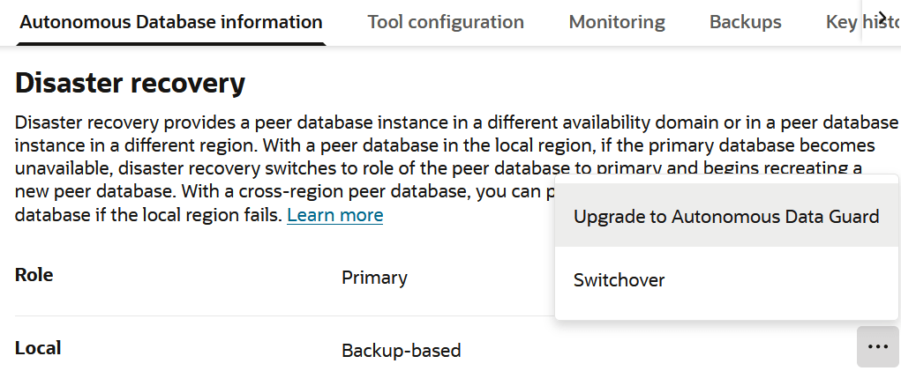

> The image shows the Disaster recovery portion of the Autonomous Database details page in OCI Console. The image shows the Actions menu open nex to the Local line, and Upgrade to Autonomous Data Guard selected.
>
> [  
> Copyright © 2005, 2026, Oracle and/or its affiliates.](https://docs.oracle.com/en/database/oracle/oracle-database/dcommon/html/cpyr.htm)

2. In the Update disaster recovery panel, verify that the local region and Autonomous Data Guard are selected, then Submit.
	You can optionally enable a maximum data loss limit in Automatic Failover with data loss limit in seconds. If you lose the primary cluster or site, there is some data loss because redo is sent asynchronously, so entering a non-zero value is reasonable if you want to reduce application and database downtime in case of most primary database, primary cluster, or complete data center failures. By setting the value greater than zero, automatic failover occurs only if the calculated data loss is less than or equal to the limit. If zero data loss failover is possible by accessing all primary database redo, it is done automatically. If data loss is greater than the setting, no automatic action occurs.

Adding a Cross-region Standby Database

1. In the primary database's OCI Console details page, select the Disaster recovery tab, then select Add peer database.
	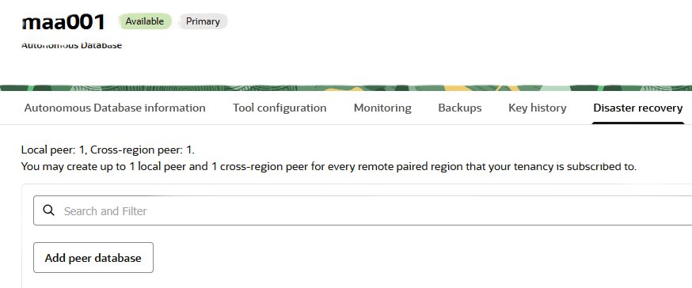

> The image shows the Disaster recovery tab in the Autonomous Database details page in the OCI Console. It is a closeup cropping out all but the area containing the Disaster recovery tab name and the Add peer database button.
>
> [  
> Copyright © 2005, 2026, Oracle and/or its affiliates.](https://docs.oracle.com/en/database/oracle/oracle-database/dcommon/html/cpyr.htm)

2. In the Add peer database panel, select the location for the standby database from the Region list, then Add.
	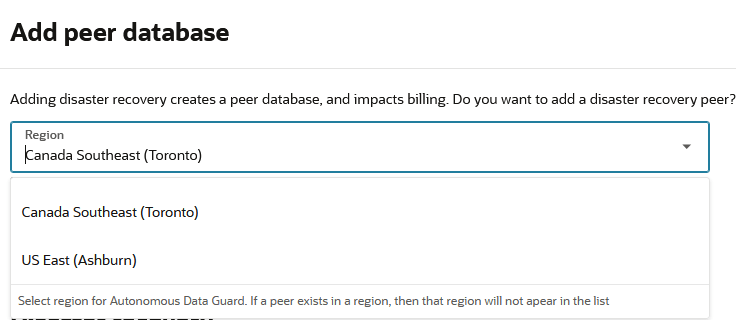

> The image shows the Add peer database panel in the OCI Console. The The Region selection is open.
>
> [  
> Copyright © 2005, 2026, Oracle and/or its affiliates.](https://docs.oracle.com/en/database/oracle/oracle-database/dcommon/html/cpyr.htm)

	There is no option for automatic failover for a cross-region standby database.
	After adding the cross-region standby, you can select the standby database name to view its characteristics in the remote region.

Listing Standby Databases

Local standby databases are not directly accessible using either the OCI Console or clients, but they are visible in the Disaster recovery sections of the primary database's details page.

A cross-region standby can be managed in its own console page, which is accessible by selecting the database name. Cross-region standbys also appear in the Disaster recovery sections of the primary database details page with the region abbreviation appended to the database name.

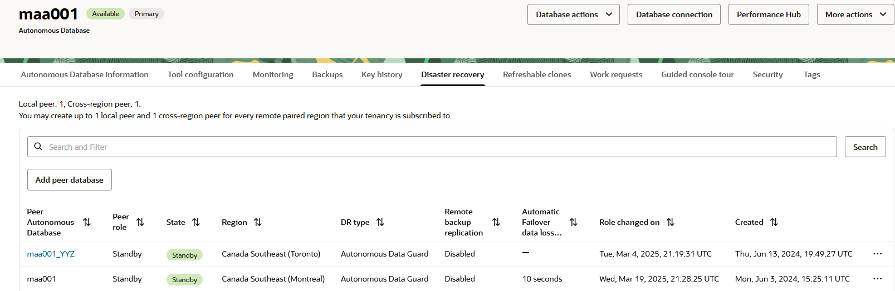

> The image shows the Autonomous Database details page opened to the Disaster recovery tab. The tab is a listing of Local and Cross-region "peers". The local peer is listed with the same name as the primary Autonomous Database, maa001. The cross-region stanbdby database is named maa001-YYZ because it has the remote region abbreviation appended to the database name.


The original region of the primary database is called the "home region". Each home region has one or more remote regions ("buddy regions") associated with it to contain cross-region standby databases.

#### Monitoring Apply Lag

You can monitor Autonomous Data Guard apply lag for redo for both a local standby and a cross-region standby. The data is provided in near real time; there is a short delay between gathering and uploading to the control plane for display, and the data applies to the entire POD, not just your specific Autonomous database.

To access the lag information, in the OCI Console Autonomous Database details page, on the Monitoring tab, select view all database metrics.

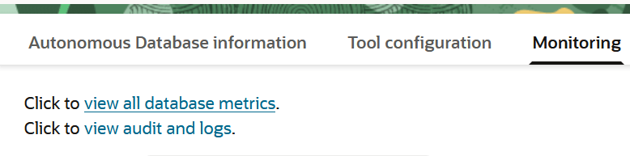

> The image shows the first two UI controls (web links) Monitoring tab in the OCI Console Autonomous Database details page.
>
> [  
> Copyright © 2005, 2026, Oracle and/or its affiliates.](https://docs.oracle.com/en/database/oracle/oracle-database/dcommon/html/cpyr.htm)


On the Service Metrics page, scroll down until you see the Peer Lag metric display.

The database being viewed determines the data in the metric. If you are viewing the primary database, the metric data display is for the local standby; if you are viewing the cross-region standby, the metric data display is for the cross-region standby.

Transport lag is typically less than 10 seconds for a local standby and less than 60 seconds for cross-region standby, depending on workloads and peaks.

Figure 34-1 Peer Lag for Local Standby

  
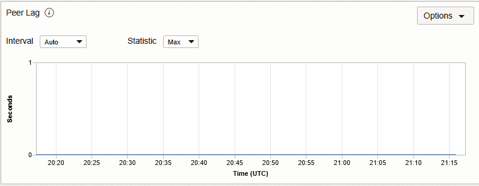

Figure 34-2 Peer Lag for Cross-Region Standby

  
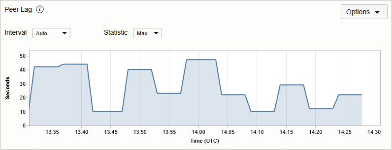

#### Autonomous Data Guard Role Transitions

Either a local or cross-region standby database can be used as the target destination for a role transition.

The local standby should be the primary target for switchover operations, ensuring that there is no additional latency in connections and network operations after role transitions complete.

To perform a switchover to the local standby database, in the OCI Console, in the primary database's details page (in the home region), in the Disaster recovery section, select Switchover on the Local line, as shown in the following image.

Figure 34-3 Switchover to Local Standby

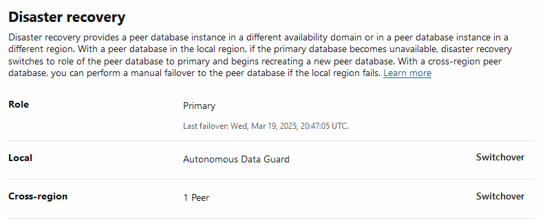

> The image shows the remote region cross-region standby database's OCI Console details page showing the local and corss-region peers. Each line has a Switchover button and the Cross-region line item's Switchover button is active.
>
> [  
> Copyright © 2005, 2026, Oracle and/or its affiliates.](https://docs.oracle.com/en/database/oracle/oracle-database/dcommon/html/cpyr.htm)


If the local standby switchover fails, perform a switchover to the cross-region standby.

Note:

The cross-region switchover must be initiated from the remote region cross-region standby's details page in the OCI Console, not from the primary database page.

To perform a switchover to the remote (cross-region) standby database, in the OCI Console, in the cross-region database's details page (in the remote region), in the Disaster recovery section, select Switchover on the Role line, as shown in the following image.

Figure 34-4 Switchover to Cross-region Standby

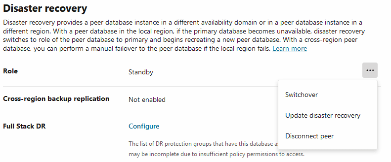

> The image shows the OCI Console, in the cross-region database's details page (in the remote region), zoomed in on the Disaster recovery section, where the Action menu is open on the Role line item, and shows the Switchover action in the menu.
>
> [  
> Copyright © 2005, 2026, Oracle and/or its affiliates.](https://docs.oracle.com/en/database/oracle/oracle-database/dcommon/html/cpyr.htm)


If the switchover is successful, the Role line status changes from Standby to Primary when the primary becomes accessible.

#### Manual Failover Operations and Determining Data Loss

Because your database is in a shared environment and you only have access to your autonomous databases, you will not know if issues are impacting only your databases or the entire POD. It is always best to react under the premise that the issues are local to only your database.

If you do not have automatic failover enabled, always attempt a switchover using the OCI Console first. A successful switchover guarantees zero data loss. If switchover fails, the role transition option in the OCI Console will change to Failover.

The following image shows the Disaster recovery section of the cross-region (remote) standby details page, showing that because the Switchover action was not successful, the choice is now a Failover.

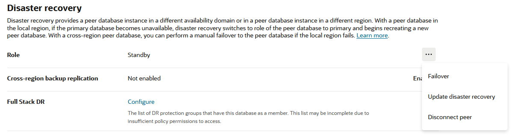

> The image shows The OCI Console details page for the cross-region (remote) standby database, zoomed in on the Disaster recovery section, with the Action menu open at the Role line. The Failover action is shown in the Action menu.
>
> [  
> Copyright © 2005, 2026, Oracle and/or its affiliates.](https://docs.oracle.com/en/database/oracle/oracle-database/dcommon/html/cpyr.htm)


In this case, the failover operation ensures that all available redo will be applied, though it does not guarantee zero data loss. This applies to both local and cross-region failover operations.

Determining Data Loss

Each manual failover job generates a work request visible in the console.

To determine the amount of data loss after a failover to the local standby, go to the Work requests tab on the Autonomous Database details page. For a cross-region standby, look at the Work requests in the cross-region new primary.

Select the work request for the failover and view the Log messages, which report the data loss incurred during the failover.

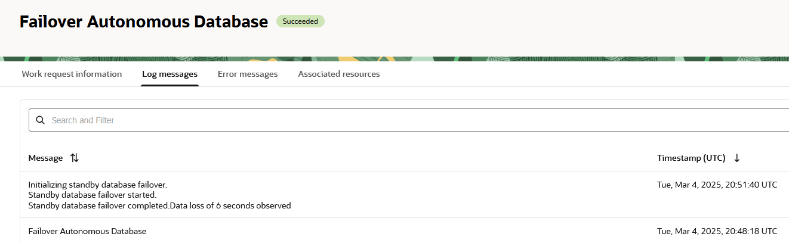

> The image shows the OCI Console Work requests page for the Autonomous Database, with the Log messages tab selected.
>
> [  
> Copyright © 2005, 2026, Oracle and/or its affiliates.](https://docs.oracle.com/en/database/oracle/oracle-database/dcommon/html/cpyr.htm)


#### Notifications for Automatic Failover

Automatic failover is only provided for the local standby database, and activates when connection loss is detected against the primary database.

Oracle scans the Connection Manager (CMAN) connection log, searching for connection failures. When failures are detected for a period of time (typically 60 to 90 seconds) with no successful connections found for the duration, automatic failover is triggered. Detection of a successful connection resets the check and timing.

Regardless of any Automatic Failover settings, if a failure is detected and if Oracle can guarantee zero data loss, failover to your local region standby occurs automatically.

If a non-zero data loss situation is encountered, Oracle checks if automatic failover is enabled and compares the potential data loss to the Automatic Failover loss limit defined. If the potential data loss is determined to be less than the specified loss limit, automatic failover occurs.

Local standby automatic failover jobs do not create work requests that can be reviewed; however, you can create events to receive notification of the beginning and end of automatic failover operations, in addition to displaying the data loss associated with the failover. Information about creating events can be found in [Get Notified of Autonomous Database Events](https://docs.oracle.com/en/cloud/paas/autonomous-database/serverless/adbsb/autonomous-database-events.html#GUID-66B76449-6025-4A0F-BE9C-9B9F981347CF). Notifications require rules to establish the conditions under which a notification is sent.

To enable notifications for local standby automatic failover:

1. Open the Notifications service.
	In the OCI Console, select the hamburger menu in the upper left-hand corner, and select Developer Services, then select Notifications under Application Integration.
2. Select Create Topic and provide a name and description.
3. Select the new topic and select Create Subscription
4. In the Create Subscription panel, select a notification type (email, Slack, pager, etc) and select Create.
5. Open the Events service Rules page.
	In the OCI Console, select the hamburger menu in the upper left hand corner, and select Observability & Management, then select Rules under Events Service.
6. On the Rules page, select Create Rule.
	A single rule can generate notifications for multiple events.
7. Provide a display name and description, and in the Rule Conditions section, enter the following conditions for notifying on Automatic Failover Begin and End events.
	1. To establish the type of event for the rule, configure the first Condition with these values:
		- Condition: Event Type
				- Service Name: Database
				- Event Type: Autonomous Container Database - Critical
		2. To limit the rule to just your tenancy, add a Condition with the following values:
		- Condition: Attribute
				- Service Name: compartmentId
				- Attribute Values: my.tenancy.id
		3. To cause the rule to send notifications for Automatic Failure Begin and End events, add another Condition with the following values:
		- Condition: Attribute
				- Attribute Name: eventName
				- Attribute Values: AutomaticFailoverBegin and AutomaticFailoverEnd
	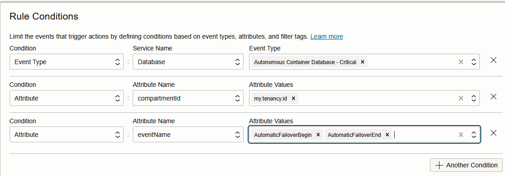

> The image shows The OCI Console Event service Rules, with the Create Rule panel open, and zoomed in on the Rule Conditions section of the panel. The values listed above are entered in the three Conditions shown in the image.
>
> [  
> Copyright © 2005, 2026, Oracle and/or its affiliates.](https://docs.oracle.com/en/database/oracle/oracle-database/dcommon/html/cpyr.htm)

8. In the Actions section, below the Rule Conditions section in the same dialog, associate the rule with an action to trigger notification, using the following settings:
	- Action Type: Notifications.
		- Notifications Compartment: Your tenancy name from the drop down list.
		- Topic: choose the topic you created in Step 2 above.
9. Click Create Rule to save the rule.

After the rules and notification creation are completed, whenever an automatic failover operation begins and ends you receive a notification based on the rule you set up. For example, if you chose an email subscription, you would receive a begin email message with a subject like "OCI Event Notification:com.oraclecloud.databaseservice.autonomous.database.critical" containing messaging including something like the following:

```
{
  "eventType" : "com.oraclecloud.databaseservice.autonomous.database.critical",
  "cloudEventsVersion" : "0.1",
  "eventTypeVersion" : "2.0",
  "source" : "DatabaseService",
  "eventTime" : "2025-03-18T20:21:24Z",
  "contentType" : "application/json",
  "data" : {
    "compartmentId" : "<OCID of your Tenancy>",
    "compartmentName" : "<Tenancy Name>",
    "resourceName" : "<Autonomous Database name>",
    "resourceId" : "<OCID of the Autonomous Database involved",
    "additionalDetails" : {
      "dbName" : "<Autonomous Database name>",
      "eventName" : "AutomaticFailoverBegin",
      "description" : "Automatic failover for database <Autonomous Database name> has begun.",
      "autonomousDataType" : "Serverless",
      "workloadType" : "Data Warehouse"
    }
  },
  "eventID" : "<Event ID>",
  "extensions" : {
    "compartmentId" : "<OCID of your Tenancy>"
  }
}
```

Then you would receive an end email message with the same subject containing something like the following. The end email message also contains the calculated data loss from the operation.

```
{
  "eventType" : "com.oraclecloud.databaseservice.autonomous.database.critical",
  "cloudEventsVersion" : "0.1",
  "eventTypeVersion" : "2.0",
  "source" : "DatabaseService",
  "eventTime" : "2025-03-19T20:47:13Z",
  "contentType" : "application/json",
  "data" : {
    "compartmentId" : "<OCID of your Tenancy>",
    "compartmentName" : "<Tenancy Name>",
    "resourceName" : "<Autonomous Database name>",
    "resourceId" : "<OCID of the Autonomous Database>",
    "additionalDetails" : {
      "dbName" : "<Autonomous Database name>",
      "eventName" : "AutomaticFailoverEnd",
      "description" : "Automatic failover completed with 4 seconds data loss and <Autonomous Database name> is AVAILABLE and ready for user operations.",
      "autonomousDataType" : "Serverless",
      "workloadType" : "Data Warehouse"
    }
  },
  "eventID" : "<Event ID>",
  "extensions" : {
    "compartmentId" : "<OCID of your Tenancy>"
  }
}
```

#### MAA Autonomous Data Guard RTO and RPO Observations

The following table provides MAA observations of hundreds of switchover and failover operations with heavy workload.

Note that the redo rates listed are for the entire POD, not for just the Autonomous Databases involved in the role transition. In Autonomous Database Serverless you have no control over the activity in Autonomous Databases not owned by you. Manual failovers require human detection time and attempts to switchover before submitting the failover operation. The Return to Operation (RTO) times are from the time the failover was submitted. For automatic failover, the detection time is typically 60 to 90 seconds. In our MAA chaos lab, up to 6 concurrent switchover or failover operations will occur concurrently after a major outage.

Table 34-4 Autonomous Data Guard Local Standby Observations

| Use Cases | Operation Type | POD Redo Rate | Maximum Application RTO | Maximum RPO |
| --- | --- | --- | --- | --- |
| CDB Failure | Manual | 250-270 MB/sec | Detection time + 85 seconds | 2 seconds |
| CDB Failure | Automatic | 250-265 MB/sec | Detection time +57 seconds | 2 seconds |
| Cluster Failure | Manual | 250-280 MB/sec | Detection time +72 seconds | 2 seconds |
| Cluster Failure | Automatic | 250-280 MB/sec | Detection time +63 seconds | 1 seconds |
| Switchover | Manual | 225-240 MB/sec | 118 seconds | 0 |
| Availability Domain Failure | Manual or Automatic | 250-285 MB/sec | Same as cluster failure | Same as cluster failure |

Table 34-5 Autonomous Data Guard Cross-Region Standby Observations

| Use Cases | Operation Type | POD Redo Rate | Maximum Application RTO | Maximum RPO |
| --- | --- | --- | --- | --- |
| CDB Failure | Manual | 175-200MB/sec | Based on reaction to outage by user + potential 5 minutes for failed switchover in UI  106 seconds | 1-3 seconds |
| Cluster Failure | Manual | 175-200MB/sec | Based on reaction to outage by user + potential 5 minutes for failed switchover in UI  126 seconds | 13 seconds |
| Switchover | Manual | 175-200 MB/sec | 407 seconds | 0 |
| Site Failure | Manual | 175-200 MB/sec | Same as cluster failure | Typically, 30-60 seconds  Cross-region redo push is every 60 seconds |

#### Preparing an Application for Seamless Application Failover

To retrieve sample connection strings for the database, in the OCI Console, on the Autonomous Database home region details page select Database connection.

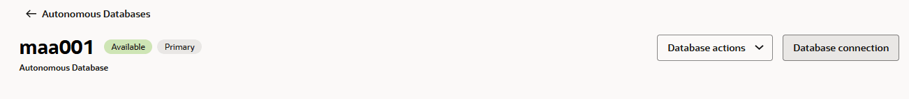

> The image shows the top of the primary database details page in the OCI Console. The Database connection button is shown on the right side of the screen
>
> [  
> Copyright © 2005, 2026, Oracle and/or its affiliates.](https://docs.oracle.com/en/database/oracle/oracle-database/dcommon/html/cpyr.htm)


You have two options:

- The Regional wallet provides connect strings for all local databases in the local region for your tenancy. For example, if you have 10 databases in Ashburn region and you are viewing one of them, the OCI Console generates TNS aliases for all 10, with an address list consisting of only the required host names to connect to the Ashburn copies of the databases.
- When running in the remote region there are two options for the connection string:
	- Connect to the cross-region standby displayed in the remote region in the OCI console and retrieve the Regional wallet under Wallet Type from the Database connection section.
		The download consists of a ZIP file including a number of files required for connection. The `tnsnames.ora` in the ZIP file contains only the host for the CMAN local to that region, and provides connect strings for all local databases for the local region for your tenancy.
		For example, if you have 10 databases in Ashburn region, and you are viewing one of them, the OCI Console generates TNS aliases for all 10 with an address list consisting of only the required host names to connect to the Ashburn copies of the databases.
		- Connect to primary database in the home region and retrieve the Instance wallet under Wallet type from the Database Connection section.
		The download consists of a ZIP file including a number of files required for connection. The `tnsnames.ora` in the ZIP file contains the host names for both the home and remote region in the address list, with the home region listed first and the remote region listed second.
		Using the instance wallet as is, the connection to the initial host in the address list must fail before it tries to connect to the remote region. You can modify the connect strings to follow MAA recommendations and avoid the delay caused by waiting for the connection to the first host in the address list to timeout. For more information see [Step 2: Configure the Connection String for High Availability](configuring-level-1-basic-application-high-availability.md).

Note:

For the local standby, the same connect string works regardless of where in the region the database resides internally. The host address connects to the local Connection Manager (CMAN), which in turn connects to the appropriate primary database for the connection string.

MAA has recommendations for connection strings and methods to ensure the highest availability and smoothest transitioning. The connection strings provided here should be used as the starting point. See [Configuring Continuous Availability for Applications](configuring-continuous-availability-applications1.md) for more information.

#### Multicloud Considerations for Autonomous Data Guard

Autonomous Database Serverless is configured identically in Oracle's multicloud partners.

In Oracle’s multicloud architecture, infrastructure is organized using a parent–child site model. Autonomous Data Guard in Oracle Cloud Infrastructure (OCI) operates within this framework. In Oracle’s multicloud partnerships, the OCI-managed environment functions as the parent site, while the peered environment in the partner’s data center is the child site.

Autonomous Data Guard behaves the same in a multicloud deployment as it does in native OCI, for both local and cross-region standby configurations. In this model, all databases, including standby databases, reside in the multicloud partner’s data center or region (for example, Google Cloud Platform or Microsoft Azure), while OCI provides orchestration and operational coordination.

With the databases residing in the multicloud partner's site, there is one distinct difference that may impact RTO and RPO: the multicloud partner's network and local storage are used as part of the redo storage and redo transport life cycle. Oracle manages this automatically as part of the service. In cases of high peer lag, the RTO and RPO may be impacted.

MAA Silver and Gold solutions for Autonomous Database Serverless are generally applicable in all of Oracle's multicloud partners that host Oracle Autonomous Database Serverless.