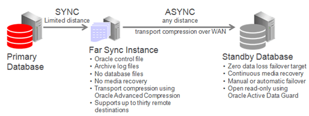
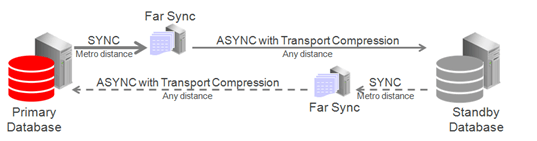
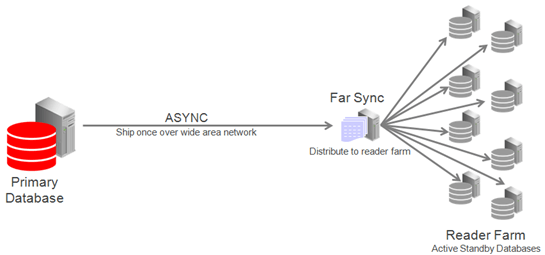
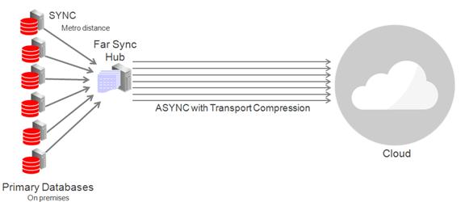

## 16 Configure and Deploy Oracle Data Guard

### Oracle Data Guard Configuration Best Practices

The following topics describe Oracle MAA best practices for configuring your Oracle Data Guard configuration.

#### Apply Oracle Database Configuration Best Practices First

Before you implement the Oracle Data Guard best practices that follow, apply the Oracle Database configuration best practices.

The Oracle Data Guard configuration best practices are considered additional to the general Oracle Database configuration best practices, and will help you achieve the services levels you expect of the MAA Gold reference architecture. It is implied that all of the database configuration best practices should be followed in a Data Guard configuration, and that the Data Guard recommendations discussed here supplant the general database recommendation where there are conflicts.

See [Oracle Database Configuration Best Practices](oracle-ai-database-configuration-best-practices.md) for more details.

#### Use Recovery Manager to Create Standby Databases

There are several methods you can use to create an Oracle Data Guard standby database, but because of its simplicity, the Oracle MAA recommended approach is to create a physical standby database using the `RMAN RESTORE ... FROM SERVICE` clause.

For information about this approach see [Creating a Physical Standby database using RMAN restore from service (Doc ID 2283978.1)](https://support.oracle.com/rs?type=doc&id=2283978.1).

#### Use Oracle Data Guard Broker with Oracle Data Guard

Use Oracle Data Guard broker to create, manage, and monitor an Oracle Data Guard configuration.

You can perform all Data Guard management operations locally or remotely using the broker interfaces: the Data Guard management pages in Oracle Enterprise Manager, which is the broker's graphical user interface (GUI), and the Data Guard command-line interface, called DGMGRL.

The broker interfaces improve usability and centralize management and monitoring of the Data Guard configuration. Available as a feature of Oracle Database Enterprise Edition and Personal Edition, the broker is also integrated with Oracle Database, Oracle Enterprise Manager, and Oracle Cloud Control Plane.

##### Example Broker Installation and Configuration

The following is an example broker installation and configuration, which is used in all of the broker configuration best practices examples.

Prerequisites:

- Primary database, standby database, and observers reside on separate servers and hardware to provide fault isolation.
- Both primary and standby databases must use an `SPFILE`.
- Set the `DG_BROKER_START` initialization parameter to `TRUE`.
- If any of the databases in the configuration is an Oracle RAC database, you must set up the `DG_BROKER_CONFIG_FILEn` initialization parameters for that database such that they point to the same shared files for all instances of that database. The shared files could be files on a cluster file system, if available, on raw devices, or stored using Oracle Automatic Storage Management.

1. If they do not already exist, create Oracle Net Services aliases that connect to the primary and the standby databases. These aliases should exist in the database home for each host or member of the Data Guard configuration. For Oracle RAC configurations, the aliases should connect using the SCAN name.
	```
	chicago =
	 (DESCRIPTION =
	  (ADDRESS_LIST =
	    (ADDRESS=(PROTOCOL= TCP)
	     (HOST=prmy-scan)(PORT=1521)))
	 (CONNECT_DATA =
	   (SERVER = DEDICATED)
	    (SERVICE_NAME = chicago)))
	boston =
	 (DESCRIPTION =
	  (ADDRESS_LIST =
	    (ADDRESS=(PROTOCOL= TCP)
	     (HOST=stby-scan)(PORT=1521)))
	 (CONNECT_DATA =
	   (SERVER = DEDICATED)
	    (SERVICE_NAME = boston)))
	```
2. On a primary host, connect with DGMGRL and create the configuration.
	```
	$ dgmgrl sys
	Enter password: password
	DGMGRL> create configuration 'dg_config' as  primary database is 'chicago' connect identifier is chicago;
	 
	 Configuration "dg_config" created with primary database "chicago"
	 
	DGMGRL> add database 'boston' as connect identifier is boston;
	 
	 Database "boston" added
	 
	DGMGRL> enable configuration;
	 Enabled.
	```
3. By default the broker sets up a `LOG_ARCHIVE_DEST_n` for Maximum Performance database protection mode.
	The broker configures the remote archive destinations with the default values for asynchronous transport, as shown here.
	```
	log_archive_dest_3=service="boston", ASYNC NOAFFIRM delay=0 optional compression=disable max_failure=0 reopen=300 db_unique_name="boston" net_timeout=30, valid_for=(online_logfile,all_roles)
	```

##### Configure Redo Transport Mode

Configure the redo transport service on each configuration member by setting the `LogXptMode` property to one of the following modes.

- `ASYNC` configures redo transport services for this standby database using the `ASYNC` and `NOAFFIRM` attributes of the `LOG_ARCHIVE_DEST_n` initialization parameter. This mode, along with standby redo log files, enables minimum data loss data protection of potentially less couple seconds with zero performance impact.
- `FASTSYNC` configures redo transport services for this standby database using the `SYNC` and `NOAFFIRM` attributes of the `LOG_ARCHIVE_DEST_n` initialization parameter. Configure synchronous redo transport mode with the `NOAFFIRM` attribute (default= `AFFIRM`) when using maximum availability mode protection mode. This helps to minimize the performance impact of synchronous redo transport by acknowledging the receipt of redo once it has been successfully received and verified within standby memory, but before the redo has been written to the standby redo log. Zero data loss protection is still preserved when only the primary database fails.
- `SYNC` configures redo transport services for this standby database using the `SYNC` and `AFFIRM` attributes of the `LOG_ARCHIVE_DEST_n` initialization parameter. This mode, along with standby redo log files, is required for configurations operating in either maximum protection mode or maximum availability mode. This redo transport service enables zero data loss data protection to the primary database, but also can incur a higher performance impact if the round trip latency between primary and standby is high (for example, more than 2ms). This option is required for maximum protection mode.

Use the `EDIT DATABASE SET PROPERTY` command to set the transport mode the broker configuration, as shown in these examples.

`DGMGRL> EDIT DATABASE 'boston' SET PROPERTY LogXptMode=ASYNC;`

`DGMGRL> EDIT DATABASE 'chicago' SET PROPERTY LogXptMode=FASTSYNC;`

`DGMGRL> EDIT DATABASE 'SanFran' SET PROPERTY LogXptMode=SYNC;`

##### Validate the Broker Configuration

To identify any problems with the overall configuration, validate it using the following steps.

1. Show the status of the broker configuration using the `SHOW                             CONFIGURATION` command.
	```
	DGMGRL> show configuration;
	 Configuration – dg
	   Protection Mode: MaxPerformance
	   Members:
	   chicago - Primary database
	   boston - Physical standby database 
	 Fast-Start Failover: DISABLED
	 Configuration Status:
	 SUCCESS   (status updated 18 seconds ago)
	```
	If the configuration status is `SUCCESS`, everything in the broker configuration is working properly. However, if the configuration status is `WARNING` or `ERROR` then something is wrong in the configuration. Additional error messages that accompany a `WARNING` or `ERROR` status can be used to identify the issues. The next step is to examine each database in the configuration to narrow down what the specific error is related to.
2. To identify warnings on the primary and standby databases, show their statuses using the `SHOW DATABASE` command.
	```
	DGMGRL> show database chicago
	 
	 Database – chicago
	 
	   Role:               PRIMARY
	   Intended State:     TRANSPORT-ON
	   Instance(s):
	     tin1
	     tin2
	 
	 Database Status:
	 SUCCESS
	```
	If the database status is `SUCCESS` then the database is working properly. However, if database status is `WARNING` or `ERROR`, then something is wrong in the database. Additional error messages accompany the `WARNING` or `ERROR` status and can be used to identify current issues.
	Repeat the `SHOW DATABASE` command on the standby database and assess any error messages.
3. Validate the databases on Oracle Database 12.1 and later.
	In addition to the above commands, in Oracle Database 12.1 and later, the Data Guard broker features a `VALIDATE DATABASE` command.
	```
	DGMGRL> validate database chicago
	  Database Role:    Primary database
	   Ready for Switchover:  Yes
	DGMGRL> validate database boston;
	 
	   Database Role:     Physical standby database
	   Primary Database:  tin
	 
	   Ready for Switchover:  No
	   Ready for Failover:    Yes (Primary Running)
	 
	   Capacity Information:
	     Database  Instances        Threads        
	     tin       2                2              
	     can       1                2              
	     Warning: the target standby has fewer instances than the
	     primary database, this may impact application performance
	 
	   Standby Apply-Related Information:
	     Apply State:      Not Running
	     Apply Lag:        Unknown
	     Apply Delay:      0 minutes
	```
	The `VALIDATE DATABASE` command does not provide a `SUCCESS` or `WARNING` status and must be examined to determine if any action needs to be taken.

##### Configure Fast Start Failover

Fast-start failover allows the broker to automatically fail over to a previously chosen standby database in the event of loss of the primary database. Enabling fast-start failover is requirement to meet stringent RTO requirements in the case of primary database, cluster, or site failure.

Fast-start failover quickly and reliably fails over the target standby database to the primary database role, without requiring you to perform any manual steps to invoke the failover. Fast-start failover can be used only in a broker configuration.

If the primary database has multiple standby databases, then you can specify multiple fast-start failover targets, using the `FastStartFailoverTarget` property. The targets are referred to as candidate targets. The broker selects a target based on the order in which they are specified on the `FastStartFailoverTarget` property. If the designated fast-start failover target develops a problem and cannot be the target of a failover, then the broker automatically changes the fast-start failover target to one of the other candidate targets.

You can use any protection mode with fast-start failover. The maximum protection and maximum availability modes provide an automatic failover environment guaranteed to lose no data. Maximum performance mode provides an automatic failover environment guaranteed to lose no more than the amount of data (in seconds) specified by the `FastStartFailoverLagLimit` configuration property. This property indicates the maximum amount of data loss that is permissible in order for an automatic failover to occur. It is only used when fast-start failover is enabled and the configuration is operating in maximum performance mode.

1. Set the `FastStartFailoverThreshold` property to specify the number of seconds you want the observer and target standby database to wait, after detecting the primary database is unavailable, before initiating a failover, as shown in this example.
	```
	DGMGRL> EDIT CONFIGURATION SET PROPERTY FastStartFailoverThreshold = seconds;
	```
	A fast-start failover occurs when the observer and the standby database both lose contact with the production database for a period of time that exceeds the value set for `FastStartFailoverThreshold`, and when both parties agree that the state of the configuration is synchronized (Maximum Availability), or that the lag is not more than the configured `FastStartFailoverLagLimit` (Maximum Performance).
	An optimum value for `FastStartFailoverThreshold` weighs the trade-off between the fastest possible failover (minimizing downtime) and unnecessarily triggering failover because of temporary network irregularities or other short-lived events that do not have material impact on availability.
	The default value for `FastStartFailoverThreshold` is 30 seconds.
	The following table shows the recommended settings for `FastStartFailoverThreshold` in different use cases.
	Table 16-1 Minimum Recommended Settings for FastStartFailoverThreshold
	| Configuration | minimum Recommended Setting |
	| --- | --- |
	| Single-instance primary, low latency, and a reliable network | 15 seconds |
	| Single-instance primary and a high latency network over WAN | 30 seconds |
	| Oracle RAC primary | Oracle RAC miscount + reconfiguration time + 30 seconds |
2. Determine where to place the observer in your topology.
	In an ideal state fast-start failover is deployed with the primary, standby, and observer, each within their own availability domain (AD) or data center; however, configurations that only use two availability domains, or even a single availability domain, must be supported. The following are observer placement recommendations for two use cases.
	Deployment Configuration 1: 2 regions with two ADs in each region.
	- Initial primary region has the primary database in AD1, and two high availability observers (one observer in AD2 and second HA observer in AD1)
		- Initial standby region has the standby database in AD1, and two high availability observers used after role change (one observer in AD2 and second HA observer in AD1)
		- For the observer, MAA recommends at least 2 observer targets in the same primary region but in different ADs
	Deployment Configuration 2: 2 regions with only 1 AD in each region
	- Initial primary regions have the primary database and two light weight servers to host observers
		- Initial standby region has the standby database and two light weight servers to host observers (when there is a role change)
3. Configure observer high availability.
	You can register up to three observers to monitor a single Data Guard broker configuration. Each observer is identified by a name that you supply when you issue the `START OBSERVER` command. You can also start the observers as a background process.
	```
	DGMGRL> sys@boston
	Enter password: password
	DGMGRL> start observer number_one in background;
	```
	On the same host or a different host you can start additional observers for high availability:
	```
	DGMGRL> sys@boston
	Enter password: password
	DGMGRL> start observer number_two in background;
	```
	Only the primary observer can coordinate fast-start failover with Data Guard broker. All other registered observers are considered to be backup observers.
	If the observer was not placed in the background then the observer is a continuously running process that is created when the `START OBSERVER` command is issued. Therefore, the command-line prompt on the observer computer does not return until you issue the `STOP OBSERVER` command from another `DGMGRL` session. To issue commands and interact with the broker configuration, you must connect using another `DGMGRL` client session.

Now that you have correctly configured fast-start failover, the following conditions can trigger a failover.

- Database failure where all database instances are down
- Data files taken offline because of I/O errors
- Both the Observer and the standby database lose their network connection to the production database, and the standby database confirms that it is in a synchronized state
- A user-configurable condition

Optionally, you can specify the following conditions for which a fast-start failover can be invoked. It is recommend that you leave these user-configurable conditions at the default values and not invoke an automatic failover.

- Data file offline (write error)
- Corrupted Dictionary
- Corrupted Control file
- Inaccessible Log file
- Stuck Archiver
- ORA-240 (control file enqueue timeout)

Should one of these conditions be detected, the observer fails over to the standby, and the primary shuts down, regardless of how `FastStartFailoverPmyShutdown` is set. Note that the for user-configurable conditions, the fast-start failover threshold is ignored and the failover proceeds immediately.

##### Fast Start Failover with Multiple Standby Databases

The `FastStartFailoverTarget` configuration property specifies the `DB_UNIQUE_NAME` of one or more standby databases that can act as target databases in a fast-start failover situation when the database on which the property is set is the primary database. These possible target databases are referred to as candidate fast-start failover targets.

The `FastStartFailoverTarget` configuration property can only be set to the name of physical standbys. It cannot be set to the name of a snapshot standby database, far sync instance, or Zero Data Loss Recovery Appliance.

If only one physical standby database exists, then the broker selects that as the default value for this property on the primary database when fast-start failover is enabled. If more than one physical standby database exists, then the broker selects one based on the order in which they are specified in the property definition. Targets are verified when fast-start failover is enabled

#### Set Log Buffer Optimally

Set `LOG_BUFFER` to a minimum of 256 MB when using Oracle Data Guard with asynchronous redo transport.

Doing so allows the asynchronous redo transport to read redo from the log buffer and avoid disk I/Os to online redo logs. For workloads that have a very high redo generation rate (for example, > 50 MB/sec per database instance) the `LOG_BUFFER` can be increased up to maximum value allowed for the platform being used.

Note:

The maximum `LOG_BUFFER` setting for Linux platform is 2 GB and for Windows is 1 GB.

#### Set Send and Receive Buffer Sizes

Redo transport processes, especially the receive/standby side, generally benefit from more TCP socket buffers in high latency network paths. TCP socket buffers can be managed by the TCP stack dynamically.

Setting the maximum values for tcp\_rmem and tcp\_wmem allows the kernel to dynamically modify the buffers allocated to a socket as needed.

Bandwidth Delay Product (BDP) is the product of the network link capacity of a channel and the round time, or latency. The minimum recommended value for socket buffer sizes is 3\*BDP, especially for a high-latency, high-bandwidth network. Use oratcptest to tune the socket buffer sizes.

As root, set the maximum value for tcp\_rmem and tcp\_wmem to 3\*\<Bandwidth Delay Product>. In this example BDP is 16MB. The other two values for these parameters should be left as they currently are set on the system.

```
# sysctl -w net.ipv4.tcp_rmem='4096 87380 16777216';

# sysctl -w net.ipv4.tcp_wmem='4096 16384 16777216';
```

Using sysctl to change these values changes them dynamically in memory only and will be lost when the system is rebooted. Additionally set these values in /etc/sysctl.conf on linux systems. Add these entries if the values are absent in the file.

```
net.ipv4.tcp_rmem='4096 87380 16777216'

net.ipv4.tcp_wmem='4096 16384 16777216'
```

#### Set SDU Size to 65535 for Synchronous Transport Only

With Oracle Net Services you can control data transfer by adjusting the session data unit (SDU) size. Oracle testing has shown that setting the SDU parameter to its maximum value of 65535 improves performance of synchronous transport.

You can set SDU on a per connection basis using the SDU parameter in the local naming configuration file, `tnsnames.ora`, and the listener configuration file, `listener.ora`, or you can set the SDU for all Oracle Net Services connections with the profile parameter `DEFAULT_SDU_SIZE` in the `sqlnet.ora` file.

#### Configure Online Redo Logs Appropriately

Redo log switching has a significant impact on redo transport and apply performance. Follow these best practices for sizing the online redo logs on the primary and standby databases.

Following these guidelines for online redo logs.

- All online redo log groups should have identically sized logs (to the byte).
- Online redo logs should reside on high performing disks (DATA disk groups).
- Create a minimum of three online redo log groups per thread of redo on Oracle RAC instances.
- Create online redo log groups on shared disks in an Oracle RAC environment.
- Multiplex online redo logs (multiple members per log group) unless they are placed on high redundancy disk groups.
- Size online redo logs to switch no more than 12 times per hour (every ~5 minutes). When log switches occur at a higher frequency, such as less than a minute, database hangs may occur if database checkpointing or archiving rates are not keeping up with peak redo generation rate. An online redo log cannot be reused unless changes have been checkpointed, and the online redo log has been archived if archivelog mode is enabled.

##### Sizing Redo Logs

Size the redo logs based on the peak redo generation rate of the primary database.

You can determine the peak rate by running the query below for a period of time that includes the peak workload. The peak rate could be seen at month-end, quarter-end, or annually. Size the redo logs to handle the highest rate in order for redo apply to perform consistently during these workloads.

```
SQL> SELECT thread#,sequence#,blocks*block_size/1024/1024 MB,(next_time-first_time)*86400 sec,
 blocks*block_size/1024/1024)/((next_time-first_time)*86400) "MB/s"
 FROM v$archived_log WHERE ((next_time-first_time)*86400<>0) and first_time
 between to_date('2015/01/15 08:00:00','YYYY/MM/DD HH24:MI:SS')
 and to_date('2015/01/15 11:00:00','YYYY/MM/DD HH24:MI:SS') and dest_id=1 order by first_time;

   THREAD#  SEQUENCE#         MB        SEC       MB/s 
---------- ---------- ---------- ---------- ---------- 
         2       2291 29366.1963        831  35.338383 
         1       2565 29365.6553        781 37.6000708 
         2       2292 29359.3403        537  54.672887 
         1       2566 29407.8296        813 36.1719921 
         2       2293 29389.7012        678 43.3476418 
         2       2294 29325.2217       1236 23.7259075 
         1       2567 11407.3379       2658 4.29169973 
         2       2295 29452.4648        477 61.7452093 
         2       2296 29359.4458        954 30.7751004 
         2       2297 29311.3638        586 50.0193921 
         1       2568 3867.44092       5510 .701894903
```

Choose the redo log size based on the peak generation rate with the following chart. Repeat this query if workload changes or additional pluggable database is added.

| Peak Redo Rate | Recommended Redo Log Size |
| --- | --- |
| <= 5 MB/sec | 500 MB |
| <= 25 MB/sec | 1 GB |
| <= 75 MB/sec | 4 GB |
| <= 150 MB/sec | 8 GB |
| <= 300 MB/sec | 16 GB |
| \> 300 MB/sec | 32 GB |

#### Use Standby Redo Log Groups

Configure the standby redo log groups on all primary and standby databases for improved availability and performance.

For each redo log thread--a thread is associated with an Oracle RAC database instance--the number of standby redo log groups must be greater than or equal to (>=) the number of online redo log groups.

Consider the following additional guidelines when creating standby redo log groups.

- All online redo logs and standby redo log groups should have identically sized logs (to the byte). Standby redo logs are not used if they are not the same size as the online redo logs.
- All standby redo log groups should have identically sized logs (to the byte) on both the primary and standby databases.
- Standby redo logs should reside on high performing disks (DATA disk group).
- Standby redo logs should be multiplexed (multiple members per log group) unless placed on high redundancy disk groups. Multiplexing standby redo logs is optional in all cases because Data Guard can fetch any missing redo.
- In an Oracle RAC environment, create standby redo logs on a shared disk.
- In an Oracle RAC environment, assign a thread to each standby redo log group.

The following example creates three log groups for each redo thread.

```
SQL> ALTER DATABASE ADD STANDBY LOGFILE THREAD 1 GROUP 7 ('+DATA') SIZE 4194304000, GROUP 8 ('+DATA') SIZE 4194304000, GROUP 9 ('+DATA') SIZE 4194304000; 

SQL> ALTER DATABASE ADD STANDBY LOGFILE THREAD 2 GROUP 10 ('+DATA') SIZE 4194304000, GROUP 11 ('+DATA') SIZE 4194304000, GROUP 12 ('+DATA') SIZE 419430400
```

To check the thread number and group numbers of the online redo logs, query the `V$LOG` view.

```
SQL> SELECT * FROM V$LOG;
```

To check the results of the `ALTER DATABASE ADD STANDBY LOGFILE THREAD` statements, query the `V$STANDBY_LOG` view.

```
SQL> SELECT * FROM V$STANDBY_LOG;
```

#### Protect Against Data Corruption

Oracle Database corruption prevention, detection, and repair capabilities are built on internal knowledge of the data and transactions it protects, and on the intelligent integration of its comprehensive high availability solutions.

When data corruption is detected, Oracle Data Guard, block media recovery, and data file media recovery can recover the data. Database-wide logical corruptions caused by human or application errors can be undone with Oracle Flashback Technologies.

Tools are also available for proactive validation of logical data structures. For example, the SQL\*Plus `ANALYZE TABLE` statement detects inter-block corruptions.

Achieve the most comprehensive data corruption prevention and detection with these best practices.

- Use Oracle Data Guard with physical standby databases to prevent widespread block corruption. Oracle Data Guard is the best solution for protecting Oracle data against data loss and corruption, and lost writes.
- Set the Oracle Database block-corruption initialization parameters on the Data Guard primary and standby databases as shown in the following table.
	Table 16-2 Block-Corruption Initialization Parameter Settings
	| On the primary database set... | On the standby databases set... |
	| --- | --- |
	| `DB_BLOCK_CHECKSUM=TYPICAL` or `FULL`  `DB_LOST_WRITE_PROTECT=TYPICAL` or `FULL`  `DB_BLOCK_CHECKING=FALSE` \* | `DB_BLOCK_CHECKSUM=TYPICAL` or `FULL`  `DB_LOST_WRITE_PROTECT=TYPICAL`, `FULL` or `AUTO`  `DB_BLOCK_CHECKING=MEDIUM` or `FULL` |
	\* `DB_BLOCK_CHECKING` on the `PRIMARY` is recommended to be set to `MEDIUM` or `FULL` but only after a full performance evaluation with the application.
- Performance overhead is incurred on every block change, therefore performance testing is of particular importance when setting the `DB_BLOCK_CHECKING` parameter. Oracle highly recommends the minimum setting of `DB_BLOCK_CHECKING=MEDIUM` (block checks on data blocks but not index blocks) on either the primary or standby database. If the performance overhead of enabling `DB_BLOCK_CHECKING` to `MEDIUM` or `FULL` is unacceptable on your primary database, then set `DB_BLOCK_CHECKING` to `MEDIUM` or `FULL` for your standby databases.
- Enabling `DB_LOST_WRITE_PROTECT` on the primary and standby databases can incur additional physical reads on the standby to detect lost writes.

Refer to Best Practices for Corruption Detection, Prevention, and Automatic Repair - in a Data Guard Configuration (Doc ID 1302539.1) for more information and insight.

The following recommendations also help to protect against data corruptions.

- Use Oracle Automatic Storage Management (Oracle ASM) to provide disk mirroring to protect against disk failures.
- Use Oracle ASM `HIGH REDUNDANCY` for optimal corruption repair. Using Oracle ASM redundancy for disk groups provides mirrored extents that can be used by the database if an I/O error or corruption is encountered. For continued protection, Oracle ASM redundancy provides the ability to move an extent to a different area on a disk if an I/O error occurs. The Oracle ASM redundancy mechanism is useful if you have bad sectors returning media errors.
- Enable Flashback Technologies for fast point-in-time recovery from logical corruptions most often caused by human error and for fast reinstatement of a primary database following failover.
- Use RMAN for additional block checks during backup and restore operations. Implement a backup and recovery strategy with Recovery Manager (RMAN) and periodically use the RMAN `BACKUP VALIDATE CHECK LOGICAL` scan to detect corruptions.
- Use Zero Data Loss Recovery Appliance for backup and recovery validation including corruption checks and repairs, central backup validation, reduced production database impact, and Enterprise Cloud backup and recovery solution.

#### Use Flashback Database for Reinstatement After Failover

Enable Flashback Database on both the primary and standby database, so that if the original primary database has not been damaged, you can reinstate the original primary database as a new standby database following a failover.

If there is a failure during the switchover process, then it can easily be reversed when Flashback Database is enabled.

Set `DB_FLASHBACK_RETENTION_TARGET` to the same value on the standby database as the primary. Set `DB_FLASHBACK_RETENTION_TARGET` initialization parameter to the largest value prescribed by any of the following conditions that apply.

- To leverage flashback database to reinstate your failed primary database after Data Guard failover, for most cases set `DB_FLASHBACK_RETENTION_TARGET` to a minimum of 120 (minutes) to enable reinstatement of a failed primary.
- If using Flashback Database for fast point in time recovery from user error or logical corruptions, set `DB_FLASHBACK_RETENTION_TARGET` to a value equal to the farthest time in the past to which the database should be recovered. If you can detect and repair from logical corruptions in less than 24 hours, then set `DB_FLASHBACK_RETENTION_TARGET` to a minimum of 1440 (minutes).

#### Use Force Logging Mode

When the primary database is in `FORCE LOGGING` mode, all database data changes are logged. `FORCE LOGGING` mode ensures that the standby database remains consistent with the primary database.

If it is not possible to use this mode because you require the load performance with `NOLOGGING` operations, then see [Enable an Appropriate Logging Mode](https://docs.oracle.com/pls/topic/lookup?ctx=en/database/oracle/oracle-database/21/haovw&id=SBYDB-GUID-AE2B1237-57A1-4745-A04C-4246A831A963) for other options.

You can enable force logging immediately by issuing an `ALTER DATABASE FORCE                 LOGGING` statement. If you specify `FORCE LOGGING`, then Oracle waits for all ongoing non-logged operations to finish.

#### Configure Fast Start Failover to Bound RTO and RPO (MAA Gold Requirement)

Enabling fast-start failover is requirement to meet stringent RTO requirements in the case of primary database, cluster, or site failure. With Data Guard fast-start failover, there's a Data Guard observer to provide quorum of 2 and to preserve database consistency and prevent database split brains.

Fast-start failover allows the Data Guard broker to automatically fail over to a previously chosen standby database in the event of loss of the primary database. Fast-start failover quickly and reliably switches the target standby database over to the primary database role, without requiring you to perform any manual steps to invoke the failover. Fast-start failover can be used only in a Data Guard broker configuration.

If the primary database has multiple standby databases, then you can specify multiple fast-start failover targets, using the `FastStartFailoverTarget` property. The targets are referred to as candidate targets. The broker selects a target based on the order in which they are specified on the `FastStartFailoverTarget` property. If the designated fast-start failover target develops a problem and cannot be the target of a failover, then the broker automatically changes the fast-start failover target to one of the other candidate targets.

You can use any Data Guard protection mode with fast-start failover. The maximum protection and maximum availability modes provide an automatic failover environment guaranteed to lose no data. Maximum performance mode provides an automatic failover environment guaranteed to lose no more than the amount of data (in seconds) specified by the `FastStartFailoverLagLimit` configuration property. This property indicates the maximum amount of data loss that is permissible in order for an automatic failover to occur. It is only used when fast-start failover is enabled and the configuration is operating in maximum performance mode.

1. Set the `FastStartFailoverThreshold` property to specify the number of seconds you want the observer and target standby database to wait, after detecting the primary database is unavailable, before initiating a failover, as shown in this example.
	```
	DGMGRL> EDIT CONFIGURATION SET PROPERTY FastStartFailoverThreshold = seconds;
	```
	A fast-start failover occurs when the observer and the standby database both lose contact with the production database for a period of time that exceeds the value set for `FastStartFailoverThreshold`, and when both parties agree that the state of the configuration is synchronized (Maximum Availability mode), or that the lag is not more than the configured `FastStartFailoverLagLimit` (Maximum Performance mode).
	An optimum value for `FastStartFailoverThreshold` weighs the trade-off between the fastest possible failover (minimizing downtime) and unnecessarily triggering failover because of temporary network irregularities or other short-lived events that do not have material impact on availability.
	The default value for `FastStartFailoverThreshold` is 30 seconds.
	The following table shows the recommended settings for `FastStartFailoverThreshold` in different use cases.
	| Configuration | Minimum Recommended Setting |
	| --- | --- |
	| Single-instance primary, low latency, and a reliable network | 15 seconds |
	| Single-instance primary and a high latency network over WAN | 30 seconds |
	| Oracle RAC primary | Oracle RAC miscount + reconfiguration time + 30 seconds  For Exadata systems, minimum setting of 30 seconds |
2. Determine where to place the observer in your topology.
	The Data Guard broker observer provides a quorum of 2 to preserve database consistency and avoid split brains. Data Guard fast-start failover always guarantees that only one primary database exists, and external consistency is guaranteed by routing transactions to the primary database. In an ideal state, fast-start failover is deployed with the primary, standby, and observer, each within their own availability domain (AD) or data center; however, configurations that only use two availability domains, or even a single availability domain, must be supported. The following are observer placement recommendations for two use cases.
	- Deployment Configuration 1: 2 regions with two ADs in each region.
		- Initial primary region has the primary database in AD1, and two high availability observers (one observer in AD2 and second HA observer in AD1)
				- Initial standby region has the standby database in AD1, and two high availability observers used after role change (one observer in AD2 and second HA observer in AD1)
				- For the observer, MAA recommends at least 2 observer targets in the same primary region but in different ADs
		- Deployment Configuration 2: 2 regions with only 1 AD in each region
		- Initial primary regions have the primary database and two light weight servers to host observers
				- Initial standby region has the standby database and two light weight servers to host observers (when there is a role change)
3. Configure observer high availability.
	You can register up to three observers to monitor a single Data Guard broker configuration. Each observer is identified by a name that you supply when you issue the `START OBSERVER` command. You can also start the observers as a background process.
	```
	DGMGRL> sys@boston
	Enter password: 
	DGMGRL> start observer number_one in background;
	```
	On the same host or a different host you can start additional observers for high availability:
	```
	DGMGRL> sys@boston
	Enter password: 
	DGMGRL> start observer number_two in background;
	```
	Only the primary observer can coordinate fast-start failover with Data Guard broker. All other registered observers are considered to be backup observers.
	If the observer was not placed in the background, then the observer is a continuously executing process that is created when the `START                             OBSERVER` command is issued. Therefore, the command-line prompt on the observer computer does not return until you issue the `STOP                             OBSERVER` command from another `DGMGRL` session. To issue commands and interact with the broker configuration, you must connect using another `DGMGRL` client session.

Triggering Fast-Start Failover

Now that you have correctly configured fast-start failover, the following conditions can trigger a failover.

- Database failure where all database instances are down
- Datafiles taken offline because of I/O errors
- Both the Observer and the standby database lose their network connection to the production database, and the standby database confirms that it is in a synchronized state
- A user-configurable condition

Optionally, you can specify the following conditions for which a fast-start failover can be invoked. It is recommend that you leave these user-configurable conditions at the default values and not invoke an automatic failover.

- Datafile offline (write error)
- Corrupted Dictionary
- Corrupted Controlfile
- Inaccessible Logfile
- Stuck Archiver
- ORA-240 (control file enqueue timeout)

Should one of these conditions be detected, the observer fails over to the standby, and the primary shuts down, regardless of how `FastStartFailoverPmyShutdown` is set. Note that the for user-configurable conditions, the fast-start failover threshold is ignored and the failover proceeds immediately.

Fast Start Failover with Multiple Standby Databases

The `FastStartFailoverTarget` configuration property specifies the `DB_UNIQUE_NAME` of one or more standby databases that can act as target databases in a fast-start failover situation when the database on which the property is set is the primary database. These possible target databases are referred to as candidate fast-start failover targets.

The `FastStartFailoverTarget` configuration property can only be set to the name of physical standbys. It cannot be set to the name of a snapshot standby database, far sync instance, or Zero Data Loss Recovery Appliance.

If only one physical standby database exists, then the broker selects that as the default value for this property on the primary database when fast-start failover is enabled. If more than one physical standby database exists, then the broker selects one based on the order in which they are specified in the property definition. Targets are verified when fast-start failover is enabled.

#### Configure Standby AWR

Since Oracle Database 12c (12.2), Automatic Workload Repository (AWR) snapshots can be taken of the standby database.

Standby AWR is the best tool for identifying performance issues with recovery and reporting workloads in an Active Data Guard standby database.

See [Managing Automatic Workload Repository in Active Data Guard Standby Databases](https://docs.oracle.com/pls/topic/lookup?ctx=en/database/oracle/oracle-database/21/haovw&id=TGDBA-GUID-309C107F-DC42-4119-9904-9504E9748B84) for details about configuring and managing standby AWR.

Note:

For Oracle Exadata Cloud Data Guard deployments, standby AWR is configured as part of instantiation.

To Create Standby AWR Reports

1. Identify the AWR ID (`NODE_ID`) for the standby database.
	```
	SQL> select NODE_ID,NODE_NAME from DBA_UMF_REGISTRATION;
	```
2. Run the reports from the primary database using the `NODE_ID` for the target database as the DBID.
	- For instance level reports (for example, assessing redo apply performance bottlenecks) use the `awrrpti` script.
		```
		SQL> ?/rdbms/admin/awrrpti
		```
		- For global AWR reports on the standby (for example, assessing query performance) use the `awrgrpti` script.
		```
		SQL> ?/rdbms/admin/awrgrpti
		```

### Configuring Multiple Standby Databases

An Oracle Data Guard configuration with multiple standby databases gives you the benefits of both local and remote standby databases.

A local standby database can provide zero data loss failover and application downtime reduced to seconds. If a regional disaster occurs, making the primary and local standby systems inaccessible, the application and database can fail over to the remote standby. See ["Gold: Multiple Standby Databases"](https://www.oracle.com/webfolder/technetwork/tutorials/architecture-diagrams/high-availability-overview/high-availability-reference-architectures.html) for a full discussion of the features and benefits of a multiple standby configuration.

#### Managing Oracle Data Guard Configurations with Multiple Standby Databases

The Oracle Data Guard broker automates management and operation tasks across multiple databases in an Oracle Data Guard configuration. The broker also monitors all of the systems in a single Oracle Data Guard configuration.

In a multi-member Data Guard configuration the following redo transport destinations are supported:

- Oracle Data Guard standby databases
- Far sync instances (See [Using Far Sync Instances](https://docs.oracle.com/pls/topic/lookup?ctx=en/database/oracle/oracle-database/21/haovw&id=SBYDB-GUID-8AD7FBA2-42B0-46CF-852B-1AF0CB4A36E8) for more information)
- Oracle Streams downstream capture databases
- Zero Data Loss Recovery Appliance (Recovery Appliance)

#### Multiple Standby Databases and Redo Routes

You can use the Oracle Data Guard broker `RedoRoutes` property to override the default behavior by which a primary database sends the redo that it generates to every other redo transport destination in the configuration.

An example redo transport topology that differs from the default would be one in which a physical standby, or a far sync instance, forwards redo received from the primary database to one or more destinations, or one in which the redo transport mode used for a given destination is dependent on which database is in the primary role.

Consider a configuration that has a primary database (North\_Sales) and two physical standby databases (Local\_Sales and Remote\_Sales). The Local\_Sales database is located in the same data center as the primary for high availability purposes and for simpler application and database failover. The Remote\_Sales database is located in a remote data center for disaster recovery purposes.

Rather than have North\_Sales ship its redo to both databases, you can use the `RedoRoutes` broker property to configure real-time cascading, in which the local physical standby database forwards to Remote\_Sales the redo it receives from North\_Sales. To accomplish this, the `RedoRoutes` property is set on North\_Sales and Local\_Sales as follows:

- On the North\_Sales database, the `RedoRoutes` property specifies that if North\_Sales is in the primary role, then it should ship redo to the Local\_Sales database using synchronous transport mode. This rule prevents the primary from shipping redo data directly to the Remote\_Sales database.
- On the Local\_Sales database, the `RedoRoutes` property must specify that if North\_Sales is in the primary role, then Local\_Sales should forward redo it receives from North\_Sales on to Remote\_Sales.

To see the runtime `RedoRoutes` configuration, use the `SHOW                 CONFIGURATION` command. For example:

```
DGMGRL> SHOW CONFIGURATION;

Configuration - Sales_Configuration

  Protection Mode: MaxAvailability
  Members:
 North_Sales  - Primary database
    Local_Sales  - Physical standby database
      Remote_Sales  - Physical standby database (receiving current redo)

Fast-Start Failover: DISABLED

Configuration Status:
SUCCESS
```

Note that the asynchronous redo transport attribute was explicitly specified in the redo route rule for the Remote\_Sales destination to enable real-time cascading of redo to that destination. (Real-time cascading requires a license for the Oracle Active Data Guard option.)

To disable real-time cascading of redo, do not specify the asynchronous redo transport attribute. For example:
```
DGMGRL> EDIT DATABASE 'Local_Sales' SET PROPERTY 'RedoRoutes' = '(North_Sales : Remote_Sales)';
```

See [RedoRoutes](https://docs.oracle.com/pls/topic/lookup?ctx=en/database/oracle/oracle-database/21/haovw&id=DGBKR-GUID-FB1A96ED-5E6D-43FE-BFC4-6A808E589410) for more information.

##### Using the RedoRoutes Property for Remote Alternate Destinations

The `RedoRoutes` property can be used to set up a remote alternate destination, so that a terminal member can still receive redo data even if the member from which it was receiving the redo data fails.

Using the previous example, you can have the primary database, North\_Sales, send redo data directly to Remote\_Sales if the Local\_Sales standby database failed. It is also possible, using the `PRIORITY` attribute, to specify that once the Local\_Sales failure has been resolved it can resume shipping redo to Remote\_Sales.

```
DGMGRL> EDIT DATABASE 'North_Sales' SET PROPERTY
 'RedoRoutes' = '(LOCAL : ( Local_Sales ASYNC PRIORITY=1, Remote_Sales ASYNC PRIORITY=2 ))';
Property "RedoRoutes" updated

DGMGRL> EDIT DATABASE 'Local_Sales'
 SET PROPERTY 'RedoRoutes' = '(North_Sales : Remote_Sales ASYNC)';
Property "RedoRoutes" updated

DGMGRL> SHOW CONFIGURATION;

Configuration - Sales_Configuration

  Protection Mode: MaxPerformance
  Members:
  North_Sales    - Primary database
    Local_Sales  - Physical standby database
      Remote_Sales - Physical standby database
Fast-Start Failover: DISABLED

Configuration Status:
SUCCESS
```

To see the full `RedoRoutes` configuration, use the `SHOW                 CONFIGURATION VERBOSE` command. For example:

```
DGMGRL> SHOW CONFIGURATION VERBOSE;

Configuration - Sales_Configuration

  Protection Mode: MaxPerformance
  Members:
    North_Sales - Primary database
      Local_Sales - Physical standby database
        Remote_Sales - Physical standby database
      Remote_Sales - Physical standby database (alternate of Local_Sales)

  Properties:
    FastStartFailoverThreshold      = '180'
    OperationTimeout                = '30'
    TraceLevel                      = 'USER'
    FastStartFailoverLagLimit       = '300'
    CommunicationTimeout            = '180'
    ObserverReconnect               = '0'
    FastStartFailoverAutoReinstate  = 'TRUE'
    FastStartFailoverPmyShutdown    = 'TRUE'
    BystandersFollowRoleChange      = 'ALL'
    ObserverOverride                = 'FALSE'
    ExternalDestination1            = ''
    ExternalDestination2            = ''
    PrimaryLostWriteAction          = 'CONTINUE'
    ConfigurationWideServiceName    = 'c0_CFG'

Fast-Start Failover: DISABLED

Configuration Status:
SUCCESS
```

#### Fast Start Failover with Multiple Standby Databases

The Oracle Data Guard `FastStartFailoverTarget` broker configuration property specifies the `DB_UNIQUE_NAME` of one or more standby databases that can act as target databases in a fast-start failover scenario when the database on which the property is set is the primary database.

These possible target databases are referred to as candidate fast-start failover targets. The `FastStartFailoverTarget` property can only be set to the name of physical standbys. It cannot be set to the name of a snapshot standby database, far sync instance, or Zero Data Loss Recovery Appliance.

If only one physical standby database exists, then the broker selects that database as the default value for `FastStartFailoverTarget` on the primary database when fast-start failover is enabled. If more than one physical standby database exists, then the broker selects a single standby based on the order in which they are specified in the property definition. The targets are verified when fast-start failover is enabled.

See also, [FastStartFailoverTarget](https://docs.oracle.com/pls/topic/lookup?ctx=en/database/oracle/oracle-database/21/haovw&id=DGBKR-GUID-63108DF8-4DAD-40F1-88B1-458C3FCB6C84).

##### Setting FastStartFailoverTarget

If you have two or more standby databases, set up the `FastStartFailoverTarget` configuration property on the primary database to indicate the desired fast-start failover target standby database.

The Oracle Data Guard broker reciprocally sets this property for the target standby database to indicate the primary database as its future target standby database when fast-start failover is actually enabled. There is no need for you set this property on the target standby as this is done for you automatically. For example:

```
DGMGRL> edit database moe set property ='curly,larry';
Property "faststartfailovertarget" updated
```

After `FastStartFailoverTarget` is configured, continue with enabling fast-start failover. When fast-start failover is enabled, you cannot change the `FastStartFailoverTarget` configuration property on the primary or target standby databases.

To change the `FastStartFailoverTarget` property to point to a different standby database, disable fast-start failover, set the `FastStartFailoverTarget` property, and reenable fast-start failover. This action does not impact primary or standby database availability or up time.

##### Switchover with FastStartFailoverTarget Set

If fast-start failover is enabled with `FastStartFailoverTarget` set you can still perform a switchover or a manual failover, as long the role change is directed to the same standby database that was specified for the `FastStartFailoverTarget` database property on the primary database.

Attempting to switch over to a standby that is not the fast-start failover target results in ORA-16655.

```
DGMGRL> switchover to curly
Performing switchover NOW, please wait...
Error: ORA-16655: specified standby database not the current fast-start failover target standby
```

To switch over to a standby that is not the primary fast-start target:

1. Disable fast-start failover.
	```
	DGMGRL> DISABLE FAST_START FAILOVER;
	```
2. Edit the `FastStartFailoverTarget` property to list the standby you wish to switch over to first.
	```
	DGMGRL> edit database moe set property FastStartFailoverTarget='curly,larry';
	Property "faststartfailovertarget" updated
	```
3. Enable fast-start failover.
	```
	DGMGRL> ENABLE FAST_START FAILOVER;
	```
4. Perform the switchover operation.
	```
	DGMGRL> switchover to curly
	Performing switchover NOW, please wait...
	```

##### Fast-Start Failover Outage Handling

If the primary database's fast-start failover target standby database becomes unavailable, perhaps because the standby database or instance is down or there's an issue with transporting redo, then the primary's fast-start failover target is automatically switched to the next target configured in the `FastStartFailoverTarget` property.

Note that is can take several ping cycles to effect the target switch: one ping to recognize that the current target is not viable, and another ping to propose the target switch and finalize it.

If the original fast-start failover target comes back online, a switch back to the original target is not performed automatically. To get the original target back after an outage you must disable and then enable fast-start failover.

### Oracle Active Data Guard Far Sync Solution

To support zero data loss, you can deploy between the primary and standby databases an Oracle Data Guard far sync instance, which is a remote Oracle Data Guard destination that accepts redo from the primary database and then ships that redo to other members of the Oracle Data Guard configuration.

#### About Far Sync

Far Sync is an Oracle Active Data Guard feature that provides increased flexibility in the location of a disaster recovery site for those who wish to implement zero data loss protection.

Even users who have already deployed Oracle Data Guard synchronous transport can benefit from configuring a far sync instance closer to the primary than their current standby to reduce the performance impact on the production database.

Synchronous redo transport over WAN distances or on an under-performing network often has too large an impact on primary database performance to support zero data loss protection. Oracle Active Data Guard Far Sync provides the ability to perform a zero data loss failover to a remote standby database without requiring a second standby database or complex operation.

Far Sync enables this by deploying a far sync instance (a lightweight Oracle instance) at a distance that is within an acceptable range of the primary for synchronous redo transport. A far sync instance receives redo from the primary using synchronous transport and forwards the redo to up to 29 remote standby databases using asynchronous transport.

Far sync instances are part of the Oracle Active Data Guard Far Sync feature, which requires an Oracle Active Data Guard license.

##### Offloading to a Far Sync Instance

A far sync instance offloads from the primary any overhead of resolving gaps in redo received by the remote standby database (for example, following network or standby database outages) and can conserve WAN bandwidth by performing redo transport compression without impacting primary database performance.

Note that redo compression requires that the Advanced Compression Option be licensed.

Redo Transport Encryption can additionally be offloaded to the far sync instance. Including Advanced Security Option (ASO) encryption during MAA testing showed no impact to the performance of the primary nor currency of the standby databases.

Oracle recommends using ASO for encryption because it is tested and integrated with Oracle Net and Data Guard.

Note that Oracle Advanced Security Option is a licensed option.

#### Far Sync Deployment Topologies

Oracle Active Data Guard Far Sync provides the ability to perform a zero data loss failover to a remote standby database without requiring a second standby database or complex operation.

Data Guard enables this by deploying a far sync instance (a lightweight Oracle instance that has only a control file, `SPFILE`, password file and standby log files; there are no database files or online redo logs) at a distance that is within an acceptable range of the primary for synchronous transport. A far sync instance receives redo from the primary through synchronous transport and immediately forwards the redo to up to 29 remote standby databases using asynchronous transport. A far sync instance can also forward redo to the new Oracle Database Backup, Logging, and Recovery Appliance.

Figure 16-1 Far Sync Architecture Overview



The following use cases illustrate the benefits of various architecture choices you can implement with far sync instances.

##### Case 1: Zero Data Loss Protection Following Role Transitions

This is the most basic example in which a primary database uses high availability far sync instances to extend zero data loss failover to a remote standby database.

Ideally the high availability far sync instance is deployed in a location separate from the primary database to isolate it from site failure, but within a metro area distance (network RTT of 5ms or less – subject to performance testing). Even if no separate location is available there is still a benefit to deploying a far sync instance within the same data center to enable fast, zero data loss failover for all unrecoverable outages short of full site failure.

The remote high availability far sync instance is idle while the standby database is in a standby role. It becomes active when the standby database transitions to the primary database role, enabling zero data loss failover to the new standby (old primary). The high availability far sync instance that is local to the original primary database becomes inactive while it is in a standby role.

Figure 16-2 Role Transition Facilitated by Far Sync



High availability far sync options are described in Far Sync Instance High Availability Typologies.

##### Case 2: Reader Farm Support

Far Sync can support up to 30 remote destinations, making it a very useful tool for supporting a reader farm – an Active Data Guard configuration having multiple active standby databases to easily scale read performance.

In this example the reader farm is configured in a remote location from the primary database. The primary ships once over the WAN to the far sync instance located in the remote destination and Far Sync distributes redo locally to all active standby databases in the reader farm.

Figure 16-3 Far Sync Ships Redo to Reader Farm



##### Case 3: Cloud Deployment With Far Sync Hub

Far Sync is a very lightweight process; a single physical server can support multiple far sync instances, each providing zero data loss failover to a remote destination.

The diagram below shows primary databases shipping to a single physical machine operating as a far sync "hub" consisting of multiple far sync instances on a single physical machine. Primaries and the far sync hub are on-premises while standby databases are deployed remotely in the cloud.

Note that all of the systems in this configuration (primary and standby database hosts and far sync instance host) must meet the usual requirements for compatibility in a Data Guard configuration described in [Data Guard Support for Heterogeneous Primary and Physical Standbys in Same Data Guard Configuration (Doc ID 413484.1)](https://support.oracle.com/rs?type=doc&id=413484.1).

Figure 16-4 Far Sync Hub Architecture



##### Far Sync High Availability Topologies

To keep far sync instances highly available, consider the following deployment topologies.

Deploy Far Sync Instances on Oracle Real Application Clusters

The far sync instance can be placed on an Oracle RAC cluster. In this configuration a far sync instance is only active on one server at a time while other servers provide automatic failover for high availability. The characteristics of this approach include:

- Lowest data loss potential and brown-out when the active far sync instance or node fails.
- The ability to resume zero data loss protection quickly after far sync instance failure.
- By itself, this solution does not address cluster failure.

The most critical applications are well served by a pair of Oracle RAC far sync instances, each configured as an alternate for the other and deployed at different locations. This provides the most robust HA and data protection (during instance, node, cluster and site outages).

Deploy Far Sync Instances on Alternate Destinations and Multiple Far Sync instances

Configuring two separate far sync instances on distinct physical machines, each serving as an alternate destination for the other, provides far sync instance high availability in a non-Oracle RAC environment. Each destination defined on the primary database contains the ALTERNATE keyword assigning the other far sync instance as the alternate. When the active far sync instance enters an error state the alternate destination pointing to the alternate far sync instance is enabled automatically. By defining a far sync instance as an alternate destination, Maximum Availability protection will be maintained after a briefly dropping to a resynchronization state while the new destination is prepared.

The characteristics of this approach include:

- Retains zero data loss coverage after far sync instance transport failures (instance or network outages).
- Failure testing has shown
	- During far sync instance failures a performance brownout of approximately 3.5 seconds while SYNC redo transport starts (network sync service - NSS).
		- During network failures a short brownout equal to the setting of the destination's net\_timeout parameter was observed.
- HA for machine outage assuming each far sync instance is on separate hardware.
- HA for site outage assuming far sync instances are deployed in separate sites.
- Higher application brown-out and resynchronization time during far sync instance outages compared with Far Sync with Oracle RAC

Deploy a Far Sync Instance on the Terminal Standby as an Alternate Destination

The simplest approach to maintaining data protection during a far sync instance outage is to create an alternate `LOG_ARCHIVE_DEST_n` pointing directly to the terminal standby (the terminal failover target). Asynchronous transport to the remote destination is the most likely choice in order to avoid the performance impact on the primary caused by WAN network latency.

Asynchronous transport can achieve near-zero data loss protection (as little as sub-seconds to seconds of exposure), but because it never waits for standby acknowledgment, it is unable to provide a zero data loss guarantee. In this configuration the protection level must be dropped to Maximum Performance prior to a switchover (planned event) as the level must be enforceable on the target in order to perform the transition. Changing protection levels and transport methods is a dynamic operation that does not require downtime.

During a far sync instance outage, redo transport automatically fails over to using the alternate destination. Once the far sync instance is repaired and resumes operation, transport automatically switches back to the far sync instance and zero data loss protection is restored.

The characteristics of this approach include:

- No additional hardware or far sync instances to manage.
- Loss of zero data loss coverage during a far sync instance outage. Data protection level drops to `UNSYNCHRONIZED` with `ASYNC` transport until the Far sync instance can resume operation and the standby become fully synchronized.

##### Choosing a Far Sync Deployment Topology

All configurations for far sync instance high availability perform equally with regard to receiving and sending redo. The choice of configuration should be based on application tolerance to the maximum data loss (RPO) and application brownout period of the different failure scenarios.

- Far sync instances deployed on Oracle RAC provides the lowest brownout and best protection however has no coverage for cluster or site outage. The most critical applications are well served by a pair of Oracle RAC far sync instances configured as alternates for each other and deployed at different locations. This provides the most robust Far Sync high availability (instance, node, cluster, and site failure) protection.
- Alternate far sync instances in a non-RAC environment provide the ability to place each instance on separate physical database servers. This configuration provides protection by deploying the far sync instances in different sites. Applications where data protection is critical but where cost is an important consideration are best served by deploying a pair of single node far sync instances, each as an alternate for the other. There is, however, slightly increased application brownout and longer resynchronization time while transport transitions from one far sync instance to the other. There is also the potential for data loss should a second outage impact the primary database while transport transitions from one far sync instance to the other.
- Terminal standby alternate configurations require that the application accept that there is no zero data loss protection while the far sync instance is not available, but requires no additional hardware to implement. Applications that can tolerate increased data loss potential during a far sync instance outage, and where low cost is the main consideration, are best served by configuring the terminal standby as an alternate location using asynchronous redo transport. Use of the terminal standby as an alternate destination requires accepting that the configuration will run in asynchronous mode during the entire period required to resolve the far sync instance outage. The advantage of this approach is that it requires no additional hardware or software to deploy or manage. Applications that can tolerate increased data loss potential during a far sync instance outage and where low cost is the main consideration are best served by configuring the terminal standby as an alternate location using ASYNC redo transport.
- A Far Sync hub is an efficient way of consolidating far sync instances for multiple Data Guard configurations on a single physical host. Cloud deployments that include a zero data loss service level category can deploy a Far Sync hub to efficiently consolidate far sync instances for multiple zero data loss configuration on a single physical machine or cluster
- Applications where data protection is critical but where cost is an important consideration are best served by deploying a pair of single node far sync instances, each as an alternate for the other.

#### Far Sync Configuration Best Practices

The following are far sync configuration best practices that are necessary in addition to those best practices that apply to any synchronous redo transport destination.

- The network between the primary database and the far sync instance must:
	- Have round trip latency low enough so that the impact to response time and throughput of the primary database does not exceed business requirements. The degree of impact is very application specific and will require testing to validate. In general, experience shows that there is a higher likelihood of success if the round-trip latency is less than 5ms, though there are successful deployments at higher latencies.
		- Provide enough bandwidth between the primary database and the far sync instance to accommodate peak redo volumes, in addition to any other traffic sharing the network. Redo transport compression can be used to reduce network bandwidth requirements.
		- Ideally have redundant network links that also tolerate network component failure.
- Standard Oracle Data Guard network best practices, such as setting appropriate TCP send and receive buffer sizes equal to three times the bandwidth delay product. See Configure Online Redo Logs Appropriately.
- Standby redo logs for a far sync instance should be placed on storage with sufficient IOPS (writes per second) capacity to exceed the I/O of the LGWR process on the primary database during peak activity, in addition to any IOPS from other activities. This is an important consideration. For example:
	- If the far sync instance has lower performing disks than the primary database, it will not be able to forward redo to remote destinations as fast as it is received, and an archive log gap may form.
		- In redo gap resolution scenarios, due to planned maintenance on the standby or network outages, for example, there will be additional I/O requests for gap resolution on top of peak redo coming in.
		- Lower performing disks at the far sync instance will delay acknowledgment to the primary database, increasing the total round-trip time between primary and standby databases and impacting application response time. This impact can be eliminated by using Fast Sync between the primary database and the far sync instance.
- The far sync instance should follow the same standby redo log best practices as the standby database. See Configure Online Redo Logs Appropriately.
- The standby redo logs of an alternate far sync instance should be manually cleared before use to achieve the fastest return to synchronous transport when the alternate far sync is activated. For example:
	```
	ALTER DATABASE CLEAR LOGFILE GROUP 4, GROUP 5, GROUP 6;
	```
- Oracle MAA performance testing shows that a small far sync instance SGA does not impact the performance of the far sync instance or the primary database. To conserve system resources, you can configure the minimum SGA required for Far Sync to function.
	- Set `CPU_COUNT=4`. Values of 1 or 2 are possible when neither compression nor encryption are not being used.
		- Reducing the `CPU_COUNT` during testing has no effect on the performance of the Far sync instance.
- Configure far sync instances for both the primary and standby databases to maintain zero data loss protection following role transitions. The second far sync instance configured in proximity to the standby database is idle until the standby becomes the primary database, enabling synchronous redo transport in the reverse direction.
	Note that in a Data Guard Broker configuration, a switchover (planned role transition) cannot occur while in Maximum Availability mode unless the protection mode can be enforced from the target standby site. If the standby database does not have its own far sync instance it will have to be configured to ship asynchronous redo to the original primary database after the roles are reversed. This prevents a switchover from occurring unless the protection mode for the primary database is first dropped from Maximum Availability to Maximum Performance.
- Fast Sync yields a 4% to 12% primary database performance improvement compared to synchronous transport, depending on the network latency and the I/O speed of the far sync instance hardware.
- Provided CPU, I/O, and network requirements are met.
	- Placing the far sync instance on a virtual machine produces no reduction in performance over physical hardware configurations.
		- Multiple far sync instances servicing multiple Data Guard configurations can share the same physical server, cluster, or virtual machine.
- Note that archives may need to be managed on the far sync server.

#### Configuring the Active Data Guard Far Sync Architecture

The following topics walk you through an example of configuring an Active Data Guard Far Sync architecture.

##### Configuring the Far Sync Instances

The following examples show you how to add far sync instances to an Oracle Data Guard broker configuration.

The first step is to add a far sync standby instance that is independent or fault isolated from the primary database server, and where the network latency between the primary server and the far sync server is consistently low enough that application performance can tolerate it (for example, < 5 ms).

In the following example, far sync instance FS1 is created for the primary database, North\_Sales.

```
DGMGRL> ADD FAR_SYNC FS1 AS CONNECT IDENTIFIER IS FS1.example.com;
Far Sync FS1 added
DGMGRL> ENABLE FAR_SYNC FS1;
Enabled.
DGMGRL> SHOW CONFIGURATION;

Configuration - DRSolution

  Protection Mode: MaxPerformance
  Members:
  North_Sales  - Primary database
    FS1        - Far Sync
    South_Sales - Physical standby database

Fast-Start Failover: DISABLED

Configuration Status:
SUCCESS
```

After a far sync instance has been added to the configuration, set up redo transport to support maximum availability mode and then upgrade the protection mode, as shown in the following example.

```
DGMGRL> EDIT DATABASE 'North_Sales' SET PROPERTY 'RedoRoutes' = '(LOCAL : FS1 SYNC)';
DGMGRL> EDIT FAR_SYNC 'FS1' SET PROPERTY 'RedoRoutes' = '(North_Sales : South_Sales ASYNC)';
DGMGRL> EDIT CONFIGURATION SET PROTECTION MODE AS MaxAvailability;
DGMGRL> SHOW CONFIGURATION;

Configuration - DRSolution

  Protection Mode: MaxAvailability
  Members:
  North_Sales  - Primary database
    FS1          - Far Sync
      South_Sales - Physical standby database
 
Fast-Start Failover: DISABLED
Configuration Status:
SUCCESS
```

To ensure that maximum availability protection mode can be maintained when the remote standby database, South\_Sales, becomes the primary database after a switchover or a failover, add a second far sync instance to the configuration so that South\_Sales can send redo in synchronous mode, which in turn will send redo to the new terminal database, North\_Sales, after the role transition.

The following example shows you how to add a second far sync instance (FS2) to the broker configuration.

```
DGMGRL> ADD FAR_SYNC FS2 AS CONNECT IDENTIFIER IS FS2.example.com;
Far Sync FS2 added
DGMGRL> EDIT FAR_SYNC 'FS2' SET PROPERTY 'RedoRoutes' = '(South_Sales : North_Sales ASYNC)';
DGMGRL> ENABLE FAR_SYNC FS2;
Enabled.
DGMGRL> EDIT DATABASE 'South_Sales' SET PROPERTY 'RedoRoutes' = '(LOCAL : FS2 SYNC)';
DGMGRL> SHOW CONFIGURATION;

Configuration - DRSolution

  Protection Mode: MaxAvailability
  Members:
  North_Sales  - Primary database
    FS1          - Far Sync
      South_Sales - Physical standby database
      FS2         - Far Sync (inactive)
 
Fast-Start Failover: DISABLED
Configuration Status:
SUCCESS
```

##### Setting Up HA Far Sync Instances

Alternate HA far sync instances are set up to provide high availability for the far sync instances you created for the primary and remote standby databases.

The following example shows you how to add a second far sync instance (FS1a) to the primary database's far sync instance (FS1) in the Oracle Data Guard broker configuration, so that if the primary far sync instance becomes unavailable, redo transport will use the alternate far sync instance.

```
DGMGRL> ADD FAR_SYNC FS1a AS CONNECT IDENTIFIER IS FS1a.example.com;
Far Sync FS1a added
DGMGRL> EDIT DATABASE 'North_Sales' SET PROPERTY 'RedoRoutes' = ' (LOCAL:(FS1 SYNC PRIORITY=1, FS1a SYNC PRIORITY=2))';
DGMGRL> EDIT FAR_SYNC 'FS1' SET PROPERTY 'RedoRoutes' = '(North_Sales : South_Sales ASYNC)';
DGMGRL> EDIT FAR_SYNC 'FS1a' SET PROPERTY 'RedoRoutes' = '(North_Sales : South_Sales ASYNC)';
DGMGRL> EDIT CONFIGURATION SET PROTECTION MODE AS MaxAvailability;
DGMGRL> SHOW CONFIGURATION;

Configuration - DRSolution

  Protection Mode: MaxAvailability
  Members:
  North_Sales  - Primary database
    FS1          - Far Sync
    FS1a          - Far Sync
      South_Sales - Physical standby database
 
Fast-Start Failover: DISABLED
Configuration Status:
SUCCESS
```

After adding the alternate far sync instance on the primary, use the following example to add an alternate far sync instance (FS2a) on the standby.

```
DGMGRL> ADD FAR_SYNC FS2a AS CONNECT IDENTIFIER IS FS2a.example.com;
Far Sync FS2a added
DGMGRL> EDIT DATABASE 'South_Sales' SET PROPERTY 'RedoRoutes' = ' (LOCAL:(FS2 SYNC PRIORITY=1, FS2a SYNC PRIORITY=2))';
DGMGRL> EDIT FAR_SYNC 'FS2' SET PROPERTY 'RedoRoutes' = '(South_Sales : North_Sales ASYNC)';
DGMGRL> EDIT FAR_SYNC 'FS2a' SET PROPERTY 'RedoRoutes' = '(South_Sales : North_Sales ASYNC)';
DGMGRL> EDIT CONFIGURATION SET PROTECTION MODE AS MaxAvailability;
DGMGRL> SHOW CONFIGURATION;

Configuration - DRSolution

  Protection Mode: MaxAvailability
  Members:
    North_Sales - Primary database
      FS1 - Far Sync
      FS1a - Far Sync
        South_Sales - Physical standby database
          FS2 - Far Sync (inactive)
          FS2a - Far Sync (inactive)

Fast-Start Failover: DISABLED
Configuration Status:
SUCCESS
```

##### Configuring Far Sync Instances with Oracle RAC or Oracle Clusterware

If a far sync instance is deployed on a server or cluster with Oracle Clusterware (for example, in an Oracle Restart, Oracle Real Application Clusters (Oracle RAC), or Oracle RAC One Node installation), then use the SRVCTL utility to specify a default open mode of mount.

You can use a command such as the following:

```
srvctl modify database -d db_unique_name -startoption MOUNT
```

### Encrypting a Database Using Data Guard and Fast Offline Encryption

Encrypting a database using Transparent Data Encryption (TDE) can be done more quickly, with minimal down time, and no extra space requirements, by using the standby database and offline encryption.

In this two-phase process, the standby database is encrypted offline, followed by a switchover, and then the offline encryption is repeated on the new standby database (formerly the primary).

In more recent Oracle releases online encryption is also available. Online encryption may fit the needs for some, but requires additional storage while a tablespace is converted, and online encryption can be a time-consuming process because each block is read and written to a new encrypted data file. With fast offline encryption, each data file is encrypted directly, in-place, on a mounted standby database.

Step 1: Configure Transparent Data Encryption (TDE)

There are a number of different TDE configuration options. Different Oracle releases have different requirements. It is strongly recommended that you review [Introduction to Transparent Data Encryption](https://docs.oracle.com/pls/topic/lookup?ctx=en/database/oracle/oracle-database/21/haovw&id=ASOAG-GUID-62AA9447-FDCD-4A4C-B563-32DE04D55952) in the Oracle Database Advanced Security Guide for your database release to understand the configuration options and implications of TDE.

Note:

This process describes configuring a united, file-based keystore, which means that the wallets are stored on a file system, and all keys for all PDBs are stored in a single wallet.

For more complex configurations such as isolated PDBs, Oracle Key Vault (OKV), or Hardware Security Module (HSM), see [Using Transparent Data Encryption](https://docs.oracle.com/en/database/oracle/oracle-database/21/asoag/asopart1.html) in Oracle Database Advanced Security Guide for details.

The following are the basic parameters required to configure a united, file-based keystore. The parameters are configured on the primary and standby databases but may have different values.

| Parameter | Configuration Best Practice |
| --- | --- |
| `WALLET_ROOT` | Starting in Oracle Database 18c, configuring the `WALLET_ROOT` database parameter is the best practice for specifying the root directory for all database wallets. For clustered databases, the location specified in `WALLET_ROOT` must be a shared location such as an ASM disk.  ``` ALTER SYSTEM SET  WALLET_ROOT='+DATA/db_unique_name'  SCOPE=SPFILE SID='*'; ```  Note:  `WALLET_ROOT` is a static parameter; the database must be restarted for the changes to take effect. `TDE_CONFIGURATION` cannot be set until the database is restarted with the `WALLET_ROOT` set.  See [WALLET\_ROOT](https://docs.oracle.com/pls/topic/lookup?ctx=en/database/oracle/oracle-database/21/haovw&id=REFRN-GUID-37347728-3D24-444A-A9ED-5B981C4EA2D3) in the Oracle Database Reference for more details. |
| `TDE_CONFIGURATION` | The `TDE_CONFIGURATION` database parameter sets the type of keystore.  `TDE_CONFIGURATION` is dynamic, but it can only be set after the database is restarted with `WALLET_ROOT` configured.  ``` ALTER SYSTEM SET  TDE_CONFIGURATION='KEYSTORE_CONFIGURATION=FILE'  SCOPE=SPFILE SID='*'; ```  See [TDE\_CONFIGURATION](https://docs.oracle.com/pls/topic/lookup?ctx=en/database/oracle/oracle-database/21/haovw&id=REFRN-GUID-285A9BCE-22AE-4DE4-A76E-1319B7BB91BC) in the Oracle Database Reference for more details. |
| `TABLESPACE_ENCRYPTION` | The database parameter `TABLESPACE_ENCRYPTION` is available in Oracle 19c (19.16). `TABLESPACE_ENCRYPTION` is an alternative to `ENCRYPT_NEW_TABLESPACES`, which specifies whether to encrypt new tablespaces when they are created. If both `TABLESPACE_ENCRYPTION` and `ENCRYPT_NEW_TABLESPACES` parameters are set, `TABLESPACE_ENCRYPTION` takes precedence.  The values for `TABLESPACE_ENCRYPTION` are as follows:  - `AUTO_ENABLE` - All newly created tablespaces will be encrypted. This is the Oracle Cloud default which cannot be overridden in Oracle 19c (19.16) and later. - `MANUAL_ENABLE` - Manually control whether tablespaces are encrypted with the ENCRYPTION clause on the CREATE statement. - `DECRYPT_ONLY` - No tablespaces will be encrypted. This setting is used in a hybrid Data Guard configuration where the on-premises database remains unencrypted while the cloud database is encrypted. ``` ALTER SYSTEM SET  TABLESPACE_ENCRYPTION=MANUAL_ENABLE  SCOPE=BOTH SID='*'; ```  See [TABLESPACE\_ENCRYPTION](https://docs.oracle.com/en/database/oracle/oracle-database/19/refrn/TABLESPACE_ENCRYPTION.html#GUID-42408BFB-1A3F-4BAA-B0E9-1AA0CD48FA5A) in the Oracle Database Reference for more details. |
| `ENCRYPT_NEW_TABLESPACES` | Before Oracle Database 19c (19.16) the `ENCRYPT_NEW_TABLESPACES` parameter specifies whether to encrypt new tablespaces.  The values for `ENCRYPT_NEW_TABLESPACES` are as follows:  - `CLOUD_ONLY` - When a tablespace is created in the Oracle Cloud, it is transparently encrypted with the default encryption algorithm, whether or not the encryption clause in included. The default encryption algorithm can be changed as shown in Step 2, but AES128 is the default algorithm. - `ALWAYS` - The new tablespace is transparently encrypted whether or not the database is in the Oracle Cloud. - `DDL` - Manually control whether tablespaces are encrypted with the `ENCRYPTION` clause.  See [ENCRYPT\_NEW\_TABLESPACES](https://docs.oracle.com/en/database/oracle/oracle-database/19/refrn/ENCRYPT_NEW_TABLESPACES.html#GUID-44EF2AAC-1313-4437-B0F3-A427F45016F2) in the Oracle Database Reference for more details. |

The following table indicates which TDE parameters to configure based on your Oracle Database release.

| Oracle Release | WALLET\_ROOT and TDE\_CONFIGURATION | TABLESPACE\_ENCRYPTION | ENCRYPT\_NEW\_TABLESPACES |
| --- | --- | --- | --- |
| Oracle 19c (19.16) and later | Yes | Yes | No |
| Oracle 18c to 19c (19.15) | Yes | No | Yes |

Step 2: Set the default encryption algorithm

The default encryption algorithm for TDE is AES128. In Oracle 21c and later releases, the algorithm can be set with the `TABLESPACE_ENCRYPTION_DEFAULT_ALGORITHM` parameter, but this setting must be configured before creating the wallet. Likewise, " `_tablespace_encryption_default_algorithm` " can be used in Oracle 19c and earlier with patch 30398099.

This setting determines the encryption algorithm used on new tablespaces for `TABLESPACE_ENCRYPTION=AUTO_ENABLE`, `ENCRYPT_NEW_TABLESPACES=ALWAYS`, and for offline encryption used in this process.

On the primary and standby databases issue:

```
-- for Oracle 21c and later
ALTER SYSTEM SET "tablespace_encryption_default_algorithm"='AES256' scope=both;

 -- for Oracle 19c and earlier
ALTER SYSTEM SET "_tablespace_encryption_default_algorithm"='AES256' scope=both;
```

Step 3: Create the encryption wallet and set the master key

The TDE documentation is very thorough in describing creation of the wallet, or keystore, and setting the master encryption key on the primary database.

See [Configuring a Software Keystore and TDE Master Encryption Key for United Mode](https://docs.oracle.com/en/database/oracle/oracle-database/21/asoag/configuring-united-mode2.html#GUID-2E40034B-4523-4D1C-9A2F-BCC3D58C570D) in Oracle Database Advanced Security Guide for details.

Note that even if the primary database is to remain unencrypted after the standby is encrypted, in a hybrid Data Guard use case the master key must be set on the primary database. This key is used to encrypt data on the standby during redo apply, and after role transition. The key is be used to decrypt data from the encrypted primary cloud database after role transition.

Step 4: Copy the wallet files to the standby database environment

The standby database must have a copy of the encryption wallet and the auto-login keystore to perform encryption operations on the standby database. Copy the files from the primary database to the standby database accordingly.

From the location defined by `WALLET_ROOT`. If the target directory does not exist on the standby, it should be created manually.

Copy files to each node:

```
ASMCMD> cp +DATA/PRIMARY_ORACLE_UNQNAME/TDE/cwallet.sso /tmp
ASMCMD> cp +DATA/PRIMARY_ORACLE_UNQNAME/TDE/ewallet.p12 /tmp

<primary host>$ scp /tmp/cwallet.sso ewallet.p12 oracle@standby_host:/tmp

<standby host> ASMCMD> cp /tmp/cwallet.sso +DATA/STANDBY_db_unique_name/TDE/
<standby host> ASMCMD> cp /tmp/ewallet.p12 +DATA/STANDBY_db_unique_name/TDE/
```

Alternatively, the files can be copied directly from ASM to ASM.

```
ASMCMD>cp cwallet.sso sys/password@stbyhost1.+ASM1:+DATA/STANDBY_ORACLE_UNQNAME/TDE/
ASMCMD>cp ewallet.p12 sys/password@stbyhost1.+ASM1:+DATA/STANDBY_ORACLE_UNQNAME/TDE/
```

Note:

In Oracle Database 19c and later releases the `kscopy asmcmd` command can be used instead of `cp`. See My Oracle Support Doc ID 2951705.1 How to backup TDE keystore using ASMCMD for additional details.

Step 5: Verify Data Guard health

Before starting the offline encryption process, make sure that the standby database is current with the primary. Managed recovery must be stopped during the encryption process, and so ensuring that the standby database is current with the primary reduces the redo gap that must be applied after the encryption process.

On the primary or standby database, look up redo apply lag, then validate the standby database as shown in the following example. The Data Guard Broker command `VALIDATE DATABASE` lists potential configuration gaps. Address any gaps and verify that the status of "Ready for Switchover" and "Ready for Failover" are both `YES`.

```
DGMGRL> SHOW CONFIGURATION LAG

Configuration - dgconfig

  Protection Mode: MaxPerformance
  Members:
primary_db    - Primary database
  standby_db - Physical standby database 
               Transport Lag:       0 seconds (computed 1 second ago)
               Apply Lag:           0 seconds (computed 1 second ago)

Fast-Start Failover:  Disabled

Configuration Status:
SUCCESS   (status updated 11 seconds ago)

DGMGRL> VALIDATE DATABASE <standby>

  Database Role:     Physical standby database
  Primary Database:  primary

  Ready for Switchover:  Yes
  Ready for Failover:    Yes (Primary Running)
```

Step 6: Place the standby database in a mounted state with recovery stopped

Before you run the offline encryption process directly against the data files, the standby database must be mounted and recovery must be stopped. All instances of the standby can be used during the encryption process to encrypt multiple files simultaneously.

```
$ srvctl stop database -d standby -o immediate

$ srvctl start database -d standby -o mount

DGMGRL> EDIT DATABASE standby SET STATE=APPLY-OFF;
```

Redo transport services continue to ship redo to ensure that the archived logs are present at the standby database. This process maintains Recovery Point Objective (RPO) in the event of a failure during the encryption process.

For a database that is very active, the required number of archived logs could be significant, so make sure that there is sufficient space in the recovery area.

Step 7: Encrypt data files in-place and in parallel on the standby database

The encryption properties of TEMP tablespaces cannot be changed after creation. To encrypt a TEMP tablespace it must be created as encrypted.

To use an encrypted TEMP tablespace, create a new TEMP tablespace using the `ENCRYPTION` clause and make it the default temporary tablespace. Then drop the original TEMP tablespace.

```
SQL> CREATE TEMPORARY TABLESPACE TEMP_ENC ENCRYPTION ENCRYPT;

SQL> ALTER DATABASE DEFAULT TEMPORARY TABLESPACE TEMP_ENC;
```

The UNDO and TEMP metadata that is generated from sensitive data in an encrypted tablespace is already encrypted; therefore, encrypting UNDO and TEMP tablespaces is optional.

1. Make sure the standby database is mounted and the keystore is open.
	```
	SQL> select inst_id,database_role,open_mode from gv$database;
	   INST_ID DATABASE_ROLE    OPEN_MODE
	---------- ---------------- --------------------
	         1 PHYSICAL STANDBY MOUNTED
	         2 PHYSICAL STANDBY MOUNTED
	SQL> col WRL_PARAMETER format a40
	SQL> set linesize 120 pagesize 9999
	SQL> select * from gv$encryption_wallet;
	INST_ID WRL_TYPE WRL_PARAMETER                          STATUS
	------- -------- --------------------------------------- ------
	      1 file     +DATA/ORACLE_UNQNAME/TDE             OPEN
	```
2. Encrypt the data files.
	The offline encryption command encrypts each data file with a single process; however, multiple data files can be encrypted in parallel with separate sessions. Each session can fully utilize a CPU core. It is recommended that each instance issues a number of sessions less than or equal to the number of cores on the host.
	The following query can be used to generate a script to convert the data files. Break the script into multiple scripts and run each smaller script in an individual session. The most efficient process is to encrypt large files individually while placing multiple smaller files in a separate script.
	Note:
	The seed database files do not need to be encrypted.
	```
	set lines 120
	set pages 9999
	spool encrypt.sql
	select 'alter session set container='||pdb.name||';'||chr(10)||'alter database datafile '||chr(39)||df.name||chr(39)||' encrypt;' COMMAND
	from v$tablespace ts, v$datafile df, v$pdbs pdb where ts.ts#=df.ts# and ts.con_id=df.con_id and df.con_id=pdb.con_id and pdb.name <> 'PDB$SEED';
	spool off
	COMMAND
	------------------------------------------------------------------------------------------------------------------------
	alter session set container=ORADBP11;
	alter database datafile '+DATA/DB_UNIQUE_NAME/E73F249E7030C3B8E0537B544664A065/DATAFILE/system.336.1113852973' encrypt;
	alter session set container=ORADBP11;
	alter database datafile '+DATA/DB_UNIQUE_NAME/E73F249E7030C3B8E0537B544664A065/DATAFILE/sysaux.335.1113852973' encrypt;
	alter session set container=ORADBP11;
	alter database datafile '+DATA/DB_UNIQUE_NAME/E73F249E7030C3B8E0537B544664A065/DATAFILE/undotbs1.337.1113852973' encrypt;
	<...>
	```
3. TEMP files can be encrypted by dropping and recreating them using the `ENCRYPTION` clause in the `CREATE` statement. Identify existing TEMP files using the `V$TEMPFILE` view.
4. Validate that all data files are encrypted by querying `V$DATAFILE_HEADER.ENCRYPTED`. After file encryption is completed, the `ENCRYPTED` column indicates whether the file is encrypted (`YES`) or not (`NO`). All data files except those belonging to the seed PDB should be encrypted.

Step 8: Restart redo apply and catch up on the standby database

After it is confirmed that all data files are encrypted, the standby database must apply all of the redo from the primary that was generated during the encryption process. The following are recommended ways to catch up redo on the standby database, depending on the amount of redo that needs to be applied.

- If the gap is small, restart managed recovery and apply the redo gap until the apply lag is 0.
	On the primary or standby database run
	```
	DGMGRL> edit database standby set state=apply-on;
	```
- If the encryption process took longer, and the primary database was very active, the gap might be large. It is often faster to use an incremental roll forward approach to copy only the blocks which have changed since apply was stopped.
	That process is described in My Oracle Support note [How to Roll Forward a Standby Database Using Recover Database From Service (Doc ID 2850185.1)](https://support.oracle.com/rs?type=doc&id=2850185.1). Recovery is still needed when the roll forward is complete, but this process can shorten the time significantly to close large gaps.

Step 9: Perform a Data Guard switchover to begin encryption on the primary database

Until you are ready to encrypt the primary database, you can allow the unencrypted primary database to ship unencrypted redo to the standby, where it is encrypted by the standby indefinitely.

When you are ready to encrypt the primary database, and it is convenient to switch the database roles, perform a Data Guard switchover, making the encrypted standby database the new primary and the unencrypted primary database the new standby.

On the original primary database which is now the standby, repeat steps 5-8 to encrypt the data files and catch up on redo.

Step 11: Perform a Data Guard switchover (optional)

If, after both the standby and primary database are encrypted, you prefer to revert to the original primary-standby database roles, you can perform a Data Guard switchover to re-establish their original roles.