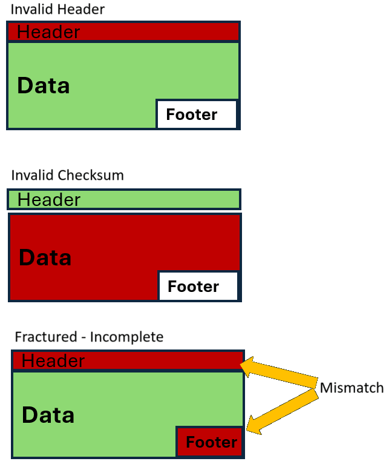
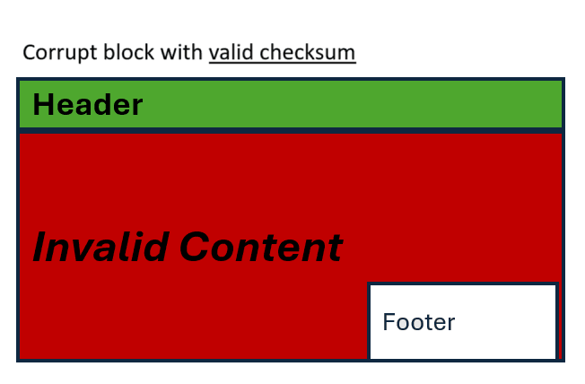
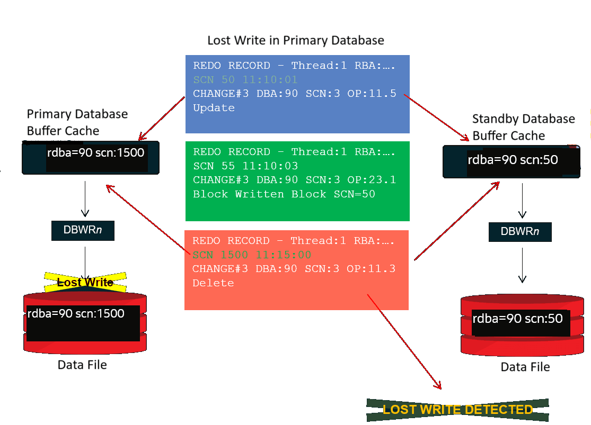

## 32 Data Corruption Prevention, Detection, and Repair

Data corruption, defined as the unintentional alteration of data caused by hardware, software, or human errors, poses a critical threat to the integrity of Oracle Database environments. To combat this pervasive concern, Oracle provides robust mechanisms built on three fundamental pillars: Prevention, Detection, and Repair.

### Data Corruption Types

Summary of Data Corruption Types

| Type | Source/Cause | Detected by | Symptom |
| --- | --- | --- | --- |
| Physical corruption | Hardware/storage | Block I/O/checksum | Read errors, corrupted structure |
| Logical corruption | Software/memory | Consistency checks | Data exists, but is inconsistent/logically invalid |
| Lost write corruption | Storage, I/O path | SCN checks/Data Guard | The block version is older than the redo expectations |

Physical Block Corruption

These errors occur when a database block's structure is physically damaged or rendered unreadable. Such corruption is typically a result of hardware failures (for example: disk errors, controller faults, faulty cables).

Examples:

- Incorrect or missing block header/footer
- Mismatch in data checksums or internal "magic numbers"
- Blocks containing entirely zeros or random, unrecognizable data patterns

Characteristics:

- Detected by Oracle when attempting to read the corrupted block from disk
- Manifests as severe errors such as `ORA-01578: ORACLE data block                         corrupted`.
- Can be repaired using block media recovery or data restoration from a valid backup

> The image shows three examples of physical block corruption described in the examples above. The first example is an invalid header, depicted with the header in red. The second example is invalid checksum, depicted with the data in red. The third example is Fractured - Mismatched, depicted with the header and footer in red.

Logical Block Corruption

In contrast to physical corruption, logical corruption arises when a block's physical structure is intact and readable, but its internal contents are inconsistent with Oracle's expected logical rules or metadata. These are commonly indicative of software bugs or memory-related issues. Logical block corruptions can be **intra-block** logical corruptions where the logical corruption is self-contained in single data block, and **inter-block** logical corruptions where data inconsistencies between 2 or more independent data blocks.

Examples:

- Index entries referencing non-existent rows is an example of inter-block logical corruption
- Table rows exhibiting inconsistencies with their associated metadata within the same data block is an example of intra-block logical corruption
- Incorrect internal pointers, such as those within row piece chains can be intra-block or inter-block logical corruption depending on how many data blocks are involved

Characteristics:

- The block is physically readable, and its checksums and structure are typically valid
- Detection requires logical consistency checks, often performed with RMAN `VALIDATE CHECK LOGICAL`, SQL command `ANALYZE ...                             VALIDATE STRUCTURE`, or exposed during application queries
- In some cases, repair is possible using block media recovery or without full restoration from backup, for example, by rebuilding affected indexes or using `DBMS_REPAIR` to work around the corruption so the remaining data can be accessed

> The image shows an illustration of a corrupt data block with valid checksum.
>
> [  
> Copyright © 2005, 2026, Oracle and/or its affiliates.](https://docs.oracle.com/en/database/oracle/oracle-database/dcommon/html/cpyr.htm)

Lost Write Corruption

A lost write corruption occurs when a database block modification is acknowledged as successfully written by the storage sub-system, but the actual data is never persistently stored on disk or I/O being "lost". This results in the on-disk block image being older than the database expects, creating a crucial consistency mismatch.

Examples:

- A defect in the I/O sub-system or system firmware resulting in false acknowledged I/Os
- Following a system crash or any hardware failure, a data block on disk does not reflect recently committed changes that were believed to be durable
- The redo log contains entries expecting a newer block version than what is physically present on disk

Characteristics:

- This is a data consistency issue, not a structural or logical corruption of the block itself
- Primarily detected by advanced features like Oracle Data Guard (through block SCN comparisons) or through some type of media recovery
- Leads to data divergence, where the primary and standby databases become out of sync, or where the redo stream does not match the actual state of data files

> The image shows an example of lost write in the primary database. The scn value in the primary database differs from that of the standby database.
>
> [  
> Copyright © 2005, 2026, Oracle and/or its affiliates.](https://docs.oracle.com/en/database/oracle/oracle-database/dcommon/html/cpyr.htm)

### Summary of Oracle Data Corruption Resiliency Capabilities

Proactive prevention, vigilant detection, and proper use of Oracle’s built-in repair features form a comprehensive defense against data corruption in Oracle databases.

| Pillar | Features, Tools, and Best Practices | Purpose |
| --- | --- | --- |
| Prevention | Software Update Practices, Testing, Use Recommended Database Parameters  Oracle Active Data Guard, Exadata, Recovery Appliance  For details see Preventing Data Corruption | Avoid corruption from happening or avoid corruption from impacting your application |
| Detection | Recommended Database Parameters, Database and System Alerting, RMAN  Oracle Active Data Guard, Recovery Appliance, Exadata  For details see Detecting Data Corruption | Find corruption early, notify, and take action |
| Repair | Oracle Active Data Guard, or GoldenGate, ASM and Exadata, RMAN  For details see Repairing Data Corruption | Minimize impact; restore data and automatically repair (that is, Automatic Block Repair), aligning the solution with the lowest downtime and data loss |

### Preventing Data Corruption

Prevention aims to proactively stop corruption before it can occur.

Best Practices and Oracle Features

- Maintain Up-to-Date Software:
	- Regularly apply Oracle Release Updates (RUs) and relevant patches. These updates frequently include prioritized corruption prevention, detection, and repair fixes. Customers gain these benefits by adhering to regular software updates and applying critical fixes detailed in My Oracle Support Notes [1270094.1](https://support.oracle.com/rs?type=doc&id=1270094.1) and [555.1](https://support.oracle.com/rs?type=doc&id=555.1).
		- Leverage `Exachk` and `Orachk` tools for comprehensive software health guidance, including recommendations for updates that prevent data corruptions.
- Use Dedicated Test Systems:
	- Thoroughly evaluate all software, hardware, database, or application changes in a test environment before deploying to production. This practice helps detect potential new data corruptions and verifies the effectiveness of existing corruption fixes.
		- Employing a representative workload that accurately mimics production is crucial, as some corruptions manifest only under specific or extreme application conditions.
- Employ Reliable Hardware:
	- Implement enterprise-grade storage solutions equipped with advanced error-correcting features.
		- Exadata and Oracle ASM offer numerous integrated hardware and software features specifically designed to prevent data corruption from impacting applications and databases.
- Implement Storage Redundancy:
	- Use RAID configurations and redundant SAN/NAS solutions for physical storage resilience.
		- Oracle ASM and normal or high redundancy protects from data corruptions.
		If a block on one ASM disk is physically corrupted (for example, due to hardware failure), ASM can:
		- Serve an uncorrupted mirrored copy from another disk, thus shielding the database from encountering corrupted data.
				- Automatically recover the corrupted copy by reading the valid mirrored copy and rewriting it to replace the corrupt one (if possible).
		- Exadata inherently provides built-in redundancy, along with advanced corruption prevention and automated repair capabilities. Exadata does regular data validation (scrubbing) to detect and repair corrupted blocks using mirrored copies.
- Run Regular Backups:
	- Schedule frequent, automated RMAN backups and ensure continuous archiving of redo logs.
		- Zero Data Loss Recovery Appliance (ZDLRA) and Recovery Appliance enhance this by offering automatic backup validation and leveraging Exadata's corruption prevention and repair benefits.

Key Database Configuration Parameters

- `DB_BLOCK_CHECKSUM`:
	- Purpose: Detects physical block corruptions by enabling checksumming for every database and redo block written to disk.
		- Recommendation: `TYPICAL` or higher for both primary and standby databases.
		- Default: `TYPICAL`
- `DB_BLOCK_CHECKING`:
	- Purpose: Detects logical corruptions and prevents them from being written to disk.
		- Recommendation: `MEDIUM` or higher for primary or standby databases.
		- Default: `FALSE`
		- Note: Performance overhead can vary. A common compromise is to enable it on the standby database to ensure logical corruptions are not propagated.
- `DB_LOST_WRITE_PROTECT`:
	- Purpose: Detects lost writes on standby databases and actively prevents/detects lost writes on primary databases.
		- Recommendation: `TYPICAL` or higher for both primary and standby databases.
		- Default: `TYPICAL` or `NONE` depending on the database release. Starting in Oracle 19c (19.26), the default changed to `TYPICAL` for Data Guard configuration
		- Note: This can incur additional I/Os on the standby, requiring sufficient I/O capacity to maintain redo apply performance. Starting with Oracle Database 19c, automatic block repair of lost writes using a current block from either primary or standby can occur.

Oracle Integrity Tools and Features

- RMAN Backups: Ensure the integrity of your backups and facilitate recovery.
- Avoid Unreliable Storage: Never place Oracle database files on improperly configured NFS mounts or other unreliable storage devices.
- Use Active Data Guard: When configured with a physical standby database and real-time apply, Active Data Guard automatically detects all types of data corruption. It also provides auto block repair for physical data block corruptions and some lost write corruptions on both primary and standby databases, preventing application impact. Contact Oracle Support to investigate the root cause of any detected corruption.
- Enable Flashback Database: Flashback database logs can be leveraged for automatic block repair and RMAN block repair of data corruptions.
- Use ASM redundancy and Exadata for additional corruption prevention, detection and repair

### Detecting Data Corruption

Corruption detection focuses on identifying corruption as soon as it occurs or before it can cause widespread damage.

The following are best practices and Oracle features to detect data corruption.

- Configure Database Parameters:
	- Ensure `DB_BLOCK_CHECKSUM`, `DB_BLOCK_CHECKING`, and `DB_LOST_WRITE_PROTECT` are configured for proactive block and write verification. (Refer to descriptions in the "Prevention" section for details).
- Monitor Database and System Alerts:
	- Regularly monitor Oracle database, Oracle clusterware or Exadata alert logs and system logs for any corruption-related errors or warnings. Exadata provides additional, specialized alerts if corruptions are detected within its storage layer.
- Query Database Views:
	- Refer to `V$DATABASE_BLOCK_CORRUPTION` for a comprehensive list of known corrupted blocks within the database.
- Leverage RMAN Validation:
	- Perform RMAN backups, which inherently include checks for physical corruption by default.
		- Use `BACKUP VALIDATE` or `VALIDATE                                 DATABASE` commands to periodically check for corruption without creating a full backup.
		- Use `BACKUP VALIDATE CHECK LOGICAL DATABASE` to detect logical corruptions within your backups periodically.
- Use Oracle Active Data Guard:
	- With Active Data Guard and a physical standby database operating with real-time apply, Data Guard automatically detects all types of data corruption from physical, logical and lost write data corruptions. It further facilitates auto block repair for physical data block corruptions and some lost write corruptions on either primary or standby databases, effectively preventing corruption from impacting applications. Always contact Oracle Support to understand the root cause of any data corruption.
- Use Zero Data Loss Recovery Appliance (ZDLRA) or Recovery Appliance:
	- The Recovery Appliances provide automatic and continuous backup validation, detecting and alerting on backup integrity issues, and offers additional corruption prevention and repair benefits.
- LOB Segment Corruption:
	- Note that some LOB segment corruptions may not be detected by standard database configuration parameters. A new PL/SQL detection script is available for this purpose. Refer to My Oracle Support Note [3084047.1](https://support.oracle.com/rs?type=doc&id=3084047.1) for details.
- `ANALYZE ... VALIDATE STRUCTURE CASCADE`
	- The `ANALYZE` command in Oracle can be used to check for structural and referential inconsistencies in tables or indexes. The specific clause for checking for inconsistencies is `VALIDATE                             STRUCTURE CASCADE`. These types of inter-logical block corruptions may not be detected by recommended database parameters.
- Use ASM redundancy and Exadata for additional corruption prevention, detection and repair. Any detected corruptions will be relevant log files and both ASM and Exadata will automatically recover the corrupted copy by reading the valid mirrored copy and rewriting it to replace the corrupt one (if possible). This may not work if this is logical corruption or even all mirrored copies have been corrupted or compromised.
- Oracle Enterprise Manager (OEM):
	- Provides automated monitoring capabilities for corruption events and overall backup health.

### Repairing Data Corruption

Repair strategies focus on restoring or correcting corrupted data after it has been identified, minimizing impact or working around the corrupted data, and attempting to re-establish data integrity.

The following are best practices and Oracle features to repair data corruption.

- RMAN Block Media Recovery:
	- This highly efficient method restores only the corrupted blocks from backup, significantly minimizing recovery time and application downtime.
		- Primarily effective for physical data corruption but can help in some logical data block and lost block corruptions when following our recommended practices. See References below for links to articles and documentation topics.
- RMAN Full/Incremental Restore and Recover:
	- Provides comprehensive recovery options to restore entire data files, tablespaces, or the entire database to a consistent, uncorrupted state.
- Leverage Active Data Guard for Automatic Repair and Failover:
	- Automatic Block Repair: Active Data Guard can automatically repair physical data corruptions by fetching a good block from its synchronized standby database (or vice versa). Starting with Oracle Database 19c R27 and Oracle Database 23ai, detected standby lost write corruptions will use automatic block repair feature for transparent repair.
		- For physical block corruptions (such as ORA-1578), primary database auto-block repairs (that is, a corrupt block is seen on primary and Oracle internally fixes it by fetching good block from standby) requires standby container database with a minimum apply lag to be open read only regardless of the standby PDB state. For standby auto-BMR (that is, a corrupt block is seen on standby and Oracle internally fixes it by fetching good block from primary) requires at least a mounted or open standby with a minimum apply lag.
				- If standby lost write corruption is detected on the standby database, the standby lost write results in an ORA-753 error. Oracle automatically marks this is a soft corrupted data block which triggers Automatic Block Repair. If the block cannot be repaired, it remains soft corrupted, and once the database is open, reads on that block will raise ORA-01578.
		- Fast-Start Failover (FSFO) with Lost Write Protection: To enable automatic failover when a standby detects a lost write corruption, configure Data Guard Broker with Fast-Start Failover (FSFO) enabled, set `DB_LOST_WRITE_PROTECT` to `TYPICAL` or higher, and set Data Guard broker property `PrimaryLostWriteAction`.
		Options for Data Guard broker property `PrimaryLostWriteAction`:
		- `FAILOVER`: If FSFO is enabled in Maximum Availability or Maximum Performance mode, and the lag is either zero with Maximum Availability or within `FastStartFailoverLagLimit` for Maximum Performance, the observer initiates a failover.
				- `FORCEFAILOVER`: If FSFO is enabled (in Maximum Performance, Maximum Availability, or Maximum Protection mode), the observer initiates a failover, which may result in data loss.
- Use Flashback Database:
	- Enables rapid restoration of the database to a point in time before the corruption, significantly reducing recovery time objectives (RTO).
		- Flashback logs can also contribute to RMAN block media recovery.
- Targeted Table/Partition Recovery:
	- For specific object-level corruption, RMAN table or tablespace point-in-time recovery, or Data Pump export/import (to extract and load healthy data) can be used.
- Index Rebuild:
	- If an index block is corrupted, rebuilding the affected index can often resolve the issue without requiring full database or tablespace recovery.
- LOB Segment Corruption Repair:
	- New repair mechanisms have been developed specifically for LOB corruptions. Refer to My Oracle Support Note [3084047.1](https://support.oracle.com/rs?type=doc&id=3084047.1) for detailed instructions.
- Failover to Standby Database or GoldenGate Replica (Lowest RTO/RPO):
	- To achieve the lowest possible Recovery Time Objective (RTO) and Recovery Point Objective (RPO) when the primary database is experiencing corruptions, initiate a failover to a healthy standby database (via Data Guard) or a GoldenGate replica. This ensures business continuity by transitioning to a database without any data corruptions.
- `DBMS_REPAIR`
	- The `DBMS_REPAIR` package in Oracle is designed to identify and address corruptions in database tables and indexes, especially when physical or logical corruption prevents normal queries or operations from completing. It does not physically fix the corrupt blocks, but instead helps you to isolate and work around them, so that the rest of your data can be accessed or managed.

### References

- Best Practices for Corruption Detection, Prevention, and Automatic Repair - in a Data Guard Configuration (Doc ID [1302539.1](https://support.oracle.com/rs?type=doc&id=1302539.1))
- Database dictionary inconsistencies: [DBMS\_DICTIONARY\_CHECK PL/SQL Package](https://docs.oracle.com/pls/topic/lookup?ctx=en/database/oracle/oracle-database/21/haovw&id=ARPLS-GUID-5A0A5C52-64C1-4C73-A964-53E89D34B2AE)
- Block media repair guidance: [Performing Block Media Recovery](https://docs.oracle.com/pls/topic/lookup?ctx=en/database/oracle/oracle-database/21/haovw&id=BRADV-GUID-1E226393-17D0-4AB0-A05D-91210255D8FF)
- Physical and Logical Block Corruptions. All you wanted to know about it. (Doc ID [840978.1](https://support.oracle.com/rs?type=doc&id=840978.1))
- Primary Note for Handling Oracle Database Corruption Issues (Doc ID [1088018.1](https://support.oracle.com/rs?type=doc&id=1088018.1))
- Resolving Logical Block Corruption Errors in a Physical Standby Database (Doc ID [2821699.1](https://support.oracle.com/rs?type=doc&id=2821699.1))
- Resolving ORA-00752 or ORA-600 \[3020\] During Standby Recovery (Doc ID [1265884.1](https://support.oracle.com/rs?type=doc&id=1265884.1))
- Identify the Corruption Extension for Block Corruption, Table/Index Inconsistency, Data Dictionary, and Lost Writes (Doc ID [836658.1](https://support.oracle.com/rs?type=doc&id=836658.1))
- Handling LOB Segment Corruptions (Doc ID [3084047.1](https://support.oracle.com/rs?type=doc&id=3084047.1))
- OERR: ORA-1578 "ORACLE data block corrupted (file # %s, block # %s)" Master Note (Doc ID [1578.1](https://support.oracle.com/rs?type=doc&id=1578.1))
- OERR: ORA-8102 "index key not found, obj# %s, file %s, block %s (%s)" (Doc ID [8102.1](https://support.oracle.com/rs?type=doc&id=8102.1))
- ORA-600 \[kddummy\_blkchk\] (Doc ID [300581.1](https://support.oracle.com/rs?type=doc&id=300581.1))
- ORA-600 \[kdblkcheckerror\] (Doc ID [882875.1](https://support.oracle.com/rs?type=doc&id=882875.1))
- How to clear a block corruption in a TEMPORARY segment (Doc ID [1332088.1](https://support.oracle.com/rs?type=doc&id=1332088.1))
- Handling LOB Segment Corruptions (Doc ID [3084047.1](https://support.oracle.com/rs?type=doc&id=3084047.1))