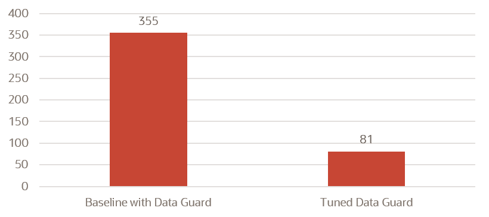
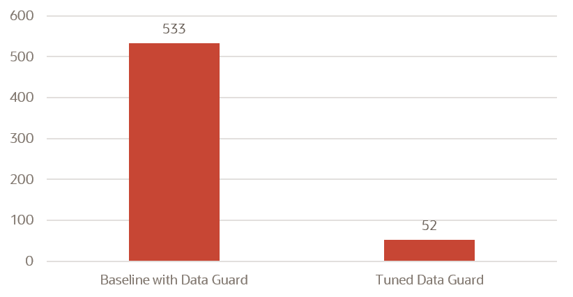
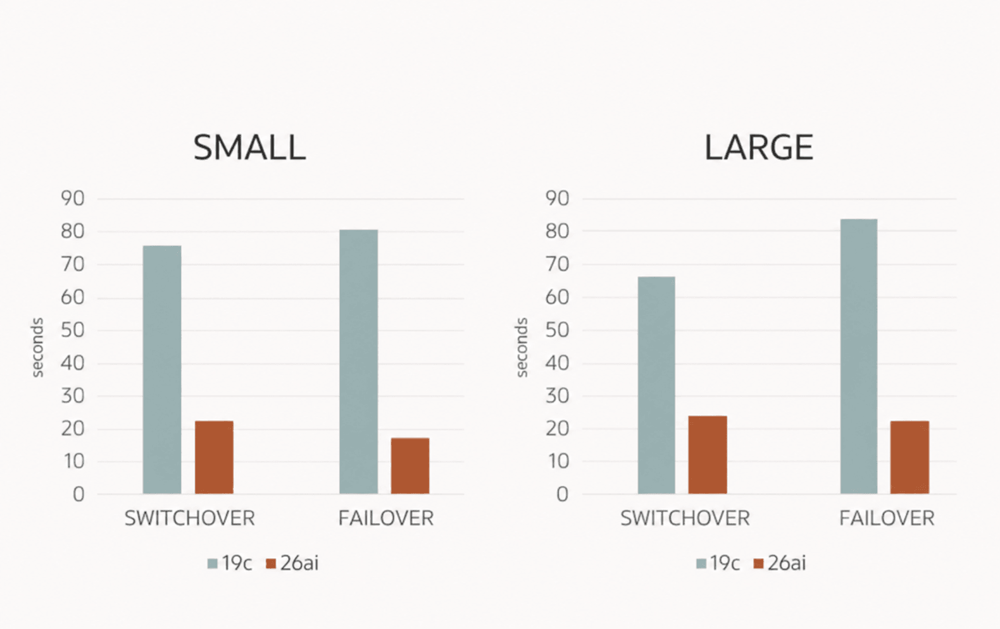
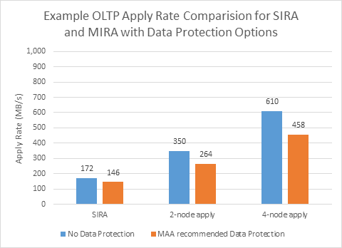
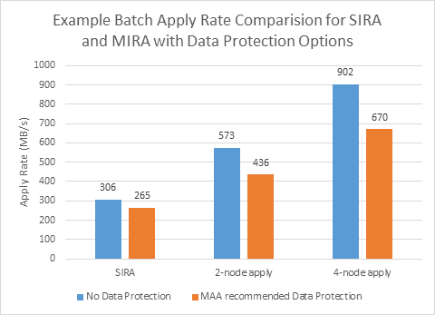
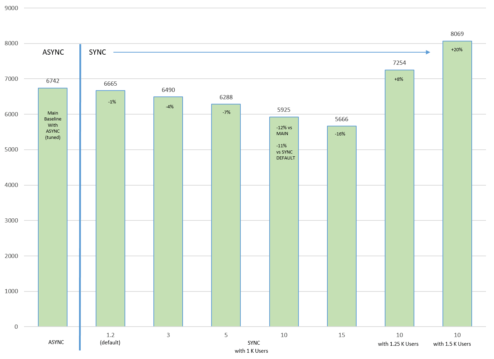
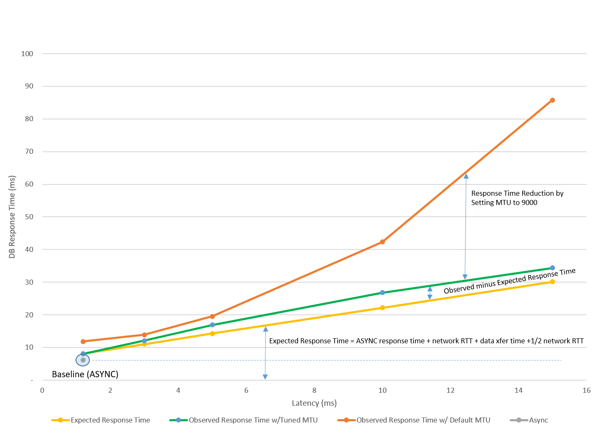

## Data Guard Performance Observations

### Data Guard Role Transition Duration

Oracle Data Guard and Oracle MAA Gold reference architectures provide disaster recovery and high availability solutions when the primary database, cluster, or site fails or is inaccessible.

Each Data Guard environment is different and the time to perform role transitions can vary significantly. Variables including, but not limited to, SGA size, number of Oracle RAC instances, number of PDBs, number of data files, number of Oracle services and connections to the database at the time of role transition impact the length of a given role transition.

Generally, Data Guard switchover (planned maintenance) is slightly longer than Data Guard failover (unplanned outages).

Assuming system resources are not a bottleneck, the standby system is symmetric to the primary, and apply lag is near zero, the biggest factors that increase Data Guard role transition timings for Oracle 19c or earlier database releases are the following:

- Number of Pluggable Databases (PDBs) (for example, more than 25 PDBs)
- Number of Oracle Clusterware managed services (for example, more than 200 Oracle Services)
- Number of data files (more than 500 Oracle data files)

If any of the above exceeds the thresholds, Data Guard switchover or failover timings can increase by minutes. For example, a database with 5000 or more data files can increase role transition timings by 5 or more minutes. A database with 500 Oracle services can increase role transition timings by a minute or more. A database with 50 or more PDBs can increase role transition timings by a minute or more.

Because the number of data files is a big factor, MAA recommends using large data file sizes or BigFiles when creating tablespaces and partitions. If some databases that are protected by standby databases are critical, MAA recommends isolating them in their own separate container database (CDB) or keeping the number of PDBs to a minimum.

The following information is meant to educate you about ways to optimize role transitions.

Data Guard Switchover Duration

When attempting to minimize application downtime for planned maintenance:

- Before planned maintenance windows, avoid or defer batch jobs or long running reports. Peak processing windows should also be avoided.
- Because Data Guard switchover is graceful, which entails a shutdown of the source primary database, any application drain timeout is respected. See [Enabling Continuous Service for Applications](enabling-continuous-service-applications.md) for Oracle Clusterware service drain attributes and settings.
- Data Guard switchover operations on a single instance (non-RAC) can be less than 30 seconds.
- Data Guard switchover operations on Real Application Cluster vary, but can be from 30 seconds to 7 minutes. The duration may increase with more PDBs (for example, > 25 PDBs), more application services (for example, 200 services), and if the database has a large number of data files (for example, 1000s of data files).

The following graph and table show one example of how much switchover operation duration can decrease when MAA tuning recommendations are implemented. Results will vary.

Figure 17-1 Planned maintenance: DR switch duration in seconds

> The image shows a vertical bar graph with two bars. The first bar is labeled Baseline with Data Guard and goes up to 355 seconds. The second bar is labeled Tuned Data Guard and goes up to 81 seconds.
>
> [  
> Copyright © 2005, 2026, Oracle and/or its affiliates.](https://docs.oracle.com/en/database/oracle/oracle-database/dcommon/html/cpyr.htm)

| Planned DR Switch (Switchover) | Initial Configuration | Tuned MAA Configuration |
| --- | --- | --- |
| Convert Primary to Standby | 26 secs | 21 sec |
| Convert Standby to Primary (C2P) | 47 secs | 7 secs |
| Open new Primary (OnP) | 152 secs | 14 secs |
| Open PDB and Start Service (OPDB) | 130 secs | 39 secs |
| Total App Downtime | 355 secs or 5 mins 55 secs | 81 secs (78% drop) |

The Tuned MAA Configuration timings were achieved by implementing the following MAA recommended practices:

- [Use Bigfile Tablespace](oracle-ai-database-configuration-best-practices.md)
- [Oracle Data Guard Configuration Best Practices](configure-and-deploy-oracle-data-guard.md)
- [Role Transition, Assessment, and Tuning](role-transition-assessment-tuning-and-troubleshooting.md)

Data Guard Failover Duration

When attempting to minimize application downtime for DR scenarios:

- To limit Recovery Time Objective (RTO or database down time) and Recovery Point Objective (RPO or data loss), automatic detection and fail over is required. See [Fast-Start Failover](https://docs.oracle.com/pls/topic/lookup?ctx=en/database/oracle/oracle-database/21/haovw&id=DGBKR-GUID-995CED84-BEA1-4675-9C68-B37CB996924F) in Oracle Data Guard Broker.
- The database administrator can determine the appropriate "detection time" before initiating an automatic failover by setting `FastStartFailoverThreshold`. See [Enabling Fast-Start Failover Task 4: Set the FastStartFailoverThreshold Configuration Property](https://docs.oracle.com/pls/topic/lookup?ctx=en/database/oracle/oracle-database/21/haovw&id=DGBKR-GUID-68161F2B-991E-47B6-8D52-9651248A8162) in Oracle Data Guard Broker.
	The MAA recommended setting is between 5 seconds and 60 seconds for a reliable network. Oracle RAC restart may also recover from a transient error on the primary. Setting this threshold higher gives the restart a chance to complete and avoid failover, which can be intrusive in some environments. The trade off is that application downtime increases in the event an actual failover is required.
- Data Guard failover operations on a single instance (non-RAC) can be less than 20 seconds.
- Data Guard failover operations on a Real Application Cluster vary but can be from 20 seconds to 7 minutes. The duration may increase with more PDBs (for example, > 25 PDBs), more application services (for example, 200 services) and if the database has a large number of data files (for example, 1000s of data files).

The following graph and table show one example how much failover operation duration can decrease when MAA tuning recommendations are implemented. Results will vary.

Figure 17-2 Unplanned DR failover duration in seconds

> The image shows a vertical bar graph with two bars. The first bar is labeled Baseline with Data Guard and goes up to 355 seconds. The second bar is labeled Tuned Data Guard and goes up to 52 seconds.
>
> [  
> Copyright © 2005, 2026, Oracle and/or its affiliates.](https://docs.oracle.com/en/database/oracle/oracle-database/dcommon/html/cpyr.htm)

| Unplanned Outage/DR (Failover) | Initial Configuration | Tuned MAA Configuration |
| --- | --- | --- |
| Close to Mount (C2M) | 21 secs | 1 sec |
| Terminal Recovery (TR) | 154 secs | 2 secs |
| Convert to Primary (C2P) | 114 secs | 5 secs |
| Open new Primary (OnP) | 98 secs | 28 secs |
| Open PDB and Start Service (OPDB) | 146 secs | 16 secs |
| Total App Downtime | 533 secs or 8min 53 secs | 52 secs (90% drop) |

The Tuned MAA Configuration timings were achieved by implementing the following MAA recommended practices:

- Evaluate Data Guard [Fast-Start Failover](https://docs.oracle.com/pls/topic/lookup?ctx=en/database/oracle/oracle-database/21/haovw&id=DGBKR-GUID-995CED84-BEA1-4675-9C68-B37CB996924F) and test with different `FastStartFailoverThreshold` settings
- [Use Bigfile Tablespace](oracle-ai-database-configuration-best-practices.md)
- [Oracle Data Guard Configuration Best Practices](configure-and-deploy-oracle-data-guard.md)
- [Role Transition, Assessment, and Tuning](role-transition-assessment-tuning-and-troubleshooting.md)

Customer Examples

Real-world Data Guard role transition duration observations from Oracle customers are shown in the following table.

| Primary and Data Guard Configuration | Observed RTO |
| --- | --- |
| Single instance database failover in Database Cloud (DBCS) with heavy OLTP workload. Data Guard threshold is 5 seconds. | 20 secs |
| Large commercial bank POC results on 4 node Oracle RAC with heavy OLTP workload, that consists of only one PDB in a large CDB and >= 25 clusterware managed services | 51 secs (unplanned DR)  82 secs (planned DR) |
| ExaDB-D 2-node RAC MAA testing with heavy OLTP workload | 78 secs |
| ADB-D 2-node RAC MAA testing (25 PDBs, 250 services) with heavy OLTP workload | 104 secs |
| ADB-D 2-node RAC MAA testing (50 PDBs, 600 services) with heavy OLTP workload | 180 secs |
| ADB-D 2-node RAC MAA testing (4 CDBs, 100 PDBs total, 500 services) with heavy OLTP workload | 164 secs |
| Oracle SaaS Fleet (thousands) of 12-node RAC, 400 GB SGA, 4000+ data files  (note: reducing number of data files to hundreds can reduce downtime by minutes) | < 6 mins |
| Third Party SaaS Fleet (thousands) of 7-12 node RACs with quarterly site switch | < 5 mins |

#### Data Guard Role Transition Optimizations in Oracle AI Database 26ai

Data Guard role transition timings can be 400% times faster in Oracle AI Database 26ai because of many Oracle AI Database 26ai optimizations in various areas, including PDB and CDB open and close operations, recovery, and database checkpoint and clusterware service management.

The examples that follow show role transitions are less than 30 seconds, and you will see faster Data Guard role transition timings after upgrading to Oracle AI Database 26ai compared to Oracle Database 19c.

There are cases where the Oracle AI Database 26ai Data Guard role transition timings may exceed 30 seconds. The main factors are:

- Number of data files (for example, more than 2000 data files) and how much outstanding media recovery needed. This is the most significant and most impactful variable.
	For example, a database on a CDB that has 5000 data files and a heavy workload, resulting in outstanding redo that needs to be applied, may have an RTO greater than 60 seconds, or even more than a couple of minutes. Observed is an additional 10ms per data file. By using Oracle recommended BigFiles instead of smallfiles on any new database creation, this problem is eliminated for all new databases.
- Number of PDBs and Clusterware managed services. If you have many PDBs (more than 25 PDBs) or hundreds of Clusterware managed services, you may find an increase in RTO timings.

Data Guard switchover and failover timings are reduced significantly in Oracle AI Database and Oracle Grid Infrastructure 26ai, as shown in the following image.

> The image shows 2 vertical bar graphs. Each graph has two groups of two bars. The first group in each is labeled "SWITCHOVER" and the second group is labeled "FAILOVER". The legends beneath the graphs indicate that the first bar in each group is data from an Oracle Database 19c setup, and the second bar in each group is data from an Oracle Database 26ai setup.
>
> The first graph is labeled "SMALL" with a vertical axis labeled in seconds from 0-90.
>
> The second graph is labeled "LARGE" with a vertical axis labeled in seconds from 0-100
>
> The precise numbers are not given but the 19c bars are much higher (in seconds) than the 26ai bars.

What Was Measured

Oracle MAA measured the time difference between entering the `SWITCHOVER` or `FAILOVER` phase in `DGMGRL` and starting the services, as seen in the alert log.

For that, two different configurations were used, as shown in the following table.

| Configuration | System | PDBs | Data Files | Services | Redo Rate |
| --- | --- | --- | --- | --- | --- |
| SMALL | 2-node Exadata RAC | 5 | 50 | 10 | 60 MB/s |
| LARGE | 4-node Exadata RAC | 12 | 500 | 12 | 100 MB/s |

### Redo Apply Performance

Single Instance Redo Apply (SIRA) is the default redo apply mode, and for most cases should be sufficient. Focus on tuning and understanding the bottlenecks of SIRA before even considering Multi-Instance Redo Apply (MIRA). See [Redo Apply Troubleshooting and Tuning](redo-apply-troubleshooting-and-tuning.md).

Assuming there is no system resource contention, such as storage bandwidth limitations or non-tuned database wait event due to read-write I/O or checkpoint wait events, Multi-Instance Redo Apply (MIRA) can improve redo apply performance by scaling 30 to 80% for each additional Oracle RAC instance in a MIRA configuration.

There are a number of factors affecting the rate of improvement, such as the type of workload on the primary, additional read-only workload on the standby, and any new top standby wait events.

Figure 17-3 Example apply rates of Swingbench OLTP workloads

> The image shows a bar graph. The vertical axis is labeled "Apply Rate (MB/sec)" and the horizontale axis labels three sets of bars labeled (from left to right) "SIRA", "2-node apply" and "4-node apply". Each group of bars consists of 2 vertical bars, the first of which represents No Data Protection, and the second represents MAA recommended Data Protection.
>
> In the "SIRA" bar group No Data Protection = 172 and MAA recommended Data Protection = 146. In the "2-node apply" bar group No Data Protection = 350 and MAA recommended Data Protection = 264. In the "4-node apply" bar group No Data Protection = 610 and MAA recommended Data Protection = 458.

Figure 17-4 Example apply rates of batch insert workloads

> The image shows a bar graph. The vertical axis is labeled "Apply Rate (MB/sec)" and the horizontale axis labels three sets of bars labeled (from left to right) "SIRA", "2-node apply" and "4-node apply". Each group of bars consists of 2 vertical bars, the first of which represents No Data Protection, and the second represents MAA recommended Data Protection.
>
> In the "SIRA" bar group No Data Protection = 306 and MAA recommended Data Protection = 265. In the "2-node apply" bar group No Data Protection = 573 and MAA recommended Data Protection = 436. In the "4-node apply" bar group No Data Protection = 902 and MAA recommended Data Protection = 670.

For large redo gaps, you can quickly catch up on the gaps by implementing the method described in [Addressing a Very Large Redo Apply Gap](redo-apply-troubleshooting-and-tuning.md).

In very rare case you can temporarily disable some MAA data protection settings if apply performance is more important. Refer to [Improving Redo Apply Rates by Sacrificing Data Protection](redo-apply-troubleshooting-and-tuning.md).

### Application Throughput and Response Time Impact with Data Guard

Application throughput and response time impact is near zero when you enable Data Guard Max Performance protection mode or ASYNC transport. Throughput and application response time is typically not impacted at all in those cases.

With Data Guard Max Availability or Max Protection mode or SYNC transport, the application performance impact varies, which is why application performance testing is always recommended before you enable SYNC transport. With a tuned network and low round-trip latency (RTT), the impact can also be negligible, even though every log commit has to be acknowledged to every available SYNC standby database in parallel to preserve a zero data loss solution.

Here's an example of the application throughput impact but application impact varies based on workload:

Figure 17-5 Application impact with MTU=9000

> The image shows a vertical bar graph with more to come.
>
> [  
> Copyright © 2005, 2026, Oracle and/or its affiliates.](https://docs.oracle.com/en/database/oracle/oracle-database/dcommon/html/cpyr.htm)

Notice the lower network RTT latency (x axis), the application (TPS or y axis) throughput reduces.

Note that in this network environment we observed that increasing MTU from 1500 (default) to 9000 (for example, jumbo frames) helped significantly since log message size increased significantly with SYNC. With the larger MTU size, the number of network packets per redo send request are reduced.

See [Assessing and Optimizing Network Performance](plan-oracle-data-guard-deployment.md) for details about tuning the network including the socket buffer size and MTU.

Even when throughput decreases significantly with higher RTT latency, you can increase TPS if your application can increase the concurrency. In the above chart, the last 2 columns increased the workload concurrency by adding more users.

Application response time with SYNC transport can also increase, but will vary based on each application workload and network tuning. With SYNC transport, all log writes have to wait for standby SYNC acknowledgment. This additional wait result in more foregrounds waiting for commit acknowledgment. Because commits have to be acknowledged by the standby database and more foregrounds are waiting for commits, the average log write size increases which affects the redo/data transfer time, as shown in the following chart.

Figure 17-6 Database response time (ms) vs latency (ms) for tuned and default MTU

> The image shows a line graph shows latency and response time with default MTU comapred to Tuned MTU.
>
> [  
> Copyright © 2005, 2026, Oracle and/or its affiliates.](https://docs.oracle.com/en/database/oracle/oracle-database/dcommon/html/cpyr.htm)

In this example, we observed from AWR reports that average redo write size increased significantly, and tuning MTU reduced the response time impact. See [Assessing and Optimizing Network Performance](plan-oracle-data-guard-deployment.md) on tuning network including the socket buffer size and MTU.

After tuning the network, the response time impact was very predictable and low. Note that response impact varies per application workload.

To get the best application performance with Data Guard, use the following practices:

- Tune the application without Data Guard first and you should observe similar performance for ASYNC transport
- Implement [Oracle Data Guard Configuration Best Practices](configure-and-deploy-oracle-data-guard.md)
- Use [Redo Transport Troubleshooting and Tuning](redo-transport-troubleshooting-and-tuning.md) methods
- Tune the network to improve application performance with SYNC. See [Assessing and Optimizing Network Performance](plan-oracle-data-guard-deployment.md)
- Application workload specific changes that can help increase throughput for SYNC Transport are:
	- Evaluate adding more concurrency or users to increase throughput.
	- For non-critical workloads within certain sessions that do not require zero data loss, evaluate advanced `COMMIT_WRITE` attribute to `NOWAIT`.
		In this case, you can commit before receiving the acknowledgment. Redo is still sent to persistent redo logs but is done asynchronously. Recovery is guaranteed for all persistent committed transactions in the redo that is applied. See [COMMIT\_WRITE](https://docs.oracle.com/pls/topic/lookup?ctx=en/database/oracle/oracle-database/21/haovw&id=REFRN-GUID-F392FBE5-848D-439E-B470-73A5FEC31C61) in Oracle Database Reference.