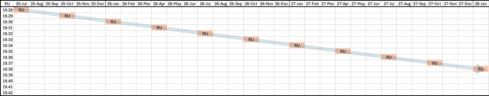
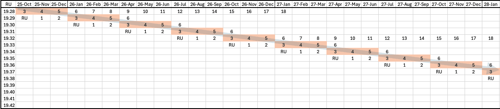
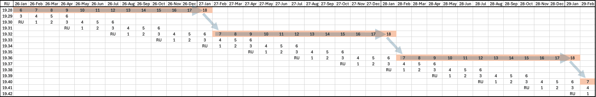

## Detect When Software Needs To Be Updated

Defining a software maintenance policy and proactively detecting outdated software are critical for security, stability, availability, and compliance. Oracle recommends automating detection and alerting by using Oracle tools and selected My Oracle Support resources.

Key Practices

- Define a software maintenance policy that aligns with business requirements for compliance, risk tolerance, and update frequency.
- Use Oracle tools to evaluate software health and determine whether maintenance is required or recommended.
- Automate health checks with DBCA, DBCACTL, FPP, or other supported orchestration integrated with Oracle Update Advisor to produce consistent, policy-aware recommendations.
- Establish notification thresholds for critical and important advisories that require interim action.
- Monitor feature-specific recommendations for components that are critical to the business, such as Oracle Data Guard.

### Define a Software Maintenance Policy

Establish a documented software maintenance policy that reflects compliance requirements, risk tolerance, service level agreements, and maintenance-window constraints. Review the policy whenever business or operational requirements change.

A comprehensive policy should define the following directives:

- Apply frequency: How often proactive software updates are applied, such as monthly, quarterly, or semiannually. Oracle typically releases proactive updates monthly or quarterly. Oracle recommends updating to the latest RU quarterly and applying monthly security or recommended updates when applicable.
- Update lag: Whether to apply the most recent proactive update (N) or a previous update, such as N-1. Oracle recommends using the latest RU as a security best practice. If N-1 is used to reduce early-adoption risk, combine it with MRPs or CSPUs.
- Notification Level: The severity of newly published issues that trigger applying interim fixes before the next proactive update. Levels include Critical and Important. The choice depends on business risk tolerance and operational priority.
	- Critical: Address only critical issues immediately. Examples are listed in [Exadata Critical Issues (KB623062)](https://support.oracle.com/support/?documentId=KB623062)
	- Important: Address both critical and important issues immediately. Examples for Oracle Database are listed in [Oracle Database 19c and Oracle AI Database 26ai Important Recommended One-off Patches (KB188772)](https://support.oracle.com/support/?documentId=KB188772)
- Recommendation Area: The specific Oracle product components or features for which software recommendations will be monitored. Identify recommendation areas that are critical to business success.
	A maintenance policy should consider the CVSS level of newly announced security vulnerabilities when determining how security requirements affect software apply frequency and target versions. Higher CVSS levels, especially Critical and High vulnerabilities, may require accelerated adoption of a newer RU, MRP, CSPU, or interim fix instead of waiting for the next scheduled maintenance cycle.

| Security Target | CVSS Range |
| --- | --- |
| SecurityCritical | CVSS 9.0 - 10.0 |
| SecurityHigh+ | CVSS 7.0 - 10.0 (Default) |
| SecurityMedium+ | CVSS 4.0 - 10.0 |
| SecurityLow+ | CVSS 0.1 - 10.0 |

Oracle Database and Grid Infrastructure Software

Oracle Database and Oracle Grid Infrastructure require a defined, repeatable software maintenance policy that balances security, stability, availability, and change rate. The policy should specify how often proactive updates are applied, how far behind the latest recommended update the environment is allowed to operate, and what severity of missing fixes triggers interim action.

Oracle recommends using out-of-place, gold image-based updates orchestrated by DBCA for single-instance systems and FPP for clustered environments, with Oracle Update Advisor supplying policy-aware recommendations and ready-to-deploy images. This approach standardizes software baselines, reduces risk and downtime, and simplifies rollback, and aligns with MAA high availability principles.

Policy Scenarios

The following tables show examples of software maintenance goals and the policy directives used to achieve them.

| Apply Frequency | Description |
| --- | --- |
| Quarterly | Update quarterly |
| Semiannually | Update twice per year |
| Monthly | Update monthly |
| Monthly Long Term RU | Update monthly staying on a Long Term RU |

| Update Lag | Description |
| --- | --- |
| N | Install latest RU |
| N-1 | Install prior (N-1) RU |
| N-2 | Install prior (N-2) RU |

| Apply Frequency | Update Lag N | Update Lag N-1 | Update Lag N-2 |
| --- | --- | --- | --- |
| Quarterly | Supported | Supported | Supported |
| Semiannually | Supported | Supported | Supported |
| Monthly | Supported | Supported | Not supported <sup>1</sup> |
| Monthly Long Term RU | Supported | Supported | Not supported <sup>2</sup> |

<sup>1</sup> Not supported because monthly updates extend to only one prior RU.

<sup>2</sup> Not supported because monthly updates extend to only one prior Long Term RU.

Policy Examples

The following policy examples cover the most common customer goals.

- Policy Example 1: Apply Frequency = Quarterly, Update Lag = N
- Policy Example 2: Apply Frequency = Quarterly, Update Lag = N-1
- Policy Example 3: Apply Frequency = Monthly, Update Lag = N-1
- Policy Example 4: Apply Frequency = Monthly Long Term RU, Update Lag = N-1

Policy Example 1: Apply Frequency = Quarterly, Update Lag = N

This is the default and most common policy. Adopt the latest RU each quarter as it is released, operate on that RU for approximately three months, and advance to the next RU at the next quarterly release. This keeps security and stability fixes current with no intentional lag.

Policy summary:

- Stay on the latest RU for three months.
- When a new RU is released every quarter (January, April, July, and October), install the new RU.

| Date | Released RU | Installed RU |
| --- | --- | --- |
| 25-Jul | 19.28 | 19.28 |
| 25-Aug |  | 19.28 |
| 25-Sep |  | 19.28 |
| 25-Oct | 19.29 | 19.28 ➞ 19.29 |
| 25-Nov |  | 19.29 |
| 25-Dec |  | 19.29 |
| 26-Jan | 19.30 | 19.29 ➞ 19.30 |
| 26-Feb |  | 19.30 |
| 26-Mar |  | 19.30 |
| 26-Apr | 19.31 | 19.30 ➞ 19.31 |
| 26-May |  | 19.31 |
| 26-Jun |  | 19.31 |
| 26-Jul | 19.32 | 19.31 ➞ 19.32 |

The following graph for policy example 1 shows Oracle Database 19c quarterly RU releases and their release month over 28 months. It depicts the quarterly, no‑lag policy, where you adopt each newly released RU that quarter, operate on it for about three months, and then advance to the next RU on release.



Policy Example 2: Apply Frequency = Quarterly, Update Lag = N-1

Choose this policy when a conservative cadence is required. Stay one RU behind the latest by installing the previous quarter’s RU each cycle, operating on that RU for approximately three months before advancing to the next previous RU. This reduces early-adoption risk while maintaining a predictable quarterly cadence.

Policy summary::

- Stay on the N-1 RU for three months.
- When a new RU is released every quarter (January, April, July, and October), install the next N-1 RU.
- Monitor critical and important fixes continuously; accelerate patching if Oracle publishes a fix that materially affects your risk profile.

| Date | Released RU | Installed RU |
| --- | --- | --- |
| 25-Jul | 19.28 | 19.27 |
| 25-Aug |  | 19.27 |
| 25-Sep |  | 19.27 |
| 25-Oct | 19.29 | 19.27 ➞ 19.28 |
| 25-Nov |  | 19.28 |
| 25-Dec |  | 19.28 |
| 26-Jan | 19.30 | 19.28 ➞ 19.29 |
| 26-Feb |  | 19.29 |
| 26-Mar |  | 19.29 |
| 26-Apr | 19.31 | 19.29 ➞ 19.30 |
| 26-May |  | 19.30 |
| 26-Jun |  | 19.30 |
| 26-Jul | 19.32 | 19.30 ➞ 19.31 |

Policy Example 3: Apply Frequency = Monthly, Update Lag = N-1

This policy reduces early-adoption risk by staying one RU behind while still applying the latest monthly recommended patches (MRPs) for that RU. Operate on a given RU for approximately one quarter, and apply the current MRP for that RU each month. When a new quarterly RU is released, move to the prior RU for the next quarter and continue monthly patching on that RU.

Policy summary:

- Stay on an RU for three months.
- Install the latest MRP for the prior (N-1) RU every month.
- When a new RU is released each quarter (January, April, July, and October), install the prior (N-1) RU and the latest MRP for that RU.

MRP details:

- MRPs are cumulative monthly bundles applied on top of a specific RU and do not change the RU version. MRPs apply only to Linux x86-64.
- MRP labels in the tables (for example, MRP3, MRP4) denote the third, fourth, and later monthly cumulative bundles after the RU release.

| Date | Released RU | Installed RU |
| --- | --- | --- |
| 25-Oct | 19.29 | 19.28 + MRP3 |
| 25-Nov |  | 19.28 + MRP3 ➞ 19.28 + MRP4 |
| 25-Dec |  | 19.28 + MRP4 ➞ 19.28 + MRP5 |
| 26-Jan | 19.30 | 19.28 + MRP5 ➞ 19.29 + MRP3 |
| 26-Feb |  | 19.29 + MRP3 ➞ 19.29 + MRP4 |
| 26-Mar |  | 19.29 + MRP4 ➞ 19.29 + MRP5 |
| 26-Apr | 19.31 | 19.29 + MRP5 ➞ 19.30 + MRP3 |
| 26-May |  | 19.30 + MRP3 ➞ 19.30 + MRP4 |
| 26-Jun |  | 19.30 + MRP4 ➞ 19.30 + MRP5 |
| 26-Jul | 19.32 | 19.30 + MRP5 ➞ 19.31 + MRP3 |

The following graph for policy example 3 shows Oracle Database 19c quarterly RU and monthly MRP releases and their release month over 28 months. It depicts the monthly, N‑1 policy, where you stay one RU behind, apply the latest monthly MRP to that RU each month, and shift to the next N‑1 RU at the following quarterly release.



Policy Example 4: Apply Frequency = Monthly Long Term RU, Update Lag = N-1

This policy targets customers who prefer a long-lived RU foundation (Long Term RU) while still consuming monthly MRPs. Stay on a designated Long Term RU for approximately 12 months and apply the latest MRP each month. When the next Long Term RU becomes available (annually), move forward to the prior (N-1) Long Term RU during your annual change window, then continue monthly MRPs on that new Long Term RU.

For additional details see [Long Term Support Model for 19c Database Release Updates (RU) (KB625385)](https://support.oracle.com/support/?documentId=KB625385)

Policy summary:

- Stay on an Long Term RU for 12 months.
- Install the latest MRP for the prior (N-1) Long Term RU every month.
- Install the prior (N-1) Long Term RU and the latest MRP for that RU every year during your annual change window.

| Date | Released RU | Installed RU |
| --- | --- | --- |
| 26-Jan | 19.30 | 19.28 + MRP5 ➞ 19.28 + MRP6 |
| 26-Feb |  | 19.28 + MRP6 ➞ 19.28 + MRP7 |
| 26-Mar |  | 19.28 + MRP7 ➞ 19.28 + MRP8 |
| 26-Apr | 19.31 | 19.28 + MRP8 ➞ 19.28 + MRP9 |
| 26-May |  | 19.28 + MRP9 ➞ 19.28 + MRP10 |
| 26-Jun |  | 19.28 + MRP10 ➞ 19.28 + MRP11 |
| 26-Jul | 19.32 (Long Term RU) | 19.28 + MRP11 ➞ 19.28 + MRP12 |
| 26-Aug |  | 19.28 + MRP12 ➞ 19.28 + MRP13 |
| 26-Sep |  | 19.28 + MRP13 ➞ 19.28 + MRP14 |
| 26-Oct | 19.33 | 19.28 + MRP14 ➞ 19.28 + MRP15 |
| 26-Nov |  | 19.28 + MRP15 ➞ 19.28 + MRP16 |
| 26-Dec |  | 19.28 + MRP16 ➞ 19.28 + MRP17 |
| 27-Jan | 19.34 | 19.28 + MRP17 ➞ 19.28 + MRP18 |
| 27-Feb |  | 19.28 + MRP18 ➞ 19.32 + MRP7 |
| 27-Mar |  | 19.32 + MRP7 ➞ 19.32 + MRP8 |
| 27-Apr | 19.35 | 19.32 + MRP8 ➞ 19.32 + MRP9 |
| 27-May |  | 19.32 + MRP9 ➞ 19.32 + MRP10 |
| 27-Jun |  | 19.32 + MRP10 ➞ 19.32 + MRP11 |
| 27-Jul | 19.36 (Long Term RU) | 19.32 + MRP11 ➞ 19.32 + MRP12 |
| 27-Aug |  | 19.32 + MRP12 ➞ 19.32 + MRP13 |
| 27-Sep |  | 19.32 + MRP13 ➞ 19.32 + MRP14 |
| 27-Oct | 19.37 | 19.32 + MRP14 ➞ 19.32 + MRP15 |
| 27-Nov |  | 19.32 + MRP15 ➞ 19.32 + MRP16 |
| 27-Dec |  | 19.32 + MRP16 ➞ 19.32 + MRP17 |
| 28-Jan | 19.38 | 19.32 + MRP17 ➞ 19.32 + MRP18 |
| 28-Feb |  | 19.32 + MRP18 ➞ 19.36 + MRP7 |

The following graph for policy example 4 shows Oracle Database 19c quarterly RU and monthly MRP releases and their release month over 38 months. It depicts the monthly Long Term RU, N‑1 policy, where you run on a designated Long Term RU for about a year with monthly MRPs, then move annually to the prior Long Term RU and continue monthly MRPs.



### Determine Software Health

After a software maintenance policy is established, evaluate installed software against that policy and Oracle’s current recommendations to determine software health.

Evaluate whether:

- Installed software is behind Oracle’s recommended proactive updates.
- Critical or important fixes announced by Oracle are missing for the base product software.
- Critical or important fixes announced by Oracle are missing for specific product components or features, such as Oracle Data Guard.

Evaluate software health frequently, such as weekly, and more frequently than the planned apply frequency. This helps identify newly recommended critical or important fixes shortly after they are published.

Oracle Database and Grid Infrastructure Software

Oracle recommends using automated tools integrated with Oracle Update Advisor (OUA) to assess software health for Oracle Database and Oracle Grid Infrastructure. This approach reduces manual tracking and improves consistency.

Automated tools such as DBCA/DBCACTL, and FPP can integrate with Oracle Update Advisor to evaluate installed software against the defined policy and Oracle’s current recommendation to determine software health status. Customers can also integrate Oracle Update Advisor with their own custom software maintenance orchestration by using the Oracle Update Advisor API, as described in My Oracle Support article [KB886700](https://support.oracle.com/support/?documentId=KB886700). Using automation simplifies the identification of missing critical or important fixes and helps drive consistent, policy-aware maintenance decisions.

Software Health Status

| Status | Action |
| --- | --- |
| GREEN | No action needed  Installed software meets Oracle’s recommendation based on your policy. |
| YELLOW | Update is recommended  Installed software is missing important fixes or is behind Oracle’s recommendation by one cycle. |
| RED | Update is required  Installed software is missing critical fixes or is behind Oracle’s recommendation by more than one cycle. |

Examples

In the following examples:

- Installed software is Database Release Update 23.8. Database Release Update 23.9 is the latest version released and recommended. Therefore, the installed RU is one behind the latest RU.
- When Policy is not specified the default is used (Apply frequency = Quarterly, Update lag = No lag).

DBCA Example using default policy

```
$ dbca -managePatches -checkPatchStatus -silent
   "softwareHealth" : "YELLOW",
   "comment" : "One cycle behind your policy.",
   "recommendedVersion" : "23.9"
```

FPP Example (using FPP Server Mode) using default policy

```
$ rhpctl evaluate patch -image DB238000
Software health status: "YELLOW"
Software health comment: "One cycle behind your policy."
Software Type: "DB"
Current version: "23.8.0.25.4"
Recommended version: "23.9"
```

DBCACTL Example using semiannual apply frequency

```
$ dbcactl -managePatches -checkPatchStatus -applyFrequency SEMI_ANNUAL
  "softwareHealth" : "GREEN"
```

For additional details see [Streamlining Your Update Experience with Oracle Update Advisor](https://docs.oracle.com/pls/topic/lookup?ctx=en/database/oracle/oracle-database/21/haovw&id=DBPTC-GUID-2F954CB6-CF7C-4A7A-AF97-8B57A905548C).

Alternative/Complementary Methods

If automated evaluation tools are not in use, administrators can track recommendations and health status manually by using:

- Exachk – Run Exachk regularly and review recommended software checks.
- My Oracle Support knowledge base articles - Proactively monitor prioritized KB articles for proactive software update release announcements, critical fixes and recommended fixes, and replacement updates.

For additional details see [Obtain Recommended Software](obtain-recommended-software.md).

Exadata Software

For Exadata environments, Oracle recommends:

- Exachk – Run Exachk and review recommended software checks.
- My Oracle Support knowledge base articles - Proactively monitor prioritized articles for proactive software update release announcements, critical and recommended fixes, or replacement fixes.

For additional details see [Obtain Recommended Software](obtain-recommended-software.md).