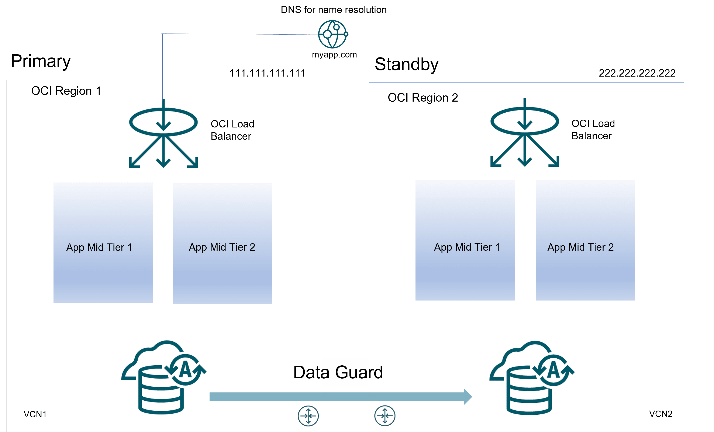
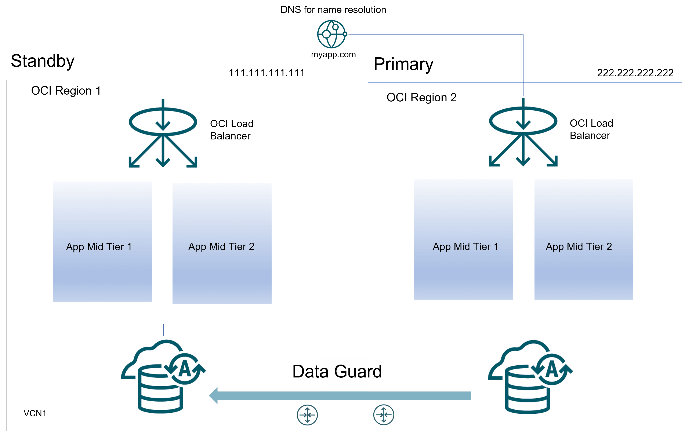

## 44 Full Site Switch in Oracle Cloud or On-Premise

A complete-site or full site failure results in both the application and database tiers being unavailable. To maintain availability users must be redirected to a secondary site that hosts a redundant application tier and a synchronized copy of the production database. MAA best practice is to use Data Guard to maintain the synchronized copy of the production database. Upon site failure a WAN traffic manager or load balancer is used to perform a DNS failover (either manually or automatically) to redirect all users to the application tier at standby site while a Data Guard failover transitions the standby database to the primary production role.

During normal runtime operations the following occurs:

1. Client requests enter the client tier of the primary site and travel by the WAN traffic manager.
2. Client requests are sent to the application server tier.
3. Requests are forwarded through the active load balancer to the application servers.
4. Requests are sent into the database server tier.
5. The application requests, if required, are routed to an Oracle RAC instance.
6. Responses are sent back to the application and clients by a similar path.

The following illustrates the possible network routes before site switchover:

Figure 44-1 Sites before switchover



> The image shows primary and standby sites with Oracle Data Guard replication to the standby.
>
> [  
> Copyright © 2005, 2026, Oracle and/or its affiliates.](https://docs.oracle.com/en/database/oracle/oracle-database/dcommon/html/cpyr.htm)


The following steps describe the effect of a site switchover:

1. The administrator has failed over or switched over the primary database to the secondary site. This is automatic if you are using Data Guard Fast-Start Failover. Autonomous Database on Dedicated Hardware supports Data Guard Fast-Start Failover.
2. The administrator starts the middle-tier application servers on the secondary site, if they are not running. In some cases the same middle-tier application servers can be leveraged if they do not reside in the failed site.
3. The wide-area traffic manager selection of the secondary site can be automatic for an entire site failure.
4. The wide-area traffic manager at the secondary site returns the virtual IP address of a load balancer at the secondary site and clients are directed automatically on the subsequent reconnect. In this scenario, the site failover is accomplished by an automatic domain name system (DNS) failover.

The following figure illustrates the network routes after site failover. Client or application requests enter the secondary site at the client tier and follow the same path on the secondary site that they followed on the primary site.

Figure 44-2 Sites after switchover



> The image shows the primary and standby sites after a switchover, with Oracle Data Guard replication going to the new standby.
>
> [  
> Copyright © 2005, 2026, Oracle and/or its affiliates.](https://docs.oracle.com/en/database/oracle/oracle-database/dcommon/html/cpyr.htm)


Failover also depends on the client's web browser. Most browser applications cache the DNS entry for a period. Consequently, sessions in progress during an outage might not fail over until the cache timeout expires. To resume service to such clients, close the browser and restart it.

### Performing Role Transitions Between Regions

Examples below leverage Oracle Public Cloud. However similar steps can be done on-premise or hybrid cloud scenarios.

Failover to Another Region

A failover operation is performed when the primary site becomes unavailable, and it is commonly an unplanned operation. You can role-transition a standby database to a primary database when the original primary database fails and there is no possibility of recovering the primary database in a timely manner. There may or may not be data loss depending upon whether your primary and target standby databases were consistent at the time of the primary database failure.

To perform a manual failover in a DR configuration follow these steps:

1. Switchover DNS name.
	Perform the required DNS push in the DNS server hosting the names used by the system or alter the file host resolution in clients to point the front-end address of the system to the public IP used by load balancer in site2. For scenarios where DNS is used for the external front-end resolution (OCI DNS, commercial DNS, etc.), appropriate API can be used to push the change. An example that push this change in an OCI DNS:
	The following is an OCI client script that updates a front end DNS entry, such as ordscsdroci.domainexample.com, to the site 1 load balancer's public IP address (for example: 111.111.111.123).
	```
	oci dns record rrset update
	 --config-file /home/opc/scripts/.oci_ordscsdr/config
	 --zone-name-or-id "domainexample.com"
	 --domain "ordscsdroci.domainexample.com"
	 --rtype "A"
	 --items '[{"domain":"ordscsdroci.domainexample.com","rdata":"111.111.111.123","rtype":"A","ttl":60}]'
	 --force
	```
2. Failover database.
	On Oracle Cloud:
	Use Oracle Control Plane and issue a Data Guard switchover or failover operation.
	On-Premises:
	Use Data Guard broker in secondary database host to perform the failover. As user oracle:
	```
	[oracle@drdbwlmp1b ~]$ dgmgrl sys/your_sys_password@secondary_db_unqname
	DGMGRL> failover to “secondary_db_unqname”
	```
3. Start the servers in the secondary site.
	Restart the secondary application servers.

Switchover

A switchover is a planned operation where an administrator reverts the roles of the two sites. The roles change from the primary to the standby as well as from standby to primary. This is known as a manual switchover. To perform a manual switchover follow these steps:

1. Propagate any pending configuration changes.
	For non-database files, you can use rsync or Object Storage Service (OSS) to replicate to your secondary site.
2. Stop servers in the primary site.
	Use scripts to stop managed servers / mid tiers in primary Site.
3. Switchover DNS name
	Perform the required DNS push in the DNS server hosting the names used by the system or alter the file host resolution in clients to point the front-end address of the system to the public IP used by load balancer in site 2. For scenarios where DNS is used for the external front-end resolution (OCI DNS, commercial DNS, etc.), appropriate API can be used to push the change.
	The following example pushes this change in an OCI DNS.
	The OCI client script updates the front end DNS entry, for example ordscsdroci.domainexample.com, to the site1 load balancer's public IP address (for example: 111.111.111.123).
	```
	oci dns record rrset update
	 --config-file /home/opc/scripts/.oci_ordscsdr/config
	 --zone-name-or-id "domainexample.com"
	 --domain "ordscsdroci.domainexample.com"
	 --rtype "A"
	 --items '[{"domain":"ordscsdroci.domainexample.com","rdata":"111.111.111.123","rtype":"A","ttl":60}]'
	 --force
	```
	Note that the TTL value of the DNS entry will affect to the effective RTO of the switchover: if the TTL is high (example, 20 mins), the DNS change will take that time to be effective in the clients. Using lower TTL values will make this to be faster, however, this can cause an overhead because the clients check the DNS more frequently. A good approach is to set the TTL to a low value temporarily (example, 1 min), before the change in the DNS. Then, perform the change, and once the switchover procedure is completed, set the TTL to the normal value again.
4. Perform database switchover.
	On Oracle Cloud:
	Use Oracle Control Plane and issue a Data Guard switchover operation.
	On-Premises:
	Use Data Guard broker on the primary database host to perform the switchover.
	As user oracle:
	```
	$ dgmgrl sys/your_sys_password@primary_db_unqname
	DGMGRL> switchover to “secondary_db_unqname”
	```
5. Start the servers in secondary site (new primary).
	Restart the secondary managed servers and mid tiers.

### Best Practices for Full Site Switchover

Oracle recommends the following best practices:

- Maintain the same configuration in primary and standby sites: any changes applied to the primary system must be performed in the secondary system too, so both primary and secondary systems have the same configuration. For example: a modification in the primary load balancer, any modifications to the operating system, and so on.
- Perform regular switchovers to verify the health of the secondary site.
- Perform any switchover related activity that does not require downtime before you stop the primary servers. For example, the WLS configuration replication based on config\_replica.sh script does not require downtime, you can perform it while the primary system is up and running. Other example is to start any shutdown host in the standby site.
- If required to restart the application servers, stop and start the managed servers / mid tiers in parallel.
- The front-end update in DNS is customer dependent. Use a low TTL value in the appropriate DNS entry (at least during the switchover operation) to reduce the time for update. Once the switchover finished, the TTL can be reverted to its original value.
- The OCI load balancer takes some time also to realize that the servers are up and to start sending requests to them. It is usually some seconds, depending on the frequency of the OCI load balancer health checks. Lower the interval used for the checks is, faster it realizes that the servers are up. However, be cautious when you use too low intervals: if the health check is a heavy check, it could overload the back end.

### More Information About Full Site Switchover

The previous topics describe full site failover in a generic fashion. For detailed information for full site failover for specific applications refer to the following sources:

- [SOA Suite on Oracle Cloud Infrastructure Marketplace Disaster Recovery](https://www.oracle.com/a/tech/docs/maa-soamp-dr.pdf)
- [Oracle WebLogic Server for Oracle Cloud Infrastructure Disaster Recovery](https://www.oracle.com/a/otn/docs/middleware/maa-wls-mp-dr.pdf)
- [Full Stack Disaster Recovery](https://www.oracle.com/cloud/full-stack-disaster-recovery/)
- [Oracle Cloud Infrastructure Full Stack Disaster Recovery](https://docs.oracle.com/en/cloud/iaas/disaster-recovery/index.html)