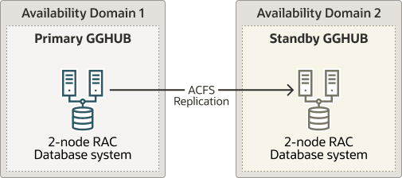

## Task 2: Prepare a Primary and Standby Base System for GGHub

### Step 2.1 - Deploy an Oracle RAC 2-Node Cluster System

Deploy a minimum of two GGHubs (primary and standby). Each GGHub must be deployed as a 2-node Oracle RAC database system as described in [Oracle Base Database Service](https://docs.oracle.com/en/cloud/paas/bm-and-vm-dbs-cloud/aboutbmvmdbs/index.html#articletitle).

Figure 23-2 Oracle GoldenGate Hub Hardware Architecture

  


### Step 2.2 - Remove the Standard Database and Rearrange the Disk Group Layout

1. As the `oracle` OS user on the first GGHub node, remove the standard database:
	```
	[opc@gghub_prim1 ~]$ sudo su - oracle
	[oracle@gghubN-node1 ~]$ dbca -deleteDatabase -silent -sourceDB $ORACLE_UNQNAME
	Enter SYS user password: ##############
	[WARNING] [DBT-19202] The Database Configuration Assistant will delete the Oracle instances and datafiles for your database. All information in the database will be destroyed.
	Prepare for db operation
	32% complete
	Connecting to database
	39% complete
	...
	100% complete
	Database deletion completed.
	Look at the log file "/u01/app/oracle/cfgtoollogs/dbca/DB0502_fra2pr/DB0502_fra2pr.log" for further details.
	```
2. As the `grid` OS user on the second GGHub node, dismount the RECO diskgroup:
	```
	[opc@gghub_prim2 ~]$ sudo su - grid
	[grid@gghub_prim2 ~]$ sqlplus / as sysasm
	SQL> alter diskgroup RECO dismount;
	```
3. As the `grid` OS user on the first gghub node, drop the RECO diskgroup and assign the disks to the DATA diskgroup:
	```
	[opc@gghub_prim1 ~]$ sudo su - grid
	[grid@gghub_prim1 ~]$ sqlplus / as sysasm
	SQL>
	drop diskgroup RECO INCLUDING CONTENTS;
	alter diskgroup DATA add disk '/dev/RECODISK1';
	alter diskgroup DATA add disk '/dev/RECODISK2';
	alter diskgroup DATA add disk '/dev/RECODISK3';
	alter diskgroup DATA add disk '/dev/RECODISK4';
	```
4. As the `root` OS user on all GGhub nodes, reboot the node:
	```
	[opc@gghub_prim1 ~]$ sudo reboot
	```

Note:

Repeat this step in the primary and standby GGHubs.

### Step 2.3 - Download the Required Software

1. As the `opc` OS user on all GGHub nodes, create the staging and scripts directories:
	```
	[opc@gghub_prim1 ~]$ 
	sudo mkdir -p /u01/oracle/stage
	sudo mkdir /u01/oracle/scripts
	sudo chown -R oracle:oinstall /u01/oracle
	sudo chmod -R g+w /u01/oracle
	sudo chmod -R o+w /u01/oracle/stage
	```
2. As the `opc` OS user on all GGHub nodes, download the following software in the directory /u01/oracle/stage:
	- Download the latest Oracle GoldenGate 21c (or later release) Microservices software from [Oracle GoldenGate Downloads](http://www.oracle.com/technetwork/middleware/goldengate/downloads/index.html).
		- Download subsequent patches to the base release from the Patches and Updates tab of [My Oracle Support.](https://support.oracle.com/epmos/faces/PatchHome)
		- See [Installing Patches for Oracle GoldenGate Microservices Architecture](https://docs.oracle.com/en/middleware/goldengate/core/21.3/coredoc/install-installing-patches-ma.html#GUID-BE9C5FCD-9DC0-4452-B232-123BA82979D0) for more information.
				- Minimum required version is Patch 35214851: Oracle GoldenGate 21.9.0.0.2 Microservices for Oracle
		- Download the latest OPatch release, Patch 6880880, for Oracle Database 21c (21.0.0.0.0) from My Oracle Support Document [2542082.1](https://support.oracle.com/rs?type=doc&id=2542082.1).
		- Download the Oracle Grid Infrastructure Standalone Agents for Oracle Clusterware 19c, release 10.2 or later, from [Oracle Grid Infrastructure Standalone Agents for Oracle Clusterware](http://www.oracle.com/technetwork/database/database-technologies/clusterware/downloads/xag-agents-downloads-3636484.html).
		- Download the python script (`secureServices.py`) from My Oracle Support [Document 2826001.1](https://support.oracle.com/rs?type=doc&id=2826001.1)
		- Download the Oracle GGHUB Scripts from My Oracle Support [Document 2951572.1](https://support.oracle.com/rs?type=doc&id=2951572.1)
3. As the `grid` OS user on all GGHub nodes, unzip the GGhub scripts file downloaded from My Oracle Support [Document 2951572.1](https://support.oracle.com/rs?type=doc&id=2951572.1) into the directory `/u01/oracle/scripts`.
	Place the script in the same location on all primary and standby GGhub nodes
	```
	[opc@gghub_prim1 ~]$ sudo su - grid 
	[grid@gghub_prim1 ~]$ unzip -q /u01/oracle/stage/gghub_scripts_YYYYYMMDD.zip -d /u01/oracle/scripts/
	```

### Step 2.4 - Configure Oracle Linux To Use the Oracle Public YUM Repository

The Oracle Linux yum server hosts software for Oracle Linux and compatible distributions. These instructions help you get started configuring your Linux system for Oracle Linux yum server and installing software through yum.

- As the `root` OS user in all GGHub systems, create the file `/etc/yum.repos.d/oracle-public-yum-ol7.repo` with the following contents:
	```
	[opc@gghub_prim1 ~]$ sudo su -
	[root@gghub_prim1 ~]#
	cat > /etc/yum.repos.d/oracle-public-yum-ol7.repo <<EOF
	[ol7_latest]
	name=Oracle Linux $releasever Latest ($basearch)
	baseurl=http://yum$ociregion.oracle.com/repo/OracleLinux/OL7/latest/\$basearch/
	gpgkey=file:///etc/pki/rpm-gpg/RPM-GPG-KEY-oracle
	gpgcheck=1
	enabled=1
	EOF
	```