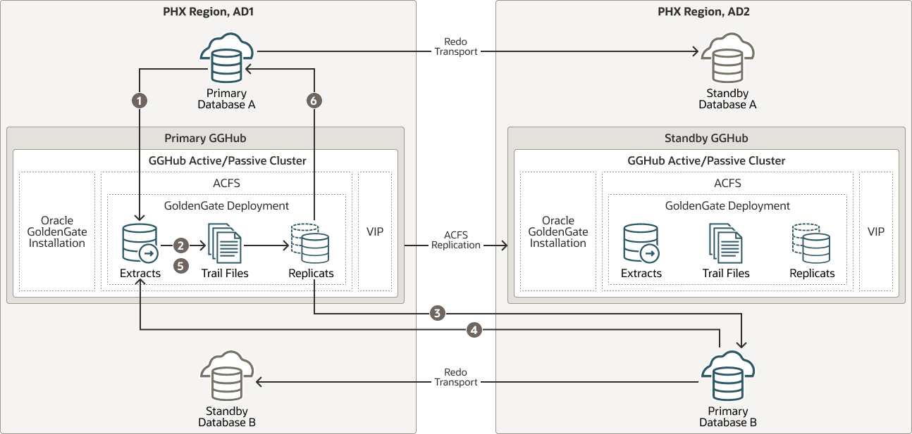

## Planning GGHub Placement in the Platinum MAA Architecture

Extreme availability that delivers zero downtime (RTO=0 or near zero) and zero or near zero data loss (RPO=0 or near zero) typically requires the following Platinum MAA architecture.

1. You have the source and target database in an Oracle GoldenGate architecture to allow your application to fail over immediately in the case of disaster (database, cluster, or site failure) or switch over in the case of a database or application upgrade. This architecture enables the potential RTO of zero or near zero for disaster scenarios and database and application upgrade maintenance.
2. Each source and target database is deployed in Exadata cloud systems so any local failures are tolerated or recovered almost instantly.
3. Each source and target database is configured with a standby database with Data Guard Fast-Start Failover so any failure of the database results in activating a new primary database in seconds to minutes. If SYNC transport is leveraged with Max Availability protection mode, zero data loss Data Guard failover is achieved.
4. Configured with GoldenGate replication using MAA GGhub between the source and target databases.
5. Configured so that any standby becoming a primary database due to Data Guard switchover or failover will automatically resynchronize with its target GoldenGate database. If zero data loss Data Guard switchover or failover occurs, GoldenGate resychronization ensures zero data loss across the distributed database environment.
6. Configured with GoldenGate Automatic Conflict Detection and Resolution, which is required after any Data Guard failover operation occurs.

### Where to Place the MAA Primary GGHub and Standby GGHub

1. The GGHub Pair (Primary and Standby GGHub) must reside in the same OCI regions as each primary and standby database. For example:
	1. If the primary database is in AD1, Region A, and the standby database is in AD2, Region A, then the GGHub pair will reside in Region A. For this configuration, continue reading the topics in this chapter.
		2. If the primary database is in Region A and the standby database is in Region B, then the GGHub pair will split between Region A and B. The primary, or active, GGHub must be co-located in the same OCI region as the target primary database. For this configuration, see [Cloud Across Regions: Configuring Oracle GoldenGate Hub for MAA Platinum](cloud-gghub-regions.md).
2. Performance implications:
	1. Primary or active GGHub must reside in the same data center as the target database to ensure round trip latency of 4ms or less. (Replicat performance)
		2. Primary or active GGHub should be < 90 ms from the source database without incurring GoldenGate performance degradation. (Extract performance)
3. GoldenGate distribution path:
	1. A GoldenGate distribution path is required if the source and target GGHubs are in different regions and latency between the OCI regions is > 90 ms.
		2. In Oracle Cloud, when your Oracle GoldenGate source and target databases reside in the same region, or in different regions in the same country, you never need to set up a GoldenGate distribution path because the latency is always < 90 ms.

### MAA GGHubs Placed in the Same OCI Region

In this scenario, the primary and standby database are located in the same OCI region, and so the primary (active) GGHub and the standby GGHub are also located in the same region.

The following architectural components comprise the GGHubs, as shown in the image below:

1. Primary database and associated standby database are configured with Oracle Active Data Guard Fast Start Failover (FSFO). FSFO can be configured with any Data Guard protection mode, with ASYNC or SYNC redo transport, depending on your maximum data loss tolerance.
2. Primary GGHub Active/Passive Cluster: Only one GGHub software deployment and configuration on the 2-node cluster. This cluster contains the 21c Oracle GoldenGate software deployment that can support Oracle Database 11g (11.2.0.4) and later releases.
	This GGHub can support many primary databases and encapsulates the GoldenGate processes. GoldenGate Extract mines transactions from the source database and GoldenGate Replicat applies the same changes to target database. GoldenGate trail and checkpoint files also reside in the GGhub ACFS file system.
	The HA failover solution is built in to the GGhub, which includes automatic failover to the passive node in the same cluster, and restarts GoldenGate processes and activity after a node failure.
3. Standby GGHub Active/Passive Cluster: A Symmetric standby GGhub is configured. ACFS replication is set up between the primary and standby GGHubs to preserve all GoldenGate files.
	Manual GGhub failover, which includes ACFS failover, can be performed in the rare case that you lose the entire primary GGhub.

Figure 22-1 Primary and Standby GGHubs in the Same OCI Region

  

The figure above depicts data replicated from Primary Database A to Primary Database B and Primary B back to Primary A with the following steps:

1. Primary Database A: Primary A’s Logminer server sends redo changes to a Primary GGHub Extract process.
2. Primary GGHub: An Extract process writes changes to trail files.
3. Primary GGHub to Primary Database B: A Primary GGHub Replicat process applies those changes to the target database (Primary B).
4. Primary Database B: Primary B’s Logminer server sends redo to a Primary GGHub Extract process.
5. Primary GGHub: A Primary GGHub Extract process writes changes to trail files.
6. Primary GGHub to Primary Database A: A Primary GGHub Replicat process applies those changes to the target database (Primary A).

Note that one GGHub can support multiple source and target databases, even when the source and target databases are different Oracle Database releases.

Table 22-1 Outage Scenarios, Repair, and Restoring Redundancy for GGHubs in the Same OCI Region

| Outage Scenario | Application Availability and Repair | Restoring Redundancy and Pristine State |
| --- | --- | --- |
| Primary Database A (or Database B) failure | Impact: Near-zero application downtime. GoldenGate replication resumes when a new primary database starts.  1. One primary database is still available. All activity is routed to the existing available primary database to achieve zero application downtime. Refer to Global Data Service [Global Services Failover](https://docs.oracle.com/pls/topic/lookup?ctx=en/database/oracle/oracle-database/21/haovw&id=GSMUG-GUID-63143CA0-23BF-46D2-A349-401FECD24FBD) solution. For example, application services A-F are routed to Database A and application services G-J are routed to Database B. If Database A fails, all application services temporarily go to Database B. 2. The standby becomes the new primary automatically with Data Guard FSFO. Oracle GoldenGate replication resumes and the primary databases resynchronize. Data loss is bounded by the Data Guard protection level. If Maximum Availability or Maximum Protection is configured, zero data loss is achieved. All committed transactions are in one or both databases. Workload can be “rebalanced” when Primary Database A and Database B are available and in sync. For example, when Database A is up and running and in sync, services A-F can go back to Database A. | 1. The old primary database is reinstated as the new standby database to restore redundancy. 2. Optionally performing a Data Guard switchover to switch back to the original configuration ensures that at least one primary database resides in an independent AD. |
| Primary or standby GGHub single node failure | Impact: No application impact. GoldenGate replication resumes automatically after a couple of minutes.  No action is required. The HA failover solution built in to the GGHub includes automatic failover and restart of GoldenGate processes and activity. Replication activity is blocked until GoldenGate processes are active again. GoldenGate replication blackout could last a couple of minutes. | Once the node restarts, active/passive configuration is re-established. |
| Primary GGHub cluster crashes and is not recoverable | Impact: No application impact. GoldenGate replication resumes after restarting the existing GGHub or performing a manual GGHub failover operation.  1. If the GGHub cluster can be restarted, then that’s the simplest solution. 2. If the primary GGHub is not recoverable, then perform a manual GGHub failover to the standby GGHub, which includes ACFS failover. This typically takes several minutes. 3. GoldenGate replication stops until the new primary GGhub is available, so performing step 1 or step 2 should take little time. | If the previous GGHub eventually restarts, ACFS replication resumes in the other direction automatically. If the GGHub cluster is lost or unrecoverable, you need to rebuild a new standby GGHub. |
| Standby GGHub cluster crashes and not recoverable | Impact: No application or replication impact.  1. If the GGHub cluster can be restarted, then that is the simplest solution, and ACFS replication can resume. 2. If the standby GGHub is not recoverable, you can rebuild a new standby GGHub. | N/A |
| Complete Data Center or Availability Domain (AD1 or AD2) failure | Impact: Near-zero application downtime. GoldenGate replication resumes when the new primary database starts.  1. One primary database is still available. All activity is routed to the existing available primary database to achieve zero application downtime. Refer to Global Data Service [Global Services Failover](https://docs.oracle.com/pls/topic/lookup?ctx=en/database/oracle/oracle-database/21/haovw&id=GSMUG-GUID-63143CA0-23BF-46D2-A349-401FECD24FBD) solution. For example, application services A-F are routed to Database A and application services G-J are routed to Database B. If Database A fails, all services temporarily go to Database B. 2. If the primary GGHub is still functional, GoldenGate replication continues. If the primary GGHub is lost due to availability domain (AD) failure, then a manual GGhub failover is required. GoldenGate replication resumes and the primary databases resynchronize. Data loss is bounded by the Data Guard protection level. If Maximum Availability or Maximum Protection is configured, zero data loss is achieved. All committed transactions are in one or both databases. Workload can be rebalanced when Primary Database A and Database B are available and in sync. When Database A is up and running and in sync, services A-F can go back to Database A. | 1. When the data center/AD returns, re-establish the configuration, such as reinstate standby. If the previous GGHub eventually restarts, ACFS replication resumes in the other direction automatically. 2. When possible, perform a Data Guard switchover (back) to get back to the original state where one primary database exists in each AD. |