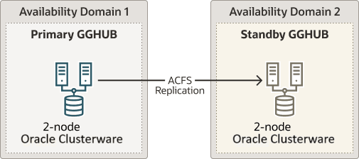

## Task 2: Deploy Oracle GoldenGate Maximum Availability Hub on Oracle Cloud Marketplace

Oracle GoldenGate Maximum Availability Hub was designed to save you time in setting up and configuring your Oracle GoldenGate high availability solution.

It provides high availability by configuring a 2-node cluster server for fast and simple failover, and disaster recovery by leveraging Oracle Advanced Cluster File System (ACFS) replication to another identical GoldenGate hub server on a separate 2-node cluster server.

Follow the steps in [Using Oracle GoldenGate Maximum Availability Hub on Oracle Cloud Marketplace](https://docs.oracle.com/en/middleware/goldengate/core/21.3/ggmah/get-started.html#GUID-C508B269-0CF7-46A4-906D-11CFD0811734) to deploy the system, and come back to this topic to continue with the GGHub configuration.

Figure 22-2 Oracle GoldenGate Maximum Availability Hub Hardware Architecture

  
