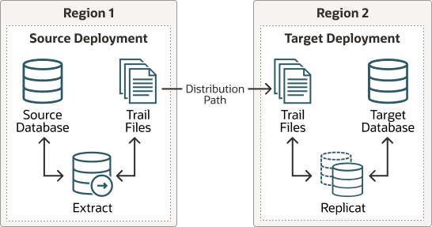

## Task 3: Configure the Oracle GoldenGate Environment

### Step 3.1 - Create Database Credentials

With the Oracle GoldenGate deployment created, use the Oracle GoldenGate Administration Service home page to create the database credentials using the above TNS alias names. See figure 4 below for an example of the database credential creation using the TNS alias.

From a client machine with access to the GGHUB, create a ssh tunnel to connect to the Oracle GoldenGate Administration Service:

```
$ ssh -N -L <local_port>:<vip>:443 -p 22 <gghub-node>
```

As the oggadmin user, create the database credentials:

1. Log in into the Administration Service: https://localhost:\<localPort>/<instance\_name>/adminsrvr.
2. Click Configuration under Administration Service.
3. Click the plus button to Add Credentials under the Database tab.
4. Add the required information for the source and target CDB and PDB as shown in the table:
	| Region | Container | Domain | Alias | User ID |
	| --- | --- | --- | --- | --- |
	| Region 1 | CDB | GoldenGate | Reg1\_CDB | c##ggadmin@<tns\_alias> |
	| Region 1 | PDB | GoldenGate | Reg1\_PDB | ggadmin@<tns\_alias> |
	| Region 2 | CDB | GoldenGate | Reg2\_CDB | c##ggadmin@<tns\_alias> |
	| Region 2 | PDB | GoldenGate | Reg2\_PDB | ggadmin@<tns\_alias> |

### Step 3.2 - Create an Oracle Net TNS Alias for Oracle GoldenGate Database Connections

To provide local database connections for the Oracle GoldenGate processes when switching between nodes, create a TNS alias on all nodes of the cluster where Oracle GoldenGate may be started. Create the TNS alias in the `tnsnames.ora` file in the `TNS_ADMIN` directory specified in the deployment creation.

If the source database is a multitenant database, two TNS alias entries are required, one for the container database (CDB) and one for the pluggable database (PDB) that is being replicated. For a target Multitenant database, the TNS alias connects the PDB to where replicated data is being applied. The pluggable database `SERVICE_NAME` should be set to the database service created in an earlier step (refer to Step 2.3: Create the Database Services in [Task 2: Prepare a Primary and Standby Base System for GGHub](gghub-cloud-cross-region-task-2-prepare-primary-and-standby-base-system-gghub.md)).

As the `oracle` OS user on any database node of the primary and the standby database systems, use dbaascli to find the database domain name and the SCAN name:

```
# Primary DB
[opc@exadb1_node1]$ sudo su - oracle
[oracle@exadb1_node1]$ source db_name.env
[oracle@exadb1_node1]$ dbaascli database getDetails --dbname <db_name>
 |grep 'connectString'

        "connectString" : "<primary_scan_name>:1521/<service_name>"

# Standby DB
[opc@exadb2_node1]$ sudo su - oracle
[oracle@exadb2_node1]$ source db_name.env
[oracle@exadb2_node1]$ dbaascli database getDetails --dbname <db_name>
 |grep 'connectString'

      "connectString" : "<standby_scan_name>:1521/<service_name>"
```

As the `oracle` OS user on all nodes of the primary and standby GGHUB, add the recommended parameters for Oracle GoldenGate in the `sqlnet.ora` file:

```
[opc@gghub_prim1]$ sudo su - oracle
[oracle@gghub_prim1]$ mkdir -p /u01/app/oracle/goldengate/network/admin
[oracle@gghub_prim1]$ 
cat > /u01/app/oracle/goldengate/network/admin/sqlnet.ora <<EOF
DEFAULT_SDU_SIZE = 2097152
EOF
```

As the `oracle` OS user on all nodes of the primary and standby GGHUB, follow the steps to create the TNS alias definitions:

```
[opc@gghub_prim1 ~]$ sudo su - oracle
[oracle@gghub_prim1 ~]$

cat > /u01/app/oracle/goldengate/network/admin/tnsnames.ora <<EOF

# Source
<source_cbd_service_name>= 
     (DESCRIPTION =
         (CONNECT_TIMEOUT=3)(RETRY_COUNT=2)(LOAD_BALANCE=off)(FAILOVER=on)(RECV_TIMEOUT=30)
         (ADDRESS_LIST =
             (ADDRESS = (PROTOCOL = TCP)(HOST=<primary_scan_name>)(PORT=1521)))
         (ADDRESS_LIST = 
             (ADDRESS = (PROTOCOL = TCP)(HOST=<standby_scan_name>)(PORT=1521)))
         (CONNECT_DATA=(SERVICE_NAME = <source_cbd_service_name>.goldengate.com)))

<source_pdb_service_name>= 
    (DESCRIPTION =
        (CONNECT_TIMEOUT=3)(RETRY_COUNT=2)(LOAD_BALANCE=off)(FAILOVER=on)(RECV_TIMEOUT=30)
        (ADDRESS_LIST =
            (ADDRESS = (PROTOCOL = TCP)(HOST=<primary_scan_name>)(PORT=1521)))
        (ADDRESS_LIST = 
            (ADDRESS = (PROTOCOL = TCP)(HOST=<standby_scan_name>)(PORT=1521)))
        (CONNECT_DATA=(SERVICE_NAME = <source_pdb_service_name>.goldengate.com)))

# Target
<target_pdb_service_name>= 
    (DESCRIPTION =
        (CONNECT_TIMEOUT=3)(RETRY_COUNT=2)(LOAD_BALANCE=off)(FAILOVER=on)(RECV_TIMEOUT=30)
        (ADDRESS_LIST =
            (ADDRESS = (PROTOCOL = TCP)(HOST=<primary_scan_name>)(PORT=1521)))
        (ADDRESS_LIST = 
            (ADDRESS = (PROTOCOL = TCP)(HOST=<standby_scan_name>)(PORT=1521)))
        (CONNECT_DATA=(SERVICE_NAME = <target_pdb_service_name>.goldengate.com)))

EOF

[oracle@gghub_prim1 ~]$ scp /u01/app/oracle/goldengate/network/admin/*.ora
 gghub_prim2:/u01/app/oracle/goldengate/network/admin
```

Note:

When the `tnsnames.ora` or `sqlnet.ora` (located in the `TNS_ADMIN` directory for the Oracle GoldenGate deployment) are modified, the deployment needs to be restarted to pick up the changes.

### Step 3.3 - Set Up Schema Supplemental Logging

1. Log in to the Oracle GoldenGate Administration Server.
2. Click Configuration under Administration Service.
3. Click the Connect to database button under Actions for the Source Database (Reg\_CDB).
4. Click the plus button (Add TRANDATA) to Add TRANDATA for the Schema or Tables.

### Step 3.4 - Create the Autostart Profile

Create a new profile to automatically start the Extract and Replicat processes when the Oracle GoldenGate Administration Server is started. Then, restart if any Extract or Replicat processes are abandoned. With GoldenGate Microservices, auto start and restart is managed by Profiles.

Using the Oracle GoldenGate Administration Server GUI, create a new profile that can be assigned to each of the Oracle GoldenGate processes:

1. Log in to the Administration Service on the Source and Target GoldenGate.
2. Click on Profile under Administration Service.
3. Click the plus (+) sign next to Profiles on the Managed Process Settings home page.
4. Enter the details as follows:
	- Profile Name: Start\_Default
		- Description: Default auto-start/resteart profile
		- Default Profile: Yes
		- Auto Start: Yes
		- Auto Start Options
		- Startup Delay: 1 min
				- Auto Restart: Yes
		- Auto Restart Options
		- Max Retries: 5
				- Retry Delay: 30 sec
				- Retries Window: 30 min
				- Restart on Failure only: Yes
				- Disable Task After Retries Exhausted: Yes
5. Click Submit

### Step 3.5 - Configure Oracle GoldenGate Processes

When creating Extract, Distribution Paths, and Replicat processes with Oracle GoldenGate Microservices Architecture, all files that need to be shared between the GGHub nodes are already shared with the deployment files stored on a shared file system.

Listed below are essential configuration details recommended for running Oracle GoldenGate Microservices on GGhub for Extract, Distribution Paths, and Replicat processes.

Perform the following sub-steps to complete this step:

- Step 4.4.1 - Extract Configuration
- Step 4.4.2 - Replicat Configuration
- Step 4.4.3 - Distribution Path Configuration
- Step 4.4.4 - Set up a Heartbeat Table for Monitoring Lag Times

The main goal is to prevent data divergence between GoldenGate replicas and their associated standby databases. This section focuses on configuring Extract so that GoldenGate Extract never gets ahead of the standby database which can result in data divergence.

| GoldenGate Parameter | Description | Recommendations |
| --- | --- | --- |
| `TRANLOGOPTIONS HANDLEDLFAILOVER` | This is mandatory setting for Data Guard configurations that have Oracle GoldenGate to ensure GoldenGate Extract never extract data that has not been received by standby database. The HANDLEDLFAILOVER stands for handle DATA LOSS for Data Guard failover. The following parameter must be added to the Extract process parameter fileto avoid losing transactions and resulting in logical data inconsistencies after data loss Data Guard failover event. When the two primary tried to reconcile, this parameter ensures that all transactions can be reconciled since the new primary (old standby) is not further behind as expected.  Prevents Extract from extracting redo data from the source database, and writing to the trail file data that has not yet been applied to the Oracle Data Guard standby database. If this parameter is not specified, after a data loss failover, it is possible to have data in the target database that is not present in the source database, leading to data divergence and logical data inconsistencies. | MANDATORY when the source database is configured with Data Guard in Max Availaibility or Max Performance mode. |
| `TRANLOGOPTIONS FAILOVERTARGETDESTID n` | For multiple standby configurations or cases when Data Guard Fast-Start failover is not enabled, set `FAILOVERTARGETDESTID` to standby demarcated by `LOG_ARCHIV_DEST` to ensure GoldenGate Extract never extract data that has not been received by target standby database. To determine the correct value for `FAILOVERTARGETDESTID`, use the `LOG_ARCHIVE_DEST_N` parameter from the GoldenGate source database which is used for sending redo to the source standby database. For example, if `LOG_ARCHIVE_DEST_2` points to the standby database, then use a value of 2.  When not using Data Guard Fast Start Failover (FSFO) in the source database, this parameter Identifies which standby database the Extract process must remain behind, with regard to not extracting redo data that has not yet been applied to the Oracle Data Guard standby database. | MANDATORY when not using FSFO in the source database.  To determine the correct value for `FAILOVERTARGETDESTID`, use the `LOG_ARCHIVE_DEST_N` parameter from the GoldenGate source database which is used for sending redo to the source standby database. For example, if `LOG_ARCHIVE_DEST_2` points to the standby database, then use a value of 2. |
| `TRANLOGOPTIONS HANDLEDLFAILOVER STANDBY_WARNING                                             value` | The amount of time before a warning message is written to the Extract report file, if Extract is stalled, due to being unable to query the source database standby apply progress. This can occur after a Data Guard failover when the old primary database is not currently available. The default is 60 seconds. | OPTIONAL if want to adjust the timing of when the warning message is written to the Extract report file.  Add `STANDBY_WARNING                                         value` to the `TRANLOGOPTIONS HANDLEDLFAILOVER` parameter. |
| `TRANLOGOPTIONS HANDLEDLFAILOVER STANDBY_ABEND                                             value` | The amount of time before Extract abends, if Extract is stalled, due to being unable to query the standby apply progress. The default is 30 minutes. | OPTIONAL if want to adjust the amount of time it takes Extract to abend, when the source database standby is not accessible to enforce the `HANDLEDLFAILOVER` parameter.  Add `STANDBY_ABEND                                         value` to the `TRANLOGOPTIONS HANDLEDLFAILOVER` parameter. |
| `TRANLOGOPTIONS DLFAILOVER_TIMEOUT                                             value` | The amount of time Extract will run on the new source primary database, after a Data Guard role transition, before it will check the status of the standby database. If standby database is not available after the DLFAILOVER\_TIMEOUT, Extract will abend. The default is 300 seconds.  NOTE: If during normal operations of the source Oracle Data Guard configuration, the standby database becomes unavailable, Extract will stop extracting data from the source database to prevent possible data divergence with the GoldenGate target database due to the HANDLEDLFAILOVER parameter. The DLFAILOVER\_TIMEOUT parameter does not take effect when a Data Guard failover has not occurred, and there are no messages output to the Extract report file. | OPTIONAL. if you want to adjust the amount of time an Extract can run on a new primary source database, after a role transition, when the standby is not yet available to honor the `TRANLOGOPTIONS HANDLEDLFAILOVER` parameter. |

Refer to the [Oracle GoldenGate Parameters and Functions Reference Guide](https://docs.oracle.com/en/database/goldengate/core/26/reference/tranlogoptions.html) for more information about the Extract `TRANLOGOPTIONS` parameters.

When creating an Extract using the Oracle GoldenGate Administration Service GUI interface, leave the Trail SubDirectory parameter blank so that the trail files are automatically created in the deployment directories stored on the shared file system. The default location for trail files is the /\<deployment directory>/var/lib/data directory.

Note:

To capture from a multitenant database, you must use an Extract configured at the root level using a c## account. To apply data into a multitenant database, a separate Replicat is needed for each PDB because a Replicat connects at the PDB level and doesn't have access to objects outside of that PDB.

Step 4.4.1 - Extract Configuration

Create the Extract:

1. Log in to the Oracle GoldenGate Administration Server.
2. Click Overview under Administration Service.
3. Click the plus button to Add Extract.
4. Select Integrated Extract.
5. Add the required information as follows:
	- Process Name: EXT\_1
		- Description: Extract for Region 1 CDB
		- Intent: Unidirection
		- Begin: Now
		- Trail Name: aa
		- Credential Domain: GoldenGate
		- Credential Alias: Reg1\_CDB
		- Register to PDBs: PDB Name
6. Click and set parameters.
	```
	EXTRACT ext_1
	USERIDALIAS Reg1_CDB DOMAIN GoldenGate
	EXTTRAIL aaTRANLOGOPTIONS HANDLEDLFAILOVER
	TRANLOGOPTIONS FAILOVERTARGETDESTID 2
	SOURCECATALOG PDB_NAME
	TABLE OWNER.*;
	```
7. Click Next.
8. If using CDB Root Capture from PDB, add the `SOURCECATALOG` parameter with the PDB Name.
9. Click Create and Run.

Note:

For ADB-D deployments, the extract requires a connection to the PDB rather than the CDB.

See [Oracle GoldenGate Extract Failure or Error Conditions Considerations](troubleshooting-maa-gghub.md) for more information.

Step 4.4.2 - Replicat Configuration

Oracle generally recommends using integrated parallel Replicat which offers better apply performance for most workloads when the GGHub is in the same region as the target Oracle GoldenGate database.

The best apply performance can be achieved when the network latency between the GGHub and the target database is as low as possible. The following configuration is recommended for the remote Replicat running on the Oracle GGHub.

- `APPLY_PARALLELISM` – Disables automatic parallelism, instead of using `MAX_APPLY_PARALLELISM` and `MIN_APPLY_PARALLELISM`, and allows the highest amount of concurrency to the target database. It is recommended to set this as high as possible based on available CPU of the hub and the target database server.
- `MAP_PARALLELISM` – Should be set with a value of 2 to 5. With a larger number of appliers, increasing the Mappers increases the ability to hand work to the appliers.
- `BATCHSQL` – applies DML using array processing which reduces the amount network overheads with a higher latency network. Be aware that if there are many data conflicts, BATCHSQL results in reduced performance, as rollback of the batch operations followed by a re-read from trail file to apply in non-batch mode.

Add a Replicat:

After you’ve set up your database connections and verified them, you can add a Replicat for the deployment by following these steps:

1. Log in to the Oracle GoldenGate Administration Server.
2. Click theplus (+) sign next to Replicats on the Administration Service home page. The Add Replicat page is displayed.
3. Select a Replicat type and click Next.
4. Enter the details as follows:
	- Process Name: REP\_1
		- Description: Replicat for Region 2 PDB
		- Intent: Unidirectional
		- Credential Domain: GoldenGate
		- Credential Alias: Reg2\_PDB
		- Source: Trail
		- Trail Name: aa
		- Begin: Position in Log
		- Checkpoint Table: "GGADMIN"."CHKP\_TABLE"
5. Click Next.
6. From the Action Menu, click Details to edit the Replicat Parameters:
	```
	REPLICAT REP_1
	USERIDALIAS Reg2_PDB DOMAIN GoldenGate
	MAP <SOURCE_PDB_NAME>.<OWNER>.*, TARGET <OWNER>.*;
	```
7. From the Action Menu, click Start.

Step 4.4.3 - Distribution Path Configuration

Distribution paths are only necessary when trail files need to be sent to an additional Oracle GoldenGate Hub in a different, or even the same, region as described in the following figure.

Figure 22-3 Oracle GoldenGate Distribution Path

  


When using Oracle GoldenGate Distribution paths with the NGINX Reverse Proxy, additional steps must be carried out to ensure the path client and server certificates are configured.

More instructions about creating distribution paths are available in [Add a Distribution Path](https://docs.oracle.com/en/database/goldengate/core/26/coredoc/distribute-add-distribution-path.html). A step-by-step example is in the following video, “ [Connect an on-premises Oracle GoldenGate to OCI GoldenGate using NGINX,”](https://apexapps.oracle.com/pls/apex/f?p=44785:112:0::::P112_CONTENT_ID:31380) to correctly configure the certificates.

Here are the steps performed in this sub-step:

- Step 4.4.3.1 - Download the Target Server’s Root Certificate, and then upload it to the source Oracle GoldenGate
- Step 4.4.3.2 - Create a user in the Target Deployment for the Source Oracle GoldenGate to use
- Step 4.4.3.3 - Create a Credential in the Source Oracle GoldenGate
- Step 4.4.3.4 - Create a Distribution Path on the Source Oracle GoldenGate to the Target Deployment

Step 4.4.3.1 - Download the Target Server’s Root Certificate, and then upload it to the source Oracle GoldenGate

Download the target deployment server’s root certificate and add the CA certificate to the source deployment Service Manager.

1. Log in to the Administration Service on the Target GoldenGate.
2. Follow “Step 2 - Download the target server’s root certificate” in the video “ [Connect an on-premises Oracle GoldenGate to OCI GoldenGate using NGINX](https://apexapps.oracle.com/pls/apex/f?p=44785:112:0::::P112_CONTENT_ID:31380).”

Step 4.4.3.2 - Create a user in the Target Deployment for the Source Oracle GoldenGate to use

Create a user in the target deployment for the distribution path to connect to:

1. Log in to the Administration Service on the Target GoldenGate.
2. Click on Administrator under Administration Service.
3. Click the plus (+) sign next to Users.
4. Enter the details as follows:
	- Username: ggnet
		- Role: Operator
		- Type: Password
5. Click Submit

Step 4.4.3.3 - Create a Credential in the Source Oracle GoldenGate

Create a credential in the source deployment connecting the target deployment with the user created in the previous step. For example, a domain of OP2C and an alias of WSSNET.

1. Log in to the Administration Service on the Source Oracle GoldenGate.
2. Click in Configuration under Administration Service.
3. Click the plus (+) sign next to Credentials on the Database home page.
4. Enter the details as follows:
	- Credential Domain: OP2C
		- Credential Alias: wssnet
		- User ID: ggnet
5. Click Submit

Step 4.4.3.4 - Create a Distribution Path on the Source Oracle GoldenGate to the Target Deployment

A path is created to send trail files from the Distribution Server to the Receiver Server. You can create a path from the Distribution Service. To add a path for the source deployment:

1. Log in to the Distribution Service on the Source Oracle Goldengate.
2. Click the plus (+) sign next to Path on the Distribution Service home page. The Add Path page is displayed.
3. Enter the details as follows:
	| Option | Description |
	| --- | --- |
	| Path Name | Select a name for the path. |
	| Source: Trail Name | Select the Extract name from the drop-down list, which populates the trail name automatically. If it doesn’t, enter the trail name you provided while adding the Extract. |
	| Generated Source URI | Specify localhost for the server’s name; this allows the distribution path to be started on any of the Oracle RAC nodes. |
	| Target Authentication Method | Use ‘UserID Alias’ |
	| Target | Set the Target transfer protocol to wss (secure web socket). Set the Target Host to the target hostname/VIP that will be used for connecting to the target system along with the Port Number that NGINX was configured with (default is 443). |
	| Domain | Set the Domain to the credential domain created above in Step 11.3.3, for example, OP2C. |
	| Alias | The Alias is set to the credential alias wssnet, also created in Step 11.3.3. |
	| Auto Restart Options | Set the distribution path to restart when the Distribution Server starts automatically. This is required, so that manual intervention is not required after a RAC node relocation of the Distribution Server. It is recommended to set the number of Retries to 10. Set the Delay, which is the time in minutes to pause between restart attempts, to 1. |
4. Click Create Path.
5. From the Action Menu, click Start.

Step 4.4.4 - Set up a Heartbeat Table to Monitor Lag Times

Follow [Steps to add Heartbeat Table in OCI GoldenGate](https://blogs.oracle.com/dataintegration/post/steps-to-add-heartbeat-table-in-oci-goldengate) to implement the best practices for creating a heartbeat process that can be used to determine where and when lag are developing between a source and target system.

This document walks you through the step-by-step process of creating the necessary tables and added table mapping statements needed to keep track of processing times between a source and target database. Once the information is added into the data flow, the information is then stored in a target table that can be analyzed to determine when and where the lag is being introduced between the source and target systems.