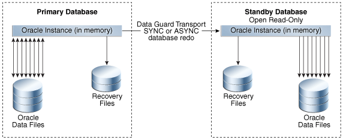
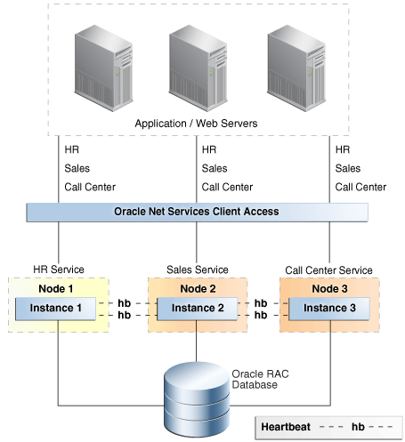

## 3 Features for Maximizing Availability

Familiarize yourself with the following Oracle Database high availability features used in MAA solutions.

### Oracle Data Guard

Oracle Data Guard ensures high availability, data protection, and disaster recovery for enterprise data.

Data Guard provides a comprehensive set of services that create, maintain, manage, and monitor one or more standby databases to enable Oracle databases to survive outages of any kind, including natural disasters and data corruptions. A Data Guard standby database is an exact replica of the production database and thus can be transparently utilized in combination with traditional backup, restoration, flashback, and cluster techniques to provide the highest possible level of data protection, data availability and disaster recovery. Data Guard is included in Oracle Enterprise Edition.

A Data Guard configuration consists of one primary database and one or more standby databases. A primary database can be either a single-instance Oracle database or an Oracle RAC database. Similar to a primary database, a standby database can be either a single-instance Oracle database or an Oracle RAC database. Using a backup copy of the primary database, you can create up to 30 standby databases that receive redo directly from the primary database. Optionally you can use a cascaded standby to create Data Guard configurations where the primary transmits redo to a single remote destination, and that destination forwards redo to multiple standby databases. This enables a primary database to efficiently synchronize many more than 30 standby databases if desired.

Note:

Oracle Active Data Guard is an extension of basic Data Guard providing advanced features that off-load various types of processing from a production database, extend zero data loss protection over any distance, and that enhance high availability. Oracle Active Data Guard is licensed separately from Oracle Database Enterprise Edition.

There are several types of standby databases. Data Guard physical standby database is the MAA best practice for data protection and disaster recovery and is the most common type of standby database used. A physical standby database uses Redo Apply (an extension of Oracle media recovery) to maintain an exact, physical replica of the production database. When configured using MAA best practices, Redo Apply uses multiple Oracle-aware validation checks to prevent corruptions that can impact a primary database from impacting the standby. Other types of Data Guard standby databases include: snapshot standby (a standby open read/write for test or other purposes) and logical standby (used to reduce planned downtime).

Benefits of Using Data Guard

- Continuous Oracle-aware validation of all changes using multiple checks for physical and logical consistency of structures within an Oracle data block and redo, before updates are applied to a standby database. This isolates the standby database and prevents it from being impacted by data corruptions that can occur on the primary system.
- Transparent operation: There are no restrictions on the use of Data Guard physical standby for data protection. Redo Apply supports all data and storage types, all DDL operations, and all applications (custom and packaged applications), and guarantees data consistency across primary and standby databases.
- Highest performance: Fast redo transport for best recovery point objective, fast apply performance for best recovery time objective. Multi-instance redo apply provides Oracle RAC scalability for redo apply, eliminating bottlenecks of a single database server. Redo apply can essentially scale up to available CPU, I/O, and network across your Oracle RAC cluster. An observed redo apply rate of 3500 MB per second (12 TB/hour) on 8 node RAC Exadata.
- Fast failover to a standby database to maintain availability should the primary database fail for any reason. Failover is either a manual or automatic operation depending on how Data Guard is configured.
- Integrated client notification framework to enable application clients to connect to a new primary database after a failover occurs.
- Automatic or automated (depending upon configuration) resynchronization of a failed primary database, quickly converting it to a synchronized standby database after a failover occurs.
- Choice of flexible data protection levels to support all network configurations, availability and performance SLAs, and business requirements.
- Management of a primary and all of its standby databases as a single configuration to simplify management and monitoring using either the Data Guard Broker command-line interface or Oracle Enterprise Manager Cloud Control.
- Data Guard Broker greatly improves manageability with additional features for comprehensive configuration health checks, resumable switchover operations, streamlined role transitions, support for cascaded standby configurations, and user-configurable thresholds for transport and apply lag to automatically monitor the ability of the configuration to support SLAs for recovery point and recovery time objectives at any instant in time.
- Efficient transport to multiple remote destinations using a single redo stream originating from the primary production database and forwarded by a cascading standby database.
- Snapshot Standby enables a physical standby database to be open read/write for testing or any activity that requires a read/write replica of production data. A snapshot standby continues to receive but does not apply updates generated by the primary. When testing is complete, a snapshot standby is converted back into a synchronized physical standby database by first discarding the changes made during the open read/write, and then applying the redo received from the primary database. Primary data is always protected. Snapshot standby is particularly useful when used in conjunction with Oracle Real Application Testing (workload is captured at the production database for replay and subsequent performance analysis at the standby database-an exact replica of production).
- Reduction of planned downtime by using a standby database to perform maintenance in a rolling manner. The only downtime is the time required to perform a Data Guard switchover; applications remain available while the maintenance is being performed.
- Increased flexibility for Data Guard configurations where the primary and standby systems may have different CPU architectures or operating systems subject to limitations defined in My Oracle Support note [413484.1](https://support.oracle.com/CSP/main/article?cmd=show&type=NOT&id=413484.1).
- Efficient disaster recovery for a container database (CDB). Data Guard failover and switchover completes using a single command at a CDB level regardless of how many pluggable databases (PDBs) are consolidated within the CDB.
- Enables a specific administration privilege, SYSDG, to handle standard administration duties for Data Guard. This new privilege is based on the least privilege principle, in which a user is granted only the necessary privileges required to perform a specific function and no more. The SYSDBA privilege continues to work as in previous releases.
- The Oracle Database In-Memory column store is supported on standby databases in an Active Data Guard environment.
- Further improves performance and availability of Data Warehouses in a Data Guard configuration by tracking information from `NOLOGGING` operations so they can be repaired with the new RMAN command `RECOVER DATABASE NOLOGGING`.
- Improves the impact multiple SYNC transport destinations have on the primary database through the use of a new parameter `DATA_GUARD_SYNC_LATENCY`. This parameter defines the maximum amount of time (in seconds) that the Primary database must wait before disconnecting subsequent destinations after at least one synchronous standby has acknowledged receipt of the redo.
- Data Guard Broker improves manageability by supporting destinations of different Endianess than the primary in addition to enhancing management of alternate destinations.
- Data Guard improves protection and Return To Operations (RTO) and Recovery Point Objectives (RPO) through multiple features including:
	- Multi-Instance Redo Apply (MIRA) provides scalable redo apply performance across Oracle RAC instances reducing RTO for even higher production OLTP or batch workloads
		- Compare primary and standby database blocks using the new `DBMS_DBCOMP` package to help identify lost writes so they can be resolved efficiently.
		- Fast Start Failover (FSFO) has the robustness of highly available zero data loss configurations with support for Maximum Protection mode while giving the flexibility of multiple observers and multiple failover targets for high availability in any configuration. FSFO can also be configured to automatically fail over to the standby with the detection of a lost write on the primary.
		- RPO is improved with no data loss failovers after a storage failure in ASYNC configurations and Data Guard Broker support for Application Continuity, improving the user experience during Data Guard role transitions.
- Oracle Data Guard Broker further improves the management of databases by supporting destinations of different endianness than the primary in addition to enhancing management of alternate archive destinations when the primary destination is unavailable.
- Oracle Data Guard Database Compare tool compares data blocks stored in an Oracle Data Guard primary database and its physical standby databases. Use this tool to find disk errors (such as lost write) that cannot be detected by other tools like the DBVERIFY utility. (new in Oracle Database 12c Release 2)
- Oracle Data Guard Broker supports multiple automatic failover targets in a fast-start failover configuration. Designating multiple failover targets significantly improves the likelihood that there is always a standby suitable for automatic failover when needed. (new in Oracle Database 12c Release 2)
- Dynamically change Oracle Data Guard Broker Fast-Start Failover target. The fast-start failover target standby database can be changed dynamically, to another standby database in the target list, without disabling fast-start failover. (new in Oracle Database 19c)
- Propagate restore points from primary to standby Site. Restore points created on the primary database are propagated to the standby sites, so that they are available even after a failover operation. (new in Oracle Database 19c)
- Oracle Data Guard automatic outage resolution can be tuned to fit your specific needs. Oracle Data Guard has an internal mechanism to detect hung processes and terminate them, allowing the normal outage resolution to occur. (new in Oracle Database 19c)
- Active Data Guard DML redirection helps load balancing between the primary and standby databases. Incidental Data Manipulation Language (DML) operations can be run on Active Data Guard standby databases. This allows more applications to benefit from using an Active Data Guard standby database when some writes are required. When incidental DML is issued on an Active Data Guard standby database, the update is passed to the primary database where it is processed. The resulting redo of the transaction updates the standby database after which control is returned to the application. (new in Oracle Database 19c)

#### Oracle Active Data Guard

Oracle Active Data Guard is Oracle's strategic solution for real time data protection and disaster recovery for the Oracle database using a physical replication process.

Oracle Active Data Guard also provides high return on investment in disaster recovery systems by enabling a standby database to be open read-only while it applies changes received from the primary database. Oracle Active Data Guard is a separately licensed product that provides advanced features that greatly expand Data Guard capabilities included with Oracle Enterprise Edition.

Figure 3-1 Oracle Active Data Guard Architecture



> The graphic shows a primary database on the left side and a standby database open read-only on the right side. Between the two databases is an arrow pointing from the primary to the standby with the label "Data Guard Transport SYNC or ASYNCH database redo."
>
> [  
> Copyright © 2005, 2026, Oracle and/or its affiliates.](https://docs.oracle.com/en/database/oracle/oracle-database/dcommon/html/cpyr.htm)


Oracle Active Data Guard enables administrators to improve performance by offloading processing from the primary database to a physical standby database that is open read-only while it applies updates received from the primary database. Offload capabilities of Oracle Active Data Guard include read-only reporting and ad-hoc queries (including DML to global temporary tables and unique global or session sequences), data extracts, fast incremental backups, redo transport compression, efficient servicing of multiple remote destinations, and the ability to extend zero data loss protection to a remote standby database without impacting primary database performance. Oracle Active Data Guard also increases high availability by performing automatic block repair and enabling High Availability Upgrades automation.

Note:

Oracle Active Data Guard is licensed separately as a database option license for Oracle Database Enterprise Edition. All Oracle Active Data Guard capabilities are also included in an Oracle Golden Gate license for Oracle Enterprise Edition. This provides customers with the choice of a standalone license for Oracle Active Data Guard, or licensing Oracle GoldenGate to acquire access to all advanced Oracle replication capabilities.

Benefits of Oracle Active Data Guard

Oracle Active Data Guard inherits all of the benefits previously listed for Data Guard, plus the following:

- Improves primary database performance: Production-offload to an Oracle Active Data Guard standby database of read-only applications, reporting, and ad hoc queries. Any application compatible with a read-only database can run on an Oracle Active Data Guard standby. Oracle also provides integration that enables the offloading of many Oracle E-Business Suite Reports, PeopleTools reporting, Oracle Business Intelligence Enterprise Edition (OBIEE), and Oracle TopLink applications to an Oracle Active Data Guard standby database.
- DML global temporary tables and the use of sequences at the standby database significantly expands the number of read-only applications that can be off-loaded from production databases to an Oracle Active Data Guard standby database.
- The unique ability to easily scale read performance using multiple Oracle Active Data Guard standby databases, also referred to as a Reader Farm.
- Production-offload of data extracts using Oracle Data Pump or other methods that read directly from the source database.
- Production-offload of the performance impact from network latency in a synchronous, zero data loss configuration where primary and standby databases are separated by hundreds or thousands of miles. Far sync uses a lightweight instance (control file and archive log files, but no recovery and no data files), deployed on a system independent of the primary database. The far sync instance is ideally located at the maximum distance from the primary system that an application can tolerate the performance impact of synchronous transport to provide optimal protection. Data Guard transmits redo synchronously to the far sync instance and far sync forwards the redo asynchronously to a remote standby database that is the ultimate failover target. If the primary database fails, the same failover command used for any Data Guard configuration, or mouse click using Oracle Enterprise Manager Cloud Control, or automatic failover using Data Guard Fast-Start Failover initiates a zero data loss failover to the remote destination. This transparently extends zero data loss protection to a remote standby database just as if it were receiving redo directly from the primary database, while avoiding the performance impact to the primary database of WAN network latency in a synchronous configuration.
- Production-offload of the overhead of servicing multiple remote standby destinations using far sync. In a far sync configuration, the primary database ships a single stream of redo to a far sync instance using synchronous or asynchronous transport. The far sync instance is able to forward redo asynchronously to as many as 29 remote destinations with zero incremental overhead on the source database.
- Data Guard maximum availability supports the use of the
	```
	NOAFFIRM
	```
	redo transport attribute. A standby database returns receipt acknowledgment to its primary database as soon as redo is received in memory. The standby database does not wait for the Remote File Server (RFS) to write to a standby redo log file.
	This feature provides increased primary database performance in Data Guard configurations using maximum availability and SYNC redo transport. Fast Sync isolates the primary database in a maximum availability configuration from any performance impact due to slow I/O at a standby database. This new FAST SYNC feature can work with a physical standby target or within a far sync configuration.
- Production-offload of CPU cycles required to perform redo transport compression. Redo transport compression can be performed by the far sync instance if the Data Guard configuration is licensed for Oracle Advanced Compression. This conserves bandwidth with zero incremental overhead on the primary database.
- Production-offload and increased backup performance by moving fast incremental backups off of the primary database and to the standby database by utilizing Oracle Active Data Guard support for RMAN block change tracking.
- Increased high availability using Oracle Active Data Guard automatic block repair to repair block corruptions, including file header corruptions, detected at either the primary or standby, transparent to applications and users.
- Increased high availability by reducing planned downtime for upgrading to new Oracle Database patch sets and database releases using the additional automation provided by high availability Upgrade.
- Connection preservation on an Active Data Guard standby through a role change facilitates improved reporting and improves the user experience. The connections pause while the database role changes to a primary database and resume, improving the user experience.
- The Oracle Enterprise Manager Diagnostic tool can be used with Active Data Guard to capture and send performance data to the Automatic Workload Repository, while the SQL Tuning Advisor allows primary database SQL statement tuning to be offloaded to a standby database.
- Active Data Guard support for the Oracle Database In-Memory option enables reporting to be offloaded to the standby database while reaping the benefits the In-Memory option provides, including tailored column stores for the standby database workload.

#### Oracle Data Guard Advantages Over Traditional Solutions

Oracle Data Guard provides a number of advantages over traditional solutions.

- Fast, automatic or automated database failover for data corruptions, lost writes, and database and site failures, with recovery times of potentially seconds with Data Guard as opposed to hours with traditional solutions
- Zero data loss over wide area network using Oracle Active Data Guard Far Sync
- Offload processing for redo transport compression and redo transmission to up to 29 remote destinations using Oracle Active Data Guard Far Sync
- Automatic corruption repair automatically replaces a physical block corruption on the primary or physical standby by copying a good block from a physical standby or primary database
- Most comprehensive protection against data corruptions and lost writes on the primary database
- Reduced downtime for storage, Oracle ASM, Oracle RAC, system migrations and some platform migrations, and changes using Data Guard switchover
- Reduced downtime for database upgrades with Data Guard rolling upgrade capabilities
- Ability to off-load primary database activities—such as backups, queries, or reporting—without sacrificing the RTO and RPO ability to use the standby database as a read-only resource using the real-time query apply lag capability, including Database In-Memory column support
- Ability to integrate non-database files using Oracle Database File System (DBFS) or Oracle Advanced Cluster File System (Oracle ACFS) as part of the full site failover operations
- No need for instance restart, storage remastering, or application reconnection after site failures
- Transparency to applications
- Transparent and integrated support (application continuity and transaction guard) for application failover
- Effective network utilization
- Database In-Memory support
- Integrated service and client failover that reduces overall application RTO
- Enhanced and integrated Data Guard awareness with existing Oracle technologies such as Oracle RAC, RMAN, Oracle GoldenGate, Enterprise Manager, health check (`orachk`), DBCA, and Fleet Patch and Provisioning

For data resident in Oracle databases, Data Guard, with its built-in zero-data-loss capability, is more efficient, less expensive, and better optimized for data protection and disaster recovery than traditional remote mirroring solutions. Data Guard provides a compelling set of technical and business reasons that justify its adoption as the disaster recovery and data protection technology of choice, over traditional remote mirroring solutions.

#### Data Guard and Planned Maintenance

Data Guard standby databases can be used to reduce planned downtime by performing maintenance in a rolling fashion. Changes are implemented first at the standby database. The configuration is allowed to run with the primary at the old version and standby at the new version until there is confidence that the new version is ready for production. A Data Guard switchover can be performed, transitioning production to the new version or same changes can be applied to production in a rolling fashion. The only possible database downtime is the time required to perform the switchover.

There are several approaches to performing maintenance in a rolling fashion using a Data Guard standby. Customer requirements and preferences determine which approach is used.

##### Data Guard Redo Apply and Standby-First Patching

Beginning with Oracle Database 10g, there has been increased flexibility in cross-platform support using Data Guard Redo Apply.

In certain Data Guard configurations, primary and standby databases are able to run on systems having different operating systems (for example, Windows and Linux), word size (32bit/64bit), different storage, different Exadata hardware and software versions, or different hardware architectures. Redo Apply can also be used to migrate to Oracle Automatic Storage Management (ASM), to move from single instance Oracle databases to Oracle RAC, to perform technology refresh, or to move from one data center to the next.

Beginning with Oracle Database 11g Release 2 (11.2), Standby-First Patch Apply (physical standby using Redo Apply) can support different database software patch levels between a primary database and its physical standby database for the purpose of applying and validating Oracle patches in a rolling fashion. Patches eligible for Standby-First patching include:

- Database Release Updates (RUs) or Release Update Revisions (RURs)
- Database Patch Set Update (PSU)
- Database Critical Patch Update (CPU)
- Database bundled patch

Standby-First Patch Apply is supported for certified database software patches for Oracle Database Enterprise Edition 11g Release 2 (11.2) and later.

In each of the types of planned maintenance previously described, the configuration begins with a primary and physical standby database (in the case of migration to a new platform, or to ASM or Oracle RAC, the standby is created on the new platform). After all changes are implemented at the physical standby database, Redo Apply (physical replication) is used to synchronize the standby with the primary. A Data Guard switchover is used to transfer production to the standby (the new environment).

See Also:

My Oracle Support Note [413484.1](https://support.oracle.com/CSP/main/article?cmd=show&type=NOT&id=413484.1) for information about mixed platform combinations supported in a Data Guard configuration.

My Oracle Support Note [1265700.1](https://support.oracle.com/CSP/main/article?cmd=show&type=NOT&id=1265700.1) for more information about Standby First Patch Apply and the README for each patch to determine if a target patch is certified as being a Standby-First Patch.

##### Data Guard Transient Logical Rolling Upgrades

There are numerous types of maintenance tasks that are unable to use Redo Apply (physical replication) to synchronize the original version of a database with the changed or upgraded version. These tasks include:

- Database patches or upgrades that are not Standby-First Patch Apply-eligible. This includes database patch-sets (11.2.0.2 to 11.2.0.4) and upgrade to new Oracle Database releases (18c to 19c).
- Maintenance must be performed that modifies the physical structure of a database that would require downtime (for example, adding partitioning to non-partitioned tables, changing Basicfile LOBs to Securefile LOBs, changing XML-CLOB to Binary XML, or altering a table to be OLTP-compressed).

All of the previous types of maintenance can be performed in a rolling fashion using a Data Guard standby database by using Data Guard SQL Apply (logical replication) to synchronize the old and new versions of the database. Prior to Oracle Database 11g this required creating a logical standby database, performing the maintenance on the logical standby, resynchronizing the standby with the primary, and then switching over. Additionally if a physical standby was being used for disaster recovery, then a new physical standby database would have to be created from a backup of the production database at the new version. This represented a number of logistical and cost challenges when upgrading a multi-terabyte database.

Beginning with Oracle Database 11g, database rolling upgrades can use a new procedure called Transient Logical that begins and ends with a physical standby database. SQL Apply is only used during the phase when Data Guard is synchronizing across old and new versions. A new logical standby database does not need to be created if there is already a physical standby in place. A new physical standby database does not need to be created from a backup of the production database at the new version after the maintenance is complete. Similar to the traditional process of upgrading a Data Guard configuration having an in-place physical standby, the original primary is upgraded or changed using redo from the new primary database and Redo Apply (a single catalog upgrade migrates both primary and standby databases to the new Oracle release).

Transient Logical upgrades require that the primary database be at Oracle Database 11g release 1 (11.1) or later and that the database meet the prerequisites of SQL Apply.

Oracle provides a Bourne shell script that automates a number of the manual steps required by the Transient Logical rolling upgrade process.

Databases that use Oracle Database Vault can be upgraded to new Oracle Database releases and patch sets by using Oracle Data Guard database rolling upgrades (transient logical standby only).

See Also:

[http://www.oracle.com/goto/maa](http://www.oracle.com/goto/maa) for Oracle MAA technical brief “Oracle Database Rolling Upgrades: Using a Data Guard Physical Standby Database”

##### Rolling Upgrade Using Oracle Active Data Guard

Rolling database upgrade using Oracle Active Data Guard provides a simpler, automated, and easily repeatable method for reducing planned downtime than represented by the manual Transient Logical rolling upgrade procedure.

Rolling upgrade using Oracle Active Data Guard transforms the 42 or more steps required by the manual procedure into several easy-to-use DBMS\_ROLLING PL/SQL packages. Rolling upgrades performed using the DBMS\_ROLLING PL/SQL package are supported on a multitenant container database (CDB).

A rolling upgrade using Oracle Active Data Guard:

- Generates an upgrade plan with a configuration-specific set of instructions to guide you through the upgrade process.
- Modifies parameters of the rolling upgrade.
- Configures primary and standby databases participating in the upgrade.
- Performs switchover of the production database to the new version. Switchover is the only downtime required.
- Completes the upgrade of the old primary and any additional standby databases in the Data Guard configuration and resynchronizes with the new primary.

Rolling upgrade using Oracle Active Data Guard has the following additional benefits:

- Provides a simple specify-compile-run protocol
	- Catches configuration errors at the compilation step
		- Runtime errors are detected during processing
- The state is kept in the database
	- Enables a reliable, repeatable process
- Runtime steps are constant regardless of how many databases are involved
- Handles failure at the original primary database
- Enables data protection for the upgraded primary at all times

See Also:

[http://www.oracle.com/goto/maa](http://www.oracle.com/goto/maa) for Oracle MAA technical brief “Oracle Database Rolling Upgrades: Using a Data Guard Physical Standby Database”

[Oracle Data Guard Concepts and Administration](https://docs.oracle.com/pls/topic/lookup?ctx=en/database/oracle/oracle-database/21/haovw&id=SBYDB5214)

### Oracle GoldenGate

Oracle GoldenGate is Oracle's strategic logical replication solution for data distribution and data integration.

Oracle GoldenGate offers a real-time, log-based change data capture and replication software platform. The software provides capture, routing, transformation, and delivery of transactional data across heterogeneous databases in real time.

Unlike replication solutions from other vendors, Oracle GoldenGate is more closely integrated with Oracle Database while also providing an open, modular architecture ideal for replication across heterogeneous database management systems. This combination of attributes eliminates compromise, making Oracle GoldenGate the preferred logical replication solution for addressing requirements that span Oracle Database and non-Oracle Database environments.

A typical environment includes a capture, pump, and delivery process. Each of these processes can run on most of the popular operating systems and databases, including Oracle Database. All or a portion of the data can be replicated, and the data within any of these processes can be manipulated for not only heterogeneous environments but also different database schemas, table names, or table structures. Oracle GoldenGate also supports bidirectional replication with preconfigured conflict detection and resolution handlers to aid in resolving data conflicts.

Oracle GoldenGate logical replication enables all databases in an Oracle GoldenGate configuration, both source and target databases, to be open read-write. This makes it a key component of MAA for addressing a broad range of high availability challenges for zero downtime maintenance, cross platform migration, and continuous data availability, specifically:

- Zero or near zero downtime maintenance. In this architecture, Oracle GoldenGate provides greater flexibility than the capabilities provided by Data Guard. Oracle GoldenGate source and target databases can have a different physical and logical structure, can reside on different hardware and operating system architectures, can span wide differences in Oracle Database releases (for example, 12.2 to 19c), or be a mix of Oracle and non-Oracle systems. This allows for the modernization of 24x7 servers and allows new Oracle features to be implemented without impacting the availability of the databases. Maintenance is first performed on a target database while production runs on the source. After the maintenance is complete, production can be moved to the source all at once, similar to a Data Guard switchover. Optionally, bidirectional replication can be used to gradually move users over to the new system to create the perception of zero downtime. In either case, Oracle GoldenGate replication can be enabled in the reverse direction to keep the original source database synchronized during a transition period, making it simple to effect a planned fall-back to the previous version if needed, with minimal downtime and no data loss.
- Zero or near-zero downtime migrations when a Data Guard solution is not applicable. Platform or database migrations can be carried out using Oracle GoldenGate as the data synchronization method between the old and new systems. Once the database has been instantiated on another host, Oracle GoldenGate is configured to replicate changes from the production database. A guaranteed restore point can be created on the migrated database so that after user testing the database can be flashed back, and Oracle GoldenGate can apply any outstanding data changes from the production database before moving the application users to the new database, similar to a snapshot standby database. If desired, bi-directional replication can also be configured from the migrated database back to the production database for use as a fallback solution.
- Zero or near-zero downtime application upgrades. Application upgrades that modify back-end database objects typically result in significant planned downtime while maintenance is being performed. Oracle GoldenGate replication enables data transformations that map database objects used by a previous version of an application to objects modified by the new version of an application. This enables database maintenance to be performed on a separate copy of the production database without impacting the availability of the application. After the maintenance is complete and Oracle GoldenGate has finished synchronizing old and new versions, users can be switched to the new version of the application.
- Read-write access to a replica database while it is being synchronized with its source database. This is most often used to offload reporting to a copy of a production database when the reporting application requires a read-write connection to database in order to function. This is also relevant to disaster recovery environments where the nature of the technology used for the application tier requires an active read-write connection to the DR database at all times in order to meet recovery time objectives.
- Active-Active replication. Oracle GoldenGate supports an active-active multi-directional configuration, where there are two or more systems with identical sets of data that can be changed by application users on either system. Oracle GoldenGate replicates transactional data changes from each database to the others to keep all sets of data current.
- Seamless moves between Oracle Real Application Clusters (RAC) nodes in the event of database instance failure or during applicable maintenance operations. This ability provides high availability with Oracle GoldenGate and it is possible to patch and upgrade the Oracle GoldenGate software on one or more nodes in the cluster without affecting the node where Oracle GoldenGate is currently running. Then at a predetermined time, Oracle GoldenGate can be switched to one of the upgraded nodes. The switch is done without reconfiguring Oracle GoldenGate because configuration information is shared across the Oracle RAC cluster.

See Also:

[Oracle GoldenGate Documentation](https://docs.oracle.com/en/middleware/goldengate/index.html)

[http://www.oracle.com/goto/maa](https://www.oracle.com/goto/maa) for Oracle MAA Oracle GoldenGate technical briefs

### Best Practice: Oracle Active Data Guard and Oracle GoldenGate

While Oracle Active Data Guard and Oracle GoldenGate are each capable of maintaining a synchronized copy of an Oracle database, each has unique characteristics that result in high availability architectures that can use one technology or the other, or both at the same time, depending upon requirements.

Examples of MAA Best Practice guidelines are as follows:

#### When to Use Oracle Active Data Guard

Use Oracle Active Data Guard when the emphasis is on simplicity, data protection, and availability.

- Simplest, fastest, one-way replication of a complete Oracle database.
- No restrictions: Data Guard Redo Apply supports all data and storage types and Oracle features; transparent replication of DDL
- Features optimized for data protection: Detects silent corruptions that can occur on source or target; automatically repairs corrupt blocks
- Synchronized standby open read-only provides simple read-only offloading for maximum ROI
- Transparency of backups: A Data Guard primary and standby are physically exact copies of each other; RMAN backups are completely interchangeable
- Zero data loss protection at any distance, without impacting database performance
- Minimizing planned downtime and risk using standby first patching, database rolling upgrades, and select platform migrations
- Reduce risk of introducing change by dual purposing a DR system for testing using Data Guard Snapshot Standby
- Integrated automatic database and client failover
- Integrated management of a complete configuration: Data Guard Broker command line interface or Oracle Enterprise Manager Cloud Control

#### When to Use Oracle GoldenGate

Use Oracle GoldenGate when the emphasis is on advanced replication requirements not addressed by Oracle Active Data Guard.

- Any requirement where the replica database must be open read/write while synchronizing with the primary database
- Any data replication requirements such as multimaster and bidirectional replication, subset replication, many-to-one replication, and data transformations.
- When data replication is required between endian format platforms or across-database major versions.
- Maintenance and migrations where zero downtime or near zero downtime is required. Oracle GoldenGate can be used to migrate between application versions, for example, from Application 1.0 to Application 2.0 without downtime.
- Database rolling upgrades where it is desired to replicate from new version down to the old version for the purpose of fast fall-back if something is wrong with the upgrade.
- Zero downtime planned maintenance where bidirectional replication is used to gradually migrate users to the new version, creating the perception of zero downtime. Note that bidirectional replication requires avoiding or resolving update conflicts that can occur on disparate databases.

#### When to Use Oracle Active Data Guard and Oracle GoldenGate Together

Oracle Active Data Guard and Oracle GoldenGate are not mutually exclusive. The following are use cases of high availability architectures that include the simultaneous use of Oracle Active Data Guard and Oracle GoldenGate.

- An Oracle Active Data Guard standby is utilized for disaster protection and database rolling upgrades for a mission critical OLTP database. At the same time, Oracle GoldenGate is used to replicate data from the Data Guard primary database (or from the standby database using Oracle GoldenGate ALO mode) for ETL update of an enterprise data warehouse.
- Oracle GoldenGate subset replication is used to create an operational data store (ODS) that extracts, transforms, and aggregates data from numerous data sources. The ODS supports mission critical application systems that generate significant revenue for the company. An Oracle Active Data Guard standby database is used to protect the ODS, providing optimal data protection and availability.
- Oracle GoldenGate bidirectional replication is utilized to synchronize two databases separated by thousands of miles. User workload is distributed across each database based upon geography, workload, and service level using Global Data Services (GDS). Each Oracle GoldenGate copy has its own local synchronous Data Guard standby database that enables zero data loss failover if an outage occurs. Oracle GoldenGate capture and apply processes are easily restarted on the new primary database following a failover because the primary and standby are an exact, up-to-date replica of each other.
- An Oracle Active Data Guard standby database used for disaster protection is temporarily converted into an Oracle GoldenGate target for the purpose of performing planned maintenance not supported by Data Guard. For example, a Siebel application upgrade requiring modification of back-end database objects which require comprehensive testing before switching users over to the new system.
- Oracle Active Data Guard is used to protect a production environment when a major database version upgrade is required offering zero or near-zero downtime (for example, Oracle 18c to 19c.) A second primary/standby environment is created using the new database version, and Oracle GoldenGate is used to replicate data from the production environment to the copy with one-way or bidirectional replication. When Oracle GoldenGate has completed synchronizing the old and new environments, production is switched to the new environment and the old environment is decommissioned. This provides zero or minimal downtime depending upon configuration, eliminates risk by providing complete isolation between the old and new environment, and avoids any impact to data protection and availability SLAs if problems are encountered during the upgrade process.

See Also:

[http://www.oracle.com/goto/maa](http://www.oracle.com/goto/maa) for Oracle MAA Best Practices technical brief ““Transparent Role Transitions With Oracle Data Guard and Oracle GoldenGate"

### Recovery Manager

Recovery Manager (RMAN) provides a comprehensive foundation for efficiently backing up and recovering the database. RMAN eliminates operational complexity while providing superior performance and availability of the database.

RMAN determines the most efficient method of running the requested backup, restoration, or recovery operation and then submits these operations to the Oracle Database server for processing. RMAN and the server automatically identify modifications to the structure of the database and dynamically adjust the required operation to adapt to the changes.

RMAN is the standard interface to backup and restore from Recovery Appliance, local disk (ZFS storage), tape, and cloud object store.

RMAN provides the following benefits:

- Support for Oracle Sharding - RMAN support for every independent database (shard)
- Enhancement for Sparse Databases - allows backup and restore to operate on
	```
	SPARSE
	```
	backup sets and or image copies
- Over the Network Standby Database repair of
	```
	NONLOGGED
	```
	operation - new syntax for validation and repair on Standby -
	```
	VALIDATE/RECOVER .. NONLOGGED BLOCK;
	```
- ```
	RMAN DUPLICATE
	```
	feature enhanced to support creation of Far Sync from Primary and backup
- ```
	RMAN DUPLICATE
	```
	Using Encrypted Backups - RMAN enhanced support non Auto-login wallet based encrypted backups with a new
	```
	SET
	```
	command - enables interrupt-free cloning
- Support for cross-platform backup and restore over the network
- Network-enabled restoration allows the
	```
	RESTORE
	```
	operations to copy data files directly from one database to another over the network
- Simplified table restoration with the
	```
	RECOVER TABLE
	```
	command
- Support for Oracle Multitenant, including backup and recovery of individual pluggable databases
- Support for cross-platform Oracle Multitenant, including backup and recovery of individual PDBs
- Automatic channel failover on backup and restore operations
- Automatic failover to a previous backup when the restore operation discovers a missing or corrupt backup
- Automatic creation of new database files and temporary files during recovery
- Automatic recovery through a previous point-in-time recovery—recovery through reset logs
- Block media recovery, which enables the data file to remain online while fixing the block corruption
- Fast incremental backups using block change tracking
- Fast backup and restore operations with intrafile and interfile parallelism
- Enhanced security with a virtual private recovery catalog
- Merger of incremental backups into image copies, providing up-to-date recoverability
- Optimized backup and restoration of required files only
- Retention policy to ensure that relevant backups are retained
- Ability to resume backup and restore operations in case of failure
- Automatic backup of the control file and the server parameter file, ensuring that backup metadata is available in times of database structural changes and media failure and disasters
- Easily reinstantiate a new database from an existing backup or directly from the production database (thus eliminating staging areas) using the
	```
	DUPLICATE
	```
	command.

See Also:

[Oracle Database Backup and Recovery User’s Guide](https://docs.oracle.com/pls/topic/lookup?ctx=en/database/oracle/oracle-database/21/haovw&id=BRADV8001)

### Oracle Real Application Clusters and Oracle Clusterware

Oracle RAC and Oracle Clusterware enable Oracle Database to run any packaged or custom application across a set of clustered servers.

This capability provides the highest levels of availability and the most flexible scalability. If a clustered server fails, then Oracle Database continues running on the surviving servers. When more processing power is needed, you can add another server without interrupting access to data.

Oracle RAC enables multiple instances that are linked by an interconnect to share access to an Oracle database. In an Oracle RAC environment, Oracle Database runs on two or more systems in a cluster while concurrently accessing a single shared database. The result is a single database system that spans multiple hardware systems, enabling Oracle RAC to provide high availability and redundancy during failures in the cluster. Oracle RAC accommodates all system types, from read-only data warehouse systems to update-intensive online transaction processing (OLTP) systems.

Oracle Clusterware is software that, when installed on servers running the same operating system, enables the servers to be bound together to operate as if they are one server, and manages the availability of user applications and Oracle databases. Oracle Clusterware also provides all of the features required for cluster management, including node membership, group services, global resource management, and high availability functions:

- For high availability, you can place Oracle databases (single-instance or Oracle RAC databases), and user applications (Oracle and non-Oracle) under the management and protection of Oracle Clusterware so that the databases and applications restart when a process fails or so that a failover to another node occurs after a node failure.
- For cluster management, Oracle Clusterware presents multiple independent servers as if they are a single-system image or one virtual server. This single virtual server is preserved across the cluster for all management operations, enabling administrators to perform installations, configurations, backups, upgrades, and monitoring functions. Then, Oracle Clusterware automatically distributes the processing of these management functions to the appropriate nodes in the cluster.

Oracle Clusterware is a requirement for using Oracle RAC. Oracle Clusterware is the only clusterware that you need for most platforms on which Oracle RAC operates. Although Oracle Database continues to support third-party clusterware products on specified platforms, using Oracle Clusterware provides these main benefits:

- Dispenses with proprietary vendor clusterware
- Uses an integrated software stack from Oracle that provides disk management with local or remote Oracle Automatic Storage Management (Oracle Flex ASM) to data management with Oracle Database and Oracle RAC
- Can be configured in large clusters, called an Oracle Flex Cluster.

In addition, Oracle Database features, such as Oracle services, use the underlying Oracle Clusterware mechanisms to provide their capabilities.

Oracle Clusterware requires two clusterware components: a voting disk to record node membership information and the Oracle Cluster Registry (OCR) to record cluster configuration information. The voting disk and the OCR must reside on shared storage. Oracle Clusterware requires that each node be connected to a private network over a private interconnect.

#### Benefits of Using Oracle Clusterware

Oracle Clusterware provides the following benefits.

- Tolerates and quickly recovers from computer and instance failures.
- Simplifies management and support by means of using Oracle Clusterware together with Oracle Database. By using fewer vendors and an all Oracle stack you gain better integration compared to using third-party clusterware.
- Performs rolling upgrades for system and hardware changes. For example, you can apply Oracle Clusterware upgrades, patch sets, and interim patches in a rolling fashion.
	When you upgrade to Oracle Database 12c, Oracle Clusterware and Oracle ASM binaries are installed as a single binary called the Oracle Grid Infrastructure. You can upgrade Oracle Clusterware in a rolling manner from Oracle Clusterware 10g and Oracle Clusterware 11g; however, you can only upgrade Oracle ASM in a rolling manner from Oracle Database 11g release 1 (11.1).
- Automatically restarts failed Oracle processes.
- Automatically manages the virtual IP (VIP) address. When a node fails, the node's VIP address fails over to another node on which the VIP address can accept connections.
- Automatically restarts resources from failed nodes on surviving nodes.
- Controls Oracle processes as follows:
	- For Oracle RAC databases, Oracle Clusterware controls all Oracle processes by default.
		- For Oracle single-instance databases, Oracle Clusterware enables you to configure the Oracle processes into a resource group that is under the control of Oracle Clusterware.
- Provides an application programming interface (API) for Oracle and non-Oracle applications that enables you to control other Oracle processes with Oracle Clusterware, such as restart or react to failures and certain rules.
- Manages node membership and prevents split-brain syndrome in which two or more instances attempt to control the database.
- Using server weight-based node eviction allows for aligning the choice of which node gets evicted in case of certain failures in the cluster with business requirements, ensuring that the most important workload is kept alive for as long as possible, assuming an equal choice between servers.
- Provides the ability to perform rolling release upgrades of Oracle Clusterware, with no downtime for applications.

#### Benefits of Using Oracle Real Application Clusters and Oracle Clusterware

Together, Oracle RAC and Oracle Clusterware provide all of the Oracle Clusterware benefits plus the following benefits.

- Provides better integration and support of Oracle Database by using an all Oracle software stack compared to using third-party clusterware.
- Relocate Oracle Service automatically. Plus, when you perform additional fast application notification (FAN) and client configuration, distribute FAN events so that applications can react immediately to achieve fast, automatic, and intelligent connection and failover.
- Detect connection failures fast and automatically, and remove terminated connections for any Java application using Oracle Universal Connection Pool (Oracle UCP) Fast Connection Failover and FAN events.
- Balance work requests using Oracle UCP runtime connection load balancing.
- Use runtime connection load balancing with Oracle UCP, Oracle Call Interface (OCI), and Oracle Data Provider for.NET (ODP.NET).
- Distribute work across all available instances using load balancing advisory.
- You can configure a database so that Oracle Clusterware is aware of the CPU requirements and limits for the given database. Oracle Clusterware uses this information to place the database resource only on servers that have a sufficient number of CPUs, amount of memory, or both.
- Allow the flexibility to increase processing capacity using commodity hardware without downtime or changes to the application.
- Provide comprehensive manageability integrating database and cluster features.
- Provide scalability across database instances.
- Implement Fast Connection Failover for nonpooled connections.

#### Oracle RAC Advantages Over Traditional Cold Cluster Solutions

Oracle RAC provides many advantages over traditional cold cluster solutions, including the following.

- Scalability across database instances
- Flexibility to increase processing capacity using commodity hardware without downtime or changes to the application
- Ability to tolerate and quickly recover from computer and instance failures (measured in seconds)
- Application brownout can be zero or seconds compared to minutes and hours with cold cluster solutions
- Optimized communication in the cluster over redundant network interfaces, without using bonding or other technologies
	Oracle Grid Infrastructure and Oracle RAC make use of Redundant Interconnect Usage that distributes network traffic and ensures optimal communication in the cluster. This functionality is available starting with Oracle Database 11g Release 2 (11.2.0.2). In previous releases, technologies like bonding or trunking were used to make use of redundant networks for the interconnect.
- Rolling upgrades for system and hardware changes
- Rolling patch upgrades for some interim patches, security patches, CPUs, and cluster software
- Fast, automatic, and intelligent connection and service relocation and failover
- Comprehensive manageability integrating database and cluster features with Grid Plug and Play and policy-based cluster and capacity management
- Load balancing advisory and run-time connection load balancing help redirect and balance work across the appropriate resources
- Oracle Quality of Service (QoS) Management for policy-based run-time management of resource allocation to database workloads to ensure service levels are met in order of business need under dynamic conditions. This is accomplished by assigning a service to a server pool where the database is running. Resources from the pool are used to make sure the required capacity is available.
- Oracle Enterprise Management support for Oracle Automatic Storage Management (ASM) and Oracle Advanced Cluster File System (ACFS), Grid Plug and Play, Cluster Resource Management, Oracle Clusterware and Oracle RAC Provisioning and patching.
- SCAN (Single Client Access Name) support as a single name to the clients connecting to Oracle RAC that does not change throughout the life of the cluster, even if you add or remove nodes from the cluster.

The following figure shows Oracle Database with Oracle RAC architecture. This figure shows Oracle Database with Oracle RAC architecture for a partitioned three-node database. An Oracle RAC database is connected to three instances on different nodes. Each instance is associated with a service: HR, Sales, and Call Center. The instances monitor each other by checking "heartbeats." Oracle Net Services provide client access to the Application/web server tier at the top of the figure.

Figure 3-2 Oracle Database with Oracle RAC Architecture



> This figure shows Oracle Database with Oracle RAC architecture for a partitioned three-node database. An Oracle RAC database is connected to three instances on different nodes. Each instance is associated with a service: HR, Sales, and Call Center. The instances monitor each other by checking "heartbeats." Oracle Net Services provide client access to the Application/web server tier at the top of the figure.


Note:

After Oracle release 11.2, Oracle RAC One Node or Oracle RAC is the preferred solution over Oracle Clusterware (Cold Cluster Failover) because it is a more complete and feature-rich solution.

See Also:

[Oracle RAC Administration and Deployment Guide](https://docs.oracle.com/pls/topic/lookup?ctx=en/database/oracle/oracle-database/21/haovw&id=RACAD-GUID-5A1B02A2-A327-42DD-A1AD-20610B2A9D92)

[Oracle Clusterware Administration and Deployment Guide](https://docs.oracle.com/pls/topic/lookup?ctx=en/database/oracle/oracle-database/21/haovw&id=CWADD-GUID-58F85575-7D88-4D45-B097-6274FBBBB646)

### Oracle RAC One Node

Oracle Real Application Clusters One Node (Oracle RAC One Node) is a single instance of an Oracle RAC database that runs on one node in a cluster.

This feature enables you to consolidate many databases into one cluster with minimal overhead, protecting them from both planned and unplanned downtime. The consolidated databases reap the high availability benefits of failover protection, online rolling patch application, and rolling upgrades for the operating system and Oracle Clusterware.

Oracle RAC One Node enables better availability than cold failover for single-instance databases because of the Oracle technology called online database relocation, which intelligently migrates database instances and connections to other cluster nodes for high availability and load balancing. Online database relocation is performed using the Server Control Utility (SRVCTL).

Oracle RAC One Node provides the following:

- Always available single-instance database services
- Built-in cluster failover for high availability
- Live migration of instances across servers
- Online rolling patches and rolling upgrades for single-instance databases
- Online upgrade from single-instance to multiple-instance Oracle RAC
- Better consolidation for database servers
- Enhanced server virtualization
- Lower cost development and test platform for full Oracle RAC
- Relocation of Oracle RAC primary and standby databases configured with Data Guard. This functionality is available starting with Oracle Database 11g Release 2 (11.2.0.2).

Oracle RAC One Node also facilitates the consolidation of database storage, standardizes your database environment, and, when necessary, enables you to transition to a full, multiple-instance Oracle RAC database without downtime or disruption.

### Oracle Automatic Storage Management

Oracle Automatic Storage Management (Oracle ASM) provides a vertically integrated file system and volume manager directly in the Oracle Database kernel.

This design provides several benefits, resulting in:

- Significantly less work to provision database storage
- Higher level of availability
- Elimination of the expense, installation, and maintenance of specialized storage products
- Unique capabilities for database applications

For optimal performance, Oracle ASM spreads files across all available storage. To protect against data loss, Oracle ASM extends the concept of SAME (stripe and mirror everything) and adds more flexibility because it can mirror at the database file level rather than at the entire disk level.

More important, Oracle ASM simplifies the processes of setting up mirroring, adding disks, and removing disks. Instead of managing hundreds or possibly thousands of files (as in a large data warehouse), database administrators using Oracle ASM create and administer a larger-grained object called a disk group. The disk group identifies the set of disks that are managed as a logical unit. Automation of file naming and placement of the underlying database files save administrators time and ensure adherence to standard best practices.

The Oracle ASM native mirroring mechanism (two-way or three-way) protects against storage failures. With Oracle ASM mirroring, you can provide an additional level of data protection with the use of failure groups. A failure group is a set of disks sharing a common resource (disk controller or an entire disk array) whose failure can be tolerated. After it is defined, an Oracle ASM failure group intelligently places redundant copies of the data in separate failure groups. This ensures that the data is available and transparently protected against the failure of any component in the storage subsystem.

By using Oracle ASM, you can:

- Mirror and stripe across drives and storage arrays.
- Automatically remirror from a failed drive to remaining drives.
- Automatically rebalance stored data when disks are added or removed while the database remains online.
- Support Oracle database files and non-database files using Oracle Advanced Cluster File System (Oracle ACFS).
- Allow for operational simplicity in managing database storage.
- Manage the Oracle Cluster Registry (OCR) and voting disks.
- Provide preferred read capability on disks that are local to the instance, which gives better performance for an extended cluster.
- Support very large databases.
- Support Oracle ASM rolling upgrades.
- Improve availability and reliability using the Oracle ASM disk scrubbing process to find and repair logical data corruptions using mirror disks.
- Support finer granularity in tuning and security.
- Provide fast repair after a temporary disk failure through Oracle ASM Fast Mirror Resync and automatic repair of block corruptions if a good copy exists in one of the mirrors.
- Provide disaster recovery capability for the file system by enabling replication of Oracle ACFS across the network to a remote site.
- Patch the Oracle ASM instance without impacting the clients that are being serviced using Oracle Flex ASM. A database instance can be directed to access Oracle ASM metadata from another location while the current Oracle ASM instance it is connected to is taken offline for planned maintenance.
- Monitor and manage the speed and status of Oracle ASM Disk Resync and Rebalance operations.
- Bring online multiple disks simultaneously and manage performance better by controlling resync parallelism using the Oracle ASM Resync Power Limit. Recover faster after a cell or disk failure, and the instance doing the resync is failing; this is made possible by using a Disk Resync Checkpoint which enables a resync to resume from where it was interrupted or stopped instead of starting from the beginning.
- Automatically connect database instances to another Oracle ASM instance using Oracle Flex ASM. The local database instance can still access the required metadata and data if an Oracle ASM instance fails due to an unplanned outage.
- Use flex diskgroups to prioritize high availability benefits across multiple databases all using the same diskgroup. Some of the key HA benefits are file extent redundancy, rebalance power limit, and rebalance priority. With flex diskgroups, you can set different values for the above features for different databases, resulting in prioritization across multiple databases within one diskgroup.
- Use flex diskgroups to implement quoto\_groups across multiple databases sharing one diskgroup which helps in space management and protection.
- Use flex diskgroups to create point-in-time database clones using the ASM split mirror feature.
- Use preferred reads with stretch clusters to improve performance by affinitizing reads to a site.

See Also:

[Oracle Automatic Storage Management Administrator's Guide](https://docs.oracle.com/pls/topic/lookup?ctx=en/database/oracle/oracle-database/21/haovw&id=OSTMG30000)

### Fast Recovery Area

The fast recovery area is a unified storage location for all recovery-related files and activities in Oracle Database.

After this feature is enabled, all RMAN backups, archived redo log files, control file autobackups, flashback logs, and data file copies are automatically written to a specified file system or Oracle ASM disk group, and the management of this disk space is handled by RMAN and the database server.

Performing a backup to disk is faster because using the fast recovery area eliminates the bottleneck of writing to tape. More important, if database media recovery is required, then data file backups are readily available. Restoration and recovery time is reduced because you do not need to find a tape and a free tape device to restore the needed data files and archived redo log files.

The fast recovery area provides the following benefits:

- Unified storage location of related recovery files
- Management of the disk space allocated for recovery files, which simplifies database administration tasks
- Fast, reliable, disk-based backup and restoration

See Also:

[Oracle Database Backup and Recovery User’s Guide](https://docs.oracle.com/pls/topic/lookup?ctx=en/database/oracle/oracle-database/21/haovw&id=BRADV89418)

### Corruption Prevention, Detection, and Repair

Data block corruptions can be very disruptive and challenging to repair. Corruptions can cause serious application and database downtime and data loss when encountered and worse yet it can go undetected for hours, days and even weeks leading to even longer application downtime once detected.Unfortunately, there is not one way to comprehensively prevent, detect, and repair data corruptions within the database because the source and cause of corruptions can be anywhere in memory, hardware, firmware, storage, operating system, software, or user error. Worse yet, third-party solutions that do not understand Oracle data block semantics and how Oracle changes data blocks do not prevent and detect data block corruptions well. Third party remote mirroring technologies can propagate data corruptions to the database replica (standby) leading to a double failure, data loss, and much longer downtime. Third party backup and restore solutions cannot detect corrupted backups or bad sectors until a restore or validate operation is issued, resulting in longer restore times and once again potential data loss.

Oracle MAA has a comprehensive plan to prevent, detect, and repair all forms of data block corruptions including physical block corruptions, logical block corruptions, stray writes, and lost writes. These additional safeguards provide the most comprehensive Oracle data block corruption prevention, detection, and repair solution. Details of this plan are described in the My Oracle Support note "Best Practices for Corruption Detection, Prevention, and Automatic Repair - in a Data Guard Configuration (Doc ID 1302539.1)."

The following outlines block corruption checks for various manual operational checks and runtime and background corruption checks. Database administrators and the operations team can incorporate manual checks such as running Oracle Recovery Manager (RMAN) backups, RMAN "check logical" validations, or running the `ANALYZE VALIDATE                 STRUCTURE` command on important objects. Manual checks are especially important to validate data that are rarely updated or queried.

Runtime checks are far superior in that they catch corruptions almost immediately or during runtime for actively queried and updated data. Runtime checks can prevent corruptions or automatically fix corruptions resulting in better data protection and higher application availability. A new background check has been introduced in Exadata to automatically scan and scrub disks intelligently with no application overhead and to automatically fix physically corrupted blocks.

Table 3-1 Summary of Block Corruption Checks

| Checks | Capabilities | Physical Block Corruption | Logical Block Corruption |
| --- | --- | --- | --- |
| Manual checks | Dbverify, Analyze | Physical block checks | Logical intra-block and inter-object consistency checks |
| Manual checks | RMAN | Physical block checks during backup and restore operations | Intra-block logical checks |
| Manual checks | ASM Scrub | Physical block checks | Some logical intra-block checks |
| Runtime checks | Oracle Active Data Guard | 1\. Continuous physical block checking at standby during transport and apply  2\. Strong database isolation eliminates single point database failure  3\. Automatic repair of block corruptions, including file block headers in Oracle Database 12c Release 2  4\. Automatic database failover | 1\. With `DB_LOST_WRITE_PROTECT ` enabled, detection of lost writes (11.2 and higher). With 11.2.0.4 and Data Guard broker, ability to shutdown the primary when lost writes are detected on the primary database.  2\. With `DB_BLOCK_CHECKING` enabled on the standby, additional intra-block logical checks |
| Runtime checks | Database | With `DB_BLOCK_CHECKSUM,` in-memory data block and redo checksum validation | With `DB_BLOCK_CHECKING,` in-memory intra-block check validation  Starting in Oracle Database 18c, and with Shadow Lost Write Protection enabled, Oracle tracks system change numbers (SCNs) for tracked data files and enables early lost write detection. When lost writes are detected, an error is returned immediately.  See Shadow Lost Write Protection description following this table. |
| Runtime checks | ASM and ASM software mirroring  (inherent in Exadata, Supercluster, and Zero Data Loss Recovery Appliance) | Implicit data corruption detection for reads and writes and automatic repair if good ASM extent block pair is available during writes | . |
| Runtime checks | DIX + T10 DIF | Checksum validation from operating system to HBA controller to disk (firmware). Validation for reads and writes for certified Linux, HBA and disks. | . |
| Runtime checks | Hardware and Storage | Limited checks due to lack of Oracle integration. Checksum is most common. | Limited checks due to lack of Oracle integration. Checksum is most common |
| Runtime checks | Exadata | Comprehensive HARD checks on writes | HARD checks on writes |
| Background checks | Exadata | Automatic HARD disk scrub and repair. Detects and fixes bad sectors. | . |

Shadow Lost Write Protection

New in Oracle Database 18c, shadow lost write protection detects a lost write before it can result in a major data corruption. You can enable shadow lost write protection for a database, a tablespace, or a data file without requiring an Oracle Data Guard standby database. Shadow lost write protection provides fast detection and immediate response to a lost write, thus minimizing the data loss that can occur in a database due to data corruption.

See Also:

[Oracle Database Reference](https://docs.oracle.com/pls/topic/lookup?ctx=en/database/oracle/oracle-database/21/haovw&id=REFRN-GUID-6F1C3203-0AA0-4AF1-921C-A027DD7CB6A9) for more information about the views and initialization parameters

My Oracle Support Note [1302539.1](https://support.oracle.com/CSP/main/article?cmd=show&type=NOT&id=1302539.1)

### Data Recovery Advisor

Data Recovery Advisor automatically diagnoses persistent (on-disk) data failures, presents appropriate repair options, and runs repair operations at your request.

You can use Data Recovery Advisor to troubleshoot primary databases, logical standby databases, physical standby databases, and snapshot standby databases.

Data Recovery Advisor includes the following functionality:

- Failure diagnosis
	The first symptoms of database failure are usually error messages, alarms, trace files and dumps, and failed health checks. Assessing these symptoms can be complicated, error-prone, and time-consuming. Data Recovery Advisor automatically diagnoses data failures and informs you about them.
- Failure impact assessment
	After a failure is diagnosed, you must understand its extent and assess its impact on applications before devising a repair strategy. Data Recovery Advisor automatically assesses the impact of a failure and displays it in an easily understood format.
- Repair generation
	Even if a failure was diagnosed correctly, selecting the correct repair strategy can be error-prone and stressful. Moreover, there is often a high penalty for making poor decisions in terms of increased downtime and loss of data. Data Recovery Advisor automatically determines the best repair for a set of failures and presents it to you.
- Repair feasibility checks
	Before presenting repair options, Data Recovery Advisor validates them with respect to the specific environment and availability of media components required to complete the proposed repair, including restoring files directly from the primary or standby database to complete the proposed repair.
- Repair automation
	If you accept the suggested repair option, Data Recovery Advisor automatically performs the repair, verifies that the repair was successful, and closes the appropriate failures.
- Validation of data consistency and database recoverability
	Data Recovery Advisor can validate the consistency of your data, and backups and redo stream, whenever you choose.
- Early detection of corruption
	Through Health Monitor, you can schedule periodic runs of Data Recovery Advisor diagnostic checks to detect data failures before a database process running a transaction discovers the corruption and signals an error. Early warnings can limit the damage caused by corruption.
- Integration of data validation and repair
	Data Recovery Advisor is a single tool for data validation and repair.

Note:

Data Recovery Advisor only supports single-instance databases. Oracle RAC databases are not supported.

See Also:

[Oracle Database Backup and Recovery User’s Guide](https://docs.oracle.com/pls/topic/lookup?ctx=en/database/oracle/oracle-database/21/haovw&id=BRADV246) for information about Data Recovery Advisor supported database configurations.

### Oracle Flashback Technology

Oracle Flashback technology is a group of Oracle Database features that let you view past states of database, database objects, transactions or rows or to rewind the database, database objects, transactions or rows to a previous state without using point-in-time media recovery.

With flashback features, you can:

- Perform queries to show data as it looked at a previous point in time
- Perform queries that return metadata that shows a detailed history of changes to the database
- Recover tables or rows to a previous point in time
- Automatically track and archive transactional data changes
- Roll back a transaction and its dependent transactions while the database remains online
- Undrop a table
- Recover a database to a point-in-time without a restore operation

Other than the flashback database feature, most Oracle Flashback features use the Automatic Undo Management (AUM) system to obtain metadata and historical data for transactions. They rely on undo data, which are records of the effects of individual transactions. For example, if a user runs an UPDATE statement to change a salary from 1000 to 1100, then Oracle Database stores the value 1000 in the undo data.

Undo data is persistent and survives a database shutdown. By using flashback features, you can use undo data to query past data or recover from logical damage. Besides using it in flashback features, Oracle Database uses undo data to perform these actions:

- Roll back active transactions
- Recover terminated transactions by using database or process recovery
- Provide read consistency for SQL queries

Oracle Flashback can address and rewind data that is compromised due to various human or operator errors that inadvertently or maliciously change data, cause bad installations and upgrades, and result in logical errors in applications. These problems use features such as flashback transaction, flashback drop, flashback table, and flashback database.

See Also:

[Oracle Database Development Guide](https://docs.oracle.com/pls/topic/lookup?ctx=en/database/oracle/oracle-database/21/haovw&id=ADFNS01011)

[Performing Flashback and Database Point-in-Time Recovery](https://docs.oracle.com/pls/topic/lookup?ctx=en/database/oracle/oracle-database/21/haovw&id=BRADV-GUID-5463669A-DC89-4FF4-ACCE-136A72DF687B), [Using Flashback Database and Restore Points](https://docs.oracle.com/pls/topic/lookup?ctx=en/database/oracle/oracle-database/21/haovw&id=BRADV-GUID-909BBEEF-389B-443B-8CD7-F3C027AAFFF3), and [Performing Block Media Recovery](https://docs.oracle.com/pls/topic/lookup?ctx=en/database/oracle/oracle-database/21/haovw&id=BRADV-GUID-1E226393-17D0-4AB0-A05D-91210255D8FF) in the Oracle Database Backup and Recovery User’s Guide

[Oracle Database PL/SQL Packages and Types Reference](https://docs.oracle.com/pls/topic/lookup?ctx=en/database/oracle/oracle-database/21/haovw&id=ARPLS-GUID-AA34A68B-E1FC-46A5-ABAB-4AEF7F7BAF88)

[Oracle Database Backup and Recovery Reference](https://docs.oracle.com/pls/topic/lookup?ctx=en/database/oracle/oracle-database/21/haovw&id=ARPLS-GUID-CA98040F-9865-4F4F-BAF2-91C518612E95)

#### Oracle Flashback Query

Oracle Flashback Query (Flashback Query) provides the ability to view data as it existed in the past by using the Automatic Undo Management system to obtain metadata and historical data for transactions.

Undo data is persistent and survives a database malfunction or shutdown. The unique features of Flashback Query not only provide the ability to query previous versions of tables, they also provide a powerful mechanism to recover from erroneous operations.

Uses of Flashback Query include:

- Recovering lost data or undoing incorrect, committed changes. For example, rows that were deleted or updated can be immediately repaired even after they were committed.
- Comparing current data with the corresponding data at some time in the past. For example, by using a daily report that shows the changes in data from yesterday, it is possible to compare individual rows of table data, or find intersections or unions of sets of rows.
- Checking the state of transactional data at a particular time, such as verifying the account balance on a certain day.
- Simplifying application design by removing the need to store certain types of temporal data. By using Flashback Query, it is possible to retrieve past data directly from the database.
- Applying packaged applications, such as report generation tools, to past data.
- Providing self-service error correction for an application, enabling users to undo and correct their errors.

#### Oracle Flashback Version Query

Oracle Flashback Version Query is an extension to SQL that you can use to retrieve the versions of rows in a given table that existed at a specific time interval.

Oracle Flashback Version Query returns a row for each version of the row that existed in the specified time interval. For any given table, a new row version is created each time the `COMMIT` statement is issued.

Oracle Flashback Version Query is a powerful tool that database administrators (database administrators) can use to run analysis to determine the source of problems. Additionally, application developers can use Oracle Flashback Version Query to build customized applications for auditing purposes.

#### Oracle Flashback Transaction

Oracle Flashback Transaction backs out a transaction and its dependent transactions.

The
```
DBMS_FLASHBACK.TRANSACTION_BACKOUT()
```
procedure rolls back a transaction and its dependent transactions while the database remains online. This recovery operation uses undo data to create and run the compensating transactions that return the affected data to its original state. You can query the
```
DBA_FLASHBACK_TRANSACTION_STATE
```
view to see whether the transaction was backed out using dependency rules or forced out by either:

- Backing out nonconflicting rows
- Applying undo SQL

Oracle Flashback Transaction increases availability during logical recovery by quickly backing out a specific transaction or set of transactions and their dependent transactions. You use one command to back out transactions while the database remains online.

#### Oracle Flashback Transaction Query

Oracle Flashback Transaction Query provides a mechanism to view all of the changes made to the database at the transaction level.

When used in conjunction with Oracle Flashback Version Query, it offers a fast and efficient means to recover from a human or application error. Oracle Flashback Transaction Query increases the ability to perform online diagnosis of problems in the database by returning the database user that changed the row, and performs analysis and audits on transactions.

#### Oracle Flashback Table

Oracle Flashback Table recovers a table to a previous point in time.

It provides a fast, online solution for recovering a table or set of tables that were changed by a human or application error. In most cases, Oracle Flashback Table alleviates the need for administrators to perform more complicated point-in-time recovery operations. The data in the original table is not lost when you use Oracle Flashback Table because you can return the table to its original state.

#### Oracle Flashback Drop

Although there is no easy way to recover dropped tables, indexes, constraints, or triggers, Oracle Flashback Drop provides a safety net when you are dropping objects.

When you drop a table, it is automatically placed into the Recycle Bin. The Recycle Bin is a virtual container where all dropped objects reside. You can continue to query data in a dropped table.

#### Restore Points

When an Oracle Flashback recovery operation is performed on the database, you must determine the point in time—identified by the system change number (SCN) or time stamp—to which you can later flash back the data.

Oracle Flashback restore points are labels that you can define to substitute for the SCN or transaction time used in Flashback Database, Flashback Table, and Oracle Recovery Manager (RMAN) operations. Furthermore, a database can be flashed back through a previous database recovery and opened with an
```
OPEN RESETLOGS
```
command by using guaranteed restore points. Guaranteed restore points allow major database changes—such as database batch jobs, upgrades, or patches—to be quickly undone by ensuring that the undo required to rewind the database is retained.

Using the restore points feature provides the following benefits:

- The ability to quickly restore to a consistent state, to a time before a planned operation that has gone awry (for example, a failed batch job, an Oracle software upgrade, or an application upgrade)
- The ability to resynchronize a snapshot standby database with the primary database
- A quick mechanism to restore a test or cloned database to its original state

#### Oracle Flashback Database

Oracle Flashback Database is the equivalent of a fast rewind button, quickly returning a database to a previous point in time without requiring a time consuming restore and roll forward using a backup and archived logs.

The larger the size of the database, the greater the advantage of using Oracle Flashback Database for fast point in time recovery.

Enabling Oracle Flashback Database provides the following benefits:

- Fast point in time recovery to repair logical corruptions, such as those caused by administrative error.
- Useful for iterative testing when used with Oracle restore points. A restore point can be set, database changes implemented, and test workload run to assess impact. Oracle Flashback Database can then be used to discard the changes and return the database to the original starting point, different modifications can be made, and the same test workload run a second time to have a true basis for comparing the impact of the different configuration changes.
- Data Guard uses Oracle Flashback Database to quickly reinstantiate a failed primary database as a new standby (after a failover has occurred), without requiring the failed primary to be restored from a backup.
- Flashback database operates at the CDB level or the PDB level.

#### Flashback Pluggable Database

You can rewind a PDB to a previous SCN. The `FLASHBACK PLUGGABLE DATABASE` command, which is available through SQL or Recovery Manager, is analogous to `FLASHBACK DATABASE` in a non-CDB.

Flashback PDB protects an individual PDB against data corruption, widespread user errors, and redo corruption. The operation does not rewind data in other PDBs in the CDB.

You can use
```
CREATE RESTORE POINT ... FOR PLUGGABLE
        DATABASE
```
to create a PDB restore point, which is only usable within a specified PDB. As with CDB restore points, PDB restore points can be normal or guaranteed. A guaranteed restore point never ages out of the control file and must be explicitly dropped. If you connect to the root, and if you do not specify the
```
FOR PLUGGABLE
        DATABASE
```
clause, then you create a CDB restore point, which is usable by all PDBs.

A special type of PDB restore point is a clean restore point, which you can only create when a PDB is closed. For PDBs with shared undo, rewinding the PDB to a clean restore point is faster than other options because it does not require restoring backups or creating a temporary database instance.

#### Block Media Recovery Using Flashback Logs or Physical Standby Database

After attempting to automatically repair corrupted blocks, block media recovery can optionally retrieve a more recent copy of a data block from the flashback logs to reduce recovery time.

Automatic block repair allows corrupt blocks on the primary database to be automatically repaired as soon as they are detected, by using good blocks from a physical standby database.

Furthermore, a corrupted block encountered during instance recovery does not result in instance recovery failure. The block is automatically marked as corrupt and added to the RMAN corruption list in the
```
V$DATABASE_BLOCK_CORRUPTION
```
table. You can subsequently issue the RMAN
```
RECOVER BLOCK
```
command to fix the associated block. In addition, the RMAN
```
RECOVER BLOCK
```
command restores blocks from a physical standby database, if it is available.

#### Flashback Data Archive

The Flashback Data Archive is stored in a tablespace and contains transactional changes to every record in a table for the duration of the record's lifetime.

The archived data can be retained for a much longer duration than the retention period offered by an undo tablespace, and used to retrieve very old data for analysis and repair.

### Oracle Data Pump and Data Transport

Oracle Data Pump technology enables very high-speed movement of data and metadata from one database to another. Data Pump is used to perform the following planned maintenance activities:

- Database migration to a different platform
- Database migration to pluggable databases
- Database upgrade

The Data Pump features that enable the planned maintenance activities listed above are the following:

- Full transportable export/import to move an entire database to a different database instance
- Transportable tablespaces to move a set of tablespaces between databases

See Also:

[Transporting Data](https://docs.oracle.com/pls/topic/lookup?ctx=en/database/oracle/oracle-database/21/haovw&id=ADMIN-GUID-1901E9C3-8FCE-4D4E-AB65-34D703474E52)

### Oracle Replication Technologies for Non-Database Files

Oracle Advanced Cluster File System (Oracle ACFS), Oracle Database File System, and Oracle Solaris ZFS Storage Appliance Replication are the Oracle replication technologies for non-database files.

Table 3-2 Oracle Replication Technologies for Non-Database Files

| Technology | Recommended Usage | Comments |
| --- | --- | --- |
| Oracle Advanced Cluster File System | Recommended to provide a single-node and cluster-wide file system solution integrated with Oracle ASM, Oracle Clusterware, and Oracle Enterprise Manager technologies. Provides a loosely coupled full stack replication solution when combined with Data Guard or Oracle GoldenGate. | Oracle ACFS establishes and maintains communication with the Oracle ASM instance to participate in Oracle ASM state transitions including Oracle ASM instance and disk group status updates and disk group rebalancing.  Supports many database and application files, including executables, database trace files, database alert logs, application reports, BFILEs, and configuration files. Other supported files are video, audio, text, images, engineering drawings, and other general-purpose application file data.  Can provide near-time consistency between database changes and file system changes when point-in-time recovery happens  Can be exported and accessed by remote clients using standard NAS File Access Protocols such as NFS and CIFS. |
| Oracle Database File System | Recommended for providing stronger synchronization between database and non-database systems. | Can be integrated with the database to maintain complete consistency between the database changes and the file system changes  All data stored in the database and can be used with Oracle Active Data Guard to provide both disaster recovery and read-only access  Can take advantage all of the Oracle database features |
| Oracle Solaris ZFS Storage Appliance Replication | Recommended for disaster recovery protection for non-database files, and specifically for Oracle Fusion Middleware critical files stored outside of the database. | Replicates all non-database objects, including Oracle Fusion Middleware binaries configuration  Can provide near time consistency between database changes and file system changes when point-in-time recovery happens |

#### Oracle Advanced Cluster File System

Oracle Advanced Cluster File System (ACFS) is a multiplatform, scalable file system, and storage management technology that extends Oracle Automatic Storage Management (Oracle ASM) functionality to support customer files maintained outside of Oracle Database.

Oracle ACFS supports many database and application files, including executables, database trace files, database alert logs, application reports, BFILEs, and configuration files. Other supported files are video, audio, text, images, engineering drawings, and other general-purpose application file data.

Oracle ACFS takes advantage of the following Oracle ASM functionality:

- Oracle ACFS dynamic file system resizing
- Maximized performance through direct access to Oracle ASM disk group storage
- Balanced distribution of Oracle ACFS across Oracle ASM disk group storage for increased I/O parallelism
- Data reliability through Oracle ASM mirroring protection mechanisms

Oracle ACFS Replication, similar to Data Guard for the database, enables replication of Oracle ACFS file systems across the network to a remote site, providing disaster recovery capability for the file system. Oracle ACFS replication captures file system changes written to disk for a primary file system and records the changes in files called replication logs. These logs are transported to the site hosting the associated standby file system where background processes read the logs and apply the changes recorded in the logs to the standby file system. After the changes recorded in a replication log are successfully applied to the standby file system, the replication log is deleted from the sites hosting the primary and standby file systems.

An additional feature of Oracle ACFS is that it offers snapshot-based replication for generic and application files, providing an HA solution for disaster recovery and Test/Development environments. Oracle Databases stored in ACFS can leverage Oracle Multiltenant and ACFS snapshot technologies to create quick and efficient snapshot clones of pluggable databases.

Oracle Data Guard and Oracle ACFS can be combined to provide a full stack high availability solution with Data Guard protecting the database with a standby database and Oracle ACFS replicating the file system changes to the standby host. For planned outages the file system and the database remain consistent to a point in time with zero data loss.

See Also:

[Oracle ACFS ASM Cluster File System: What is it and How to use it](https://www.oracle.com/technetwork/database/database-technologies/cloud-storage/acfs/learnmore/oracle-acfs-19c-5302856.html)

[http://www.oracle.com/goto/maa](http://www.oracle.com/goto/maa) for Oracle MAA technical brief “Full Stack Role Transition - Oracle ACFS and Oracle Data Guard”

#### Oracle Database File System

Oracle Database File System (DBFS) takes advantage of the features of the database to store files, and the strengths of the database in efficiently managing relational data, to implement a standard file system interface for files stored in the database.

With this interface, storing files in the database is no longer limited to programs specifically written to use BLOB and CLOB programmatic interfaces. Files in the database can now be transparently accessed using any operating system (OS) program that acts on files. For example, extract, transform, and load (ETL) tools can transparently store staging files in the database.

Oracle DBFS provides the following benefits:

- Full stack integration recovery and failover: By storing file system files in a database structure, it is possible to easily perform point-in-time recovery of both database objects and file system data.
- Disaster Recovery System Return on Investment (ROI): All changes to files contained in DBFS are also logged through the Oracle database redo log stream and thus can be passed to a Data Guard physical standby database. Using Oracle Active Data Guard technology, the DBFS file system can be mounted read-only using the physical standby database as the source. Changes made on the primary are propagated to the standby database and are visible once applied to the standby.
- File system backups: Because DBFS is stored in the database as database objects, standard RMAN backup and recovery functionality can be applied to file system data. Any backup, restore, or recovery operation that can be performed on a database or object within a database can also be performed against the DBFS file system.

See Also:

[Database File System (DBFS)](https://docs.oracle.com/pls/topic/lookup?ctx=en/database/oracle/oracle-database/21/haovw&id=ADLOB-GUID-A71DF8A2-5939-4C58-9C6B-56F07A055169)

#### Oracle Solaris ZFS Storage Appliance Replication

The Oracle Solaris ZFS Storage Appliance series supports snapshot-based replication of projects and shares from a source appliance to any number of target appliances manually, on a schedule, or continuously.

The Oracle Solaris ZFS Storage Appliance series supports the following use cases:

- Disaster recovery: Replication can be used to mirror an appliance for disaster recovery. In the event of a disaster that impacts the service of the primary appliance (or even an entire data center), administrators activate the service at the disaster recovery site, which takes over using the most recently replicated data. When the primary site is restored, data changed while the disaster recovery site was in service can be migrated back to the primary site, and normal service is restored. Such scenarios are fully testable before a disaster occurs.
- Data distribution: Replication can be used to distribute data (such as virtual machine images or media) to remote systems across the world in situations where clients of the target appliance would not ordinarily be able to reach the source appliance directly, or such a setup would have prohibitively high latency. One example uses this scheme for local caching to improve latency of read-only data (such as documents).
- Disk-to-disk backup: Replication can be used as a backup solution for environments in which tape backups are not feasible. Tape backup might not be feasible, for example, because the available bandwidth is insufficient or because the latency for recovery is too high.
- Data migration: Replication can be used to migrate data and configuration between Oracle Solaris ZFS Storage appliances when upgrading hardware or rebalancing storage. Shadow migration can also be used for this purpose.

The architecture of Oracle Solaris ZFS Storage Appliance also makes it an ideal platform to complement Data Guard for disaster recovery of Oracle Fusion Middleware. Oracle Fusion Middleware has a number of critical files that are stored outside of the database. These binaries, configuration data, metadata, logs and so on also require data protection to ensure availability of the Oracle Fusion Middleware. For these, the built-in replication feature of the ZFS Storage Appliance is used to move this data to a remote disaster recovery site.

Benefits of the Oracle Solaris ZFS Storage Appliance when used with Oracle Fusion Middleware include:

- Leverages remote replication for Oracle Fusion Middleware
- Provides ability to quickly create clones and snapshots of databases to increase ROI of DR sites

See Also:

[Oracle ZFS Storage Appliance Software](https://www.oracle.com/storage/nas/zfs-appliance-software/)

### Oracle Multitenant

Oracle Multitenant is the optimal database consolidation method. The multitenant architecture combines the best attributes of each of the previous consolidation methods without their accompanying tradeoffs.

Oracle Multitenant helps reduce IT costs by simplifying consolidation, provisioning, upgrades and more. This new architecture allows a container database (CDB) to hold many pluggable databases (PDBs). To applications, these PDBs appear as a standalone database, and no changes are required to the application in order to access the PDB. By consolidating multiple databases as PDBs into a single CDB, you are provided with the ability to manage "many as one". The flexibility remains to operate on PDBs in isolation should your business require it.

Oracle Multitenant is fully compliant with and takes direct advantage of high availability features such as Oracle Real Application Clusters, Oracle Data Guard, and Oracle GoldenGate, just like any non-container database (non-CDB), meaning it can be used in any of the Oracle MAA reference architectures. Grouping multiple PDBs with the same high availability requirements into the same CDB ensures that all of those PDBs and their applications are managed and protected with the same technologies and configurations.

Benefits of Using Oracle Multitenant

- High consolidation density - Many PDBs can be stored in a single CDB. These PDBs share background processes and memory structures letting you run more PDBs than you would non-CDBs, because the overhead for each non-CDB is removed or reduced. You can store up to 4095 PDBs in a CDB. Each PDB can also have a different characterset from other PDBs within the same CDB, as long as the CDB root character set is a superset of all of the PDBs’ character sets. Logical standby databases also support this mix of character sets to allow rolling upgrades with a transient logical standby database.
- Online provisioning operations, including clones, refreshable clones, and PDB relocation - A PDB can be unplugged from one CDB and plugged into another. A PDB can also be cloned either into the same CDB or into a different CDB. Cloning can be used to create a "gold image" or seed database for DBaaS or SaaS environments. This PDB can then be rapidly cloned to easily set up database environments for new customers.
	- Near Zero Downtime PDB Relocation – This feature significantly reduces the downtime of relocating a PDB from one CDB to another by using clone functionality. The source PDB remains open and functional while the relocation takes place. The application outage is reduced to a very short window while the source PDB is brought to a consistent state, and the destination PDB is synchronized and brought online. This functionality also takes advantage of another new feature, Listener Redirects, which allows you to keep the same connect descriptor for applications and connect to the destination PDB even after it has been relocated.
		- Online provisioning and cloning – Clones of PDBs can be created without requiring the source PDB to be placed in read only-mode. The source PDB can be left in read-write mode and accessible to applications for the duration of the clone operation.
		- Refreshable Clone PDB – Clones of PDBs can be created in such a way as to be refreshed with changes with changes made to the source PDB applied either automatically at set intervals or manually. For a clone to be refreshable it must remain in read-only mode. The clone can be converted into an ordinary PDB by opening it read-write. Refreshable clones are well suited to be used as test masters for Exadata storage snapshots.
- New patching and upgrade options -When you upgrade or patch a CBD, all of the PDBs in that container are also upgraded or patched. If you need isolation, you can unplug a PDB and plug it into a CDB at a later version.
- Database backup and recovery - By consolidating multiple databases as PDBs, operations such as backup and disaster recovery are performed at the container level. Oracle Multitenant also provides the flexibility to backup and restore individual PDBs with no impact to other running PDBs in the same CDB.
- Operation with Oracle Data Guard - Data Guard configurations are maintained at the CDB level. When a Data Guard role transition (either failover or switchover) is performed, all PDBs are transitioned to the new primary database. There is no need to create or manage multiple Data Guard configurations for each PDB as would be required for single databases. Existing tools such as Data Guard Standby First Patching and Data Guard Transient Logical Rolling Upgrade can still be used to reduce downtime and are performed at the container level, so all PDBs will be maintained in a single operation.
	- PDB Migration with Data Guard Broker – The Data Guard broker has been enhanced to provide automation for migrating PDBs from one CDB, either the primary database or the standby database, to another CDB. This can be used for straight migration of a PDB from one CDB to another running at either at the same version or a CDB running at a higher version to start the upgrade process. This automation can also be used to affect a single PDB failover by using the PDBs files at a standby database to plug into a different CDB at the same version.
		- Subset Standby - A subset standby enables users of Oracle Multitenant to designate a subset of the PDBs in a CDB for replication to a standby database. This provides a finer granularity of designating which standby databases will contain which PDBs.
- Operation with Oracle GoldenGate - All of functionality provided by Oracle GoldenGate also exists for Oracle Multitenant. GoldenGate also provides the flexibility to operate at the PDB level, allowing replication to occur for a subset of the PDBs in a CDB. GoldenGate can be used for minimal to zero downtime upgrades either at the CDB level or at an individual PDB level.
- Resource management - Just as Oracle Resource Manager can control resource utilization between single databases, it can also control resource utilization of individual PDBs in a container. This can ensure that a single PDB does not access more than its assigned share of system resources. You can specify guaranteed minimums and maximums for SGA, buffer cache, shared pool, and PGA memory at the PDB limit.
- Operation with Oracle Flashback Database - If fast point-in-time recovery is required, the initial release of Oracle Multitenant enables using Flashback Database at the CDB level. Oracle Multitenant enables Flashback Database to be used on an individual PDB without impacting the availability of other PDBs. Flashback Database can performed at the CDB level which will flashback all of the PDBs in the container. Individual PDBs can be flashed back using the Flashback Pluggable Database feature. When flashing back an individual PDB all other PDBs remain unaffected.
- Data Guard Broker PDB Migration or Failover - In multitenant broker configurations, you may need to move a Production PDB from one container database to another container database that resides on the same system. You may also need to failover a PDB from a Data Guard Standby database to a new production container database when the production PDB has failed but the container database and all other PDBs function normally. Using the new Data Guard Broker command, `MIGRATE PLUGGABLE DATABASE`, you can easily move a single PDB from one container database to another, or failover a single PDB from a Data Guard standby to a new production container database. (new in Oracle Database 12c Release 2)

See Also:

- [Oracle Multitenant Administrator's Guide](https://docs.oracle.com/pls/topic/lookup?ctx=en/database/oracle/oracle-database/21/haovw&id=MULTI-GUID-267F7D12-D33F-4AC9-AA45-E9CD671B6F22)
- Oracle MAA technical brief "Best Practices for Database Consolidation" at [https://www.oracle.com/database/technologies/high-availability/oracle-database-maa-best-practices.html](https://www.oracle.com/database/technologies/high-availability/oracle-database-maa-best-practices.html)

### Oracle Sharding

Oracle Sharding is a scalability and availability feature for applications explicitly designed to run on a sharded database.

Oracle sharding enables distribution and replication of data across a pool of Oracle databases that share no hardware or software. The pool of databases is presented to the application as a single logical database. Applications elastically scale (data, transactions, and users) to any level, on any platform, simply by adding additional databases (shards) to the pool. Scaling up to 1000 shards is supported.

Oracle Sharding provides superior run-time performance and simpler life-cycle management compared to home-grown deployments that use a similar approach to scalability. It also provides the advantages of an enterprise DBMS, including relational schema, SQL, and other programmatic interfaces, support for complex data types, online schema changes, multi-core scalability, advanced security, compression, high-availability, ACID properties, consistent reads, developer agility with JSON, and much more.

See Also:

[Using Oracle Sharding](https://docs.oracle.com/pls/topic/lookup?ctx=en/database/oracle/oracle-database/21/haovw&id=SHARD-GUID-0F39B1FB-DCF9-4C8A-A2EA-88705B90C5BF)

### Oracle Restart

Oracle Restart enhances the availability of a single-instance (nonclustered) Oracle database and its components.

Oracle Restart is used in single-instance environments only. For Oracle Real Application Clusters (Oracle RAC) environments, the functionality to automatically restart components is provided by Oracle Clusterware.

If you install Oracle Restart, it automatically restarts the database, the listener, and other Oracle components after a hardware or software failure or whenever the database's host computer restarts. It also ensures that the Oracle components are restarted in the proper order, in accordance with component dependencies.

Oracle Restart periodically monitors the health of components—such as SQL\*Plus, the Listener Control utility (LSNRCTL), ASMCMD, and Oracle Data Guard—that are integrated with Oracle Restart. If the health check fails for a component, Oracle Restart shuts down and restarts the component.

Oracle Restart runs out of the Oracle Grid Infrastructure home, which you install separately from Oracle Database homes.

Integrated client failover applications depend on role based services and Fast Application Notification events, managed by Oracle clusterware, to alert the application to failures. Single instance databases must have Oracle Restart to achieve integrated client failover.

See Also:

[Oracle Database Administrator’s Guide](https://docs.oracle.com/pls/topic/lookup?ctx=en/database/oracle/oracle-database/21/haovw&id=ADMIN12708) for information about installing and configuring the Oracle Restart feature

### Online Reorganization and Redefinition

One way to enhance availability and manageability is to allow user access to the database during a data reorganization operation.

The Online Reorganization and Redefinition feature in Oracle Database offers administrators significant flexibility to modify the physical attributes of a table and transform both data and table structure while allowing user access to the database. This capability improves data availability, query performance, response time, and disk space usage. All of these are important in a mission-critical environment and make the application upgrade process easier, safer, and faster.

Use Oracle Database online maintenance features to significantly reduce (or eliminate) the application downtime required to make changes to an application's database objects

See Also:

[Redefining Tables Online](https://docs.oracle.com/pls/topic/lookup?ctx=en/database/oracle/oracle-database/21/haovw&id=ADMIN-GUID-92361F74-4796-407D-A3B9-569C6E544E34) in Oracle Database Administrator’s Guide

### Zero Data Loss Recovery Appliance

The cloud-scale Zero Data Loss Recovery Appliance, commonly known as Recovery Appliance, is an engineered system designed to dramatically reduce data loss and backup overhead for all Oracle databases in the enterprise.

Integrated with Recovery Manager (RMAN), the Recovery Appliance enables a centralized, incremental-forever backup strategy for large numbers of databases, using cloud-scale, fault-tolerant hardware and storage. The Recovery Appliance continuously validates backups for recoverability.

Recovery Appliance is the MAA-preferred backup and recovery appliance because:

- Elimination of data loss when restoring from Recovery Appliance
- Minimal backup overhead
- Improved end-to-end data protection visibility
- Cloud-scale protection
- Integrates very well with all MAA reference architectures including Oracle Sharding tier

See Also:

[Zero Data Loss Recovery Appliance Documentation](https://docs.oracle.com/en/engineered-systems/zero-data-loss-recovery-appliance/19.2/index.html)

### Fleet Patching and Provisioning

Fleet Patching and Provisioning maintains a space-efficient repository of software, more precisely "gold images," which are standardized software homes that can be provisioned to any number of target machines.

Any number of homes can be provisioned from a given gold image, and Fleet Patching and Provisioning maintains lineage information so that the provenance of deployed software is always known. Gold images can be organized into series, allowing you to create groupings that track the evolution of a release, with different series for different tailored solutions such as Oracle Database patch bundles for specific applications. A notification system informs interested parties when a new image is available in a given series. Fleet Patching and Provisioning is a feature of Oracle Grid Infrastructure. The components that form the Fleet Patching and Provisioning Server are managed automatically by Oracle Grid Infrastructure.

Fleet Patching and Provisioning can provision databases, clusterware, middleware, and custom software. Fleet Patching and Provisioning offers additional features for creating, configuring, patching and upgrading Oracle Grid Infrastructure and Oracle Database deployments. These capabilities simplify maintenance, reducing its risk and impact, and provide a roll-back option if changes need to be backed out. Additional capabilities include provisioning clusters and databases onto base machines, and simple capacity on demand by growing and shrinking clusters and Oracle RAC databases. All of these operations are performed with single commands which replace the numerous manual steps otherwise required. All commands and their outcomes are recorded in an audit log. All workflows allow customization to support the unique requirements of any environment.

The key benefits of Fleet Patching and Provisioning are:

- Enables and enforces standardization
- Simplifies provisioning, patching and upgrading
- Minimizes the impact and risk of maintenance
- Increases automation and reduces touch points
- Supports large scale deployments

See Also:

[Fleet Patching and Provisioning and Maintenance](https://docs.oracle.com/pls/topic/lookup?ctx=en/database/oracle/oracle-database/21/haovw&id=CWADD-GUID-CCEC5960-EDA4-4A3F-9643-0CA308EA49AA) in Oracle Clusterware Administration and Deployment Guide

[Oracle Fleet Patching and Provisioning (FPP) Introduction and Technical Overview](https://www.oracle.com/technetwork/database/database-technologies/cloud-storage/acfs/learnmore/oraclefpp-19c-wp-5486894.html)

### Edition-Based Redefinition

Planned application changes may include changes to data, schemas, and programs. The primary objective of these changes is to improve performance, manageability, and functionality. An example is an application upgrade.

Edition-based redefinition (EBR) lets you upgrade the database component of an application while it is in use, thereby minimizing or eliminating downtime. To upgrade an application while it is in use, you must copy the database objects that comprise the database component of the application and redefine the copied objects in isolation. Your changes do not affect users of the application; they can continue to run the unchanged application. When you are sure that your changes are correct, you make the upgraded application available to all users.

See Also:

[Using Edition-Based Redefinition](https://docs.oracle.com/pls/topic/lookup?ctx=en/database/oracle/oracle-database/21/haovw&id=ADFNS-GUID-58DE05A0-5DEF-4791-8FA8-F04D11964906) in Oracle Database Development Guide