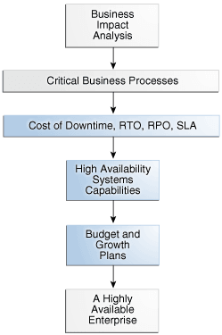
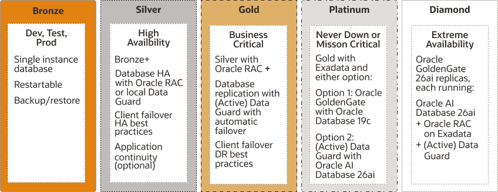

## 2 High Availability and Data Protection – Getting From Requirements to Architecture

See the following topics to learn how Oracle Maximum Availability Architecture provides a framework to effectively evaluate the high availability requirements of an enterprise.

### High Availability Requirements

Any effort to design and implement a high availability strategy for Oracle Database begins by performing a thorough business impact analysis to identify the consequences to the enterprise of downtime and data loss, whether caused by unplanned or planned outages.

The term "business impact" is intended to be agnostic of whether the enterprise is a commercial venture, government agency, or not-for-profit institution. In all cases, data loss and downtime can seriously impact the ability of any enterprise to perform its functions. Implementing high availability may involve critical tasks such as:

- Retiring legacy systems
- Investing in more capable and robust systems and facilities
- Redesigning the overall IT architecture and operations to adapt to this high availability model
- Modifying existing applications to take full advantage of high availability infrastructures
- Redesigning business processes
- Hiring and training personnel
- Moving parts or an entire application or database into the Oracle Public Cloud
- Balancing the right level of consolidation, flexibility, and isolation
- Understanding the capabilities and limitations of your existing system and network infrastructure

By combining your business analysis with an understanding of the level of investment required to implement different high availability solutions, you can develop a high availability architecture that achieves both business and technical objectives.

Figure 2-1 Planning and Implementing a Highly Available Enterprise

> The illustration shows the process of planning and implementing a highly available enterprise. Business impact analysis identifies critical business processes; then the cost of downtime, recovery time objectives (RTO), recovery point objectives (RPO), and service-level agreements (SLA) are determined.
>
> High availability system capabilities, and budget and growth plans are considered to determine and implement a highly available enterprise.

### A Methodology for Documenting High Availability Requirements

#### Business Impact Analysis

The business impact analysis categorizes the business processes based on the severity of the impact of IT-related outages.

A rigorous business impact analysis:

- Identifies the critical business processes in an organization
- Calculates the quantifiable loss risk for unplanned and planned IT outages affecting each of these business processes
- Outlines the effects of these outages
- Considers essential business functions, people and system resources, government regulations, and internal and external business dependencies
- Is based on objective and subjective data gathered from interviews with knowledgeable and experienced personnel
- Reviews business practice histories, financial reports, IT systems logs, and so on

For example, consider a semiconductor manufacturer with chip fabrication plants located worldwide. Semiconductor manufacturing is an intensely competitive business requiring a huge financial investment that is amortized over high production volumes. The human resource applications used by plant administration are unlikely to be considered as mission-critical as the applications that control the manufacturing process in the plant. Failure of the applications that support manufacturing affects production levels and have a direct impact on the financial results of the company.

As another example, an internal knowledge management system is likely to be considered mission-critical for a management consulting firm, because the business of a client-focused company is based on internal research accessibility for its consultants and knowledge workers. The cost of downtime of such a system is extremely high for this business.

Similarly, an e-commerce company is highly dependent on customer traffic to its website to generate revenue. Any disruption in service and loss of availability can dampen customer experience and drive away customers to the competition. Thus, the company needs to ensure that the existing infrastructure can scale and handle spikes in customer traffic. Sometimes, this is not possible using on-premise hardware and by moving the cloud the company can ensure their systems always remain operational.

#### Cost of Downtime

A complete business impact analysis provides the insight needed to quantify the cost of unplanned and planned downtime.

Understanding this cost is essential because it helps prioritize your high availability investment and directly influences the high availability technologies that you choose to minimize the downtime risk.

Various reports have been published, documenting the costs of downtime in different industries. Examples include costs that range from millions of dollars for each hour of brokerage operations and credit card sales, to tens of thousands of dollars for each hour of package shipping services.

These numbers are staggering. The Internet and Cloud can connect the business directly to millions of customers. Application downtime can disrupt this connection, cutting off a business from its customers. In addition to lost revenue, downtime can negatively affect customer relationships, competitive advantages, legal obligations, industry reputation, and shareholder confidence.

#### Recovery Time Objective

The business impact analysis determines your tolerance to downtime, also known as the recovery time objective (RTO).

An RTO is defined as the maximum amount of time that an IT-based business process can be down before the organization starts suffering unacceptable consequences (financial losses, customer dissatisfaction, reputation, and so on). RTO indicates the downtime tolerance of a business process or an organization in general.

RTO requirements are driven by the mission-critical nature of the business. Therefore, for a system running a stock exchange, the RTO is zero or near to zero.

An organization is likely to have varying RTO requirements across its various business processes. A high volume e-commerce website, for which there is an expectation of rapid response times, and for which customer switching costs are very low, the web-based customer interaction system that drives e-commerce sales is likely to have an RTO of zero or close to zero. However, the RTO of the systems that support back-end operations, such as shipping and billing, can be higher. If these back-end systems are down, then the business may resort to manual operations temporarily without a significant visible impact.

Some organizations have varying RTOs based on the probability of failures. One simple class separation is local failures (such as single database compute, disk/flash, network failure) as opposed to disasters (such as a complete cluster, database, data corruptions, or a site failure). Typically, business-critical customers have an RTO of less than 1 minute for local failures, and may have a higher RTO of less than 1 hour for disasters. For mission-critical applications the RTOs may indeed be the same for all unplanned outages.

#### Recovery Point Objective

The business impact analysis also determines your tolerance to data loss, also known as a recovery point objective (RPO).

The RPO is the maximum amount of data that an IT-based business process can lose without harm to the organization. RPO measures the data-loss tolerance of a business process or an organization in general. This data loss is often measured in terms of time, for example, zero, seconds, hours, or days of data loss.

A stock exchange where millions of dollars worth of transactions occur every minute cannot afford to lose any data. Therefore, its RPO must be zero. The web-based sales system in the e-commerce example does not require an RPO of zero, although a low RPO is essential for customer satisfaction. However, its back-end merchandising and inventory update system can have a higher RPO because lost data can be reentered.

An RPO of zero can be challenging for disasters, but I can be accomplished with various Oracle technologies protecting your database, especially Zero Data Loss Recovery Appliance.

#### Manageability Goal

A manageability goal is more subjective than either the RPO or the RTO. You must make an objective evaluation of the skill sets, management resources, and tools available in an organization, and the degree to which the organization can successfully manage all elements of a high availability architecture.

Just as RPO and RTO measure an organization's tolerance for downtime and data loss, your manageability goal measures the organization's tolerance for complexity in the IT environment. When less complexity is a requirement, simpler methods of achieving high availability are preferred over methods that may be more complex to manage, even if the latter could attain more aggressive RTO and RPO objectives. Understanding manageability goals helps organizations differentiate between what is possible and what is practical to implement.

Moving Oracle databases to Oracle Cloud can reduce manageability cost and complexity significantly, because Oracle Cloud lets you to choose between various Maximum Availability Architecture architectures with built-in configuration and life cycle operations. With Autonomous Database Cloud, database life cycle operations, such as backup and restore, software updates, and key repair operations are automatic.

#### Total Cost of Ownership and Return on Investment

Understanding the total cost of ownership (TCO) and objectives for return on investment (ROI) are essential to selecting a high availability architecture that also achieves the business goals of your organization.

TCO includes all costs (such as acquisition, implementation, systems, networks, facilities, staff, training, and support) over the useful life of your chosen high availability solution. Likewise, the ROI calculation captures all of the financial benefits that accrue for a given high availability architecture.

For example, consider a high availability architecture in which IT systems and storage at a remote standby site remain idle, with no other business use that can be served by the standby systems. The only return on investment for the standby site is the costs related to downtime avoided by its use in a failover scenario. Contrast this with a different high availability architecture that enables IT systems and storage at the standby site to be used productively while in the standby role (for example, for reports or for off-loading the overhead of user queries or distributing read-write workload from the primary system). The return on investment of such an architecture includes both the cost of downtime avoided and the financial benefits that accrue to its productive use, while also providing high availability and data protection.

Enterprises can also reduce TCO for growing infrastructure needs by moving workloads to the cloud rather than making an upfront capital investment in building a new data center. The major economic appeal is to convert capital expenditures into operational expenditures, and generate a higher ROI.

### Mapping Requirements to Architectures

The business impact analysis will help you document what is already known. The outcome of the business impact analysis provides the insight you need to group databases having similar RTO and RPO objectives together.

Different applications, and the databases that support them, represent varying degrees of importance to the enterprise. A high level of investment in high availability infrastructure may not make sense for an application that if down, would not have an immediate impact on the enterprise. So where do you start?

Groups of databases by similar RTO and RPO can be mapped to a controlled set of high availability reference architectures that most closely address the required service levels. Note that in the case where there are dependencies between databases, they are grouped with the database having the most stringent high availability requirement.

#### Oracle MAA Reference Architectures

Oracle MAA best practices define high availability reference architectures that address the complete range of availability and data protection required by enterprises of all sizes and lines of business.

The Platinum, Gold, Silver, and Bronze MAA reference architectures, or tiers, are applicable to on-premises, private and public cloud configurations, and hybrid cloud. They deliver the service levels described in the following figure.

Figure 2-2 Oracle MAA Reference Architectures

> Four stacked rectangles are displayed in the graphic, each containing a short description of the Platinum, Gold, Silver, and Bronze reference architectures. These architectures are described in the topics that follow.
>
> [  
> Copyright © 2005, 2026, Oracle and/or its affiliates.](https://docs.oracle.com/en/database/oracle/oracle-database/dcommon/html/cpyr.htm)

Each tier uses a different MAA reference architecture to deploy the optimal set of Oracle high availability capabilities that reliably achieve a given service level at the lowest cost and complexity. The tiers explicitly address all types of unplanned outages, including data corruption, component failure, and system and site outages, as well as planned outages due to maintenance, migrations, or other purposes.

Container databases (CDBs) using Oracle Multitenant can exist in any tier, Bronze through Platinum, providing higher consolidation density and higher TCO. Typically, the consolidation density is higher with Bronze and Silver tiers, and there is less or zero consolidation when deploying a Platinum tier.

Oracle Database In-Memory can also be leveraged in any of the MAA tiers. Because the In-Memory column store is seamlessly integrated into Oracle Database, all of the high availability benefits that come from the MAA tiers are inherited when implementing Oracle Database In-Memory.

Oracle Engineered Systems can also exist in any of the tiers. Integrating Zero Data Loss Recovery Appliance (Recovery Appliance) as the Oracle Database backup and recovery solution for your entire data center reduces RPO and RTO when restoring from backups. Leveraging Oracle Exadata Database Machine as your database platform in the MAA reference architectures provides the best database platform solution with the lowest RTO and brownout, along with additional Exadata MAA quality of service.

See Also:

[High Availability Reference Architectures](https://docs.oracle.com/pls/topic/lookup?ctx=en/database/oracle/oracle-database/26&id=HAIAD)

[Oracle Exadata Database Machine: Maximum Availability Architecture](https://www.oracle.com/a/tech/docs/exadata-maa.pdf) and [MAA Best Practices for Oracle Exadata Database Machine](https://www.oracle.com/a/tech/docs/exadata-maa-wp.pdf)

[http://www.oracle.com/goto/maa](http://www.oracle.com/goto/maa) for MAA technical brief “Oracle Database In-Memory High Availability Best Practices”

#### Bronze Reference Architecture

The Bronze tier is appropriate for databases where simple restart of a failed component (e.g. listener, database instance, or database) or restore from backup is "HA and DR enough."

The Bronze reference architecture is based on a single instance Oracle Database using MAA best practices that implement the many capabilities for data protection and high availability included with every Oracle Enterprise Edition license. Oracle-optimized backups using Oracle Recovery Manager (RMAN) provide data protection, and are used to restore availability should an outage prevent the database from restarting. The Bronze architecture then uses a redundant system infrastructure enhanced by Oracle's technologies, such as Oracle Restart, Recovery Manager (RMAN), Zero Data Loss Recovery Appliance, Flashback technologies, Online Redefinition, Online Patching, Automatic Storage Management (ASM), Oracle Multitenant, and more.

#### Silver Reference Architecture

The Silver tier provides an additional level of high availability for databases that require minimal or zero downtime in the event of database instance or server failure, as well as most common planned maintenance events, such as hardware and software updates.

The Silver reference architecture adds a rich set of enterprise capabilities and benefits, including clustering technology using either Oracle RAC or Oracle RAC One Node. Also, Application Continuity provides a reliable replay of in-flight transactions, which masks outages from users and simplifies application failover.

#### Gold Reference Architecture

The Gold tier raises the stakes substantially for business-critical applications that cannot tolerate high RTO and RPO for any disasters such as database, cluster, corruptions, or site failures. Additionally, major database upgrades or site migrations can be done in seconds.

The Gold tier also reduces costs while improving your return on investment by actively using all of the replicas at all times.

The Gold reference architecture adds database-aware replication technologies, Oracle Data Guard and Oracle Active Data Guard, which synchronize one or more replicas of the production database to provide real time data protection and availability. Database-aware replication substantially enhances high availability and data protection (corruption protection) beyond what is possible with storage replication technologies. Oracle Active Data Guard Far Sync is used for zero data loss protection at any distance.

See also, [Oracle Data Guard Advantages Over Traditional Solutions](ha-features.md).

#### Platinum Reference Architecture

The Platinum tier introduces two architecture patterns: Oracle GoldenGate replication with Oracle Database 19c Oracle Active Data Guard and Oracle AI Database 26ai and later releases.

Edition Based Redefinition lets application developers design for zero-downtime application upgrades. You can alternativly design applications for Oracle Sharding, which provides extreme availability by distributing subsets of a database into highly available shards, while the application can access the entire database as one single logical database.

Each of these technologies requires additional effort to implement, but they deliver substantial value for the most critical applications where downtime is not an option.

#### Diamond Reference Architecture

The Diamond tier introduces builds on MAA Platinum with Oracle GoldenGate, and is ideal for extremely mission critical systems.

The MAA Diamond reference architecture requires the same services as MAA Platinum with GoldeGate, except that it requires:

- Oracle GoldenGate 26ai active/active replication
- Oracle AI Database 26ai on Oracle Exadata
- MAA-hardened GoldenGate Hub configuration

#### High Availability and Data Protection Attributes by Tier

Each MAA reference architecture delivers known and tested levels of downtime and data protection.

The following table summarizes the high availability and data protection attributes inherent to each architecture. Each architecture includes all of the capabilities of the previous architecture, and builds upon it to handle an expanded set of outages. The various components included and the service levels achieved by each architecture are described in other topics.

Table 2-1 High Availability and Data Protection Attributes By MAA Reference Architecture

| MAA Reference Architecture | Unplanned Outages (Local Site) | Planned Maintenance | Data Protection | Unrecoverable Local Outages and Disaster Recovery |
| --- | --- | --- | --- | --- |
| Bronze | Single Instance, auto-restart for recoverable instance and server failures. Redundancy for system infrastructure so that single component failures such as disk, flash, and network should not result in downtime. | Some online, most off-line | Basic runtime validation combined with manual checks | Restore from backup, potential to lose data generated since the last backup. Using Zero Data Loss Recovery Appliance reduces the potential to lose data to zero or near zero. |
| Silver | HA with automatic failover for instance and server failures | Most rolling, some online, few offline | Basic runtime validation combined with manual checks | Restore from backup, potential to lose data generated since the last backup. Using Zero Data Loss Recovery Appliance reduces the potential to lose data to zero or near zero. In-flight transactions are preserved with Application Continuity. |
| Gold | Comprehensive high availability and disaster recovery | All rolling or online | Comprehensive runtime validation combined with manual checks | Real-time failover, zero or near-zero data loss |
| Platinum | Zero application outage for Platinum ready applications | Zero application outage | Comprehensive runtime validation combined with manual checks | Zero application outage for Platinum-ready applications, with zero data loss. Oracle RAC, Oracle Active Data Guard, and Oracle GoldenGate complement each other, providing a wide array of solutions to achieve zero database service downtime for unplanned outages. Alternatively, use Oracle Sharding for site failure protection, because impact on the application is only on shards in failed site rather than the entire database. Each shard can be configured with real-time failover, zero or near-zero data loss, or zero application outage for Platinum-ready applications. In-flight transactions are preserved, with zero data loss. |

See Also:

[http://www.oracle.com/goto/maa](http://www.oracle.com/goto/maa)