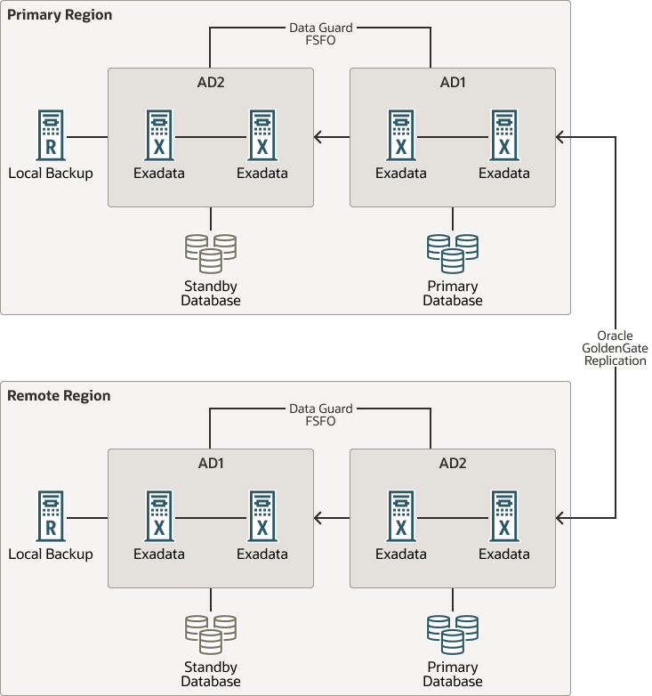
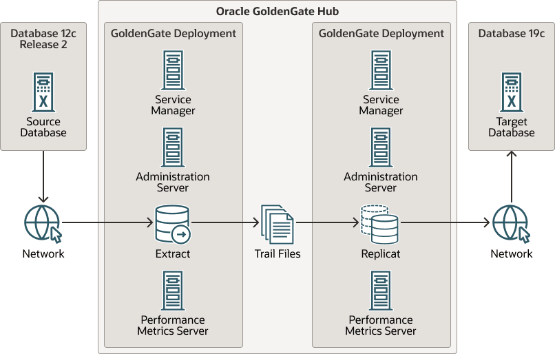
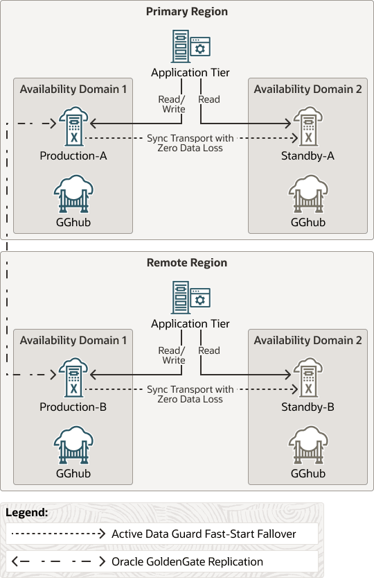

## 20 MAA Platinum Reference Architecture Overview

MAA Platinum or Never-Down Architecture, delivers near-zero Recovery Time Objective (RTO, or downtime incurred during an outage) and potentially zero or near zero Recover Point Objective (RPO, or data loss potential).

The MAA Platinum reference architecture ensures:

- RTO = zero or near-zero for all local failures using the Oracle Exadata Database Machine platform with its inherent Oracle RAC, full-stack redundancy, and failover capabilities
- RTO = zero or near-zero for disasters, such as database, cluster, or site failures, achieved by redirecting the application to an active Oracle GoldenGate source or target
- Zero downtime maintenance for software and hardware updates using Oracle RAC and Exadata Database Machine platform
- Zero downtime database upgrade or application upgrade by redirecting the application to an upgraded Oracle GoldenGate source or target database
- RPO = zero or near-zero data loss, depending on the Oracle Data Guard protection mode setting, which dictates the redo transport (SYNC, FAR SYNC, or ASYNC)
- Fast re-synchronization and zero or near-zero RPO between Oracle GoldenGate source and target databases after a disaster.
	After any database failure, automatic failover to its standby database occurs automatically. Subsequently, automatic re-synchronization between Oracle GoldenGate source and target databases will resume. For SYNC transport, this leads to eventual zero data loss.

Table 20-1 MAA Platinum Outage Matrix

| Event | RTO/RPO Service Level Objective 1 |
| --- | --- |
| Unplanned Outage |  |
| Recoverable node or instance failure | Zero or single digit seconds 2,3 |
| Disasters including corruptions and site failures | Zero 3 |
| Planned Maintenance |  |
| Most common software and hardware updates | Zero 2 |
| Major database upgrade or application upgrade | Zero 3 |

1 RPO=0 unless explicitly specified

2 To achieve zero downtime or lowest impact for online processing, apply MAA application high availability best practices (also known as The Checklist). For long running transactions, such as batch operations, it's recommended that you defer them outside the planned maintenance window.

3 Application failover is customized or managed with Global Data Services.

Enabling features of the Platinum MAA solution include:

- Oracle Real Application Clusters with recommended Exadata Database Machine Platform, Exadata Database Service on Dedicated Infrastructure (ExaDB-D), or Oracle Exadata Database Service on Cloud@Customer (ExaDB-C@C) for the source and target databases
- Oracle Active Data Guard with Fast-Start Failover to bound data loss and automatically fail over to standby in case of database, cluster, or data center failures. The standby databases are typically in separate Fault Domains (FDs) with separate power supplies, residing in separate data centers, Availability Domains (ADs), or Availability Zones (AZs), with independent power and network. The standbys can also reside across regions with typically the greatest fault isolation.
- Oracle GoldenGate enables two active read-write database systems that can be leveraged for applications to fail over immediately after database, cluster, site failure, or planned outages such as database or application upgrades. The source and target databases on which Oracle GoldenGate replication is occurring can reside in the same region, across ADs, or across regions.

MAA Platinum architecture is illustrated in the image below, where two "active read-write" primary databases, or source or target databases, reside in separate regions. Oracle GoldenGate replication occurs between the source and target databases between primary and remote regions. Each primary database is protected by a standby database in another AD within the same region.

With Data Guard Fast-Start Failover (FSFO), the standby database becomes the new primary database automatically after primary database, cluster, or AD failure. With MAA Oracle GoldenGate configuration best practices implemented, replication resumes automatically between the source and target databases after any Data Guard role transition. Each database resides on an Exadata platform with its inherent built-in Real Application Cluster, system and storage redundancy, and low brownout failover capabilities.

Figure 20-1 MAA Platinum Reference Architecture

> The image shows the Oracle MAA Platinum reference architecture at a high level.
>
> The diagram consists of two main horizontal sections: a Primary Region on top and a Remote Region on the bottom.
>
> Primary Region
>
> - The Primary Region section contains 3 major components: on the far left, a Zero Data Loss Recovery Appliance (Recovery Appliance), and then two Availability Domains labeled AD2 (left) and AD1 (right).
> - AD2 and AD1 each consist of a 2-node Oracle RAC on Exadata and between the ADs is a line labeled Data Guard FSFO (Fast-start failover).
> - Connected to AD2 is a Standby Database icon indicating that this is a Standby Database on the 2-node RAC Exadata system. AD2 is also linked to the Recovery Appliance icon indicating that the Standby Database system is backed up locally on the appliance.
> - Connected to AD1 is a Primary Database icon indicating that this is a Primary Database on the 2-node RAC Exadata system.
>
> Remote Region
>
> - The Remote Region section also contains the same 3 major components as the Primary Region: on the far left, a Zero Data Loss Recovery Appliance (Recovery Appliance), and then two Availability Domains labeled AD1 (left) and AD2 (right). Note that the order of AD1 and AD2 are the opposite of those ADs in the Primary Region.
> - AD1 and AD2 each consist of a 2-node Oracle RAC on Exadata, and between the ADs is a line labeled Data Guard FSFO (Fast-start failover).
> - Connected to AD1 is a Standby Database icon indicating that this is a Standby Database on the 2-node RAC Exadata system. AD1 is also linked to the Recovery Appliance icon indicating that the Standby Database system is backed up locally on the appliance.
> - Connected to AD2 is a Primary Database icon indicating that this is a Primary Database on the 2-node RAC Exadata system.
>
> Finally, between the AD1 in the Primary Region and AD2 in the Remote Region there is a bidirectional arrow labeled Oracle GoldenGate Replication, indicating that bi-directional GoldenGate replication is taking place between the Primary Database of each region.

MAA Platinum Architecture Variants

When setting up MAA Platinum architecture, the administrator can decide between setting up Oracle GoldenGate on each potential source or target database, or creating an Oracle GoldenGate hub independent from the database servers.

The MAA Oracle GoldenGate hub, shown in the following image, provides the following advantages:

- Offloads Oracle GoldenGate software installation, configuration, and life cycle management from source and target Exadata database systems.
- Reduces Oracle GoldenGate resource impact on the source and target database systems.
- Provides high availability by configuring a 2-node cluster server for fast and simple failover, and disaster recovery by leveraging ACFS replication to another identical GoldenGate hub server on a separate 2-node cluster server.
- Consolidates Oracle GoldenGate configurations and software deployment for multiple independent MAA Platinum or Oracle GoldenGate architectures.

Figure 20-2 MAA Oracle GoldenGate Hub

> The image shows the Oracle MAA GoldenGate Hub architecture in three major parts: an GoldenGate hub (GGHub) in the center, the Source database environment on the left side and the Target database environment on the right.
>
> The source and target database environments consist of an Exadata Database Machine and a network connection to the GGHub.
>
> The source database is labeled as Database 12c Release 2, and the target database is labeled as Database 19c, to show they are different versions of Oracle Database.
>
> The GGHub in the center of the diagram is divided into two major boxes labeled GoldenGate Deployment.
>
> The GoldenGate Deployment on the left side of the GGHub consists of a Service Manager (server icon), Administration Server (server icon), Extract process (cylinder icon), and Performance Metric Server (server icon).
>
> The GoldenGate Deployment on the right side of the GGHub consists of a Service Manager (server icon), Administration Server (server icon), Replicat process (cylinder icon), and Performance Metric Server (server icon).
>
> Between the two GoldenGate Deployment boxes, a Trail Files icon with arrows shows the flow of trail files from the left-side GoldenGate Deployment Extract process to the right-side GoldenGate Deployment Replicat process.

An example of MAA Oracle GoldenGate hub with MAA Platinum architecture is shown in the image below. Each hub is a 2-node cluster providing local high availability, and for additional protection uses ACFS replication to another hub, typically deployed across Availability Domains (ADs) or across regions.

Figure 20-3 MAA Platinum with Oracle GoldenGate Hub

> The image shows the Oracle MAA Platinum reference architecture deployed with the MAA Oracle GoldenGate hub architecture.
>
> The diagram consists of two main horizontal sections: a Primary Region on top and a Remote Region on the bottom.
>
> The Primary and Remote Region sections each contain 3 major components: Availability Domain 1 on the left, Application Tier in the center, and Availability Domain 2 on the right.
>
> Each Availability Domain consists of an Exadata Database system and an Oracle GoldenGate Hub (GGHub). Each Availability Domain 1 system is labeled Production, and each Availability Domain 2 system is labeled Standby.
>
> The Application Tier in each Region has two arrows each pointing at one of the Exadata systems within its region. The arrow pointing at Exadata in Availability Domain 1 is labeled Read/Write, and the arrow to Exadata in Availability Domain 2 is labeled Read.
>
> There is a dotted line arrow from Exadata in Availability Domain 1 to the Exadata in Availability Domain 2 labeled Sync Transport with Zero Data Loss. According to the legend below the diagram, the dotted line indicates Active Data Guard Fast-Start Failover.
>
> There is a dot and dash line between the Availability Domain 1 Exadata systems in each region, which indicates Oracle GoldenGate Replication.

How to Implement the MAA Platinum Solution

To achieve an MAA Platinum solution, review and leverage the technical papers and documentation referenced in the following steps.

Step 1 - Choose Oracle GoldenGate Deployment

Decide between implementing the recommended MAA Oracle GoldenGate Hub solution, or setting up Oracle GoldenGate directly on Exadata database servers.

| Oracle GoldenGate Deployment | Guidance |
| --- | --- |
| MAA Oracle GoldenGate Hub | This is the recommended deployment configuration  Deploy MAA Oracle GoldenGate Hub on Exadata Database Service in Oracle Cloud  - [Cloud Within Region: Configuring Oracle GoldenGate Hub for MAA Platinum](cloud-gghub-region.md) - [Cloud Across Regions: Configuring Oracle GoldenGate Hub for MAA Platinum](cloud-gghub-regions.md)  Deploy MAA Oracle GoldenGate Hub on Exadata On-Premises  - [On-Premises: Configuring Oracle GoldenGate Hub](premises-configuring-oracle-goldengate-hub.md) |
| Oracle GoldenGate | Deploy Oracle GoldenGate on Exadata Database Service in Oracle Cloud  - [Cloud: Oracle GoldenGate Microservices Architecture on Oracle Exadata Database Service Configuration Best Practices](ogg-microservices-cloud1.md) - [Cloud MAA Platinum: Oracle GoldenGate Microservices Architecture Integrated with Active Data Guard](ogg-ma-cloud-rac-and-active-data-guard1.md)  Deploy Oracle GoldenGate on Exadata On-Premises  - [On-Premises: Oracle GoldenGate Microservices Architecture with Oracle Real Application Clusters Configuration Best Practices](ogg-microservices-premises1.md) - [On-Premises MAA Platinum: Oracle GoldenGate Microservices Architecture Integrated with Active Data Guard](premises-maa-platinum-oracle-goldengate-microservices-architecture-integrated-active-data-gua.md) |

Step 2 - Configure Automatic Conflict Detection and Resolution

Bidirectional replication requires conflict detection and resolution. Oracle MAA provides guidance for developers and administrators when designing an active-active distributed database architecture using Oracle GoldenGate, where data conflicts may occur between GoldenGate replicas. See [Oracle GoldenGate Active-Active Guidance for Developers and Administrators](ogg-active-active-guidance-dev-and-admin1.md) for additional details.

Step 3 - Implement Application Failover

Oracle Global Data Services allows fault-tolerant database services to be deployed and centrally managed across a set of replicated databases, supporting seamless inter-database service failover among replicated databases in any data center, and providing higher application availability. See [Oracle Global Data Services Best Practices](oracle-global-data-services-best-practices.md) for additional details.

Alternatively, use your own custom application routing to redirect after database or site failure.