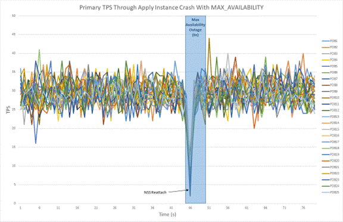
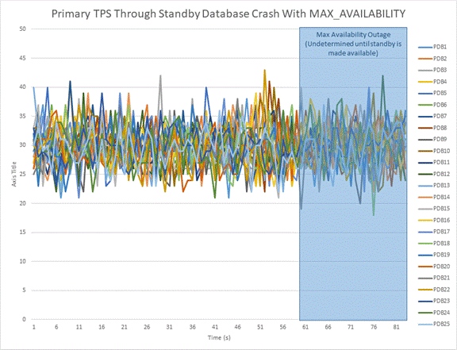
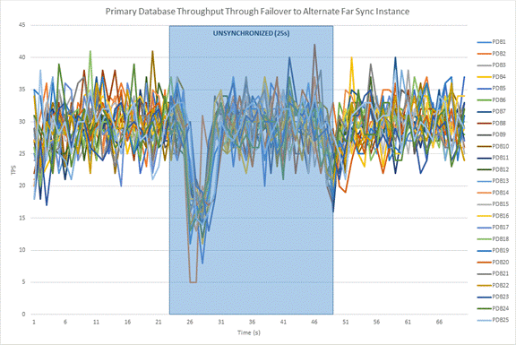
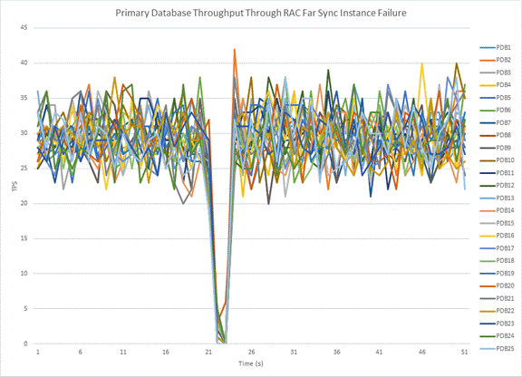
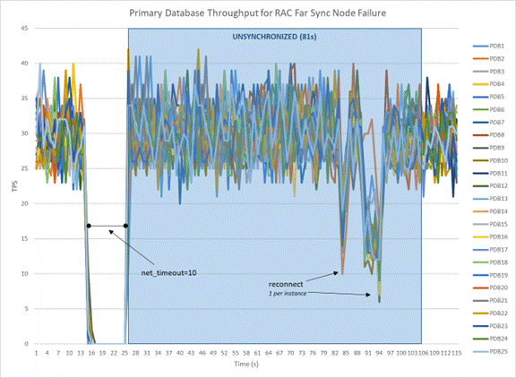
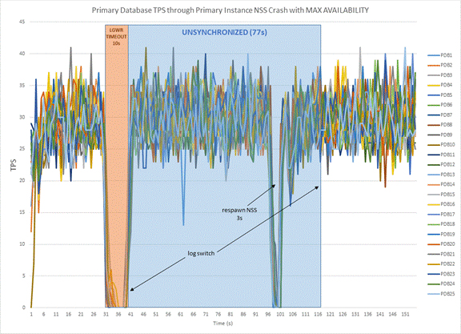
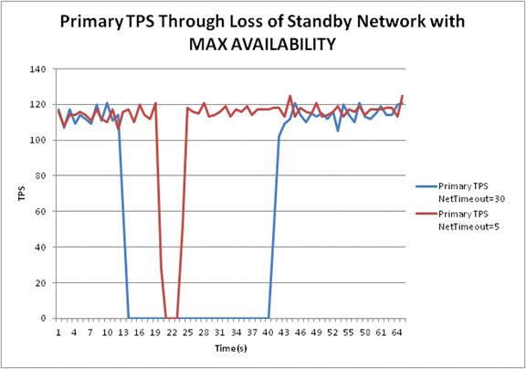
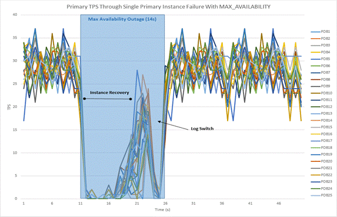
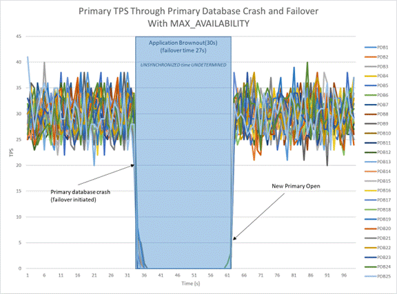

## 19 Optimizing Automatic Failover in Common Scenarios to Minimize Downtime

The following topics provide Oracle Data Guard MAA best practices in relation to common scenarios to avoid or minimize downtime and prevent various problematic scenarios.

### Automatic Database Failover for Primary Database Outages

Fast Start Failover (FSFO) is the Oracle Data Guard feature that performs automatic database failover when there is an outage of a primary database. FSFO is controlled by the Data Guard observer process, which is part of the Data Guard broker. When the observer process that controls automatic database failover is started, it creates threads that connect to both the primary and standby databases. Each thread creates a database session and verifies the database health using the `dbms_drs` package. If a thread doesn’t respond, a new thread is created and Data Guard attempts to create a session and use the `dbms_drs` package. If the threads do not respond by a defined period of time (threshold) then the database is considered to be unavailable.

If the primary database becomes network isolated from the standby and observer at the same time, the primary stalls (no new transactions are able to commit) until it can again make contact with either observer or standby. This is done to explicitly prevent split brain. If the observer and standby agree that neither can see the primary and if FSFO was enabled at the time they lost contact, then automatic failover occurs once the FSFO threshold is exceeded. At this same time, the primary will have also passed the FSFO threshold, causing it to abort so that existing connections are not able to continue reading stale data after a failover has occurred. If the primary is able to connect with either the observer or the standby designated as the failover target before the FSFO threshold expires, then it is allowed to continue to process transactions. If the primary aborts because the FSFO threshold is exceeded, then when the primary is restarted, it must receive permission from the observer or its original standby before it is able to open. When it makes contact, it is told that either a failover occurred while it was away, and it is automatically converted into a standby database or, if no failover occurred, it is allowed to open. This assures there is never a case where there are two active primaries at the same time.

If the primary loses contact with either the observer or the standby, the primary keeps processing transactions because it still has the ability to communicate with one of the two parties. If both the primary and standby have lost contact with the observer they fall into an UNOBSERVED state. If the primary has lost contact with the standby it falls into an UNSYNCHRONIZED state. This is how we ensure that an observer or standby outage, or the outage of both at different times, does not impact the availability of the primary database in an FSFO configuration.

If the primary database appears unavailable to the observer, the observer initiates an automatic failover if the standby is 1) responding 2) perceives the primary to be unavailable and 3) is synchronized as of the last communication.

As a best practice, the observer should ideally be located at a third site or third data center so that the primary, observer, and standby have isolated power, server, storage, and network infrastructure. It is possible to achieve a similar level of isolation using two sites; however, when Data Guard is used for disaster recovery, the observer should never be deployed at the primary database server or cluster, or on the standby database server or cluster.

An additional best practice is to have the observer use the same path to connect to the production database as is used by the application tier. The intent of this practice is for the observer to have the same access path as application connections so that if application connections can't see the primary, the observer has the same problem and can quickly respond. This best practice comes with a caveat if the application tier is local to the production database while the standby is in a remote data center for disaster recovery. In this case, it is not wise to deploy the observer with the application tier, as it could experience the same issues as the database. Instead, the observer should be deployed at either the standby location or a third data center.

In all recent Oracle Database releases, the Data Guard broker includes a feature that regularly makes a new connection with the primary to simulate what new connections see, providing additional health monitoring of the primary database.

### Automatic Data Integrity and Avoidance of Split Brain

An Oracle Data Guard configuration maintains multiple synchronized copies of the production database. Because Data Guard uses simple one-way replication, the primary database is the only database open read-write; all other replicas (standby databases) must be either in mount mode or open read-only (if using Oracle Active Data Guard). The term ‘split brain’ describes a scenario where there are two copies of the same database open read-write, each operating independently of the other. This is a very undesirable circumstance that results in inconsistent data. The following algorithms ensure data consistency in a Data Guard synchronous configuration and the avoidance of split-brain:

- The primary database Log Writer (LGWR) redo write and the sync redo transport write that transmits to the standby database are identical in redo content and size.
- The Data Guard Managed Recovery Process (MRP) at the standby database cannot apply redo unless the redo has been written to the primary's online redo log, with the only exception being during a Data Guard failover (via the recover managed standby database finish) operation. In addition to shipping redo synchronously, the sync transport process and LGWR also exchange information regarding the safe redo block boundary that standby recovery can apply up to from its standby redo logs. This boundary prevents the standby from applying redo it may have received, but which the primary has not yet acknowledged as committed to its own online redo logs.

Data Guard SYNC maintains data integrity in all of the 3 general outage categories:

- Primary failure and restart (for example, LGWR I/O failure, LGWR crash, instance failure, or database failure and restart): For example, if a primary database's LGWR cannot write to an online redo log, then the instance’s LGWR and instance will crash. An Oracle RAC node or single instance database crash recovery will recover to the last committed transaction in the online redo log and roll back any uncommitted transactions. The current log will be completed and archived to any enabled log archive destination in a Data Guard destination.
- Failure resulting in missing redo on the standby: If the sync transport process and the Remote File Server (RFS) process that receives redo at the standby database detects missing current or last bit of redo on the standby regardless the outage cause, RFS requests the missing redo to be resent, and it is written directly into the Standby Redo Log (SRL).
- Any outage resulting in a zero data loss failover operation: If the primary database crashes, resulting in an automatic or manual zero data loss failover, then the Data Guard failover operation will do "terminal recovery" (using the recover managed standby finish operation) and read and recover the current SRL. Once recovery completes applying all the redo in the SRLs, the new primary database comes up, and it archives the newly completed online log group. All new and existing standby databases discard any redo for the same log group sequence and thread, flashback to consistent SCN, and only apply the archives coming from the new primary database. Once again, the Data Guard environment is in sync with the (new) primary database and there’s no deviation or data loss.

### Automatic Reconnect Following Any Outage That Results in Network Timeout

Network or cluster failure outage cases are more involved because the heartbeat ARCH can hang on the network and may end up getting killed based on internal timers. The internal timers for detecting hung transport processes are controlled by the underscore parameter `_redo_transport_stall_time`, which is for the short disk/network calls, and the underscore parameter `_redo_transport_stall_time_long`, which is for the longer version of the disk/network calls.

After the heartbeat ARCH is killed, another ARCH becomes the heartbeat ARCH, and, after approximately 'REOPEN + 1 minute + \<hang time..before killed >', it attempts to connect to the network. Only when the heartbeat ARCH is able to reconnect to the standby will LGWR attempt to connect to the standby database. This ensures that the application does not incur any unnecessary impact, and LGWR does not suffer a NetTimeout hang on an unhealthy network.

### Automatic Reconnect Following Resolution of Standby Outage

The heartbeat ARCH is one of the primary database’s ARCH processes that is designated to ping the standby. The heartbeat ARCH will 'ping' the standby every 1 minute when the network is healthy and the standby is reachable. This is done to detect gaps in archive logs received by the standby. If there is a network failure, the heartbeat ARCH does not attempt to connect for up to REOPEN time; however, there are states where Oracle Data Guard will reset the 'remote' destination sooner than 'REOPEN + 1 minute' using a feature called standby announcement. For the standby bounce case (not a network hang), a mounted standby RFS or Fetch Archive Log (FAL) will communicate with the primary database and 'announce' that the standby is now available. In such cases, the primary does not wait for REOPEN - it will connect to the standby immediately after being posted.

With Maximum Availability and LGWR SYNC redo transport, note that it is only the heartbeat ARCH that attempts a reconnect to the standby after a network failure. LGWR never attempts to connect to the standby after a failure unless the heartbeat ARCH has already confirmed that the standby is accessible.

Gap resolution for a reconnect following a standby outage is done automatically. For example, consider a primary in the middle of log sequence 100, the standby database crashes, and then the primary advances through logs 101, 102, and 103. When the standby becomes available, the primary switches logs to 104 and starts either ASYNC or SYNC transport at that point. It then ships the remaining portion of log sequence 100 and uses several archive processes to ship 101, 102, and 103 in parallel.

### Data Guard Broker Properties That Affect Outage Repair Times

The following Data Guard broker properties can be configured to reduce outage repair times. Recommended values depend on the environment in which they are being used, and they should be tested to assess application impact.

Data Guard Broker Property: NetTimeout

Default Value: 30 Seconds

Recommended value: 5 to 10 seconds if the network is responsive and reliable

Specifies a maximum number of seconds that the LGWR background process blocks while waiting for a synchronous redo transport destination to acknowledge redo data sent to it. If an acknowledgment is not received within `NetTimeout` seconds, an error is logged, and the redo transport session to that destination is terminated.

This property is put into effect for all outages that would place the sync transport process in a TCP timeout with the standby processes, such as network failure, standby host failure, and standby cluster failure. `NetTimeout` should not be set < 5 seconds.

Data Guard Broker Property: `ReopenSecs`

Default Value: 300 Seconds

Recommended value: 30 seconds

Specifies the minimum number of seconds before redo transport services should try to reopen a failed destination. Once reopen expires and the destination is open it is attempted at the next log switch.

This property is in effect for all outages that place the sync transport in an error state that closes the destination, such as a standby instance/database/node/cluster outage, network outage, or sync transport process death.

Data Guard Broker Property: `MaxFailure`

Default Value: None

Recommended Value: Depends on application availability and business requirements.

Controls the consecutive number of times redo transport services attempt to reestablish communication and transmit redo data to a failed destination before the primary database gives up on the destination.

This property is in effect for all outages that place the sync transport in an error state that closes the destination, such as a standby instance/database/node/cluster outage, network outage, or sync transport process death.

Data Guard Broker Property: `FastStartFailoverThreshold`

Default Value: 30 seconds

Recommended value: 6 to 15 seconds if the network is responsive and reliable. For primary Oracle RAC instances, add maximum clusterware heartbeat timeout (CSS miscount default for Linux is 30 seconds. For Exadata, you can use 2 seconds) to `FastStartFailoverThreshold`.

The `FastStartFailoverThreshold` configuration property defines the number of seconds the observer attempts to reconnect to the primary database before initiating a fast-start failover to the target standby database. The time interval starts when the observer first loses connection with the primary database. If the observer is unable to regain a connection to the primary database within the specified time, then the observer initiates a fast-start failover.

This property is in effect for all outages that would require a failover to the standby database due to a complete primary database outage.

Database Initialization Parameter: `FAST_START_MTTR_TARGET`

Default Value: 0

Recommended value: the value required for your expected recovery time objective (RTO)

FAST\_START\_MTTR\_TARGET lets you specify the number of seconds the database takes to perform crash recovery of a single instance. When specified, `FAST_START_MTTR_TARGET` is overridden by `LOG_CHECKPOINT_INTERVAL`.

This property is put into effect for all outages that require a database to perform instance recovery, such as instance failure. When you set this database initialization parameter, the database manages incremental checkpoint writes in an attempt to meet the target. The incremental checkpoints may occur more often, increasing the amount of I/O from the database writer (DBWR). It is recommended that you perform testing before reducing this parameter.

### Data Guard Standby Database Outage Repair

Kill Apply Instance

How to run a test

1. Start workload on the primary database.
2. Ensure that the primary database is in Maximum Availability mode.
	```
	select protection_mode,protection_level from v$database;
	```
3. Abort instance running managed recovery process (MRP).
	```
	shutdown abort
	```

What to look for

- Notification of primary becoming unsynchronized
	```
	LGWR: Attempting destination LOG_ARCHIVE_DEST_2 network reconnect (3135)
	LGWR: Error 1041 disconnecting from destination LOG_ARCHIVE_DEST_2 standby host
	```
- Notification of primary becoming synchronized
	```
	Destination LOG_ARCHIVE_DEST_2 is SYNCHRONIZED
	```

After the first log switch, the `PROTECTION_LEVEL` drops to `RESYNCHRONIZATION`.

```
SQL> select inst_id,protection_mode,protection_level from gv$database;

   INST_ID PROTECTION_MODE      PROTECTION_LEVEL
  -------- -------------------- --------------------
         1 MAXIMUM AVAILABILITY RESYNCHRONIZATION
         2 MAXIMUM AVAILABILITY RESYNCHRONIZATION
```

The `PROTECTION_LEVEL` returns to `MAXIMUM                     AVAILABILITY` after the second log switch.

```
SQL> select inst_id,protection_mode,protection_level from gv$database;

   INST_ID PROTECTION_MODE      PROTECTION_LEVEL
    ------ -------------------- --------------------
         1 MAXIMUM AVAILABILITY MAXIMUM AVAILABILITY
         2 MAXIMUM AVAILABILITY MAXIMUM AVAILABILITY
```

Expected impact on primary

With the loss of the apply instance, the primary database immediately switches a log to demote the destination to `RESYCHRONIZATION MODE`. After the primary is able to reconnect to the standby and ship the missing redo, a second log switch occurs to promote the destination to `SYNCHRONOUS`, restoring `MAXIMUM AVAILABILITY`.

Figure 19-1 Primary Database Workload with Apply Instance Crash

  


If the standby instances are open read-only and an apply instance is killed, all standby instances must be brought down to the mount state. This is done using alter database close normal. If this close operation takes a long time due to a large number of read-only connections, set `_ABORT_ON_MRP_CRASH=TRUE`. With the database initialization parameter `ABORT_ON_MRP_CRASH=TRUE`, the standby aborts and restarts all other instances and brings them to the mount state.

Kill Standby Database (All Instances)

How to run a test

1. Start workload on the primary database.
2. Ensure that the primary database is in Maximum Availability mode.
	```
	select protection_mode,protection_level from v$database;
	```
3. Abort all standby database instances at the same time using shutdown abort.
	```
	srvctl stop database -d <standby> -o abort
	```

What to look for

- Notification of primary becoming unsynchronized
	```
	Destination LOG_ARCHIVE_DEST_2 is UNSYNCHRONIZED
	```
- Notification of primary becoming synchronized
	```
	Destination LOG_ARCHIVE_DEST_2 is SYNCHRONIZED
	```
	Note:
	This notification only occurs after the standby has been restarted.

After the log switch the `PROTECTION_LEVEL` drops to `RESYNCHRONIZATION`.

```
SQL> select inst_id,protection_mode,protection_level from gv$database;

   INST_ID PROTECTION_MODE      PROTECTION_LEVEL
---------- -------------------- --------------------
         1 MAXIMUM AVAILABILITY RESYNCHRONIZATION
         2 MAXIMUM AVAILABILITY RESYNCHRONIZATION
```

Expected impact on primary

Sync transport detects the instance crashes immediately, and there should not be any additional brownout for the application. With the loss of the entire standby database, the primary database immediately switches a log in order to demote the destination to `RESYCHRONIZATION MODE`. The primary does not return to `MAXIMUM AVAILABILITY` until the standby is brought back to at least a mounted state, at which point the gap in redo will be resolved and log shipping may resume. A second brief brownout occurs when the standby is again made available to the primary due to the necessary log switch to put the configuration back into `MAXIMUM AVAILABILITY`.

Figure 19-2 Primary Database Workload with Standby Database Crash

  


### Oracle Active Data Guard Far Sync – Examples and Outage Scenarios

Oracle Active Data Guard Far Sync provides the ability to perform a zero data loss failover to a remote standby database without requiring a second standby database or complex operation. Far Sync enables this by deploying a Far Sync instance (a lightweight Oracle instance that has only a control file, server parameter file (SPFILE), password file, and standby log files-- there are no database files or online redo logs-- at a distance that is within an acceptable range of the primary for SYNC transport. A Far Sync instance receives redo from the primary via SYNC transport and immediately forwards the redo to up to 29 remote standby databases via ASYNC transport. A Far Sync instance can also forward redo to the Oracle Zero Data Loss Recovery Appliance.

An outage of a Far Sync instance running in Maximum Availability mode has no impact on the availability of the primary database other than a transitory brownout while the primary database receives an error notification. The primary resumes processing database transactions after notification is received. In most cases, notification is immediate, though there are certain fault conditions that suspend fault notification until the threshold for `net_timeout` expires (a user-configurable Data Guard broker property with a default of 30 seconds). This is standard operation for any Data Guard configuration that uses Maximum Availability mode. Data Guard’s self-healing mechanisms automatically reconnect and resynchronize a standby database once the problem that caused it to disconnect is resolved. These same automatic mechanisms also apply to Far Sync.

High availability (HA) in the Far Sync context addresses the ability to eliminate or minimize the potential for data loss should there be a double failure scenario, for example, a primary database outage immediately following a Far Sync outage or vice versa. HA in this context can be achieved in multiple ways. Each approach has its own trade-offs and considerations, which are described in the sections that follow. Combinations of the options listed are also feasible.

High Availability Using the Terminal Standby as an Alternate Destination

The simplest approach to maintaining data protection during a Far Sync outage is to create an alternate log archive destination pointing directly to the terminal standby (the ultimate failover target). Asynchronous transport (`ASYNC`) to the remote destination is the most likely choice in order to avoid the performance impact caused by WAN network latency. `ASYNC` can achieve near-zero data loss protection (as little as sub-seconds of exposure), but because it never waits for standby acknowledgment, it is unable to provide a zero data loss guarantee. During a Far Sync outage, redo transport automatically fails over to using the alternate destination. Once the Far Sync instance has been repaired and resumes operation, transport will automatically switch back to the Far Sync instance and zero data loss protection is restored.

Note that during a switchover to the terminal standby (a planned role transition), the configuration's protection mode must be reduced to Maximum Performance so that the mode is enforceable on the role transition target. Changing protection modes and transport methods is a dynamic operation with zero downtime.

The characteristics of this approach include:

- No additional Far Sync hardware or instances to manage.
- Loss of zero data loss coverage during a far sync instance outage. Data protection level drops to `UNSYNCHRONIZED` with `ASYNC` transport until the Far Sync instance is able to resume operation, synchronous communication is re-established, and the standby database becomes fully synchronized.

Relevant Data Guard broker properties for this example include:

- Primary (primary):
	`RedoRoutes='(LOCAL : farsyncA FASTSYNC ALT=(standby                             ASYNC                             FALLBACK))';`
	`MaxFailure` =1
	`NetTimeout` =15
	`reopensecs` =10
- Primary Far Sync “A” (farsyncA)
	`RedoRoutes='(primary:standby                             ASYNC)';`
	`MaxFailure` =1
	`NetTimeout` =15
	`reopensecs` =10
- Standby (standby):
	`RedoRoutes='(LOCAL : primary                             ASYNC)';`
	`MaxFailure` =1
	`NetTimeout` =15
	`reopensecs` =10

High Availability Using an Alternate Far Sync Instance

A more robust approach to maintaining data protection in the event of a Far Sync outage is to deploy a second Far Sync instance as an alternative destination. Unlike the previous example, the alternate Far Sync instance prevents the data protection level from being degraded to Maximum Performance (`ASYNC`) while the first Far Sync instance is repaired.

The following image shows what occurs during an outage when the active Far Sync instance in this example has failed but the server on which it was running is still operating.

- There is a brief application brownout of 3 to 4 seconds while the primary database connects to the alternate Far Sync instance.
	- In this failure state, an error is immediately returned to the primary database without waiting for `NetTimeout`. The brownout can be calculated based on property settings ((`MaxFailure` -1)\* `ReopenSecs`) + 4s.
- The maximum potential data loss, should there be a second outage that impacts the primary database before the configuration is resynchronized, is a function of the amount of redo generated while the primary reconnects to the alternate Far Sync instance and the configuration is resynchronized.

Figure 19-3 Primary Database Workload with Failover to Alternate Far Sync Instance

  


Behavior is slightly different in a failure state where the server on which the Far Sync instance is running crashes. The application brownout is extended by an additional `NetTimeout` seconds, and the potential exposure to data loss should a second outage impact the primary is increased due to the additional processing required before resynchronization is complete.

The characteristics of this approach include:

- Reduced data loss exposure should there be a second outage that impacts the primary database before a Far Sync instance is repaired and returned to service.
- A symmetrical configuration that is able to maintain zero data loss protection following a role transition (planned switchover) that promotes the standby database to the primary role (the original primary becomes a zero data loss failover target). Please note that an SQL\*Plus configuration with an alternate destination will automatically fall back to the initial log archive destination when it becomes available. Within a Data Guard broker configuration, the `FALLBACK` keyword in the `RedoRoutes` property is used to enable this behavior.

Relevant configuration Data Guard broker properties for this example include:

- Primary (primary):
	`RedoRoutes='(LOCAL : farsyncA FASTSYNC                             ALT=(farsyncB ASYNC                             FALLBACK))';`
	`MaxFailure` =1
	`NetTimeout` =15
	`reopensecs` =10
- Primary Far Sync “A” (farsyncA)
	`RedoRoutes='(primary:standby                             ASYNC)';`
	`MaxFailure` =1
	`NetTimeout` =15
	`reopensecs` =10
- Far Sync “B” (farsyncB)
	`RedoRoutes='(primary:standby                         ASYNC)';`
	`MaxFailure` =1
	`NetTimeout` =15
	`reopensecs` =10
- Standby (standby):
	`RedoRoutes='(LOCAL : SBfarsyncA FASTSYNC                             ALT=(SBfarsyncB ASYNC                             FALLBACK))';`
	`MaxFailure` =1
	`NetTimeout` =15
	`reopensecs` =10
- Standby Far Sync “A” (SBfarsyncA)
	`RedoRoutes='(standby:primary                             ASYNC)';`
	`MaxFailure` =1
	`NetTimeout` =15
	`reopensecs` =10
- Standby Far Sync “B” (SBfarsyncB)
	`RedoRoutes='(standby:primary                             ASYNC)';`
	`MaxFailure` =1
	`NetTimeout` =15
	`reopensecs` =10

Far Sync Using Oracle Real Application Clusters

A Far Sync instance can also be placed on an Oracle RAC. In this configuration, Far Sync is only active on one server at a time while other servers provide automatic failover for HA.

The characteristics of this approach include:

- Lowest application brownout when a Far Sync instance fails.
- Fastest resumption of zero data loss protection after Far Sync instance failure.
- This solution does not address cluster failure by itself; if the cluster becomes unavailable, configuring an alternate destination is still required to maintain data protection.

Far Sync Instance Failure in an Oracle RAC Cluster

The following image shows the impact on application throughput and data protection should there be a failure of the Far Sync instance receiving redo when all Oracle RAC nodes are still functional.

Figure 19-4 Primary Database Workload with RAC Far Sync Instance Failure

  


In this use case, when the active Far Sync instance fails, Oracle RAC immediately detects the outage and automatically fails over redo transport to an already running Far Sync instance on one of the surviving Oracle RAC nodes (no alternate destination needs to be defined for this to occur). There is a very brief application brownout of less than one second to acknowledge and process the error notification during instance failover (`net_timeout` does not apply to this error state). The configuration remains at the Maximum Availability protection level, maintaining zero data loss protection throughout the transition from one node of the cluster to the next – no re-transmission is necessary due to the new Far Sync instance being able to access existing SRLs on the cluster’s shared storage. Fast detection and no interruption of zero data loss protection are substantial benefits of using Oracle RAC to host the Far Sync instance.

Node (Server) Failure in an Oracle RAC Cluster

The following image shows the impact of an Oracle RAC node failure--an outage of the server on which the active Far Sync instance is running. Node failure incurs a brief brownout equal to the Data Guard `NetTimeout` property causing the first dip in application throughput. Then a second brownout occurs while Data Guard redo transport re-establishes connection with the surviving node. Data loss potential is greater in this case because the node failure results in Data Guard entering a resynchronization state. Data Guard quickly resynchronizes the primary and standby and returns the configuration to a zero data loss protection level after the new connection is established. The time required to resynchronize the configuration will vary depending on how much redo needs to be transmitted to the surviving instance.

Figure 19-5 Primary Database Workload with RAC Far Sync Node Failure

  


### Primary Database Outage Repair

The following topic describes outage repair for various outages that could occur on the primary side of an Oracle Data Guard configuration.

Sync Transport Process Death

How to run a test

1. Start workload on the primary database.
2. Ensure that the primary database is in Maximum Availability mode.
	```
	select protection_mode,protection_level from v$database;
	```
3. Find the NSS process for one instance.
	```
	ps -aef | grep ora_nss
	```
4. Kill the NSS process.
	```
	kill -9 <pid>
	```

What to look for

- Notification of primary becoming unsynchronized
	```
	Destination LOG_ARCHIVE_DEST_2 is UNSYNCHRONIZED
	```
- Notification of primary becoming synchronized
	```
	Destination LOG_ARCHIVE_DEST_2 is SYNCHRONIZED
	```

After the first log switch, the `PROTECTION_LEVEL` drops to `RESYNCHRONIZATION`.

```
SQL> select inst_id,protection_mode,protection_level from gv$database;

   INST_ID PROTECTION_MODE      PROTECTION_LEVEL
   ------- -------------------- --------------------
         1 MAXIMUM AVAILABILITY RESYNCHRONIZATION
         2 MAXIMUM AVAILABILITY RESYNCHRONIZATION
```

The `PROTECTION_LEVEL` returns to `MAXIMUM                     AVAILABILITY` after the second log switch.

```
SQL> select inst_id,protection_mode,protection_level from gv$database;

INST_ID PROTECTION_MODE      PROTECTION_LEVEL
------- -------------------- --------------------
      1 MAXIMUM AVAILABILITY MAXIMUM AVAILABILITY
      2 MAXIMUM AVAILABILITY MAXIMUM AVAILABILITY
```

Expected impact on primary

With the loss of a sync transport process on the primary, LGWR detects sync transport death in approximately 10 seconds, after which a log switch occurs in order to demote the destination to `RESYCHRONIZATION` mode. Up to 60 seconds later, heartbeat `ARCH` initiates the respawn of the sync transport process followed by a log switch to promote the destination to `MAXIMUM                     AVAILABILITY`.

Loss of Network Between Primary and Standby Databases

How to run a test

1. Set the standby properties `NetTimeout` =30 or 5 and `MaxFailure` =1.
2. Start workload on the primary database.
3. Ensure that the primary database is in Maximum Availability mode.
	```
	select protection_mode,protection_level from v$database;
	```
	Figure 19-6 Primary Database Workload with Loss of Sync Transport Process
	  
	
4. Down the standby interfaces used by the primary as root.
	```
	ifdown eth0
	```

What to look for

- Notification of primary becoming unsynchronized
	```
	Destination LOG_ARCHIVE_DEST_2 is UNSYNCHRONIZED
	```

Note:

The destination will not become resynchronized until the network is restored, the destination `FAILURE_COUNT` is reset, and the primary reconnects with the standby.

Note:

Once the failure count for the destination reaches the specified `MaxFailure` property value, the only way to reuse the destination is to modify the `MaxFailure` property value (setting it to the current value qualifies) or any property. This has the effect of resetting the failure count to zero (0).

Expected impact to primary

After the loss of the network the primary freezes all processing for `NetTimeout` seconds waiting for the network. Provided `MaxFailure` =1, once `NetTimeout` expires the destination drops to `RESYNCHRONIZATION` and processing continues unprotected. `NetTimeout` should not be set lower than 5 and should only be set as low as 5 on a low latency reliable network.

Figure 19-7 Primary Database workload with Loss of Standby Network

  


Primary Instance Death

How to run a test

1. Start workload on the primary database.
2. Ensure that the primary database is in Maximum Availability mode.
	```
	select protection_mode,protection_level from v$database;
	```
3. Abort one instance of the primary.
	```
	shutdown abort
	```

What to look for

- There is no explicit warning in the alert log of the drop to resync however it is implied due to the loss of instance and necessary instance recovery.
- Notification of reconfiguration and instance recovery
	```
	Reconfiguration started (old inc 3, new inc 5)
	<...>
	Instance recovery: looking for dead threads
	<...>
	Completed instance recovery at
	```
- Notification of primary becoming synchronized
	```
	Client pid [#####] attached to RFS pid [#####] at remote instance number [#] at dest '<standby>'
	```

Expected Impact on Primary

After the instance is lost, one of the surviving instances performs instance recovery, and the remote destination must be re-initialized followed by a log switch, which puts the configuration back into `MAXIMUM AVAILABILITY` protection.

Figure 19-8 RAC Primary Database Workload with Primary instance Failure

  


Primary Database Outage and Failover

How to run a test

1. Start workload on the primary database.
2. Ensure that the primary database is in Maximum Availability mode.
	```
	select protection_mode, protection_level from v$database;
	```
3. Abort the primary database.
	```
	shutdown abort
	```
4. Initiate failover to standby, using manual or Fast-start Failover (FSFO).

What to look for

- Beginning of the failover in the initial standby alert log
	```
	Data Guard Broker: Beginning failover
	```
- Completion of the failover in the initial standby alert log
	```
	Failover succeeded. The primary database is now ‘<standby>’
	```

Expected impact on primary

After the failover, the primary database opens, providing database availability to the application. `MAXIMUM AVAILABILITY` protection is not restored until the old primary database is reinstated and resynchronized.

Figure 19-9 Primary Database Workload with Primary Database Crash and Failover

  
