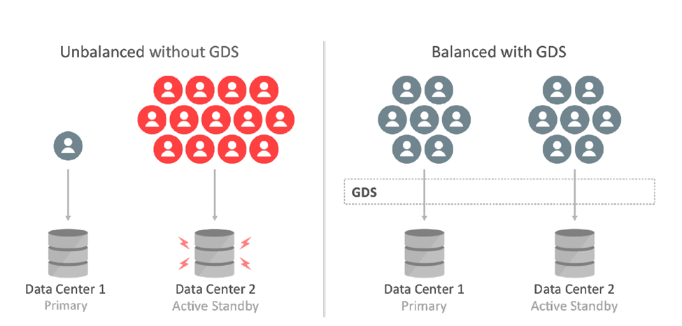
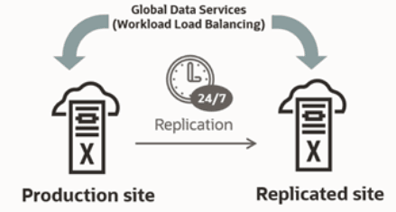

## 11 Oracle Global Data Services Best Practices

Oracle Database Global Data Services (GDS) is a holistic automated workload management feature of Oracle Database.

GDS provides workload routing, load balancing, inter-database service failover, replication lag-based routing, role-based global services, and centralized workload management for a set of replicated databases that are globally distributed or located within the same data center.

You can use GDS to achieve these benefits without the need to integrate with multiple-point solutions or homegrown products. GDS provides optimized hardware and software utilization, better performance, scalability, and availability for application workloads running on replicated databases.

### Introduction to Global Data Services

Numerous organizations have multiple copies of their production or standby databases either locally or in different geographical locations. This redundancy fulfills various business needs, such as ensuring uninterrupted availability, preparing for disaster recovery, localizing content and caching, scaling operations, optimizing performance for local users, and complying with local regulations. Oracle Active Data Guard and Oracle GoldenGate, which synchronize these copies, are Oracle's strategic disaster recovery and replication technologies that provide the lowest Recovery Time Objective (RTO) and Recovery Point Objectives (RPO).

Achieving high performance and high availability by distributing workload across multiple database replicas presents challenges that extend beyond the capabilities of the replication technology. The workload must be load-balanced to use resources effectively and achieve the best performance. Outages must be handled intelligently so that applications remain available and deliver the best possible quality of service should a replica go offline. In an ideal world, load balancing and high availability using a pool of replicated databases occurs seamlessly and optimally using real-time information available from the Oracle Database. This ideal is achievable using Oracle Global Data Services (GDS).

GDS extends the concept of database services, a mechanism used for workload management in Oracle Real Application Clusters (RAC), to a globally replicated configuration that includes any combination of Oracle RAC, single instance database, Oracle Active Data Guard, and Oracle GoldenGate. GDS allows services to be deployed anywhere within this globally replicated configuration, supporting load balancing, high availability, regional affinity, and so on. GDS is built on time-tested technological building blocks such as services (Dynamic Workload Management), Oracle Active Data Guard and GoldenGate replication, and Oracle Net Listener.

Even though the feature is called Global Data Services, the databases that constitute the GDS configuration can be globally distributed or located within the same data center. Clients can securely connect by specifying a service name without needing to know where the physical data center assets providing that service are located, enabling a highly flexible deployment for an enterprise data cloud. With GDS, replicated databases appear to the applications as a single data source.

A GDS configuration contains multiple global service managers per region. The global service managers are “global listeners,” which understand real-time load characteristics and the user-defined service placement policies on the replicated databases. These global service managers are instrumental in performing inter-database service failovers and load balancing of GDS. GDS is a shared infrastructure that can govern multiple sets of replicated databases. This documentation describes the configuration and operational practices for GDS. It is intended for enterprise architects, database architects, database administrators, technology managers, solution architects, application architects, and those who are influential in the overall database architecture design.

#### Global Data Services Concepts

Database services are logical abstractions for managing workloads in an Oracle database. Each service represents a workload with common attributes, service-level thresholds, and priorities. The grouping can be based on work characteristics, including the application function. For example, the Oracle E-Business Suite defines a service for each application module, such as general ledger, accounts receivable, and order entry. Services are built into Oracle Database, providing a single system image for workloads. Services enable administrators to configure a workload, administer it, enable and disable it, and measure the workload as a single entity. Clients connect using a database service name.

In Oracle RAC, a service can span one or more instances and facilitate workload balancing based on real-time transaction performance. This provides high availability, rolling changes by workload, and complete location transparency. For replicated environments, GDS introduces the concept of a "global service". Global services are provided across a set of databases containing replicated data that belongs to a particular administrative domain known as a GDS pool. Examples of a GDS pool are a SALES pool or an HR pool. A set of databases in a GDS configuration and the database clients are said to be in the same GDS region if they share the network proximity. Examples of GDS regions are the Asian region, European region, and so on.

All of the characteristics of traditional database services are supported by global services. Global services extends traditional database services with additional attributes such as global service placement, replication lag (Oracle Active Data Guard and Oracle GoldenGate from 19c onwards), and region affinity.

Global service placement: When a global service is created, GDS allows the preferred and available databases for that service to be specified. The available databases support a global service if the preferred database fails. In addition, GDS allows you to configure a service to run on all the replicas of a given GDS pool.

Replication lag: Clients can be routed to the Oracle Active Data Guard standbys that are not lagging by the tolerance limit established with the lag attribute of a global service.

Region affinity: A global service allows you to set preferences to which region (for example Asia or Europe) your given applications should connect.

Figure 11-1 Workload Balancing with Global Data Services



> The image shows a comparison of replicated databases without load balancing and with load balancing. The left side of the diagram, labeled "Unbalanced without GDS," shows two databases, a Data Guard primary and standby, where the primary has one client request and the standby has 13 requests. The right side, labeled "Balanced with GDS," shows an equal number of connections to the primary and standby databases. The connection lines are intersected by a box labeled GDS.


#### Key Capabilities of Global Data Services

Global Data Services (GDS) technology provides the following principal capabilities:

- Region-based workload routing: With GDS, you can choose to configure client connections to be routed among a set of replicated databases in a local region. This capability allows you to maximize application performance (avoiding the network latency overhead of accessing databases in remote areas).
- Connect-time load balancing: Global service managers use the load statistics from all databases in the GDS pool, inter-region network latency, and the configured connect-time load balancing goal to route the incoming connections to the best database in a GDS pool.
- Runtime load balancing: GDS enables runtime load balancing across replicated databases by publishing a real-time load balancing advisory for connection pool-based clients (for example, OCI, JDBC, ODP.NET, WebLogic, and so on.). The connection pool-based clients subscribe to this load-balancing advisory and route database requests in real time across already-established connections.
	With GDS's runtime connection load balancing feature, application client work requests are dynamically routed to the database that offers the best performance. In addition, GDS also supports the ability to dynamically re-distribute connections when the database performance changes.
- Inter-database service failover: If a database global service crash occurs, GDS, considering the service placement attributes, automatically performs an inter-database service failover to another available database in the pool. GDS sends Fast Application Notification (FAN) events so that the client connection pools can reconnect to the new database where the global service has been started.
- Replication lag-based workload routing: With Oracle Active Data Guard, standbys may lag behind the primary database. A global service allows you to choose the acceptable lag tolerance for a given application. GDS routes requests to a standby database whose lag is below the limit. If the lag exceeds the lag limit, the service is relocated to another available standby database that lags below the threshold. New requests are routed to a standby database that satisfies the lag limit. The global service is shut down if there is no available database. When the lag is resolved or comes within the limit, GDS automatically brings up the service.
	With Oracle GoldenGate replication, when the lag exceeds the lag threshold defined for a service (lag defined by `SELECT MAX(INCOMING_LAG FROM                         GGADMIN.GG_LAG)`, that service is stopped on that database. The service defines the effect of that; it may or may not terminate all the sessions based on the configuration. The service is restarted if the lag comes back within the threshold. After the service has been stopped, the global service manager automatically performs failover processing. Any new connections to this service are directed elsewhere than the lagged database. So, if there are two databases in the pool, and the service is `preferred_all` with `lag=10` initially, the service runs on both databases, and the connections are load-balanced. If the second database goes past the lag threshold, the service is stopped there, and any new connections are directed only to the first database. If the lag comes back within the threshold, the service is restarted, load balancing continues, and new connections can use the second database.
- Role-based global services: When a database role transition is performed with Oracle Data Guard Broker, GDS can automatically relocate the global service to the new primary database and the new standby if the role assigned to the service matches the role of the database.
- Centralized workload management for replicas: GDS allows more straightforward configuration and management of the replicated databases' resources located anywhere with a single unified framework.

#### Benefits of Global Data Services

Global Data Services (GDS) allows fault-tolerant database services to be deployed and centrally managed across a set of replicated databases. The GDS framework provides workload balancing across these databases. More specifically, GDS is an Oracle-integrated solution that renders the following benefits:

- Higher availability and global scalability support seamless inter-database service failover among replicated databases in any data center, yielding higher application availability.
- GDS provides application scalability on demand by allowing dynamic addition of databases. It enables replicated databases to be added to the GDS infrastructure dynamically and transparently to obtain additional resource capability to scale application workloads. GDS allows this with no change to the application configuration or client connectivity.

Better Performance and Elasticity

With integrated load balancing across multiple databases, GDS addresses inter-region resource fragmentation. Under-utilized resources in one region can be put to work on the workload of another region's over-utilized resources, achieving optimal resource utilization. GDS sends work requests to less powerful databases in a GDS pool containing replicated databases running on database servers of different processor generations and various resources (CPU, memory, I/O). When more powerful databases are overloaded, the goal should be to equalize the response time.

Improved Manageability

The GDSCTL command-line interface or the Oracle Enterprise Manager Cloud Control graphical user interface can administer a GDS configuration. With centralized administration of global resources, geographically dispersed replicated databases, whether regional or global, can be effectively utilized within the unified framework of GDS.

Centralized workload management of replicated databases, inter-database service failover, and runtime load balancing are unique features of GDS. GDS enables a truly elastic and agile enterprise and extends the benefits of a private data cloud.

### Application Workload Suitability for Global Data Services

Global Data Services (GDS) is best for replication-aware application workloads; it is designed to work in replicated environments. Applications that are suitable for GDS adoption possess any of the following characteristics:

- The application can separate its work into read-only, read-mostly, and read-write services to use Oracle Active Data Guard or Oracle GoldenGate replicas. GDS does not distinguish between read-only, read-write, and read-mostly transactions. The application connectivity has to be updated to separate read-only or read-mostly services from read-write services, and the GDS administrator can configure the global services on appropriate databases. For example, a reporting application can function directly with a read-only service at an Oracle Active Data Guard standby database.
- Administrators should be aware of and avoid or resolve multi-master update conflicts to take advantage of Oracle GoldenGate replicas. For example, an internet directory application with built-in conflict resolution enables the read-write workload to be distributed across multiple databases, each open read-write and synchronized using Oracle GoldenGate multi-master replication.
- Ideally, the application is tolerant of replication lag. For example, a web-based package tracking application that allows customers to track the status of their shipments using a read-only replica, where the replica does not lag the source transactional system by more than 10 seconds.

### Global Data Services in Oracle Maximum Availability Architecture

The Oracle Maximum Availability Architecture (MAA) is Oracle’s best practices blueprint for the integrated suite of Oracle’s advanced High Availability (HA) technologies. Enterprises that leverage MAA in their IT infrastructure find they can quickly and efficiently deploy applications that meet their business requirements for high availability.

Without Oracle Global Data Services, administrators were required to deploy 3rd party load balancers or have opted for custom-written connection managers. The 3rd party solutions come with significant integration costs, and the DIY homegrown solutions require high initial cost and time to value as well as an overhead of maintenance and support effort.

Using Global Data Services, you can unify replicated database resources within a single framework, avoiding the need to produce homegrown or 3rd party integration for load balancing. You can minimize the vendor integration touch points in their high availability and disaster recovery stack.

Figure 11-2 Oracle Global Data Services in Maximum Availability Architecture



> The image shows how Global Data Services (GDS) fits into the MAA Gold and Platinum reference architectures by load balancing database workload between a production site and a replicated site.
>
> [  
> Copyright © 2005, 2026, Oracle and/or its affiliates.](https://docs.oracle.com/en/database/oracle/oracle-database/dcommon/html/cpyr.htm)


Global Data Services is a strategic MAA component available within the Oracle Database. GDS is well integrated with the Oracle ecosystem, providing workload routing, load balancing, and service failover across replicated databases located within and across data centers. Simply put, GDS is a database load balancer for replicated databases and provides high availability through the inter-database service failover capability.

Global Data Services lets administrators manage client workloads automatically and transparently across replicated databases that offer common services. A database service is a named representation of one or more database instances. Services let you group database workloads and route a particular work request to an appropriate instance. A global service is provided by multiple databases synchronized through data replication.

Global Data Services provides dynamic load balancing, failover, and centralized service management for replicated databases that offer common services. The set of databases can include Oracle RAC and non-cluster Oracle databases interrelated through Oracle Data Guard, databases consolidated under Oracle Multitenant, Oracle GoldenGate, or any other replication technology.

For detailed information about GDS, see the Global Data Services technical brief at [http://oracle.com/goto/gds](http://oracle.com/goto/gds).

### Partial or Full Site Outage with Global Data Services

Complete-site failure results in both the application and database tiers being unavailable. To maintain availability, users must be redirected to a secondary site that hosts a redundant application tier and a synchronized copy of the production database. MAA's best practice is to maintain a running application tier at the standby site to avoid startup time and use Oracle Data Guard to manage the synchronized copy of the production database. Upon site failure, a WAN traffic manager performs a DNS failover (manually or automatically) to redirect all users to the application tier at the standby site. In contrast, a failover transitions the standby database to the primary production role.

A partial-site failure is when the application or database stack encounters an outage. Connecting clients to the disaster recovery site application stack can mitigate application stack failure. However, when the primary database becomes unavailable, the application tier connected to the primary database remains intact. All that is required to maintain availability is to redirect the application tier to the new primary database after a Data Guard failover has been completed. In this use case, the standby database is located within a distance from the surviving application tier such that it can deliver acceptable performance using a remote connection after a database failover has occurred.

Global Data Services (GDS) enables service management and load balancing between replicated databases withina region. However, the application tier still functions when GDS global service managers can route connections to the best available replica based on load balancing policies and service availability. By contrast, an out-of-region failover requires users to be directed to a remote application tier local to the new production database (serviced by a different set of in-region global service managers. This document focuses on GDS configuration for failover within a region.

### Global Data Services Configuration

#### High-Level Deployment Steps

The following are the basic steps you would take to implement Global Data Services.

1. Install Global Data Services (GDS) global service manager software on global service manager servers.
2. Pre-create the GDS catalog database.
3. Set up GDS Administrator accounts and privileges.
4. Configure GDS.
	- Create the GDS catalog and standby databases.
	- Add global service managers, regions, pools, databases, and global services.
5. Set up client connectivity.

#### Configuration Example

The following steps describe how to implement Global Data Services.

This example configuration of Global Data Services (GDS) uses an Administrator-managed Oracle RAC database. Administrator-managed deployment means that you configure database services to run on specific instances belonging to a particular database using a preferred and available designation.

Policy-managed deployment is based on server pools, where database services run within a server pool as singletons or uniformly across all of the servers in the server pool. Databases are deployed in one or more server pools, and the size of the server pools determines the number of database instances in the deployment. For detailed information about GDS, see [Global Data Services Concepts and Administration Guide](https://docs.oracle.com/pls/topic/lookup?ctx=en/database/oracle/oracle-database/21/haovw&id=GSMUG-GUID-829434C7-608D-40D4-81C8-A77A63FCD7EB)

1. Create and prepare a GDS catalog database.
	GDS uses a catalog database to store meta-data relating to the layout and status of the GDS configuration. For maximum availability, Oracle recommends that the GDS catalog database be deployed independently and that Oracle's high-availability features, such as Oracle Real Application Clusters (Oracle RAC) and Oracle Data Guard, be used to protect the catalog database against outages.
2. Create the `GSM_ADMIN` user and assign that user the `GSMADMIN_ROLE`.
	Note that by default, the password for both `GSM_ADMIN`, `GSMUSER`, and `GSMCATUSER` expires after 180 days.
	```
	SQL> create user gsm_admin identified by password;
	User created.
	SQL> grant gsmadmin_role to gsm_admin;
	Grant succeeded.
	SQL> exit
	```
3. Copy the Oracle Net alias that can be used to access the catalog database and place it in the tnsnames.ora file in the global service manager home.
	```
	GDSCAT =
	(DESCRIPTION =
	(ADDRESS = (PROTOCOL = TCP)(HOST = <hostmane>)(PORT = 1521))
	(CONNECT_DATA =
	(SERVER = DEDICATED)
	(SERVICE_NAME = gdscat)
	))
	```
4. With the environment configured for the global service manager home, use GDSCTL to connect to and create the GDS catalog with Auto VNCR disabled (Auto VNCR can cause problems with Oracle RAC deployments).
	```
	GDSCTL>create catalog -database gdscat -user gsm_admin -autovncr OFF
	"gsm_admin" password:
	Catalog is created
	```
5. Connect to the catalog database, unlock the `GSMCATUSER` user, and set the password.
	```
	SQL> alter user gsmcatuser account unlock;
	User altered.
	SQL> alter user gsmcatuser identified by password;
	User altered.
	```
6. With the environment configured for the global service manager home, use GDSCTL to connect to, create, and start the global service manager listeners.
	As a best practice, global service manager listeners should reside on hardware separate from that hosting the Oracle Databases in the GDS configuration. The resource requirements for hardware needed to run global service manager listeners are lightweight and can easily be accommodated using virtual machines.
	```
	GDSCTL>add gsm -gsm gsm1 -listener 1522 -catalog gdscat
	"gsmcatuser" password:
	Create credential oracle.security.client.connect_string1
	GSM successfully added
	GDSCTL>start gsm -gsm gsm1
	GSM is started successfully
	GDSCTL>status
	Alias GSM1
	Version 19.17.0.3.0
	Start Date 13-APR-2023 09:40:59
	Trace Level off
	Listener Log File
	 /u01/app/oracle/diag/gsm/hostname/gsm1/alert/log.xml
	Listener Trace File
	 /u01/app/oracle/diag/gsm/hostname/gsm1/trace/ora_64863_139739749930432.trc
	Endpoint summary
	(ADDRESS=(HOST=hostname.example.com)(PORT=1522)(PROTOCOL=tcp))
	GSMOCI Version 0.6.11
	Mastership Y
	Connected to GDS catalog Y
	Process Id 64883
	Number of reconnections 0
	Pending tasks. Total 0
	Tasks in process. Total 0
	Regional Mastership TRUE
	Total messages published 0
	Time Zone -04:00
	Orphaned Buddy Regions: None
	GDS region regionora
	```
7. With the environment configured for the global service manager home, use GDSCTL to create a default GDS pool and default region.
	```
	GDSCTL>add gdspool -gdspool sales
	GDSCTL>add region -region slc
	GDSCTL>add region -region sca
	```
8. With Auto VNCR disabled during GDS catalog creation to avoid issues, use GDSCTL to add hosts using the add invitednode command, using the host name or IP address appropriately.
	```
	GDSCTL>add invitednode 192.0.2.1
	GDSCTL>add invitednode host1.example.com
	```
9. Unlock the `GSMUSER` account.
	Before adding a database to a pool, the database administrator should unlock the `GSMUSER` account and give the password to the GDS pool administrator, as shown in the following example.
	```
	SQL> alter user gsmuser account unlock;
	User altered.
	SQL> alter user gsmuser identified by password;
	User altered.
	```
10. Add databases to the GDS pool.
	To be part of a GDS pool, a database must use a server parameter file (SPFILE). An Oracle RAC database should also have SCAN set up.
	To add a database, connect to the GDS catalog using the GDS pool or GDS administrator credentials. For example, without Data Guard, the following add database command can be used.
	```
	GDSCTL>add database -connect mts -region sca -gdspool sales
	Catalog connection is established
	"gsmuser" password:
	DB Unique Name: mts
	```
	Note:
	When using Oracle Active Data Guard with GDS, use `add                             brokerconfig` instead of `add database`, and then use `modify database` to configure the standby database (see [add brokerconfig](https://docs.oracle.com/pls/topic/lookup?ctx=en/database/oracle/oracle-database/21/haovw&id=GSMUG-GUID-A2F086A1-9846-488E-9DE8-F98723E8AF9C)). The syntax for these commands would be like the following.
	```
	GDSCTL>add brokerconfig -connect <primary_db> -gdspool <dbpool> -region <dc> -pwd <gsmuser_pwd>
	GDSCTL>modify database -database <standby_db> -connect <dc> -gdspool <dbpool> -region <dc> -pwd <gsmuser_pwd>
	```
	Database instance registration with a global service manager succeeds only when the request originates from a valid node. If a host on which a database resides contains multiple network interfaces, the auto-configuration could register the wrong set of IP addresses, leading to the database registration being rejected.
11. Correct any rejected registration and properly discover all database instances.
	If a firewall exists between the global service managers, and the databases and the ports are not opened, the registration fails. From the global service manageralert log, you will see entries similar to the following.
	```
	Listener(VNCR option 1) rejected Registration request from destination
	192.0.2.2
	Listener(VNCR option 1) rejected Registration request from destination
	192.0.2.3
	```
	You will find that the database object exists in the GDS catalog, but some or all instances associated with specific hosts are missing.
	```
	GDSCTL>databases
	Database: "mts" Registered: Y State: Ok ONS: Y. Role: PRIMARY
	Instances: 1 Region: slc
	Registered instances:
	sales%1
	```
	To correct the rejected registration and properly discover all database instances, run `add invitednode` using the rejected IP address listed in the global service manager alert log.
12. If there is a firewall between the global service managers and the database, then once the ports have been opened and verified using tnsping, issue the `add invitenode` command as shown here.
	```
	GDSCTL>add invitednode 192.0.2.3
	GDSCTL>databases
	Database: "mts" Registered: Y State: Ok ONS: Y. Role: PRIMARY
	Instances: 2 Region: slc
	Registered instances:
	sales%1
	sales%2
	```
13. Create a service on the GDS pool databases.
	The GDSCTL `add service` command creates a service on the GDS pool databases.
	```
	GDSCTL>add service -service sales_sb -preferred_all -gdspool sales -notification TRUE
	```
	If this is an Oracle RAC database being added with multiple instances, then you must modify the service to add the database instances.
	```
	GDSCTL>modify service -gdspool sales -service sales_sb -database mts -add_instances -preferred mts1,mts2
	GDSCTL>modify service -gdspool sales -service sales_sb -database stm -add_instances -preferred stm1,stm2
	GDSCTL>start service -service sales_sb -gdspool sales
	```
14. Verify that the global service is running.
	```
	GDSCTL>services
	Service "sales_sb.sales.oradbcloud" has 2 instance(s). Affinity: ANYWHERE
	Instance "sales%1", name: "mts1", db: "mts", region: "slc", status: ready.
	Instance "sales%2", name: "mts2", db: "mts", region: "slc", status: ready.
	```

#### Configuration Best Practices

Oracle MAA recommends the following best practices for implementing Global Data Services:

- Each client communicates using an Oracle-integrated connection pool such as UCP, OCI, or ODP.NET. The connection pools will be notified about any service failovers and load balancing advisory notifications using Fast Application Notification Events.
- Run three global service managers in each region. Create three global service managers in each region so that if one global service manager goes down, you have two remaining global service managers to provide redundancy. Each global service manager should reside on separate hardware. Global service managers enable connection routing among replicated databases. A global service manager is a stateless, lightweight, and intelligent listener that can repopulate its metadata from the GDS catalog.
- Protect the GDS catalog database with Oracle Data Guard.The GDS catalog is a small (< 100 GBs) repository that hosts the metadata of the GDS configuration, regions, global service managers, global services, databases, and so on. MAA recommends that you set up a local Data Guard standby database configured with Maximum Availability database protection mode, Data Guard Fast-Start failover, and a remote physical standby database. All GDS catalog standby databases should use Oracle Active Data Guard for the best data protection and reside on separate hardware and storage.

#### Using FAN ONS with Global Data Services

Fast Application Notification (FAN) uses the Oracle Notification Service (ONS) for event propagation to all Oracle Database clients, including JDBC, Tuxedo, and listener clients.

ONS is installed as part of Oracle Global Data Services, Oracle Grid Infrastructure on a cluster, in an Oracle Data Guard installation, and when Oracle WebLogic is installed.

ONS propagates FAN events to all other ONS daemons it is registered with. No steps are needed to configure or enable FAN on the database server side, with one exception: OCI FAN and ODP FAN require that notification be set to TRUE for the service by GDSCTL. With FAN auto-configuration at the client, ONS jar files must be on the CLASSPATH or in the ORACLE\_HOME, depending on your client.

General Best Practices for Configuring FCF Clients

Follow these best practices before progressing to driver-specific instructions.

- Use a dynamic database service. Using FAN requires that the application connects to the database using a dynamic global database service. This is a service created using GDSCTL.
- Do not connect using the database service or PDB service. These services are for administration only and are not supported for FAN. The TNSnames entry or URL must use the service name syntax and follow best practices by specifying a dynamic database service name. Refer to the examples later in this document.
- Use the Oracle Notification Service when you use FAN with JDBC thin, Oracle Database OCI, or ODP.Net clients. FAN is received over ONS. Accordingly, in the Oracle Database, ONS FAN auto-configuration is introduced so that FCF clients can discover the server-side ONS networks and self-configure. FAN is automatically enabled when ONS libraries or jars are present.
- Enabling FAN on most FCF clients is still necessary in the Oracle Database. FAN auto-configuration removes the need to list the global service managers an FCF client needs.
- Listing server hosts is incompatible with location transparency and causes issues with updating clients when the server configuration changes. Clients already use a TNS address string or URL to locate the global service manager listeners.
- FAN auto-configuration uses the TNS addresses to locate the global service manager listeners and then asks each server database for the ONS server-side addresses. When there is more than one global service manager FAN auto-configuration contacts each and obtains an ONS configuration for each one.
- The ONS network is discovered from the URL when using the Oracle Database. An ONS node group is automatically obtained for each address list when `LOAD_BALANCE` is off across the address lists.
- By default, the FCF client maintains three hosts for redundancy in each node group in the ONS configuration.
- Each node group corresponds to each GDS data center. For example, if there is a primary database and several Oracle Data Guard standbys, there are by default three ONS connections maintained at each node group. The node groups are discovered when using FAN auto-configuration.
	With `node_groups` defined by FAN auto-configuration, and `load_balance=false` (the default), more ONS endpoints are not required. If you want to increase the number of endpoints, you can do this by increasing max connections. This applies to each node group. Increasing to 4 in this example maintains four ONS connections at each node. Increasing this value consumes more sockets.
	`oracle.ons.maxconnections=4 ONS`
- If the client is to connect to multiple clusters and receive FAN events from them, for example in Oracle RAC with a Data Guard event, then multiple ONS node groups are needed. FAN auto-configuration creates these node groups using the URL or TNS name. If automatic configuration of ONS (Auto-ONS) is not used, specify the node groups in the Oracle Grid Infrastructure or oraaccess.xml configuration files.

Client Side Configuration

As a best practice, multiple global service managers should be highly available. Clients should be configured for multiple connection endpoints where these endpoints are global service managers rather than local, remote, or single client access name (SCAN) listeners. For OCI / ODP.Net clients use the following TNS name structure.

```
(DESCRIPTION=(CONNECT_TIMEOUT=90)(RETRY_COUNT=30)(RETRY_DELAY=3) (TRANSPORT_CONNECT_TIMEOUT=3)
  (ADDRESS_LIST =
   (LOAD_BALANCE=on)
   (ADDRESS=(PROTOCOL=TCP)(HOST=GSM1)(PORT=1522))
   (ADDRESS=(PROTOCOL=TCP)(HOST=GSM2)(PORT=1522))
   (ADDRESS=(PROTOCOL=TCP)(HOST=GSM3)(PORT=1522)))
  (ADDRESS_LIST=
   (LOAD_BALANCE=on)
   (ADDRESS=(PROTOCOL=TCP)(HOST=GSM2)(PORT=1522)))
 (CONNECT_DATA=(SERVICE_NAME=sales)))
```

Always use dynamic global database services created by GDSCTL to connect to the database. Do not use the database service or PDB service, which are for administration only not for application usage and they do not provide FAN and many other features because they are only available at mount.

Use the latest client driver aligned with the latest or older RDBMS for JDBC. Use one `DESCRIPTION` in the TNS names entry or URL Using more causes long delays connecting when `RETRY_COUNT` and `RETRY_DELAY` are used. Set `CONNECT_TIMEOUT=90` or higher to prevent logon storms for OCI and ODP clients.

#### Application-Level Configuration

Configuring FAN for Java Clients Using Universal Connection Pool

The best way to take advantage of FCF with the Oracle Database JDBC thin driver is to use the Universal Connection Pool (UCP) or WebLogic Server Active GridLink.

Setting the pool property `FastConnectionFailoverEnabled` on the Universal Connection Pool enables Fast Connection Failover (FCF). Active GridLink always has FCF enabled by default. Third-party application servers, including IBM WebSphere and Apache Tomcat, support UCP as a connection pool replacement.

For more information about embedding UCP with other web servers, see the following technical briefs.

- Design and deploy WebSphere applications for planned or unplanned database downtimes and runtime load balancing with UCP ([https://www.oracle.com/docs/tech/database/planned-unplanned-rlb-ucp-websphere.pdf](https://www.oracle.com/docs/tech/database/planned-unplanned-rlb-ucp-websphere.pdf))
- Design and deploy Tomcat applications for planned or unplanned database downtimes and Runtime Load Balancing with UCP ([https://www.oracle.com/docs/tech/database/planned-unplanned-rlb-ucp-tomcat.pdf](https://www.oracle.com/docs/tech/database/planned-unplanned-rlb-ucp-tomcat.pdf))

Follow these configuration steps to enable Fast Connection Failover.

1. The connection URL must use the service name syntax and follow best practices by specifying a dynamic database service name and the JDBC URL structure (above and below).
	All other URL formats are not highly available. The URL may use JDBC thin or JDBC OCI.
2. If wallet authentication has not been established, remote ONS configuration is needed.
	Set the pool property `setONSConfiguration` in a property file as shown in the following example. The property file specified must contain an `ons.nodes` property and, optionally, properties for `oracle.ons.walletfile` and `oracle.ons.walletpassword`. An example of an `ons.properties` file is shown here.
	```
	PoolDataSource pds = PoolDataSourceFactory.getPoolDataSource();
	pds.setConnectionPoolName("FCFSamplePool"); pds.setFastConnectionFailoverEnabled(true);
	 pds.setONSConfiguration("propertiesfile=/usr/ons/ons.properties");
	pds.setConnectionFactoryClassName("oracle.jdbc.pool.OracleDataSource");
	pds.setURL("jdbc:oracle:thin@((CONNECT_TIMEOUT=4)(RETRY_COUNT=30)(RETRY_DELAY=3) "+ "
	 (ADDRESS_LIST = "+ " (LOAD_BALANCE=on) "+ " ( ADDRESS =
	 (PROTOCOL = TCP)(HOST=GSM1)(PORT=1522))) "+ " (ADDRESS_LIST = "+ " (LOAD_BALANCE=on)
	 "+ "( ADDRESS = (PROTOCOL = TCP)(HOST=GSM2)(PORT=1522)))"+
	 "(CONNECT_DATA=(SERVICE_NAME=service_name)))");
	```
3. Ensure the pool property `setFastConnectionFailoverEnabled=true` is set.
4. The `CLASSPATH` must contain ons.jar, ucp.jar, and the JDBC driver jar file.
	For example, ojdbc8.jar.
5. If you are using JDBC thin with Oracle Database, Application Continuity can be configured to failover the connections after FAN is received.
6. If the database needs different ONS endpoints than those autoconfigured, the ONS endpoints can be enabled.
	In a situation where multiple clusters exist with auto-ons enabled, auto-ons would generate node lists with the following guidelines:
	For EVERY active nodelist `oracle.ons.maxconnections` is set to 3 by default, so there is no need to set this explicitly. This example will result in the ONS client trying to maintain six total connections.

#### Configuring FAN for OCI Clients

OCI clients use ONS for FAN transport.

OCI clients embed FAN at the driver level so that all clients can use it regardless of the pooling solution. Ideally, both the server and the client would use release 19c or later.

Configuration for SQL\*Plus and PHP

1. Set notification for the service.
2. For PHP clients only, add `oci8.events=On` to `php.ini`.
	Important: If xml is present with events=-false or events are not specified, this disables the usage of FAN. To maintain FAN with SQL\*Plus and PHP when `oraccess.xml` is in use, set `events=-true`.
3. On the client side, using a client and Oracle Database, enable FAN in xml.

Configuration for OCI Clients

1. Tell OCI where to find ONS Listeners Starting.
	The client installation comes with ONS linked into the client library. Using auto-config, the ONS endpoints are discovered from the TNS address. This automatic method is the recommended approach. Like ODP.Net, manual ONS configuration is also supported using `oraaccess.xml`.
2. Enable FAN high availability events for the OCI connections.
	To enable FAN you edit the OCI file xml to specify the global parameter events. This file is located in $ORACLE\_HOME/network/admin. See [Step 3: Use Fast Application Notification](configuring-level-1-basic-application-high-availability.md) for more information.
3. Tell OCI where to find ONS Listeners.
	The client installation comes with ONS linked into the client library. Using auto-config, the ONS endpoints are discovered from the TNS address. This automatic method is the recommended approach. Like ODP.Net, manual ONS configuration is also supported using `oraaccess.xml`.
4. Enable FAN on the server for all OCI clients.
	It is still necessary to enable FAN on the database server for all OCI clients (including SQL\*Plus).

#### Controlling Logon Storms

Small connection pools are strongly recommended, but controlling logon storms can be done with tuning when you have many connections.

Oracle MAA recommends the following tuning on servers that host Global Service Managers.

1. Increase the Listen backlog at the OS level.
	To have the new value take effect without rebooting the server, perform the following as root.
	```
	echo 8000 > /proc/sys/net/core/somaxconn
	```
2. To persist the value across reboots, add this setting to /etc/sysctl.conf.
	```
	net.core.somaxconn=6000
	```
3. Increase `queuesize` for the global service manager listener.
	Update `sqlnet.ora` in Oracle home that the listeners are running from to increase the `queuesize` parameter:
	```
	TCP.QUEUESIZE=6000
	```

#### Graceful Application Switchover

Database services are used to manage workloads during the planned outage properly. Services must be properly created, and the application must obtain connections from a service.

These recommendations assume using a FAN-aware connection pool, such as Oracle Universal Connection Pool (UCP) to gracefully drain connections without application interruption from a service that is stopped. Your applications can use other connection types that don't support FAN-aware connection pools or have long-running transactions. Ideally, these applications will be disconnected before the maintenance window.

The recommendations below describe how to disconnect some sessions when their transaction ends in a timely manner or, ultimately, when the instance is shut down for maintenance.

The recommended and validated approach to understanding and optimizing your application's connection configuration is provided in the following sections; certain applications may have specific guidelines to follow.

Understanding Your Application's Use of Connections

Understanding how your application obtains and releases its connections is critical to determining whether it can gracefully switch to other instances in the cluster.

Find the following information about your application:

- What was the workload during the planned outage (OLTP/short or batch/long transactions)?
	- Short transactions using a connection pool such as UCP or ODP.NET can be quiesced rapidly.
		- Long transactions need additional time to quiesce or must have batch jobs stopped or queued at an appropriate time in advance.
- What type of connection was obtained: Java, OCI, ODP with C#, or ODP with OCI)?
	- UCP, ICC, ODP.NET, and OCI session pools use Fast Application Notification (FAN) to drain the pool quickly; other connections require waiting until the connection is closed (or termination if the application allows)
- What is the amount of time to wait for the connection pool to quiesce before stopping the service?
	- Useful to know the proper amount of time is given before disconnection is performed
- Can the application handle disconnection after the transaction completes (applies to batch workloads)?
	- If the application can't handle being disconnected gracefully, it must be stopped before the planned maintenance, or Application Continuity might be an option to avoid interruption.

Services and Application Configuration Best Practices

You must have properly configured services and application attributes to perform a graceful switchover successfully. See My Oracle Support Doc ID [1617163.1](https://support.oracle.com/rs?type=doc&id=1617163.1) for a matrix of validated drivers and applications clients.

Note:

You must test your configuration to ensure that it is set up and performs switchover properly before relying on it for a production system.

#### Using Oracle Active Data Guard with Global Data Services

Configure sessions to move in a rolling manner for Oracle Active Data Guard reader farm.

Prerequisites

You must have the following in place for this procedure to work correctly.

- Oracle Active Data Guard configuration using Oracle Database (release 19c or later recommended).
- Global Data Services (GDS) configuration using global service manager (release 19c or later recommended).
- A GDS service has been created to run on all Active Data Guard databases in the configuration.
	For example:
	```
	GDSCTL>add service -service sales_sb -preferred_all -gdspool sales
	 –role physical_standby -notification TRUE
	GDSCTL>modify service -gdspool sales -service sales_sb -database mts -add_instances
	 -preferred mts1,mts2
	GDSCTL>modify service -gdspool sales -service sales_sb -database stm -add_instances
	 -preferred stm1,stm2
	GDSCTL>start service -service sales_sb -gdspool sales
	```

1. Check the current status of the services and related instances to ensure that services can be moved successfully.
	Note that the service should only be available on the source standby database at this point.
	```
	GDSCTL>services
	Service "sales_sb.sales.oradbcloud" has 2 instance(s). Affinity: ANYWHERE
	   Instance "sales%1", name: "mts1", db: "mts", region: "slc", status: ready.
	   Instance "sales%2", name: "mts2", db: "mts", region: "slc", status: ready.
	```
2. Stop services typically (not using the FORCE option) on the source database where connections are to be removed.
	- This step will quiesce the FAN-aware connection pools using FAN.
	- New connections are directed to other instances offering that service, and idle sessions are disconnected from the pool using the services.
	- Existing connections can continue until their work is complete and they are returned to the connection pool.
	```
	GDSCTL>stop service -service sales_sb -database mts -gdspool sales
	```
	Allow an agreed upon time for the sessions to disconnect and relocate, then continue with the next steps.
	Note:
	If you are performing a rolling upgrade of an Active Data Guard reader farm and the services are not running on other Active Data Guard reader nodes, you can complete the service stop on this database before performing the GDSCTL `stop service` described in this step.
3. Disconnect long-running sessions after the current query is completed.
	Preferably, long-running queries have been scheduled to stop or are queued before the window when connections are to be moved. This step handles long-running sessions that are still running and now need to be stopped (killed) abruptly.
4. Log on to the instance that you intend to shut down.
5. Check V$SESSION to see if any sessions are still connected to the service.
	```
	SQL> SELECT service_name, count(1) FROM v$session
	 GROUP BY service_name ORDER BY 2;
	```
6. Run the `DBMS_SERVICE.DISCONNECT_SESSION` package for the service you stopped earlier.
	For example:
	```
	SQL> exec
	 dbms_service.disconnect_session('oltp_work',DBMS_SERVICE.POST_TRANSACTION);
	```
7. Check `V$SESSION` again to ensure that sessions have logged off from the service.
	```
	SQL> SELECT service_name, count(1) FROM v$session
	 GROUP BY service_name ORDER BY 2;
	```
8. Start the GDS service on the target database and allow sessions to connect.
	```
	GDSCTL>start service -service sales_sb -database stm -gdspool sales
	```
9. Log on to the target database and check `V$SESSION` to see sessions connected to the service.
	```
	SQL> SELECT service_name, count(1) FROM v$session
	 GROUP BY service_name ORDER BY 2;
	```

#### Using Oracle GoldenGate with Global Data Services

The following Oracle GoldenGate role transition example topology consists of two databases: GG replica1 and GG replica2. Oracle GoldenGate is set up with uni-directional replication, with Extract running initially on GG replica1 and Replicat running initially on GG replica2. The generic steps still apply for bi-directional GoldenGate replicas or downstream mining GoldenGate replicas.

Prerequisites

You must have the following in place for this procedure to work correctly.

- Oracle GoldenGate configuration that uses Oracle Database (19c or higher recommended)
- GoldenGate processes should not connect to the source or target database using the GDS service name, but a dedicated TNS alias. Using the GDS service will cause the database connections to terminate prematurely, causing possible data loss.
- A heartbeat table has been implemented in the GoldenGate source and target databases to track replication latency and ensure the Replicat applied SCN synchronization. The GoldenGate automatic heartbeat table feature should be enabled. Refer to the Oracle GoldenGate Administration Guide for details on the automatic heartbeat table: [https://docs.oracle.com/en/middleware/goldengate/core/19.1/gclir/add-heartbeattable.html](https://docs.oracle.com/en/middleware/goldengate/core/19.1/gclir/add-heartbeattable.html).
- Global Data Services (GDS) configuration using global service manager (19c or higher recommended)
- GDS service has been created so that it can be run on all databases in the GoldenGate configuration.
	For example:
	```
	GDSCTL>add service -service sales_sb -preferred_all -gdspool sales
	GDSCTL>modify service -gdspool sales -service sales_sb -database mts
	 -add_instances -preferred mts1,mts2
	GDSCTL>modify service -gdspool sales -service sales_sb -database stm
	 -add_instances -preferred stm1,stm2
	GDSCTL>start service -service sales_sb -gdspool sales
	```

Note:

If you are using the lag tolerance option, specify the lag limit for the global service in seconds. Options for `add service` or `modify                     service` are `-lag {lag_value | ANY}`.

1. Check the current status of the services and related instances to ensure that they can be moved successfully.
	At this point, the service should only be available on the source database.
	```
	GDSCTL>services
	Service "sales_sb.sales.oradbcloud" has 2 instance(s). Affinity: ANYWHERE
	   Instance "sales%1", name: "mts1", db: "mts", region: "slc", status: ready.
	   Instance "sales%2", name: "mts2", db: "mts", region: "slc", status: ready.
	```
2. Stop services (not using the FORCE option) on the source database where connections are to be removed.
	- This step will quiesce the FAN-aware connection pools using FAN.
	- New connections are directed to other instances offering that service, and idle sessions are disconnected from the pool using the services.
	- Existing connections can continue until their work is complete and they are returned to the connection pool.
	```
	GDSCTL>stop service -service sales_sb -database mts -gdspool sales -force
	```
	Allow an agreed upon time for the sessions to disconnect and relocate, then continue with the next steps. The time to allow for sessions to drain depends on the workload and user transactions for your application.
3. Disconnect long-running sessions after the current transaction is completed.
	Preferably, long-running batch jobs are scheduled to be stopped or queued before the maintenance window. This step handles long-running sessions that are still running and must be stopped abruptly (e.g., killed). Check with the application developers if these long-running batch jobs are idempotent and recoverable before disconnecting long-running sessions.
4. Log on to the instance that you intend to shut down, and check `V$SESSION` to see if any sessions are still connected to the service.
	```
	SQL> SELECT service_name, count(1) FROM v$session
	 GROUP BY service_name ORDER BY 2;
	```
5. Run the `DBMS_SERVICE.DISCONNECT_SESSION` package for the service you stopped earlier.
	For example:
	```
	SQL> exec
	 dbms_service.disconnect_session('oltp_work',DBMS_SERVICE.POST_TRANSACTION);
	```
6. Check `V$SESSION` again to ensure sessions have logged off from the service.
	```
	SQL> SELECT service_name, count(1) FROM v$session
	 GROUP BY service_name ORDER BY 2;
	```
7. When all sessions associated with the GDS service have been disconnected, verify that all data from the GoldenGate source databases have been replicated to the target database.
	- Record the current database SCN from the GoldenGate SOURCE database.
		```
		SQL> SELECT current_scn FROM v$database;
		```
	- On the GoldenGate TARGET database, continue to monitor the Replicat applied SCN using the following query.
		```
		SQL> SELECT lwm_position FROM v$gg_apply_coordinator;
		```
	- When the target `LWM_POSITION` SCN is greater than the `CURRENT_SCN` recorded in the first step, it is safe to assume that all transactions have been replicated from the source to the target database. The users can now be switched over to the GoldenGate target database.

The above steps allow for a graceful switchover. However, if this is a failover event where the source database is unavailable, you can estimate the data loss using the steps below.

1. When using the automatic heartbeat table, use the following query to determine the replication latency.
	```
	SQL> col Lag(secs) format 999.9
	SQL> col "Seconds since heartbeat" format 999.9
	SQL> col "GG Path" format a32
	SQL> col TARGET format a12
	SQL> col SOURCE format a12
	SQL> set lines 140
	SQL> select remote_database "SOURCE", local_database "TARGET", incoming_path "GG Path",
	 incoming_lag "Lag(secs)", incoming_heartbeat_age "Seconds since heartbeat" from gg_lag;
	SOURCE        TARGET              GG Path                          Lag(secs) Seconds since heartbeat
	------------  ------------        -------------------------------- --------- -----------------------
	         MTS          GDST          EXT_1A ==> DPUMP_1A ==> REP_1A       7.3                     9.0
	```
	The above example shows a possible 7.3 seconds of data loss between the source and target databases.
2. Start the GDS service on the target database and allow sessions to connect.
	Note that if the application workload can accept a certain level of data lag, it is possible to perform this step much earlier than step two listed above.
	```
	GDSCTL>start service -service sales_sb -database stm -gdspool sales
	```
3. Log on to the target database and check `V$SESSION` to see sessions connected to the service.
	```
	SQL> SELECT service_name, count(1) FROM v$session
	 GROUP BY service_name ORDER BY 2;
	```

### Global Data Services Failover Across Regions Flow

1. The administrator has failed over or switched the production database to the secondary site. This is automatic if you are using Data Guard fast-start failover.
2. The administrator starts the middle-tier application servers on the secondary site if they are not already running.
3. The wide-area traffic manager selection of the secondary site can be automatic in the case of an entire site failure. The wide-area traffic manager at the secondary site returns the virtual IP address of a load balancer at the secondary site, and clients are directed automatically on the subsequent reconnect. In this scenario, the site failover is accomplished by an automatic domain name system (DNS) failover.
4. Alternatively, a DNS administrator can manually change the wide-area traffic manager selection to the secondary site for the entire site or specific applications.
	The following is an example of a manual DNS failover:
	- Change the DNS to point to the secondary site load balancer: The primary (primary) DNS server is updated with the new zone information, and the change is announced with DNS NOTIFY.
		- The secondary DNS servers are notified of the zone update with a DNS NOTIFY announcement, and the secondary DNS servers pull the new zone information.
		- Clear affected records from caching DNS servers.
		A caching DNS server is used primarily for performance and fast response. The caching server obtains information from an authoritative DNS server in response to a host query and then saves (caches) the data locally. On a second or subsequent request for the same data, the caching DNS server responds with its locally stored data (the cache) until the response's time-to-live (TTL) value expires. At this time, the server refreshes the data from the zone master. If the DNS record is changed on the primary DNS server, then the caching DNS server does not pick up the change for cached records until TTL expires. Flushing the cache forces the caching DNS server to go to an authoritative DNS server again for the updated DNS information.
		- Flush the cache if the DNS server being used supports such a capability. The following is the flush capability of standard DNS BIND versions:
		- BIND 9.3.0: The command `rndc flushname name` flushes individual entries from the cache.
				- BIND 9.2.0 and 9.2.1: The cache can be flushed with the command `rndc flush`.
				- BIND 8 and BIND 9 up to 9.1.3: Restarting the named server clears the cache.
5. Refresh local DNS service caching.
	Some operating systems might cache DNS information locally in the local name service cache. If so, this cache must also be cleared to recognize DNS updates quickly.
6. The secondary site load balancer directs traffic to the secondary site middle-tier application server.

### Global Data Services Limitations and Requirements

| A Single GDS Manages | GDS Databases |
| --- | --- |
| - 5,000 GDS Pools - 10 GDS Regions - 5 global service managers per Region - 10,000 Database instances - 10,000 Global Services - 1,000 Mid-tier connection pools | - Can be a Single Instance or RAC - Can be CDB or Non-CDB - Can run on commodity or Engineered systems (Oracle Exadata, ODA) - Are managed with GDSCTL CLI or Enterprise Manager DB Plug-in - Must be licensed for Oracle Active Data Guard or Oracle GoldenGate |

| Requirement | Network Load Balancer | Oracle GDS |
| --- | --- | --- |
| Locality-based routing | Yes | Yes |
| Connect-time database load balancing | Yes | Yes |
| Publish routing and failover intelligence to clients | No | Yes |
| Replication lag-based database workload routing | No | Yes |
| Inter-database global service failover | No | Yes |
| Automatic role-based global services | No | Yes |
| Centralized management of database services across replicas | No | Yes |
| Native integration for Oracle Active Data Guard | No | Yes |
| Cost effectiveness | Additional expenditure required | Included with Oracle Active Data Guard or Oracle GoldenGate license |