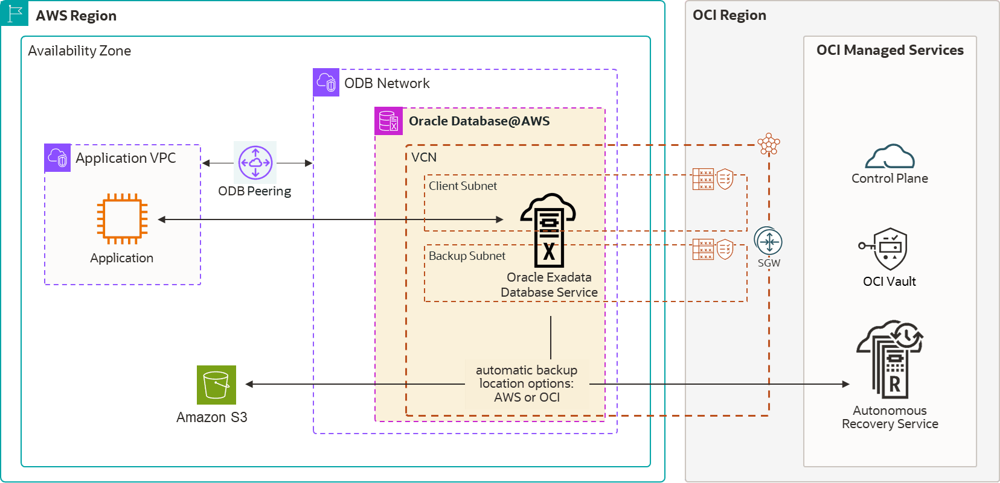
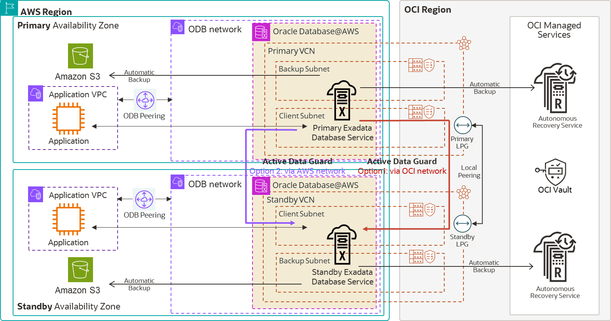
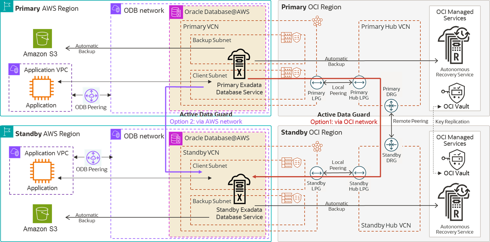

## Oracle Maximum Availability Architecture for Oracle Database@AWS

Amazon Web Services (AWS) is a strategic partner of Oracle Multicloud. Oracle Maximum Availability Architecture (MAA) evaluates MAA reference architectures on Oracle Database@AWS, the results of which are shown here.

To learn more about MAA Silver and MAA Gold evaluations and their benefits after certification, see [MAA Evaluations on Multicloud Solutions](maa-evaluations-multicloud-solutions.md).

Oracle MAA evaluated Oracle's solution in AWS. Oracle MAA continues to be periodically re-evaluated to ensure the solution meets all expected benefits, and to highlight any new MAA benefits and capabilities for Oracle Database@AWS. Certification is only given after the MAA evaluation meets the requirements.

Oracle MAA has evaluated and endorsed Oracle Database@AWS for:

- MAA Silver reference architecture for Oracle Exadata Database Service on Dedicated Infrastructure and Oracle Autonomous Database on Dedicated Exadata Infrastructure
- MAA Gold reference architecture for Oracle Exadata Database Service on Dedicated Infrastructure and Oracle Autonomous Database on Dedicated Exadata Infrastructure, when the standby database resides on another Exadata infrastructure in the same or separate Availability Zones (AZ) or different regions. Note that network latency and network bandwidth may vary depending on source and target locations.

Refer to [Multicloud Considerations for Autonomous Data Guard](autonomous-database-dedicated-exadata-infrastructure.md) for information about the MAA Silver and Gold certifications for Oracle Autonomous Database Dedicated.

### MAA Silver Network Topology and Evaluation

The following image shows the MAA Silver reference architecture, with Oracle RAC on Exadata Database Service, and showing backup options to Oracle Database Autonomous Recovery Service running in OCI or Amazon S3 in AWS.

Figure 36-9 Oracle Database@AWS in an MAA Silver Reference Architecture

> The image shows the MAA Silver reference architecture, with Oracle RAC on Exadata Database Service, and showing backup options to Oracle Database Autonomous Recovery Service running in OCI or Amazon S3 in AWS.
>
> [  
> Copyright © 2005, 2026, Oracle and/or its affiliates.](https://docs.oracle.com/en/database/oracle/oracle-database/dcommon/html/cpyr.htm)

Oracle MAA evaluated and endorsed Exadata Database Service on Oracle Database@AWS for the MAA Silver reference architecture, and observed the following results.

- Application and database uptime is adhered to as expected while injecting unplanned local outages, updating database and system software, and during system and database elastic changes (for example, increasing CPU, storage, and so on). See [MAA Evaluations on Multicloud Solutions](maa-evaluations-multicloud-solutions.md) for tests evaluated.
- [Oracle Maximum Availability Architecture in Oracle Exadata Cloud Systems](oracle-maximum-availability-architecture-oracle-exadata-cloud-systems.md) describes all of the benefits, including cloud MAA templates, high availability and low brownout, data protection, response time Quality-of-Service, low downtime for unplanned outages, minimum application impact for planned maintenance, and elastic system operations.

Additional MAA Best Practices Specific to AWS

- Take careful consideration of application VM placement and high availability. Application latency may be impacted by the application VM's proximity to the database server target.
	- For the lowest latency, place the application VM in the same Availability Zone (AZ) as the database, and use placement groups (not AWS network virtual appliances, firewalls, and the like).
		See [High Performance Networking for Oracle Database@AWS](https://docs.aws.amazon.com/odb/latest/UserGuide/high-performance-networking.html) for placement group details.
		- Ensure that your required RTT latency meets your application requirements.
		See [MAA Evaluations on Multicloud Solutions](maa-evaluations-multicloud-solutions.md) for information about how to evaluate RTT latency. For high availability, evaluate the placement of multiple application VMs in the same AZ or across multiple AZs, depending on your application response time requirements. Test thoroughly with your implementation. Variables such as VM size and placement can impact results.
		- To enable transparent application failover, follow the steps in [Configuring Continuous Availability for Applications](configuring-continuous-availability-applications1.md).
- Use Autonomous Recovery Service on OCI for the best data protection, backup, and recovery benefits as discussed later.
	The MAA evaluation observed that both Autonomous Recovery Service and Object Storage Service in OCI met expectations. MAA evaluation with S3 in AWS is still underway. See topic "Backup and Restore Observations" below.
- Allow TCP port 6200 ingress into the Exadata VM Cluster client subnet from the networks where your application VMs reside.
	TCP port 6200 access lets the Oracle Notification Services (ONS) to communicate about Fast Application Notification (FAN) events, which are required to provide immediate notification of cluster and service events, enabling applications to respond quickly to changes that occur during planned maintenance and unplanned outages. The recommended way to allow TCP port 6200 ingress is to log in to the Oracle Cloud Console, navigate to VM Cluster Information, edit the Client network security group exa\_1521\_adjustable\_nsg, and add a security rule where:
	- Direction is Ingress
		- Source Type is CIDR
		- Source CIDR is your application network CIDR
		- Protocol is TCP
		- Destination Port Range is 6200
- Allow ICMP Echo Request within the Exadata VM Cluster Client subnet.
	ICMP Echo Request enables the ping(8) command between Exadata virtual machines, which is required during Virtual Machine OS Update by the `patchmgr` utility. The recommended way to allow ICMP Echo Request is to log in to the Oracle Cloud Console, navigate to VM Cluster Information, edit the Client network security group `exa_static_nsg`, and add a security rule where:
	- Direction is Ingress
		- Source Type is NSG
		- Source NSG is `exa_static_nsg`
		- Protocol is ICMP
		- Type is 8
- See [Security Rules for the Oracle Exadata Database Service on Dedicated Infrastructure](https://docs.oracle.com/iaas/exadatacloud/doc/ecs-network-setup.html#GUID-8D325542-24CB-41C9-B0FF-73B2EFC4911D).

#### Application Network Layer and Application Failover

Factors that impact the latency and throughput between the application and database include: placement groups, VM size (application), OS kernel (application), networking services (for example, gateways), and data security inspection.

For response time-sensitive applications, pay attention to the observed response time results in the following use case.

For steps to improve the overall latency review, see [Improve network latency for Linux-based EC2 instances](https://docs.aws.amazon.com/AWSEC2/latest/UserGuide/ena-improve-network-latency-linux.html) and [High Performance Networking for Oracle Database@AWS](https://docs.aws.amazon.com/odb/latest/UserGuide/high-performance-networking.html).

See [MAA Evaluations on Multicloud Solutions](maa-evaluations-multicloud-solutions.md) for the tests that were conducted.

Use Case: Application VMs to Exadata VM Cluster in the Same Region

Observed RTT Latency (US-East-2)

Varies based on placement.

- ~165 µs in the same availability zone (AZ) using Amazon Linux2023 kernel 6.1 AMI
- 1 ms to 1.2 ms across AZs

Observed Network Throughput (US-East-2)

Affected by VM size. "Micro" images specifically will be throttled on throughput.

- 5 Gbps single process throughput
- 12-25 Gbps parallel process throughput

MAA Recommendations

1. Ensure your required RTT latency meets your application requirements.
2. Have multiple application VMs for high availability, and ensure placement of application VMs continues to meet your application RTT latency requirements.
3. Test thoroughly with your implementation. Variables such as VM size and placement can impact results.
4. To enable transparent application failover, follow the steps described in [Configuring Continuous Availability for Applications](configuring-continuous-availability-applications1.md).

#### Backup and Restore Observations

Oracle Database backup and restore throughput to Oracle's Autonomous Recovery Service or Oracle’s Object Storage Service was within performance expectations, and all expected built-in backup and restore configuration and life cycle best practices were incorporated into cloud automation.

Using RMAN `nettest` and actual database backup and restore operations, backup and restore performance were within expectations. For example, an Exadata Database Service 2-node VM Cluster (using 16+ OCPUs) and three storage cells may observe a 1.5 TB/hour backup rate and approximately 2.2 TB/hour restore rate with no other workloads.

Note that the default backup and restore RMAN channels vary based on the number of ECPUs per database node. You can increase the number of RMAN channels for higher backup and restore throughput by using `dbaascli` and to change the `channelsPerNode` value (maximum value is 32 per node for Autonomous Recovery Service or higher for other target services). An average throughput of 40 MB/second per Oracle RMAN channel was observed. The RMAN channel throughput contributes to your overall backup or restore throughput until you max out another resource limitation.

By increasing the RMAN channels, you can leverage available network bandwidth or storage bandwidth, and achieve as much as a 5 TB/hour backup rate and 7 TB/hour restore rate with three Exadata storage cells. The restore rates can increase as you add more Exadata storage cells, with approximately 2GB/second per storage cell. The performance varies based on existing workloads and network traffic on the shared infrastructure.

The Autonomous Recovery Service provides the following additional benefits:

- Leverage real-time data protection capabilities to eliminate data loss.
- With a unique "incremental forever" backup benefit, you can significantly reduce backup processing overhead and time for your production databases. The effective backup rate can be increased to 20+ TB/hour depending on the shape and size of the VM Cluster, database size, and the number of data files.
- Implement a policy-driven backup life-cycle management.
- Additional malware protection
- Data protection health statuses
- Long-term backup retention.
- Built-in high availability for Autonomous Recovery Service deployments

With all of the above benefits, Oracle MAA always recommends Autonomous Recovery Service. To enable Autonomous Recovery Service, see the [Autonomous Recovery Service documentation](https://docs.oracle.com/en/cloud/paas/recovery-service/dbrsu/), enable the security rules required, and use the Cloud Console and choose the Autonomous Recovery Service option.

See also:

- [KB115145](https://support.oracle.com/support/?documentId=KB115145) for details about `nettest`
- Autonomous Recovery Service checklist outlining the prerequisites to use Autonomous Recovery Service, see [Using Oracle Database Autonomous Recovery Service](https://docs.oracle.com/en/cloud/paas/recovery-service/dbrsu/)

### MAA Gold Network Topology and Evaluation

The recommended MAA Gold architecture in AWS consists of:

- When using Oracle Data Guard, Oracle Exadata VM Clusters are provisioned in two different, independent Exadata Infrastructures in the same region across Availability Zones (AZs), or across Regions using separate networks that do not have overlapping IP CIDR ranges.
- Backup network subnets assigned to the primary and standby Exadata VM Clusters do not have overlapping IP CIDR ranges.
- Database backup and restore operations use a high-bandwidth network for Autonomous Recovery Service or Object Storage Service in OCI or Amazon S3 Object Storage.

The following images show the MAA Gold reference architecture, with Oracle RAC on Exadata Database Service, and shows backups to Oracle Database Autonomous Recovery Service running in OCI and Amazon S3 in AWS. The first image shows the architecture implemented in a single AWS region across two Availability Zones, and the second image shows the architecture deployed across two AWS regions.

Figure 36-10 MAA Gold Architecture in One AWS Region with Two AZs

> The image shows the MAA Gold reference architecture, with Oracle RAC on Exadata Database Service, and shows backups to Oracle Database Autonomous Recovery Service running in OCI and Amazon S3 in AWS. It shows the architecture implemented in a single AWS region across two Availability Zones.
>
> [  
> Copyright © 2005, 2026, Oracle and/or its affiliates.](https://docs.oracle.com/en/database/oracle/oracle-database/dcommon/html/cpyr.htm)

Figure 36-11 MAA Gold Architecture in Two AWS Regions

> The image shows the MAA Gold reference architecture, with Oracle RAC on Exadata Database Service, and shows backups options to both Oracle Database Autonomous Recovery Service running in OCI and Amazon S3 in AWS. The architecture is deployed across two AWS regions.
>
> [  
> Copyright © 2005, 2026, Oracle and/or its affiliates.](https://docs.oracle.com/en/database/oracle/oracle-database/dcommon/html/cpyr.htm)

MAA Gold evaluation builds upon the Silver MAA evaluation, plus:

- Network tests between primary and standby Exadata VM Clusters using OCI peered or AWS peered networks to evaluate round-trip latency and bandwidth
- Oracle Data Guard role transition performance and timings for disaster recovery use cases
- Oracle database rolling upgrade with Data Guard

#### Data Guard Considerations and Network Peering

Oracle Data Guard maintains an exact physical copy of the primary database by transmitting (and applying) all data changes (redo) to the standby database across the network, making network throughput, and in some cases, latency, critical to the implementation's success.

Use Data Guard switchover for planned maintenance or disaster recovery tests. If the primary database becomes unavailable, use Data Guard failover to resume service.

Peering Networks Between Primary and Standby

Choosing your network peering option is an important decision to ensure your standby can keep up with the primary database. If the network does not have sufficient bandwidth to support single-process redo throughput, the standby will have a growing transport lag.

The primary and standby Exadata VM Clusters are deployed in separate networks. Oracle Database@AWS Exadata VM Clusters are always deployed using separate Virtual Cloud Networks (VCN) in OCI. These separate VCNs must be connected to allow traffic to pass between them; that is, they must be "peered" before enabling Data Guard with Oracle Cloud Automation. For this reason, the networks must use separate, non-overlapping IP CIDR ranges.

When creating a standby database across Availability Zones (AZs), consider

- If zero data loss is a business requirement, a lower RTT latency can reduce application impact.
- To reduce standby transport lags and potential data loss, sufficient network bandwidth is required to handle peak application and database workloads. Evaluate your peak change rate (for example, database redo rate).

When creating a standby database across regions, consider

- Due to higher RTT latency across regions, most Data Guard configurations use asynchronous redo transport for their cross region standby database, which essentially eliminates any performance overhead with sending redo to the standby.
- To reduce standby transport lags and data loss, sufficient network bandwidth is required to handle peak application and database workloads. Evaluate your peak change rate (for example, database redo rate) for each database instance and compare that to the single process throughput of a tool like iperf.

You can leverage the recommendations in the following use cases regarding expected network performance when peering with OCI before setting up your Data Guard and standby database. You can also run your own network experiments after peering and before you configure your standby. Refer to [MAA Evaluations on Multicloud Solutions](maa-evaluations-multicloud-solutions.md) for the tests that were conducted as part of this certification.

Use Case: Cross-AZ Data Guard Between Exadata VM Clusters

This use case was evaluated for:

- Redo Transport
- Database migration or standby database instantiation

RTT Latency Observed

- 1700 µs with OCI peering (US-East)
- 1100 µs with AWS peering (US-East-2)

Network Throughput Observed(US-East-2)

OCI Peering:

- ~9 Gbps single process throughput.
- Maximum 18 Gbps per node with parallelism.

AWS Peering:

- ~5 Gbps single process throughput
- Maximum ~95 Gbps per node with parallelism

MAA Recommendations

- For OCI peering, see [Local VCN Peering using Local Peering Gateways](https://docs.oracle.com/iaas/Content/Network/Tasks/localVCNpeering.htm#Local_VCN_Peering_Within_Region).
- For cross AZs, see [Implement Disaster Recovery with Cross-Zone Data Guard on Oracle Database@AWS](https://docs.oracle.com/en/solutions/cross-zone-dr-db-at-aws/).

Note:

Different results may be observed in different regions and configurations. Always test to ensure your specific requirements can be achieved.

Use Case: Cross-Region Data Guard Between Exadata VM Clusters

This use case was evaluated for:

- Redo Transport
- Database migration or standby database instantiation

RTT Latency Observed (US-East-1 to US-West-2)

Varies between different regions

Regions used Ashburn, VA, to Boardman, OR.

- 93 milliseconds observed with OCI peering

Network Throughput Observed (US-East-1 to US-West-2)

Varies based on placement and VM size

- 1.3 Gbps for single process throughput with OCI peering
- 35 Gbps for multiple (64) parallel processes throughput with OCI peering

MAA Recommendations

- For OCI peering, see [Remote VCN Peering using Dynamic Routing Gateways](https://docs.oracle.com/iaas/Content/Network/Tasks/remoteVCNpeering.htm).
	OCI peering is recommended and provides optimized network bandwidth, better network throughput, and reduced cost (the first 10 TB/month is free).
- For cross-region placement, see [Implement disaster recovery with cross-regional Active Data Guard on Oracle Database@AWS](https://docs.oracle.com/en/solutions/implement-dr-cross-region-dg-odb-aws/).

Note:

Different results may be observed in different regions and configurations. Always test to ensure your specific requirements can be achieved.

Path to Gold MAA Architecture

To achieve a Gold Maximum Availability Architecture (MAA), Oracle recommends the following principles for your cross-region deployment:

1. Deploy Infrastructure: In both your primary and standby regions, deploy an Exadata Infrastructure.
2. Create VM Clusters: On each infrastructure, create an Exadata VM Cluster within the ODB Network.
3. Instantiate Databases: Deploy your Oracle Real Application Clusters (RAC) database on the Exadata VM Cluster.
4. Configure Data Replication: Set up Oracle Data Guard to replicate data between the two databases across the regions.

Networking for Data Guard

When Exadata VM Clusters are created in AWS, each resides within its own Oracle Cloud Infrastructure (OCI) Virtual Cloud Network (VCN). To enable Data Guard communication, which is essential for shipping redo logs and performing role transitions, these VCNs must be peered. OCI peering is recommended for the most optimized Data Guard networking as it has been optimized for Data Guard redo throughput with minimal latency.

Enabling Data Guard

Once the network is peered using one of the above options, you can enable Data Guard (see [Use Oracle Data Guard with Exadata Cloud Infrastructure](https://docs.oracle.com/pls/topic/lookup?ctx=en/engineered-systems/exadata-cloud-service&id=ECSCM-GUID-6EBC4D6A-C58B-4721-B756-F22FC6819A45)). All Data Guard and MAA best Practices are built in. Data Guard adds to the comprehensive data protection and provides minimum data loss and downtime for the database, cluster, or even regional failures.

Data Guard Role Transitions

Data Guard switchover and failover performance was within expectations compared to a similar setup in Oracle OCI. Application downtime when performing a Data Guard switchover and failover can range from 30 seconds to a few minutes.

For guidance on tuning Data Guard role transition timings or examples of role transition timings, see [Tune and Troubleshoot Oracle Data Guard](tune-and-troubleshoot-oracle-data-guard1.md). Note that Oracle Cloud console timings do not reflect actual database downtime. To minimize downtime and achieve the low RTO of seconds to minutes, automatic Data Guard failover is required. Setting Data Guard Fast-Start Failover is a manual step. Refer to the [Fast-Start Failover](https://docs.oracle.com/pls/topic/lookup?ctx=en/database/oracle/oracle-database/21/haovw&id=DGBKR-GUID-995CED84-BEA1-4675-9C68-B37CB996924F) and [Configure and Deploy Oracle Data Guard](configure-and-deploy-oracle-data-guard.md) documentation.

Enhancing Availability and Reducing RTO for Disasters

To minimize downtime and achieve the low RTO of seconds to minutes, automatic Data Guard failover is required.

The Fast Start Failover (FSFO) feature automatically initiates a failover and requires you to install a Data Guard Observer on a separate VM. For optimal results, place the Observer VM in a different location from the primary and standby databases. If no additional location is available, place the Observer on the primary database site, preferably in the application network.

Note:

This is a manual configuration step and is not part of the standard cloud automation.

For detailed setup instructions, see [Implement disaster recovery with cross-regional Active Data Guard on Oracle Database@AWS](https://docs.oracle.com/en/solutions/implement-dr-cross-region-dg-odb-aws/).

For additional details, refer to the [Fast-Start Failover](https://docs.oracle.com/pls/topic/lookup?ctx=en/database/oracle/oracle-database/21/haovw&id=DGBKR-GUID-995CED84-BEA1-4675-9C68-B37CB996924F) and [Configure and Deploy Oracle Data Guard](configure-and-deploy-oracle-data-guard.md) documentation.