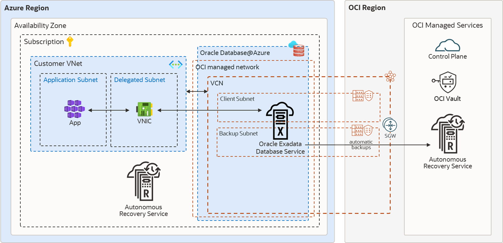
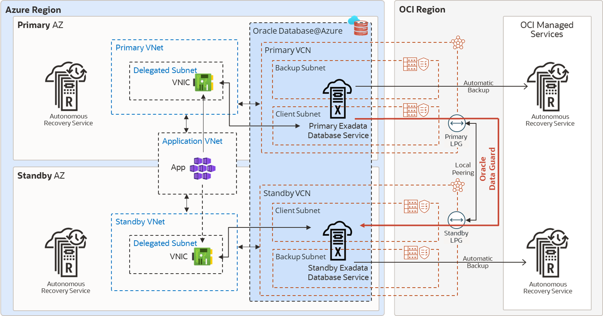
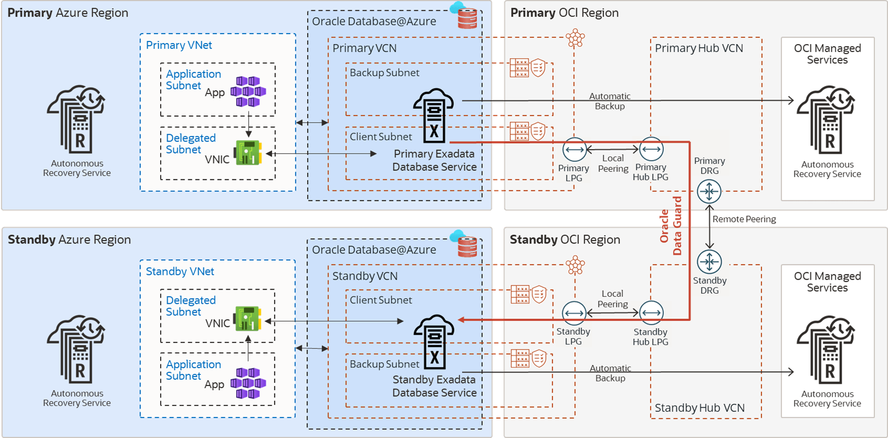

## Oracle Maximum Availability Architecture for Oracle Database@Azure

Microsoft Azure is a strategic Oracle Multicloud partner. Oracle Maximum Availability Architecture (MAA) evaluates MAA reference architectures on Oracle Database@Azure, the results of which are shown here.

To learn more about MAA Silver and MAA Gold evaluations and their benefits after certification, see [MAA Evaluations on Multicloud Solutions](maa-evaluations-multicloud-solutions.md).

Oracle MAA evaluated Oracle's solution in Azure. Oracle MAA continues to re-evaluate periodically to ensure the solution meets all the expected benefits and to highlight any new MAA for Oracle Database@Azure benefits and capabilities. Certification is only given after the MAA evaluation meets the requirements.

Oracle MAA has evaluated and endorsed Oracle Database@Azure for:

- MAA Silver reference architecture on Exadata Database Service on Dedicated Infrastructure (ExaDB-D)
- MAA Gold reference architecture when the standby database resides on another ExaDB-D in the same or separate Availability Zones (AZ) or different regions

Evaluation environments:

- Cross-region between Ashburn, Virginia, USA, and London, England regions
- Cross-availability zone (AZ) within the Ashburn, Virginia, USA region

### Network Results

The results shown here are based on network tests described in [Oracle Database Multicloud Evaluations by Oracle MAA](maa-evaluations-multicloud-solutions.md).

| Use Cases | RTT Latency Observed | Network Bandwidth | MAA Recommendations |
| --- | --- | --- | --- |
| Application VMs to Exadata VM Cluster (same region) | Varies based on placement  - 300 microseconds (Cluster in same Availability Zone (AZ)) - 500 microseconds (Cluster cross-AZs) | Variable based on placement and VM size | Ensure your required RTT latency meets your application requirements.  Test thoroughly with your implementation. Variables such as VM size and placement can impact results.  Refer to Application Network Layer on Azure  See also, [Proximity placement groups](https://learn.microsoft.com/en-us/azure/virtual-machines/co-location) and [Sizes for virtual machines in Azure](https://learn.microsoft.com/en-us/azure/virtual-machines/sizes/overview)) |
| Between Exadata VM Clusters, across AZs (London, England) for:  - Redo Transport - Database migration or standby database instantiation | 1.2 milliseconds (for both peering options) | Single process throughput:  - 13 Gb/sec (OCI VCN Peering (recommended)) - 13 Gb/sec (Azure Global Virtual Network)  Maximum parallel throughput:  - 70 Gb/sec (X11M) (OCI VCN Peering (recommended)) - 70 Gb/sec (X11M) (Azure Global Virtual Network) | Repeat MAA-recommended network tests in your environment. See [Network Evaluation](maa-evaluations-multicloud-solutions.md) for examples.  Recommended to use OCI peering for higher bandwidth (up to 600% in some examples)  For OCI peering, see  - Same region: [Local VCN Peering using Local Peering Gateways](https://docs.oracle.com/iaas/Content/Network/Tasks/localVCNpeering.htm#Local_VCN_Peering_Within_Region) - Cross-region: [Perform Cross-Regional Disaster Recovery for Exadata Database on Oracle Database@Azure](https://docs.oracle.com/en/solutions/exadb-dr-on-db-azure/index.html#GUID-C5016FB8-DD90-4F5C-8965-AC4230537EB1)  For Azure peering, see [Virtual network peering](https://learn.microsoft.com/en-us/azure/virtual-network/virtual-network-peering-overview)  Variables may impact bandwidth; see [Optimize network throughput for Azure virtual machines](https://learn.microsoft.com/en-us/azure/virtual-network/virtual-network-optimize-network-bandwidth) |
| Between Exadata VM Clusters across regions (Ashburn, Virginia, USA and London, England) for:  - Redo Transport - Database migration or standby database instantiation | ~76 milliseconds (for both peering options) | Single process throughput:  - 1.57 Gb/sec (OCI VCN Peering (recommended)) - 0.85 Gb/sec (Azure Global Virtual Network)  Maximum parallel throughput:  - 60 Gb/sec (X11M) (OCI VCN Peering (recommended)) - 45 Gb/sec (X11M) (Azure Global Virtual Network) | Repeat MAA-recommended network tests in your environment. See [Network Evaluation](maa-evaluations-multicloud-solutions.md) test examples  Use OCI peering for higher bandwidth (up to 600% in some examples)  For OCI peering, see  - Same region: [Local VCN Peering using Local Peering Gateways](https://docs.oracle.com/en-us/iaas/Content/Network/Tasks/localVCNpeering.htm#Local_VCN_Peering_Within_Region) - Cross-region: [Perform Cross-Regional Disaster Recovery for Exadata Database on Oracle Database@Azure](https://docs.oracle.com/en/solutions/exadb-dr-on-db-azure/index.html#GUID-C5016FB8-DD90-4F5C-8965-AC4230537EB1)  For Azure peering, see [Virtual network peering](https://learn.microsoft.com/en-us/azure/virtual-network/virtual-network-peering-overview)  Variables may impact bandwidth; see [Optimize network throughput for Azure virtual machines](https://learn.microsoft.com/en-us/azure/virtual-network/virtual-network-optimize-network-bandwidth) |

Azure Network Recommendations and Considerations

- Network Topology and Connectivity for Oracle Database
	- [Get started with Oracle Database@Azure](https://learn.microsoft.com/en-us/azure/oracle/oracle-db/oracle-database-get-started)
		- [Network planning for Oracle Database@Azure](https://learn.microsoft.com/en-us/azure/oracle/oracle-db/oracle-database-network-plan)
- Cross Region Azure Peering for Data Guard (OCI Peering Recommended) will be influenced by aggregate throughput
	- [Edit virtual hub capacity](https://learn.microsoft.com/en-us/azure/virtual-wan/hub-settings#edit-virtual-hub-capacity)

### MAA Silver Network Topology and Evaluation

The following MAA Silver HA Diagram illustrates Oracle RAC on ExaDB-D with backup to Autonomous Recovery Service running in Azure or OCI.

Figure 36-1 MAA Silver Architecture for Oracle Database@Azure

  

Oracle MAA evaluated and endorsed Oracle Database@Azure for the MAA Silver reference architecture, and observed the following results.

- Application latency may be impacted by the application VM's proximity to the database server target. For the lowest latency, place the application VM in the same Availability Zone (AZ) as the database and use direct communication (not Azure network virtual appliances, firewalls, and so on). For high availability, evaluate placing application VMs in multiple AZs when possible. See Application Network Layer on Azure below and [Network topology and connectivity for Oracle Database@Azure - Getting started](https://learn.microsoft.com/en-us/azure/cloud-adoption-framework/scenarios/oracle-iaas/oracle-network-topology-odaa#design-recommendations).
- The backup and restore performance with Autonomous Recovery Service@Azure, Autonomous Recovery Service on OCI, and OSS on OCI meets expectations. See Backup and Restore Observations below.
- Application and database uptime is adhered to as expected while injecting unplanned local outages, updating database and system software, and during system and database elastic changes (for example, increasing CPU, storage, etc). See [Oracle Database Multicloud Evaluations by Oracle MAA](maa-evaluations-multicloud-solutions.md) for tests evaluated and [Oracle Maximum Availability Architecture in Oracle Exadata Cloud Systems](oracle-maximum-availability-architecture-oracle-exadata-cloud-systems.md) for expected results and benefits.
- Configuration health checks, such as Exachk runs, help ensure MAA compliance. Enabling Database Service "Health" Events and reviewing Exachk output monthly is recommended.

#### Application Network Layer on Azure

The proximity of the application tier to the database cluster affects application response time.

If you require a very low latency response time (200-400 microseconds), deploy the application VMs in the same Availability Zone (AZ) as the database cluster. Latency increases to 1 millisecond or more when application and database servers are configured across VNets or AZs.

Deploy the application tier over at least two AZs to ensure high availability. The deployment process and solution over multiple AZs varies depending on the application’s components, Azure services, and resources involved. For example, with Azure Kubernetes Services (AKS), you can deploy the worker nodes in different AZs. Kubernetes control plane maintains and synchronizes the pods and the workload.

#### Backup and Restore Observations

RMAN nettest was used for backups, and the expected results were met. See [KB115145](https://support.oracle.com/support/?documentId=KB115145) for details about nettest.

Oracle Database backup and restore throughput to Oracle's Autonomous Recovery Service or Oracle’s Object Storage Service were within performance expectations. For example, an ExaDB-D 2 node cluster (using 16+ OCPUs) and three storage cells may observe a 4 TB/hour backup rate and approximately 8.7 TB/hour restore rate with no other workloads.

By increasing the RMAN channels, you can leverage available network bandwidth or storage bandwidth and achieve as much as 42 TB/hour backup rate and 8.7 TB/hour restore rate for 3 Exadata storage cells. The restore rates can increase as you add more Exadata storage cells. The performance varies based on existing workloads and network traffic on the shared infrastructure.

The Autonomous Recovery Service provides the following additional benefits:

- Leverage real-time data protection capabilities to eliminate data loss
- With a unique "incremental forever" backup benefit, you can significantly reduce backup processing overhead and time for your production databases.
- Implement a policy-driven backup life-cycle management.
- Additional malware protection

### MAA Gold Network Topology and Evaluation

The recommended MAA Gold architecture in Azure consists of:

- When using Oracle Data Guard, Oracle Exadata infrastructures (ExaDB-D) are provisioned in two different Availability Zones (AZs) or Regions using separate VNets that do not have overlapping IP CIDR ranges.
- Backup network subnets assigned to the primary and standby clusters do not have overlapping IP CIDR ranges.
- The application tier spans at least two AZs and the VNet peers, with each VNet consisting of primary and standby VM Clusters.
- Database backups and restore operations use a high bandwidth network for Autonomous Recovery Service@Azure, Autonomous Recovery Service on OCI, or OCI Object Storage.

Figure 36-2 MAA Gold DR Architecture in the Same Azure Region

> The image shows The Azure region on the left and the OCI region on the right with the OCI Managed Network between them.
>
> Inside the Azure region are the ExaDB-D primary database in Availability Zone 1, and the ExaDB-D standby database in Availability Zone 2. Each database is configured with its own VNet network, called VNet DB Primary and VNet DB Standby. An arrow depicts Data Guard redo transport going from the primary database to the standby database through the OCI Managed Network. There are several other components that are not pertinent to this document.
>
> Inside the OCI region are the OCI Managed Services: 2 instances of Object Storage, and OCI Vault. Each database in the Azure region has an arrow going from it, through the OCI Managed Network, to one of the Object Storage icons, indicating that automatic backups are sent to separate Object Storage repositories. Each database also has an arrow going from the database to the Vault through the OCI Managed Network.

Figure 36-3 MAA Gold DR Architecture Across Two Azure Regions

> The image shows two Azure regions on the left and two OCI regions on the right with the OCI Managed Network between them.
>
> Inside the primary Azure region is the availability zone containing the ExaDB-D primary database, and inside the Standby Azure Region is the availability zone containing the ExaDB-D standby database. Each database is configured with its own VNet network, called VNet DB Primary and VNet DB Standby. An arrow depicts Data Guard redo transport going from the primary database to the standby database through the OCI Managed Network. There are several other components that are not pertinent to this document.
>
> Inside the OCI regions are the OCI Managed Services: 2 instances of Object Storage, and OCI Vault. Each database in the Azure regions has an arrow going from it, through the OCI Managed Network, to one of the Object Storage icons, indicating that automatic backups are sent to separate Object Storage repositories. Each database also has an arrow going from the database to the Vault through the OCI Managed Network.

#### Network Layer

Oracle Data Guard maintains an exact physical copy of the primary database by transmitting (and applying) all data changes (redo) to the standby database across the network, making network throughput, and in some cases latency, critical to the implementation's success. Use Data Guard switchover for planned maintenance or disaster recovery tests. If the primary database becomes unavailable, use Data Guard failover to resume service.

Peering Networks Between Primary and Standby

This is the most critical decision to ensure your standby can keep up. If the network does not have sufficient bandwidth to support single-process redo throughput, the standby will have a growing transport lag.

The primary and standby Exadata Clusters are deployed in separate networks. Oracle Database@Azure Exadata Clusters are always deployed using separate Virtual Cloud Networks (VCN) in OCI. These separate VCNs must be connected to allow traffic to pass between them, that is they must be "peered" before enabling Data Guard with Oracle cloud automation. For this reason, the networks must use separate, non-overlapping IP CIDR ranges.

Peering across Availability Zones (AZs) can be done using the OCI or Azure networks. Both options provide reasonable throughput; however, Azure peering comes with a chargeback for cross-VNet traffic. OCI provides up to 10TB of data egress per month at no charge, and lower rates when that limit is exceeded. Note that Azure VNets are virtual networks similar to an OCI VCN (Virtual Cloud Network).

For cross-region network peering, OCI is the recommended option for any Enterprise application and databases due to the higher throughput observed during testing. OCI VCN peering provides higher single-process network throughput when compared to Azure VNet peering between the same regions. The latency between database clusters will vary based on physical location and network topology. There is no chargeback for cross-region traffic for the first 10TB per month with OCI VCN peering. Note that single process throughput, maximum network throughput, and latency may vary based on data center locations.

Oracle Database@Azure service network is connected to the Exadata client subnet by a Dynamic Routing Gateway (DRG) managed by Oracle. A DRG is also required to peer VCNs between regions, and only one DRG is allowed for each VCN in OCI. Therefore, to connect the primary and standby VCNs, the communication requires transit over a second VCN with its own DRG in each region.

Recommended OCI VCN Peering for Data Guard

- For a cross availability zone configuration of Data Guard at Azure, follow the instructions in Setting Up Networking Across Availability Zones.
- For a cross-region configuration of Data Guard at Azure, follow the instructions in Setting Up Networking Across Regions.
	- Azure Virtual WAN Hub Model and Network Recommendations: [https://learn.microsoft.com/en-us/azure/cloud-adoption-framework/scenarios/oracle-iaas/oracle-network-topology-odaa#design-recommendations](https://learn.microsoft.com/en-us/azure/cloud-adoption-framework/scenarios/oracle-iaas/oracle-network-topology-odaa#design-recommendations)
		- Network Bandwidth based Virtual Hub Settings: [https://learn.microsoft.com/en-us/azure/virtual-wan/hub-settings#edit-virtual-hub-capacity](https://learn.microsoft.com/en-us/azure/virtual-wan/hub-settings#edit-virtual-hub-capacity)

Alternative Option of Azure VNet Peering for Data Guard

Choose this option only if the database workload and redo generation rate are much lower than the single process network bandwidth results. To peer the Azure VNets for Data Guard redo traffic, see [Virtual network peering](https://learn.microsoft.com/en-us/azure/virtual-network/virtual-network-peering-overview).

When networks are peered through Azure, single-process network throughput can be significantly lower than Oracle OCI peered networks.. This is relevant because Data Guard redo transport is a single process for each database instance; therefore, if a single instance produces redo at a higher rate, transport lag may increase and accumulate. There is an additional cost for ingress and egress network traffic in each VNet when networks are peered through Azure.

Enabling Data Guard

After the network is peered by one of the above options, you can Enable Data Guard (see [Use Oracle Data Guard with Exadata Cloud Infrastructure](https://docs.oracle.com/pls/topic/lookup?ctx=en/engineered-systems/exadata-cloud-service&id=ECSCM-GUID-6EBC4D6A-C58B-4721-B756-F22FC6819A45)).

Data Guard Role Transitions

The timings of the Data Guard switchover and failover were within expectations compared to a similar setup in Oracle OCI. Application downtime when performing a Data Guard switchover and failover can range from 30 seconds to a few minutes. For guidance on tuning Data Guard role transition timings or examples of role transition timings, see [Tune and Troubleshoot Oracle Data Guard](tune-and-troubleshoot-oracle-data-guard1.md).

### Setting Up Networking Across Availability Zones

Oracle MAA recommends best practices for networking across availability zones in a disaster recovery setup.

Ensure the following

- Oracle Exadata infrastructures (ExaDB-D) are provisioned in two Availability Zones (AZs). Each Exadata infrastructure deployed at least one Exadata VM Cluster in a separate Virtual Network (VNet) to form the primary and standby environments.
- Ensure primary and standby client and backup subnets are separated VNets without overlapping IP CIDR ranges.
- The Azure Kubernetes Services spans at least two AZs, and the VNet is peered with each VNet of primary and standby VM Clusters.
- Database backups and restore operations are done across a high bandwidth network to OCI Object Storage.

Figure 36-4 MAA Gold DR Architecture in the Same Azure Region

> The image shows The Azure region on the left and the OCI region on the right with the OCI Managed Network between them.
>
> Inside the Azure region are the ExaDB-D primary database in Availability Zone 1, and the ExaDB-D standby database in Availability Zone 2. Each database is configured with its own VNet network, called VNet DB Primary and VNet DB Standby. An arrow depicts Data Guard redo transport going from the primary database to the standby database through the OCI Managed Network. There are several other components that are not pertinent to this document.
>
> Inside the OCI region are the OCI Managed Services: 2 instances of Object Storage, and OCI Vault. Each database in the Azure region has an arrow going from it, through the OCI Managed Network, to one of the Object Storage icons, indicating that automatic backups are sent to separate Object Storage repositories. Each database also has an arrow going from the database to the Vault through the OCI Managed Network.

Configuring the Application Tier on Azure

1. Deploy the application tier over at least two AZs.
	The process and solution for deploying over multiple AZs varies depending on the application’s components, Azure services, and resources involved. For example, with Azure Kubernetes Services (AKS), you can deploy the worker nodes in different AZs. The Kubernetes control plane maintains and synchronizes the pods and the workload.
2. Follow the steps described in [Configuring Continuous Availability for Applications](configuring-continuous-availability-applications1.md).

Configuring the Database Tier on OCI

When Exadata Clusters are created in Azure, each cluster is in a different Virtual Cloud Network (VCN) in OCI. Connectivity between VCNs is required for Data Guard redo transport. This connectivity, or peering, must be configured before enabling Data Guard in Azure. For resources in different VCNs to communicate with each other, as is required by Data Guard, additional steps are required to peer the VCNs and allow the IP address ranges access to each other.

Oracle Data Guard maintains a standby database by transmitting and applying redo data from the primary database. Use Data Guard switchover for planned maintenance or disaster recovery tests. If the primary database becomes unavailable, use Data Guard failover to resume service.

OCI is the preferred network for performance (latency, throughput), and no egress or ingress costs are incurred. When Exadata Clusters are created in Azure, each cluster will be configured in a different OCI Virtual Cloud Network (VCN). As Data Guard requires, you must perform additional steps to peer the VCNs and allow the IP address ranges access to each other for resources in different VCNs to communicate with each other.

The following steps describe the process to enable Data Guard across AZs using the OCI-managed network.

1. Log in to the OCI Console and create a Local Peering Gateway (LPG) in the VCNs of the primary and standby Exadata VM Clusters.
	For details see [Creating a Local Peering Gateway](https://docs.oracle.com/iaas/Content/Network/Tasks/create-lpg.htm).
2. Establish a Peer Connection between primary and standby LPG, and select the Unpeered Peer Gateway in the standby VCN.
	For details see [Connecting to Another LPG](https://docs.oracle.com/iaas/Content/Network/Tasks/connect-lpg.htm).
	Each VCN can have only one Local Peering Gateway (LPG), if there are multiple databases on a given Exadata Cluster which will have standby databases on different Exadata Clusters, a Hub VCN will need to be configured. See [Transit Routing inside a hub VCN](https://docs.public.oneportal.content.oci.oraclecloud.com/iaas/Content/Network/Tasks/transitrouting.htm#Transit_Routing_Access_to_Multiple_VCNs_in_the_Same_Region)
3. Update the default route table to route the traffic between the primary and standby databases over the OCI network without incurring any inbound and outbound data transfer costs.
	Note:
	To update the default route table, you currently need to create a support ticket SR providing the tenancy name and dynamic routing gateway (DRG) OCID.
	If you encounter the error "Authorization failed or requested resource not found", open a service ticket with the following information:
	- Title of ticket: "Required VCN Route Table Update permission"
	- Include information for each VNC and its DRG attachment: Region, Tenancy OCID, VCN OCID, DRG OCID
4. Update the primary and standby Network Security Group to create a security rule to allow primary and standby client subnet ingress for TCP port 1521.
	Optionally you can add SSH port 22 for direct SSH access to the database servers.
5. Enable Data Guard or Oracle Active Data Guard for the primary database.
	From the Oracle Database details page, click the Data Guard Associations link, then click Enable Data Guard.
	On the Enable Data Guard page:
	1. Select the standby Availability Domain mapped to Azure AZ.
		2. Select the standby Exadata Infrastructure.
		3. Select the desired standby VM Cluster.
		4. Choose Data Guard or Active Data Guard (MAA recommends Active Data Guard for auto block repair of data corruptions and ability to offload reporting).
		5. Choose a protection mode and redo transport type that satisfies your RTO and RPO.
		6. Select an existing database home or create a new one.
		It is recommended that you use the same custom database software image of the primary database for the standby database home, so that both have the same patches available.
		7. Enter the password for the SYS user and Enable Data Guard.
	Optionally, to reduce the recovery time in case of failures, enable automatic failover (Fast-Start Failover) by installing Data Guard Observer or a separate VM, preferably in a separate location or in the application network. For more information, see [Fast-Start Failover](https://docs.oracle.com/pls/topic/lookup?ctx=en/database/oracle/oracle-database/21/haovw&id=DGBKR-GUID-995CED84-BEA1-4675-9C68-B37CB996924F) in the Oracle Data Guard Broker guide and [Configure Fast Start Failover to Bound RTO and RPO (MAA Gold Requirement)](configure-and-deploy-oracle-data-guard.md). Currently these steps are not part of cloud automation and are manual.
	After Data Guard is enabled, the standby database is listed in the Data Guard Associations section.

### Setting Up Networking Across Regions

Oracle MAA recommends these best practices for networking across Azure regions in an Oracle Database@Azure DR configuration.

The architecture diagram below shows a containerized Azure Kubernetes Service (AKS) application in two Azure regions. The container images are stored in the Azure container registry and replicated between primary and standby regions. Users access the application externally through a public load balancer. The database is running in an Exadata VM Cluster in primary/standby mode with Oracle Data Guard for data protection. The database TDE encryption keys are stored in OCI Private Vault and are replicated between the regions. The automatic backups are in OCI object storage in each region.

Figure 36-5 MAA Gold DR Architecture Across Two Azure Regions

> The image shows two Azure regions on the left and two OCI regions on the right with the OCI Managed Network between them.
>
> Inside the primary Azure region is the availability zone containing the ExaDB-D primary database, and inside the Standby Azure Region is the availability zone containing the ExaDB-D standby database. Each database is configured with its own VNet network, called VNet DB Primary and VNet DB Standby. An arrow depicts Data Guard redo transport going from the primary database to the standby database through the OCI Managed Network. There are several other components that are not pertinent to this document.
>
> Inside the OCI regions are the OCI Managed Services: 2 instances of Object Storage, and OCI Vault. Each database in the Azure regions has an arrow going from it, through the OCI Managed Network, to one of the Object Storage icons, indicating that automatic backups are sent to separate Object Storage repositories. Each database also has an arrow going from the database to the Vault through the OCI Managed Network.

Network Principles for Oracle Database@Azure Across Regions

Oracle MAA recommends:

- Deploy Exadata Infrastructure in each region, primary and standby.
- On each Exadata infrastructure, deploy an Exadata VM Cluster in the delegated subnet of an Azure Virtual Network (VNet).
- The Oracle Real Application Clusters (RAC) database can be instantiated on the cluster. In the same VNet, deploy AKS in a separate subnet.
- Configure Oracle Data Guard to replicate data from one Oracle Database to the other across regions.
- When Exadata VM clusters are created in the Oracle OCI child site, each is created within its own OCI Virtual Cloud Network (VCN). Data Guard requires that the databases communicate with each other to ship redo and perform role transitions. The VCNs must be peered to enable this communication.
- OCI is the preferred network for higher network bandwidth, better network throughput, and reduced cost (the First 10 TB / Month is Free).

For additional details and setup instructions see [Perform Cross-Regional Disaster Recovery for Exadata Database on Oracle Database@Azure](https://docs.oracle.com/pls/topic/lookup?ctx=en/solutions/exadb-dr-on-db-azure&id=GUID-C5016FB8-DD90-4F5C-8965-AC4230537EB1).

Note:

Once configured, it is possible to enable automatic failover (Fast-Start Failover) to reduce recovery time in case of failure by installing Data Guard Observer on a separate VM, preferably in a separate location or in the application network. For more information, see the documentation for Fast-Start Failover, and Configure and Deploy Oracle Data Guard. (These are currently manual steps and not part of cloud automation.)