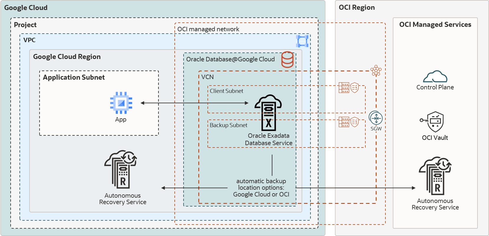
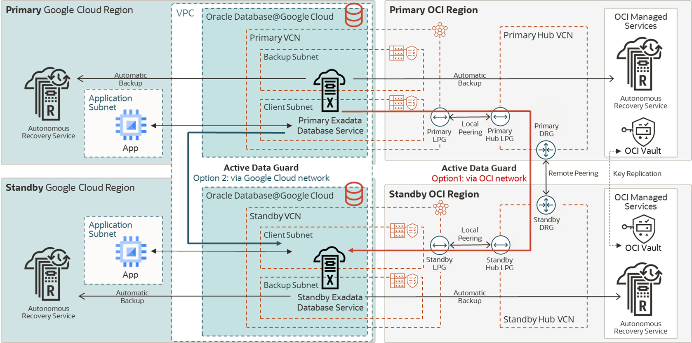
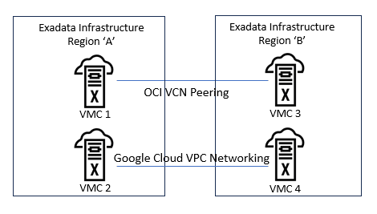

## Oracle Maximum Availability Architecture for Oracle Database@Google Cloud

Google is a strategic Oracle Multicloud hyperscaler partner. Oracle Maximum Availability Architecture (MAA) evaluates MAA reference architectures for Oracle Exadata Database Service on Dedicated Infrastructure (ExaDB-D) on Oracle Database@Google Cloud, the results of which are shown here.

To learn more about MAA Silver and MAA Gold evaluations and their benefits after certification, see [MAA Evaluations on Multicloud Solutions](maa-evaluations-multicloud-solutions.md).

Oracle MAA evaluated Oracle's solution in Google Cloud. The goal is to re-evaluate at least annually to ensure the solution meets all the expected benefits and to highlight any new MAA for Oracle Database@Google Cloud benefits and capabilities. Certification is only given after the MAA for Oracle Database@Google Cloud evaluation meets the requirements.

Oracle MAA has evaluated and endorsed the MAA Silver and MAA Gold reference architecture for Exadata Database Service on Oracle Database@Google Cloud when the standby database resides on an Exadata infrastructure within a single region, across zones within the same region, and across regions.

- The environment tested was across zones and across regions between Frankfurt, Germany and London, England.
- Oracle Active Data Guard configurations on Oracle Database@Google Cloud involving different zones or regions will have different results for throughput and latency.

### Network Results

Common abbreviations:

- OCI - Oracle Cloud Infrastructure (Oracle Cloud)
- VCN - Virtual Cloud Network (Oracle)
- VPC - Virtual Private Cloud (Google Cloud)
- VLAN - Virtual Local Area Network
- RCV - Oracle Database Autonomous Recovery Service

The results shown in the following use cases are based on network tests described in [MAA Evaluations on Multicloud Solutions](maa-evaluations-multicloud-solutions.md).

Application VMs to Exadata VM Cluster (Same Region)

RTT Latency Observed: ~300 microseconds (same region/zone)

Varies based on placement. For improved application VM latency requirements, a Google support ticket should be filed.

Network Throughput Observed: Variable based on VM shape.

See a machine series comparison at [https://cloud.google.com/compute/docs/machine-resource#machine\_type\_comparison](https://cloud.google.com/compute/docs/machine-resource#machine_type_comparison)

Example: n2-standard-4 (4 vCPUs, 16 GB Memory) 10 Gbps.

MAA Recommendations:

- Ensure that your required RTT latency meets your application requirements.
- Test thoroughly with your implementation. Variables such as VM size.
- Refer to Application Network Layer on Google Cloud

Between Exadata VM Clusters in the Same Region or Across Zones

Tested:

- Redo Transport
- Database migration or standby database instantiation

Example data is for a configuration between zones in Ashburn, Virginia (IAD).

RTT Latency Observed:1.3 ms

Network Throughput Observed:

IAD cross-zones example:

| \# Processes | OCI VCN Peering | Google Cloud VPC Networking |
| --- | --- | --- |
| 1 | 34 Gb/s  (4250 MB/s) | 10 Gb/s  (1250 MB/s) |
| 4 | 90 Gbits/sec  (11250 MB/s) | 36 Gb/s  (4500 MB/s) |
| 10 | 90 Gbits/sec  (11250 MB/s) | 60 Gb/s  (7500 MB/s) |

MAA Recommendations:

- Repeat MAA-recommended network tests in your environment. Refer to [Network Evaluation](maa-evaluations-multicloud-solutions.md).
- Test both networking options as described in "Testing Throughput" in Networking Between Primary and Standby Clusters and ensure that the network throughput exceeds minimum requirements and your peak redo rates.

For Google networking, both Exadata VM Clusters must be:

- Created in the same VPC Network (this requires no extra networking)
- The VPC Network must have MTU set to jumbo frames (8896).
- The Cloud Interconnect VLAN attachments in both regions, which must have 4 per Exadata Infrastructure, must be set to 10 Gbps network bandwidth or higher to achieve observed results for Active Data Guard redo transport and standby database instantiation. File a request with Google cloud service to request this increase in bandwidth.

Between Exadata VM Clusters Across Regions

Tested:

- Redo Transport
- Database migration or standby database instantiation

Example data is for a configuration between London, England (LHR) and Frankfurt Germany (FRA). Results will vary between different regions.

RTT Latency Observed: 12 ms (FRA-LHR)

Network Throughput Observed:

FRA-LHR example:

| \# Processes | OCI VCN Peering | Google Cloud VPC Networking\* |
| --- | --- | --- |
| 1  (min 1.4 Gb/sec) | 2.1 Gb/s (250 MB/s) | 2.7 Gb/s (300 MB/s) |
| 4 | 9.1 Gb/s (1137 MB/s) | 8.3 Gb/s (1037 MB/s) |
| 10  (min 8 Gb/sec) | 22.6 Gb/s (2825 MB/s) | 11.4 Gb/s (1425 MB/s) |

\*Google Cloud VPC networking throughput results are heavily dependent upon the Cloud Interconnect VLAN attachments in both regions having 10Gbps bandwidth (default 2Gbps). File a Google support ticket to request the increase or observed throughput is significantly less.

MAA Recommendations:

Repeat MAA-recommended network tests in your environment. Refer to [Network Evaluation](maa-evaluations-multicloud-solutions.md).

Test both networking options as described in "Testing Throughput" in Networking Between Primary and Standby Clusters and ensure that the network throughput exceeds minimum requirements and your peak redo rates.

For cross-region OCI peering, see [Perform cross-region disaster recovery for Exadata Database Service on Google Cloud](https://docs.oracle.com/en/solutions/exadb-dr-on-db-google-cloud/index.html).

For Google networking, both Exadata VM Clusters must be:

- Created in the same VPC Network (this requires no extra networking)
- The VPC Network must have MTU set to jumbo frames (8896).
- The Cloud Interconnect VLAN attachments in both regions, which must have 4 per Exadata infrastructure, must be set to 10Gbps network bandwidth or higher to achieve acceptable results for Active Data Guard redo transport and standby database instantiation.

Variables may impact bandwidth; refer to Google doc [https://cloud.google.com/compute/docs/network-bandwidth](https://cloud.google.com/compute/docs/network-bandwidth).

### MAA Silver Network Topology and Evaluation

The MAA Silver Reference Architecture provides database high availability in the case of hardware or software failures. Refer to the documentation for a full description of [MAA Silver](https://docs.oracle.com/en/database/oracle/oracle-database/23/haiad/maara_silver.html).

Figure 36-6 MAA Silver Architecture for Oracle Database@Google

  

Oracle MAA has evaluated and endorsed ExaDB-D on Oracle Database@Google Cloud for MAA Silver with the following observations:

- Application latency may be impacted by the application VM's proximity to the target database server. A Google support ticket should be opened to request close proximity for applications which require the lowest latency to the database. For high availability of the application itself, evaluate multiple, fault-isolated application VMs.
- The backup and restore performance with RCV in Google Cloud (default), RCV in OCI, and Object Storage Service in OCI meets MAA Silver expectations. See "Backup/Restore" \<add link> below.
- Application and database availability meet MAA Silver expectations while injecting unplanned local outages, updating database and system software, and during elastic changes for the system and database (for example, increasing CPU, storage, and so on). See [MAA Evaluations on Multicloud Solutions](maa-evaluations-multicloud-solutions.md) for the relevant tests and [Oracle Maximum Availability Architecture in Oracle Exadata Cloud Systems](oracle-maximum-availability-architecture-oracle-exadata-cloud-systems.md) for expected results and benefits.
- Configuration health checks, such as Exachk, help ensure MAA compliance. MAA recommends enabling [Database Service Health Events](https://docs.oracle.com/en/cloud/paas/base-database/events/index.html#articletitle) and reviewing Exachk output monthly.

#### Application Network Layer on Google Cloud

The proximity of the application tier to the database cluster affects application response time. If you require a very low latency response time (300 microseconds), deploy the application VMs in the VPC Network in close proximity to the database cluster. [Log a Google support ticket](https://cloud.google.com/oracle/database/docs/get-support) to ensure close proximity of the application VMs to the database cluster.

Deploy the application tier with multiple application VMs with sufficient fault isolation for high availability. The deployment process and solution depend on the application’s components, Google services, and the resources involved. For example, with [Google Kubernetes Engine (GKE)](https://cloud.google.com/kubernetes-engine), you can deploy the worker nodes in different locations. Kubernetes control plane maintains and synchronizes the pods and the workload.

#### Backup and Restore Observations

RMAN `nettest` results met expectations. See [KB115145](https://support.oracle.com/support/?documentId=KB115145) for details about `nettest`.

Oracle database backup and restore throughput to Oracle Database Autonomous Recovery Service or OCI Object Storage Service were within performance expectations. For example, an ExaDB-D 2-node cluster (using 16+ OCPUs) and 3 storage cells may observe a 4 TB/hour backup rate and approximately 8.7 TB/hour restore rate with no other workloads. By increasing the RMAN channels, you can leverage available network bandwidth or storage bandwidth and achieve as much as 42 TB/hour backup rate and 8.7 TB/hour restore rate for 3 Exadata storage cells. The restore rates can increase as you add more Exadata storage cells. The performance varies based on existing workloads and network traffic on the shared infrastructure.

The [Oracle Database Autonomous Recovery Service](https://docs.oracle.com/iaas/recovery-service/doc/overview-recovery-service.html) provides the following additional benefits:

- Leverage real-time data protection capabilities to eliminate data loss.
- With a unique "incremental forever" backup benefit, you can significantly reduce backup processing overhead and time for your production databases.
- Implement a policy-driven backup life-cycle management.
- Additional malware protection

### MAA Gold Network Topology and Evaluation

The MAA Gold Reference Architecture protects mission-critical databases with a remote synchronized copy of the database which can be activated in the event of disaster. Refer to the documentation for a full description of [MAA Gold](https://docs.oracle.com/en/database/oracle/oracle-database/23/haiad/maara_gold.html).

The recommended MAA Gold architecture in Google Cloud consists of:

- When using Oracle Active Data Guard, Oracle Exadata infrastructures (ExaDB-D) are provisioned in two different regions.
- Network subnets assigned to the primary and standby clusters do not have overlapping IP CIDR ranges.
- The application tier spans multiple App Servers consisting of primary and standby App VM Clusters.
- Database backups and restore operations use a high bandwidth network for Oracle Database Autonomous Recovery Service (in Google Cloud or OCI) or OCI Object Storage.

MAA Gold evaluation builds upon the Silver MAA evaluation, with:

- Network tests between primary and standby database clusters using OCI peered or multicloud partner peered networks to evaluate round-trip latency and bandwidth.
- Oracle Active Data Guard role transition performance and timings for disaster recovery use cases.
- Oracle Database rolling upgrade with Active Data Guard.

The architecture diagram below shows an application in two Google regions. The database is running in an Exadata VM Cluster in primary/standby mode with Oracle Active Data Guard for data protection. The database Transparent Data Encryption (TDE) keys are stored in OCI Vault and are replicated between the regions. The automatic backups are in Oracle Database Autonomous Recovery Service (in Google Cloud or OCI).

Figure 36-7 MAA Gold Architecture for Oracle Database@Google

  

Oracle MAA has evaluated and endorsed ExaDB-D on Google Cloud for MAA Gold with the following observations:

- Regions chosen for the primary and standby databases are critical to supporting the Recovery Point Objective (RPO). Network throughput must be sufficient as described below in Networking Between Primary and Standby Clusters.
	- Single node throughput from London to Frankfurt for a single process was 2 Gb/sec with a maximum multi-process throughput of ~47 Gb/sec. These throughputs can support most database workloads.
- The latency between an application VM and the database server within the same region was observed to be less than 300 microseconds, which meets MAA Gold expectations.
- Application VM throughput to the database server is dependent on the size of the VM. Refer to [Google Cloud documentation](https://cloud.google.com/compute/docs/machine-resource#machine_type_comparison) for details about the bandwidth allocated per VM shape.
- Oracle Active Data Guard Life Cycle Operations, switchover, failover, and reinstate are initiated from the OCI Console (accessible from the Google Cloud Console). The performance of these operations is in line with MAA Gold expectations.
- OCI VCN Peering was evaluated, and bandwidth and latency meet MAA criteria. For Google Cloud VCP Networking between the regions, the Google VPC Attachment bandwidth impacts the throughput of the network connections significantly. MAA Recommends at least 10 Gb/sec bandwidth for these attachments of which there are 4 per region (default 2 Gbps). A Google support ticket can be opened to increase the values from the default or when throughput is significantly below expectations. Refer to [https://cloud.google.com/oracle/database/docs/get-support](https://cloud.google.com/oracle/database/docs/get-support)
- The VPC network should have an MTU setting of 8896 (default 1460). Refer to [Google Cloud documentation](https://cloud.google.com/vpc/docs/change-mtu-vpc-network) to change this value.

#### Oracle Active Data Guard Principles for ExaDB-D on Google Cloud Configuration

Oracle MAA recommends:

1. Deploy Exadata Infrastructure in the selected regions for primary and standby.
2. From the Google Cloud Console, on each Exadata infrastructure, deploy an Exadata VM Cluster in the appropriate VPC.
	- For Google Cloud VPC networking option, both VM Clusters should be in the same VPC. For OCI VCN peering the VPC used for each VM Cluster can be different.
		- CIDR ranges for the primary and standby client and backup networks cannot overlap.
3. Using the OCI Console, create an Oracle Real Application Clusters (RAC) database on the VM cluster.
	1. The OCI Console can be reached from the Exadata Infrastructure details page in the Google Cloud Console by clicking MANAGE IN OCI.
		2. Click the appropriate VM cluster.
		3. Click Create Database and complete the wizard.
4. For the application tier, deploy Google Kubernetes Engine (GKE) in the same VPC network as the VM Clusters, on a separate subnet.
	- Note: the CIDR range for the VM Clusters are not shown in the Google Console but should not overlap the GKE subnet CIDRs.
5. Using the OCI Console, configure Oracle Active Data Guard to replicate data across regions from one Oracle Database to the other.
	1. From the database page for the targeted database, click Data Guard group in the left-hand column.
		2. Click the Add Standby button and complete the wizard.
		3. Depending on the size of the database, standby creation may take 30 minutes to hours. Progress can be monitored using the Work Requests resource.
6. When Exadata VM clusters are created in the Oracle OCI child site, each is created within its own OCI Virtual Cloud Network (VCN). Active Data Guard requires that the databases communicate with each other to ship redo and perform role transitions.
	- See the Networking Between Primary and Standby Clusters section below for additional details about connecting the networks.
		- For VPC networking, VM Clusters created in the same VPC will be able to communicate with each other over the Google Cloud backbone.
		- For OCI VCN peering, follow the steps in "OCI Peering Setup" in the Networking Between Primary and Standby Clusters section below.
7. When considering full stack disaster recovery failover, you need to consider DNS failover and coordinate application failover to the new primary database (after Data Guard switchover or failover)

For additional details and setup instructions, see [Perform Cross-Regional Disaster Recovery for Exadata Database Service on Google Cloud](https://docs.oracle.com/en/solutions/exadb-dr-on-db-google-cloud/index.html).

#### Networking Between Primary and Standby Clusters

Oracle Active Data Guard maintains an exact physical copy of the primary database by transmitting (and applying) all data changes (redo) to the standby database across the network. This makes network throughput and, in some cases, latency critical to the implementation's success.

There are two networking options to connect the primary and standby database clusters. OCI VCN peering and Google Cloud VPC networking. Regardless of the networking option chosen, the CIDR blocks for each cluster must not overlap.

OCI VCN Peering

Each Exadata VM cluster will be deployed on its own OCI Virtual Cloud Network (VCN) within the Google Cloud region, regardless of the Google Cloud VPC used for these infrastructures. To route traffic through the OCI backbone (MAA recommended for consistent throughput results) the VCNs are peered through hub VCNs and associated gateways. See the "OCI Peering Steps" below.

Google Cloud VPC Networking

When connecting the Exadata VM clusters with Google Cloud networking, ensure that each cluster is created in the same VPC network (but in different regions for cross-region configurations). There are no additional steps to allow these clusters to communicate.

Testing Throughput

It is recommended that you test your configuration with both options (see [MAA Evaluations on Multicloud Solutions](maa-evaluations-multicloud-solutions.md)). Multiple VM clusters can be created on a single infrastructure, while the networking between the two pairs of VM Clusters can be configured differently for testing purposes. Each VM cluster should be the same size.

Figure 36-8 Testing scenario using two Exadata infrastructures with multiple VM clusters peered in two different ways

  

Comparing the Observed Network Throughput For Frankfurt and London

Two measurements of throughput are critical for a successful implementation.

1. Parallel process throughput is an indicator of how long it will take to instantiate (create) the standby database. By default, parallelism is set to 4 processes per primary database node.
2. Single process throughput is an indicator of how fast redo transport can ship redo to the standby database. Each primary database instance creates its own thread of redo and ships it to the standby by a single process. If the redo generation rate of any instance exceeds the single process throughput capability of a single database node, a transport lag will develop and potentially impact the RPO of the database.

Table 36-1 Network Throughput Example (FRA-LHR)

| \# Processes | OCI VCN Peering | Google Cloud VPC Networking | Minimum Expectations |
| --- | --- | --- | --- |
| 1 | 2.1 Gb/sec (260 MB/sec) | 2.7 Gb/sec (300 MB/sec) | 2 Gb/sec (250 MB/sec) |
| 4 | 9.1 Gb/sec (1137 MB/sec) | 8.3 Gb/sec (1037 MB/sec) |  |
| 10 | 22.6 Gb/sec (2825 MB/sec) | 11.4 Gb/sec (1425 MB/sec) | 8 Gb/sec (1000 MB/sec) |

Note:

Each pair of regions will have different throughput. It is important that testing is performed before Active Data Guard configuration to understand the capabilities of the network option chosen for the selected regions.

OCI Peering Setup

See the detailed steps for deploying and configuring Data Guard using OCI VCN peering in [Perform Cross-Region Disaster Recovery for Exadata Database Service on Google Cloud](https://docs.oracle.com/en/solutions/exadb-dr-on-db-google-cloud/index.html#GUID-391EB6BB-1305-4278-83B7-095BCDD52AEC).

Google Cloud VPC Networking Setup

Create the related Oracle Database@Google Cloud Exadata Infrastructures in the same VPC network, in different subnets.

Enabling Active Data Guard

Once the network is configured and tested using one of the above options, you can enable Active Data Guard. See [Use Oracle Data Guard with Exadata Cloud Infrastructure](https://docs.oracle.com/pls/topic/lookup?ctx=en/engineered-systems/exadata-cloud-service&id=ECSCM-GUID-6EBC4D6A-C58B-4721-B756-F22FC6819A45) for details.

Active Data Guard Role Transitions

The timings of the Active Data Guard switchover and failover were within expectations compared to a similar setup in Oracle OCI. Application downtime when performing an Active Data Guard switchover and failover can range from 30 seconds to a few minutes. For guidance on tuning Active Data Guard role transition timings or examples of role transition timings, see [Role Transition, Assessment, and Tuning](role-transition-assessment-tuning-and-troubleshooting.md).

Automatic Failover

Once configured, it is possible to enable automatic failover (Fast-Start Failover), to reduce recovery time in case of failure, by installing Data Guard Observer on a separate VM, preferably in a separate location or the application network. For more information, see [Configure Fast Start Failover to Bound RTO and RPO (MAA Gold Requirement)](configure-and-deploy-oracle-data-guard.md). (These are currently manual steps and not part of cloud automation.)