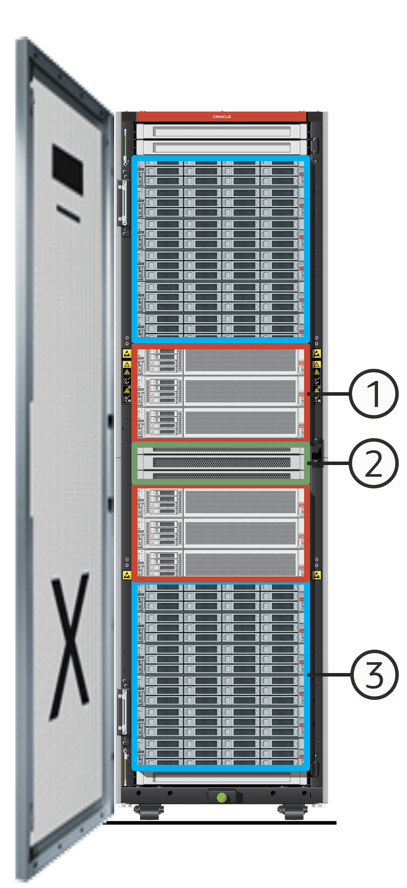

## 13 MAA Platinum: Oracle RAC and Exadata

Both Oracle Real Application Clusters (RAC) and Oracle Exadata Database Machine deliver high availability; however, only Exadata, as a fully engineered system, uniquely guarantees near-zero brownout times (0-10 seconds) for local failures.

This document contrasts Exadata's superior HA performance with tuned custom Oracle RAC setups on redundant infrastructure. Given its exceptional availability, robust data protection, and performance-preserving Quality of Service, Exadata is a mandatory prerequisite for mission-critical database solutions at the MAA Platinum tier and above, both on-premises and in the cloud. While Oracle RAC offers excellent high availability (HA), non-Exadata configurations can experience application brownouts up to 60 seconds during various local failures.

Exadata's unique high-availability capabilities significantly minimize application impact during unplanned outages (compute, network, storage) and seamless infrastructure updates. It also provides enhanced data integrity with automatic corruption repair. Crucially, Exadata manages "gray failures"—underperforming or degraded components—even before full failure. This comprehensive resilience solidifies Exadata as the optimal database platform within the MAA framework and justifies its prerequisite status for the MAA Platinum tier and above.

Oracle Exadata's fully engineered design and deep integration across hardware and software tiers make it the superior choice for high availability in mission-critical database environments, in particular in the areas of unplanned outages/planned maintenance, data protection, and Quality of Service. While Oracle RAC offers robust high availability, Exadata uniquely minimizes application brownouts to near-zero during local failures, a significant improvement over the potential brownouts of non-Exadata configurations that can take minutes.

Its comprehensive resilience, encompassing instant failure detection, smart caching, proactive "gray failure" management, and enhanced data protection with automatic corruption repair, ensures unparalleled service levels and consistent performance. These unique capabilities solidify Exadata's position as a mandatory prerequisite for MAA Platinum tier and above database solutions, both on-premise and in the cloud, ultimately delivering the highest levels of availability and data integrity.

### Exadata High Availability at Every Tier

Exadata is designed for high availability in every layer, hardware, and software, and has smart software that provides additional benefits.

The image below shows Oracle Exadata Database Machine's built in high availability features.

> The image shows the inside of an Oracle Exadata Database Machine, and has numbered callouts that correspond with the text the follows the image.
>
> [  
> Copyright © 2005, 2026, Oracle and/or its affiliates.](https://docs.oracle.com/en/database/oracle/oracle-database/dcommon/html/cpyr.htm)

1. Redundant Database Servers
	- Active-Active highly available clustered servers
		- Hot-swappable power supplies, fans, and flash cards
		- Redundant power distribution units
		- Integrated HA software/firmware stack
2. Redundant Network
	- Redundant 100Gbit/sec RoCE and switches
		- Client access using HA bonded networks
		- Integrated HA software/firmware stack
3. Redundant Storage Grid
	- Data mirrored across storage servers
		- Hot-swappable power supplies, fans, M.2 drives, and flash cards
		- Redundant, non-blocking I/O paths
		- Integrated HA software/firmware stack

The perfect pairing of hardware, software, and life cycle optimizations, combined with built-in MAA best practices, makes Exadata the best MAA database platform. Every Exadata release is extensively tested, and every major Exadata release or Exadata hardware generation requires even more stringent and long MAA chaos engineering validation that ensures there are no HA regressions, and that any additional HA feature works.

Application throughput and response time are measured, and any deviation from our TPS or response time thresholds is flagged and alerted on. MAA and Exadata development meet weekly on configuration and life cycle best practices, and also discuss any critical issues that need to be reported to our invaluable Exadata community through Exachk, Oracle cloud alerting, or another alerting mechanism.

### High Availability Differentiators

Exadata is uniquely qualified to support the most stringent Oracle Real Application Clusters (RAC) system service levels with the following high-level differentiators that exist in all three tiers: compute, network, and storage.

- Unplanned Outages and Planned Maintenance: Exadata significantly minimizes application impact during both unplanned outages (compute, network, storage) and planned infrastructure updates. It handles unplanned outages in low single-digit seconds and allows for planned maintenance and software updates with no application impact, often completely online. It also specifically manages "gray failures" (underperforming components) by removing and repairing them.
- Data Protection: Exadata provides enhanced data integrity and resilience against rare but highly impactful storage issues. It automatically detects and repairs corruption and handles multiple storage partner failures, all without application impact. Features like Hardware Assisted Resilient Data (HARD) checks and auto-detection/repair mechanisms are highlighted.
- Quality of Service (QoS): Exadata ensures applications maintain low latency and consistent performance, even during unplanned outages and planned maintenance. It achieves this by intelligently caching and prioritizing data movement at appropriate tiers, and by having features that detect sick components or outages, and quickly redirect I/O to healthy partners. This includes automatic tuning of ASM rebalance, I/O latency capping, Smart Flash Log, and I/O Resource Manager (IORM).
- Health Checks: Exadata is always deployed with MAA best practices, but it also has many automated health check features to ensure the system continues to run properly, and that divergence from MAA best practices has not occurred.

### Unplanned Outages and Planned Maintenance Features

Exadata is engineered to deliver exceptional database availability, both by mitigating the impact of unexpected failures and by enabling seamless, disruption-free planned maintenance.

For efficiency, this topic groups together Exadata features that contribute to high availability during both unexpected outages and scheduled maintenance, given their shared advantages. It explores the key features that ensure minimal downtime and continuous operation, highlighting how Exadata intelligently handles everything from component failures to routine system updates without affecting your critical applications.

Instant Failure Detection

Exadata rapidly detects failures in the database and storage servers using RDMA, which is much faster than traditional TCP timeouts. This immediate detection and node eviction prevent applications from "hanging" or experiencing disruptive blackouts.

RoCE Network Port Redundancy and Monitoring

Exadata's RoCE network ports are configured for active-active redundancy, ensuring continuous cluster and storage traffic, even if a port fails or is taken offline for maintenance. During multi-port maintenance, Exadata coordinates port activation across nodes to prevent application disruptions. Furthermore, ExaPortMon actively monitors port health and can automatically take down a "sick" port (one appearing online but not passing traffic) to redirect traffic to a healthy alternative.

Smart Flash and Hard Disk Replacement

After replacing a flash or hard disk, Exadata intelligently manages I/O by temporarily prioritizing reads from healthy partner storage cells. Simultaneously, it warms up the flash cache on the newly replaced storage. Once the cache is sufficiently populated, the system fully reintegrates the replaced drive, ensuring consistent and low I/O latency for applications throughout the process.

Smart Handshake for Storage Server Shutdown

During planned maintenance, such as a rolling software update on storage servers, Exadata synchronizes the shutdown process with the database servers. This "smart handshake" prevents any application impact and avoids the perception of an unplanned outage.

Do Not Service LED

To prevent accidental outages caused by human error, Exadata illuminates a "do not service" LED on storage servers when a partner storage component is offline. This clear visual indicator warns data center personnel not to perform maintenance on the illuminated server, safeguarding system availability.

Hot-Swappable Storage Components

All storage components within an Exadata system, including hard disks, M.2 boot drives, and Flash drives, can be replaced online without requiring a system shutdown or impacting ongoing operations.

Operating System Upgrades

Exadata simplifies major Linux operating system upgrades, offering a seamless, out-of-the-box experience with no application impact or downtime.

Database Node Live Update

Exadata System Software enables online updates for operating systems, firmware, and Exadata software on database nodes. A Live Update defers any pending work to a scheduled time, ensuring optimal and secure operation without interrupting database services.

Storage and RoCE Switch Rolling Software Updates

Software updates for storage servers and RoCE switches can be performed in a rolling fashion across the Exadata system. This allows updates to be applied sequentially without affecting the continuous availability of the Oracle Database.

### Data Protection Features

Maintaining data integrity is paramount for any mission-critical database. This topic details Exadata's comprehensive suite of data protection features, designed to prevent, detect, and automatically repair data corruptions and I/O errors.

From hardware-level checks to intelligent software mechanisms, Exadata ensures your data remains safe, consistent, and continuously available, minimizing the risk of application downtime and safeguarding your most valuable asset.

Corruptions and I/O Errors

Exadata provides robust features to safeguard your data against corruption and I/O errors, which can otherwise compromise application and database availability. Data corruption occurs when a database block's content is unexpectedly altered, either physically (incomplete writes) or logically (lost writes). I/O errors typically arise from damaged or unavailable physical storage media. Exadata is uniquely equipped to reduce, detect, report, and even eliminate these issues, ensuring data integrity and continuous operation.

Hardware Assisted Resilient Data

Exadata incorporates HARD checks to prevent corruption in critical database files, including:

- SPFILE
- Control file
- Redo Log files
- Data files
- Data Guard Broker files

If a HARD check identifies corruption, the flawed data is prevented from being written. This feature is automatically active during ASM rebalance operations when the `DB_BLOCK_CHECKSUM` parameter is enabled.

Auto Detection and Repair

Exadata's intelligent design prevents and resolves data corruption seamlessly. If a network packet in the I/O path is corrupted during a write operation, the storage cell blocks the write, and ASM automatically retries the operation. This ensures that the application is never impacted by the corruption. Should a database update encounter existing corruption, the system automatically reads the correct data from an ASM mirror and repairs the corrupted copy. All of these actions occur transparently, without impacting the database or user applications.

Physical Scrubbing

Exadata storage cells continuously perform "scrubbing" during idle periods to detect and automatically repair I/O errors on disks. To prevent performance impact, this scrubbing intelligently slows down if it detects that an application is actively accessing the disks being scrubbed.

Logical Scrubbing

Exadata offers tools for detecting logical corruptions:

- For Exadata ASM systems, the ASM `scrub` command verifies all copies of mirrored data.
- For Exadata Exascale systems, the `xsh scrub` command performs similar checks. Both commands identify and report any discrepancies found across storage mirrors.

Storage Server Disk Confinement

Beyond standard predictive failure analysis, Exadata constantly monitors disk performance and health. If a disk shows signs of poor performance (a potential precursor to failure), it is "confined," and I/O is automatically redirected to healthy mirrored copies. The storage server then runs a comprehensive health check:

- If the disk is healthy, it is returned to service, and data is resynchronized.
- If the disk is unhealthy, it is automatically taken offline, and data is rebalanced to maintain redundancy. The unhealthy disk can then be safely replaced. This feature not only protects data by proactively addressing problematic drives, but also acts as a Quality of Service enhancement by preventing applications from accessing underperforming storage.

Priority Rebalance

When a storage failure occurs, impacting data redundancy, ASM rebalance operations prioritize restoring redundancy over simply balancing data. Crucially, within redundancy restoration, ASM prioritizes the most critical files first, such as control files and online redo log files. This ensures that the most vital database components regain their redundancy as quickly as possible.

### Quality of Service (QoS) Features

For mission-critical applications, maintaining consistent performance and low response times is crucial, even during unplanned outages, degraded component performance (gray failures), or planned maintenance. Exadata provides unique, value-added features that actively detect issues and intelligently redirect operations to healthy components, ensuring consistent application performance and minimizing impact.

Automatic ASM Rebalance Tuning

Exadata dynamically adjusts the speed of ASM (Automatic Storage Management) rebalance operations. This ensures that data redundancy is restored as quickly as possible during periods of low system activity, while automatically slowing down when the system is busy to prevent any negative impact on client I/O latency.

I/O Latency Capping

When any part of the storage system experiences high I/O latency, Exadata can intelligently redirect I/O requests to an alternative location for faster processing. Specifically, read I/Os are redirected to healthy partner storage cells, and write I/Os are temporarily buffered to local flash storage on the same cell if a primary write path is slow, then written to persistent storage.

Smart Flash Log

Optimizing redo log write latency is vital for OLTP (Online Transaction Processing) database performance. Exadata's Smart Flash Log eliminates write latency outliers by simultaneously writing redo logs to both Flash Cache and a dedicated Flash Log device. The system then acknowledges the write as complete from the fastest device, ensuring maximum commit speed. Online and standby redo log writes are automatically and transparently cached in the write-back Smart Flash Cache, boosting log write throughput by leveraging flash instead of traditional disks.

Smart OLTP Caching

Exadata employs a multi-tiered caching strategy for frequently accessed data (hot data). When the Database Writer (DBWR) needs to clear space from the database buffer cache, the primary mirror of a data block is moved to the ultra-low-latency Data Accelerator (XR Memory), while the secondary mirror is stored in the Flash Cache, and the tertiary mirror remains on disk. If the storage server with the primary mirror fails, I/O is automatically redirected to the cell with the secondary mirror, and the data is read from its Flash Cache into the low-latency Data Accelerator. The tertiary mirror continues to provide data protection. When the failed server comes back online, its flash cache is quickly warmed up to restore optimal read performance.

I/O Resource Manager (IORM)

IORM is a unique Exadata feature that effectively manages and prioritizes storage server I/O resources during contention. It allows administrators to define IORM plans that tag and prioritize I/Os based on various criteria, including the database, Pluggable Database (PDB), Container Database (CDB), non-CDB, and Cluster name, as well as purpose (primary or standby) and priority. This is particularly valuable in consolidated environments and can be combined with Database Resource Manager for comprehensive workload management.

RoCE Network Lane Prioritization

The RDMA (Remote Direct Memory Access) network fabric in Exadata includes dedicated "high-speed" QoS lanes for critical I/O traffic, such as that from the Log Writer (LGWR) process. This ensures that transaction commit latency is never stalled by network congestion or other traffic, directly contributing to faster transaction response times.

Rebalance Caching Tier Preservation

During an ASM rebalance operation, Exadata ensures that data previously cached in high-performance storage tiers (such as XR Memory or Flash Cache) remains in those same tiers at the destination. This continuity guarantees that client applications continue to experience low I/O latency throughout the rebalance process.

ASM Partner Flash Read

When a disk or set of disks changes state (for example, a failed disk being replaced or disks going offline/online during a rolling software update), Exadata can intelligently fulfill client I/O requests from partner storage cells if doing so provides lower latency. Specifically, even after a replaced disk's flash cache is warmed up, Exadata will verify if the primary copy of data is in the local cell's flash cache. If not, it will retrieve the data from a partner cell's flash cache and populate the local cache. This is especially beneficial for applications whose active data set changes during storage events, ensuring consistent low latency.

RDMA Broadcast on Commit

Oracle Real Application Clusters (RAC) leverages RDMA on Exadata for its broadcast-on-commit mechanism. This provides extremely low-latency messaging, leading to faster transaction response times and improved application scalability.

### Health Checks

Management Server

The Management Server (MS) runs on both Exadata storage servers and database compute nodes, offering extensive monitoring and alerting capabilities. It not only provides alerts for hardware failures (for example, disk failures) but also for operating system resource oversubscription, such as excessive CPU usage, memory consumption, or swapping, enabling proactive issue resolution.

For more information, see [Understanding Automated Storage Server Maintenance Tasks and Policies](https://docs.oracle.com/en/engineered-systems/exadata-database-machine/sagug/understanding-automated-cell-maintenance.html) in Oracle Exadata Database Machine User's Guide.

Exadata AWR Report

The Exadata section of the AWR report contains data about the expected configuration and performance of the Exadata system, and reports misconfiguration and resource oversubscription if it exists.

For more information, see

- [Automatic Workload Repository (AWR)](https://docs.oracle.com/en/engineered-systems/exadata-database-machine/sagug/awr.html) in the Exadata System Software User's Guide
- [Generating Automatic Workload Repository Reports](https://docs.oracle.com/pls/topic/lookup?ctx=en/database/oracle/oracle-database/21/haovw&id=TGDBA-GUID-9BFC6383-6C4F-4103-A2CB-4713802F2669) in Oracle AI Database Performance Tuning Guide

Real-Time Insight

Real-Time Insight provides the infrastructure to automatically stream up-to-the-second metric observations from all of the servers in your Exadata fleet, and feeds the metrics into customizable monitoring dashboards for real-time analysis and problem-solving.

For more information, see [Using Real-Time Insight](https://docs.oracle.com/en/engineered-systems/exadata-database-machine/sagug/using-real-time-insight.html) in the Exadata System Software User's Guide.

Exachk

Exachk is a proactive tool that you can use to identify and address any deviations from Oracle MAA best practices on your Exadata systems. Resolving these identified gaps enhances system stability and contributes to higher availability for both unplanned outages and planned maintenance.

For more information, see the [ORAchk and EXAchk User’s Guide](https://docs.oracle.com/en/engineered-systems/health-diagnostics/exachk/oexug/index.html).

### Application Impact with Exadata and MAA Best Practices

The following table summarizes Exadata's differentiating features, described above, into higher-level categories across the three tiers of Exadata.

Comprehensive Exadata MAA Evaluations

The MAA team regularly evaluates high availability use cases running typical customer workloads in properly sized Exadata environments configured with MAA best practices. The evaluations are comprehensive, focusing not just on functional success but on the overall user experience, and the primary focal point is ensuring that application service levels are not impacted.

One of the customer facing outputs from the MAA team is the "Exadata Extreme Availability Matrix" that extensively details HA use cases, Exadata MAA features supporting them, and application impact expectations. See [MOS Doc ID 3103956.1](https://support.oracle.com/rs?type=doc&id=3103956.1) for the latest Exadata Extreme Availability Matrix.

Key HA Use Cases

The following are some details about key HA use cases from the Exadata Extreme Availability Matrix.

Table 13-1 Planned Maintenance HA Use Cases

| HA Use Case | Application Impact |
| --- | --- |
| Database Node Rolling Software Update (Exadata, Grid Infrastructure, and Database) | No application delay |
| Storage Server Rolling Software Update | No application delay |
| RDMA Network Fabric Switch Rolling Software Update | 10 seconds or less of application delay |

Table 13-2 Unplanned Outages HA Use Cases

| HA Use Case | Application Impact |
| --- | --- |
| Hard Disk and Flash Failure | No application delay |
| Database Node and Instance Failure | 10 seconds or less of application delay |
| RDMA Network Fabric Switch or Port Failure | 10 seconds or less of application delay |

Gray Failures

A gray failure is a system malfunction that manifests as subtle, partial, or intermittent issues, rather than a complete "hard" failure where the system stops working entirely. Gray failures can severely degrade application service levels, in some cases causing full service level stoppage, and they are very difficult hard to detect and repair quickly.

Some examples of gray failures are resource over-subscription, slow/hung instances, slow/hung database nodes, slow/hung storage, and slow/hung network. Exadata, configured with MAA best practices, provides additional protection against gray failures. More details can be found in the Exadata Extreme Availability Matrix. The examples below highlight how Exadata helps maintain high performance, stability and availability for your applications and databases.

| Gray Failure HA Use Case | Exadata Feature and Handling |
| --- | --- |
| Oversubscribed resources | Exadata leverages MS alerting, Exadata AWR support, and Real Time Insight to proactively notify and report on resource oversubscription so it can be addressed. |
| RoCE network port dropped packets | Exadata leverages the Exaportmon feature to detect sick network ports and take them down if traffic is not flowing correctly |
| Exadata Storage Cell slow/sick flash disk and hard disk | Exadata leverages the cell side IO latency capping features to cancel IO and route to secondary partners when primary partners are very slow |
| I/O hang | Exadata leverages the I/O hang detection to reboot a cell when the I/Os are not being serviced due to, for example, a sick controller |