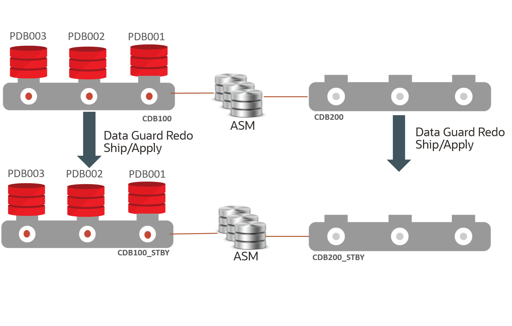
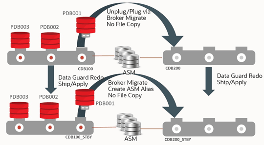
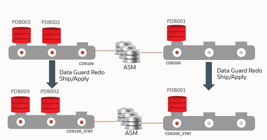
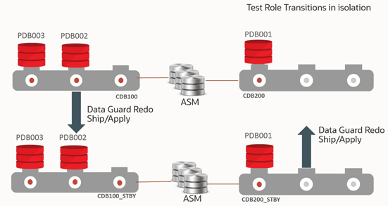
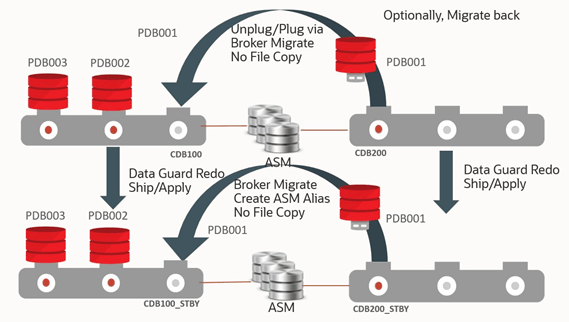
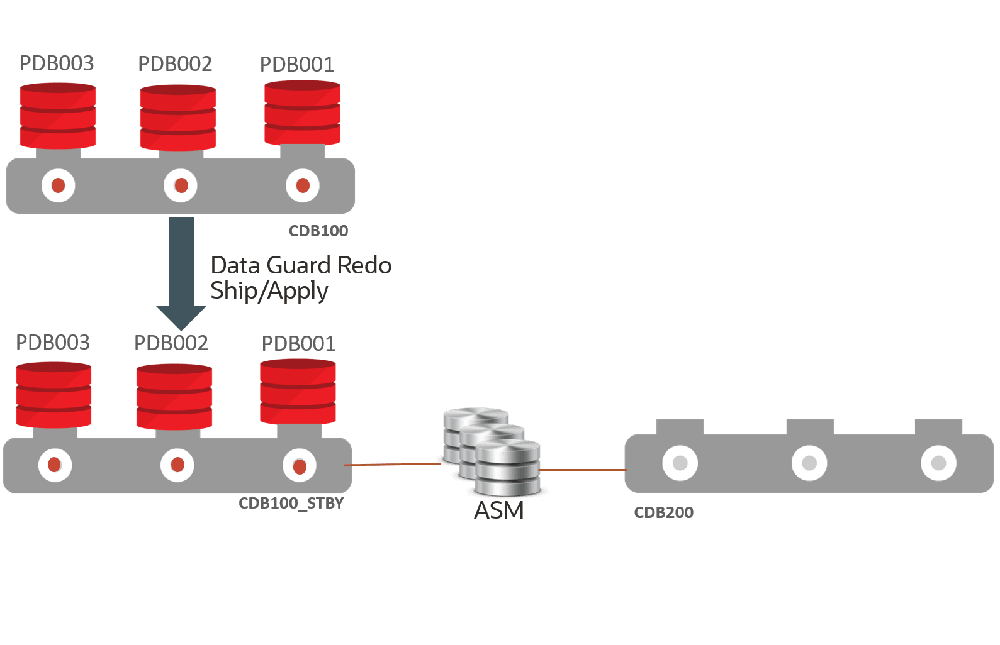
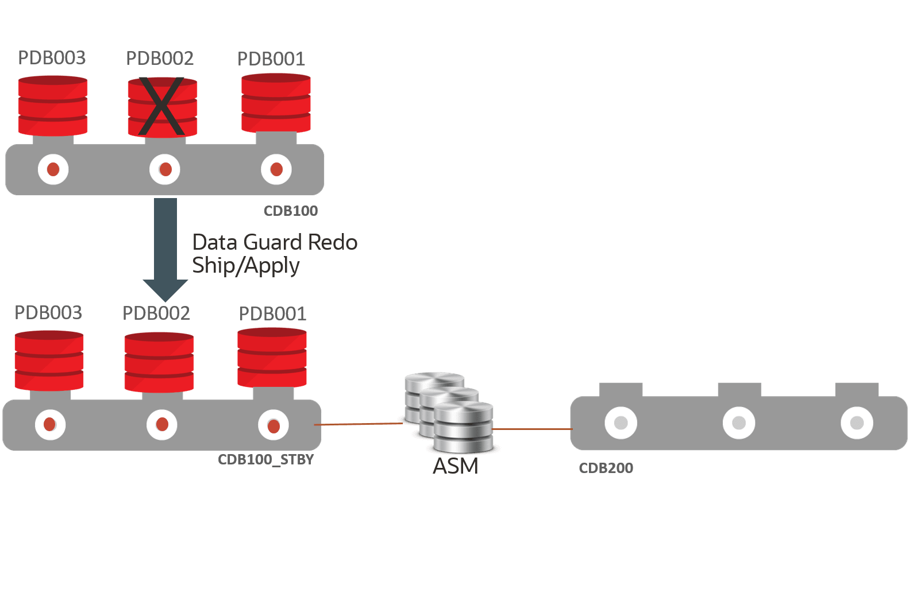
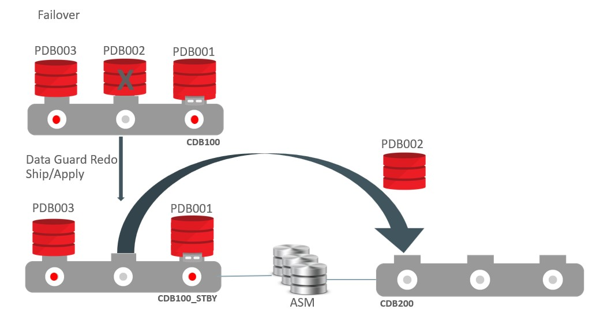
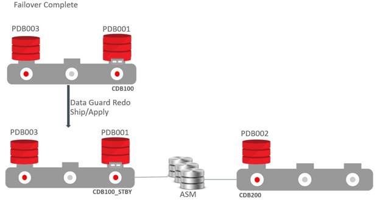
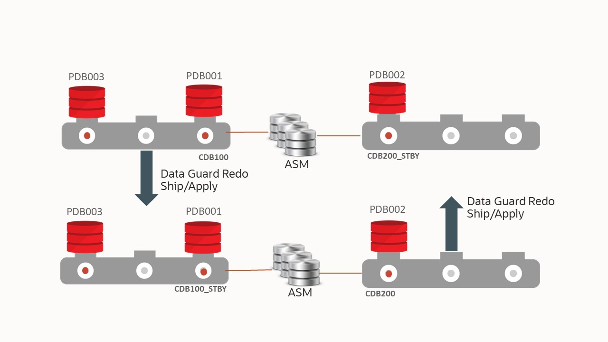

## 43 PDB Switchover and Failover in a Multitenant Configuration

The use cases documented here demonstrate how to set up single pluggable database (PDB) failover and switchover for an Oracle Data Guard configuration with a container database (CDB) with many PDBs.

With Oracle Multitenant and the ability to consolidate multiple pluggable databases (PDBs) in a container database (CDB), you can manage many databases that have similar SLAs and planned maintenance requirements with fewer system resources, and more importantly with less operational investment. Leveraging Oracle Multitenant and its CDBs/PDBs technologies with Oracle’s resource management, it is an effective means to reduce overall hardware and operational costs.

Planning and sizing are key prerequisites in determining which databases to consolidate in the same CDB. For mission critical databases that require HA and DR protection and minimal downtime for planned maintenance, it’s important that you

- Size and leverage resource management to ensure sufficient resources for each PDB to perform within response and throughput expectations
- Target PDB databases that have the same planned maintenance requirements and schedule
- Target PDB databases that can all fail over to same CDB standby in case of unplanned outages such as CDB, cluster, or site failures

Note that Data Guard failover and switchover times can increase as you add more PDBs and their associated application services. A good rule is to have fewer than 25 PDBs per CDB for mission critical “Gold” CDBs with Data Guard if you want to reduce Data Guard switchover and failover timings.

Separating mission critical databases and dev/test databases into different CDBs is important. For example a mission critical “Gold” CDB with a standby may have only 5 PDBs with identical HA/DR requirements and may be sized to have ample system resource headroom while an important CDB with standby can contain 100 PDBs for dev, UAT and application testing purposes and may set up some level of over subscription to reduce costs. Refer to [Overview of Oracle Multitenant Best Practices](overview-multitenant-best-practices.md) for more information on Multitenant MAA and Multitenant best practices.

This use case provides an overview and step by step instructions for the exception cases where a complete CDB Data Guard switchover and failover operation is not possible. With PDB failover and switchover steps, you can isolate the Data Guard role transition to one PDB to achieve Recovery Time Objective (RTO) of less 5 minutes and zero or near zero Recovery Point Objective (RPO or data loss).

Starting with Oracle RDBMS 19c (19.15) you can use Data Guard broker command line interface (DGMGRL) to migrate PDBs from one Data Guard configuration to another. Using broker, you can initiate PDB disaster recovery (DR) and switchover operations in isolation without impacting other PDBs in the same CDB.

The following primary use cases are described below for Data Guard broker migration:

- PDB switchover use case - Planned maintenance DR validation which invokes a PDB switchover operation without impacting existing PDBs in a Data Guard CDB
- PDB Failover use case - Unplanned outage DR which invokes a PDB failover without impacting existing PDBs in a Data Guard CDB

Note:

To relocate a single PDB when upgrade is not required without impacting other PDBs in a CDB see [Using PDB Relocation to Move a Single PDB to Another CDB Without Upgrade (Doc ID 2771737.1)](https://support.oracle.com/rs?type=doc&id=2771737.1). To relocate a single PDB requiring upgrade without impacting other PDBs in a CDB see.

### PDB Switchover Use Case

In this PDB switchover or "DR Test” use case, a PDB is migrated from one Oracle Data Guard protected CDB to another Data Guard protected CDB.

As part of this use case, the files for the PDB on both the primary and standby databases of the source CDB are used directly in the respective primary and standby databases of the destination CDB.

The source CDB contains multiple PDBs, but we perform role transition testing on only one PDB because the others are not able to accept the impact. Before starting the migration, a second CDB must be created and it must have the same database options as the source CDB. The destination CDB is also in a Data Guard configuration, but it contains no PDBs at the start. The two corresponding primary and standby databases share the same storage and no data file movement is performed.

#### Prerequisites

Make sure your environment meets these prerequisites for the use case.

The Oracle Data Guard broker CLI (DGMGRL) supports maintaining configurations with a single physical standby database.

Using the method described here, for the PDB being migrated (the source), the data files of both the primary and the standby databases physically remain in their existing directory structure at the source and are consumed by the destination CDB and its standby database.

- Oracle patches/versions required
	- Oracle RDBMS 19c (19.15) or later
	- Patch 33358233 installed on the source and destination CDB RDBMS Oracle Homes to provide the broker functionality to manage the switchover process. You don't need to apply the patch on Oracle RDBMS 19c (19.18) and later; it is included.
	- Patch 34904997 installed on the source and destination CDB RDBMS Oracle Homes to provide the functionality to migrate the PDB back to the original configuration after performing the PDB Failover Use Case.
- Configuration
	- `DB_CREATE_FILE_DEST =                             ASM_Disk_Group`
		- `DB_FILE_NAME_CONVERT=””`
		- `STANDBY_FILE_MANAGEMENT=AUTO`
		- The source and destination standby CDBs must run on the same cluster
		- The source and destination primary CDBs should run from the same Oracle Home, and the source and destination standby CDBs should run from the same Oracle Home
		- The source and destination primary CDBs must run on the same host
		- The source and destination primary databases must use the same ASM disk group, and the source and destination standby databases must use the same ASM disk group
- You must have access to the following
	- Password for the destination CDB sysdba user
		- Password for the standby site ASM `sysasm` user (to manage aliases)
		- Password for the destination CDB Transparent Data Encryption (TDE) keystore if TDE is enabled

Note:

PDB snapshot clones and PDB snapshot clone parents are not supported for migration or failover.

For destination primary databases with multiple physical standby databases you must either use the manual steps in [Reusing the Source Standby Database Files When Plugging a PDB into the Primary Database of a Data Guard Configuration (Doc ID 2273829.1)](https://support.oracle.com/rs?type=doc&id=2273829.1), or use the `ENABLED_PDBS_ON_STANDBY` initialization parameter in the standby databases, to limit which standby will be managed by this process. See [Creating a Physical Standby of a CDB](https://docs.oracle.com/pls/topic/lookup?ctx=en/database/oracle/oracle-database/21/haovw&id=SBYDB-GUID-D5F0EB8F-8534-462A-911C-216E6DC7CE69) in Oracle Data Guard Concepts and Administration for information about using `ENABLED_PDBS_ON_STANDBY`.

Existing ASM aliases for the source PDB migrated are managed by the broker during the migrate process. ASM only allows one alias per file, so existing aliases pointing to a different location must be removed and new ones in the correct location created.

#### Configuring PDB Switchover

You configure the "DR test" PDB switchover use case in the following steps.

The sample commands included in the steps below use the following CDB and PDB names.

- CDB100 (source CDB)
	- Contains PDB001, PDB002, PDB003; PDB001 will be configured for switchover
- CDB100\_STBY (source standby CDB)
- CDB200 (destination CDB)
- CDB200\_STBY (destination standby CDB)

Step 1: Extract PDB Clusterware managed services on the source database

Determine any application and end user services created for the source PDB that have been added to CRS.

Because there are certain service attributes such as database role not stored in the database, the detail attributes should be retrieved from CRS using `SRVCTL                     CONFIG SERVICE`.

1. Retrieve the service names from the primary PDB (PDB001 in our example).
	```
	PRIMARY_HOST $ sqlplus sys@cdb100 as sysdba
	SQL> alter session set container=pdb001;
	SQL> select name from dba_services;
	```
2. For each service name returned, retrieve the configuration including `DATABASE_ROLE`.
	```
	PRIMARY_HOST $ srvctl config service -db cdb100 -s SERVICE_NAME
	```

Step 2: Create an empty target database

Create an empty CDB (CDB200 in our example) on the same cluster as the source CDB (CDB100) which will be the destination for the PDB.

Allocate resources for this CDB to support the use of the PDB for the duration of the testing.

Step 3: Create a target standby database

Enable Oracle Data Guard on the target CDB to create a standby database (CDB200\_STBY).

The standby database must reside on the same cluster as the source standby database.

The configuration should resemble the image below.



> The image shows the topology of the use case described above.
>
> In the upper left is the source primary CDB (CDB100) containing 3 PDBs (PDB001, PDB002, PDB003).
>
> The lower left shows the standby CDB for CDB100 (CDB100\_STBY) containing 3 PDBs (PDB001, PDB002, PDB003).
>
> An arrow from source primary CDB CDB100 pointing to its standby CDB100\_STBY is labeled "Data Guard Redo Ship/Apply".
>
> The upper right of the image shows the empty destination primary CDB (CDB200) containing no PDBs.
>
> The lower right shows the empty standby CDB for CDB200 (CDB200\_STBY) containing no PDBs.
>
> An arrow from the destination primary CDB CDB200 pointing to its standby CDB200\_STBY is labeled "Data Guard Redo Ship/Apply".
>
> Between the source primary CDB (CDB100) and the destination primary CDB (CDB200) is shown an ASM disk group with solid lines to each primary CDB.
>
> Between the source standby CDB (CDB100\_STBY) and the destination standby CDB (CDB200\_STBY) is shown an ASM disk group with solid lines to each standby CDB.


Step 4: Migrate the PDB

Migrate the PDB (PDB001) from the source CDB (CDB100) to the destination CDB (CDB200).

1. Start a connection to the source primary database using Oracle Data Guard broker command line (DGMGRL).
	This session should run on a host that contains instances of both the source primary CDB and the destination primary CDB. The session should be started with a sysdba user.
	The broker CLI should be run from the command line on the primary CDB environment and run while connected to the source primary CDB. If you are using a TNS alias to connect to the source primary, it should connect to the source primary instance running on the same host as the broker CLI session.
	The host and environment settings when running the broker CLI must have access to SQL\*Net aliases for:
	- Destination primary CDB – This alias should connect to the destination primary instance that is on the same host as the broker CLI session/source primary database instance to ensure the plug-in operation can access the PDB unplug manifest file that will be created.
		- Destination standby CDB, this can connect to any instance in the standby environment.
		- Standby site ASM instance, this can connect to any instance in the standby environment.
		```
		PRIMARY_HOST1 $ dgmgrl sys@cdb100_prim_inst1 as sysdba
		```
		This session should run on a host that contains instances of both the source primary CDB and the destination primary CDB and connected to a sysdba user. Use specific host/instance combinations instead of SCAN to ensure connections are made to the desired instances.
2. Run the `DGMGRL MIGRATE PLUGGABLE DATABASE` command.
	The `STANDBY FILES` keyword is required.
	See Full Example Commands with Output for examples with complete output and [MIGRATE PLUGGABLE DATABASE](https://docs.oracle.com/pls/topic/lookup?ctx=en/database/oracle/oracle-database/21/haovw&id=DGBKR-GUID-03E8CCF2-0ACE-4F54-855D-0BBF839D6695) for additional information about the command line arguments.
	- Sample command example without TDE:
		```
		DGMGRL> MIGRATE PLUGGABLE DATABASE PDB001 TO CONTAINER CDB200
		 USING ‘/tmp/PDB001.xml’ CONNECT AS sys/password@cdb200_inst1
		 STANDBY FILES sys/standby_asm_sys_password@standby_asm_inst1
		 SOURCE STANDBY CDB100_STBY DESTINATION STANDBY CDB200_STBY ;
		```
		- Sample command example with TDE
		```
		DGMGRL> MIGRATE PLUGGABLE DATABASE PDB001 TO CONTAINER CDB200
		 USING ‘/tmp/pdb001.xml’ CONNECT AS sys/password@cdb200_inst1
		 SECRET "some_value" KEYSTORE IDENTIFIED BY "destination_TDE_keystore_passwd"
		 STANDBY FILES sys/standby_asm_sys_password@standby_asm_inst1
		 SOURCE STANDBY cdb100_stby DESTINATION STANDBY cdb200_stby;
		```
		Note:
		In TDE environments, if `SECRET` or `KEYSTORE` are not specified in the command line, the `MIGRATE` command fails. You can also use `PROMPT SECRET, PROMPT KEYSTORE` to provide a password using command line input during the migration.

When the command is executed, it:

1. Connects to the destination database and ASM instances to ensure credentials and connect strings are correct
2. Performs a variety of prechecks - If any precheck fails, the command stops processing and returns control to the user, an error is returned, and no changes are made on the target CDB
3. Creates a flashback guaranteed restore point in the destination standby CDB - This requires a short stop and start of redo apply
4. Closes the PDB on the source primary
5. Unplugs the PDB on the source primary - If TDE is in use, the keys are included in the manifest file generated as part of the unplug operation
6. Drops the PDB on the source primary database with the `KEEP                             DATAFILES` clause, ensuring that the source files are not dropped
7. Waits for the drop PDB redo to be applied to the source standby database - It must wait because the files are still owned by the source standby database until the drop redo is applied
	The command waits a maximum of `TIMEOUT` minutes (default 10). If the redo hasn't been applied by then the command fails and you must manually complete the process.
8. Manages the ASM aliases for the PDB files at the standby, removing any existing aliases and creating new aliases as needed - If the standby files already exist in the correct location, all aliases for the standby copy of the PDB are removed
9. Plugs in the PDB into the destination primary CDB - If TDE is in use, the keys are imported into the destination primary keystore as part of the plug-in
10. Ships and applies redo for the plug-in operation to the destination CDB, which uses any created aliases (if necessary) to access the files and incorporate them into the standby database
11. Validates that the standby files are added to the destination standby using redo apply
12. Opens the PDB in the destination primary database
13. Stops redo apply
14. Drops the flashback guaranteed restore point from the destination standby database
15. If TDE is enabled, redo apply remains stopped, if TDE is not enabled, redo apply is restarted

The image below shows the process of PDB001 unplugging from CDB100/CDB100\_STBY, and plugging into CDB200/CDB200\_STBY.



> The image shows the topology of the use case described above.
>
> In the upper left is the source primary CDB (CDB100) containing 3 PDBs (PDB001, PDB002, PDB003).
>
> The lower left shows the standby CDB for CDB100 (CDB100\_STBY) containing 3 PDBs (PDB001, PDB002, PDB003).
>
> An arrow from source primary CDB CDB100 pointing to its standby CDB100\_STBY is labeled "Data Guard Redo Ship/Apply".
>
> The upper right of the image shows the empty destination primary CDB (CDB200) containing no PDBs.
>
> The lower right shows the empty standby CDB for CDB200 (CDB200\_STBY) containing no PDBs.
>
> An arrow from the destination primary CDB CDB200 pointing to its standby CDB200\_STBY is labeled "Data Guard Redo Ship/Apply".
>
> Between the source primary CDB (CDB100) and the destination primary CDB (CDB200) is shown an ASM disk group with solid lines to each primary CDB. There is also an arrow labeled "Unplug/Plug via Broker Migrate No File Copy" between PDB001 in CDB100 and the destination position for PDB001 in CDB200, indicating that the PDB is in the process of unplugging from the source and being plugged into the destination.
>
> Between the source standby CDB (CDB100\_STBY) and the destination standby CDB (CDB200\_STBY) is shown an ASM disk group with solid lines to each standby CDB. There is also an arrow labeled "Broker Migrate Create ASM Alias No File Copy" between PDB001 in CDB100\_STBY and the destination position for PDB001 in CDB200\_STBY, indicating that the PDB is in the process of unplugging from the source and being plugged into the destination.


Step 5: Post Migration - Optional TDE Configuration Step and Restart Apply

If TDE is in use, redo apply will have been stopped by the broker `MIGRATE PLUGGABLE DATABASE` operation on the destination standby (CDB200\_STBY) to allow the new TDE keys to be managed. Copy the keystore for the destination primary (CDB200) to the destination standby keystore and start redo apply.

```
SOURCE_HOST $ scp DESTINATION_PRIMARY_WALLET_LOCATION/*>
 DESTINATION_HOST:DESTINATION_STANDBY_WALLET_LOCATION/

$ dgmgrl sys/password@CDB200 as sysdba
DGMGRL> edit database cdb200_stby set state=’APPLY-ON’;
```

Step 6: Post Migration - Enable Services

Add any application services for the PDB to Cluster Ready Services (CRS), associating them with the PDB and correct database role in the destination CDB, and remove the corresponding service from the source CDB.

1. For each service on both the primary and standby environments, run the following:
	```
	PRIMARY_HOST $ srvctl add service -db cdb200 -s SERVICE_NAME
	 -pdb pdb001 -role [PRIMARY|PHYSICAL_STANDBY]….
	STANDBY_HOST $ srvctl add service -db cdb200_stby -s SERVICE_NAME
	 -pdb pdb001 -role [PRIMARY|PHYSICAL_STANDBY]….
	PRIMARY_HOST $ srvctl remove service -db cdb100 -s SERVICE_NAME
	STANDBY_HOST $ srvctl remove service -db cdb100_stby -s SERVICE_NAME
	```
2. Start the required services for the appropriate database role.
	1. Start each PRIMARY role database service
		```
		PRIMARY_HOST $ srvctl start service -db cdb200 -s SERVICE_NAME
		```
		2. Start each `PHYSICAL_STANDBY` role database service:
		```
		STANDBY_HOST $ srvctl start service -db cdb200_stby -s SERVICE_NAME
		```

The image below shows the configuration after migration.



> The image shows the topology of the use case described above.
>
> In the upper left is the source primary CDB (CDB100) containing 2 PDBs (PDB002, PDB003).
>
> The lower left shows the standby CDB for CDB100 (CDB100\_STBY) containing 2 PDBs (PDB002, PDB003).
>
> An arrow from source primary CDB CDB100 pointing to its standby CDB100\_STBY is labeled "Data Guard Redo Ship/Apply".
>
> The upper right of the image shows the destination primary CDB (CDB200) containing one PDB (PDB001).
>
> The lower right shows the destination standby CDB for CDB200 (CDB200\_STBY) containing one PDB (PDB001.
>
> An arrow from the destination primary CDB CDB200 pointing to its standby CDB200\_STBY is labeled "Data Guard Redo Ship/Apply".
>
> Between the source primary CDB (CDB100) and the destination primary CDB (CDB200) is shown an ASM disk group with solid lines to each primary CDB.
>
> Between the source standby CDB (CDB100\_STBY) and the destination standby CDB (CDB200\_STBY) is shown an ASM disk group with solid lines to each standby CDB.


Step 7: Perform PDB role transition testing

After completing the migration, you can now perform required Oracle Data Guard role transitions or DR test with the PDB in destination CDB (CDB200). No other PDBs in the source CDB (CDB100) are impacted.

In addition, you continue to maintain the Data Guard benefits for both the source and destination CDB, such as DR readiness, Automatic Block Media Recovery for data corruptions, Fast-Start Failover to bound recovery time, Lost Write detection for logical corruptions, offloading reads to the standby to reduce scale and reduce impact of the primary, and so on. etc.

- Connect to the destination CDB using `DGMGRL` and perform the switchover.
	```
	$ dgmgrl sys@cdb200 as sysdba
	DGMGRL> switchover to CDB200_STBY;
	```
	The image below shows the configuration after Data Guard switchover of the PDB.
	  
	

> The image shows the topology of the use case described above.
>
> In the upper left is the source primary CDB (CDB100) containing 2 PDBs (PDB002, PDB003).
>
> The lower left shows the standby CDB for CDB100 (CDB100\_STBY) containing 2 PDBs (PDB002, PDB003).
>
> An arrow from source primary CDB CDB100 pointing to its standby CDB100\_STBY is labeled "Data Guard Redo Ship/Apply".
>
> The upper right of the image shows the destination primary CDB (CDB200) containing one PDB (PDB001).
>
> The lower right shows the destination standby CDB for CDB200 (CDB200\_STBY) containing one PDB (PDB001.
>
> An arrow from the destination standby CDB CDB200\_STBY pointing to its primary CDB200 is labeled "Data Guard Redo Ship/Apply".
>
> Between the source primary CDB (CDB100) and the destination primary CDB (CDB200) is shown an ASM disk group with solid lines to each primary CDB.
>
> Between the source standby CDB (CDB100\_STBY) and the destination standby CDB (CDB200\_STBY) is shown an ASM disk group with solid lines to each standby CDB.


You can continue performing your DR testing for the PDB.

Once the DR testing for the PDB is complete, you can switch back and subsequently migrate the PDB back to the original source CDB.

- Connect to the destination CDB (CDB200) using `DGMGRL` and perform the switchback operation.
	```
	$ dgmgrl sys@cdb200 as sysdba
	DGMGRL> switchover to CDB200;
	```
	The image below shows the configuration after the switchback operation.
	

> The image shows the topology of the use case described above.
>
> In the upper left is the source primary CDB (CDB100) containing 2 PDBs (PDB002, PDB003).
>
> The lower left shows the standby CDB for CDB100 (CDB100\_STBY) containing 2 PDBs (PDB002, PDB003).
>
> An arrow from source primary CDB CDB100 pointing to its standby CDB100\_STBY is labeled "Data Guard Redo Ship/Apply".
>
> The upper right of the image shows the destination primary CDB (CDB200) containing one PDB (PDB001).
>
> The lower right shows the destination standby CDB for CDB200 (CDB200\_STBY) containing one PDB (PDB001.
>
> An arrow from the destination primary CDB CDB200 pointing to its standby CDB200\_STBY is labeled "Data Guard Redo Ship/Apply".
>
> Between the source primary CDB (CDB100) and the destination primary CDB (CDB200) is shown an ASM disk group with solid lines to each primary CDB.
>
> Between the source standby CDB (CDB100\_STBY) and the destination standby CDB (CDB200\_STBY) is shown an ASM disk group with solid lines to each standby CDB.


Step 8: Return the PDB to the original CDB

After migration and role transition testing, switch back to the original configuration for this CDB and migrate the PDB back to the original Data Guard configuration, again automatically maintaining the standby database files. Data Guard broker migration handles any aliases that need to be dropped or created as part of the migration process.

See Full Example Commands with Output for examples with complete output.

- Start a connection to the source primary using Data Guard Broker command line (`DGMGRL`)
	```
	$ dgmgrl 
	DGMGRL> connect sys/@cdb200_inst1 as sysdba
	```
	- Command without TDE
		```
		DGMGRL> MIGRATE PLUGGABLE DATABASE PDB001 TO CONTAINER CDB100
		 USING ‘/tmp/PDB001_back.xml’ CONNECT AS sys/password@cdb100_inst1
		 STANDBY FILES sys/standby_asm_sys_password@standby_asm_inst
		 SOURCE STANDBY CDB200_STBY DESTINATION STANDBY CDB100_STBY ;
		```
	- Command with TDE
		```
		DGMGRL> MIGRATE PLUGGABLE DATABASE PDB001 TO CONTAINER CDB100
		 USING ‘/tmp/PDB001_back.xml’ CONNECT AS sys/password@cdb100_inst1
		  SECRET "some_value" KEYSTORE
		 IDENTIFIED BY "destination_TDE_keystore_passwd"
		 STANDBY FILES sys/standby_asm_sys_password@standby_asm_inst
		 SOURCE STANDBY CDB200_STBY DESTINATION STANDBY CDB100_STBY ;
		```
		Note:
		In TDE environments, if `SECRET` or `KEYSTORE` are not specified in the command line, the `MIGRATE` command fails. You can also use `PROMPT SECRET, PROMPT KEYSTORE` to provide a password using command line input during the migration.

The image below shows the configuration during reverse migration.



> The image shows the topology of the use case described above.
>
> In the upper left is the source primary CDB (CDB100) containing 2 PDBs (PDB002, PDB003).
>
> The lower left shows the standby CDB for CDB100 (CDB100\_STBY) containing 2 PDBs (PDB002, PDB003).
>
> An arrow from source primary CDB CDB100 pointing to its standby CDB100\_STBY is labeled "Data Guard Redo Ship/Apply".
>
> The upper right of the image shows the destination primary CDB (CDB200) showing one PDB (PDB001) lifted away from the CDB.
>
> The lower right shows the destination standby CDB for CDB200 (CDB200\_STBY) showing one PDB (PDB001) lifted away from the CDB.
>
> An arrow from the destination primary CDB CDB200 pointing to its standby CDB200\_STBY is labeled "Data Guard Redo Ship/Apply".
>
> Between the source primary CDB (CDB100) and the destination primary CDB (CDB200) is shown an ASM disk group with solid lines to each primary CDB. There is also an arrow labeled "Unplug/Plug via Broker Migrate No File Copy" pointing from PDB001 in CDB200 to the original source position for PDB001 in CDB100, indicating that the PDB is in the process of unplugging from the destination and being plugged into the source.
>
> Between the source standby CDB (CDB100\_STBY) and the destination standby CDB (CDB200\_STBY) is shown an ASM disk group with solid lines to each standby CDB. There is also an arrow labeled "Broker Migrate Create ASM Alias No File Copy" pointing from PDB001 in CDB200\_STBY to the original source position for PDB001 in CDB100\_STBY, indicating that the PDB is in the process of unplugging from the destination and being plugged into the source.


Step 9: Post Migration - Enable Services

Add any application services for the PDB to Cluster Ready Services (CRS), associating them with the PDB and correct database role in the destination CDB (CDB100), and remove the corresponding service from the source CDB (CDB200).

- For each service on both the primary and standby environments, run the following:
	```
	PRIMARY_HOST $ srvctl add service -db cdb100 -s SERVICE_NAME
	 -pdb pdb001 -role [PRIMARY|PHYSICAL_STANDBY]….
	STANDBY_HOST $ srvctl add service -db cdb100_stby -s SERVICE_NAME
	 -pdb pdb001 -role [PRIMARY|PHYSICAL_STANDBY]….
	<PRIMARY_HOST>PRIMARY_HOST $ srvctl remove service -db cdb200 -s SERVICE_NAME
	STANDBY_HOST $ srvctl remove service -db cdb200_stby -s SERVICE_NAME
	```
- Start the required services for the appropriate database role.
	1. Start each `PRIMARY` role database service.
		```
		PRIMARY_HOST $ srvctl start service -db cdb100 -s SERVICE_NAME
		```
		2. Start each `PHYSICAL_STANDBY` role database service.
		```
		STANDBY_HOST $ srvctl start service -db cdb100_stby -s SERVICE_NAME
		```

### PDB Failover Use Case

This is a very rare use case since a real disaster that encompasses CDB, cluster, or site failure should always leverage a complete CDB Data Guard failover operation to bound downtime, reduce potential data loss, and reduce administrative steps.

Even with widespread logical or data corruptions or inexplicable database hangs, it's more efficient to issue a CDB Data Guard role transition operation because the source environment may be suspect and root cause analysis may take a long time.

When does a PDB failover operation make sense? PDB failover may be viable if the application is getting fatal errors such as data integrity or corruption errors, or simply is not performing well (not due to system resources). If the source CDB and its corresponding PDBs are still running well, and the standby did not receive any errors for the target sick PDB, then you can fail over just the target sick PDB from the standby without impacting any other PDBs in the source primary CDB.

The process below describes how to set up a PDB failover of a sick PDB that migrates the standby’s healthy PDB from the source CDB standby (CDB100\_STBY) to an empty destination CDB (CDB200). Before starting the migration, the destination CDB must be created and it must have the same database options as the source standby CDB. The destination CDB will contain no PDBs. The source and destination CDBs share the same storage and no data file movement is performed.

#### Prerequisites

Make sure your environment meets these prerequisites for the use case.

In addition to the prerequisites listed in the PDB switchover use case, above, the following prerequisites exist for failing over.

- Oracle recommends that you shut down the services on both the primary and the standby that are accessing the PDB before starting the migration process.
	If the PDB is not closed on the primary before running the `DGMGRL MIGRATE PLUGGABLE DATABASE` command, an error is returned stating that you will incur data loss. Closing the PDB on the primary resolves this issue. All existing connections to the PDB are terminated as part of the migration.

Assuming a destination CDB is already in place and patched correctly on the standby site, the entire process of moving the PDB can be completed in less than 15 minutes.

#### Additional Considerations

The following steps assume the source CDB database (either primary for migration or standby for failover) and the destination CDB database have access to the same storage, so copying data files is not required.

- Oracle Active Data Guard is required for the source CDB standby for failover operations.
- Create an empty CDB to be the destination for the PDB on the same cluster as the source CDB.
- Ensure that the TEMP file in the PDB has already been created in the source CDB standby before performing the migration.
- If the destination CDB is a later Oracle release the PDB will be plugged in but left closed to allow for manual upgrade as a post-migration task.
- After processing is completed, you may need to clean up leftover database files from the source databases.
- The plugin operation at the destination CDB is performed with `STANDBYS=NONE`, so you will need to manually enable recovery at any standby databases upon completion of the migration. See [Making Use Deferred PDB Recovery and the STANDBYS=NONE Feature with Oracle Multitenant (Doc ID 1916648.1)](https://support.oracle.com/rs?type=doc&id=1916648.1) for steps to enable recovery of a PDB.

#### Configuring PDB Failover

You configure the DR PDB failover use case in the following steps.

In this use case, the example topology has source primary CDB100 with 3 PDBs (PDB001, PDB002, PDB003). CDB100 also has a Data Guard physical standby (CDB100\_STBY).

On the same environment as the standby CDB, we will create a new CDB (CDB200) which is a read-write database that becomes the new host for one of the source PDBs.

Step 1: Extract PDB Clusterware managed services on the source database

Determine any application and end user services created for the source PDB that have been added to CRS.

Because there are certain service attributes such as database role not stored in the database, the detail attributes should be retrieved from CRS using `SRVCTL                     CONFIG SERVICE`.

1. Retrieve the service names from the primary PDB (PDB002 in our example).
	```
	PRIMARY_HOST $ sqlplus sys@cdb100 as sysdba
	SQL> alter session set container=pdb002;
	SQL> select name from dba_services;
	```
2. For each service name returned, retrieve the configuration including `DATABASE_ROLE`.
	```
	PRIMARY_HOST $ srvctl config service -db cdb100 -s SERVICE_NAME
	```

Step 2: Create an empty target database

Create an empty CDB (CDB200 in our example) on the same cluster as the source standby CDB (CDB100\_STBY) which will be the destination for the PDB (PDB002).

Allocate resources for this CDB to support the use of the PDB while it remains in this CDB.

Step 3: Create an Oracle Data Guard configuration for the empty target database

To allow Data Guard broker to access the new CDB (CDB200), it must be part of a Data Guard configuration. This configuration can consist of only a primary database.

1. Configure the database for broker.
	```
	STANDBY_HOST $ sqlplus sys@cdb200 as sysdba
	SQL> alter system set dg_broker_config_file1='+DATAC1/cdb200/dg_broker_1.dat';
	SQL> alter system set dg_broker_config_file2='+DATAC1/cdb200/dg_broker_2.dat';
	SQL> alter system set dg_broker_start=TRUE;
	```
2. Create the configuration and add the database as the primary.
	```
	STANDBY_HOST $ dgmgrl 
	DGMGRL> connect sys@cdb200 as sysdba
	DGMGRL> create configuration failover_dest as primary database is cdb200
	 connect identifier is 'cdb200';
	DGMGRL> enable configuration;
	```

The configuration should resemble the image below.



> The image shows the topology of the use case described above.
>
> In the upper left is the source primary CDB (CDB100) containing 3 PDBs (PDB001, PDB002, PDB003).
>
> The lower left shows the standby CDB for CDB100 (CDB100\_STBY) containing 3 PDBs (PDB001, PDB002, PDB003).
>
> An arrow from source primary CDB CDB100 pointing to its standby CDB100\_STBY is labeled "Data Guard Redo Ship/Apply".
>
> The lower right of the image shows the empty destination CDB (CDB200) containing no PDBs.
>
> Between the source standby CDB (CDB100\_STBY) and the destination CDB (CDB200) is shown an ASM disk group with solid lines to each CDB.


In this image, the source primary CDB (CDB100) and all PDBs are running normally. the source standby CDB (CDB100\_STBY) must run in Active Data Guard mode to allow for the "unplug" operation to succeed without impacting other PDBs. The destination CDB (CDB200) is currently empty.

Assume that one of the source primary PDBs (PDB002) experiences a failure, as shown in the image below, which requires a long recovery period, but the failure does not impact the other PDBs (PDB001 and PDB003), and the standby for the source CDB continues to apply redo without error. The image below shows this outage scenario.



> The image shows the topology when PDB002 fails.
>
> In the upper left is the source primary CDB (CDB100) containing 3 PDBs (PDB001, PDB002, PDB003).
>
> PDB002 has an X over it indicating that this primary instance failed.
>
> The lower left shows the standby CDB for CDB100 (CDB100\_STBY) containing 3 PDBs (PDB001, PDB002, PDB003).
>
> An arrow from source primary CDB CDB100 pointing to its standby CDB100\_STBY is labeled "Data Guard Redo Ship/Apply".
>
> The lower right of the image shows the empty destination CDB (CDB200) containing no PDBs.
>
> Between the source standby CDB (CDB100\_STBY) and the destination CDB (CDB200) is shown an ASM disk group with solid lines to each CDB.


This configuration will use files from PDB002 at the standby site (CDB100\_STBY) to plug into the destination CDB (CDB200) to restore read/write application access and then drop the sick PDB (PDB002) from the source primary CDB (CDB100). This will not be a native unplug operation because native unplug requires a read/write CDB and in this scenario we're extracting from the standby.

Step 4: Stop services for the failed PDB

Although not required, stop all services on both the source primary database and any standby database(s) pertaining to the PDB (PDB002) to be migrated.

The following commands stop all services defined in CRS but does not close the PDB.

```
SOURCE_PRIMARY $ srvctl stop service -d CDB100 -pdb PDB002
SOURCE_PRIMARY $ srvctl stop service -d CDB100_STBY -pdb PDB002
```

Step 5: Fail over the PDB from the standby

Fail over the sick PDB (PDB002) from the standby CDB (CDB100\_STBY) to the destination CDB (CDB200).

1. Start a `DGMGRL` session connecting to the source configuration standby database (CDB100\_STBY).
	You must connect to the source standby database as SYSDBA using something similar to the following:
	```
	$ dgmgrl
	DGMGRL> connect sys@cdb100_stby_inst1 as sysdba
	```
2. Run the `DGMGRL MIGRATE PLUGGABLE DATABASE` command to perform the failover.
	Note:
	The `DGMGRL                             FAILOVER` command has a similar format to the `MIGRATE                             PLUGGABLE DATABASE` command.
	Do not use the `STANDBY FILES` keyword for the failover operation.
	If data loss is detected (SCN in the header of the first `SYSTEM` tablespace standby data file is less than the corresponding SCN of the file in the primary) and `IMMEDIATE` has not been specified, the `MIGRATE PLUGGABLE DATABASE` command will fail. The most common reason is that the PDB in the primary CDB is still open, the PDB on the primary should be closed before attempting a failover.
	You must resolve the SCN discrepancy or accept the data loss with the `IMMEDIATE` clause.
3. Fail over the PDB
	See Full Example Commands with Output for examples with complete output.
	The CONNECT alias should connect to the destination primary instance that is on the same host as the broker CLI session/source standby database instance to ensure that the plug-in operation can access the PDB unplug manifest file that will be created.
	Note:
	In the following examples, you will be prompted for the SYSDBA password for the destination CDB (CDB200) when the broker attempts to connect to the CDB200\_INST1 instance.
	- For non-TDE enabled environments:
		```
		DGMGRL> migrate pluggable database PDB002 to container CDB200
		 using '/tmp/PDB002.xml>' connect as sys@”CDB200_INST1”;
		```
		- For TDE enabled environments:
		```
		DGMGRL> migrate pluggable database PDB002 to container CDB200
		 using '/tmp/PDB002.xml>' connect as sys@”CDB200_INST1”
		 secret “some_value”
		 keystore identified by “destination_keystore_password”
		 keyfile ‘/tmp/pdb002_key.dat’
		 source keystore identified by “source_keystore_password”;
		```
		Note:
		In TDE environments, if `SECRET`, `KEYSTORE`, `KEYFILE`, or `SOURCE KEYSTORE` are not specified in the command line, the `MIGRATE` command fails. You can also use `PROMPT SECRET, PROMPT                                     KEYSTORE, PROMPT SOURCE KEYSTORE` to provide a password using command line input during the migration.

Once the connection to the destination is established the command will:

1. Perform all necessary validations for the failover operation
2. If TDE is enabled, export the TDE keys for the PDB from the source standby keystore
3. Stop redo apply on the source standby if it is running
4. Create the manifest on the standby at the location specified in the command using the `DBMS_PDB.DESCRIBE` command
5. Disable recovery of the PDB at the source standby
6. If TDE is enabled, import TDE keys into the destination CDB keystore to allow the plug-in to succeed
7. Plug in the PDB in the destination database using the standby's data files (`NOCOPY` clause) and with `STANDBYS=NONE`.
8. Open the PDB in all instances of the destination primary database
9. If TDE is enabled, issue `ADMINISTER KEY MANAGEMENT USE KEY` in the context of the PDB to associate the imported key and the PDB.
10. Unplug the PDB from the source primary. If errors occur on unplug messaging is provided to user to perform cleanup manually
11. If unplug succeeds, drop the PDB from the source primary with the `KEEP                         DATAFILES` clause. This will also drop the PDB in all of the source standby databases.

The image below shows the environment during failover.



> The image shows the topology of the use case described above.
>
> In the upper left is the source primary CDB (CDB100) containing 3 PDBs (PDB001, PDB002 with an "x" on it, and PDB003).
>
> The lower left shows the standby CDB for CDB100 (CDB100\_STBY) containing 2 PDBs (PDB001, PDB003).
>
> An arrow from source primary CDB CDB100 pointing to its standby CDB100\_STBY is labeled "Data Guard Redo Ship/Apply".
>
> The lower right of the image shows the destination primary CDB (CDB200) showing one PDB (PDB002) above the first PDB "socket".
>
> Between the source standby CDB (CDB100\_STBY) and the destination primary CDB (CDB200) is shown an ASM disk group with solid lines to each CDB.
>
> There is also an unlabeled arrow pointing from PDB002's "socket" in CDB100\_STBY to the first position in CDB200, indicating that the PDB002 is in the process of unplugging from the source standby and being plugged into the destination primary.


Step 6: Post Migration - Enable Services

Add any application services for the PDB to Cluster Ready Services (CRS), associating them with the PDB and correct database role in the destination CDB, and remove the corresponding service from the source CDB.

1. For each service on both the primary and standby environments, run the following:
	```
	DESTINATION_PRIMARY_HOST $ srvctl add service -db cdb200 -s SERVICE_NAME
	 -pdb pdb002 -role [PRIMARY|PHYSICAL_STANDBY]….
	SOURCE_PRIMARY_HOST $ srvctl remove service -db cdb100 -s SERVICE_NAME
	SOURCE_STANDBY_HOST $ srvctl remove service -db cdb100_stby -s SERVICE_NAME
	```
2. Start the required services for the appropriate database role.
	Start each `PRIMARY` role database service
	```
	DESTINATION_PRIMARY_HOST $ srvctl start service -db cdb200 -s SERVICE_NAME
	```

Step 7: Back up the PDB

Back up the PDB in the destination CDB (CDB200) to allow for recovery going forward.

```
DESTINATION_PRIMARY_HOST $ rman
RMAN> connect target sys@cdb200
RMAN> backup pluggable database pdb002;
```

Step 8: Optionally enable recovery of the PDB

Follow the steps in [Making Use Deferred PDB Recovery and the STANDBYS=NONE Feature with Oracle Multitenant (Doc ID 1916648.1)](https://support.oracle.com/rs?type=doc&id=1916648.1) to enable recovery of the PDB at any standby databases to establish availability and disaster recovery requirements.

The image below shows the environment after failover.



> The image shows the topology of the use case described above.
>
> In the upper left is the source primary CDB (CDB100) containing 2 PDBs (PDB001, PDB003).
>
> The lower left shows the standby CDB for CDB100 (CDB100\_STBY) containing 2 PDBs (PDB001, PDB003).
>
> An arrow from source primary CDB CDB100 pointing to its standby CDB100\_STBY is labeled "Data Guard Redo Ship/Apply".
>
> The lower right of the image shows the destination primary CDB (CDB200) showing one PDB (PDB002) in the first PDB "socket".
>
> Between the source standby CDB (CDB100\_STBY) and the destination primary CDB (CDB200) is shown an ASM disk group with solid lines to each CDB.


And this image shows the environment after enabling recovery.



> The image shows the topology of the use case described above.
>
> In the upper left is the source primary CDB (CDB100) containing 2 PDBs (PDB001, PDB003).
>
> The lower left shows the standby CDB for CDB100 (CDB100\_STBY) containing 2 PDBs (PDB001, PDB003).
>
> An arrow from source primary CDB CDB100 pointing to its standby CDB100\_STBY is labeled "Data Guard Redo Ship/Apply".
>
> The lower right of the image shows the destination primary CDB (CDB200) showing one PDB (PDB002) in the first PDB "socket".
>
> The upper right of the image shows the destination standby CDB (CDB200\_STBY) showing one PDB (PDB002) in the first PDB "socket".
>
> An arrow from destination primary CDB200 pointing to its standby CDB200\_STBY is labeled "Data Guard Redo Ship/Apply".
>
> Between the source standby CDB (CDB100\_STBY) and the destination primary CDB (CDB200) is shown an ASM disk group with solid lines to each CDB.
>
> Between the source primary CDB (CDB100) and the destination standby CDB (CDB200\_STBY) is shown an ASM disk group with solid lines to each CDB.


Step 9: Optionally to Migrate Back

See the migration steps in [Configuring PDB Switchover](https://docs.oracle.com/en/database/oracle/oracle-database/21/haovw/pdb-switchover-and-failover-multitenant-configuration.html#GUID-35E7D7A6-17D7-4687-9300-D067A245C185 "You configure the \"DR test\" PDB switchover use case in the following steps.").

### Reference

Note that the following examples may generate different output as part of the `DGMGRL MIGRATE` command than you will see while executing the command, based on the different states of PDBs and items found by `DGMGRL` running prechecks in your environment. In addition, Oracle does not ship message files with bug fixes, so instead of displaying full messages you may receive something similar to the following:

`Message 17241 not found; product=rdbms; facility=DGM`

This does not mean it's an error or a problem, it means that the text we want to display is missing from the message file. All messages are displayed in their entirety in the first release containing all of the fixes.

#### Full Example Commands with Output

The following are examples of the commands with output.

Example 43-1 Migrate without TDE

```
DGMGRL> MIGRATE PLUGGABLE DATABASE PDB001 TO CONTAINER CDB200
 USING ‘/tmp/PDB001.xml’ CONNECT AS sys/password@cdb200_inst1
 STANDBY  FILES sys/standby_asm_sys_passwd@standby_asm_inst1
 SOURCE STANDBY CDB100_STBY DESTINATION STANDBY CDB200_STBY ;

Beginning migration of pluggable database PDB001.
Source multitenant container database is CDB100.
Destination multitenant container database is CDB200.
Connecting to "+ASM1".
Connected as SYSASM.
Stopping Redo Apply services on multitenant container database cdb200_stby.
The guaranteed restore point "<GRP name>" was created for multitenant container
 database "cdb2001_stby".
Restarting redo apply services on multitenant container database cdb200_stby.
Closing pluggable database PDB001 on all instances of multitenant container
 database CDB100.
Unplugging pluggable database PDB001 from multitenant container database cdb100.
Pluggable database description will be written to /tmp/pdb001.xml
Dropping pluggable database PDB001 from multitenant container database CDB100.
Waiting for the pluggable database PDB001 to be dropped from standby multitenant
 container database cdb100_stby.
Creating pluggable database PDB100 on multitenant container database CDB200.
Checking whether standby multitenant container database cdb200_stby has added all
 data files for pluggable database PDB001.
Opening pluggable database PDB001 on all instances of multitenant container
 database CDB200.
The guaranteed restore point "<GRP_name>" was dropped for multitenant container
 database "cdb200_stby".
Migration of pluggable database PDB001 completed.

Succeeded.
```

Example 43-2 Migrate with TDE - JSON output

```
DGMGRL> MIGRATE PLUGGABLE DATABASE TBM1_PDB1 TO CONTAINER TB19MIG2
  USING '/tmp/dg_tbm1pdb01.xml'  CONNECT AS sys/<sys_pass>@TB19MIG2_INST1
  SECRET "<secret_string>"  KEYSTORE IDENTIFIED BY "<dest keystore password>"
  STANDBY FILES sys/<sysasm_passwd>@ASM_STB_INST1
  SOURCE STANDBY TB19MIG1_STB DESTINATION STANDBY TB19MIG2_STB;

{
  "Version" : "19.24.0.0.0",
  "MigratePDB" :
  {
    "StartTimestamp" : "2025-04-09T13:28:24.053+00:00",
    "EndTimestamp" : "2025-04-09T13:29:26.710+00:00",
    "PDBName" : "TBM1_PDB1",
    "VerifyOnly" : false,
    "UseTDE" : true,
    "ReuseStandbyDataFile" : true,
    "Status" : "Success",
    "MigrationSource" :
    {
      "DBUniqueName" : "tb19mig1",
      "ConnectedInstance" : "tb19mig11",
      "Version" : "19.24.0.0.0",
      "Role" : "Primary"
    },
    "MigrationDest" :
    {
      "DBUniqueName" : "tb19mig2",
      "ConnectedInstance" : "tb19mig21",
      "Version" : "19.24.0.0.0"
    },
    "ProcessMessage" :
    [
      "13:28:24 Connected as SYSDBA.",
      "13:28:24 Master keys of the pluggable database TBM1_PDB1 need to be migrated.",
      "13:28:24 Keystore of pluggable database TBM1_PDB1 is open.",
      "13:28:24 Beginning migration of pluggable database TBM1_PDB1.",
      "13:28:24 Source multitenant container database is tb19mig1.",
      "13:28:24 Destination multitenant container database is tb19mig2.",
      "13:28:26 Connecting to \"ASM_STB_INST1\".",
      "13:28:26 Connected as SYSASM.",
      "13:28:27 Stopping Redo Apply services on multitenant container
 database TB19MIG2_STB.",
      "13:28:33 The guaranteed restore point \"grp_20250409132833_1246692955\"
 was created for multitenant container database \"TB19MIG2_STB\".",
      "13:28:33 Restarting redo apply services on multitenant container
 database TB19MIG2_STB.",
      "13:28:41 Closing pluggable database TBM1_PDB1 on all instances of
 multitenant container database tb19mig1.",
      "13:28:43 Unplugging pluggable database TBM1_PDB1 from multitenant
 container database tb19mig1.",
      "13:28:43 Pluggable database description will be written to
 /tmp/dg_tbm1pdb01.xml.",
      "13:28:49 Dropping pluggable database TBM1_PDB1 from multitenant container
 database tb19mig1.",
      "13:28:49 Waiting for the pluggable database TBM1_PDB1 to be dropped from
 standby multitenant container database TB19MIG1_STB.",
      "13:29:17 Creating pluggable database TBM1_PDB1 on multitenant container
 database tb19mig2.",
      "13:29:19 Checking whether standby multitenant container database
 TB19MIG2_STB has added all data files for pluggable database TBM1_PDB1.",
      "13:29:19 Stopping Redo Apply services on multitenant container database
 TB19MIG2_STB.",
      "13:29:22 Opening pluggable database TBM1_PDB1 on all instances of
 multitenant container database tb19mig2.",
      "13:29:26 The guaranteed restore point \"grp_20250409132833_1246692955\"
 was dropped for multitenant container database \"TB19MIG2_STB\".",
      "13:29:26 Please complete the following steps to finish the operation:",
      "13:29:26 Copy keystore located in
 /var/opt/oracle/dbaas_acfs/tb19mig2/wallet_root/tde/ for migration destination
 primary database to /var/opt/oracle/dbaas_acfs/tb19mig2/wallet_root/tde/ for
 migration destination standby database.",
      "13:29:26 Start DGMGRL, connect to multitenant container database tb19mig2,
 and issue command \"EDIT DATABASE TB19MIG2_STB SET STATE=APPLY-ON\".",
"13:29:26 If the Oracle Clusterware is configured on multitenant container
 database tb19mig2, add all non-default services for the migrated pluggable
 database in Cluster Ready Services.",
      "13:29:26 If the Oracle Clusterware is configured on multitenant container
 database TB19MIG2_STB, add all non-default services for the migrated pluggable
 database in Cluster Ready Services.",
      "13:29:26 Migration of pluggable database TBM1_PDB1 completed.",
      "13:29:26 Succeeded."
    ]
  }
}
```

Example 43-3 Migrate with TDE

```
DGMGRL> MIGRATE PLUGGABLE DATABASE PDB001 TO CONTAINER CDB200 USING
 ‘/tmp/pdb001.xml’
 CONNECT AS sys/password@cdb200_inst1 SECRET "some_value"
 KEYSTORE IDENTIFIED BY "destination_TDE_keystore_passwd"
 STANDBY FILES sys/standby_ASM_sys_passwd@standby_asm_inst1
 SOURCE STANDBY cdb100_stby DESTINATION STANDBY cdb200_stby;

Master keys of the pluggable database PDB001 to need to be migrated.
Keystore of pluggable database PDB001 is open.
Beginning migration of pluggable database PDB001.
Source multitenant container database is cdb100.
Destination multitenant container database is cdb200.
Connecting to "+ASM1".
Connected as SYSASM.
Stopping Redo Apply services on multitenant container database cdb200_stby.
The guaranteed restore point "..." was created for multitenant container
 database "cdb200_stby".
Restarting redo apply services on multitenant container database cdb200_stby.
Closing pluggable database PDB001 on all instances of multitenant container
 database cdb100.
Unplugging pluggable database PDB001 from multitenant container database cdb100.
Pluggable database description will be written to /tmp/pdb001.xml
Dropping pluggable database PDBT001 from multitenant container database cdb100.
Waiting for the pluggable database PDB001 to be dropped from standby multitenant
 container
database cdb100_stby.
Creating pluggable database PDB1001 on multitenant container database cdb200.
Checking whether standby multitenant container database cdb200_stby has added
 all data files for pluggable database PDB001.
Stopping Redo Apply services on multitenant container database cdb200_stby.
Opening pluggable database PDB001 on all instances of multitenant container
 database cdb400.
The guaranteed restore point "..." was dropped for multitenant container
 database "cdb200_stby".

Please complete the following steps to finish the operation:
1. Copy keystore located in <cdb200 primary keystore location> for migration
 destination primary database to <cdb200 standby keystore location> for
 migration destination standby database.
2. Start DGMGRL, connect to multitenant container database cdb200_stby, and
 issue command "EDIT DATABASE cdb200_stby SET STATE=APPLY-ON".
3. If the clusterware is configured on multitenant container databases cdb200
 or cdb200_stby, add all non-default services for the migrated pluggable
 database in cluster ready services.
Migration of pluggable database PDB001 completed.

Succeeded.
```

Example 43-4 Failover without TDE

```
DGMGRL> migrate pluggable database PDB002 immediate to container CDB200
 using '/tmp/<pdb002.xml>';
Username: USERNAME@cdb200
Password:
Connected to "cdb200"
Connected as SYSDBA.

Beginning migration of pluggable database pdb002.
Source multitenant container database is cdb100_stby.
Destination multitenant container database is cdb200.

Connected to "cdb100"
Closing pluggable database pdb002 on all instances of multitenant container
 database cdb100.
Continuing with migration of pluggable database pdb002 to multitenant container
 database cdb200.
Stopping Redo Apply services on source multitenant container database cdb100_stby.
Succeeded.
Pluggable database description will be written to /tmp/pdb002.xml.
Closing pluggable database pdb002 on all instances of multitenant container
 database cdb100_stby.
Disabling media recovery for pluggable database pdb002.
Restarting redo apply services on source multitenant container database cdb100_stby.
Succeeded.
Creating pluggable database pdb002 on multitenant container database cdb200.
Opening pluggable database pdb002 on all instances of multitenant container
 database cdb200.
Unplugging pluggable database pdb002 from multitenant container database cdb100.
Pluggable database description will be written to /tmp/pdb002_temp.xml.
Dropping pluggable database pdb002 from multitenant container database cdb100.
Unresolved plug in violations found while migrating pluggable database pdb002
 to multitenant container database cdb200.
Please examine the PDB_PLUG_IN_VIOLATIONS view to see the violations that need to be
 resolved.
Migration of pluggable database pdb002 completed.
Succeeded.
```

Example 43-5 Failover with TDE

NOTE: ORA-46655 errors in the output can be ignored.

```
DGMGRL> migrate pluggable database PDB002 to container CDB200
 using '/tmp/PDB002.xml>' connect as sys@”CDB200” secret “some_value”
 keystore identified by “destination_keystore_password”
 keyfile ‘/tmp/pdb002_key.dat’
 source keystore identified by “source_keystore_password”;
Connected to "cdb200"
Connected as SYSDBA.
Master keys of the pluggable database PDB002 need to be migrated.
Keystore of pluggable database PDB002 is open.

Beginning migration of pluggable database PDB002.
Source multitenant container database is adg.
Destination multitenant container database is cdb200.

Connected to "cdb1001"
Exporting master keys of pluggable database PDB002.
Continuing with migration of pluggable database PDB002 to multitenant container
 database cdb200.
Stopping Redo Apply services on multitenant container database adg.
Pluggable database description will be written to /tmp/PDB002.xml.
Closing pluggable database PDB002 on all instances of multitenant container
 database adg.
Disabling media recovery for pluggable database PDB002.
Restarting redo apply services on multitenant container database adg.
Unplugging pluggable database PDB002 from multitenant container database cdb100.
Pluggable database description will be written to /tmp/ora_tfilSxnmva.xml.
Dropping pluggable database PDB002 from multitenant container database cdb100.
Importing master keys of pluggable database PDB002 to multitenant container
 database cdb200.
Creating pluggable database PDB002 on multitenant container database cdb200.
Opening pluggable database PDB002 on all instances of multitenant container
 database cdb200.
ORA-46655: no valid keys in the file from which keys are to be imported

Closing pluggable database PDB002 on all instances of multitenant container
 database cdb200.
Opening pluggable database PDB002 on all instances of multitenant container
 database cdb200.

Please complete the following steps to finish the operation:
If the Oracle Clusterware is configured on multitenant container database CDB200,
 add all non-default services for the migted pluggable database in Cluster Ready
 Services.

Migration of pluggable database PDB002 completed.
Succeeded.
```

#### Keyword Definitions

The `DGMGRL MIGRATE` command keywords are explained below.

Syntax

```
DGMGRL> MIGRATE PLUGGABLE DATABASE [VERIFY] [IMMEDIATE] <pdb-name>
  TO CONTAINER <destination-db-unique-name>
    USING <XML-description-file>
    [ CONNECT AS [<destination-username>]/[<destination-password>]
        @<destination-connect-identifier> ]
    [ STANDBY FILES [<asm-instance-username>]/[<asm-instance-password>]
        @<asm-instance-connect-identifier> ]
    [ SOURCE STANDBY <source-standby-db-unique-name> ]
    [ DESTINATION STANDBY <destination-standby-db-unique-name> ]
    [ TIMEOUT <seconds> ]
    [ { PROMPT SECRET } | SECRET <secret> } ]
    [ KEYFILE <keys-file> ]
    [ { PROMPT KEYSTORE} | 
      { KEYSTORE IDENTIFIED BY { EXTERNAL STORE | <keystore-password> } } ]
    [ { PROMPT SOURCE KEYSTORE} | 
      { SOURCE KEYSTORE IDENTIFIED BY { EXTERNAL STORE |
        <source-keystore-password> } } ];
```

These are the keyword definitions used on the `MIGRATE PLUGGABLE                     DATABASE` command

- pdb-name - The name of the PDB to be migrated.
- destination-db-unique-name - The database unique name of the CDB to receive the PDB to be migrated.
- XML-description-file - An XML file that contains the description of the PDB to be migrated. This file is automatically created by the SQL statements executed by the MIGRATE PLUGGABLE DATABASE command, and the location of the file must be directly accessible by both the source and destination primary database instances. The file cannot exist before command execution.
- destination-username - The user name of the user that has SYSDBA access to the destination CDB.
- destination-password- The password associated with the user name specified for dest-cdb-user.
- destination-connect-identifier - An Oracle Net connect identifier used to reach the destination CDB.
- asm-instance-username - A user having SYSASM privilege for the ASM instance.
- asm-instance-password - The password for sysasm-user.
- asm-instance-connect-identifier- The connect identifier to the ASM instance that has the source standby database file.
- source-standby-db-unique-name - DB\_UNIUE\_NAME of the migration source CDB’s standby database.
- destination-standby-db-unique-name- DB\_UNIUE\_NAME of the migration destination CDB’s standby database.
- timeout - The timeout value in seconds when waiting for the destination standby database to pick up the data files during migration. This is optional, the default is 5 minutes if the TIMEOUT clause is omitted.
- secret - A word used to encrypt the export file containing the exported encryption keys of the source PDB. This clause is only required for TDE enabled environments.
- keys-file - A data file that contains the exported encryption keys for the source PDB. This file is created by SQL statements executed by the MIGRATE PLUGGABLE DATABASE command in the failover use case, and the location of the file must be directly accessible by the source standby instance and the destination primary instance.
- keystore-password - The password of the destination CDB keystore containing the encryption keys. This is required if the source PDB was encrypted using a password keystore in TDE enabled environments.
- source-keystore-password - The password of the source CDB keystore containing the encryption keys.
- PROMPT - is an option to provide a password using command line input during the migration, rather then use them in plain text in command line input

#### Sample Oracle Database Net Services Connect Aliases

The following Net Services connect aliases must be accessible to DGMGRL when starting the broker session. This can be through default tnsnames.ora location or by setting TNS\_ADMIN in the environment before starting DGMGRL.

PDB Switchover

The host names in the following examples reference Oracle Single Client Access Name (SCAN) host names. There is overlap in the host names between the source and destination databases as they must reside on the same hosts. In all cases the connect strings should connect to the cdb$root of the database.

Source primary database

```
CDB100 =
          (DESCRIPTION =
            (CONNECT_TIMEOUT=120)(TRANSPORT_CONNECT_TIMEOUT=90)(RETRY_COUNT=3)
            (ADDRESS =
                (PROTOCOL = TCP)
                (HOST = <source-primary-scan-name>)
                (PORT = <source-primary-listener-port>)
            )
            (CONNECT_DATA =
              (SERVER = DEDICATED)
              (SERVICE_NAME = <source-primary-service-name>)
              (FAILOVER_MODE =
                  (TYPE = select)
                  (METHOD = basic)
              )
             )
          )
```

Source primary database local instance

```
CDB100_INST1 =
          (DESCRIPTION =
            (CONNECT_TIMEOUT=120)(TRANSPORT_CONNECT_TIMEOUT=90)(RETRY_COUNT=3)
            (ADDRESS =
                (PROTOCOL = TCP)
                (HOST = <source-primary-scan-name>)
                (PORT = <source-primary-listener-port>)
            )
            (CONNECT_DATA =
              (SERVER = DEDICATED)
              (SERVICE_NAME = <source-primary-cdb$root-service-name>)
              (INSTANCE_NAME = <source-primary-local-instance-name>)
            )
          )
```

Destination primary database

```
CDB200=
    (DESCRIPTION=
      (CONNECT_TIMEOUT=120)(TRANSPORT_CONNECT_TIMEOUT=90)(RETRY_COUNT=3)
      (ADDRESS=
        (PROTOCOL= TCP)
        (HOST= <source-primary-scan-name>)
        (PORT= <source-primary-listener-port>))
      (CONNECT_DATA=
        (SERVER= DEDICATED)
        (SERVICE_NAME= <destination-primary-cdb$root-service-name>)))
```

Destination primary local instance

This must connect to an instance on the same host that dgmgrl is being executed

```
CDB200_INST1=
    (DESCRIPTION=
      (CONNECT_TIMEOUT=120)(TRANSPORT_CONNECT_TIMEOUT=90)(RETRY_COUNT=3)
      (ADDRESS=
        (PROTOCOL= TCP)
        (HOST= <source-primary-scan-name>)
        (PORT= <source-primary-listener-port>))
      (CONNECT_DATA=
        (SERVER= DEDICATED)
        (SERVICE_NAME= <destination-primary-cdb$root-service-name>)
        (INSTANCE_NAME = <destination-primary-local-instance-name>)
      )
    )
```

Source standby database

```
CDB100_STBY =
          (DESCRIPTION =
            (CONNECT_TIMEOUT=120)(TRANSPORT_CONNECT_TIMEOUT=90)(RETRY_COUNT=3)
            (ADDRESS =
                (PROTOCOL = TCP)
                (HOST = <source-standby-scan-name)
                (PORT = <source-standby-listener-port>)
            )
            (CONNECT_DATA =
              (SERVER = DEDICATED)
              (SERVICE_NAME = <source-standby-cdb$root-service-name>)
              (FAILOVER_MODE =
                  (TYPE = select)
                  (METHOD = basic)
              )
             )
          )
```

Destination standby database

```
CDB200_STBY =
          (DESCRIPTION =
            (CONNECT_TIMEOUT=120)(TRANSPORT_CONNECT_TIMEOUT=90)(RETRY_COUNT=3)
            (ADDRESS =
                (PROTOCOL = TCP)
                (HOST = <source-standby-scan-name>)
                (PORT = <source-standby-listener-port>)
            )
            (CONNECT_DATA =
              (SERVER = DEDICATED)
              (SERVICE_NAME = <destination-standby=cdb$root-service-name>)
              (FAILOVER_MODE =
                  (TYPE = select)
                  (METHOD = basic)
              )
             )
          )
```

Standby environment ASM

This must connect to an ASM instance running on the same host as one instance each of the source standby and destination standby

```
STANDBY_ASM_INST1=
    (DESCRIPTION=
      (CONNECT_TIMEOUT=120)(TRANSPORT_CONNECT_TIMEOUT=90)(RETRY_COUNT=3)
      (ADDRESS=
        (PROTOCOL= TCP)
        (HOST = <source-standby-scan-name>)
        (PORT= <source-standby-listener-port>))
      (CONNECT_DATA=
        (SERVER= DEDICATED)
        (SERVICE_NAME= +ASM)
        (INSTANCE_NAME=<ASM_instance_name>)
      )
    )
```

PDB Failover

Source primary database

```
CDB100 =
          (DESCRIPTION =
            (CONNECT_TIMEOUT=120)(TRANSPORT_CONNECT_TIMEOUT=90)(RETRY_COUNT=3)
            (ADDRESS =
                (PROTOCOL = TCP)
                (HOST = <source-primary-scan-name>)
                (PORT = <source-primary-listener-port>)
            )
            (CONNECT_DATA =
              (SERVER = DEDICATED)
              (SERVICE_NAME = <source-primary-cdb$root-service-name>)
              (FAILOVER_MODE =
                  (TYPE = select)
                  (METHOD = basic)
              )
             )
          )
```

Source standby database

```
CDB100_STBY =
          (DESCRIPTION =
            (CONNECT_TIMEOUT=120)(TRANSPORT_CONNECT_TIMEOUT=90)(RETRY_COUNT=3)
            (ADDRESS =
                (PROTOCOL = TCP)
                (HOST = <source-standby-scan-name>)
                (PORT = <source-standby-listener-port>)
            )
            (CONNECT_DATA =
              (SERVER = DEDICATED)
              (SERVICE_NAME = <source-standby-cdb$root-service-name>)
              (FAILOVER_MODE =
                  (TYPE = select)
                  (METHOD = basic)
              )
             )
          )
```

Source standby database local instance

This must connect to an instance on the same host that dgmgrl is being executed

```
CDB100_STBY_INST1=
    (DESCRIPTION=
      (CONNECT_TIMEOUT=120)(TRANSPORT_CONNECT_TIMEOUT=90)(RETRY_COUNT=3)
      (ADDRESS=
        (PROTOCOL= TCP)
        (HOST= <source-standby-scan-name>)
        (PORT= <source-standby-listener-port>))
      (CONNECT_DATA=
        (SERVER= DEDICATED)
        (SERVICE_NAME= <source-standby-cdb$root-service-name>)
        (INSTANCE_NAME = <source-standby-local-instance-name>)
      )
    )
```

Destination primary database

```
CDB200=
    (DESCRIPTION=
      (ADDRESS=
        (PROTOCOL= TCP)
        (HOST= <source-standby-scan-name>)
        (PORT= <source-standby-listener-port>))
      (CONNECT_DATA=
        (SERVER= DEDICATED)
        (SERVICE_NAME= <destination-primary-cdb$root-service-name>)))
```

Destination primary local instance

This must connect to an instance on the same host that dgmgrl is being executed

```
CDB200_INST1=
    (DESCRIPTION=
      (ADDRESS=
        (PROTOCOL= TCP)
        (HOST= <source-standby-scan-name>)
        (PORT= <source-standby-listener-port>))
      (CONNECT_DATA=
        (SERVER= DEDICATED)
        (SERVICE_NAME= <destination-primary-cdb$root-service-name>)
        (INSTANCE_NAME = <destination-primary-local-instance-name>)
      )
    )
```

#### Resolving Errors

For cases where the plugin to the destination primary CDB succeeds but there are issues such as file not found at the destination standby, you can use the GRP created on the destination CDB standby database to help in resolution.

If the broker detects an error at the standby it ends execution without removing the GRP, it can be used to help resolve errors. The GRP name is displayed in the output from the CLI command execution.

Before using this method, ensure that all patches from the prerequisites section have been applied.

1. Turn off redo apply in Data Guard Broker so it does not automatically start
	`DGMGRL> edit database CDB200_STBY set state=’APPLY-OFF’;`
2. Restart the destination CDB standby in mount mode, ensuring in RAC environments only one instance is running.
	- For Oracle RAC
		`$ srvctl stop database –d cdb200_stby –o                                 immediate`
		`$ srvctl start instance –d                                 cdb200_stby –i cdb200s1 –o mount`
		- For SIDB
		`SQL> shutdown immediate`
		`SQL>                                 startup mount `
3. Connect to the PDB in the destination CDB standby database and disable recovery of the PDB.
	`SQL> alter session set container=pdb001;`
	`SQL> alter pluggable database disable recovery;`
4. Connect to the CDB$root of the destination CDB standby database and flashback the standby database.
	`SQL> alter session set                         container=cdb$root;`
	`SQL> flashback database to                         restore point <GRP from execution>;`
5. Repair any issues that caused redo apply to fail (e.g. missing ASM aliases).
6. Staying in mount mode on the CDB standby, start redo apply.
	`SQL> recover managed standby database disconnect;`
	Redo apply will now start applying all redo from the GRP forward, including rescanning for all the files for the newly plugged in PDB. The flashback GRP rolls back the destination CDB standby to the point where the PDB is unknown to the standby, so the disabling of recovery for the PDB is backed out as well.

Steps 1-6 can be repeated as many times as is required until all files are added to the standby and additional redo is being applied at which point you would:

1. Stop recovery
	`DGMGRL> edit database CDB200_STBY set state='APPLY-OFF';`
2. Connect to the CDB$root of the destination CDB standby database and drop the GRP from the destination standby database:
	`SQL> drop restore point <GRP from execution>;`
3. Restart redo apply
	`DGMGRL> edit database CDB200_STBY set state=’APPLY-ON’;`

If you continue to have issues and require that your CDB standby database maintain protection of additional PDBs in the standby during problem resolution:

- Disable recovery of the PDB as noted above
- Restart redo apply so that the other PDBs in the CDB standby are protected
- Follow the Enable Recovery steps in [Making Use Deferred PDB Recovery and the STANDBYS=NONE Feature with Oracle Multitenant (Doc ID 1916648.1)](https://support.oracle.com/rs?type=doc&id=1916648.1) to enable recovery of the failed PDB.
- Drop the GRP from the destination CDB standby.

During testing if there are repetitive errors on the standby that cannot be resolved:

1. Enable PDB operation debugging for redo apply on the standby.
	`SQL> alter system set "_pluggable_database_debug"=256 comment=’set to                         help debug PDB plugin issues for PDB100, reset when done’                         scope=both;`
2. Follow the steps above to flashback the destination CDB standby database.
3. Restart redo apply.

After the new failure, gather the redo apply trace files from the standby host that was running redo apply (..../trace/\<SID>\_pr\*.trc) and open a bug.

Once debugging is done:

1. Reset the parameter to turn off debugging.
	`SQL> alter system reset “_pluggable_database_debug”                         scope=spfile;`
2. Bounce the CDB standby database.