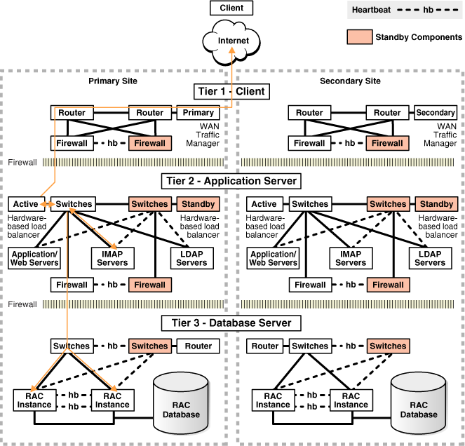
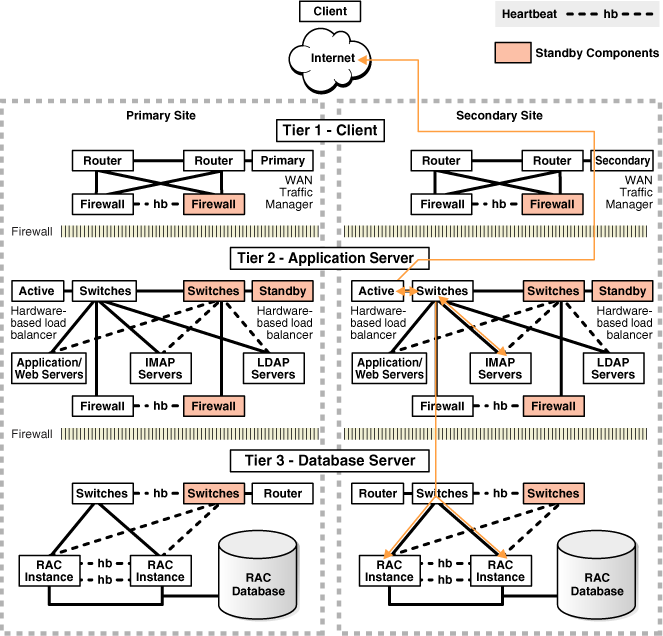
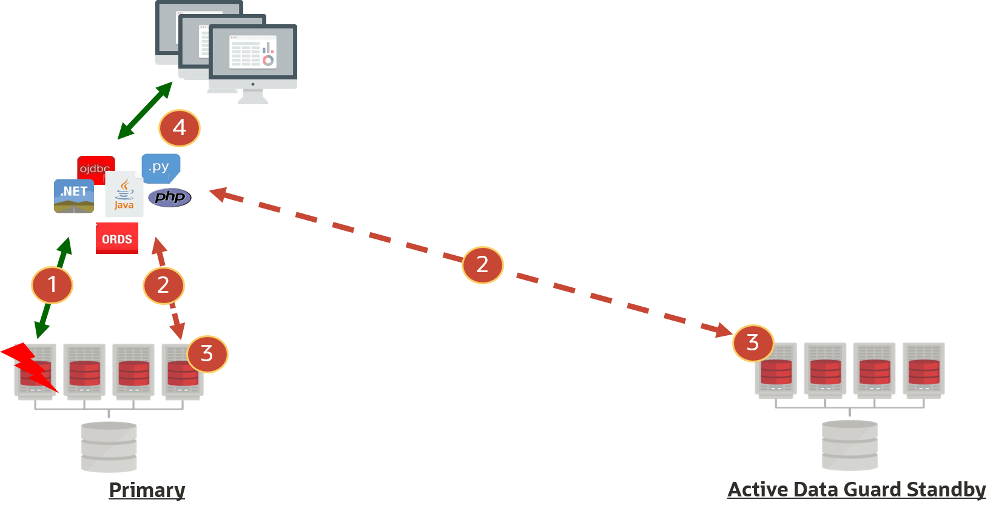

## 15 Plan an Oracle Data Guard Deployment

Analyze your specific requirements, including both the technical and operational aspects of your IT systems and business processes, understand the availability impact for the Oracle Data Guard architecture options, and consider the impact of your application and network.

### Oracle Data Guard Architectures

The Gold MAA reference architecture provides you with four architecture patterns, using Oracle Active Data Guard to eliminate single point of failure. The patterns vary from a single remote active standby with Fast Start Failover and HA Obeserver, to including far sync instances, multiple standbys, and reader farms.

When planning your Gold MAA Reference Architecture, see [High Availability Reference Architectures](https://www.oracle.com/webfolder/technetwork/tutorials/architecture-diagrams/high-availability-overview/high-availability-reference-architectures.html) for an overview of each Gold architecture pattern, and choose the elements to incorporate based on your requirements.

### Application Considerations for Oracle Data Guard Deployments

As part of planning your Oracle Data Guard deployment, consider the resources required and application availability requirements in a fail over scenario.

#### Deciding Between Full Site Failover or Seamless Connection Failover

The first step is to evaluate which failover option best meets your business and application requirements when your primary database or primary site is inaccessible or lost due to a disaster.

The following table describes various conditions for each outage type and recommends a failover option in each scenario.

Table 15-1 Recommended Failover Options for Different Outage Scenarios

| Outage Type | Condition | Recommended Failover Option |
| --- | --- | --- |
| Primary Site Failure (including all application servers) | Primary site contains all existing application servers (or mid-tier servers) that were connected to the failed primary database. | Full site failover is required |
| Primary Site Failure (with some application servers surviving) | Some or all application servers are not impacted and the surviving application servers can reconnect to new primary database in a secondary disaster recovery site.  Application performance and throughput is still acceptable with different network latency between application servers and new primary database in a secondary disaster recovery site.  Typically analytical or reporting applications can tolerate higher network latency between client and database without any noticeable performance impact, while OLTP applications performance may suffer more significantly if there is an increase in network latency between the application server and database. | Seamless connection failover is recommended to minimize downtime and enable automatic application and database failover. |
| Complete Primary Database or Primary Server Failure | Application servers are not impacted and users can reconnect to new primary database in a secondary disaster recovery site.  Application performance and throughput is still acceptable with different network latency between application servers and new primary database in a secondary disaster recovery site.  Typically analytical or reporting applications can tolerate higher network latency between client and database without any noticeable performance impact, while OLTP applications performance may suffer more significantly if there is an increase in network latency between the application server and database. | If performance is acceptable, seamless connection failover is recommended to minimize downtime and enable automatic application and database failover.  Otherwise, full site failover is required. |

#### Full Site Failover Best Practices

A **full site failover** means that the complete site fails over to another site with a new set of application tiers and a new primary database.

Complete site failure results in both the application and database tiers becoming unavailable. To maintain availability, application users must be redirected to a secondary site that hosts a redundant application tier and a synchronized copy of the production database.

Consider the two figures below. The first figure shows the network routes before failover. Client or application requests enter the Primary site at the client tier, and are routed to the application server and database server tiers on the primary site.

Figure 15-1 Network Routes Before Site Failover



> The illustration shows network routes before site failover. From top to bottom, it shows the client, the Internet, the client tier of the primary and secondary sites, the application server tier of the primary and secondary sites, and the database server tier of the primary and secondary sites.
>
> The client tier of the primary site contains two routers, an active firewall and a standby firewall, and a WAN traffic manager. There is a "heartbeat" between the two firewalls. The routers are connected to each other, to both firewalls, and to the WAN traffic manager. There is a firewall between the client tier and the application server tier.
>
> The application server tier of the primary site contains active and standby switches, active and standby hardware-based load balancers, application/web servers, IMAP servers, LDAP servers, and an active firewall and a standby firewall. The switches are connected to each other and to their load balancers. The switches are also connected to the 3 kinds of servers. The active switches are connected to the active firewall, and the standby switches are connected to the standby firewall. There is a heartbeat between the two firewalls. There is a firewall between the application server tier and the database server tier.
>
> The database server tier of the primary site contains active and standby switches, a router, two RAC instances, and a RAC database. There is a heartbeat between the active and standby switches. There are two heartbeats between the RAC instances. Both kinds of switches are connected to both RAC instances. The instances are connected to the database.
>
> The components of the secondary site are identical to the components of the primary site.
>
> The route of the client request is described in the text preceding the figure.
>
> End of image description.


The second figure, below, illustrates the network routes after a complete site failover. Client or application requests enter the Secondary site at the client tier and follow the same path on the secondary site that they followed on the primary site.

Figure 15-2 Network Routes After Site Failover



> The illustration shows network routes after failover.
>
> From top to bottom, the illustration shows the client, the Internet, the client tier of the primary and secondary sites, the application server tier of the primary and secondary sites, and the database server tier of the primary and secondary sites.
>
> The client tier of the primary site contains two routers, an active firewall and a standby firewall, and a WAN traffic manager. There is a "heartbeat" between the two firewalls. The routers are connected to each other, to both firewalls, and to the WAN traffic manager. There is a firewall between the client tier and the application server tier.
>
> The application server tier of the primary site contains active and standby switches, active and standby hardware-based load balancers, application/web servers, IMAP servers, LDAP servers, and an active firewall and a standby firewall. The switches are connected to each other and to their load balancers. The switches are also connected to the 3 kinds of servers. The active switches are connected to the active firewall, and the standby switches are connected to the standby firewall. There is a heartbeat between the two firewalls. There is a firewall between the application server tier and the database server tier.
>
> The database server tier of the primary site contains active and standby switches, a router, two RAC instances, and a RAC database. There is a heartbeat between the active and standby switches. There are two heartbeats between the RAC instances. Both kinds of switches are connected to both RAC instances. The instances are connected to the database.
>
> The components of the secondary site are identical to the components of the primary site.
>
> The route of the client request is described in the text preceding the figure.
>
> End of image description.


MAA best practice is to maintain a running application tier at the standby site to avoid incurring start-up time, and to use Oracle Data Guard to maintain a synchronized copy of the production database. Upon site failure, a WAN traffic manager is used to perform a DNS failover (either manually or automatically) to redirect all users to the application tier at standby site while a Data Guard failover transitions the standby database to the primary production role.

Use Oracle Active Data Guard Fast-Start Failover to automate the database failover. Application server and non-database failovers can be automated and coordinated by using Oracle Site Guard. Oracle Site Guard orchestrates and automates any operations, such as starting up application servers on the secondary site, resynchronizing non-database meta data as Data Guard fails over automatically.

For more information about Oracle Site Guard, see the [Oracle Site Guard Administrator's Guide](https://docs.oracle.com/pls/topic/lookup?ctx=en/database/oracle/oracle-database/21/haovw&id=GUARD-GUID-8C2FADF5-11F1-420C-B968-05714F276A1F).

#### Configuring Seamless Connection Failover

Automating seamless client failover in an Oracle Data Guard configuration includes relocating database services to the new primary database as part of a Data Guard failover, notifying clients that a failure has occurred to break them out of TCP timeout, and redirecting clients to the new primary database.

In the following figure, a database request is interrupted by an outage or timeout (1), so the session reconnects to the Oracle RAC cluster (2) (or standby) (2), the database request replays automatically on the alternate node (3), and the result from the database request is returned to the user (4).

Figure 15-3 Seamless Connection Failover



> The image shows the flow of information before and after an Oracle RAC node failure on the primary database. Shown at the top of the image is a client system, at the bottom left is a four-node RAC system representing the primary database with the first node down, on the lower right is a four-node RAC representing the Active Data Guard standby database, and in the center is a group of overlapping boxes representing the client connections to the database, such as Java, JDBC, PHP, python, ORDS, and.NET. There are four numbered, double-ended arrows showing the progression of the failover scenario. The arrow labeled "1" is a solid line between the first node of the primary database and the group of connections. There are two arrows labeled "2" which are dotted lines between the client conecctions and an "up" RAC node in both the primary database and the active standby. The up nodes that are being pointed to by those arrows is labeled "3". The arros labeled "4" is a solid line between the client connections and the client system.


To achieve seamless connection failover, refer to [Configuring Continuous Availability for Applications](configuring-continuous-availability-applications1.md).

### Assessing and Optimizing Network Performance

Oracle Data Guard relies on the underlying network to send redo from the primary database to standby databases. Ensuring that the network is healthy and capable of supporting peak redo generation rates helps avoid future transport lags.

A transport lag forms when the primary database cannot ship redo to the standby faster than primary instance's redo generation rate. A transport lag can lead to potential data loss if a primary database failure occurs.

Network assessment consists of evaluating

- Network reliability
- Network bandwidth to accommodate peak redo generation rates

Note:

Each instance of the primary database instance generates its own redo and ships redo to the standby database in a single network stream. Therefore, maximizing single process network throughput for each node is critical for redo transport.

Historically there are areas that can reduce network and redo transport throughput resulting in potential transport lags:

1. Network firewalls or network encryption
	Network firewalls and network (not Oracle Net) encryption can reduce overall throughput significantly. Verify throughput with the oratcp tool (described below), with and without encryption, and tune accordingly.
	At times reducing the encryption level can increase throughput significantly. A balance is required to meet security needs with your performance and data loss requirements.
2. Redo transport compression
	When database initialization parameter has `LOG_ARCHIVE_DEST_N` attribute `COMPRESSION=ENABLE`, Oracle background processes have to compress the redo before sending network message, and uncompress the redo before processing the redo. This reduces the overall redo and network throughput. Compression is only recommended if network bandwidth is insufficient between the primary and standby destinations.
3. Oracle Net encryption
	Depending on the Oracle Net encryption level, this will have varying redo throughput impact, because Oracle Net messages containing redo have to be encrypted before sending and then unencrypted before redo processing.
	Note that if database encryption is already enabled with Transparent Data Encryption (TDE), redo is already encrypted, although Oracle Net encryption can also encrypt the message headers.
4. Untuned network for redo transport
	- Increasing maximum operating system socket buffer size can increase single process throughput by 2-8 times. Test with different socket buffer sizes to see what value yields positive results, and ensure throughput is greater than the peak redo throughput.
		- Compare performance with various MTU settings.
		If average redo write size is less than 1500 bytes, then try various MTU settings including MTU=9000 (for example, Jumbo Frames) for network interface that sends or receives redo on your system. This may reduce some unnecessary network round trips which will increase overall throughput.
		Also note that for SYNC transport, Oracle's average redo write size (for example, Oracle message send) increases significantly as determined by v$sysstats or AWR statistics "redo size / redo writes".
		When sending redo across geographical regions, experiments have shown that using MTU=9000 can also benefit in some network topologies. Conduct performance tests with oratcp and compare the results with default MTU and MTU=9000 settings.

#### Gather Topology Information

Understanding the topology of the Oracle Data Guard configuration, and its relevance to Data Guard performance, helps eliminate infrastructure weaknesses that are often incorrectly attributed to the Data Guard architecture.

Oracle recommends that you outline the following high-level architecture information.

- Describe the primary and standby database system (number of nodes in Oracle RAC cluster, CPUs and memory per database node, storage I/O system)
- Describe network topology connecting the primary and standby systems
	- Network switches and firewalls in between primary and standby
		- Network bandwidth and latency

For standby databases with symmetric hardware and configuration, and with a well tuned network configuration that can support peak redo generation rates, the transport lag should be less than 1 second.

#### Understanding Network Usage of Data Guard

The phases of the Data Guard life cycle which use the network most heavily are:

- Instantiation - During this phase of standby database creation, files can be copied using parallelism from any host. Determining the degree of parallelism which maximizes throughput between nodes helps to optimize the standby instantiation process.
- Redo Transport (Steady State)- Under normal Data Guard operation the primary database ships redo to the standby which is then applied. Each RAC instance of a primary database ships redo in a single stream from the host on which it is running. Understanding the requirements of each primary database instance and ensuring a single process can achieve the throughput requirements is critical to a standby database staying current with the primary database.

#### Understanding Targets and Goals for Instantiation

Instantiation for large databases can take hours, or in extreme cases days. To allow for planning of an instantiation and also maximize throughput between the primary and standby system to complete the instantiation is as timely a manner as possible, first determine the goal for instantiation time. Then follow the process defined below to maximize per process throughput and identify the optimal degree of parallelism between the primary and standby nodes.

#### Understanding Throughput Requirements and Average Redo Write Size for Redo Transport

Required network bandwidth of a given Data Guard configuration is determined by the redo generate rate of the primary database.

Note:

In cases where the primary database is pre-existing, a baseline for the required network bandwidth can be established. If there is no existing primary database, skip this step and future references to the data further in the process.

While the Automatic Workload Repository (AWR) tool can be used to determine the redo generation rate, the snapshots are often 30 or 60 minutes apart which can dilute the peak rate. Since peak rates often occur for shorter periods of time, it is more accurate to use the following query which calculates the redo generation rate for each log when run on an existing database. (change the timestamps as appropriate)

```
SQL> SELECT THREAD#, SEQUENCE#, BLOCKS*BLOCK_SIZE/1024/1024 MB,
(NEXT_TIME-FIRST_TIME)*86400 SEC,
 (BLOCKS*BLOCK_SIZE/1024/1024)/((NEXT_TIME-FIRST_TIME)*86400) "MB/S"
FROM V$ARCHIVED_LOG
WHERE ((NEXT_TIME-FIRST_TIME)*86400<>0)
AND FIRST_TIME BETWEEN TO_DATE('2022/01/15 08:00:00','YYYY/MM/DD HH24:MI:SS')
 AND TO_DATE('2022/01/15 11:00:00','YYYY/MM/DD HH24:MI:SS')
AND DEST_ID=1 ORDER BY FIRST_TIME;
```

Example output:

```
THREAD# SEQUENCE# MB         SEC        MB/s
------- --------- ---------- ---------- ----------
      2      2291 29366.1963        831  35.338383
      1      2565 29365.6553        781 37.6000708
      2      2292 29359.3403        537  54.672887
      1      2566 29407.8296        813 36.1719921
      2      2293 29389.7012        678 43.3476418
      2      2294 29325.2217       1236 23.7259075
      1      2567 11407.3379       2658 4.29169973
      2      2295 24682.4648        477 51.7452093
      2      2296 29359.4458        954 30.7751004
      2      2297 29311.3638        586 50.0193921
      1      2568 3867.44092       5510 .701894903
```

Note:

To find the peak redo rate, choose times during the highest level of processing, such as peak OLTP periods, End of Quarter batch processing or End of Year batch processing.

In this short example the highest rate was about 52MB/s. Ideally the network will support the maximum rate plus 30% or 68MB/s for this application.

#### Verify Average Redo Write Size

Using `v$sysstats` or looking at your AWR reports for various workload and peak intervals, record the average redo write size based on

Average Redo Write Size = "REDO SIZE" / "REDO WRITES"

Use this average redo write size in your `oratcp` experiments. If the average redo write size > 1500 bytes, experiment with various MTU settings.

#### Understand Current Network Throughput

The Oracle utility oratcptest is a general-purpose tool for measuring network bandwidth and latency similar to iperf/qperf which can be run by any OS user.

The oratcptest utility provides options for controlling the network load such as:

- Network message size
- Delay time between messages
- Parallel streams
- Whether or not the oratcptest server should write messages on disk.
- Simulating Data Guard SYNC transport by waiting for acknowledgment (ACK) of a packet or ASYNC transport by not waiting for the ACK.

Note:

This tool, like any Oracle network streaming transport, can simulate efficient network packet transfers from the source host to target host similar to Data Guard transport. Throughput can saturate the available network bandwidth between source and target servers. Therefore, Oracle recommends that short duration tests are performed and that consideration is given for any other critical applications sharing the same network.

Measure the Existing Throughput of One and Many Processes

Do the following tasks to measure the existing throughput.

Task 1: Install oratcptest

1. Download the oratcptest.jar file from MOS note 2064368.1
2. Copy the JAR file onto both client (primary) and server (standby)
	Note:
	oratcptest requires JRE 6 or later
3. Verify that the host has JRE 6 or later
4. On all primary and standby hosts, verify that the JVM can run the JAR file by displaying the help
	```
	# java -jar oratcptest.jar -help
	```

Task 2: Determine the Existing Throughput for a Single Process

Data Guard asynchronous redo transport (ASYNC) uses a streaming protocol which does not wait for packet acknowledgment and therefore achieves higher rates than SYNC transport.

1. Start the test server on the receiving (standby) side.
	```
	java -jar oratcptest.jar -server [IP of standby host or VIP in RAC
	 configurations] -port=<any available port number>
	```
2. Run the test client. (Change the server address and port number to match that of your server started in step 4.)
	```
	$ java -jar oratcptest.jar [IP of standby host or VIP in RAC configurations]
	 -port=<port number> -mode=async -duration=120 -interval=20s
	[Requesting a test]
	        Message payload        = 1 Mbyte
	        Payload content type   = RANDOM
	        Delay between messages = NO
	        Number of connections  = 1
	        Socket send buffer     = (system default)
	        Transport mode         = ASYNC
	        Disk write             = NO
	        Statistics interval    = 20 seconds
	        Test duration          = 2 minutes
	        Test frequency         = NO
	        Network Timeout        = NO
	        (1 Mbyte = 1024x1024 bytes)
	(17:54:44) The server is ready.
	                    Throughput
	(17:55:04)     20.919 Mbytes/s
	(17:55:24)     12.883 Mbytes/s
	(17:55:44)     10.457 Mbytes/s
	(17:56:04)     10.408 Mbytes/s
	(17:56:24)     12.423 Mbytes/s
	(17:56:44)     13.701 Mbytes/s
	(17:56:44) Test finished.
	               Socket send buffer = 2 Mbytes
	                  Avg. throughput = 13.466 Mbytes/s
	```

In this example the average throughput between these two nodes was about 13 MB/s which does not meet the requirements of 68 MB/s from the query.

Note:

This process can be scheduled to run at a given frequency using the `-freq` option to determine if the bandwidth varies at different times of the day. For instance setting `-freq=1h/24h` will repeat the test every hour for 24 hours.

Task 3: Determine Existing Throughput for Multiple Processes

1. Repeat the previous test with two (2) connections (using num\_conn parameter).
	```
	$ java -jar oratcptest.jar <target IP address> -port=<port number>
	 -duration=60s -interval=10s -mode=async [-output=<results file>] -num_conn=2
	[Requesting a test]
	        Message payload        = 1 Mbyte
	        Payload content type   = RANDOM
	        Delay between messages = NO
	        Number of connections  = 2
	        Socket send buffer     = (system default)
	        Transport mode         = ASYNC
	        Disk write             = NO
	        Statistics interval    = 20 seconds
	        Test duration          = 2 minutes
	        Test frequency         = NO
	        Network Timeout        = NO
	        (1 Mbyte = 1024x1024 bytes)
	(18:08:02) The server is ready.
	                    Throughput
	(18:08:22)     44.894 Mbytes/s
	(18:08:42)     23.949 Mbytes/s
	(18:09:02)     25.206 Mbytes/s
	(18:09:22)     23.051 Mbytes/s
	(18:09:42)     24.978 Mbytes/s
	(18:10:02)     22.647 Mbytes/s
	(18:10:02) Test finished.
	          Avg. socket send buffer = 2097152
	        Avg. aggregate throughput = 27.454 Mbytes/s
	```
2. Re-run step 1 Iteratively and increase the value of num\_conn by two each time until the aggregate throughput does not increase for three consecutive values. For example if the aggregate throughput is approximately the same for 10, 12 and 14 connections, stop.
	Note:
	RMAN can utilize all nodes in the cluster for instantiation. To find the total aggregate throughput, see My Oracle Support [Creating a Physical Standby database using RMAN restore database from service (Doc ID 2283978.1)](https://support.oracle.com/rs?type=doc&id=2283978.1).
3. Run the same test with all nodes in all clusters to find the current total aggregate throughput. Node 1 of primary to node 1 of standby, node 2 to node 2, etc. Sum the throughput found for all nodes.
4. Reverse the roles and repeat the tests.
5. Note the number of connections which achieved the best aggregate throughput.

Use the total size of the database and total aggregate throughput to estimate the amount of time it will take to complete the copy of the database. A full instantiation also needs to apply the redo generated during the copy. Some additional percentage (0%-50%) should be added to this estimated time based on how active the database is.

If the estimated time meets the goal, no additional tuning is required for instantiation.

#### Optimizing Redo Transport with One and Many Processes

If throughput from the prior single and multiple process tests meet the targets, no additional tuning is required. If higher throughput is required, setting the maximum TCP socket buffers size to a larger value is the primary method to potentially increase throughput.

Setting TCP Socket Buffer Size

The TCP socket buffers are system memory buffers which temporarily store incoming and outgoing data. Outgoing data is stored on the write buffers while incoming data is stored on the read buffers. Read and write socket buffers are allocated separately. When a buffer, generally the read buffer, fills up (often do to the application not pulling data out of the buffer fast enough), a message is sent to the sender to slow down or stop sending data. Allocating a larger buffer often improves redo transport by giving the application time to pull data off the wire without stopping the sender.

Tuning TCP socket buffer size is the primary approach to improving ASYNC transport and can improve SYNC transport as well in some cases.

Note:

With larger socket buffer sizes, TCP selective acknowledgment (SACK) is strongly recommended. Often times this is enabled by default but refer to your operating system documentation for details on confirming or enabling TCP selective acknowledgment.

To set TCP Socket Buffer Size do the following tasks.

Task 1: Determine Optimal Maximum Socket Buffer Size

Find the optimal maximum socket buffer size for a single process on the target network link by running a series of tests.

Note:

Bandwidth Delay Product is the product of the network link capacity of a channel and the round time, or latency. The minimum recommended value for socket buffer sizes is 3\*BDP, especially for a high-latency, high-bandwidth network. Use oratcptest to tune the socket buffer sizes.

Task 2: Set Maximum Socket Buffer Size Temporarily

On the primary and standby systems follow these steps to set the maximum socket buffer size for requests. This will be done in memory and will not persist if the server is restarted for any reason.

Do the following steps as root.

1. First find the current size of the kernel parameters net.ipv4.tcp\_rmem and net.ipv4.tcp\_wmem. The values returned are the minimum, default and maximum size for socket buffers which TCP dynamically allocates. If a process requires more than the default given when a socket is created, more buffers will be dynamically allocated up to the maximum value.
	```
	# cat /proc/sys/net/ipv4/tcp_rmem
	4096    87380   6291456
	# cat /proc/sys/net/ipv4/tcp_wmem
	4096    16384   4194304
	```
2. Change the values to 16MB or whatever 3\*BDP was calculated to be
	```
	# sysctl -w net.ipv4.tcp_rmem='4096 87380 16777216';
	# sysctl -w net.ipv4.tcp_wmem='4096 16384 16777216';
	```

Note:

Increasing these values can increase system memory usage of any network socket on the system.

Note:

Changes made with sysctl are not permanent. Update the /etc/sysctl.conf file to persist these changes through machine restarts. There will be a step to change the configuration file at the end of this process once the proper setting is determined.

Task 3: Test Throughput of a Single Process

Re-run the previous tests allowing the socket buffers to dynamically grow to the new maximum set in the previous step

(as oracle)

Server (standby):

```
$ java -jar oratcptest.jar -server [IP of standby host or VIP in RAC configurations]
 -port=<port number>
```

Client (primary):

```
$ java -jar oratcptest.jar <IP of standby host or VIP in RAC configurations>
 -port=<port number> -mode=async -duration=120s -interval=20s
```

Note:

Do not use the oratcptest `sockbuf` parameter because the kernel parameters which govern explicit requests for socket buffer size are different than those set for this test.

After the test completes the results from the client and server show the value for socket buffers during that test. At the time of this writing, that value is half of the actual socket buffer size and should be doubled to find the actual size used.

Client

```
[Requesting a test]
        Message payload = 1 Mbyte 
        Payload content type = RANDOM 
        Delay between messages = NO 
        Number of connections = 1 
        Socket send buffer = 2 Mbytes 
        Transport mode = ASYNC
        Disk write = NO
        Statistics interval = 20 seconds 
        Test duration = 2 minutes
        Test frequency = NO 
        Network Timeout = NO
        (1 Mbyte = 1024x1024 bytes) 
(11:39:16) The server is ready.
                Throughput 
(11:39:36) 71.322 Mbytes/s
(11:39:56) 71.376 Mbytes/s
(11:40:16) 72.104 Mbytes/s
(11:40:36) 79.332 Mbytes/s
(11:40:56) 76.426 Mbytes/s
(11:41:16) 68.713 Mbytes/s
(11:41:16) Test finished.

          Socket send buffer = 8388608  
            Avg. throughput = 73.209 Mbytes/s
```

Server

```
The test terminated. The socket receive buffer was 8 Mbytes.
```

Note:

oratcptest is reporting half of the buffers allocated to the socket. Double the number reported for the actual socket buffer size used during the test.

Task 4: Test Throughput of Multiple Processes

Now repeat the test using the num\_conn value determined in the first tests. for example,. if the peak aggregate throughput was reached with 10 processes set num\_conn=10.

Client

```
$ java -jar oratcptest.jar <IP of standby host or VIP in RAC configurations>
 -port=<port number> -mode=async -duration=120s -interval=20s -num_conn=10

[Requesting a test]
        Message payload        = 1 Mbyte
        Payload content type   = RANDOM
        Delay between messages = NO
        Number of connections  = 10
        Socket send buffer     = (system default)
        Transport mode         = ASYNC
        Disk write             = NO
        Statistics interval    = 20 seconds
        Test duration          = 2 minutes
        Test frequency         = NO
        Network Timeout        = NO
        (1 Mbyte = 1024x1024 bytes)

(19:01:38) The server is ready.
                    Throughput
(19:01:58)    266.077 Mbytes/s
(19:02:18)    242.035 Mbytes/s
(19:02:38)    179.574 Mbytes/s
(19:02:58)    189.578 Mbytes/s
(19:03:18)    218.856 Mbytes/s
(19:03:38)    209.130 Mbytes/s
(19:03:38) Test finished.
          Avg. socket send buffer = 8 Mbytes 
        Avg. aggregate throughput = 217.537 Mbytes/s
```

Note:

oratcptest is reporting half of the buffers allocated to the socket. Double the number reported for the actual socket buffer size used during the test.

Server (Each connection will have the receive buffer printed. Double the socket buffer size in each instance)

```
The test terminated. The socket receive buffer was 8 Mbytes. 

The test terminated. The socket receive buffer was 8 Mbytes. 
 
The test terminated. The socket receive buffer was 8 Mbytes.

The test terminated. The socket receive buffer was 8 Mbytes.

The test terminated. The socket receive buffer was 8 Mbytes.

The test terminated. The socket receive buffer was 8 Mbytes.
 
The test terminated. The socket receive buffer was 8 Mbytes.

The test terminated. The socket receive buffer was 8 Mbytes.

The test terminated. The socket receive buffer was 8 Mbytes.

The test terminated. The socket receive buffer was 8 Mbytes.
```

Use the total size of the database and total aggregate throughput to estimate the amount of time it will take to complete the copy of the database. A full instantiation also needs to apply the redo generated during the copy. Some additional percentage (0%-50%) should be added to this estimated time based on how active the database is.

Task 5: Repeat the Tests

Repeat the previous two tests with higher values for tcp\_rmem and tcp\_wmem if more throughput is needed. Understand that these higher values are available for other sockets as well but will be dynamically allocated only if needed. The table shows sample data tracking the different throughput results for different socket buffer sizes.

| tcp\_rmem maximum | tcp\_wmem maximum | Single Process Throughput | Single Node Multi-Process Maximum Aggregate Throughput | Single Node Multi-Process Parallelism |
| --- | --- | --- | --- | --- |
| 6291456 | 4194304 | 13.5 MB/s | 203 MB/s | 16 |
| 8388608 | 8388608 | 48 MB/s | 523 MB/s | 14 |
| 16777216 | 16777216 | 73 MB/s | 700 MB/s | 14 |
| 33554432 | 33554432 | 132 MB/s | 823 MB/s | 14 |

Task 6: Set Parameters Permanently

Changes using sysctl modify the values in memory which do not persist through a reboot of the host. Once the optimal size for socket buffers is determined, set the kernel parameters so they persist through server restarts by editing the /etc/sysctl.conf file.

This must be done on all nodes of the primary and standby systems.

To make these changes persistent, edit the /etc/sysctl.conf either modifying the existing values or adding these values to the file if they are absent.

```
net.ipv4.tcp_rmem='4096 87380 16777216'

net.ipv4.tcp_wmem='4096 16384 16777216'
```

Task 7: Evaluate Larger MTU

Determine the network interfaces that are used by the Data Guard transport.

If Average Redo Write Size > current MTU setting (for example, typically the default 1500), evaluate if jumbo frames (for example, MTU=9000) can reduce the network RTT for these large network packets and improve overall redo throughput.

Shown here is an example of changing the MTU for Data Guard transport network interface for testing purposes on Linux.

```
ifconfig bondeth0 mtu 9000 up
```

Repeat the same `oratcp` performance methodology as described above with the higher MTU size to see if greater throughput is achieved.

If performance gains are noticed, work with system and network engineers to change MTU size for DG transport for both primary and standby databases.

#### Using This Data

The throughput numbers can be used to determine throughput to aid in Redo Transport and Instantiation situations.

Redo Transport

If the single process throughput does not exceed the single instance redo generation rate for a primary database, the standby will not stay current with the primary during these times. Further evaluation and network tuning by the network engineering team may be required in these cases.

Instantiation

Once the maximum aggregate throughput of all nodes is understood, a rough estimate for instantiation can be developed. As an example, if there is a 100 TB database on a 2-node RAC to be instantiated and each node can achieve 300 MB/s it should take about 50 hours to copy the data files. Additional work to instantiate will add some percentage to that number (~30%).

```
300 MB/s * 60 seconds/minute * 60 minutes/hour * 2 nodes = ~2 TB/hr aggregate for both nodes
100TB / 2TB/hr = ~50 hours
```

The steps to instantiate a database using large database optimizations such as using multiple nodes is described in [Creating a Physical Standby database using RMAN restore database from service (Doc ID 2283978.1)](https://support.oracle.com/epmos/faces/DocumentDisplay?id=2283978.1).

### Determining Oracle Data Guard Protection Mode

Oracle Data Guard can run in three different protection modes, which cater to different performance, availability, and data loss requirements. Use this guide to determine which protection mode fits your business requirements and your potential environmental constraints.

Maximum Protection mode guarantees that no data loss will occur if the primary database fails, even in the case of multiple failures (for example, the network between the primary and standby fails, and then at a later time, the primary fails). This policy is enforced by never signaling commit success for a primary database transaction until at least one synchronous Data Guard standby has acknowledged that redo has been hardened to disk. Without such an acknowledgment the primary database will stall and eventually shut down rather than allow unprotected transactions to commit.

To maintain availability in cases where the primary database is operational but the standby database is not, the best practice is to always have a minimum of two synchronous standby databases in a Maximum Protection configuration. Primary database availability is not impacted if it receives acknowledgment from at least one synchronous standby database.

Choose this protection mode if zero data loss is more important than database availability. Workload impact analysis is recommended to measure whether any overhead is acceptable when enabling `SYNC` transport.

Maximum Availability mode guarantees that no data loss will occur in cases where the primary database experiences the first failure to impact the configuration. Unlike the Maximum Protection mode, Maximum Availability will wait a maximum of `NET_TIMEOUT` seconds for an acknowledgment from any of the standby databases, after which it will signal commit success to the application and move to the next transaction. Primary database availability (thus the name of the mode) is not impacted by an inability to communicate with the standby (for example, due to standby or network outages). Data Guard will continue to ping the standby and automatically re-establish connection and resynchronize the standby database when possible, but during the period when primary and standby have diverged there will be data loss should a second failure impact the primary database.

For this reason, it is a best practice to monitor protection level, which is simplest using Enterprise Manager Grid Control, and quickly resolve any disruption in communication between the primary and standby before a second failure can occur. This is the most common zero data loss database protection mode.

Choose this protection mode if zero data loss is very important but you want the primary database to continue to be available even with the unlikely case that all standby databases are not reachable. You can complement this solution by integrating multiple standby databases or using Far Sync instances to implement a zero data loss standby solution across a WAN. Workload impact analysis is recommended to measure whether any overhead is acceptable when enabling `SYNC` transport.

Maximum Performance mode is the default Data Guard mode, and it provides the highest level of data protection that is possible without affecting the performance or the availability of the primary database. This is accomplished by allowing a transaction to commit as soon as the redo data needed to recover that transaction is written to the local online redo log at the primary database (the same behavior as if there were no standby database). Data Guard transmits redo concurrently to 1) the standby database directly from the primary log buffer and 2) to the local online redo log write asynchronously enabling a very low potential data loss if the primary site is lost. There is never any wait for standby acknowledgment but the potential data loss for this data protection mode can still be near zero..

Similar to Maximum Availability mode, it is a best practice to monitor the protection level using Enterprise Manager Grid Control, and quickly resolve any disruption in communication between primary and standby before a second failure can occur.

Choose this mode if minimum data loss is acceptable and zero performance impact on the primary is required.

### Offloading Queries to a Read-Only Standby Database

Offloading queries and reporting workloads to read-only standby databases can free up your primary database system resources, giving you the ability to add more users, workloads, or even databases.

When you leverage both primary and standby database resources, your business and your applications benefit with higher total system usage, and potentially higher application throughput.

Offload appropriate workloads by following these steps.

1. Identify which application modules are read-only or read-mostly.
	- Evaluate whether you have application services or modules that are read-only.
		- Small and short read-only queries are good candidates to offload to the standby database.
		- Short DMLs, especially those that are response-time sensitive, should not be offloaded to the standby.
		- Large reports or analytic reports are good candidates to offload.
		- Reports that are primarily reads, and that may have an infrequent DML, typically at the start or end of a report, may be good candidates to offload.
		To enable DML Redirection, see [ADG\_REDIRECT\_DML](https://docs.oracle.com/pls/topic/lookup?ctx=en/database/oracle/oracle-database/21/haovw&id=REFRN-GUID-AC98F026-33BE-41FE-8F2F-EFA296723AD8).
2. Gather information about the expected application performance, throughput, response time, or elapsed time service levels for each offload candidate.
	- Once you have determined which queries and reports are good candidates to offload, find out the required expected and maximum response time or elapsed time for each of them. For example some large analytic reports must complete within a 2 hour time span.
		- For short queries, determine the expected response time and throughput expectations.
		- These requirements are sometimes referred to as application performance Service Level Agreements, which you need for the next step.
3. Test the performance of each candidate on the standby, and determine whether it meets your requirements.
	- Even though the primary and standby databases have essentially identical data, they are independent databases, independent machines, independent configurations, and have different workloads. For example, an Active Data Guard read-only standby database has a redo apply workload plus the queries that are offloaded, while the primary database may have OLTP, batch, and query workloads.
		- Reported elapsed times, query response time, and workload performance may vary between the primary and standby due to these system, configuration, and workload differences.
		- Tuning requires that you understand system resources, SQL plans, and individual query CPU and wait profile. The tuning recommendations are applicable for both primary and standby databases. See [Diagnosing and Tuning Database Performance](https://docs.oracle.com/pls/topic/lookup?ctx=en/database/oracle/oracle-database/21/haovw&id=TGDBA-GUID-E0EEBB00-000C-48EA-9F81-6BD867B78405) .
4. Offload a subset of the queries that meet your performance requirements, freeing up resources on the primary database for additional processing capacity.
	- Once you have determined which queries and reports can be offloaded, and the performance of those activities are acceptable, then slowly offload some of the workload and monitor it.
		- Do not oversubscribe and offload too much workload to the standby such that redo apply cannot keep pace after tuning. If the standby falls behind. then you lose that standby as a viable role transition target, and in most cases a standby that lags cannot be used to offload queries.

What if a specific query does not meet your requirements?

1. Consult with a performance engineer and follow the recommendations in [Database Performance Tuning Guide](https://docs.oracle.com/pls/topic/lookup?ctx=en/database/oracle/oracle-database/21/haovw&id=TGDBA-GUID-DD122227-0E55-49DB-8DF0-0F321D03800F).
2. A particular query response time or throughput or report elapsed time is not guaranteed to be the same on the standby system as it was on the primary. Analyze the system resources, SQL plans, overall CPU work time and wait times.
	For example, you may see `standby query scn advance wait` is contributing to a much longer elapsed time in one of your short queries. This wait increase is attributed to Active Data Guard redo apply. If a query sees a certain row in a data block and needs to roll it back because the transaction has not committed as of the query System Commit Number (SCN), it needs to apply corresponding undo to get a consistent read for that query. If the redo for the corresponding undo change has not been applied by redo apply yet, the query needs to wait. The presence of such wait is itself not an issue, and typically may be a couple of milliseconds, but it will vary by workload and may be higher in Real Application Cluster database systems.