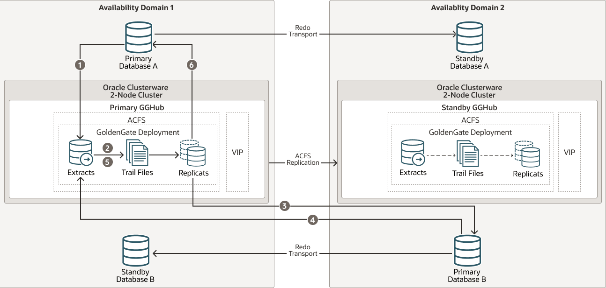
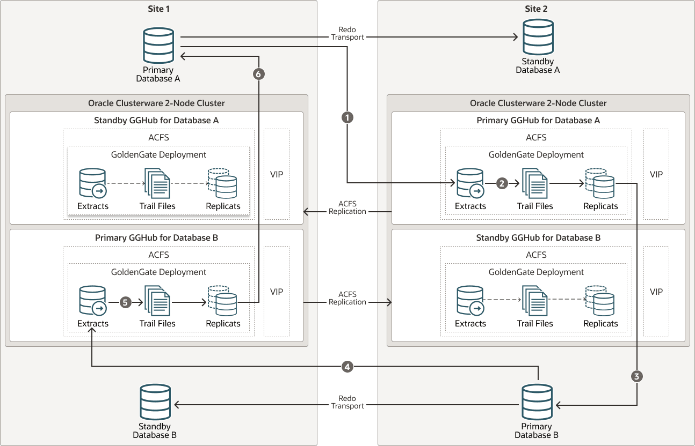

## Planning GGHub Placement in the Platinum MAA Architecture

MAA GGHub consists of two GGHub clusters: a primary GGHub cluster and a standby GGHub cluster.

Meet the following guidelines when deciding where to place primary and standby GGHub clusters in relation to the source primary, source standby, target primary, and target standby databases:

- Locate the primary active GGHub near the target primary database. Network round trip latency between the primary active GGHub and the target primary database must be 4ms or less to ensure acceptable GoldenGate Replicat performance.
- Network round trip latency between the primary active GGHub and the source primary database must be 90ms or less to ensure acceptable GoldenGate Extract performance. If network round trip latency exceeds 90ms then GoldenGate distribution path is required.
- When configuring bi-directional replication the guidelines above must still be met. Therefore, if the network round trip latency between the source and target databases exceeds 4ms then it is necessary to configure two active GGHub configurations in the same GGHub cluster.

The table below shows you the number of GoldenGate configurations required, based on latency between sites and GoldenGate replication directionality.

| Latency between GGHub clusters | Uni-directional GoldenGate replication | Bi-directional GoldenGate replication |
| --- | --- | --- |
| <=4 milliseconds | 1 GoldenGate configuration in 1 GGHub | 1 GoldenGate configuration in 1 GGHub |
| \>4 milliseconds | 1 GoldenGate configuration in 1 GGHub | 2 GoldenGate configurations in 1 GGHub |

### MAA GGHubs Placed in the Same Data Center

In this scenario, the primary and standby database are located such that latency between GGHub clusters is less than or equal to 4 milliseconds, so the primary (active) GGHub and the standby GGHub are typically located in the same data center, in separate availability domains (ADs), as shown in the image below.

As shown below, you have the following architectural components:

1. Primary database and associated standby database are configured with Oracle Active Data Guard Fast Start Failover (FSFO). FSFO can be configured with Data Guard protection mode with ASYNC or SYNC redo transport depending on your maximum data loss tolerance.
2. Primary GGHub on Active/Passive Cluster: Only one GGHub software deployment and configuration on the 2-node cluster. This cluster contains the Oracle GoldenGate software deployment at release 23ai or higher, that can support Oracle Database 11.2.0.4 and later database versions.
	This GGHub can support many primary databases and encapsulates the GoldenGate processes: GoldenGate Extract mines transactions from the source database and GoldenGate Replicat applies the same changes to target database. GoldenGate trail and checkpoint files also reside in the GGHub ACFS file system. The HA failover solution is built in to the GGHub, which includes automatic failover to the passive node in the same cluster, and restarts GoldenGate processes and activity after a node failure.
3. Standby GGHub on Active/Passive Cluster: A symmetric standby GGHub is configured. ACFS replication is set up between the primary and standby GGHubs to preserve all GoldenGate files. Manual GGHub failover, which includes ACFS failover, can be executed in the rare case that you lose the entire primary GGHub.

Figure 26-1 Primary and Standby GGHubs in the Same Data Center

> The image shows two availability domains, AD1 and AD2 in one data center (PHX Data Center) depicted as two large rectangles, with AD1 on the left and AD2 on the right. Each data center contains a primary and standby database, and one GGHub as described in the surrounding text.
>
> The image also shows numbers that correspond to the numbered steps below the image, explaining the flow of data.

The figure above depicts replicating data from Primary Database A to Primary Database B and Primary B back to Primary A with the following steps:

1. Primary Database A: Primary A’s Logminer server sends redo changes to a Primary GGHub Extract process.
2. Primary GGHub: An Extract process writes changes to trail files.
3. Primary GGHub to Primary Database B: A Primary GGHub Replicat process applies those changes to the target database (Primary B).
4. Primary Database B: Primary B’s Logminer server sends redo to a Primary GGHub Extract process.
5. Primary GGHub: A Primary GGHub Extract process writes changes to trail files.
6. Primary GGHub to Primary Database A: A Primary GGHub Replicat process applies those changes to the target database (Primary A).

Note that one GGHub can support multiple source and target databases, even when the source and target databases are different Oracle Database releases.

Table 26-1 Outage Scenarios, Repair, and Restoring Redundancy for GGHubs in the Same Data Center

| Outage Scenario | Application Availability and Repair | Restoring Redundancy and Pristine State |
| --- | --- | --- |
| Primary Database A (or Database B) failure | Impact: Near-zero application downtime. GoldenGate replication resumes when a new primary database starts.  1. One primary database is still available. All activity is routed to the existing available primary database to achieve zero application downtime. Refer to the Global Data Services [Global Services Failover](https://docs.oracle.com/pls/topic/lookup?ctx=en/database/oracle/oracle-database/21/haovw&id=GSMUG-GUID-63143CA0-23BF-46D2-A349-401FECD24FBD) solution. For example, application services A-F are routed to Database A and application services G-J are routed to Database B. If Database A fails, all application services temporarily go to Database B. 2. The standby becomes the new primary automatically with Data Guard FSFO. Oracle GoldenGate replication resumes and the primary databases resynchronize. Data loss is bounded by the Data Guard protection level. If Maximum Availability or Maximum Protection is configured, zero data loss is achieved. All committed transactions are in one or both databases. Workload can be “rebalanced” when Primary Database A and Database B are available and in sync. For example, when Database A is up and running and in sync, services A-F can go back to Database A. | 1. The old primary database is reinstated as the new standby database to restore redundancy. 2. Optionally performing a Data Guard switchover to switch back to the original configuration ensures that at least one primary database resides in an independent AD. |
| Primary or standby GGHub single node failure | Impact: No application impact. GoldenGate replication resumes automatically after a couple of minutes.  No action is required. The HA failover solution built in to the GGHub includes automatic failover and restart of GoldenGate processes and activity. Replication activity is blocked until GoldenGate processes are active again. GoldenGate replication blackout could last a couple of minutes. | Once the node restarts, active/passive configuration is re-established. |
| Primary GGHub cluster crashes and is not recoverable | Impact: No application impact. GoldenGate replication resumes after restarting the existing GGHub or executing a manual GGHub failover operation.  1. If the GGHub cluster can be restarted, then that’s the simplest solution. 2. If the primary GGHub is not recoverable, then execute a manual GGHub failover to the standby GGHub, which includes ACFS failover. This typically takes several minutes. 3. GoldenGate replication stops until the new primary GGhub is available, so executing step 1 or step 2 should be quick. | If the previous GGHub eventually restarts, ACFS replication resumes in the other direction automatically. If the GGHub cluster is lost or unrecoverable, you need to rebuild a new standby GGHub. |
| Standby GGHub cluster crashes and not recoverable | Impact: No application or replication impact.  1. If the GGHub cluster can be restarted, then that is the simplest solution, and ACFS replication can resume. 2. If the standby GGHub is not recoverable, you can rebuild a new standby GGHub. | N/A |
| Availability Domain (AD1 or AD2) failure | Impact: Near-zero application downtime. GoldenGate replication resumes when the new primary database starts.  1. One primary database is still available. All activity is routed to the existing available primary database to achieve zero application downtime. Refer to the [Global Services Failover](https://docs.oracle.com/pls/topic/lookup?ctx=en/database/oracle/oracle-database/21/haovw&id=GSMUG-GUID-63143CA0-23BF-46D2-A349-401FECD24FBD) solution. For example, application services A-F are routed to Database A and application services G-J are routed to Database B. If Database A fails, all services temporarily go to Database B. 2. If the primary GGHub is still functional, GoldenGate replication continues. If the primary GGHub is lost due to AD failure, then a manual GGhub failover is required. GoldenGate replication resumes and the primary databases resynchronize. Data loss is bounded by the Data Guard protection level. If Maximum Availability or Maximum Protection is configured, zero data loss is achieved. All committed transactions are in one or both databases. Workload can be rebalanced when Primary Database A and Database B are available and in sync. When Database A is up and running and in sync, services A-F can go back to Database A. | 1. When AD returns, re-establish configuration such as reinstate standby. If the previous GGHub eventually restarts, ACFS replication resumes in the other direction automatically. 2. When possible, perform a Data Guard switchover (failback) to get back to the original state where one primary database exists in each AD. |

### MAA GGHubs Placed in Different Data Centers

In this scenario, the primary and standby databases are located in different data centers (latency greater than 4 milliseconds), so the primary (active) GGHub is located in the same data center as the primary database, and the standby GGHub is located in the same data center as the standby database.

As shown in the following image, you have the following architectural components:

1. The primary database and associated standby database are configured with Oracle Active Data Guard Fast Start Failover (FSFO). FSFO can be configured with Data Guard protection mode with ASYNC or SYNC redo transport depending on your maximum data loss tolerance.
2. Primary GGHubs on Active/Passive Clusters: In this configuration, there’s a 2-node cluster with two Oracle GoldenGate software configurations. Because a primary GGHub needs to be 4 milliseconds or less from the target database, and the network latency between the sites is greater than 5 miliseconds, two GGHub configurations are created for each GGHub cluster. Essentially, a primary GGHub configuration is always in the same data center as the target database.
	The GGHubs are configured with an Oracle GoldenGate 26ai or higher software deployment that can support Oracle Database 11g and later releases. These GGHubs can support many primary databases and encapsulate the GoldenGate processes: Extract mines transactions from the source database, and Replicat applies those changes to the target database. GoldenGate trail and checkpoint files also reside in the ACFS file system. An HA failover solution is built in to the GGHub cluster, which includes automatic failover and restart of GoldenGate processes and activity after a node failure.
	Note: Each GGHub configuration contains a GoldenGate Service Manager and deployment, ACFS file system with ACFS replication, and a separate application VIP.
3. Standby GGHubs on Active/Passive Clusters: A symmetric standby GGhub is configured in each site. ACFS replication is set up between the primary and standby GGHubs to preserve all GoldenGate files. Manual GGhub failover, which includes ACFS failover, can be executed if you lose the entire primary GGhub.

Figure 26-2 Primary and Standby GGHubs in Different Data Centers

> The image shows two data centers depicted as two large rectangles, with PHX Data Center on the left and ASH Data Center on the right. Each data center contains a primary and standby database, and a pair of GGHubs (primary and standby) as described in the surrounding text.
>
> The image also shows numbers that correspond to the numbered steps below the image, explaining the flow of data.

The figure above depicts replicating data from Primary Database A to Primary Database B and Primary B back to Primary A with the following steps:

1. Primary Database A: Primary A’s Logminer server sends redo changes to the GGHub Extract process on Site 2, which is on the Primary GGHub for Database A.
2. Primary GGHub: The Extract process writes changes to trail files.
3. Primary GGHub to Primary Database B: A GoldenGate Replicat process on Site 2 applies those changes to the target database (Primary Database B).
4. Primary Database B: Primary B’s Logminer server sends redo to a GGHub Extract process on Site 1, which is on the Primary GGHub for Database B.
5. Primary GGHub: The Extract process writes changes to trail files.
6. Primary GGHub to Primary Database A: A GoldenGate Replicat process on Site 1 applies those changes to the target database (Primary Database A).

Table 26-2 Outage Scenarios, Repair, and Restoring Redundancy for GGHubs in Different Data Centers

| Outage Scenario | Application Availability and Repair | Restoring Redundancy and Pristine State |
| --- | --- | --- |
| Primary Database A (or Database B) failure | Impact: Near-zero application downtime. GoldenGate replication resumes when the new primary database starts.  1. One primary database is still available. All activity is routed to the existing available primary database to achieve zero application downtime. Refer to the Global Data Services [Global Services Failover](https://docs.oracle.com/pls/topic/lookup?ctx=en/database/oracle/oracle-database/21/haovw&id=GSMUG-GUID-63143CA0-23BF-46D2-A349-401FECD24FBD) solution. For example, application services A-F are routed to Database A and application services G-J are routed to Database B. If Database A fails, all services temporarily go to Database B. 2. The standby becomes the new primary automatically with Data Guard FSFO. GoldenGate replication resumes and the primary databases resynchronize. Data loss is bounded by the Data Guard protection level. If Maximum Availability or Maximum Protection is configured, zero data loss is achieved. All committed transactions are in one or both databases. Workload can be rebalanced when primary Database A and Database B are available and in sync. For example, when Database A is up and running and in sync, services A-F can go back to Database A. 3. Replicat performance will be degraded if the primary GGHub is not in the same site as the target database. Schedule a GGHub switchover with ACFS replication switchover to resume optimal Replicat performance to the target database. You may then experience two active GGHub configurations on the same GGHub cluster. | 1. The old primary database is reinstated as the new standby database to restore redundancy. 2. Optionally performing a Data Guard switchover, to switch back to the original configuration, ensures that at least one primary database resides in an independent AD. Schedule a GGHub switchover with ACFS replication switchover to resume optimal Replicat performance to the target database. |
| Primary or standby GGHub single node failure | Impact: No application impact. GoldenGate replication resumes automatically after a couple of minutes.  No action is required. An HA failover solution is built in to the GGHub that includes automatic failover and restart of GoldenGate processes and activity. Replication activity is blocked until GoldenGate processes are active again. GoldenGate Replication blackout could last a couple of minutes. | Once the node restarts, active/passive configuration is re-established. |
| Primary GGHub cluster crashes and is not recoverable | Impact: No application impact. GoldenGate replication resumes after the existing primary GGHub restarts or manual GGHub failover completes.  1. If the GGHub cluster can be restarted, then that’s the simplest solution. 2. If the primary GGHub is not recoverable, then execute a manual GGHub failover to the standby GGHub, which includes ACFS failover. This typically takes several minutes. 3. Replication stops until the new primary GGhub is started, so executing step 1 or step 2 should be quick. If there’s any orchestration, this should be automated. | 1. If the previous GGHub eventually restarts, ACFS replication resumes in the other direction automatically. If the GGHub cluster is lost or unrecoverable, you need to rebuild a new standby GGHub. 2. Replicat performance is degraded if the primary GGhub is not in the same data center as the target database. Schedule a GGHub switchover with ACFS replication switchover to resume optimal Replicat performance to the target database. |
| Standby GGHub cluster crashes and is not recoverable | Impact: No application or replication impact.  1. If the GGHub cluster can be restarted, then that’s the simplest solution, and ACFS replication will resume. 2. If the standby GGHub is not recoverable, you can rebuild a new standby GGHub. | N/A |
| Complete site failure | Impact: Near Zero Application Downtime. GoldenGate replication resumes once new primary database starts.  1. One primary database is still available. All activity is routed to the existing available primary database to achieve zero application downtime. Refer to the Global Data Services [Global Services Failover](https://docs.oracle.com/pls/topic/lookup?ctx=en/database/oracle/oracle-database/21/haovw&id=GSMUG-GUID-63143CA0-23BF-46D2-A349-401FECD24FBD) solution. For example, application services A-F routed to Database A and application services G-J routed to Database B. If Database A fails, all services will temporarily go to Database B. 2. If the primary GGHub is still functional, GoldenGate replication will continue. If the primary GGHub is lost due to site failure, then a manual GGhub failover is required. GoldenGate replication resumes and the primary databases resynchronize. Data loss is bounded by the Data Guard protection level. If Maximum availability or protection is configured, zero data loss is achieved. All committed transactions are in one or both databases. Workload can be rebalanced when Primary Database A and Database B are available and in sync. When Database A is up and running and in sync, services A-F can go back to Database A. | 1. When the site returns, re-establish configuration such as reinstate standby. If the previous GGHub eventually restarts, ACFS replication resumes in the other direction automatically. 2. When possible, execute a Data Guard switchover (failback) to get back to the original state where one primary database exists in each site. 3. Replicat performance is degraded if the primary GGHub is not in the same site as the target database. Schedule a GGHub switchover with ACFS replication switchover to resume optimal Replicat performance to the target database. |