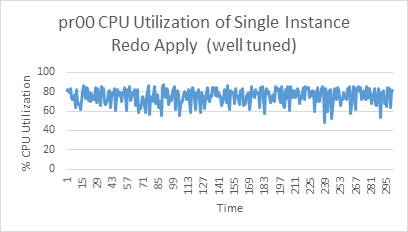
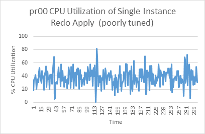

## Redo Apply Troubleshooting and Tuning

Most Oracle Data Guard configurations should be able to minimize apply lag by troubleshooting and tuning redo apply. Redo apply performance is directly dependent on the performance of the standby systems.

The guidance presented here assumes that the MAA configuration best practices are followed. As a prerequisites, ensure that the [Oracle Data Guard Configuration Best Practices](configure-and-deploy-oracle-data-guard.md) are implemented.

To improve apply performance holistically, leverage the data gathering and troubleshooting methodology described in the topics below.

### Understanding Redo Apply and Redo Apply Performance Expectations

Standby database recovery is the process of replaying all DML and DDL operations. The high level process is:

1. Redo is received from the primary database and written into standby redo logs (SRLs). When the database is an Oracle RAC database, each thread (instance) is stored in it's assigned SRLs.
2. The log merger process, sometimes known as the recovery coordinator, merges the threads of redo and places the resulting change vectors into memory buffers.
3. Recovery worker processes identify which data blocks are required and read them into the buffer cache if they are not already present. Then the worker processes apply the change vectors to the blocks in the buffer cache.
4. At checkpoint time, database writer processes write the validated buffer changes to data files, advancing the database's checkpoint time stamp, called the System Commit Number (SCN). Checkpoint can be the most extensive I/O load in the recovery process.

Redo Apply Performance Expectations

Performance, and the resulting apply rate, mainly depend on the type of workload that is being recovered and the system resources allocated to and available for recovery.

Oracle recommends that the primary and standby database systems are symmetric, including equivalent I/O subsystems, memory, and CPU resources. The primary reason for this recommendation is so that the application performs at the same level, no matter which database is the primary database; however, redo apply performance also benefits greatly from symmetric primary and standby databases. Features such as data protection (`DB_BLOCK_CHECKING`, `DB_BLOCK_CHECKSUM`, `DB_LOST_WRITE_PROTECT`) require CPU and I/O resources, as does reporting on the standby database using Oracle Active Data Guard.

For the most part, redo apply performance should keep up with the redo generation rates, resulting in near zero apply lag with system resources are symmetric. During peak workloads, there may be a slight redo apply gap which should naturally reduce to near zero once workloads return to normal levels.

OLTP Workloads

Recovering Online Transaction Processing (OLTP) workloads can be very I/O intensive because an OLTP workload performs small changes to many different blocks. This results in large numbers of small random block reads into the buffer cache during recovery. Subsequently, the database writers run large batches of write I/Os to maintain the buffer cache and to checkpoint the database periodically. Therefore, recovery of OLTP workloads requires the storage subsystem to handle a high number of I/Os Per Second (IOPS) in order to achieve optimal rates. This is another reason for recommending that the primary and standby database systems are symmetric.

Recovery testing of OLTP workloads, generated by swingbench on Oracle Exadata Database Machine quarter rack systems with no resource bottlenecks, achieved approximately 150 MB/sec apply rates. Rates of 200+ MB/s with single instance redo apply have been observed by customers on larger Exadata systems. These rates are more challenging to achieve in non-Exadata systems since the I/O and network throughput are lower.

Batch Workloads

In contrast to OLTP workload recovery, recovering batch workloads is more efficient because batch workloads consist of large sequential reads and writes. A lot more redo changes are occurring while reading and modifying significantly fewer data blocks, resulting in much faster redo apply rates than OLTP workloads. In addition, batch direct load operation recovery optimizations result in greater efficiency and even higher recovery rates.

Using batch load or parallel DML (PDML) workloads with no impeding system resource bottleneck, internal redo apply testing on small Exadata Database Machine quarter rack systems resulted in approximately 200-300 MB/sec apply rates. Customers have observed 600+ MB/sec apply rates with single instance redo apply for their batch workloads for larger Exadata systems. These rates can be achieved by non-Exadata systems, but system resource capacity and scalable network and I/O subsystems are required to handle these demanding workloads.

Mixed Workloads

The difference between OLTP and batch recovery performance profiles and different system shapes explains why applications with variation in their mixtures of OLTP and batch workloads can have different recovery rates at a standby database, even if the primary database redo generation rates are similar. Customers have achieved 100-1100 MB/sec redo apply rates with various mixed workloads for various Exadata systems. These rates can be achieved by non-Exadata systems, but system resource capacity and scalable database compute, network, and I/O subsystems are required to handle these demanding workloads. These extreme redo apply rates are rarely achieved on non-Exadata systems.

Catch Up Redo Apply Performance Expectations

Compared to real-time redo apply, redo apply during a "catch up" period may require even more system resources. If there is a large redo gap, see Addressing a Very Large Redo Apply Gap for recommendations.

### Verify Apply Lag

Recovery performance can vary with the workload type and the redo generation rate of the primary database. A lower apply rate does not necessarily indicate a recovery performance issue. However, a persistent or increasing apply lag, without an accompanying transport lag, is the best indication of a recovery performance bottleneck.

To identify and quantify apply lags and transport lags, query the `V$DATAGUARD_STATS` view in the standby database.

```
SQL> select name, value, time_computed, datum_time from v$dataguard_stats where name=’%lag’;
```

The `DATUM_TIME` column is the local time on the standby database when the datum used to compute the metric was received. The lag metrics are computed based on data that is periodically received from the primary database. An unchanging value in this column across multiple queries indicates that the standby database is not receiving data from the primary database. The potential data loss in this scenario would be from the last datum time from `V$DATAGUARD_STATS` to the current time on the standby.

To obtain a histogram that shows the history of transport or apply lag values since the standby instance was last started, query the `V$STANDBY_EVENT_HISTOGRAM` view.

```
SQL> select * from v$standby_event_histogram where name like '%lag' and count >0;
```

To evaluate the transport or apply lag over a time period, take a snapshot of `V$STANDBY_EVENT_HISTOGRAM` in the standby database at the beginning of the time period, and compare that snapshot with one taken at the end of the time period.

```
SQL> col NAME format a10
SQL> select NAME,TIME,UNIT,COUNT,LAST_TIME_UPDATED from V$STANDBY_EVENT_HISTOGRAM
 where name like '%lag' and count >0 order by LAST_TIME_UPDATED;
```

Example output:

```
NAME       TIME   UNIT       COUNT LAST_TIME_UPDATED

---------- ------ ---------- ----- -------------------
apply lag      23 seconds    3     02/05/2022 16:30:59
apply lag     135 seconds    1     02/05/2022 16:31:02
apply lag     173 seconds    2     02/05/2022 16:32:03
apply lag     295 seconds    2     02/05/2022 16:34:04
```

A transport lag can cause an apply lag. If a high apply lag is observed with a near zero transport lag, continue with this redo apply investigation in Gather Information.

If a high transport lag is observed, first address the transport lag, using the methodology in [Redo Transport Troubleshooting and Tuning](redo-transport-troubleshooting-and-tuning.md).

### Gather Information

Gather the following information when an unacceptable apply lag is occurring:

- When did the apply lag occur?
	Record the V$DATAGUARD\_STATS and V$STANDBY\_EVENT\_HISTOGRAM data every 15 to 30 minutes to identify when the lag started and how lag changed over time in the last 24 hours.
	```
	SQL>select name, value, time_computed, datum_time from v$dataguard_stats where name=’%lag’;
	```
	```
	SQL>select * from v$standby_event_histogram where name like '%lag' and count >0;
	```
- Does the apply lag occur at certain time period, such as daily at 12 midnight for daily batch operations, monthly during large batch operation, quarterly during quarter end?
- Gather data from the standby Automatic Work Repository (AWR) report V$RECOVERY\_PROGRESS, and take multiple standby AWR snapshots at 30 minute intervals before and during the apply lag.
	See [How to Generate AWRs in Active Data Guard Standby Databases (Doc ID 2409808.1)](https://support.oracle.com/rs?type=doc&id=2409808.1).
	For example:
	```
	SQL> set lines 120 pages 99
	SQL> alter session set nls_date_format='YYYY/MM/DD HH24:MI:SS';
	SQL> select START_TIME, ITEM, SOFAR, UNITS from gv$recovery_progress;
	```
	Sample output:
	```
	START_TIME          ITEM                                  SOFAR UNITS
	------------------- -------------------------------- ---------- ---------
	2022/02/28 23:02:36 Log Files                                 8 Files
	2022/02/28 23:02:36 Active Apply Rate                     54385 KB/sec
	2022/02/28 23:02:36 Average Apply Rate                    12753 KB/sec
	2022/02/28 23:02:36 Maximum Apply Rate                    65977 KB/sec
	2022/02/28 23:02:36 Redo Applied                           2092 Megabytes
	2022/02/28 23:02:36 Last Applied Redo                         0 SCN+Time
	2022/02/28 23:02:36 Active Time                              41 Seconds
	2022/02/28 23:02:36 Apply Time per Log                        1 Seconds
	2022/02/28 23:02:36 Checkpoint Time per Log                   0 Seconds
	2022/02/28 23:02:36 Elapsed Time                            168 Seconds
	2022/02/28 23:02:36 Standby Apply Lag                         2 Seconds
	```

The simplest way to determine application throughput in terms of redo volume is to collect Automatic Workload Repository (AWR) reports on the primary database during normal and peak workloads, and determine the number of bytes per second of redo data the production database is producing. Then compare the speed at which redo is being generated with the Active Apply Rate columns in the V$RECOVERY\_PROGRESS view to determine if the standby database is able to maintain the pace.

If the apply lag is above your expectations, then evaluate redo apply performance by querying the V$RECOVERY\_PROGRESS view. This view contains the columns described in the following table.

The most useful statistic is the Active Apply rate because the Average Apply Rate includes idle time spent waiting for redo to arrive making it less indicative of apply performance.

Table 17-5 V$RECOVERY\_PROGRESS View Columns

| Column | Description |
| --- | --- |
| Average Apply Rate | Redo Applied / Elapsed Time includes time spent actively applying redo and time spent waiting for redo to arrive |
| Active Apply Rate | Redo Applied / Active Time is a moving average over the last 3 minutes, and the rate does not include time spent waiting for redo to arrive |
| Maximum Apply Rate | Redo Applied / Active Time is peak measured throughput or maximum rate achieved over a moving average over last 3 minutes; rate does not include time spent waiting for redo to arrive |
| Redo Applied | Total amount of data in bytes that has been applied |
| Last Applied Redo | System change number (SCN) and time stamp of last redo applied. This is the time as stored in the redo stream, so it can be used to compare where the standby database is relative to the primary. |
| Apply Time per Log | Average time spent actively applying redo in a log file. |
| Checkpoint Time per Log | Average time spent for a log boundary checkpoint. |
| Active Time | Total duration applying the redo, but not waiting for redo |
| Elapsed Time | Total duration applying the redo, including waiting for redo |
| Standby Apply Lag | Number of seconds that redo apply has not been applied for. Possible standby is behind the primary. |
| Log Files | Number of log files applied so far. |

Active Session History

In cases where standby AWR is not available, or the standby database is not in open read-only mode, the top waits can be gathered using the V$ACTIVE\_SESSION\_HISTORY view. Standby AWR is strongly recommended due to the additional information and detail provided but these queries are useful in some cases.

To select to top 10 waits over the last 30 minutes (replace 30 with some other number of minutes ago from current time):

```
select * from (
select a.event_id, e.name, sum(a.time_waited) total_time_waited
from v$active_session_history a, v$event_name e
where a.event_id = e.event_id and a.SAMPLE_TIME>=(sysdate-30/(24*60)) 
group by a.event_id, e.name order by 3 desc)
where rownum < 11;
```

To select the waits between two timestamps (example shows a 3 hour period between 2021/01/01 00:00:00 and 2021/01/01 03:00:00):

```
select * from (
select a.event_id, e.name, sum(a.time_waited) total_time_waited
from v$active_session_history a, v$event_name e
where a.event_id = e.event_id 
and a.SAMPLE_TIME 
between to_date('2021/01/01 00:00:00','YYYY/MM/DD HH24:MI:SS') and to_date('2021/01/01 03:00:00','YYYY/MM/DD HH24:MI:SS')
group by a.event_id, e.name 
order by 3 desc)
where rownum < 11
/
```

### Compare Redo Generation Rate History on the Primary

There are cases where the primary database's redo generation rate is exceptionally high for a small period of time, such as during large batch jobs, data loads, data pump operations, create table as select or PDML operations or end of month, quarter or year batch updates.

Obtain the redo generation history from the primary database and compare that to when the redo transport or redo apply lag started. Check if the redo generation rate is exceptionally high due to additional workloads, such as adding new pluggable databases (PDBs) or new application services. Additional tuning may be required to accommodate this additional load.

As part of troubleshooting, gather the following information or address the following questions:

- Gather daily history of the primary database's redo generation rate using this query.
	```
	SQL> select trunc(completion_time) as "DATE", count(*) as "LOG SWITCHES", round(sum(blocks*block_size)/1024/1024) as "REDO PER DAY (MB)" 
	from v$archived_log 
	where dest_id=1 
	group by trunc(completion_time) order by 1;
	```
- Gather the per log redo generation rate, starting 6 hours before the start of any redo or transport lag.
	```
	SQL> alter session set nls_date_format='YYYY/MM/DD HH24:MI:SS';
	SQL> select thread#,sequence#,blocks*block_size/1024/1024 MB,(next_time-first_time)*86400 sec, blocks*block_size/1024/1024)/((next_time-first_time)*86400) "MB/s" from v$archived_log 
	where ((next_time-first_time)*86400<>0) 
	and first_time between to_date('2015/01/15 08:00:00','YYYY/MM/DD HH24:MI:SS') 
	and to_date('2015/01/15 11:00:00','YYYY/MM/DD HH24:MI:SS') 
	and dest_id=1 order by first_time;
	```
- Is this primary redo generation rate exceptionally high compared to prior history?
- If possible, determine the workload that corresponds to the high redo generation rate, and evaluate if it's transient or if it can be tuned.
	For example, for large purge operations, consider truncate or drop partition operations to reduce the redo generation volumes.

### Tune Single Instance Redo Apply

Single instance redo apply (SIRA) tuning is an iterative process and a mandatory prerequisite before even evaluating multi-instance redo apply (MIRA). The iterative process consists of

1. Evaluating and addressing system resource bottlenecks
2. Tuning based on top standby database wait events

#### Evaluate System Resource Bottlenecks

First, evaluate system resources such as CPU utilization and I/O subsystem. Use utilities such as `top` and `iostat` or statistics from OSwatcher or ExaWatcher to determine if there is contention for those resources. Addressing any resource bottlenecks to free up resources required for redo apply can improve apply performance.

Redo apply can be impacted if:

- The managed recovery node is completely CPU bound
- The standby database's I/O system is saturated
- The standby database SGA, specifically the buffer cache, is not at least the same size (or larger) than that on the primary database

For optimal recovery performance the standby database system requires:

- Sufficient CPU utilization for Recovery Coordinator (PR00) and recovery workers (PRnn)
- Sufficient I/O bandwidth to maintain low I/O latency during peak rates
- A network interface that can receive the peak redo rate volumes, in addition to any other network activity across the same interface
- Sufficient memory to accommodate a symmetric SGA and buffer cache; the size of the log buffer and buffer cache generally have the biggest impact on redo apply performance

What to gather and how?

- Gather standby Automatic Work Repository (AWR) reports with intervals of 30 minutes or less.
	See [Managing Automatic Workload Repository in Active Data Guard Standby Databases](https://docs.oracle.com/pls/topic/lookup?ctx=en/database/oracle/oracle-database/21/haovw&id=TGDBA-GUID-309C107F-DC42-4119-9904-9504E9748B84) in Oracle Database Performance Tuning Guide
- Gather Active Session History (ASH) data for more real time granular waits.
	See [Generating Active Session History Reports](https://docs.oracle.com/pls/topic/lookup?ctx=en/database/oracle/oracle-database/21/haovw&id=TGDBA-GUID-A40B1029-D042-41B6-B596-C77BDCEC722B) in Oracle Database Performance Tuning Guide
- Gather Oracle Linux OSwatcher or Oracle Exadata ExaWatcher data to analyze system resources.
	For Exadata systems, see [Using ExaWatcher Charts to Monitor Exadata Database Machine Performance](https://docs.oracle.com/pls/topic/lookup?ctx=en/database/oracle/oracle-database/21/haovw&id=DBMMN-GUID-5AEB3139-333D-453F-91D6-8EB09CB6E6EB) in Oracle Exadata Database Machine Maintenance Guide
- Gather `top` process information to check if the recovery coordinator (PR00) is CPU bound by using `top` or `ps` commands.

Some common indicators and causes of resource bottlenecks include:

- Low CPU idle time may indicate the system is CPU bound
- Long disk or flash service times or high IOPS may indicate I/O contention or saturation
- Undersized systems and shared systems with many active databases may cause contention for these resources
- Reporting workloads in an Active Data Guard standby can also cause contention

#### Tune Redo Apply by Evaluating Database Wait Events

Once you have verified that there are no system resource bottlenecks, it is time to assess standby database wait events by looking at the standby Automatic Work Repository (AWR) reports.

Before assessing database wait events, it is important to understand where the waits occur during the process flow involved in recovery.

1. Redo is received on the standby by the Remote File Server (RFS) process.
	The RFS process writes newly received redo for each thread into the current standby redo log for that thread. The RFS write operation is tracked by the rfs random I/O wait event.
2. Once redo has been written, the recovery coordinator process (pr00) reads the redo from the standby redo logs (or archived logs) for each thread.
	This read I/O is tracked by the log file sequential read wait event.
3. The recovery coordinator then merges redo from all threads together and places the redo into memory buffers for the recovery workers.
	The wait events for writing and reading into recovery memory buffers is tracked by the parallel recovery read buffer free and parallel recovery change buffer free wait events.
4. The recovery processes retrieve redo or change vectors from the memory buffers and begin the process of applying the changes to data blocks.
	First the recovery workers determine which data blocks need to be recovered and reads those into the buffer cache if it’s not already present.
	This read I/O by the recovery workers is tracked by the recovery read wait event.
5. When a log is switched on the primary for any thread, the standby coordinates a switch of the standby redo log for that thread at the same time.
	In earlier versions a log switch on a standby forces a full checkpoint, which results in flushing all dirty buffers from the buffer cache out to the data files on the standby. Starting with Oracle Database 18c, checkpoints also occur at regular time intervals, thus amortizing checkpoint I/O across all phases.
	During checkpoint, multiple database writer processes (DBWR) write the data file blocks down to the data files, with its write time tracked by the db file parallel write wait event. The total time for the checkpoint to complete is covered by the checkpoint complete wait event.

During the apply phase it is normal to observe that the recovery coordinator process (pr00) has high utilization on a single CPU, while during the checkpoint phase there is an increase in DB writer processes (dbwn) CPU utilization indicating increased write I/O to the data files.

The following table provides a description as well as tuning advice for wait events involved in the recovery process.

Table 17-6 Recovery Process Wait Events

| Column | Description | Tuning Recommendations |
| --- | --- | --- |
| Logfile sequential read | The parallel recovery coordinator is waiting on I/O from the online redo log, standby redo log, or the archived redo log. | Tune or increase the I/O bandwidth for the ASM disk group or storage subsystem where the archive logs, standby redo logs, or online redo logs reside. |
| Parallel recovery read buffer free | This event indicates that all read buffers are being used by workers, and usually indicates that the recovery workers lag behind the coordinator. | Increase `_log_read_buffers` to max 256 |
| Parallel recovery change buffer free | The parallel recovery coordinator is waiting for a buffer to be released by a recovery worker. Again, this is a sign the recovery workers are behind the coordinator. | Tune or increase the I/O bandwidth for the ASM disk group or storage subsystem where data files reside. |
| Data file init write | The parallel recovery coordinator is waiting for a file resize to finish, as would occur with file auto extend. | This is a non-tunable event, but evaluate your primary database workload to discover why there are so many data file resize operations. Optionally, use a larger NEXT size when AUTOEXTEND is enabled |
| Parallel recovery control message reply | The parallel recovery coordinator is waiting for all recovery workers to respond to a synchronous control message. | N/A. This is an idle event. |
| Parallel recovery slave next change | The parallel recovery worker is waiting for a change to be shipped from the coordinator. This is in essence an idle event for the recovery worker. To determine the amount of CPU a recovery worker is using, divide the time spent in this event by the number of workers started, and subtract that value from the total elapsed time. | N/A. This is an idle event. |
| DB File Sequential Read | A parallel recovery worker (or serial recovery process) is waiting for a batch of synchronous data block reads to complete. | Tune or increase the I/O bandwidth for the ASM disk group or storage subsystem where data files reside. |
| Checkpoint completed | Recovery is waiting for checkpoint to complete, and redo apply is not applying any changes currently. | Tune or increase the I/O bandwidth for the ASM disk group or storage subsystem where data files reside.  Also, increase the number of `db_writer_processes` until the checkpoint completed wait event is lower than the db file parallel write wait event.  Also consider increasing the online log file size on the primary and standby to decrease the number of full checkpoints at log switch boundaries. |
| Recovery read | A parallel recovery worker is waiting for a batched data block I/O. | Tune or increase the I/O bandwidth for the ASM disk group where data files reside. |
| Recovery apply pending and/or recovery receive buffer free (MIRA) | Recovery apply pending = the time the logmerger process waited (in centiseconds) for apply workers to apply all pending changes up to a certain SCN.  Recovery receive buffer free = the time (in centiseconds) spent by the receiver process on the instance waiting for apply workers to apply changes from received buffers so that they can be freed for the next change. | Increase `_mira_num_local_buffers` and `_mira_num_receive_buffers`  Note that these parameters use space from the shared pool equal to  (`_mira_num_local_buffers` \* 2) + (`_mira_num_receive_buffers` \* instances-1)  in each instance of the standby database.  For example: In a 2-node RAC standby database when `_mira_num_local_buffers` = 100 and `_mira_num_receive_buffers` = 100 the total SGA space used by these parameters is (100\*2)+(100\*1)=300MB of the SGA.  Note:  The default for `_mira_num_local_buffers` and `_mira_num_receive_buffers` is 25. |

See [How to Generate AWRs in Active Data Guard Standby Databases (Doc ID 2409808.1)](https://support.oracle.com/rs?type=doc&id=2409808.1) for more information about generating AWRs on the standby database.

### Enable Multi-Instance Redo Apply if Required

Multi-instance redo apply (MIRA) has the potential to improve redo apply by running multiple recovery coordinators and redo apply (worker) processes across Oracle RAC database instances of the standby database. MIRA is optimized for later Oracle Database releases, and the redo apply benefits vary based on workloads.

Prerequisites for Considering MIRA

- Single-instance redo apply (SIRA) has been completely tuned and is not I/O bound.
- Recovery coordinator (PR00) is CPU bound.
	Examine the CPU utilization of the recovery coordinator/log merger process ora\_pr00\_\<SID> over a period of an hour. If the coordinator process has a CPU utilization % of over 70% for a majority of that time, this may be the bottleneck, and MIRA may improve recovery performance.
	Shown here are two examples of output from the `top` command showing the CPU utilization of the pr00.
	

> The image shows a graph of % CPU utilization over time starting with 1 and ending with 295. The line on the graph is jagged but remains between 60% and 85% with a few small spikes.
>
> [  
> Copyright © 2005, 2026, Oracle and/or its affiliates.](https://docs.oracle.com/en/database/oracle/oracle-database/dcommon/html/cpyr.htm)
 

> The image shows a graph of % CPU utilization over time starting with 1 and ending with 295. The line on the graph is jagged and remains mainly between 20% and 60% but there are several large spikes reaching as high as 80% and as low as 0%.
>
> [  
> Copyright © 2005, 2026, Oracle and/or its affiliates.](https://docs.oracle.com/en/database/oracle/oracle-database/dcommon/html/cpyr.htm)

	If the recovery coordinator CPU utilization is largely below 70% with only a few short spikes, it is not CPU bound, and there is likely a resource issue or some additional tuning that will improve performance. If the recovery coordinator is not CPU bound, return to tuning SIRA.
- Most MIRA optimizations are implemented in Oracle Database 19c and are not available in earlier database releases. In fact, Oracle recommends the database release be no earlier than Oracle Database 19.13 because it includes some important fixes, including 29924147, 31290017, 31047740, 31326320, 30559129, 31538891, 29785544, 29715220, 29845691, 30421009, 30412188, 30361070, 32486528, 33821145 and 28389153.
- All Oracle Exadata Database Machine systems based either on InfiniBand network fabric or on RDMA over Converged Ethernet (RoCE) network fabric require an additional step on the primary database, as shown in this table.
	Table 17-7 Oracle Exadata Database Machine prerequisites to enable MIRA
	| Exadata System | Database Release | Steps |
	| --- | --- | --- |
	| Exadata Storage cells with persistent memory (XRMEM) | 19.13 and higher | No additional steps |
	| Without XRMEM | 19.13 and higher | Set dynamic parameter on all instances `_cache_fusion_pipelined_updates_enable=FALSE` |
	| Any Exadata System | 19.13 and lower | 1\. Apply Patch 31962730  2\. Set dynamic parameter on all instances `_cache_fusion_pipelined_updates_enable=FALSE` |

Note:

Only redo generated with the dynamic parameter `_cache_fusion_pipelined_updates_enable` or static parameter `_cache_fusion_pipelined_updates` set to FALSE can be recovered with MIRA.

Enable Multi-instance Redo Apply and Tune

1. Enable multi-instance redo apply (MIRA) by indicating the number of apply instances.
	Leave all previous single-instance redo apply (SIRA) tuning changes in place. The MAA recommendation for MIRA is to use all standby database instances for apply.
2. It is recommended that you start with increased buffer sizes for MIRA.
	These parameters provide additional buffer space to pass blocks between instances.
	- `"_mira_local_buffers"=100` (default 25)
		- `"_mira_num_receive_buffers"=100` (default 25)
		- `“_mira_rcv_max_buffers”=10000` (default 500) - does not increase SGA usage, simply sets a cap.
	These values will increase SGA usage of MIRA. Ensure that there is sufficient available SGA memory for these new settings.
	The additional memory requirements (in MB) for each participating MIRA Oracle RAC instance = ((`_mira_local_buffers` \*2)+(`_mira_num_receive_buffers` \*\[#instances-1\])) MB
	For example: In a 4-node Oracle RAC system, if `_mira_num_local_buffers=100` and `_mira_num_receive_buffers=100`, then (100\*2)+(100\*3)=500MB from the SGA.
	Note:
	For these parameter to take effect, the standby database must be restarted (A RAC rolling restart is allowed).
3. Enable MIRA using one of these methods.
	- Set an Oracle Data Guard Broker property
		`‘ApplyInstances’=<#|ALL>`
		- Or run
		`SQL> ALTER DATABASE RECOVER MANAGED STANDBY                                     DATABASE DISCONNECT FROM SESSION INSTANCES ALL;`
4. Check for system resource contention after tuning MIRA.
	Follow the same practices described in Evaluate System Resource Bottlenecks.
5. Tune MIRA based on wait events described here.
	Follow the methodology in Tune Redo Apply by Evaluating Database Wait Events.
	If "recovery apply pending" or "recovery receive buffer free" are among the top wait events, increase `_mira_num_receive_buffers` and `_mira_num_local_buffers` incrementally by 100 to reduce this wait event.
	These parameters provide additional buffer space to pass blocks between instances. Evaluate whether there is sufficient memory in the SGA to accommodate the additional buffer space.
6. Finding the right values for buffers can be in iterative process.
	Monitor the apply rate and Standby AWR reports for a period of time that is representative of the normal workload, including peak workload time periods. If "recovery apply pending" and/or "recovery receive buffer free" are still among the top waits, and are of a significant percentage of the waits, increase the buffer parameters further and repeat.

### Addressing a Very Large Redo Apply Gap

If the apply lag is larger than 24 hours, consider using a standby roll forward method to skip over the gap rather than apply all of the redo. See [How to Roll Forward a Standby Database Using Recover Database From Service (12.2 and higher) (Doc ID 2850185.1)](https://support.oracle.com/rs?type=doc&id=2850185.1)

This approach pulls changed Oracle data blocks directly from the primary database, and can potentially mitigate a large redo gap in half the time required to apply all of the redo.

The disadvantages of this approach are:

- Logical corruption and lost write detection checks and balances that are inherent to redo apply and standby databases are skipped
- Manual intervention is required to issue these commands and restart redo apply once it's completed.

Data blocks are still verified for physical corruptions.

### Improving Redo Apply Rates by Sacrificing Data Protection

There are extremely rare conditions where redo apply cannot be tuned to achieve even higher redo apply rates to stay current with the primary. In these cases it may be necessary to turn off recommended data protection settings to help improve redo apply performance.

The following table describes some potential interim changes and their potential gains and trade offs.

| Change | Potential Gain | Potential Trade-offs |
| --- | --- | --- |
| Stop redo apply and use recover from service  See [How to Roll Forward a Standby Database Using Recover Database From Service (12.2 and higher) (Doc ID 2850185.1)](https://support.oracle.com/rs?type=doc&id=2850185.1) | Optimized approach to recover from a large redo transport or redo apply gap, such as when the gap exceeds 24 hours | No logical block or lost writes data protection checks  No redo block checksum verification |
| Mount standby instead of Active Data Guard | Potential 5-10% redo apply performance gain, but mostly for batch workloads | No real-time auto block repair of physical corruptions  No real-time query on the standby  Neither of the above trade-offs may be as relevant when the standby is lagging beyond application threshold |
| Disable or reduce `DB_BLOCK_CHECKING` on the standby | Reduces CPU utilization during redo apply  If CPU resources are limited, this change can improve redo apply by 10-40% | Potential "rare" logical block corruptions may not be detected and can be propagated to the standby |
| Disable Flashback Database | Eliminates flashback IOPS requirement on RECO  If storage IOPS is the constraining resource, then this change can help redo apply performance | Lose the ability to quickly rewind the standby |
| Disable `DB_LOST_WRITE_PROTECT` on the primary and standby | Eliminates additional read IOPS on the standby due to block read redo generated on the primary to detect lost writes  This change is an option if IOPS capacity is saturated | Lost writes are not detected early on either primary or standby databases |