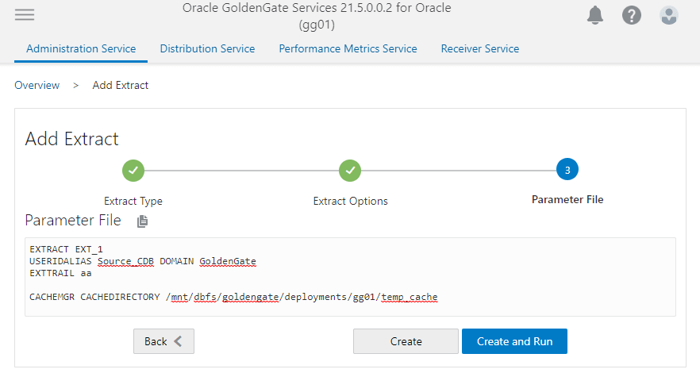
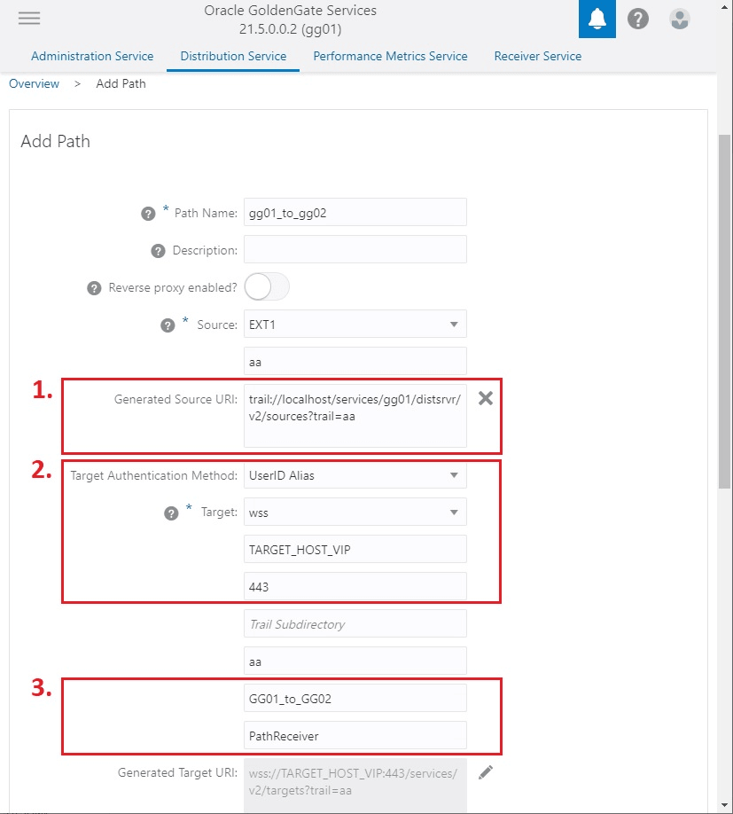
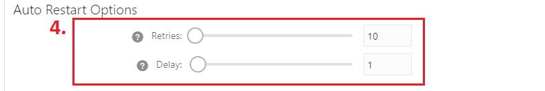
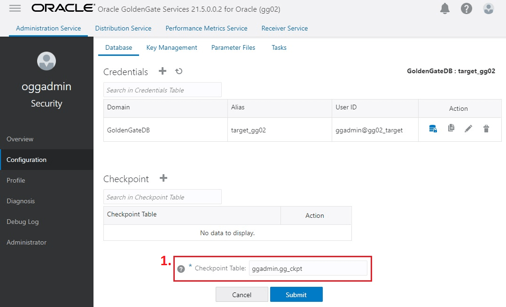
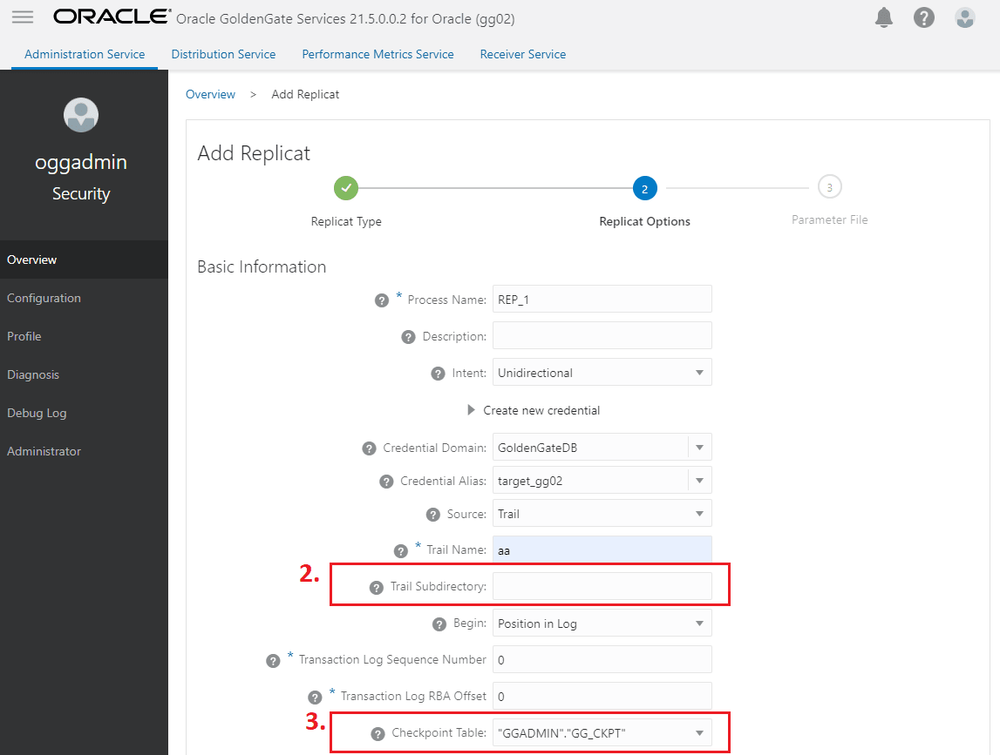

## Task 10: Configure Oracle GoldenGate Processes

When creating Extract, Distribution Paths, and Replicat processes with Oracle GoldenGate Microservices Architecture, all files that need to be shared between Oracle RAC nodes are already shared with the deployment files stored on a shared file system (DBFS or ACFS).

Listed below are important configuration details that are recommended for running Oracle GoldenGate Microservices on Oracle RAC for Extract, Distribution Paths and Replicat processes.

Extract Configuration

1. When creating an Extract using the Oracle GoldenGate Administration Server GUI interface, leave the Trail SubDirectory parameter blank, so that the trail files are automatically created in the deployment directories stored on the shared file system.
	The default location for trail files is the `/<deployment                             directory>/var/lib/data`
2. If you are using DBFS for shared storage, and the deployment `var/temp` directory was moved to local storage as described in [Task 6: Create the Oracle GoldenGate Deployment](task-6-create-oracle-goldengate-deployment.md), it is recommended that you use the Extract `CACHEMGR` parameter to place the temporary cache files on the shared storage.

Create a new directory under the DBFS deployment mount point. For example:

```
$ mkdir –p /mnt/dbfs/goldengate/deployments/ggnorth/temp_cache
```

Set the Extract parameter to the new directory:

```
CACHEMGR CACHEDIRECTORY /mnt/dbfs/goldengate/deployments/ggnorth/temp_cache
```

Shown below is an example of how the parameters specified for an integrated Extract with the Oracle GoldenGate Administration Server GUI looks in the UI.

Figure 27-1 Extract parameters for defining the temporary cache files

  


Distribution Path Configuration

When using Oracle GoldenGate distribution paths with the NGINX Reverse Proxy, there are additional steps that must be performed to ensure that the path server certificates are configured.

Follow the instructions provided in the following video to correctly configure the certificates: [https://apexapps.oracle.com/pls/apex/f?p=44785:112:0::::P112\_CONTENT\_ID:31380](https://apexapps.oracle.com/pls/apex/f?p=44785:112:0::::P112_CONTENT_ID:31380)

Configuration highlights presented in this video:

1. Create a client certificate for the source deployment and add the client certificate to the source deployment Service Manager. (This is not required when using Oracle GoldenGate 21c or later releases.)
2. Download the target deployment server’s root certificate and add the CA certificate to the source deployment Service Manager.
3. Create a user in the target deployment for the distribution path to connect to.
4. Create a credential in the source deployment connecting to the target deployment with the user created in the previous step.
	For example, a domain of `GGNORTH_to_GGSOUTH` and an alias of `PathReceiver`.

After configuring the client and server certificates, the following configuration options need to be set. Refer to the figures below to see where these options are set in the UI.

1. Change the Generated Source URI specifying `localhost` for the server name.
	This allows the distribution path to be started on any of the Oracle RAC nodes.
2. Set the Target Authentication Method to `UserID Alias` and the Target transfer protocol to `wss` (secure web socket).
	Set the Target Host to the target host name/VIP that will be used for connecting to the target system along with the Port Number that NGINX was configured with (default is 443).
	The target host name/VIP should match the common name in the CA signed certificate used by NGINX.
3. Set the Domain to the credential domain created above in step 4 and presented in the video, for example `GGNORTH_to_GGSOUTH`.
	The Alias is set to the credential alias, also created in step 4 in the video.
4. Set the distribution path to automatically restart when the Distribution Server starts.
	This is required so that manual intervention is not required after an Oracle RAC node relocation of the Distribution Server. It is recommended that you set the number of Retries to 10. Set the Delay, which is the amount of time in minutes to pause between restart attempts, to 1.

Figure 27-2 Distribution Path Creation steps 1-3

  


Figure 27-3 Distribution Path Creation step 4

  


Replicat Configuration

1. The checkpoint table is a required component for GoldenGate Replicat processes. Make sure that a checkpoint table has been created in the database GoldenGate administrator (GGADMIN) schema.
	The checkpoint table can be created using the Oracle GoldenGate Administration Server GUI, clicking on the ‘+’ button and entering the checkpoint table name in the format of schema.tablename. This is shown in the image below
	Figure 27-4 Creating the checkpoint table for Replicat processes
	  
	
	See [About Checkpoint Table](https://docs.oracle.com/en/middleware/goldengate/core/21.3/oracle-db/configuring-oracle-goldengate-apply.html#GUID-3DFBE2BE-20C5-48AA-B96A-7697126D77FE) for more information about creating a checkpoint table.
2. When creating a Replicat using the Oracle GoldenGate Administration Server GUI interface, set the Trail SubDirectory parameter to the location where the distribution path or local Extract are creating the trail files.
3. If a checkpoint table was created previously, select the table name from the Checkpoint Table pulldown list.
	Figure 27-5 Replicat creation with Trail SubDirectory and Checkpoint Table
	  
	