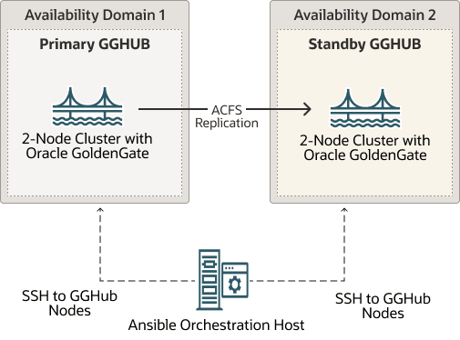

## Task 2: Prepare GGHub Clusters and Ansible Orchestration Host

Perform the following steps to complete this task:

- Step 2.1 - Deploy Primary and Standby Clusters for GGHub
- Step 2.2 - Deploy Ansible Orchestration Host
- Step 2.3 - Download the Required Oracle GoldenGate Software to the Ansible Orchestration Host

Step 2.1 - Deploy Primary and Standby Clusters for GGHub

Each GGHub cluster must be deployed as a 2-node Oracle Grid Infrastructure system with job role separation as described in [Grid Infrastructure Installation and Upgrade Guide for Linux](https://docs.oracle.com/en/database/oracle/oracle-database/19/cwlin/installing-oracle-grid-infrastructure.html#GUID-D4E3FADF-360E-49EB-89A2-E4CBBB9CC61F).



> The image shows two large boxes labeled Availability Domain 1 and Availability Domain 2.
>
> Inside Availability Domain 1 box is another box labeled Primary GGHub. Inside this box is an icon labeled 2-node cluster with Oracle GoldenGate.
>
> Inside Availability Domain 2 box is another box labeled Standby GGHub. Inside this box is an icon labeled 2-node cluster with Oracle GoldenGate.
>
> An arrow pointing from the GoldenGate icon in Availability Domain 1 to the GoldenGate icon in Availability Domain 2 is labeled ACFS Replication.
>
> Under the Availability Domain boxes is an icon labeled Ansible Orchestration Host. This icon has dashed line arrows pointing to each of the Availability Domain boxes and those are both labeled SSH to GGHub nodes.


Complete Requirements for GGHub Clusters

Primary and standby GGHub clusters must meet the following requirements:

1. Deploy GGHub clusters with Oracle Linux 8 operating system and 19c Grid Infrastructure software with the latest release update.
2. Configure required OS users on the GGHub cluster nodes as follows:
	- Oracle Clusterware software owner, typically `grid` for job role separation installations, which will exist as a result of the Clusterware installation.
		- Oracle GoldenGate software owner, typically `oracle`, which is used by Ansible automation to install GoldenGate software.
		- GGHub orchestration user, such as `opc`, which has privileged access (`su/sudo`) to `root` OS user.
		- The Ansible orchestration user from the Ansible orchestration host will login to each GGHub node as this OS user using passwordless ssh key configuration to run commands as `root`, `grid`, or `oracle`, as required.
				- This passwordless ssh key configuration is performed in a later step.
3. Allocate an unused application virtual IP address (APP VIP) on each GGHub cluster on the clusterware public network.
	- The APP VIP is a cluster resource that Oracle Clusterware manages, and is migrated to another cluster node in the event of a node failure or planned maintenance.
		- The APP VIP is used to ensure that the primary GGHub ACFS replication process sends GoldenGate trail files to the correct standby GGHub node where the file system is currently mounted. This is accomplished by co-locating the APP VIP and the ACFS CRS resources on the same node.
4. Set up passwordless ssh key configuration for the `grid` OS user between the primary and standby GGHub clusters to support ACFS replication. Specifically this requires the following:
	| SSH From | SSH To | Purpose |
	| --- | --- | --- |
	| `grid` OS user on each primary GGHub node | `grid` OS user on each standby GGHub cluster node using the APP VIP name  Note: In the `grid` user's `known_hosts` file on all standby GGHub cluster nodes, add the primary cluster APP VIP name or address to each primary cluster node entry | ACFS snapshot based replication |
	| `grid` OS user on each standby GGHub node | `grid` OS user on each primary GGHub cluster node using the APP VIP name  Note: In the `grid` user's `known_hosts` file on all primary GGHub cluster nodes, add the standby cluster APP VIP name or address to each standby cluster node entry. | ACFS snapshot based replication if the ACFS replication direction is reversed or GGHub standby is converted to primary. |
	For additional guidance follow the instructions in [Configuring ssh for Use With Oracle ACFS Replication](https://docs.oracle.com/pls/topic/lookup?ctx=en/database/oracle/oracle-database/21/haovw&id=OSTMG-GUID-C1CB3914-E278-473A-ACCC-FD1BA7CDC0B4) to configure ssh connectivity between the primary and standby nodes.
5. Allocate 10GB free disk space to support staging installation files. The software staging directory is supplied during GGHub deployment.
	Ansible automation copies the software files to the designated staging directory, but it temporarily uses the GGHub orchestration user's home directory. Therefore, in addition to the staging directory, at least 10 GB of free space is required in the user's home directory.
6. Install the required packages and python modules as listed in the table below:
	| Required modules and libraries | Description |
	| --- | --- |
	| iptables-services | Required by Ansible automation for nginx configuration |
	| python3.12 | Ansible automation requires minimum python version 3.12 for compatibility. Python 3.12 interpreter path is required in a later step. |
	| python3.12-pip | pip package manager associated with a python 3.12 installation. |
	| lxml, packaging, pexpect | Python modules required by Ansible automation. Install using the command:  ``` $ python3.12 -m pip install lxml packaging pexpect ``` |
	For more details refer to Oracle Linux documentation [https://public-yum.oracle.com/oracle-linux-python.html#InstallFromAppStream](https://public-yum.oracle.com/oracle-linux-python.html#InstallFromAppStream)
7. Configure python3 to use Python 3.12 as the default version on the cluster nodes by running the command below as a privileged user:
	```
	# update-alternatives --config python3
	```
8. Install NGINX version 1.24 or higher. Follow the steps provided in the NGINX documentation [https://nginx.org/en/linux\_packages.html#RHEL](https://nginx.org/en/linux_packages.html#RHEL) to install NGINX.
	NGINX configuration is performed by Ansible automation during the GGHub deployment.
9. For compatibility and software requirements if SELinux is planned to be enabled on the GGHub cluster nodes, refer to My Oracle Support document 3102722.1 [Oracle Automatic Storage Management Cluster File System (ACFS) Replication and Security-Enhanced Linux (SELinux)](https://support.oracle.com/rs?type=doc&id=3102722.1).

Step 2.2 - Deploy Ansible Orchestration Host and Configure GGHub Ansible Collection

Provision a separate Oracle Linux 8 host to act as the Ansible orchestration host. This lightweight orchestration host is used to run Ansible playbooks or scripts and login to GGHub nodes to execute specific tasks to help automate the GGHub deployment.

Perform the following steps on the Ansible orchestration host:

- Step 2.2.1 - Install Packages Required for Ansible
- Step 2.2.2 - Configure Ansible Environment and Install GGHub Ansible Collection
- Step 2.2.3 - Download the Required Oracle GoldenGate Software to the Ansible Orchestration Host

Step 2.2.1 - Install Packages Required for Ansible

Install the required packages listed in the table below. To install the required packages subscribe to the Oracle Linux 8 channel on the Unbreakable Linux Network, or configure a yum repository from the Oracle Linux yum server website.

Follow [Configuring a System to Use Oracle Linux Yum Server](https://docs.oracle.com/en/operating-systems/oracle-linux/software-management/sfw-mgmt-ConfigureaSystemtoUseEnterpriseLinuxYumServer.html#oci-regional-yum) to define the required repositories on the Ansible orchestration host.

| Packages for Oracle Linux 8 Ansible orchestration host | Repository |
| --- | --- |
| python3.12 | ol8\_appstream |
| python3.12-pip | ol8\_appstream |
| bzip2 | ol8\_baseos\_latest |

After defining the required yum repositories, install the required packages as a privileged user on the Ansible orchestration host.

```
$ sudo dnf install python3.12 python3.12-pip bzip2
```

Additional python packages and libraries are installed in a later step using pip package manager, which, by default, uses the python package index (PyPI) repository. Allow Ansible orchestration host to access python package index repository from [https://pypi.org](https://pypi.org/) or use an approved internal package repository to install the required packages in your python environment.

Step 2.2.2 - Configure Ansible Environment and Install GGHub Ansible Collection

Perform the following sub-steps to complete this task:

- Step 2.2.2.1 - Create or Identify Ansible Orchestration User
- Step 2.2.2.2 - Obtain GGHub Ansible Collection
- Step 2.2.2.3 - Update the Default Python Version on the Ansible Orchestration Host
- Step 2.2.2.4 - Ensure That the pip Package Manager is Installed
- Step 2.2.2.5 - Execute the Script python\_venv\_activate.sh From the GGHub Collection Directory
- Step 2.2.2.6 - Activate Python Virtual Environment

Step 2.2.2.1 - Create or Identify Ansible Orchestration User

Create or identify a non-privileged OS user on the Ansible orchestration host, such as `ansible`, that owns the Ansible installation and can be used to execute all Ansible orchestration tasks.

The Ansible orchestration user will login to the GGHub orchestration user on each primary and standby GGHub node using passwordless ssh to run commands as `root`, `grid`, or `oracle`, as required.

All subsequent steps on the Ansible orchestration host are performed as the Ansible orchestration user.

Step 2.2.2.2 - Obtain GGHub Ansible Collection

GGHub Ansible collection (Bundled Ansible automation assets such as playbooks, roles, scripts, plugins, in a single, versioned unit) can be downloaded from MOS article [KB858669 - Oracle GoldenGate MicroServices Architecture High Availability with zero or near-zero downtime](https://support.oracle.com/support/?documentId=KB858669).

In this example `/u01/maagghub/` is used as the top level directory for staging all of the files on the Ansible orchestration host.

Extract the downloaded Ansible collection under the `/u01/maagghub/gghub-ansible-collection/` directory on the Ansible orchestration host.

```
$ mkdir -p /u01/maagghub 

$ cd /u01/maagghub

e.g.
unzip gghub-onprem-yyyymmdd.zip -d /u01/maagghub/gghub-ansible-collection
```
Step 2.2.2.3 - Update the Default Python Version on the Ansible Orchestration Host

The required python version is python3.12 or higher. Update the default python version on the Ansible orchestration host if required.

```
$ sudo update-alternatives --config python3

There are 2 programs which provide 'python3'.

  Selection    Command
-----------------------------------------------
*  1           /usr/bin/python3.6
 + 2           /usr/bin/python3.12

Enter to keep the current selection[+], or type selection number: 2

Validate the python version. 

$ python3 --version
Python 3.12.11
```
Step 2.2.2.4 - Ensure That the pip Package Manager is Installed

Check if the pip package manager is installed using the following python command. The command should display the pip package manager version without errors.

```
$ python3.12 -m pip -V
pip 23.2.1 from /usr/lib/python3.12/site-packages/pip (python 3.12)
```
Step 2.2.2.5 - Execute the Script python\_venv\_activate.sh From the GGHub Collection Directory

The `python_venv_activate.sh` script performs the following operations on the Ansible orchestration host:

- Creates `venv`, `ansible` and `collections` subdirectories under the `/u01/maagghub/` directory, which is used as the Ansible base directory for creating the python virtual environment in this example.
- Creates the Python virtual environment named `'venv'`.
	If a virtual environment with the same name already exists, the script attempts to update the MAA GGHub collection in the virtual environment while skipping other steps.
- Copies the `ansible.cfg` environment configuration file under the directory `/u01/maagghub/` with recommended parameter settings.
- Activates the python virtual environment.
- Installs GGHub required Ansible packages and libraries using pip package manager.
	By default the pip package manager uses the python package index (PyPI) repository. Allow Ansible orchestration host to access python package index repository from [https://pypi.org](https://pypi.org/) or use an approved internal package repository.
- Updates python pip package installer.
- Installs the Ansible MAA GGHub collection under the `/u01/maagghub/collections/` directory.
- Lists the GGHub collection version.
```
$ cd /u01/maagghub
$ sh gghub-ansible-collection/python_venv_activate.sh
```
Step 2.2.2.6 - Activate Python Virtual Environment

Python virtual environment needs to be activated before running any Ansible commands on the Ansible orchestration host.

```
$ source /u01/maagghub/venv/bin/activate
```

After activation of virtual environment the prompt changes as shown here.

```
(gghub) [~]$
```

Verify that python and ansible executables are being used from the virtual environment home.

```
$ which python ansible
/u01/maagghub/venv/bin/python
/u01/maagghub/venv/bin/ansible
```

Update GGHub Ansible collection to newer version

To upgrade an already installed GGHub collection to the latest available version, extract the new collection in directory `/u01/maagghub/gghub-ansible-collection-new/` and run the following command:

```
$ cd /u01/maagghub
(gghub) [~]$ ansible-galaxy collection install /u01/maagghub/gghub-ansible-collection-new --upgrade
```

To install a specific version of the GGHub collection, extract the collection in directory, for example `/u01/maagghub/gghub-ansible-collection-version/`, and use the following command:

```
(gghub) [~]$ ansible-galaxy collection install /u01/maagghub/gghub-ansible-collection-version:==X.Y.Z
```
Step 2.3 - Download the Required Oracle GoldenGate Software to the Ansible Orchestration Host

Create a software repository directory (for example, `/u01/maagghub/stage`) on the Ansible orchestration host and stage the following software on the Ansible orchestration host:

1. Oracle GoldenGate 23ai software:
	1. Review [Doc ID 1645495.1](https://support.oracle.com/epmos/faces/DocumentDisplay?id=1645495.1&parent=WIDGET_RECENT_DB) to identify the latest Oracle GoldenGate 23ai Patch Set Availability document in the OGG v23ai Patch Set Availability Notes section.
		2. From the latest Patch Set Availability document, download the patch with description "Oracle GoldenGate \<OGGRU> for Oracle (Complete Install)".
2. Oracle Grid Infrastructure Standalone Agents for Oracle Clusterware 19c:
	1. Download the agent software version 10.2 or higher, using the "Download" section in document [Oracle Grid Infrastructure Standalone Agents for Oracle Clusterware](http://www.oracle.com/technetwork/database/database-technologies/clusterware/downloads/xag-agents-downloads-3636484.html)

Make a note of the software repository directory path as it is used in a later step.