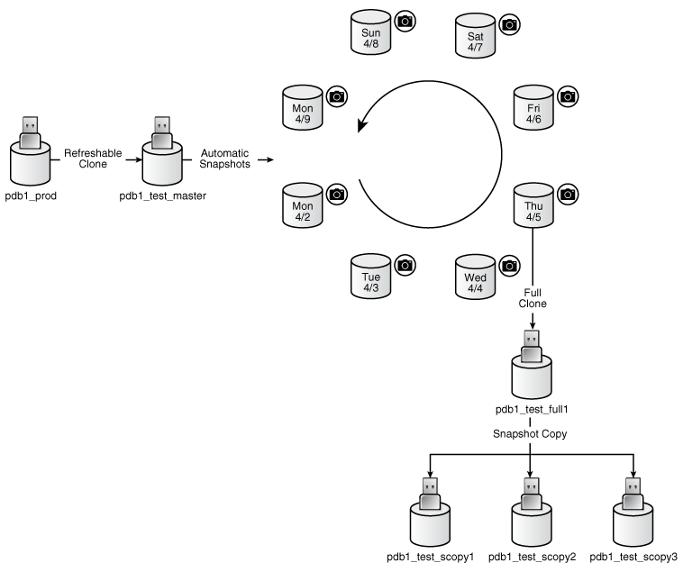
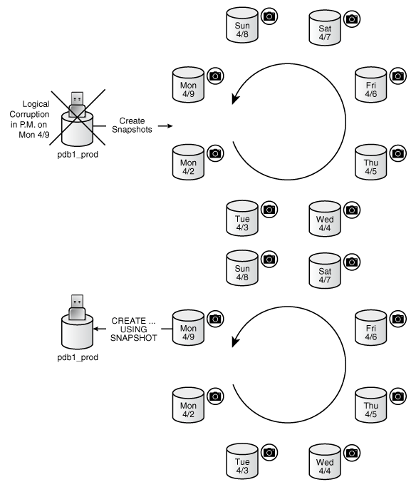
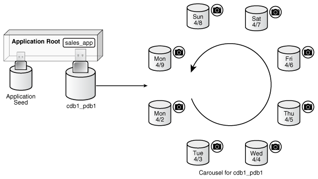

You can configure a PDB snapshot carousel for a specified PDB, create snapshots manually or automatically, and set the maximum number of snapshots.

- About PDB Snapshot Carousel  
	A PDB snapshot carousel is a library of PDB snapshots.
- Setting the Maximum Number of Snapshots in a PDB Snapshot Carousel  
	You can set the maximum number of PDB snapshots for a PDB.
- Configuring Automatic PDB Snapshots  
	Configure a PDB for automatic snapshots by using the `SNAPSHOT MODE EVERY` clause when creating or altering a PDB.
- Creating PDB Snapshots Manually  
	To create a PDB snapshot manually, specify the `SNAPSHOT snapshot_name` clause in `ALTER PLUGGABLE DATABASE` or `CREATE PLUGGABLE DATABASE`.
- Dropping a PDB Snapshot  
	You can drop a PDB snapshot by running an `ALTER PLUGGABLE DATABASE` statement with the `DROP SNAPSHOT` clause.
- Viewing Metadata for PDB Snapshots  
	The data dictionary views `DBA_PDB_SNAPSHOTS` and `DBA_PDB_SNAPSHOTFILE` show the metadata for PDB snapshots.

**Parent topic:** [Creating PDBs and Application Containers](creating-pdbs.md)

### About PDB Snapshot Carousel

A PDB snapshot carousel is a library of PDB snapshots.

A **PDB snapshot** is a point-in-time copy of a PDB. The source PDB can be open read-only or read/write while the snapshot is created. You can create snapshots manually using the `SNAPSHOT` clause of `CREATE PLUGGABLE DATABASE` (or `ALTER PLUGGABLE DATABASE`), or automatically using the `EVERY interval` clause. If the storage system supports sparse clones, then the preceding command creates a sparse copy. Otherwise, the command creates a full copy.

- Purpose of PDB Snapshot Carousel  
	A PDB snapshot carousel is useful for maintaining a library of recent PDB copies for point-in-time recovery and cloning.
- How PDB Snapshot Carousel Works  
	The carousel for a specific PDB is a circular library of copies for this PDB.
- User Interface for PDB Snapshot Carousel  
	The `SNAPSHOT MODE` clause controls creation of snapshots, and determines whether creation is manual, automatic, or disabled.

See Also:

[Oracle Database Licensing Information User Manual](https://docs.oracle.com/pls/topic/lookup?ctx=en/database/oracle/oracle-database/21/multi&id=DBLIC-GUID-0F9EB85D-4610-4EDF-89C2-4916A0E7AC87) for details on which features are supported for different editions and services

**Parent topic:** Administering a PDB Snapshot Carousel

#### Purpose of PDB Snapshot Carousel

A PDB snapshot carousel is useful for maintaining a library of recent PDB copies for point-in-time recovery and cloning.

Cloning PDBs for Development and Testing

In a typical development use case, you clone a production PDB for testing using a command of the form `CREATE PLUGGABLE DATABASE newpdb FROM srcpdb`. When the CDB is in `ARCHIVELOG` mode and local undo mode, the source production PDB can be opened in read/write mode and fully functional when you clone it, a technique known as **hot cloning**. The hot clone PDB is transactionally consistent with the source PDB as of the SCN at the completion of the `ALTER PLUGGABLE DATABASE ... OPEN` statement.

The following steps illustrate a typical development scenario:

1. While the production PDB named `pdb1_prod` is open and in use, create a refreshable clone PDB named `pdb1_test_master`.
	A refreshable clone PDB can only be opened in read/only mode. To refresh the clone PDB from `pdb1_prod`, you must close it.
2. Run `ALTER PLUGGABLE DATABASE pdb1_test_master SNAPSHOT MODE EVERY 24 HOURS`, which configures the PDB to generate automatic snapshots of `pdb1_test_master` every day.
3. When you need new PDBs for testing, create a full clone PDB by using the `CREATE PLUGGABLE DATABASE … USING SNAPSHOT` command.
4. Create sparse snapshot copy PDBs of the full clone PDB using `CREATE PLUGGABLE DATABASE ... SNAPSHOT COPY`.

The following figure shows the creation of the clone `pdb1_test_full1` from the PDB snapshot taken on April 5. The figure shows three snapshot copy PDBs created from `pdb1_test_full1`.

Figure 12-1 Automatic Snapshots of a Refreshable Clone PDB



> In this graphic, pdb1\_prod points toward pdb1\_test\_master. The arrow is labeled “Refreshable Clone.” The icon pdb1\_test\_master has a right-pointing arrow labeled “Automatic Snapshots.” The arrow points toward a ring of 8 PDBs, each one labeled with a different date: 4/2, 4/3, 4/4, 4/5, 4/6, 4/7, 4/8, and 4/9. The 4/5 PDB points down to pdb1\_test\_full. The arrow is labeled “Full Clone.” The pdb1\_test\_full1 PDB points down to 3 PDBs: pdb1\_test\_scopy1, pdb1\_test\_scopy2, and pdb1\_test\_scopy3. The arrow is labeled “Snapshot Copy.”


Point-in-Time Restore with PDB Snapshot Carousel

One strategy is to take a snapshot of a PDB every day at the same time. Another strategy is to take a PDB snapshot manually before data loads. In either case, a PDB snapshot carousel enables you to restore a PDB using any available PDB snapshot.

For example, a sales history PDB named `pdb1_prod` generates an automatic snapshot every day at 12:01 a.m. On the daily data load on the afternoon of Monday 4/9, you accidentally load the wrong data, corrupting the PDB. You can create a new production PDB based on the Monday 4/9 snapshot, drop the corrupted PDB, and then retry the data load.

Figure 12-2 Restore a Production PDB Using a Snapshot



> On the top of the graphic, pdb1\_prod is crossed out. The label says “Logical Corruption in P.M. on Mon 4/9.” The PDB points right and is labeled “Create Snapshots.” The arrow points to a circle of PDBs, each labeled with a different date: Mon 4/2, Tue 4/3, Wed 4/4, Thu 4/5, Fri 4/6, Sat 4/7, Sun 4/8, and Mon 4/9.
>
> On the bottom of the graphic, pdb1\_prod is on the left, and is pointed to by a snapshot PDB labeled Mon 4/9. The arrow is labeled “CREATE... USING SNAPSHOT.”


See Also:

- " [About Cloning a PDB](cloning-a-pdb.md) "
- [Oracle Database SQL Language Reference](https://docs.oracle.com/pls/topic/lookup?ctx=en/database/oracle/oracle-database/21/multi&id=SQLRF-GUID-F2DBA8DD-EEA8-4BB7-A07F-78DC04DB1FFC) for `CREATE PLUGGABLE DATABASE` syntax and semantics
- [Oracle Database Licensing Information User Manual](https://docs.oracle.com/pls/topic/lookup?ctx=en/database/oracle/oracle-database/21/multi&id=DBLIC-GUID-0F9EB85D-4610-4EDF-89C2-4916A0E7AC87) for details on which features are supported for different editions and services

**Parent topic:** About PDB Snapshot Carousel

#### How PDB Snapshot Carousel Works

The carousel for a specific PDB is a circular library of copies for this PDB.

The database creates successive copies in the carousel either on demand or automatically. The database overwrites the oldest snapshot when the snapshot limit is reached.

- Contents of a PDB Snapshot  
	The contents of a PDB snapshot depend on whether the underlying file system supports sparse files.
- Contents of a PDB Snapshot Carousel  
	The PDB snapshot carousel is the set of all existing snapshots for a PDB.

**Parent topic:** About PDB Snapshot Carousel

##### Contents of a PDB Snapshot

The contents of a PDB snapshot depend on whether the underlying file system supports sparse files.

Snapshot Names

The name of a database-managed PDB snapshot is either user-specified or system-generated. For system-generated snapshot names, `SNAP_` is prefixed to a unique identifier, which contains the snapshot SCN. For example, the following query shows three snapshots with system-generated names and the SCNs at which they were taken:

```
SET LINESIZE 200
SET PAGESIZE 50000

COL CON_ID FORMAT 999999
COL CON_NAME FORMAT a15
COL SNAPSHOT_NAME FORMAT a27

SELECT CON_ID, CON_NAME, SNAPSHOT_NAME, SNAPSHOT_SCN FROM DBA_PDB_SNAPSHOTS;

 CON_ID CON_NAME        SNAPSHOT_NAME               SNAPSHOT_SCN
------- --------------- --------------------------- ------------
      5 HRPDB           SNAP_1389467754_993556301        2925293
      5 HRPDB           SNAP_1389467754_993556306        2925679
      5 HRPDB           SNAP_1389467754_993556309        2925698
```

Note:

See [Oracle Database Licensing Information User Manual](https://docs.oracle.com/pls/topic/lookup?ctx=en/database/oracle/oracle-database/21/multi&id=DBLIC-GUID-0F9EB85D-4610-4EDF-89C2-4916A0E7AC87) for details on which features are supported for different editions and services.

Full and Sparse Snapshots

The content of snapshots generated by `ALTER PLUGGABLE DATABASE ... SNAPSHOT` depends on the underlying file system. If the underlying file system supports sparse copies, then the PDB-level snapshots are sparse. Only the first PDB-managed PDB snapshot is full. Otherwise, the PDB snapshots contain full copies of the data files. The snapshot includes other files necessary to create a PDB from the snapshot.

Snapshot Directories

Every PDB has its own snapshot directory. Within this directory, each snapshot has its own subdirectory named after the SCN at which it was taken. The following query shows the sparse PDB snapshots for `hrpdb`, which has a DBID of `1389467754`:

```
SET LINESIZE 200
SET PAGESIZE 50000

COL SNAPSHOT_NAME FORMAT a27
COL FULL_SNAPSHOT_PATH FORMAT a65

SELECT SNAPSHOT_NAME, SNAPSHOT_SCN, FULL_SNAPSHOT_PATH FROM DBA_PDB_SNAPSHOTS;

SNAPSHOT_NAME               SNAPSHOT_SCN FULL_SNAPSHOT_PATH
--------------------------- ------------ ---------------------------------------
SNAP_1389467754_993556301        2925293 /d1/snapshots/pdb_1389467754/2925293/
SNAP_1389467754_993556306        2925679 /d1/snapshots/pdb_1389467754/2925679/
SNAP_1389467754_993556309        2925698 /d1/snapshots/pdb_1389467754/2925698/
```

Note:

If the snapshot were full instead of sparse, then the full snapshot path would specify an archive with the `.pdb` suffix.

The directory for `/d1/snapshots/pdb_1389467754/2925698/` contains the following files:

```
archparlog_1_63_52d1986a_993552590.arc  
o1_mf_salestbs_g03341t2_.dbf
o1_mf_sysext_g0333vqw_.dbf
o1_mf_undo_1_g033gd2j_.dbf            
o1_mf_sysaux_g0333vqv_.dbf   
o1_mf_system_g0333vqt_.dbf
HRPDB.xml
```

The set includes the data files, archived redo log files, and an XML file that contains metadata about the PDB snapshot. The following `du` command shows that the size of the snapshot data files, which are sparse, is small relative to the size of the data files:

```
% du -h *dbf
16K     o1_mf_salestbs_g03341t2_.dbf
16K     o1_mf_sysaux_g0333vqv_.dbf
16K     o1_mf_sysext_g0333vqw_.dbf
16K     o1_mf_system_g0333vqt_.dbf
16K     o1_mf_undo_1_g033gd2j_.dbf
```

The following data dictionary join shows the snapshot file names and types for snapshot `2925698`:

```
SELECT f.SNAPSHOT_FILENAME, f.SNAPSHOT_FILETYPE
FROM   DBA_PDB_SNAPSHOTS s, DBA_PDB_SNAPSHOTFILE f
WHERE  s.SNAPSHOT_SCN=f.SNAPSHOT_SCN
AND    s.CON_ID=f.CON_ID
ORDER BY s.SNAPSHOT_SCN DESC;

SNAPSHOT_FILENAME                                                        SNAPSHOT
-----------------------------------------------------------------        --------
/d1/snapshots/pdb_1389467754/2925698/o1_mf_sysaux_g0333vqv_.dbf              DATA
/d1/snapshots/pdb_1389467754/2925698/o1_mf_system_g0333vqt_.dbf              DATA
/d1/snapshots/pdb_1389467754/2925698/HRPDB.xml                                XML
/d1/snapshots/pdb_1389467754/2925698/o1_mf_sysext_g0333vqw_.dbf              DATA
/d1/snapshots/pdb_1389467754/2925698/o1_mf_salestbs_g03341t2_.dbf            DATA
/d1/snapshots/pdb_1389467754/2925698/o1_mf_undo_1_g033gd2j_.dbf              DATA
/d1/snapshots/pdb_1389467754/2925698/archparlog_1_63_52d1986a_993552590.arc  ARCH
/d1/snapshots/pdb_1389467754/2925679/o1_mf_sysext_g0333vqw_.dbf              DATA
/d1/snapshots/pdb_1389467754/2925679/o1_mf_salestbs_g03341t2_.dbf            DATA
/d1/snapshots/pdb_1389467754/2925679/o1_mf_undo_1_g033gd2j_.dbf              DATA
/d1/snapshots/pdb_1389467754/2925679/o1_mf_sysaux_g0333vqv_.dbf              DATA
/d1/snapshots/pdb_1389467754/2925679/archparlog_1_63_52d1986a_993552590.arc  ARCH
/d1/snapshots/pdb_1389467754/2925679/HRPDB.xml                                XML
/d1/snapshots/pdb_1389467754/2925679/o1_mf_system_g0333vqt_.dbf              DATA
/d1/snapshots/pdb_1389467754/2925293/HRPDB.xml                                XML
/d1/snapshots/pdb_1389467754/2925293/o1_mf_system_g0333vqt_.dbf              DATA
/d1/snapshots/pdb_1389467754/2925293/o1_mf_sysaux_g0333vqv_.dbf              DATA
/d1/snapshots/pdb_1389467754/2925293/o1_mf_undo_1_g033gd2j_.dbf              DATA
/d1/snapshots/pdb_1389467754/2925293/o1_mf_salestbs_g03341t2_.dbf            DATA
/d1/snapshots/pdb_1389467754/2925293/o1_mf_sysext_g0333vqw_.dbf              DATA
/d1/snapshots/pdb_1389467754/2925293/archparlog_1_63_52d1986a_993552590.arc  ARCH
```

**Parent topic:** How PDB Snapshot Carousel Works

##### Contents of a PDB Snapshot Carousel

The PDB snapshot carousel is the set of all existing snapshots for a PDB.

The `MAX_PDB_SNAPSHOTS` property specifies the maximum number of snapshots permitted in the carousel. The current setting is visible in the `CDB_PROPERTIES` view.

The following figure shows a carousel for `cdb1_pdb1`. In this example, the database takes a PDB snapshot automatically every day, maintaining a set of 8. After the first 8 snapshots have been created, every new snapshot replaces the oldest snapshot. For example, the Tuesday 4/10 snapshot replaces the Monday 4/2 snapshot; the Wednesday 4/11 snapshot replaces the Tuesday 4/3 snapshot; and so on.

Figure 12-3 PDB Snapshot Carousel



> Application Seed and cdb1\_pdb1 are plugged into Application Root. The application PDB named cdb1\_pdb1 points right toward a circle of snapshot PDBs, each with a different date: Mon 4/2, Tue 4/3, Wed 4/4, Thu 4/5, Fri 4/6, Sat 4/7, Sun 4/8, and Mon 4/9.


If the file system supports sparse files, then all PDB snapshots in the carousel except the first one are sparse. The source PDB can remain in read/write mode. Sparse files significantly reduce the carousel storage space.

**Parent topic:** How PDB Snapshot Carousel Works

#### User Interface for PDB Snapshot Carousel

The `SNAPSHOT MODE` clause controls creation of snapshots, and determines whether creation is manual, automatic, or disabled.

ALTER PLUGGABLE DATABASE … SNAPSHOT Statement

To set the snapshot mode for a PDB, use one of the following values in the `SNAPSHOT MODE` clause of `ALTER PLUGGABLE DATABASE` or `CREATE PLUGGABLE DATABASE`:

- `MANUAL`
	This clause, which is the default, enables the creation of manual snapshots of the PDB. To create a snapshot on demand, specify the `SNAPSHOT snapshot_name` clause in an `ALTER PLUGGABLE DATABASE` or `CREATE PLUGGABLE DATABASE` statement.
- `EVERY snapshot_interval [MINUTES|HOURS]`
	This clause enables the automatic creation of snapshots after an interval of time. The following restrictions apply to the interval specified:
	- The minutes value must be less than `3000`.
		- The hours value must be less than `2000`.
	The database assigns each automatic snapshot a system-generated name. Note that manual snapshots are also supported for the PDB when `EVERY` is specified.
- `NONE`
	This clause disables snapshot creation for the PDB.

See Also:

- " [About Cloning PDBs from PDB Snapshots](cloning-a-pdb.md) "
- [Oracle Database SQL Language Reference](https://docs.oracle.com/pls/topic/lookup?ctx=en/database/oracle/oracle-database/21/multi&id=SQLRF55694) for the syntax and semantics of the `SNAPSHOT` clause

MAX\_PDB\_SNAPSHOTS Database Property

To set the maximum number of snapshots for a PDB, specify the `MAX_PDB_SNAPSHOTS` property in `ALTER PLUGGABLE DATABASE` or `CREATE PLUGGABLE DATABASE`. The default is for the property is `8`, which is also the maximum value. When the maximum allowed number of snapshots has been created, the database purges the oldest snapshot. The `CDB_PROPERTIES` view shows the setting of `MAX_PDB_SNAPSHOTS`.

See Also:

[Oracle Database SQL Language Reference](https://docs.oracle.com/pls/topic/lookup?ctx=en/database/oracle/oracle-database/21/multi&id=SQLRF-GUID-A29491AD-8F0F-4E52-9D94-57FC3FF8FBC7) for the syntax of the `ALTER PLUGGABLE DATABASE` statement

Snapshot-Related Data Dictionary Views

The following data dictionary views provide snapshot information:

- The `DBA_PDB_SNAPSHOTS` view records metadata about PDB snapshots, including snapshot name, creation SCN, creation time, and file name.
- The `DBA_PDB_SNAPSHOTFILE` view lists the names and types of the files in a PDB snapshot. This view is only populated when the snapshots are sparse.
- The `DBA_PDBS` view has a `SNAPSHOT_MODE` and `SNAPSHOT_INTERVAL` column.

See Also:

Oracle Database Reference to learn about [`DBA_PDB_SNAPSHOTS`](https://docs.oracle.com/pls/topic/lookup?ctx=en/database/oracle/oracle-database/21/multi&id=GUID-B1389923-0F82-476F-BBEE-39364F10A988), [`DBA_PDB_SNAPSHOTFILE`](https://docs.oracle.com/pls/topic/lookup?ctx=en/database/oracle/oracle-database/21/multi&id=GUID-990A75BF-090C-4298-AA9A-27F7BF8C35C3), and [`DBA_PDBS`](https://docs.oracle.com/pls/topic/lookup?ctx=en/database/oracle/oracle-database/21/multi&id=GUID-439126EA-A6B6-45B8-AAFA-37EE4356BBEF)

**Parent topic:** About PDB Snapshot Carousel

### Setting the Maximum Number of Snapshots in a PDB Snapshot Carousel

You can set the maximum number of PDB snapshots for a PDB.

The `MAX_PDB_SNAPSHOTS` database property sets the maximum number of snapshots for every PDB in a PDB snapshot carousel. The default maximum is `8`. You cannot set the property to a number greater than `8`.

Prerequisites

The PDB must be open in read/write mode.

To set the maximum number of PDB snapshots for a PDB:

1. In SQL\*Plus, ensure that the current container is the PDB for which you want to set the limit.
2. Optionally, query `CDB_PROPERTIES` for the current setting of the `SET MAX_PDB_SNAPSHOTS` property.
3. Run an `ALTER PLUGGABLE DATABASE` or `ALTER DATABASE` statement with the `SET MAX_PDB_SNAPSHOTS` clause.

Example 12-1 Setting the Maximum Number of PDB Snapshots for a PDB

The following query shows the maximum in the carousel for `cdb1_pdb1` (sample output included):

```
SET LINESIZE 150
COL ID FORMAT 99
COL PROPERTY_NAME FORMAT a17
COL PDB_NAME FORMAT a9
COL VALUE FORMAT a3
COL DESCRIPTION FORMAT a43

SELECT r.CON_ID AS id, p.PDB_NAME, PROPERTY_NAME, 
       PROPERTY_VALUE AS value, DESCRIPTION 
FROM   CDB_PROPERTIES r, CDB_PDBS p 
WHERE  r.CON_ID = p.CON_ID 
AND    PROPERTY_NAME LIKE 'MAX_PDB%' 
ORDER BY PROPERTY_NAME;

ID PDB_NAME  PROPERTY_NAME     VAL DESCRIPTION
-- --------- ----------------- --- ------------------------------------
 3 CDB1_PDB1 MAX_PDB_SNAPSHOTS 8   maximum number of snapshots for a PDB
```

The following SQL statement sets the maximum number of PDB snapshots for the current PDB to 7:

```
ALTER PLUGGABLE DATABASE SET MAX_PDB_SNAPSHOTS=7;
```

Example 12-2 Dropping All Snapshots in a PDB Snapshot Carousel

To drop all snapshots in a PDB snapshot carousel, set the `MAX_PDB_SNAPSHOTS` database property to `0` (zero), as shown in the following statement:

```
ALTER PLUGGABLE DATABASE SET MAX_PDB_SNAPSHOTS=0;
```

This technique is faster than executing `ALTER PLUGGABLE DATABASE ... DROP SNAPSHOT snapshot_name` for every snapshot.

See Also:

" [About Container Access in a CDB](administering-a-cdb-with-sql-plus.md) "

**Parent topic:** Administering a PDB Snapshot Carousel

### Configuring Automatic PDB Snapshots

Configure a PDB for automatic snapshots by using the `SNAPSHOT MODE EVERY` clause when creating or altering a PDB.

By default, a PDB is configured for manual snapshots.

Prerequisites

Note the following prerequisites for the `ALTER PLUGGABLE DATABASE SNAPSHOT` statement:

- The CDB must be in local undo mode.
- The administrator must have the privileges to create a PDB and drop a PDB.

To configure automatic snapshots when altering a PDB:

1. In SQL\*Plus, log in as an administrator to the PDB whose snapshot mode you intend to configure.
2. Optionally, query `DBA_PDBS` to determine the current snapshot mode.
3. Run `ALTER PLUGGABLE DATABASE` with the `SNAPSHOT MODE EVERY interval` clause, specifying either `MINUTES` or `HOURS`.

To configure automatic snapshots when creating a PDB:

1. In SQL\*Plus, log in as an administrator to the CDB root or application root.
2. Optionally, query `DBA_PDBS` to determine the current snapshot mode.
3. Run `CREATE PLUGGABLE DATABASE` with the `SNAPSHOT MODE EVERY interval` clause, specifying either `MINUTES` or `HOURS`.

Example 12-3 Configuring an Automatic Snapshot Every Day for an Existing PDB

This example assumes that you are logged in to the PDB whose snapshot mode you intend to change. Query the data dictionary to confirm that the PDB is currently in `MANUAL` mode (sample output included):

```
SELECT SNAPSHOT_MODE "S_MODE", SNAPSHOT_INTERVAL/60 "SNAP_INT_HRS" 
FROM   DBA_PDBS;

S_MODE SNAP_INT_HRS
------ ------------
MANUAL
```

Change the snapshot mode to every 24 hours:

```
ALTER PLUGGABLE DATABASE SNAPSHOT MODE EVERY 24 HOURS;
```

Confirm the change to automatic mode:

```
SELECT SNAPSHOT_MODE "S_MODE", SNAPSHOT_INTERVAL/60 "SNAP_INT_HRS" 
FROM   DBA_PDBS;

S_MODE SNAP_INT_HRS
------ ------------
AUTO             24
```

Example 12-4 Creating a PDB That Takes Snapshots Every Two Hours

This example assumes that you are logged in to the CDB root. The following statement creates `cdb1_pdb3` from an existing PDB named `cdb1_pdb1`, and configures it to take snapshots automatically every 2 hours:

```
CREATE PLUGGABLE DATABASE cdb1_pdb3 FROM cdb1_pdb1
  FILE_NAME_CONVERT=('cdb1_pdb1','cdb1_pdb3')
  SNAPSHOT MODE EVERY 120 MINUTES;
```

See Also:

- " [Cloning a PDB from a PDB Snapshot: Scenario](cloning-a-pdb.md) "
- " [Configuring a CDB to Use Local Undo Mode](administering-a-cdb-with-sql-plus.md) "

**Parent topic:** Administering a PDB Snapshot Carousel

### Creating PDB Snapshots Manually

To create a PDB snapshot manually, specify the `SNAPSHOT snapshot_name` clause in `ALTER PLUGGABLE DATABASE` or `CREATE PLUGGABLE DATABASE`.

Prerequisites

Note the following prerequisites for the `ALTER PLUGGABLE DATABASE SNAPSHOT` statement:

- The CDB must be in local undo mode. You can check the mode by using the following query, which returns `TRUE` when local undo is enabled:
	```
	SELECT * FROM DATABASE_PROPERTIES WHERE PROPERTY_NAME='LOCAL_UNDO_ENABLED';
	```
- The DBA must have the privileges to create and drop a PDB.
- If you want the snapshots to be sparse, then the underlying storage system must support sparse files. In this case, only the first snapshot will be full.

To create a PDB snapshot:

1. In SQL\*Plus, log in as an administrator to the PDB whose snapshot you intend to create.
2. Optionally, query `DBA_PDBS.SNAPSHOT_MODE` to confirm that the snapshot mode is not set to `NONE`.
3. Run an `ALTER PLUGGABLE DATABASE` statement with the `SNAPSHOT` clause.

Example 12-5 Creating a PDB Snapshot with a User-Specified Name

The following SQL statements create two PDB snapshots of `cdb1_pdb1`, one before and one after a Wednesday data load:

```
ALTER PLUGGABLE DATABASE SNAPSHOT cdb1_pdb1_b4WLOAD;
-- data load
ALTER PLUGGABLE DATABASE SNAPSHOT cdb1_pdb1_afWLOAD;
```

The following query of `DBA_PDB_SNAPSHOTS` shows the locations of two snapshots of the PDB named `cdb1_pdb1` (sample output included):

```
SET LINESIZE 150
COL CON_NAME FORMAT a9
COL ID FORMAT 99
COL SNAPSHOT_NAME FORMAT a17
COL SNAP_SCN FORMAT 9999999
COL FULL_SNAPSHOT_PATH FORMAT a61

SELECT CON_ID AS ID, CON_NAME, SNAPSHOT_NAME, 
       SNAPSHOT_SCN AS snap_scn, FULL_SNAPSHOT_PATH 
FROM   DBA_PDB_SNAPSHOTS
ORDER BY SNAP_SCN;

 ID SNAPSHOT_NAME     SNAP_SCN FULL_SNAPSHOT_PATH
--- ----------------- -------- -------------------------------------------------------------
  4 CDB1_PDB1_B4WLOAD  5056465 /ade/b/813544604/oracle/dbs/snapshots/pdb_2935056285/5056465/
  4 CDB1_PDB1_AFWLOAD  5056501 /ade/b/813544604/oracle/dbs/snapshots/pdb_2935056285/5056501/
```

If you do not specify a PDB snapshot name, then the database generates a unique name.

Example 12-6 Creating a PDB Snapshot with a System-Specified Name

The following SQL statement creates a snapshot, but does not specify a name:

```
ALTER PLUGGABLE DATABASE SNAPSHOT;
```

The following sample query shows that the database assigned the snapshot a name prefixed with `SNAP_`:

```
SET LINESIZE 150
COL CON_NAME FORMAT a9
COL ID FORMAT 99
COL SNAPSHOT_NAME FORMAT a26
COL SNAP_SCN FORMAT 9999999
COL FULL_SNAPSHOT_PATH FORMAT a61

SELECT CON_ID AS id, CON_NAME, SNAPSHOT_NAME, 
       SNAPSHOT_SCN AS snap_scn, FULL_SNAPSHOT_PATH 
FROM   DBA_PDB_SNAPSHOTS
ORDER BY SNAP_SCN;

 ID SNAPSHOT_NAME              SNAP_SCN FULL_SNAPSHOT_PATH
--- -------------------------- -------- -------------------------------------------------------------
  4 CDB1_PDB1_B4WLOAD           5056465 /ade/b/813544604/oracle/dbs/snapshots/pdb_2935056285/5056465/
  4 CDB1_PDB1_AFWLOAD           5056501 /ade/b/813544604/oracle/dbs/snapshots/pdb_2935056285/5056501/
  4 SNAP_2935056285_1031574118  5057389 /ade/b/813544604/oracle/dbs/snapshots/pdb_2935056285/5057389/
```

See Also:

- " [About Container Access in a CDB](administering-a-cdb-with-sql-plus.md) "
- " [Configuring a CDB to Use Local Undo Mode](administering-a-cdb-with-sql-plus.md) "

**Parent topic:** Administering a PDB Snapshot Carousel

### Dropping a PDB Snapshot

You can drop a PDB snapshot by running an `ALTER PLUGGABLE DATABASE` statement with the `DROP SNAPSHOT` clause.

To drop all PDB snapshots based on a PDB, set the `MAX_PDB_SNAPSHOTS` property in the PDB to `0` (zero).

To drop a PDB snapshot:

1. In SQL\*Plus, ensure that the current container is the PDB from which you created the PDB snapshot.
2. Run an `ALTER PLUGGABLE DATABASE` statement with the `DROP SNAPSHOT` clause.

Example 12-7 Dropping a PDB Snapshot

The following SQL statement drops a PDB snapshot named `sales_snap`:

```
ALTER PLUGGABLE DATABASE DROP SNAPSHOT sales_snap;
```

See Also:

" [About Container Access in a CDB](administering-a-cdb-with-sql-plus.md) "

**Parent topic:** Administering a PDB Snapshot Carousel

### Viewing Metadata for PDB Snapshots

The data dictionary views `DBA_PDB_SNAPSHOTS` and `DBA_PDB_SNAPSHOTFILE` show the metadata for PDB snapshots.

`DBA_PDB_SNAPSHOTS` contains general information about the snapshot, including name, SCN, time, and path. `DBA_PDB_SNAPSHOTFILE` shows the path and file type of every file in a snapshot: data files, archived redo log files, and XML files.

Note:

`DBA_PDB_SNAPSHOTFILE` only shows sparse clone PDBs. To create sparse clones, the `CLONEDB` initialization parameter must be set to `TRUE`.

To view metadata for PDB snapshots:

1. In SQL\*Plus, log in to the database as an administrative user.
2. Query `DBA_PDB_SNAPSHOTS`.
	For example, run the following query (sample output included):
	```
	COL SNAPSHOT_NAME FORMAT a30
	SELECT SNAPSHOT_NAME, SNAPSHOT_SCN, SNAPSHOT_TIME FROM DBA_PDB_SNAPSHOTS;
	SNAPSHOT_NAME                  SNAPSHOT_SCN SNAPSHOT_TIME
	------------------------------ ------------ -------------
	HRPDB_SNAP_F                        3678939    1536262569
	HRPDB_SNAP_S                        4954803     986473745
	```
3. Query `DBA_PDB_SNAPSHOTFILE`.
	For example, run the following join query (sample output included):
	```
	SET LINESIZE 120
	COL SNAPSHOT_NAME FORMAT a12
	COL SNAPSHOT_FILENAME FORMAT a54
	SELECT SNAPSHOT_NAME, SNAPSHOT_FILENAME, SNAPSHOT_FILETYPE AS TYPE
	FROM   DBA_PDB_SNAPSHOTS s, DBA_PDB_SNAPSHOTFILE f
	WHERE  s.SNAPSHOT_SCN=f.SNAPSHOT_SCN;
	SNAPSHOT_NAM SNAPSHOT_FILENAME                                      TYPE
	------------ ------------------------------------------------------ ----
	HRPDB_SNAP_S /d1/snapshots/4954803/o1_mf_undo_1_fry1l5bq_.dbf       DATA
	HRPDB_SNAP_S /d1/snapshots/4954803/o1_mf_salestbs_fry19m6h_.dbf     DATA
	HRPDB_SNAP_S /d1/snapshots/4954803/o1_mf_sysext_fry19d1n_.dbf       DATA
	HRPDB_SNAP_S /d1/snapshots/4954803/o1_mf_sysaux_fry19d1m_.dbf       DATA
	HRPDB_SNAP_S /d1/snapshots/4954803/o1_mf_system_fry19d1k_.dbf       DATA
	HRPDB_SNAP_S /d1/snapshots/4954803/HRPDB.xml                         XML
	HRPDB_SNAP_S /d1/snapshots/4954803/archparlog_1_274_b87ca51e_985963
	             814.arc                                                ARCH
	```

Example 12-8 Querying Metadata for Full PDB Snapshots

The following query shows two PDB snapshots. The snapshots are full, not sparse, as indicated by the `.pdb` extension.

```
SET LINESIZE 200
SET PAGESIZE 50000

COL ID FORMAT 99
COL CON_NAME FORMAT a7
COL SNAPSHOT_NAME FORMAT a25
COL SNAPSHOT_SCN FORMAT a7
COL FULL_SNAPSHOT_PATH FORMAT a65

SELECT CON_ID AS ID, CON_NAME, SNAPSHOT_NAME, 
       SNAPSHOT_SCN, FULL_SNAPSHOT_PATH 
FROM   DBA_PDB_SNAPSHOTS;

ID CON_NAM SNAPSHOT_NAME             SNAPSHO FULL_SNAPSHOT_PATH
-- ------- ------------------------- ------- -------------------------------
 5 HRPDB   SNAP_3286480866_994766895 3160319 /d1/snap_3286480866_3160319.pdb
 5 HRPDB   SNAP_3286480866_994767095 3165758 /d1/snap_3286480866_3165758.pdb
```

The following query of `DBA_PDB_SNAPSHOTFILE` returns no rows because this view is only populated when PDB snapshots are sparse:

```
SQL> SELECT COUNT(*) FROM DBA_PDB_SNAPSHOTFILE;

  COUNT(*)
----------
         0
```

**Parent topic:** Administering a PDB Snapshot Carousel