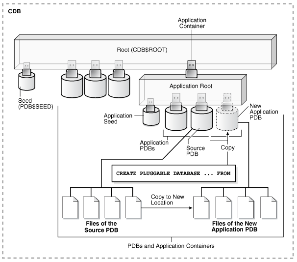
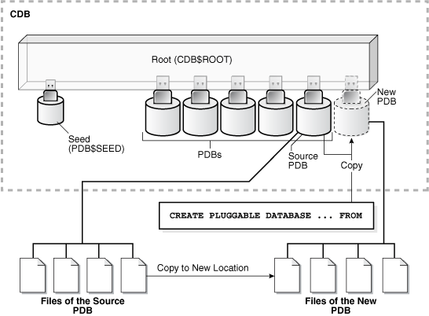
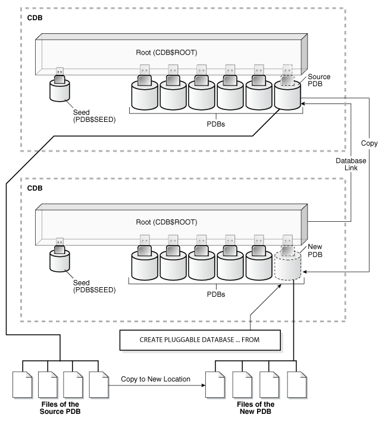

- About Cloning a PDB  
	Cloning means creating a new PDB from a source PDB.
- Cloning a Local PDB  
	You can clone a local PDB by running a `CREATE PLUGGABLE DATABASE` statement and specifying a local PDB in the `FROM` statement.
- Cloning a Remote PDB  
	You can clone a local PDB by running a `CREATE PLUGGABLE DATABASE` statement, and specifying a database link to the remote PDB in the `FROM` statement.
- About Refreshable Clone PDBs  
	The `CREATE PLUGGABLE DATABASE ... REFRESH MODE` statement clones a source PDB and configures the clone to be refreshable. Refreshing the clone PDB updates it with redo accumulated since the last redo log apply.
- Cloning PDBs from PDB Snapshots  
	You can create PDBs from PDB snapshots by executing the `CREATE PLUGGABLE DATABASE … USING SNAPSHOT` statement.
- Creating and Materializing Snapshot Copy PDBs  
	You can clone a PDB from snapshots of the underlying storage. The PDB files are sparse, but you can materialize the files to create a standalone PDB.
- Creating a Split Mirror Clone PDB  
	In Oracle ASM, a split mirror is the process of detaching a point-in-time media copy from a parent copy. After the split, updates to the parent do not affect the child copy.

**Parent topic:** [Creating PDBs and Application Containers](creating-pdbs.md)

### About Cloning a PDB

Cloning means creating a new PDB from a source PDB.

A typical use case is development testing. You can create one or more clones of a PDB and safely test them in isolation. For example, you might test a new or modified application on a cloned PDB before using the application with a production PDB.

- How Cloning Works  
	This technique creates a new PDB from a source PDB. The process automatically plugs the new PDB into the CDB.
- User Interface for PDB Cloning  
	All forms of PDB cloning use the `CREATE PLUGGABLE DATABASE` statement.

See Also:

[Oracle Database Advanced Security Guide](https://docs.oracle.com/pls/topic/lookup?ctx=en/database/oracle/oracle-database/21/multi&id=ASOAG-GUID-67812205-D0C9-4F5F-BA64-DAE282F3B516) to learn about cloning a source with encrypted data or a keystore set

**Parent topic:** Cloning a PDB

#### How Cloning Works

This technique creates a new PDB from a source PDB. The process automatically plugs the new PDB into the CDB.

To use this technique, you must specify the source in a `CREATE PLUGGABLE DATABASE` statement. The source can be a local or remote PDB.

The target PDB is the copy of the source PDB. The copy is called a clone PDB.

The `CREATE PLUGGABLE DATABASE` statement copies the files associated with the source to a new location and associates the files with the target PDB. When the CDB is in `ARCHIVELOG` mode and local undo mode, the source PDB can be open in read/write mode and operational during the cloning process. This technique is known as **hot cloning**.

Note:

If you clone a PDB, and if that PDB has encrypted data or a TDE master encryption key has been set, you must provide the keystore password of the target keystore by including the `KEYSTORE IDENTIFIED BY                     keystore_password` clause in the `CREATE PLUGGABLE                 DATABASE ... FROM` SQL statement. You must provide the target keystore password so that a check can be made to see if additional keys must be imported before the clone can be used. You can determine whether the source PDB has encrypted data or a TDE master encryption key set in the keystore by querying the `V$ENCRYPTION_KEYS` dynamic view.

In all cloning scenarios, when you run the `CREATE PLUGGABLE DATABASE` statement in the application root, the clone PDB is created in the application container. The application name and version of the source PDB must match the application name and version of the application container.

The following graphic illustrates how this technique creates a new application PDB in an application container by cloning a local source application PDB. The source PDB can also be a PDB plugged into the local CDB root, a PDB plugged into a remote CDB root, or an application PDB plugged into a remote application root.

Figure 8-1 Clone a PDB in an Application Container



> This illustration shows a CDB with a `CDB$ROOT` container, a `PDB$SEED` container plugged into the root, several PDBs plugged into the CDB root, and one application container with an application root plugged into the CDB root. In the application container, one application PDB is a new application PDB. The illustration shows the files of the source application PDB. The illustration shows the source application PDB files copied to a new location. The copied files are the files of the new application PDB. The illustration shows the copied files associated with the new application PDB. A `CREATE` `PLUGGABLE` `DATABASE` `...` `FROM` statement uses these copied files to create the new application PDB.


See Also:

" [PDB Storage](overview-of-pdb-creation.md) "

**Parent topic:** About Cloning a PDB

#### User Interface for PDB Cloning

All forms of PDB cloning use the `CREATE PLUGGABLE DATABASE` statement.

Cloning requires specifying the source PDB in a `FROM` clause. The following table summarizes the most important clauses.

Table 8-1 CREATE PLUGGABLE DATABASE Options for PDB Cloning

| Clause | Cloning Operation | See Also |
| --- | --- | --- |
| `USING SNAPSHOT` | Creates a clone from a PDB-level snapshot (`ALTER PLUGGABLE DATABASE SNAPSHOT`). Specify the PDB snapshot name, SCN, or timestamp.  Note: You cannot create a snapshot copy PDB that is based on a PDB snapshot by including both the `USING SNAPSHOT` clause and the `SNAPSHOT COPY` clause. However, you can create a clone based on a PDB snapshot with `USING SNAPSHOT`, and then create a `SNAPSHOT COPY` PDB from the clone. | " [Clones from PDB Snapshots](introduction-to-the-multitenant-architecture.md) " |
| `REFRESH MODE` | Creates a refreshable clone PDB. | " [Refreshable Clone PDBs](introduction-to-the-multitenant-architecture.md) " |
| `SNAPSHOT COPY` | Creates a snapshot copy PDB from a storage-managed snapshot (not `ALTER PLUGGABLE DATABASE SNAPSHOT`). Storage-managed snapshots are only supported on specific file systems.  A snapshot copy PDB does not include a complete copy of the source data files. Rather, Oracle Database creates a storage-level snapshot of the underlying file system, and then creates the clone PDB from the snapshot.  Unlike a standard clone PDB, the snapshot copy PDB is dependent on the storage snapshot. Therefore, you cannot unplug a snapshot copy PDB from the CDB root or plug it in to an application root. Also, you cannot drop the storage snapshot on which the PDB is based. Instead, you must materialize the snapshot copy PDB, which converts it into a full PDB with non-sparse files. | " [Snapshot Copy PDBs](introduction-to-the-multitenant-architecture.md) " |
| `USING MIRROR COPY` | Creates a new PDB by splitting the ASM storage mirror specified by mirror\_name. You can only split one PDB from a prepared mirror copy. If you want to create additional splits, you must prepare a new mirror copy. | " Creating a Split Mirror Clone PDB " |

See Also:

- " Materializing a Snapshot Copy PDB "
- [Oracle Database SQL Language Reference](https://docs.oracle.com/pls/topic/lookup?ctx=en/database/oracle/oracle-database/21/multi&id=GUID-F2DBA8DD-EEA8-4BB7-A07F-78DC04DB1FFC) to learn more about `CREATE PLUGGABLE DATABASE` clauses

**Parent topic:** About Cloning a PDB

### Cloning a Local PDB

You can clone a local PDB by running a `CREATE PLUGGABLE DATABASE` statement and specifying a local PDB in the `FROM` statement.

- About Cloning a Local PDB  
	The simplest form of cloning copies a PDB from a CDB into the same CDB.
- Cloning a Local PDB: Basic Steps  
	You can clone a local PDB by executing `CREATE PLUGGABLE DATABASE` and specify the source PDB in the `FROM` clause.
- After Cloning a Local PDB  
	Certain rules regarding users and tablespaces apply after cloning a local PDB.
- Cloning a Local PDB: Examples  
	The following examples clone a local source PDB named `pdb1` to a target PDB named `pdb2` given different factors.

**Parent topic:** Cloning a PDB

#### About Cloning a Local PDB

The simplest form of cloning copies a PDB from a CDB into the same CDB.

Note:

You cannot use the `FROM` clause in the `CREATE PLUGGABLE DATABASE` statement to create a PDB from the PDB seed (`PDB$SEED`) or from an application seed.

The following figure illustrates how to clone a local PDB.

Figure 8-2 Clone a Local PDB



> This illustration shows a CDB with a `CDB$ROOT` container, a `PDB$SEED` container plugged into the root, and several PDBs plugged into the root. One PDB is a new PDB. The illustration shows the files of the source PDB. The illustration shows the source PDB files copied to a new location. The copied files are the files of the new PDB. The illustration shows the copied files associated with the new PDB. A `CREATE` `PLUGGABLE` `DATABASE` `...` `FROM` statement uses these copied files to create the new PDB.


Before cloning a PDB, address the questions that apply to cloning a PDB in " [Table 6-3](overview-of-pdb-creation.md) ". The table describes which `CREATE PLUGGABLE DATABASE` clauses to specify based on different factors.

Starting in Oracle Database 18c, you can clone a local PDB using DBCA.

See Also:

- " [Determining the Current Container ID or Name](administering-a-cdb-with-sql-plus.md) "
- " [Creating a PDB from Scratch](creating-a-pdb-from-scratch.md) " to learn how to create a PDB from the seed
- " Cloning a Local PDB Using DBCA: Example "
- " [Creating an Application PDB](creating-application-pdb.md) "

**Parent topic:** Cloning a Local PDB

#### Cloning a Local PDB: Basic Steps

You can clone a local PDB by executing `CREATE PLUGGABLE DATABASE` and specify the source PDB in the `FROM` clause.

Prerequisites

You must meet the following prerequisites:

- Complete the prerequisites described in " [General Prerequisites for PDB Creation](overview-of-pdb-creation.md) ".
- The current user must have the `CREATE PLUGGABLE DATABASE` system privilege in both the root and the source PDB.
- The source PDB cannot be closed.
- If the CDB is not in local undo mode, then the source PDB must be in open read-only mode. This requirement does not apply if the CDB is in local undo mode.
- If the CDB is not in `ARCHIVELOG` mode, then the source PDB must be in open read-only mode. This requirement does not apply if the CDB is in `ARCHIVELOG` mode.
- If you are creating an application PDB, then the application PDB must have the same character set and national character set as the application container.
	If the database character set of the CDB is AL32UTF8, then the character set and national character set of the application container can be different from the CDB. However, all application PDBs in an application container must have same character set and national character set, matching that of the application container.

Note:

You can use the `REFRESH MODE` clause to create a refreshable clone of a local PDB, but only if the database link loops back to the same CDB.

To clone a local PDB:

1. In SQL\*Plus, ensure that the current container is the CDB root or an application root.
	When the current container is the CDB root, the PDB is created in the CDB. When the current container is an application root, the application PDB is created in the application container.
2. Run the `CREATE PLUGGABLE DATABASE` statement, and specify the source PDB in the `FROM` clause. Specify other clauses when required.
	After cloning a local PDB, the source and target PDBs are in the same CDB. The new PDB is in mounted mode, and its status is `NEW`. You can view the open mode of a PDB by querying the `OPEN_MODE` column in the `V$PDBS` view. You can view the status of a PDB by querying the `STATUS` column of the `CDB_PDBS` or `DBA_PDBS` view.
	A new default service is created for the PDB. The service has the same name as the PDB and can be used to access the PDB. Oracle Net Services must be configured properly for clients to access this service.
3. Open the new PDB in read/write mode.
	You must open the new PDB in read/write mode for Oracle Database to complete the integration of the new PDB into the CDB. An error is returned if you attempt to open the PDB in read-only mode. After the PDB is opened in read/write mode, its status is `NORMAL`.
4. Back up the new PDB.
	A PDB cannot be recovered unless it is backed up.

Note:

If an error is returned during PDB creation, then the PDB being created might be in an `UNUSABLE` state. You can check the PDB state by querying the `CDB_PDBS` or `DBA_PDBS` view. You can learn more about PDB creation errors by checking the alert log. An unusable PDB can only be dropped, and it must be dropped before you can create a PDB with the same name as the unusable PDB.

See Also:

- " [About the Current Container](administering-a-cdb-with-sql-plus.md) " and " [About Container Access in a CDB](administering-a-cdb-with-sql-plus.md) "
- " [About the CDB Undo Mode](administering-a-cdb-with-sql-plus.md) "
- " [Modifying the Open Mode of PDBs](administering-pdbs-with-sql-plus.md) "
- [Oracle Database Backup and Recovery User’s Guide](https://docs.oracle.com/pls/topic/lookup?ctx=en/database/oracle/oracle-database/21/multi&id=BRADV-GUID-655DC5F5-FF8D-4A73-B67D-F5AAE20CA382) to learn how to back up a PDB

**Parent topic:** Cloning a Local PDB

#### After Cloning a Local PDB

Certain rules regarding users and tablespaces apply after cloning a local PDB.

Users in the new PDB who used the default temporary tablespace of the source PDB use the default temporary tablespace of the new PDB. Users who used nondefault temporary tablespaces in the PDB continue to use the same local temporary tablespaces in the cloned PDB.

See Also:

" [About Managing Tablespaces in a CDB](administering-a-cdb-with-sql-plus.md) "

**Parent topic:** Cloning a Local PDB

#### Cloning a Local PDB: Examples

The following examples clone a local source PDB named `pdb1` to a target PDB named `pdb2` given different factors.

In each example, the root to which the new PDB belongs depends on the current container when the `CREATE PLUGGABLE DATABASE` statement is run:

- When the current container is the CDB root, the database creates the PDB in the CDB root.
- When the current container is an application root in an application container, the database creates an application PDB in the application root.

- Cloning a Local PDB Using No Clauses: Example  
	This example shows the simplest way to clone a PDB.
- Cloning a Local PDB Using DBCA: Example  
	This example clones a PDB using the silent mode of DBCA. Hot cloning is supported.
- Cloning a Local PDB with the PATH\_PREFIX Clause: Example  
	This example explains how to clone a local PDB with the `PATH_PREFIX`, `FILE_NAME_CONVERT`, and `SERVICE_NAME_CONVERT` clauses.
- Cloning a Local PDB Using the STORAGE Clause: Example  
	This example clones a local PDB using the `FILE_NAME_CONVERT`, `STORAGE`, and `SERVICE_NAME_CONVERT` clauses.
- Cloning a Local PDB with the NO DATA Clause: Example  
	This example clones the data model definition of the PDB, but does not clone the data in the PDB.

**Parent topic:** Cloning a Local PDB

##### Cloning a Local PDB Using No Clauses: Example

This example shows the simplest way to clone a PDB.

This example assumes the following factors:

- The `PATH_PREFIX` clause is not required.
- The `FILE_NAME_CONVERT` clause and the `CREATE_FILE_DEST` clause are not required.
	Either Oracle Managed Files is enabled, or the `PDB_FILE_NAME_CONVERT` initialization parameter is set. Therefore, the `FILE_NAME_CONVERT` clause is not required. The files will be copied to a new location based on the Oracle Managed Files configuration or the initialization parameter setting.
- Storage limits are not required for the PDB. Therefore, the `STORAGE` clause is not required.
- There is no file with the same name as the new temp file that will be created in the target location. Therefore, the `TEMPFILE REUSE` clause is not required.

The following statement clones the `pdb2` PDB from the `pdb1` PDB:

```
CREATE PLUGGABLE DATABASE pdb2 FROM pdb1;
```

See Also:

- [Oracle Database Administrator’s Guide](https://docs.oracle.com/pls/topic/lookup?ctx=en/database/oracle/oracle-database/21/multi&id=ADMIN-GUID-4A3C4616-0D81-4BBA-8EAD-FCAA8AD5C15A) for more information about Oracle Managed Files
- [Oracle Database Reference](https://docs.oracle.com/pls/topic/lookup?ctx=en/database/oracle/oracle-database/21/multi&id=REFRN10322) for information about the `PDB_FILE_NAME_CONVERT` initialization parameter

**Parent topic:** Cloning a Local PDB: Examples

##### Cloning a Local PDB Using DBCA: Example

This example clones a PDB using the silent mode of DBCA. Hot cloning is supported.

This example assumes the following factors:

- The source CDB is a single-instance database with the SID `orcl`.
- The source PDB is `pdb1`. You intend for `pdb1` to remain open during the cloning operation, which means that local undo and `ARCHIVELOG` mode are enabled in the CDB. Otherwise, DBCA closes the PDB during the clone operation, and after receiving confirmation, opens the source PDB in read-only mode.
- The new PDB is `pdb2`.
- You are running DBCA in noninteractive mode.

The following command clones the `pdb2` PDB from the `pdb1` PDB:

```
./dbca -silent 
  -createpluggabledatabase 
  -sourcedb orcl 
  -createpdbfrom PDB 
  -pdbName pdb2 
  -sourcepdb pdb1
```

See Also:

[Oracle Database Administrator’s Guide](https://docs.oracle.com/pls/topic/lookup?ctx=en/database/oracle/oracle-database/21/multi&id=ADMIN-GUID-5DD346B8-4404-48F1-A811-F39D739E4D05) for the DBCA command reference

**Parent topic:** Cloning a Local PDB: Examples

##### Cloning a Local PDB with the PATH\_PREFIX Clause: Example

This example explains how to clone a local PDB with the `PATH_PREFIX`, `FILE_NAME_CONVERT`, and `SERVICE_NAME_CONVERT` clauses.

This example assumes the following factors:

- The path prefix must be added to the PDB's directory object paths. Therefore, the `PATH_PREFIX` clause is required. In this example, the path prefix /disk2/oracle/pdb2/ is added to the PDB’s directory object paths.
- The `FILE_NAME_CONVERT` clause is required to specify the target locations of the copied files. In this example, the files are copied from `/disk1/oracle/pdb1` to `/disk2/oracle/pdb2`.
	The `CREATE_FILE_DEST` clause is not used, and neither Oracle Managed Files nor the `PDB_FILE_NAME_CONVERT` initialization parameter is used to specify the target locations of the copied files.
	To view the location of the data files for a PDB, run the query in " [Example 15-34](administering-a-cdb-with-sql-plus.md) ".
- Storage limits are not required for the PDB. Therefore, the `STORAGE` clause is not required.
- There is no file with the same name as the new temp file that will be created in the target location. Therefore, the `TEMPFILE REUSE` clause is not required.
- The PDB that is being cloned (`pdb1`) has two user-defined services: `salesrep_ca` and `orders_ca` for the sales representatives and order entry personnel in California. The new services will be for the sales representatives and order entry personnel in Oregon, and the service names will be renamed to `salesrep_or` and `orders_or`, respectively, in the cloned PDB (`pdb2`).
- Future tablespaces created within the PDB will be created with the `NOLOGGING` attribute by default. This feature is available starting with Oracle Database 12c Release 1 (12.1.0.2).

The following statement clones the `pdb2` PDB from the `pdb1` PDB:

```
CREATE PLUGGABLE DATABASE pdb2 FROM pdb1 
  PATH_PREFIX = '/disk2/oracle/pdb2/'
  FILE_NAME_CONVERT = ('/disk1/oracle/pdb1/', '/disk2/oracle/pdb2/')
  SERVICE_NAME_CONVERT = ('salesrep_ca','salesrep_or','orders_ca','orders_or')
  NOLOGGING;
```

**Parent topic:** Cloning a Local PDB: Examples

##### Cloning a Local PDB Using the STORAGE Clause: Example

This example clones a local PDB using the `FILE_NAME_CONVERT`, `STORAGE`, and `SERVICE_NAME_CONVERT` clauses.

This example assumes the following factors:

- The `PATH_PREFIX` clause is not required.
- The `FILE_NAME_CONVERT` clause is required to specify the target locations of the copied files. In this example, the files are copied from /disk1/oracle/pdb1 to /disk2/oracle/pdb2.
	The `CREATE_FILE_DEST` clause is not used, and neither Oracle Managed Files nor the `PDB_FILE_NAME_CONVERT` initialization parameter is used to specify the target locations of the copied files.
	To view the location of the data files for a PDB, run the query in [Example 15-34](administering-a-cdb-with-sql-plus.md).
- Storage limits must be enforced for the PDB. Therefore, the `STORAGE` clause is required. Specifically, all tablespaces that belong to the PDB must not exceed 2 gigabytes.
- The source PDB (`pdb1`) has two user-defined services: `salesrep_ca` and `orders_ca` for the sales representatives and order entry personnel in California. The new services will be for the sales representatives and order entry personnel in Oregon, and the service names will be renamed to `salesrep_or` and `orders_or`, respectively, in the cloned PDB (`pdb2`).
- There is no file with the same name as the new temp file that will be created in the target location. Therefore, the `TEMPFILE REUSE` clause is not required.

The following statement clones the `pdb2` PDB from the `pdb1` PDB:

```
CREATE PLUGGABLE DATABASE pdb2 FROM pdb1 
  FILE_NAME_CONVERT = ('/disk1/oracle/pdb1/', '/disk2/oracle/pdb2/')
  STORAGE (MAXSIZE 2G)
  SERVICE_NAME_CONVERT = ('salesrep_ca','salesrep_or','orders_ca','orders_or');
```

**Parent topic:** Cloning a Local PDB: Examples

##### Cloning a Local PDB with the NO DATA Clause: Example

This example clones the data model definition of the PDB, but does not clone the data in the PDB.

This example assumes the following factors:

- The `NO DATA` clause is required because the goal is to clone the data model definition of the source PDB without cloning its data.
- The `PATH_PREFIX` clause is not required.
- The `FILE_NAME_CONVERT` clause and the `CREATE_FILE_DEST` clause are not required.
	Either Oracle Managed Files is enabled, or the `PDB_FILE_NAME_CONVERT` initialization parameter is set. Therefore, the `FILE_NAME_CONVERT` clause is not required. The process copies the files to a new location based on the Oracle Managed Files configuration or the initialization parameter setting.
- Storage limits are not required for the PDB. Therefore, the `STORAGE` clause is not required.
- There is no file with the same name as the new temp file that will be created in the target location. Therefore, the `TEMPFILE REUSE` clause is not required.

Assume that the source PDB `pdb1` has a large amount of data. The following steps illustrate how the clone does not contain the data of the source PDB when the operation is complete:

1. With the source PDB `pdb1` as the current container, query a table with a large amount of data:
	```
	SELECT COUNT(*) FROM tpch.lineitem;
	  COUNT(*)
	----------
	  60001215
	```
	The table has over sixty million rows.
2. Clone the source PDB with the `NO DATA` clause:
	```
	CREATE PLUGGABLE DATABASE pdb2 FROM pdb1 NO DATA;
	```
3. Open the cloned PDB:
	```
	ALTER PLUGGABLE DATABASE pdb2 OPEN;
	```
4. With the cloned PDB `pdb2` as the current container, query the table that has a large amount of data in the source PDB:
	```
	SELECT COUNT(*) FROM tpch.lineitem;
	  COUNT(*)
	----------
	         0
	```
	The table in the cloned PDB has no rows.

**Parent topic:** Cloning a Local PDB: Examples

### Cloning a Remote PDB

You can clone a local PDB by running a `CREATE PLUGGABLE DATABASE` statement, and specifying a database link to the remote PDB in the `FROM` statement.

- About Cloning a Remote PDB  
	When the source is a PDB is in a remote CDB, you must use a database link to clone the PDB into the local CDB.
- Cloning a Remote PDB: Basic Steps  
	You can create a PDB by cloning a remote PDB. After the cloning operation, the source and the target PDB are in different locations.
- After Cloning a Remote PDB  
	Certain rules regarding users and tablespaces apply after cloning a remote PDB.
- Cloning a Remote PDB: Examples  
	These examples clone a remote PDB given different factors.

**Parent topic:** Cloning a PDB

#### About Cloning a Remote PDB

When the source is a PDB is in a remote CDB, you must use a database link to clone the PDB into the local CDB.

The database link must exist in the local CDB (not the remote CDB). When you issue the `CREATE PLUGGABLE DATABASE` statement from the root of the local CDB, you must specify a database link to the remote CDB that contains the PDB being cloned in the `FROM` clause. The database link connects from the local CDB to either to the root of the remote CDB or to the remote source PDB.

The following figure illustrates how this technique creates a new PDB when the source PDB is remote.

Figure 8-3 Creating a PDB by Cloning a Remote PDB



> This illustration shows two CDBs. Both CDBs have a `CDB$ROOT` container, a `PDB$SEED` container plugged into the root, and several PDBs plugged into the root. The bottom CDB has one new PDB. The illustration shows a database link going from the bottom CDB to the source PDBs in the top CDB. The illustration shows the files of the source PDB. The illustration shows the source PDB files copied to a new location. The copied files are the files of the new PDB. The illustration shows the copied files associated with the new PDB. A `CREATE` `PLUGGABLE` `DATABASE` `...` `FROM` statement uses these copied files to create the new PDB.


Starting in Oracle Database 19c, you can clone a remote PDB using DBCA in silent mode.

**Parent topic:** Cloning a Remote PDB

#### Cloning a Remote PDB: Basic Steps

You can create a PDB by cloning a remote PDB. After the cloning operation, the source and the target PDB are in different locations.

General Prerequisites

The following prerequisites must be met:

- Complete the prerequisites described in " [General Prerequisites for PDB Creation](overview-of-pdb-creation.md) ".
- The current user must have the `CREATE PLUGGABLE DATABASE` system privilege in the root of the CDB that will contain the target PDB.
- The source and target platforms must meet the following requirements:
	- They must have the same endianness.
		- The database options installed on the source platform must be the same as, or a subset of, the database options installed on the target platform.
- If you are creating an application PDB, then the application name and version of the source PDB must match the application name and version of the target application container.

Prerequisites for Character Sets

- If the character set of the CDB to which the PDB is being cloned is not AL32UTF8, then the source and target must have compatible character sets and national character sets. If the character set of the CDB to which the PDB is being cloned is AL32UTF8, then this requirement does not apply.
- If you are creating an application PDB, then the application PDB must have the same character set and national character set as the application container.
	If the database character set of the CDB is AL32UTF8, then the character set and national character set of the application container can different from the CDB. However, all application PDBs in an application container must have same character set and national character set, matching that of the application container.

Note:

Oracle Multitenant does not support a LOB in one container from being accessed by a container with a different character set using data links, extended data links, or the `CONTAINERS()` clause. For example, if the CDB root and `salespdb` have different character sets, then a `CONTAINERS()` query run in the CDB root should not access LOBs stored in `salespdb`.

Prerequisites for the Open Mode of the Source PDB

- The source PDB must not be closed.
- If the remote CDB is not in local undo mode, then the source PDB must be open in read-only mode.
	See " [About the CDB Undo Mode](administering-a-cdb-with-sql-plus.md) ".
- If the remote CDB is not in `ARCHIVELOG` mode, then the source PDB must be open in read-only mode.
- If you are creating a refreshable PDB, then the source PDB must be in `ARCHIVELOG` mode and local undo mode.

Prerequisites for the Database Link

The following prerequisites must be met:

- A database link must enable a connection from the destination CDB (the CDB to which the PDB is being cloned) to the PDB in the source CDB.
- The database link can connect as a common user to the root of the source CDB, or as a common or local user to the source PDB. The source PDB can be either a standard PDB or application PDB.
- The user account specified in the database link must have either of the following privileges:
	- The `CREATE PLUGGABLE DATABASE` privilege, granted either commonly or locally, on the source PDB
		- The `SYSOPER` privilege
- In an Oracle Data Guard environment, if you are performing a remote clone of a PDB into a primary CDB, then on the standby CDB set the `STANDBY_PDB_SOURCE_FILE_DBLINK` initialization parameter. This parameter specifies the name of the database link used in `CREATE PLUGGABLE DATABASE ... FROM dblink`. The standby CDB attempts to copy the data files from the source PDB referenced in the database link, but only if the source PDB is open in read-only mode. Otherwise, you must copy data files to the Oracle Managed Files location on the standby CDB.

To clone a remote PDB:

1. In SQL\*Plus, ensure that the current container is the root of the target CDB or the application root of the target application container.
2. Run the `CREATE PLUGGABLE DATABASE` statement, and specify the source PDB in the `FROM` clause. Specify other clauses when required.
	After you create the PDB, it is in mounted mode, and its status is `NEW`. You can view the open mode of a PDB by querying the `OPEN_MODE` column in the `V$PDBS` view. You can view the status of a PDB by querying the `STATUS` column of the `CDB_PDBS` or `DBA_PDBS` view.
	A new default service is created for the PDB. The service has the same name as the PDB and can be used to access the PDB. Oracle Net Services must be configured properly for clients to access this service.
	Note:
	If an error is returned during PDB creation, then the PDB being created might be in an `UNUSABLE` state. You can check the PDB state by querying the `CDB_PDBS` or `DBA_PDBS` view, and you can learn more about PDB creation errors by checking the alert log. An unusable PDB can only be dropped, and it must be dropped before a PDB with the same name as the unusable PDB can be created.
3. Open the new PDB in read/write mode.
	You must open the new PDB in read/write mode for Oracle Database to complete the integration of the new PDB into the CDB. An error is returned if you attempt to open the PDB in read-only mode. After the PDB is opened in read/write mode, its status is `NORMAL`.
4. Back up the PDB.
	A PDB cannot be recovered unless it is backed up.

See Also:

- " [Refreshing a PDB](administering-pdbs-with-sql-plus.md) "
- " [Modifying the Open Mode of PDBs](administering-pdbs-with-sql-plus.md) "
- [Oracle Database Backup and Recovery User’s Guide](https://docs.oracle.com/pls/topic/lookup?ctx=en/database/oracle/oracle-database/21/multi&id=BRADV-GUID-655DC5F5-FF8D-4A73-B67D-F5AAE20CA382) for information about backing up a PDB
- [Oracle Data Guard Concepts and Administration](https://docs.oracle.com/pls/topic/lookup?ctx=en/database/oracle/oracle-database/21/multi&id=SBYDB-GUID-20D2DEAC-0355-4FBB-ADB8-37BF5F4328E2) to learn more about plugging in a PDB in an Oracle Data Guard environment
- [Oracle Database Globalization Support Guide](https://docs.oracle.com/pls/topic/lookup?ctx=en/database/oracle/oracle-database/21/multi&id=NLSPG1035) to learn about the requirements for the compatibility of character sets
- [Oracle Database Reference](https://docs.oracle.com/pls/topic/lookup?ctx=en/database/oracle/oracle-database/21/multi&id=REFRN10322) for information about the `PDB_FILE_NAME_CONVERT` initialization parameter

**Parent topic:** Cloning a Remote PDB

#### After Cloning a Remote PDB

Certain rules regarding users and tablespaces apply after cloning a remote PDB.

The following applies after cloning a remote PDB:

- Users in the new PDB who used the default temporary tablespace of the source PDB use the default temporary tablespace of the new PDB. Users who used nondefault temporary tablespaces in the PDB continue to use the same local temporary tablespaces in the cloned PDB.
- User-created common user accounts that existed in the source CDB but not in the target CDB do not have privileges granted commonly. However, if the target CDB has a common user account with the same name as a common user account in the PDB, then the latter is linked to the former and has the privileges granted to this common user account in the target CDB.
	If the cloned or plugged-in PDB has a common user account that does not exist in the target CDB, and if this user does not own objects in the PDB, then Oracle Database drops the user during the synchronization step; otherwise, the user account is locked in the target PDB. You have the following options regarding locked accounts:
	- Close the PDB, connect to the root, and create a common user account with the same name. When the PDB is opened in read/write mode, differences in roles and privileges granted commonly to the user account are resolved, and you can unlock the account. Privileges and roles granted locally to the user account remain unchanged during this process.
		- Create a new local user account in the PDB and use Data Pump to export/import the locked user's data into the new local user's schema.
		- Leave the user account locked.
		- Drop the user account.

See Also:

- " [About Managing Tablespaces in a CDB](administering-a-cdb-with-sql-plus.md) "
- [Oracle Database Security Guide](https://docs.oracle.com/pls/topic/lookup?ctx=en/database/oracle/oracle-database/21/multi&id=DBSEG832) for information about creating a local user
- [Oracle Database Utilities](https://docs.oracle.com/pls/topic/lookup?ctx=en/database/oracle/oracle-database/21/multi&id=SUTIL4334) for information about using Oracle Data Pump with a CDB

**Parent topic:** Cloning a Remote PDB

#### Cloning a Remote PDB: Examples

These examples clone a remote PDB given different factors.

In each example, the root to which the new PDB belongs depends on the current container when the `CREATE PLUGGABLE DATABASE` statement is run:

- When the current container is the CDB root, the new PDB is created in the CDB root.
- When the current container is an application root in an application container, the new PDB is created as an application PDB in the application root.

- Cloning a Remote PDB Using No Clauses: Example  
	This example clones a remote source PDB named `pdb1` to a target PDB named `pdb2` given different factors.
- Cloning a Remote PDB Using DBCA: Example  
	This example uses DBCA to clone a PDB named `pdb1` from a remote CDB to the local CDB, where it will be renamed `clonepdb1`.

**Parent topic:** Cloning a Remote PDB

##### Cloning a Remote PDB Using No Clauses: Example

This example clones a remote source PDB named `pdb1` to a target PDB named `pdb2` given different factors.

This example assumes the following factors:

- The database link name to the remote PDB is `pdb1_link`.
- The `PATH_PREFIX` clause is not required.
- The `FILE_NAME_CONVERT` clause and the `CREATE_FILE_DEST` clause are not required.
	Either Oracle Managed Files is enabled, or the `PDB_FILE_NAME_CONVERT` initialization parameter is set. The files will be copied to a new location based on the Oracle Managed Files configuration or the initialization parameter setting.
- Storage limits are not required for the PDB. Therefore, the `STORAGE` clause is not required.
- There is no file with the same name as the new temp file that will be created in the target location. Therefore, the `TEMPFILE REUSE` clause is not required.

The following statement clones the `pdb2` PDB from the `pdb1` remote PDB:

```
CREATE PLUGGABLE DATABASE pdb2 FROM pdb1@pdb1_link;
```

See Also:

- [Oracle Database Administrator’s Guide](https://docs.oracle.com/pls/topic/lookup?ctx=en/database/oracle/oracle-database/21/multi&id=ADMIN-GUID-4A3C4616-0D81-4BBA-8EAD-FCAA8AD5C15A) for more information about Oracle Managed Files
- [Oracle Database Reference](https://docs.oracle.com/pls/topic/lookup?ctx=en/database/oracle/oracle-database/21/multi&id=REFRN10322) for information about the `PDB_FILE_NAME_CONVERT` initialization parameter

**Parent topic:** Cloning a Remote PDB: Examples

##### Cloning a Remote PDB Using DBCA: Example

This example uses DBCA to clone a PDB named `pdb1` from a remote CDB to the local CDB, where it will be renamed `clonepdb1`.

Prerequisites

This scenario assumes the following:

- The user in the local database has the `CREATE PLUGGABLE DATABASE` privilege in the root container.
- The remote CDB is in local undo mode.
- The remote and local CDBs are in `ARCHIVELOG` mode.
- The common user in the remote CDB to whom the database link connects has the `CREATE PLUGGABLE DATABASE`, `SESSION`, and `SYSOPER` privilege.
- The local and remote CDBs have the same options installed.

Assumptions

This scenario assumes the following:

- You are running DBCA on the host of the CDB that will contain the cloned PDB. The local CDB is named `loccdb1`.
- The remote (source) CDB is named `remcdb1` and resides on host `remcdb1host`. The instance name for the remote CDB is `reminst`.
- The remote PDB, which is the PDB to be cloned, is named `rempdb1`.
- The common user `c##adminuser_remcdb1` resides in `remcdb1`.
- The administrative user `locSYS` has `SYSDBA` privileges on `loccdb1`, which is the CDB to which the PDB is being cloned.
- The administrative user `remSYS` has `SYSDBA` privileges on `remcdb1`, which is the CDB that contains the PDB to be cloned.
- After cloning to `loccdb1`, the PDB will be renamed `clonepdb1`.

This following silent command clones `rempdb1` to `loccdb1`:

```
./dbca -silent 
  -createPluggableDatabase
  -createFromRemotePDB
  -sourceDB remcdb1  
  -remotePDBName rempdb1 
  -remoteDBConnString remcdb1host:1521/reminst 
  -remoteDBSYSDBAUserName remSYS 
      -remoteDBSYSDBAUserPassword remsyspwd 
  -dbLinkUsername c##adminuser_remcdb1 
      -dbLinkUserPassword pwd4dblinkusr 
  -sysDBAUserName locSYS 
      -sysDBAPassword locsyspwd
  -pdbName clonepdb1
```

See Also:

[Oracle Database Administrator’s Guide](https://docs.oracle.com/pls/topic/lookup?ctx=en/database/oracle/oracle-database/21/multi&id=GUID-5DD346B8-4404-48F1-A811-F39D739E4D05) for syntax and semantics of DBCA commands

**Parent topic:** Cloning a Remote PDB: Examples

### About Refreshable Clone PDBs

The `CREATE PLUGGABLE DATABASE ... REFRESH MODE` statement clones a source PDB and configures the clone to be refreshable. Refreshing the clone PDB updates it with redo accumulated since the last redo log apply.

- Purpose of Refreshable Clone PDBs  
	The cloning operation for production PDBs can take significant time.
- Automatic and Manual Refresh Modes  
	You can configure the clone PDB to refresh automatically at set intervals, or you can refresh it manually with the `ALTER PLUGGABLE DATABASE REFRESH` statement.
- Requirements for Refreshable Clone PDBs  
	Creation of a refreshable clone PDB requires a database link. The database link can point to the same CDB or a different CDB.
- Creating a Refreshable Clone PDB: Scenario  
	This scenario creates a refreshable clone named `pdb1_ref_cln` from a remote PDB named `pdb1`.

**Parent topic:** Cloning a PDB

#### Purpose of Refreshable Clone PDBs

The cloning operation for production PDBs can take significant time.

If PDBs are cloned infrequently to avoid a drag on the system, then the cloned data becomes stale. A refreshable clone PDB solves this problem. When a refreshable clone PDB is stale, you can close it and then refresh it with recent redo. When not being refreshed, a refreshable clone PDB can be open read-only. A typical practice is to maintain a “golden master” refreshable clone of a production PDB, take PDB-level snapshots, and then create clones from the PDB snapshots for development and testing.

You can reverse the roles for source and clone PDBs using an `ALTER PLUGGABLE DATABASE ... SWITCHOVER` statement. This capability is useful in the following situations:

- Planned switchover
	The CDB hosting the source PDB may experience significantly more overhead than the CDB hosting the clone PDB. To achieve load balancing, you can reverse the roles, making the clone the new source PDB, and the source PDB the new clone.
- Unplanned switchover
	The source PDB may suffer an unplanned failure. In this case, you can make the clone PDB the new source PDB, and resume normal operations.

See Also:

- " [Managing Refreshable Clone PDBs](administering-pdbs-with-sql-plus.md) "
- [Oracle Database SQL Language Reference](https://docs.oracle.com/pls/topic/lookup?ctx=en/database/oracle/oracle-database/21/multi&id=SQLRF-GUID-A29491AD-8F0F-4E52-9D94-57FC3FF8FBC7) to learn more about `ALTER PLUGGABLE DATABASE ... SWITCHOVER`

**Parent topic:** About Refreshable Clone PDBs

#### Automatic and Manual Refresh Modes

You can configure the clone PDB to refresh automatically at set intervals, or you can refresh it manually with the `ALTER PLUGGABLE DATABASE REFRESH` statement.

The `REFRESH MODE` clause is supported only in a `CREATE PLUGGABLE DATABASE ... FROM` statement. You can use this clause to specify one of the following options:

- Specify `REFRESH MODE NONE`, the default, to create a PDB that is not refreshable.
	You can change a refreshable clone PDB into an ordinary PDB by including the `REFRESH MODE NONE` clause in an `ALTER PLUGGABLE DATABASE` statement and then opening the PDB in read/write mode. You cannot change an ordinary PDB into a refreshable clone PDB. After a refreshable clone PDB is converted to an ordinary PDB, you cannot change it back into a refreshable clone PDB.
- Specify `REFRESH MODE MANUAL` to create a refreshable PDB that must be refreshed manually.
- Specify `REFRESH MODE EVERY number_of_minutes MINUTES` to create a refreshable PDB that is refreshed automatically after the specified number of minutes has passed. A refreshable PDB that uses automatic refresh can also be refreshed manually.

Note:

- When you create a refreshable PDB, you can set the `REMOTE_RECOVERY_FILE_DEST` initialization parameter in the PDB. This initialization parameter specifies a directory from which to read archive log files during refresh operations if the source PDB is not available over its database link.
- If new data files are created in the source PDB, then the `PDB_FILE_NAME_CONVERT` initialization parameter must be set in the CDB to convert the data file paths from the source PDB to the clone PDB.
- A change to a tablespace encryption algorithm (for example, from AES128 to AES256) is not applied to a refreshable PDB after the algorithm has been changed in the source PDB. After you create the refreshable PDB, you must update its tablespace encryption algorithm manually.

Example 8-1 A REFRESH MODE Clause That Specifies Automatic Refresh

This refresh mode clause specifies that a refreshable PDB is refreshed automatically every two hours (120 minutes):

```
REFRESH MODE EVERY 120 MINUTES
```

See Also:

- " Cloning a Remote PDB: Basic Steps "
- " [Refreshing a PDB](administering-pdbs-with-sql-plus.md) "

**Parent topic:** About Refreshable Clone PDBs

#### Requirements for Refreshable Clone PDBs

Creation of a refreshable clone PDB requires a database link. The database link can point to the same CDB or a different CDB.

A refreshable clone PDB must be in either of the following states:

- Closed
	A refreshable PDB must be closed when a refresh is performed. If it is not closed when automatic refresh is attempted, then the refresh is deferred until the next scheduled refresh. If it is not closed when a user attempts to perform manual refresh, then an error is reported.
- Open in read-only mode
	The refreshable PDB must be kept in read-only mode to prevent out-of-sync changes on the refreshable PDB which do not occur on the source PDB. The refreshable PDB is intended to serve as a clone master and as such must accurately reflect the source PDB at the refreshed point in time.

**Parent topic:** About Refreshable Clone PDBs

#### Creating a Refreshable Clone PDB: Scenario

This scenario creates a refreshable clone named `pdb1_ref_cln` from a remote PDB named `pdb1`.

The clone PDB is a copy of the source PDB. You can refresh the clone PDB periodically to update it with any changes made to the source PDB.

Assumptions

This scenario assumes the following factors:

- The database link name to the remote PDB is `pdb1_link`.
- The `PATH_PREFIX` clause is not required.
- The `FILE_NAME_CONVERT` clause and the `CREATE_FILE_DEST` clause are not required.
	Either Oracle Managed Files is enabled, or the `PDB_FILE_NAME_CONVERT` initialization parameter is set. The files will be copied to a new location based on the Oracle Managed Files configuration or the initialization parameter setting.
- Storage limits are not required for the PDB. Therefore, the `STORAGE` clause is not required.
- There is no file with the same name as the new temp file that will be created in the target location. Therefore, the `TEMPFILE REUSE` clause is not required.
- The refreshable clone will be refreshed automatically every 60 minutes.

Note:

To create a refreshable PDB, the source PDB must be in `ARCHIVELOG` mode and local undo mode.

To create a refreshable clone PDB:

1. In SQL\*Plus, ensure that the current container is the CDB root or an application root.
	When the current container is the CDB root, the PDB is created in the CDB. When the current container is an application root, the application PDB is created in the application container.
2. Execute the `CREATE PLUGGABLE DATABASE` statement.
	The following statement creates `pdb1_ref_cln` from `pdb1`:
	```
	CREATE PLUGGABLE DATABASE pdb1_ref_cln FROM pdb1@pdb1_link REFRESH MODE EVERY 60 MINUTES;
	```

See Also:

" [Managing Refreshable Clone PDBs](administering-pdbs-with-sql-plus.md) "

**Parent topic:** About Refreshable Clone PDBs

### Cloning PDBs from PDB Snapshots

You can create PDBs from PDB snapshots by executing the `CREATE PLUGGABLE DATABASE … USING SNAPSHOT` statement.

- About Cloning PDBs from PDB Snapshots  
	A **PDB snapshot** is a point-in-time copy of a PDB. The source PDB can be open read-only or read/write while the snapshot is created. A clone from a PDB snapshot is a full, standalone PDB.
- Cloning a PDB from a PDB Snapshot: Scenario  
	This scenario creates a new PDB from a PDB snapshot by executing `CREATE PLUGGABLE DATABASE ... USING SNAPSHOT`.

**Parent topic:** Cloning a PDB

#### About Cloning PDBs from PDB Snapshots

A **PDB snapshot** is a point-in-time copy of a PDB. The source PDB can be open read-only or read/write while the snapshot is created. A clone from a PDB snapshot is a full, standalone PDB.

- PDB Snapshot Carousel  
	A PDB snapshot carousel is a library of up to 8 snapshots.
- Creation of a PDB with the USING SNAPSHOT Clause  
	The `USING SNAPSHOT` clause of the `CREATE PLUGGABLE DATABASE` statement creates an active PDB from a read-only PDB snapshot.

**Parent topic:** Cloning PDBs from PDB Snapshots

##### PDB Snapshot Carousel

A PDB snapshot carousel is a library of up to 8 snapshots.

The carousel enables you to clone a PDB to a specific SCN or point in time. A typical use case is to restore a PDB snapshot from the carousel, typically the most recent snapshot, and then recover it to the required SCN or timestamp.

See Also:

" [Administering a PDB Snapshot Carousel](administering-pdb-snapshots.md) "

**Parent topic:** About Cloning PDBs from PDB Snapshots

##### Creation of a PDB with the USING SNAPSHOT Clause

The `USING SNAPSHOT` clause of the `CREATE PLUGGABLE DATABASE` statement creates an active PDB from a read-only PDB snapshot.

To view the available PDB snapshots, query the `DBA_PDB_SNAPSHOTS` data dictionary view. To clone a PDB from a snapshot, specify one of the following values in the `USING SNAPSHOT` clause:

- The unique name of the PDB snapshot
- The PDB snapshot SCN in the following form:
	```
	USING SNAPSHOT AT SCN scn
	```
- The PDB snapshot timestamp in the following form:
	```
	USING SNAPSHOT AT TIME timestamp
	```

A clone from a PDB snapshot is a full, standalone PDB. Unlike a snapshot copy PDB, which is based on a storage-managed snapshot, you do not need to materialize a snapshot clone PDB.

See Also:

[Oracle Database SQL Language Reference](https://docs.oracle.com/pls/topic/lookup?ctx=en/database/oracle/oracle-database/21/multi&id=SQLRF55694) for the syntax and semantics of the `USING SNAPSHOT` clause

**Parent topic:** About Cloning PDBs from PDB Snapshots

#### Cloning a PDB from a PDB Snapshot: Scenario

This scenario creates a new PDB from a PDB snapshot by executing `CREATE PLUGGABLE DATABASE ... USING SNAPSHOT`.

Assumptions

This example assumes the following factors:

- A PDB snapshot carousel exists with 8 daily snapshots of source PDB `salespdb`, named after the weekday, day of the month, and time when they were created: `pdb1_mon_2_1201`, `pdb1_tue_3_1201`, `pdb1_wed_4_1201`, and so on.
- All snapshots were created when the source `salespdb` was in read/write mode.
- The new PDB will be a clone of a snapshot named `pdb1_wed_4_1201`, which is a snapshot of `pdb1` taken last Wednesday on the 4th of the month at 12:01 a.m.
- The `PATH_PREFIX` clause is not required.
- The `FILE_NAME_CONVERT` clause and the `CREATE_FILE_DEST` clause are not required.
	Either Oracle Managed Files is enabled, or the `PDB_FILE_NAME_CONVERT` initialization parameter is set. Therefore, the `FILE_NAME_CONVERT` clause is not required. The files will be copied to a new location based on the Oracle Managed Files configuration or the initialization parameter setting.
- Storage limits are not required for the PDB. Therefore, the `STORAGE` clause is not required.
- There is no file with the same name as the new temp file that will be created in the target location. Therefore, the `TEMPFILE REUSE` clause is not required.

To clone a PDB from a PDB snapshot:

1. In SQL\*Plus, ensure that the current container is the CDB root or an application root.
	When the current container is the CDB root, the PDB is created in the CDB. When the current container is an application root, the application PDB is created in the application container.
2. Execute the `CREATE PLUGGABLE DATABASE ... USING SNAPSHOT` statement.
	The following statement clones the `pdb1_copy` PDB from the PDB snapshot named `pdb1_wed_4_1201`:
	```
	CREATE PLUGGABLE DATABASE pdb1_copy FROM pdb1 
	  USING SNAPSHOT pdb1_wed_4_1201;
	```

See Also:

- " [Configuring Automatic PDB Snapshots](administering-pdb-snapshots.md) "
- [Oracle Database Licensing Information User Manual](https://docs.oracle.com/pls/topic/lookup?ctx=en/database/oracle/oracle-database/21/multi&id=DBLIC-GUID-0F9EB85D-4610-4EDF-89C2-4916A0E7AC87) for details on which features are supported for different editions and services

**Parent topic:** Cloning PDBs from PDB Snapshots

### Creating and Materializing Snapshot Copy PDBs

You can clone a PDB from snapshots of the underlying storage. The PDB files are sparse, but you can materialize the files to create a standalone PDB.

- About Snapshot Copy PDBs  
	You can create a **snapshot copy PDB** by executing a `CREATE PLUGGABLE DATABASE ... FROM ... SNAPSHOT COPY` statement. The source PDB is specified in the `FROM` clause.
- Creating a Snapshot Copy PDB: Scenario  
	This scenario create a snapshot copy PDB by specify the `SNAPSHOT COPY` clause in `CREATE PLUGGABLE DATABASE`.
- Materializing a Snapshot Copy PDB  
	You can materialize a snapshot copy PDB by running an `ALTER PLUGGABLE DATABASE` statement with the `MATERIALIZE` clause. Materializing a snapshot copy PDB copies all data blocks.

**Parent topic:** Cloning a PDB

#### About Snapshot Copy PDBs

You can create a **snapshot copy PDB** by executing a `CREATE PLUGGABLE DATABASE ... FROM ... SNAPSHOT COPY` statement. The source PDB is specified in the `FROM` clause.

A snapshot copy reduces the time required to create the clone because it does not include a complete copy of the source data files. Furthermore, the snapshot copy PDB occupies a fraction of the space of the source PDB.

Storage clones are named and tagged using the GUID of the target PDB. To view clone tags for storage clones, query the `DBA_PDB_HISTORY.CLONETAG` column.

- Storage Requirements for Snapshot Copy PDBs  
	If you use `CREATE PLUGGABLE DATABASE ... FROM srcpdb ... SNAPSHOT COPY`, then the source PDB data files must reside in the same storage type.
- Restrictions for Snapshot Copy PDBs  
	You cannot drop the storage snapshot on which a snapshot copy PDB is based.

**Parent topic:** Creating and Materializing Snapshot Copy PDBs

##### Storage Requirements for Snapshot Copy PDBs

If you use `CREATE PLUGGABLE DATABASE ... FROM srcpdb ... SNAPSHOT COPY`, then the source PDB data files must reside in the same storage type.

The behavior of the `CREATE PLUGGABLE DATABASE ... FROM ... SNAPSHOT COPY` command depends on the following rules:

1. If the file system supports storage-managed snapshots, then the snapshot copy PDB is based on a storage-level copy of the underlying file system. The snapshot copy PDB contains sparse files. The copy-on-write technology means that only modified blocks require additional storage on disk.
2. If the file system does not support storage snapshots, then the algorithm is as follows:
	- If the storage system uses Oracle Exadata sparse disk groups, then Oracle Database creates a snapshot copy PDB. However, the source PDB must remain read/only for the lifetime of the snapshot copy PDB.
		- If the storage system does not use Oracle Exadata sparse disk groups, then the behavior is as follows:
		- If `CLONEDB=true`, then the underlying file system for the source PDB files can be any local file system, network file system (NFS), or a clustered file system such as Oracle ACFS. If using a network file system, Direct NFS should be enabled for the CDB. The file system should support sparse files. Most UNIX systems meet these requirements.
			When `CLONEDB=true`, the open mode of the source PDB has the following effects:
			- If the source PDB is open in read-only mode, then Oracle Database creates a snapshot copy PDB using copy-on-write technology. The snapshot copy PDB contains sparse files, not full copies.
						- If the source PDB is not open in read-write mode, then Oracle Database issues an error.
				- If `CLONEDB=false`, then Oracle Database issues an error.

Direct NFS Client enables an Oracle database to access network attached storage (NAS) devices directly, rather than using the operating system kernel NFS client. If the files of the source PDB are stored on Direct NFS Client storage, then the following additional requirements must be met:

- The source PDB files must be located on an NFS volume.
- Storage credentials must be stored in a Transparent Data Encryption keystore.
- The storage user must have the privileges required to create and destroy snapshots on the volume that hosts the files of the source PDB.
- Credentials must be stored in the keystore using an `ADMINISTER KEY MANAGEMENT ADD SECRET` SQL statement.
	The following example configures an Oracle Database secret in a software keystore:
	```
	ADMINISTER KEY MANAGEMENT  
	  ADD SECRET 'secret' FOR CLIENT 'client_name' 
	  USING TAG 'storage_user' 
	  IDENTIFIED BY  keystore_password  WITH BACKUP;
	```
	Run this statement to add a separate entry for each storage server in the configuration. In the previous example, the following values must be specified:
	- `secret` is the storage password.
		- `client_name` is the storage server. On a Linux or UNIX platform, it is the name entered in /etc/hosts or the IP address of the storage server.
		- `tag` is the user name passed to the storage server.
		- `keystore_password` is the password for the keystore.

Note:

Snapshot copy behavior and efficiency are vendor specific and may vary between vendors.

See Also:

- [Oracle Automatic Storage Management Cluster File System Administrator's Guide](https://docs.oracle.com/pls/topic/lookup?ctx=en/database/oracle/oracle-database/21/multi&id=ACFSG-GUID-C91D3A8E-F329-44BE-97B7-8AB41897D8E1) for more information about Oracle ACFS
- [Oracle Grid Infrastructure Installation and Upgrade Guide](https://docs.oracle.com/pls/topic/lookup?ctx=en/database/oracle/oracle-database/21/multi&id=CWGEN) for your operating system for information about Direct NFS Client
- [Oracle Database Advanced Security Guide](https://docs.oracle.com/pls/topic/lookup?ctx=en/database/oracle/oracle-database/21/multi&id=ASOAG-GUID-0E59AD1E-514A-4F93-9A1F-E5683A535A89) for more information about Transparent Data Encryption
- [My Oracle Support Note 1597027.1](https://docs.oracle.com/pls/topic/lookup?ctx=en/database/oracle/oracle-database/21/multi&id=support_article_1597027_1) for more information about supported platforms for snapshot cloning of PDBs
- [Oracle Exadata System Software User's Guide](https://docs.oracle.com/pls/topic/lookup?ctx=en/database/oracle/oracle-database/21/multi&id=SAGUG-GUID-78370F4C-EEDD-4230-9A80-BF979B4C907F) for information about Exadata support for PDB clones created using the `SNAPSHOT COPY` clause

**Parent topic:** About Snapshot Copy PDBs

##### Restrictions for Snapshot Copy PDBs

You cannot drop the storage snapshot on which a snapshot copy PDB is based.

You cannot unplug snapshot copy PDBs from the CDB root or application container. Attempting to unplug a snapshot copy PDB results in an error. However, you can materialize the snapshot copy PDB, which turns it into a standalone PDB, and then drop it.

Note:

A PDB created with the `USING SNAPSHOT` clause and a PDB created with the `SNAPSHOT COPY` clause have different properties. You cannot specify both clauses in a single `CREATE PLUGGABLE DATABASE` command. The `CREATE PLUGGABLE DATABASE … FROM … USING SNAPSHOT` clause creates a full, standalone PDB that does not need to be materialized. The `CREATE PLUGGABLE DATABASE … FROM … SNAPSHOT COPY` clause creates a sparse PDB that must be materialized if you want to drop the storage-level snapshot on which it is based.

**Parent topic:** About Snapshot Copy PDBs

#### Creating a Snapshot Copy PDB: Scenario

This scenario create a snapshot copy PDB by specify the `SNAPSHOT COPY` clause in `CREATE PLUGGABLE DATABASE`.

Assumptions

This scenario assumes the following factors:

- The new snapshot copy PDB will be created from a PDB named `pdb1`.
- The underlying file system supports storage snapshots. Thus, you do not need to set the `CLONEDB` initialization parameter.
- The `PATH_PREFIX` clause is not required.
- The `FILE_NAME_CONVERT` clause and the `CREATE_FILE_DEST` clause are not required.
	Either Oracle Managed Files is enabled, or the `PDB_FILE_NAME_CONVERT` initialization parameter is set. Therefore, the `FILE_NAME_CONVERT` clause is not required. The files will be copied to a new location based on the Oracle Managed Files configuration or the initialization parameter setting.
- Storage limits are not required for the PDB. Therefore, the `STORAGE` clause is not required.
- There is no file with the same name as the new temp file that will be created in the target location. Therefore, the `TEMPFILE REUSE` clause is not required.

To create a snapshot copy PDB:

1. In SQL\*Plus, ensure that the current container is the CDB root or an application root.
	When the current container is the CDB root, the PDB is created in the CDB. When the current container is an application root, the application PDB is created in the application container.
2. Execute the `CREATE PLUGABBLE DATABASE … SNAPSHOT COPY` statement.
	The following statement clones the `pdb1_snap_copy` PDB from `pdb1`:
	```
	CREATE PLUGGABLE DATABASE pdb1_snap_copy FROM pdb1 SNAPSHOT COPY;
	```
	As long as `pdb1_snap_copy` exists, you cannot drop the storage snapshot on which `pdb1_snap_copy` is based.

See Also:

" Materializing a Snapshot Copy PDB "

**Parent topic:** Creating and Materializing Snapshot Copy PDBs

#### Materializing a Snapshot Copy PDB

You can materialize a snapshot copy PDB by running an `ALTER PLUGGABLE DATABASE` statement with the `MATERIALIZE` clause. Materializing a snapshot copy PDB copies all data blocks.

Materializing a snapshot copy PDB transforms the snapshot copy PDB, which uses sparse files, into a full PDB, which does not use sparse files. The materialized PDB is no longer dependent on the source PDB, which can be dropped or changed to a different open mode.

For example, if `pd1_snap_copy` is a snapshot copy PDB, then you can materialize it into a standalone PDB by running an `ALTER PLUGGABLE DATABASE MATERIALIZE` command. After materialization, `pdb1_snap_copy` no longer depends on the storage-level snapshot, enabling you to drop it.

To materialize a PDB snapshot:

1. In SQL\*Plus, ensure that the current container is the snapshot copy PDB that is being materialized.
2. Run an `ALTER PLUGGABLE DATABASE` statement with the `MATERIALIZE` clause.

Example 8-2 Materializing a Snapshot Copy PDB

The following SQL statement materializes a snapshot copy PDB:

```
ALTER PLUGGABLE DATABASE MATERIALIZE;
```

See Also:

- " About Snapshot Copy PDBs " to learn more about snapshot copy PDBs
- " Creating a Snapshot Copy PDB: Scenario "
- [My Oracle Support Note 2627975.1](https://support.oracle.com/CSP/main/article?cmd=show&type=NOT&id=2627975.1) to learn how to revert the source PDB data file permissions after removing all snapshot clone PDBs

**Parent topic:** Creating and Materializing Snapshot Copy PDBs

### Creating a Split Mirror Clone PDB

In Oracle ASM, a split mirror is the process of detaching a point-in-time media copy from a parent copy. After the split, updates to the parent do not affect the child copy.

Starting in Oracle Database 18c, the parent copy can be a PDB rather than a storage volume. The split mirror clone PDB resides on the same media as the parent. The principal use case is to rapidly provision test and development PDBs in an Oracle ASM environment.

Note:

Oracle ASM flex and extended disk groups are required for split mirror clone PDBs.

Mirror refresh is refreshing a split mirror clone PDB with changes from the parent PDB. In effect, this operation is equivalent to deleting the mirror split, and then taking a new mirror split.

To drop a split mirror clone PDB, enter `ALTER PLUGGABLE DATABASE ... DROP MIRROR COPY`.

To create a split mirror clone PDB:

1. Start SQL\*Plus, and connect to the CDB root.
2. Prepare the source PDB by issuing the `ALTER PLUGGABLE DATABASE ... PREPARE MIRROR COPY` statement.
	If you are creating the PDB in a different CDB, issue the `ALTER PLUGGABLE DATABASE ... PREPARE MIRROR COPY` statement with the `FOR DATABASE database_name` clause where `database_name` is the name of the target CDB.
3. Create a clone PDB from the source PDB by issuing the `CREATE PLUGGABLE DATABASE ... FROM ... USING MIRROR COPY` statement.
	If you are creating the PDB in a different CDB, include the database link to the source CDB in the `FROM` clause. Before issuing the `CREATE PLUGGABLE DATABASE` command, you must create a database link that can connect to the source CDB from where the `ALTER PLUGGABLE DATABASE ... PREPARE MIRROR COPY` command was issued.
4. Optionally, query `V$ASM_DBCLONE_INFO` view to see the relationship between the source PDB, the cloned PDB, and their file groups.

See Also:

- [Oracle Automatic Storage Management Administrator's Guide](https://docs.oracle.com/pls/topic/lookup?ctx=en/database/oracle/oracle-database/21/multi&id=OSTMG-GUID-F0CA1610-780A-40FB-B8BB-88E0C7688CC2) to learn how to create or drop a split mirror clone PDB
- [Oracle Database Reference](https://docs.oracle.com/pls/topic/lookup?ctx=en/database/oracle/oracle-database/21/multi&id=REFRN-GUID-434D0A47-A61C-4882-8FAC-9539F272E609) to learn more about `V$ASM_DBCLONE_INFO`

**Parent topic:** Cloning a PDB