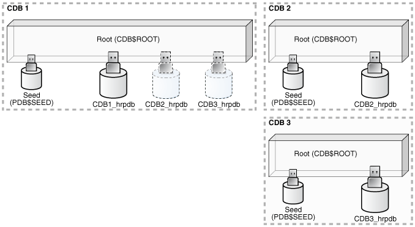

A **CDB fleet** is a collection of CDBs and hosted PDBs that you can manage as one logical CDB.

- About CDB Fleets  
	A **lead CDB** is the central location for monitoring and managing the CDBs in the fleet.
- Purpose of a CDB Fleet  
	A CDB fleet provides the database infrastructure for scalability and centralized management of many CDBs.
- Setting the Lead CDB in a CDB Fleet  
	Set the lead CDB in a CDB fleet by setting the `LEAD_CDB` database property to `true`.
- Designating a CDB Fleet Member  
	Designate a fleet member by setting the `LEAD_CDB_URI` database property to a database link that points to the lead CDB.

**Parent topic:** [Creating CDBs](creating-and-configuring-a-multitenant-environment.md)

### About CDB Fleets

A **lead CDB** is the central location for monitoring and managing the CDBs in the fleet.

Designate one CDB in the fleet to be the lead CDB by setting its `LEAD_CDB` database property to `TRUE`. The other CDBs in the fleet point to the lead CDB by setting the `LEAD_CDB_URI` database property. After you configure the CDB fleet, PDB information from the various CDBs is synchronized with the lead CDB. All PDBs in the CDBs are now “visible” in the lead CDB, enabling you to access the PDBs in the fleet as a single, logical CDB from the lead CDB.

The following figure shows a CDB fleet consisting of CDB1, CDB2, and CDB3. The lead CDB is CDB1. CDB2\_hrpdb, which resides in CDB2, is visible in CDB1. CDB3\_hrpdb, which resides in CDB3, is also visible in CDB1.

Figure 5-1 CDB Fleet



> This graphic depicts three CDBs. CDB1 has one PDB named CDB1\_hrpdb. CDB2 has one PDB named CDB2\_hrpdb. CDB3 has one PDB named CDB3\_hrpdb. Both CDB2\_hrpdb and CDB3\_hrpdb are visible in CDB1.


All Oracle Database features, such as Oracle Real Application Cluster (Oracle RAC), RMAN, point-in-time recovery, and flashback features, are supported for CDBs in the fleet.

You can use the following cross-container features to access the CDBs and PDBs in a CDB fleet:

- `CDB` views
- `GV$` views
- The `CONTAINERS` clause
- Container maps

If a common application schema is configured with application containers, then these cross-container features enable query and data aggregation across PDBs in different CDBs managed in the fleet.

Note:

- Each PDB name must be unique across all CDBs in a CDB fleet.
- You can create a PDB in any CDB in the fleet, but you can only open a PDB in the CDB where it was created.

**Parent topic:** Configuring a CDB Fleet

### Purpose of a CDB Fleet

A CDB fleet provides the database infrastructure for scalability and centralized management of many CDBs.

A CDB fleet is useful in the following situations:

- The number of PDBs you must provision exceeds the `MAX_PDBS` initialization parameter setting, requiring you to create multiple CDBs.
- Different PDBs in a single configuration require different types of servers to function optimally.
	For example, some PDBs might process a large transaction load, while other PDBs are used mainly for monitoring, and you want the appropriate server resources for these PDBs, such as CPU, memory, I/O rate, and storage systems.
- Different PDBs that use the same application must reside in different locations.

Monitoring and Diagnostic Collection Across CDBs

The lead CDB can run monitoring and reporting applications that execute across the CDBs in the fleet. You can install a monitoring application in one container, and then use `CDB` views and `GV$` views to monitor and process diagnostic data for the entire CDB fleet. A cross-container query issued in the lead CDB can automatically execute in all PDBs across the CDB fleet.

Software as a Service (SaaS) Applications

Using a common schema and common application objects in different application containers across the CDB fleet, you can use the `CONTAINERS` clause or a container map to run queries across all PDBs in the CDB fleet. To ensure a common application schema across the CDBs, the application can be installed in an application root.

A typical use case involves installing the master application root in the lead CDB. An application root clone resides in every other CDB in the fleet. Proxy PDBs for the application root clones reside in the master application root.

Database as a Service (DBaaS) Applications

The lead CDB can serve as a central location where you can collect and view usage metrics and status of all or a subset of the PDBs provisioned in the CDB fleet.

Microservices

Microservices are a specialization of service-oriented architectures used to build flexible, independently deployable software systems. With microservices, each team can deploy and manage a CDB fleet with customized scaling and availability SLAs. The CDBs can use different storage systems and configuration settings and cater to different types of workloads. The lead CDB can help the central DBA manage the collection of CDBs associated with each individual microservice.

### Setting the Lead CDB in a CDB Fleet

Set the lead CDB in a CDB fleet by setting the `LEAD_CDB` database property to `true`.

To set the lead CDB in a CDB fleet:

1. In SQL\*Plus, ensure that the current container is the root of the CDB that will be the lead CDB.
2. Optionally, check the current `LEAD_CDB` database property by running the following query:
	```
	SELECT PROPERTY_VALUE 
	FROM   DATABASE_PROPERTIES 
	WHERE  PROPERTY_NAME='LEAD_CDB';
	```
3. Set the `LEAD_CDB` database property to `TRUE`.

Example 5-1 Setting the Lead CDB Database Property to true

1. Access the CDB root:
	```
	ALTER SESSION SET CONTAINER = CDB$ROOT;
	```
2. Run the following SQL statement:
	```
	ALTER DATABASE SET LEAD_CDB = TRUE;
	```

See Also:

" [About Container Access in a CDB](administering-a-cdb-with-sql-plus.md) "

**Parent topic:** Configuring a CDB Fleet

### Designating a CDB Fleet Member

Designate a fleet member by setting the `LEAD_CDB_URI` database property to a database link that points to the lead CDB.

Prerequisites

You must use a database link with fixed user semantics, which means that the user name and password are in the link definition. The link cannot use connected user semantics, in which case the user name and password are not in the link definition.

To designate a CDB fleet member:

1. In SQL\*Plus, ensure that the current container is the root of the CDB that you want to designate as a fleet member.
2. Optionally, check the current `LEAD_CDB_URI` database property by running the following query:
	```
	SELECT PROPERTY_VALUE FROM DATABASE_PROPERTIES WHERE PROPERTY_NAME='LEAD_CDB_URI';
	```
3. If a database link does not exist, then create a link to the root of the lead CDB in the fleet.
	The database link must be a fixed common user database link.
4. Set the `LEAD_CDB_URI` database property to the name of the database link to the lead CDB.

Example 5-2 Designating a CDB Fleet Member

This example assumes that the lead CDB is `cdb1` and that the database link to the lead CDB does not exist. It also assumes that the network is configured so that the current CDB can connect to `cdb1` using the `lead_pod` service name.

1. Access the root of the CDB that you want to designate as a fleet member:
	```
	ALTER SESSION SET CONTAINER = CDB$ROOT;
	```
2. Create the database link to `cdb1`:
	```
	CREATE PUBLIC DATABASE LINK lead_link 
	   CONNECT TO C##CF1 IDENTIFIED BY password
	   USING 'lead_pod';
	```
3. Set the `LEAD_CDB_URI` property to the name of the database link:
	```
	ALTER DATABASE SET LEAD_CDB_URI = 'dblink:LEAD_LINK';
	```

See Also:

- " [About Container Access in a CDB](administering-a-cdb-with-sql-plus.md) "
- [Oracle Database Administrator’s Guide](https://docs.oracle.com/pls/topic/lookup?ctx=en/database/oracle/oracle-database/21/multi&id=ADMIN12085) for information about fixed user database links

**Parent topic:** Configuring a CDB Fleet