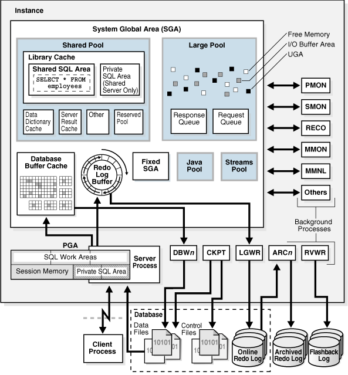
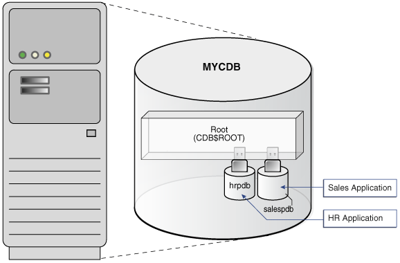
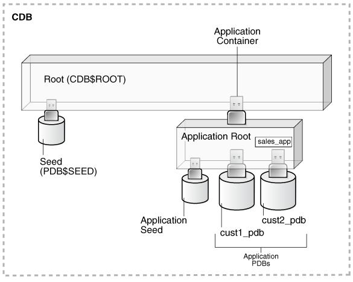
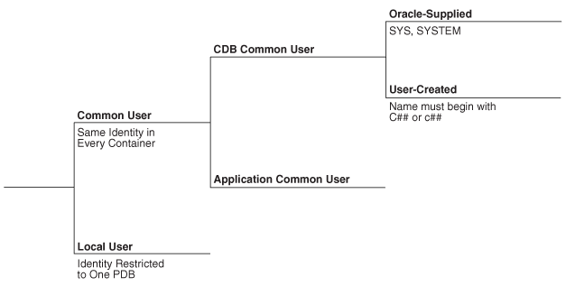
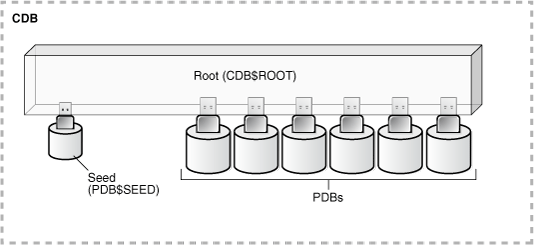
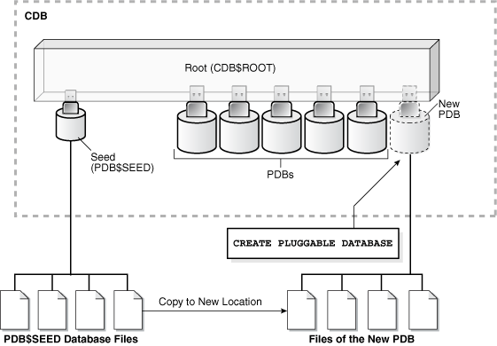
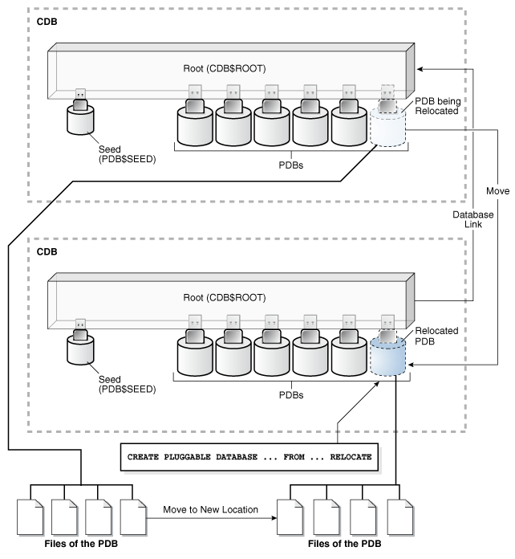

### Changes in Oracle Database Release 21c for Oracle Multitenant Administrator’s Guide

The following features are new in this release.

Note:

A multitenant container database is the only supported architecture in Oracle Database 21c. While the documentation is being revised, legacy terminology may persist. In most cases, "database" and "non-CDB" refer to a CDB or PDB, depending on context. In some contexts, such as upgrades, "non-CDB" refers to a non-CDB from a previous release.

- Changed scope for Oracle Multitenant Administrator's Guide
	Starting in Oracle Database 21c, this publication explains how to administer containers as containers, for example, how to create CDBs and PDBs, start them up and shut them down, and perform cross-container operations. [Oracle Database Administrator’s Guide](https://docs.oracle.com/pls/topic/lookup?ctx=en/database/oracle/oracle-database/21/multi&id=ADMIN-GUID-EA8CC987-EF18-4434-B962-01312CD3A8AC) describes traditional administrative tasks that you perform within an existing container, including managing database storage, schema objects, resources, and task scheduling. Oracle Database Security Guide explains how to secure multitenant databases.
- Adopting a non-CDB as a PDB using Replay Upgrade
	When adopting a non-CDB from a previous release as a PDB in an Oracle Database 21c CDB, the upgrade occurs automatically when the PDB is opened normally. The Replay Upgrade feature automatically captures necessary `CREATE OR                                                   REPLACE` statements, replays the statements only for changed objects, and converts the data dictionary. The replay mechanism is the same one used in application synchronization.
	See [Oracle Database Upgrade Guide](https://docs.oracle.com/pls/topic/lookup?ctx=en/database/oracle/oracle-database/21/multi&id=GUID-77BA4A1D-447F-46FB-B3EE-C58B8546FEB0) to learn how to adopt a non-CDB as a PDB using Replay Upgrade.
- Replay Upgrade on PDB Open
	Opening a PDB upgrades it automatically when a version mismatch occurs between the PDB and the CDB root. The Replay Upgrade on PDB Open optimization, which is the default, avoids manual error correction by re-executing statements stored in capture tables. The mechanism is the same used in application synchronization. Oracle Database 21c uses Replay Upgrade on PDB Open in the following scenarios:
	- You plug in a PDB that was unplugged from a CDB in a previous release. When the PDB is opened, the database automatically performs a Replay Upgrade.
		- A CDB from a previous release was upgraded to Oracle Database 21c, but a PDB in the CDB was not upgraded. If you open this PDB without the `OPEN UPGRADE` option, then the CDB automatically performs a Replay Upgrade of the PDB.
	See " [Compatibility Checks When a PDB Is Opened](administering-pdbs-with-sql-plus.md) " and " [Plugging In an Unplugged PDB](plugging-in-a-pdb.md) ".
- Namespace integration with Oracle Database
	DbNest provides operating system resource isolation and management, file system isolation, and secure computing for PDBs. When DbNest is enabled, provisioning of a database instance occurs inside a **nest**, which is a type of isolated, hierarchical container. The database instance system resources are isolated from other instances. Files and directories are only accessible to the CDB or PDB for which they were configured.
	See [Oracle Database Security Guide](https://docs.oracle.com/pls/topic/lookup?ctx=en/database/oracle/oracle-database/21/multi&id=DBSEG-GUID-256DEEBF-8FBE-4641-BAE3-D23D53ADFB44) to learn more about DbNest.
- Transparent Application Continuity in the Oracle Cloud
	During planned maintenance, the database may decide that a session is unlikely to drain in the drain window. In this case, the database invokes Application Continuity and fails over the session automatically.
	See " [Server Session Draining When Relocating or Stopping PDBs](relocating-a-pdb.md) ".
- `CPU_MIN_COUNT` initialization parameter enhancements
	`CPU_MIN_COUNT` expresses the minimum number of CPU threads required by the PDB or CDB. CPU resource manager uses the PDB-level `CPU_MIN_COUNT` value to set the PDB shares in the resource plan. For each PDB, CPU Resource Manager ensures fair access to the CPU, guarantees the minimum CPU, and enforces the maximum CPU.
- `JOB_QUEUE_PROCESSES` initialization parameter enhancements
	The default value for `JOB_QUEUE_PROCESSES` across all containers has changed its default from 4000 to an automatic value that depends on the number of sessions and CPU threads.
- `MAX_IDLE_BLOCKER_TIME` initialization parameter enhancements
	`MAX_IDLE_BLOCKER_TIME` sets the number of minutes that a session holding needed resources can be idle before it is a candidate for termination.
- Expanded syntax for application synchronization
	The `ALTER PLUGGABLE DATABASE APPLICATION ... SYNC` statement accepts multiple application names. For example, a single statement issued in an application PDB can synchronize `apexapp` and `ordsapp`, or synchronize all applications except `ordsapp`.
	When applications depend on one another, synchronizing them in a single statement is necessary for functional correctness. Assume that you upgrade `apexapp` from 1.0 to 2.0, upgrade `ordsapp` from 1.0 to 2.0, and then upgrade `apexapp` to 3.0. The statement `ALTER PLUGGABLE DATABASE APPLICATION apexapp, ordsapp SYNC` replays the upgrades in sequence, upgrading `apexapp` to 2.0, `ordsapp` to 2.0, and then `apexapp` to 3.0. Synchronizing `apexapp` and then `ordsapp` in separate statements does not preserve the upgrade order.
	See " [Application Synchronization](administering-application-containers-with-sql-plus.md) " and " [Synchronizing Applications in an Application PDB](administering-application-containers-with-sql-plus.md) ".
- New parameters for the Database Configuration Assistant (DBCA) silent mode commands
	DBCA supports:
	- Configuring Oracle Machine Learning for Python (OML4PY)
		- Creating a database using a clone template that is stored in Oracle Cloud Infrastructure
		- Registering a database to use and support Enhanced SSL Security
		- Configuring Transparent Data Encryption (TDE) during database creation
		- Setting a database management policy for Real Application Clusters (RAC)
		- Specifying a time zone for a pluggable database (PDB)

**Parent topic:** Introduction to Multitenant Administration

### Multitenant Architecture

The **multitenant architecture** enables an Oracle database to be a CDB.

Every Oracle database must contain or be able to be contained by another database. For example, a CDB contains PDBs, and an application container contains application PDBs. A PDB is contained by a CDB or application container, and an application container is contained by a CDB.

Starting in Oracle Database 21c, a multitenant container database is the only supported architecture. In previous releases, Oracle supported non-container databases (non-CDBs).

- CDBs  
	A CDB contains one or more user-created PDBs and application containers.
- PDBs  
	A **PDB** is a portable collection of schemas, schema objects, and nonschema objects that appears to an application as a separate database.
- Application Containers  
	An **application container** is an optional, user-created container within a CDB that stores data and metadata for one or more applications.

**Parent topic:** Introduction to Multitenant Administration

#### CDBs

A CDB contains one or more user-created PDBs and application containers.

At the physical level, a CDB is a set of files: control file, online redo log files, and data files. The database instance manages the files that make up the CDB.

The following figure shows a CDB and an associated database instance.

Figure 1-1 Database Instance and CDB



> The graphic shows the SGA. Within the SGA are the Database Buffer Cache, Redo Log Buffer, Shared Pool, Large Pool, Fixed SGA, Java Pool, and Streams Pool. To the right of the SGA are the background processes PMON, SMON, RECO, MMON, MMNL, and Others. Below the SGA are DBWn, CKPT, LGWR, ARCn, and RVWR. Below the SGA are the PGA and Server Process. The Server Process is connected to a Client Process. To the right of the Client Process are Database Files (Data Files, Control Files, Online Redo Log), Archived Redo Log, and Flashback Log.


**Parent topic:** Multitenant Architecture

#### PDBs

A **PDB** is a portable collection of schemas, schema objects, and nonschema objects that appears to an application as a separate database.

At the physical level, each PDB has its own set of data files that store the data for the PDB. The CDB includes all the data files for the PDBs contained within it, and a set of system data files that store metadata for the CDB itself.

To move or archive a PDB, you can unplug it. An unplugged PDB consists of the PDB data files and a metadata file. An unplugged PDB is not usable until it is plugged in to a CDB.

The following figure shows a CDB named `MYCDB`.

Figure 1-2 PDBs in a CDB



> This graphic depicts a server computer. On this computer is a cylinder representing a database. The database is labeled "CDB." Inside the cylinder is a three-dimensional oblong box labeled "Root (CDB$ROOT)." Two smaller cylinders are plugged into the box. One cylinder is labeled "hrpdb." The other cylinder is labeled "salespdb." A box labeled Sales Application points to salespdb. A box labeled HR Application points to hrpdb.


Physically, `MYCDB` is an Oracle database, in the sense of a set of data files associated with an instance. `MYCDB` has one database instance, although multiple instances are possible in Oracle Real Application Clusters, and one set of database files.

`MYCDB` contains two PDBs: `hrpdb` and `salespdb`. As shown in Figure 1-2, these PDBs appear to their respective applications as separate, independent databases. An application has no knowledge of whether it is connecting to a CDB or PDB.

To administer the CDB itself or any PDB within it, you can connect to the [CDB root](glossary.md). The root is a collection of schemas, schema objects, and nonschema objects to which all PDBs and application containers belong.

**Parent topic:** Multitenant Architecture

#### Application Containers

An **application container** is an optional, user-created container within a CDB that stores data and metadata for one or more applications.

In this context, an [application](glossary.md) (also called the master application definition) is a named, versioned set of common data and metadata stored in the [application root](glossary.md). For example, the application might include definitions of tables, views, user accounts, and PL/SQL packages that are common to a set of PDBs.

In some ways, an application container functions as an application-specific CDB within a CDB. An application container, like the CDB itself, can include multiple application PDBs, and enables these PDBs to share metadata and data. At the physical level, an application container has its own set of data files, just like a PDB.

For example, a SaaS deployment can use multiple application PDBs, each for a separate customer, which share application metadata and data. For example, in the following figure, `sales_app` is the application model in the application root. The [application PDB](glossary.md) named `cust1_pdb` contains sales data only for customer 1, whereas the application PDB named `cust2_pdb` contains sales data only for customer 2. Plugging, unplugging, cloning, and other PDB-level operations are available for individual customer PDBs.

Figure 1-3 SaaS Use Case



> This graphic depicts a three-dimension box labeled Root (CDB$ROOT). Below the Root and on the left, a cylinder with a USB connector plugs into the Root box. The cylinder is labeled Seed (PDB$SEED). Below the box and on the right, a box labeled Application Root is plugged into the Root. The connector is labeled Application Container. Application Root contains a smaller box labeled sales\_app. Plugged into the Application Root are Application Seed, cust1\_pdb, and cust2\_pdb. The latter two are labeled Application PDBs.


**Parent topic:** Multitenant Architecture

### Benefits of the Multitenant Architecture

Creating separate PDBs and application containers within a single CDB provides benefits for manageability and performance.

- Benefits of Consolidating Data into a Single CDB  
	**Database consolidation** is the process of consolidating data from multiple databases on separate hosts into one CDB on one host. The multitenant architecture enables you to consolidate data and code without altering existing schemas or applications.
- Benefits of the Multitenant Architecture for Manageability  
	The multitenant architecture improves manageability by storing the data and metadata specific to a PDB in the PDB itself.

**Parent topic:** Introduction to Multitenant Administration

#### Benefits of Consolidating Data into a Single CDB

**Database consolidation** is the process of consolidating data from multiple databases on separate hosts into one CDB on one host. The multitenant architecture enables you to consolidate data and code without altering existing schemas or applications.

Consolidating data into a single CDB has the following benefits:

- Cost reduction
	By consolidating hardware and database infrastructure to a single set of background processes, and efficiently sharing computational and memory resources, you reduce costs for hardware and maintenance. For example, 100 PDBs in a single CDB on a single host can share one database instance.
- Easier and more rapid movement of data and code
	By design, you can quickly plug a PDB into a CDB, unplug the PDB from the CDB, and then plug this PDB into a different CDB. You can also clone PDBs while they remain available. You can plug in a PDB with any character set and access it without character set conversion. If the character set of the CDB is AL32UTF8, then PDBs with different database character sets can exist in the same CDB.
- Easier management and monitoring of the physical database
	The [CDB administrator](glossary.md) can manage the environment as an aggregate by executing a single operation, such as patching or performing an RMAN backup, for all hosted tenants and the CDB root. Backup strategies and disaster recovery are simplified.
- Separation of data and code
	Although consolidated into a single physical CDB, PDBs appears to applications as separate databases. For example, if user error loses critical data in a single PDB, then the PDB administrator can use Oracle Flashback or point-in-time recovery to retrieve the lost data without affecting other PDBs.
- Secure separation of administrative duties
	A [common user](glossary.md) account can connect to any container on which it has sufficient privileges, whereas a [local user](glossary.md) account is restricted to a specific PDB. Administrators can divide duties as follows:
	- An administrator uses a common user account to manage a CDB or application container.
	- A PDB administrator uses a local user account to manage an individual PDB. Because a privilege is contained within the container in which it is granted, a local user on one PDB does not have privileges on other PDBs within the same CDB.
- Ease of performance tuning
	It is easier to collect performance metrics for a single CDB on one host than for multiple databases on multiple hosts. For example, it is easier to size one SGA than 100 SGAs.
- Fewer database patches and upgrades
	It is easier to apply a patch to one CDB than to 100 databases, and to upgrade one CDB than to upgrade 100 databases.

See Also:

- " Overview of Multitenant Administration "
- [Oracle Database Security Guide](https://docs.oracle.com/pls/topic/lookup?ctx=en/database/oracle/oracle-database/21/multi&id=DBSEG580) to learn about common user accounts

**Parent topic:** Benefits of the Multitenant Architecture

#### Benefits of the Multitenant Architecture for Manageability

The multitenant architecture improves manageability by storing the data and metadata specific to a PDB in the PDB itself.

By storing its own dictionary metadata, a PDB becomes easier to manage as a unit. This benefit occurs even when only one PDB resides in a CDB. Grouping PDBs into a separately managed application container increases manageability even further.

In a CDB, the data dictionary metadata is split between the CDB root and the PDBs. Benefits of data dictionary separation include the following:

- Easier upgrade of data and code
	For example, instead of upgrading a CDB from one database release to another, you can rapidly unplug a PDB from the existing CDB, and then plug it into a newly created CDB from a higher release.
- Easier migration between servers
	To perform load balancing or to meet SLAs, you can migrate an application database from an on-premise data center to the Oracle Cloud, or between two servers in the same environment.
- Protection against data corruption within a PDB
	You can flash back a PDB to an SCN or PDB-specific restore point, without affecting other PDBs.
- Ability to install, administer, and upgrade application-specific data and metadata in a single place
	You can define a set of application-specific PDBs as a single component, called an [application container](glossary.md). You can then define one or more applications within this container. Each application definition is a named, versioned set of common metadata and data shared within this application container.
	For example, each customer of a SaaS vendor could have its own [application PDB](glossary.md). Each application PDB might have identically defined tables named `sales_mlt`, with different data in each PDB. The PDBs could share a [data-linked common object](glossary.md) named `countries_olt`, which has identical data in each PDB. As an application administrator, you could manage the master application definition so that every new customer gets a PDB with the same objects, and every change to existing schemas (for example, the addition of a new table, or a change in the definition of a table) applies to all PDBs that share the application definition.
- Integration with Oracle Database Resource Manager (the Resource Manager)
	In the multitenant environment, PDBs contend for shared resources. To address resource contention, usage, and monitoring issues, use the Resource Manager.

See Also:

- " [Administering an Application Container](administering-application-containers-with-sql-plus.md) "
- [Oracle Database Administrator’s Guide](https://docs.oracle.com/pls/topic/lookup?ctx=en/database/oracle/oracle-database/21/multi&id=ADMIN-GUID-2BEF5482-CF97-4A85-BD90-9195E41E74EF) to learn more about the Resource Manager
- [Oracle Database Concepts](https://docs.oracle.com/pls/topic/lookup?ctx=en/database/oracle/oracle-database/21/multi&id=CNCPT-GUID-0AF14A64-DD38-4755-94ED-2021CE137A90) to learn more about data dictionary separation

**Parent topic:** Benefits of the Multitenant Architecture

### Overview of Multitenant Administration

Become familiar with basic concepts related to configuring and managing a multitenant environment.

- Users, Roles, and Objects in a Multitenant Environment  
	The container architecture enables database administrators to assume different roles. The key to the separation of duties is the distinction between common and local users, roles, and objects.
- Tasks and Tools for a Multitenant Environment  
	This manual explains how to create and perform operations on containers using command-line tools such as SQL\*Plus or SQL Developer.
- Overview of Container Creation  
	You create a CDB using `CREATE DATABASE`, and then create PDBs and application containers using `CREATE PLUGGABLE DATABASE`.

**Parent topic:** Introduction to Multitenant Administration

#### Users, Roles, and Objects in a Multitenant Environment

The container architecture enables database administrators to assume different roles. The key to the separation of duties is the distinction between common and local users, roles, and objects.

- About Commonality in a CDB  
	A common phenomenon defined in a CDB or application root is the same in all containers plugged in to this root.
- About Common and Local User Accounts  
	A database user account has a password and specific database privileges.
- Overview of Common and Local Roles in a CDB  
	User-created roles are either local or common. Common roles are either common to the CDB itself or to a specific application container.
- Common and Local Objects  
	A **common object** is defined in either the CDB root or an application root, and can be referenced using metadata links or object links. A local object is every object that is not a common object.
- Separation of Duties in CDB and PDB Administration  
	Some database administrators manage an entire CDB, while others manage individual PDBs.

**Parent topic:** Overview of Multitenant Administration

##### About Commonality in a CDB

A common phenomenon defined in a CDB or application root is the same in all containers plugged in to this root.

- Principles of Commonality  
	In a CDB, a phenomenon can be common within either the system container (the CDB itself), or within a specific application container.
- Namespaces in a CDB  
	In a CDB, the namespace for every object is scoped to its container.

**Parent topic:** Users, Roles, and Objects in a Multitenant Environment

###### Principles of Commonality

In a CDB, a phenomenon can be common within either the system container (the CDB itself), or within a specific application container.

For example, if you create a common user account while connected to `CDB$ROOT`, then this user account is common to all PDBs and application roots in the CDB. If you create an application common user account while connected to an application root, however, then this user account is common only to the PDBs in this application container.

Within the context of `CDB$ROOT` or an application root, the principles of commonality are as follows:

- A common phenomenon is the same in every existing and future container.
	Therefore, a common user defined in the CDB root has the same identity in every PDB plugged in to the CDB root; a common user defined in an application root has the same identity in every application PDB plugged in to this application root. In contrast, a local phenomenon is scoped to exactly one existing container.
- Only a common user can alter the existence of common phenomena.
	More precisely, only a common user logged in to either the CDB root or an application root can create, destroy, or modify attributes of a user, role, or object that is common to the current container.

**Parent topic:** About Commonality in a CDB

###### Namespaces in a CDB

In a CDB, the namespace for every object is scoped to its container.

The following principles summarize the scoping rules:

- From an application perspective, a PDB is a separate database that is distinct from any other PDBs.
- Local phenomena are created within and restricted to a single container.
	Note:
	In this topic, the word “phenomenon” means “user account, role, or database object.”
- Common phenomena are defined in a CDB root or application root, and exist in all PDBs that are or will be plugged into this root.

The preceding principles have implications for local and common phenomena.

Local Phenomena

A local phenomenon must be uniquely named within a container, but not across all containers in the CDB. Identically named local phenomena in different containers are distinct. For example, local user `sh` in one PDB does not conflict with local user `sh` in another PDB.

CDB$ROOT Common Phenomena

Common phenomena defined in `CDB$ROOT` exist in multiple containers and must be unique within each of these namespaces. For example, the CDB root includes predefined common users such as `SYSTEM` and `SYS`. To ensure namespace separation, Oracle Database prevents creation of a `SYSTEM` user within another container.

To ensure namespace separation, the name of user-created common phenomena in the CDB root must begin with the value specified by the `COMMON_USER_PREFIX` initialization parameter. The default prefix is `c##` or `C##`. The names of all other user-created phenomena must not begin with `c##` or `C##`. For example, you cannot create a local user in `hrpdb` named `c##hr`, nor can you create a common user in the CDB root named `hr`.

Application Common Phenomena

Within an application container, names for local and application common phenomena must not conflict.

- Application common users and roles
	The same principles apply to application common users as to CDB common users. The difference is that for CDB common users, the default value for the common user prefix is `c##` or `C##`, whereas in application root the default value for the common user prefix is the empty string.
	The multitenant architecture assumes that you create application PDBs from an application root, or convert a single-tenant application to a multitenant application.
- Application common objects
	The multitenant architecture assumes that you create application common objects in the application root. Later, you add data locally within the application PDBs. However, Oracle Database supports creation of local tables within an application PDB. In this case, the local tables reside in the same namespace as application common objects within the application PDB.

See Also:

[Oracle Database Security Guide](https://docs.oracle.com/pls/topic/lookup?ctx=en/database/oracle/oracle-database/21/multi&id=DBSEG830) to learn more about common users and roles

**Parent topic:** About Commonality in a CDB

##### About Common and Local User Accounts

A database user account has a password and specific database privileges.

User Accounts and Schemas

Each user account owns a single schema, which has the same name as the user. The schema contains the data for the user owning the schema. For example, the `hr` user account owns the `hr` schema, which contains schema objects such as the `employees` table. In a production database, the schema owner usually represents a database application rather than a person.

Within a schema, each schema object of a particular type has a unique name. For example, `hr.employees` refers to the table `employees` in the `hr` schema. The following figure depicts a schema owner named `hr` and schema objects within the `hr` schema.

Figure 1-4 HR Schema


> On the left of the graphic is an icon representing the HR user. An arrow labeled "owns" extends to the right of this user. The arrow points to a box bordered by a dotted line. This box is labeled "HR Schema." Inside this box are icons representing tables and indexes. These icons are labeled "schema objects."


Common and Local User Accounts

If a user account owns objects that define the database, then this user account is common. User accounts that are not Oracle-supplied are either local or common. A CDB common user is a common user that is created in the CDB root. An application common user is a user that is created in an application root, and is common only within this application container.

The following graphic shows the possible user account types in a CDB.

Figure 1-5 User Accounts in a CDB



> The graphic depicts an option tree. The first branch is between Common User and Local User. The Common User branch has branches for Oracle-Supplied and User-Created.


A CDB common user can connect to any container in the CDB to which it has sufficient privileges. In contrast, an application common user can only connect to the application root in which it was created, or a PDB that is plugged in to this application root, depending on its privileges.

- Common User Accounts  
	Within the context of either the system container (CDB) or an application container, a **common user** is a database user that has the same identity in the root and in every existing and future PDB within this container.
- Local User Accounts  
	A **local user** is a database user that is not common and can operate only within a single PDB.

**Parent topic:** Users, Roles, and Objects in a Multitenant Environment

###### Common User Accounts

Within the context of either the system container (CDB) or an application container, a **common user** is a database user that has the same identity in the root and in every existing and future PDB within this container.

Every common user can connect to and perform operations within the root of its container, and within any PDB in which it has sufficient privileges. Some administrative tasks must be performed by a common user. Examples include creating a PDB and unplugging a PDB.

For example, `SYSTEM` is a CDB common user with DBA privileges. Thus, `SYSTEM` can connect to the CDB root and any PDB in the database. You might create a common user `saas_sales_admin` in the `saas_sales` application container. In this case, the `saas_sales_admin` user could only connect to the `saas_sales` application root or to an application PDB within the `saas_sales` application container.

Every common user is either Oracle-supplied or user-created. Examples of Oracle-supplied common users are `SYS` and `SYSTEM`. Every user-created common user is either a CDB common user, or an application common user.

The following figure shows sample users and schemas in two PDBs: `hrpdb` and `salespdb`. `SYS` and `c##dba` are CDB common users who have schemas in `CDB$ROOT`, `hrpdb`, and `salespdb`. Local users `hr` and `rep` exist in `hrpdb`. Local users `hr` and `rep` also exist in `salespdb`.

Figure 1-6 Users and Schemas in a CDB


> This graphic shows a cylinder representing a container database. On the right side of the database are the following local users: hr in hrpdb, hr in salespdb, rep in salespdb, and rep in hrpdb. Each of these users points to the appropriate schema in the appropriate PDB. Within the CDB is a three-dimensional box labeled "Root(CDB$ROOT)." Plugged in to the root are three PDBs: Seed (PDB$SEED), hrpdb, and salespdb. The root box contains the schemas SYS, c##dba, and PUBLIC. On the left of the CDB are the common users SYS and c##dba. User SYS points to a SYS schema in the root and in each PDB. The c##dba user points to the schema in the root, in hrpdb, and salespdb. The root and each PDB contains a schema named "PUBLIC." Seed contains the schemas PUBLIC and SYS.


Common users have the following characteristics:

- A common user can log in to any container (including `CDB$ROOT`) in which it has the `CREATE SESSION` privilege.
	A common user need not have the same privileges in every container. For example, the `c##dba` user may have the privilege to create a session in `hrpdb` and in the root, but not to create a session in `salespdb`. Because a common user with the appropriate privileges can switch between containers, a common user in the root can administer PDBs
- An application common user does not have the `CREATE SESSION` privilege in any container outside its own application container.
	Thus, an application common user is restricted to its own application container. For example, the application common user created in the `saas_sales` application can connect only to the application root and the PDBs in the `saas_sales` application container.
- The names of user-created CDB common users must follow the naming rules for other database users. Additionally, the names must begin with the characters specified by the `COMMON_USER_PREFIX` initialization parameter, which are `c##` or `C##` by default. Oracle-supplied common user names and user-created application common user names do not have this restriction.
	No local user name may begin with the characters `c##` or `C##`.
- Every common user is uniquely named across all PDBs within the container (either the system container or a specific application container) in which it was created.
	A CDB common user is defined in the CDB root, but must be able to connect to every PDB with the same identity. An application common user resides in the application root, and may connect to every application PDB in its container with the same identity.

- Characteristics of Common Users  
	Every common user is either Oracle-supplied or user-created.
- SYS and SYSTEM Accounts  
	All Oracle databases include default common user accounts with administrative privileges.

**Parent topic:** About Common and Local User Accounts

###### Characteristics of Common Users

Every common user is either Oracle-supplied or user-created.

Common user accounts have the following characteristics:

- A common user can log in to any container (including `CDB$ROOT`) in which it has the `CREATE SESSION` privilege.
	A common user need not have the same privileges in every container. For example, the `c##dba` user may have the privilege to create a session in `hrpdb` and in the root, but not to create a session in `salespdb`. Because a common user with the appropriate privileges can switch between containers, a common user in the root can administer PDBs.
- An application common user does not have the `CREATE SESSION` privilege in any container outside its own application container.
	Thus, an application common user is restricted to its own application container. For example, the application common user created in the `saas_sales` application can connect only to the application root and the PDBs in the `saas_sales` application container.
- The names of user-created CDB common users must follow the naming rules for other database users. Additionally, the names must begin with the characters specified by the `COMMON_USER_PREFIX` initialization parameter, which are `c##` or `C##` by default. Oracle-supplied common user names and user-created application common user names do not have this restriction.
	No local user name may begin with the characters `c##` or `C##`.
- Every common user is uniquely named across all PDBs within the container (either the system container or a specific application container) in which it was created.
	A CDB common user is defined in the CDB root, but must be able to connect to every PDB with the same identity. An application common user resides in the application root, and may connect to every application PDB in its container with the same identity.

The following figure shows sample users and schemas in two PDBs: `hrpdb` and `salespdb`. `SYS` and `c##dba` are CDB common users who have schemas in `CDB$ROOT`, `hrpdb`, and `salespdb`. Local users `hr` and `rep` exist in `hrpdb`. Local users `hr` and `rep` also exist in `salespdb`.

Figure 1-7 Users and Schemas in a CDB


> This graphic shows a cylinder representing a container database. On the right side of the database are the following local users: hr in hrpdb, hr in salespdb, rep in salespdb, and rep in hrpdb. Each of these users points to the appropriate schema in the appropriate PDB. Within the CDB is a three-dimensional box labeled "Root(CDB$ROOT)." Plugged in to the root are three PDBs: Seed (PDB$SEED), hrpdb, and salespdb. The root box contains the schemas SYS, c##dba, and PUBLIC. On the left of the CDB are the common users SYS and c##dba. User SYS points to a SYS schema in the root and in each PDB. The c##dba user points to the schema in the root, in hrpdb, and salespdb. The root and each PDB contains a schema named "PUBLIC." Seed contains the schemas PUBLIC and SYS.


See Also:

- [Oracle Database Security Guide](https://docs.oracle.com/pls/topic/lookup?ctx=en/database/oracle/oracle-database/21/multi&id=DBSEG580) to learn about common user accounts
- [Oracle Database Reference](https://docs.oracle.com/pls/topic/lookup?ctx=en/database/oracle/oracle-database/21/multi&id=GUID-516ADCCF-3661-4B54-908A-7041854EA14F) to learn about `COMMON_USER_PREFIX`

**Parent topic:** Common User Accounts

###### SYS and SYSTEM Accounts

All Oracle databases include default common user accounts with administrative privileges.

Administrative accounts are highly privileged and are intended only for DBAs authorized to perform tasks such as starting and stopping the database, managing memory and storage, creating and managing database users, and so on.

The `SYS` common user account is automatically created when a database is created. This account can perform all database administrative functions. The `SYS` schema stores the base tables and views for the data dictionary. These base tables and views are critical for the operation of Oracle Database. Tables in the `SYS` schema are manipulated only by the database and must never be modified by any user.

The `SYSTEM` administrative account is also automatically created when a database is created. The `SYSTEM` schema stores additional tables and views that display administrative information, and internal tables and views used by various Oracle Database options and tools. Never use the `SYSTEM` schema to store tables of interest to nonadministrative users.

See Also:

- [Oracle Database Security Guide](https://docs.oracle.com/pls/topic/lookup?ctx=en/database/oracle/oracle-database/21/multi&id=DBSEG-GUID-F78AE647-184C-4790-9E95-493787CACDE1) to learn about user accounts
- [Oracle Database Administrator’s Guide](https://docs.oracle.com/pls/topic/lookup?ctx=en/database/oracle/oracle-database/21/multi&id=ADMIN11042) to learn about `SYS`, `SYSTEM`, and other administrative accounts

**Parent topic:** Common User Accounts

###### Local User Accounts

A **local user** is a database user that is not common and can operate only within a single PDB.

Local users have the following characteristics:

- A local user is specific to a PDB and may own a schema in this PDB.
	In the example shown in " Characteristics of Common Users ", local user `hr` on `hrpdb` owns the `hr` schema. On `salespdb`, local user `rep` owns the `rep` schema, and local user `hr` owns the `hr` schema.
- A local user can administer a PDB, including opening and closing it.
	A common user with `SYSDBA` privileges can grant `SYSDBA` privileges to a local user. In this case, the privileged user remains local.
- A local user in one PDB cannot log in to another PDB or to the CDB root.
	For example, when local user `hr` connects to `hrpdb`, `hr` cannot access objects in the `sh` schema that reside in the `salespdb` database without using a database link. In the same way, when local user `sh` connects to the `salespdb` PDB, `sh` cannot access objects in the `hr` schema that resides in `hrpdb` without using a database link.
- The name of a local user must not begin with the characters `c##` or `C##`.
- The name of a local user must only be unique within its PDB.
	The user name and the PDB in which that user schema is contained determine a unique local user. " Characteristics of Common Users " shows that a local user and schema named `rep` exist on `hrpdb`. A completely independent local user and schema named `rep` exist on the `salespdb` PDB.

The following table describes a scenario involving the CDB in " Characteristics of Common Users ". Each row describes an action that occurs after the action in the preceding row. Common user `SYSTEM` creates local users in two PDBs.

Table 1-1 Local Users in a CDB

| Operation | Description |
| --- | --- |
| ``` SQL> CONNECT SYSTEM@hrpdb Enter password: ******** Connected. ``` | `SYSTEM` connects to the `hrpdb` container using the service name `hrpdb`. |
| ``` SQL> CREATE USER rep IDENTIFIED BY password;   User created.  SQL> GRANT CREATE SESSION TO rep;  Grant succeeded. ``` | `SYSTEM` now creates a local user `rep` and grants the `CREATE SESSION` privilege in this PDB to this user. The user is local because common users can only be created by a common user connected to the root. |
| ``` SQL> CONNECT rep@salespdb Enter password: ******* ERROR: ORA-01017: invalid username/password; logon denied ``` | The `rep` user, which is local to `hrpdb`, attempts to connect to `salespdb`. The attempt fails because `rep` does not exist in PDB `salespdb`. |
| ``` SQL> CONNECT SYSTEM@salespdb Enter password: ******** Connected. ``` | `SYSTEM` connects to the `salespdb` container using the service name `salespdb`. |
| ``` SQL> CREATE USER rep IDENTIFIED BY password;   User created.  SQL> GRANT CREATE SESSION TO rep;  Grant succeeded. ``` | `SYSTEM` creates a local user `rep` in `salespdb` and grants the `CREATE SESSION` privilege in this PDB to this user. Because the name of a local user must only be unique within its PDB, a user named `rep` can exist in both `salespdb` and `hrpdb`. |
| ``` SQL> CONNECT rep@salespdb Enter password: ******* Connected. ``` | The `rep` user successfully logs in to `salespdb`. |

See Also:

[Oracle Database Security Guide](https://docs.oracle.com/pls/topic/lookup?ctx=en/database/oracle/oracle-database/21/multi&id=DBSEG581) to learn about local user accounts

**Parent topic:** About Common and Local User Accounts

##### Overview of Common and Local Roles in a CDB

User-created roles are either local or common. Common roles are either common to the CDB itself or to a specific application container.

Every Oracle-supplied role is common, for example, the predefined `DBA` role. In Oracle-supplied scripts, every privilege or role granted to Oracle-supplied users and roles is granted commonly, with one exception: system privileges are granted locally to the common role `PUBLIC`.

- Common Roles in a CDB  
	A common role exists either in the CDB root or an application root, and applies to every PDB within the root container (either the CDB or the application container).
- Local Roles in a CDB  
	A **local role** exists only in a single PDB, and is thus completely independent of local roles in any other PDBs.

**Parent topic:** Users, Roles, and Objects in a Multitenant Environment

###### Common Roles in a CDB

A common role exists either in the CDB root or an application root, and applies to every PDB within the root container (either the CDB or the application container).

Common roles are useful for cross-container operations, ensuring that a common user has a role in every PDB. Every common role is one of the following types:

- Oracle-supplied
	All Oracle-supplied roles, such as `DBA` and `PUBLIC`, are common to the CDB.
- User-created
	Create a common role by executing `CREATE ROLE ... CONTAINER=ALL` in either the CDB root or application root, which determines the container to which the role is common. The standard naming conventions apply. Additionally, the names of CDB common roles must begin with the characters specified by the `COMMON_USER_PREFIX` initialization parameter, which are `c##` or `C##` by default.

The scope of the role is the scope of the root within which it is defined. If you define the role in `CDB$ROOT`, then its scope is the entire CDB. If you define the role within application root, then its scope is the application container.

**Parent topic:** Overview of Common and Local Roles in a CDB

###### Local Roles in a CDB

A **local role** exists only in a single PDB, and is thus completely independent of local roles in any other PDBs.

A local role can only contain roles and privileges that apply within the container in which the role exists. For example, if you create the local role `pdbadmin` in `hrpdb`, then the scope of this role is restricted to this PDB.

PDBs in the same CDB, or in the same application container, may contain local roles with the same name. For example, the user-created role `pdbadmin` may exist in both `hrpdb` and `salespdb`. However, these roles are completely independent of each other.

**Parent topic:** Overview of Common and Local Roles in a CDB

##### Common and Local Objects

A **common object** is defined in either the CDB root or an application root, and can be referenced using metadata links or object links. A local object is every object that is not a common object.

Database-supplied common objects are defined in `CDB$ROOT` and cannot be changed. Oracle Database does not support creation of common objects in `CDB$ROOT`.

You can create most schema objects—such as tables, views, PL/SQL and Java program units, sequences, and so on—as common objects in an application root. If the object exists in an application root, then it is called an **application common object**.

A local user can own a common object. Also, a common user can own a local object, but only when the object is not data-linked or metadata-linked, and is also neither a metadata link nor a data link.

See Also:

[Oracle Database Security Guide](https://docs.oracle.com/pls/topic/lookup?ctx=en/database/oracle/oracle-database/21/multi&id=GUID-D3336A29-71A4-42C3-BCBB-8E6738627539) to learn more about privilege management for common objects

**Parent topic:** Users, Roles, and Objects in a Multitenant Environment

##### Separation of Duties in CDB and PDB Administration

Some database administrators manage an entire CDB, while others manage individual PDBs.

DBAs who manage an entire CDB connect to the CDB as common users, and manage attributes of the entire CDB and the root, as well as some attributes of PDBs. For example, these CDB DBAs can create, unplug, plug in, and drop PDBs. They can also specify the temporary tablespace and the default tablespace for the CDB root, and they can change the open mode of PDBs.

DBAs can also connect to a specific PDB as a local PDB administrator. The PDB DBA performs tasks required for the PDB to support an [application](glossary.md). For example, tasks can include management of tablespaces and schemas in a PDB, specification of storage parameters for that PDB, changing the open mode of the current PDB, and setting PDB-level initialization parameters.

**Parent topic:** Users, Roles, and Objects in a Multitenant Environment

#### Tasks and Tools for a Multitenant Environment

This manual explains how to create and perform operations on containers using command-line tools such as SQL\*Plus or SQL Developer.

- Tasks for a Multitenant Environment  
	This section summarizes the tasks required to manage a multitenant environment.
- Tools for a Multitenant Environment  
	You can use various tools to configure and administer a multitenant environment.

**Parent topic:** Overview of Multitenant Administration

##### Tasks for a Multitenant Environment

This section summarizes the tasks required to manage a multitenant environment.

This manual explains how to administer containers as containers, for example, how to create CDBs and PDBs, start them up and shut them down, and perform cross-container operations. [Oracle Database Administrator’s Guide](https://docs.oracle.com/pls/topic/lookup?ctx=en/database/oracle/oracle-database/21/multi&id=ADMIN-GUID-EA8CC987-EF18-4434-B962-01312CD3A8AC) describes traditional administrative tasks that you perform within an existing container, including managing database storage, schema objects, resources, and task scheduling.

To achieve the goals described in " Benefits of the Multitenant Architecture ", you must complete the following general tasks:

Task 1 Plan for the Multitenant Environment

Creating and configuring any database requires careful planning. A CDB requires special considerations. For example, consider the following factors when you plan for a CDB:

- The number of PDBs that will be plugged into each CDB
- The resources required to support the planned CDB
- Container management policies executed as an aggregate on the entire CDB or executed locally on individual PDBs
- Container database topology, which could consist of application containers with application PDBs or a CDB with PDBs, or a combination of both

See " [Preparing to Create a CDB](preparing-cdb.md) " for detailed information about planning for a CDB.

Task 2 Create One or More CDBs

When you have completed the necessary planning, you can create one or more CDBs using either the Database Configuration Assistant (DBCA) or the `CREATE DATABASE ... ENABLE PLUGGABLE DATABASE` command. In either case, you must specify the configuration details for each CDB.

See " [Creating a CDB with DBCA](creating-and-configuring-an-oracle-database.md) " and " [Creating a Database with the CREATE DATABASE Statement](creating-and-configuring-an-oracle-database.md) " for detailed information about creating a CDB.

After a CDB is created, it consists of the root and `PDB$SEED`, as shown in the following figure. The CDB root contains only Oracle maintained objects and data structures, and `PDB$SEED` is a generic seed database for cloning purposes.

Figure 1-8 A Newly Created CDB


> This graphic depicts a rectangle with a dotted-line border. The rectangle is labeled "CDB." Inside the CDB is a long box labeled "Root (CDB$ROOT)." An cylinder icon labeled "Seed (PDB$SEED)" is plugged into the Root box.


Task 3 Optionally, Create Application Containers

An application container is an optional component of a CDB that consists of an application root and the application PDBs associated with it. An application container stores data for one or more applications.

The following graphic shows a CDB with one empty application container.

Figure 1-9 An Application Container


> This illustration shows a CDB with a `CDB$ROOT` container and a `PDB$SEED` container plugged into the root container. There is also one application container plugged into the CDB root, and the application container has an application root.


See " [About Application Containers](application-containers2.md) ".

Task 4 Create, Plug In, and Unplug PDBs

PDBs contain user data. After creating a CDB, you can create PDBs, plug unplugged PDBs into it, and unplug PDBs from it whenever necessary. You can unplug a PDB from a CDB and plug this PDB into a different CDB. You might move a PDB from one CDB to another if, for example, you want to move the workload for the PDB from one server to another.

See " [Creating PDBs and Application Containers](creating-pdbs.md) " for information about creating PDBs, plugging in PDBs, and unplugging PDBs.

The following figure shows a CDB with several PDBs.

Figure 1-10 A CDB with PDBs



> This illustration shows a CDB with a `CDB$ROOT` container, a `PDB$SEED` container plugged into the root container, and several PDBs plugged into the root container.


Figure 1-11 shows a CDB with PDBs, application containers, and application PDBs.

Figure 1-11 A CDB with PDBs, Application Containers, and Application PDBs


> This illustration shows a CDB with the following components:
>
> - The CDB has a `CDB$ROOT` container.
> - A `PDB$SEED` container is plugged into the root container.
> - Several PDBs are plugged into the root container.
> - Two application containers plugged into the root container.
> - Each application container has an application root container.
> - One application container has two application PDBs plugged into its application root container.
> - One application container has three application PDBs plugged into its application root container.
> - The application container with two application PDBs also has an application seed plugged into its application root container.


Task 5 Administer and Monitor the CDB and Application Containers

Administering and monitoring a CDB involves managing the entire CDB, the CDB root, and some attributes of PDBs.. Administering and monitoring an application container is similar to administering and monitoring a CDB, but your actions only affect the application root and the application PDBs that are part of the application container.

See " [After Creating a CDB](creating-and-configuring-an-oracle-database.md) " for descriptions of tasks that are similar and tasks that are different. Also, see " [Administering a CDB](administering-a-cdb-with-sql-plus.md) " and " [Monitoring Containers in a CDB](administering-a-cdb-with-sql-plus.md) ".

You can use Oracle Resource Manager to allocate and manage resources among PDBs hosted in a CDB, and you can use it to allocate and manage resource use among user processes within a PDB.

You can also use Oracle Scheduler to schedule jobs in a CDB and in individual PDBs. See [Oracle Database Administrator’s Guide](https://docs.oracle.com/pls/topic/lookup?ctx=en/database/oracle/oracle-database/21/multi&id=ADMIN-GUID-6B8C0335-D36B-44D3-95BC-82FA2141D967).

Task 6 Administer and Monitor PDBs and Application PDBs

See " [Administering PDBs](administering-pdbs-with-sql-plus.md) " and " [Monitoring Containers in a CDB](administering-a-cdb-with-sql-plus.md) ".

**Parent topic:** Tasks and Tools for a Multitenant Environment

##### Tools for a Multitenant Environment

You can use various tools to configure and administer a multitenant environment.

Table 1-2 Tools for a Multitenant Environment

| Tool | Description | See Also |
| --- | --- | --- |
| SQL\*Plus | SQL\*Plus is a command-line tool that enables you to create, manage, and monitor CDBs and PDBs. You use SQL statements and Oracle-supplied PL/SQL packages to complete these tasks in SQL\*Plus. | [SQL\*Plus User's Guide and Reference](https://docs.oracle.com/pls/topic/lookup?ctx=en/database/oracle/oracle-database/21/multi&id=SQPUG-GUID-BF1995BD-EF9B-4EA2-9B32-7BFACDEB79DA) |
| Oracle Database Configuration Assistant (DBCA) | DBCA is a utility with a graphical user interface that enables you to create and duplicate CDBs. It also enables you to create, relocate, clone, plug in, and unplug PDBs. | [Oracle Database Installation Guide](https://docs.oracle.com/pls/topic/lookup?ctx=en/database/oracle/oracle-database/21/multi&id=GINST) and the DBCA online help |
| Oracle Enterprise Manager Cloud Control | Cloud Control is a system management tool with a graphical user interface that enables you to manage and monitor a CDB and its PDBs. | Cloud Control online help |
| Oracle SQL Developer | Oracle SQL Developer is a client application with a graphical user interface that enables you to configure a CDB, create PDBs, plug and unplug PDBs, modify the state of a PDB, clone a PDB to the Oracle Cloud, hot clone/refresh a PDB, relocate a PDB between application roots, and more.  Additionally, Oracle SQL Developer has graphical interfaces for resource management, storage, security, configuration, and reporting of performance metrics on containers and pluggable databases in a CDB. | [Oracle SQL Developer User's Guide](https://docs.oracle.com/pls/topic/lookup?ctx=en/database/oracle/oracle-database/21/multi&id=RPTUG-GUID-464C045C-FBDF-417A-A20B-037D294B3BDA) |
| The Server Control (SRVCTL) utility | The SRVCTL utility can create and manage services for PDBs. | " [Managing Services for PDBs](administering-pdbs-with-sql-plus.md) " |
| Oracle Multitenant Self-Service Provisioning application | This application enables the self-service provisioning of PDBs. CDB administrators control access to this self-service application and manage quotas on PDBs. | [`http://www.oracle.com/goto/multitenant`](http://www.oracle.com/goto/multitenant)  To access the application, click the Downloads tab, and select Oracle Pluggable Database Self-Service Provisioning application in the Downloads for Oracle Multitenant section. |

**Parent topic:** Tasks and Tools for a Multitenant Environment

#### Overview of Container Creation

You create a CDB using `CREATE DATABASE`, and then create PDBs and application containers using `CREATE PLUGGABLE DATABASE`.

- Creation of a CDB  
	The `CREATE DATABASE` statement creates a new CDB.
- Creation of a PDB or Application Container  
	The `CREATE PLUGGABLE DATABASE` SQL statement creates a PDB. Specifying the `AS APPLICATION CONTAINER` clause creates an application container.

**Parent topic:** Overview of Multitenant Administration

##### Creation of a CDB

The `CREATE DATABASE` statement creates a new CDB.

When you create a CDB, Oracle Database automatically creates a root container (`CDB$ROOT`) and a seed PDB (`PDB$SEED`). The following graphic shows a newly created CDB:

Figure 1-12 CDB with Seed PDB


> This graphic depicts a rectangle with a dotted-line border. The rectangle is labeled "CDB." Inside the CDB is a long box labeled "Root (CDB$ROOT)." An cylinder icon labeled "Seed (PDB$SEED)" is plugged into the Root box.


See Also:

- " [Creating a CDB: Basic Steps](creating-and-configuring-an-oracle-database.md) "
- [Oracle Database SQL Language Reference](https://docs.oracle.com/pls/topic/lookup?ctx=en/database/oracle/oracle-database/21/multi&id=SQLRF01204) for more information about specifying the clauses and parameter values for the `CREATE DATABASE` statement

**Parent topic:** Overview of Container Creation

##### Creation of a PDB or Application Container

The `CREATE PLUGGABLE DATABASE` SQL statement creates a PDB. Specifying the `AS APPLICATION CONTAINER` clause creates an application container.

A created PDB automatically includes a full data dictionary, including metadata and internal links to system-supplied objects in the CDB root or application root. You must define every PDB from a single root: either the [CDB root](glossary.md) or an [application root](glossary.md). A PDB created in an application container is called an **application PDB**.

Every PDB and application container has a globally unique identifier (GUID). The PDB GUID is primarily used to generate names for directories that store the PDB files, including both Oracle Managed Files directories and non-Oracle Managed Files directories.

Note:

In the following topics, the term "PDB" refers to a PDB, application container, or application PDB.

- Creation of a PDB by Cloning  
	One technique for creating a PDB is called cloning.
- Creation of a PDB by Plugging In an Unplugged PDB  
	An unplugged PDB is a self-contained set of data files, and an XML metadata file that specifies the locations of the PDB files. To plug in an unplugged PDB, use the `CREATE PLUGGABLE DATABASE` statement with the `USING` clause.
- Creation of a PDB by Relocating  
	To relocate a PDB from one CDB to another, use either the `CREATE PLUGGABLE DATABASE ... RELOCATE` statement or DBCA.
- Creation of a PDB as a Proxy PDB  
	A **proxy PDB** provides access to different PDB, called the **referenced PDB**, in a remote CDB.

See Also:

" [Creating PDBs and Application Containers](creating-pdbs.md) "

**Parent topic:** Overview of Container Creation

###### Creation of a PDB by Cloning

One technique for creating a PDB is called cloning.

You can clone a PDB from `PDB$SEED`, an application seed, or a remote or local PDB.

- Creation of a PDB from a Seed  
	You can use the `CREATE PLUGGABLE DATABASE` statement to create a PDB from a seed.
- Creation of a PDB by Cloning a PDB  
	To clone a PDB from another PDB, use the `CREATE PLUGGABLE DATABASE` statement with the `FROM` clause.

**Parent topic:** Creation of a PDB or Application Container

###### Creation of a PDB from a Seed

You can use the `CREATE PLUGGABLE DATABASE` statement to create a PDB from a seed.

A seed is a PDB that serves as a template for creation of another PDB. Creating a PDB from a seed copies some or all of the contents of a PDB, and then assigns a new unique identifier.

A seed PDB is either of the following:

- The PDB seed (`PDB$SEED`), which is a system-supplied template for creating PDBs
	Every CDB has exactly one `PDB$SEED`, which cannot be modified or dropped.
- An [application seed](glossary.md), which is a user-created PDB for a specified [application root](glossary.md)
	Within an [application container](glossary.md), you can create an application seed using the `CREATE PLUGGABLE DATABASE AS SEED` statement, which you can then use to accelerate creation of new application PDBs.

Figure 1-13 Creation from PDB$SEED



> This illustration shows a CDB with a CDB$ROOT container, a PDB$SEED container plugged into the root, and several PDBs plugged into the root. One PDB is a new PDB. The illustration shows the PDB$SEED database files associated with the PDB$SEED container. The illustration shows the seed database files copied to a new location. The copied files are the files of the new PDB. The illustration shows the copied files associated with the new PDB. A CREATE PLUGGABLE DATABASE statement uses these copied files to create the new PDB.


Example 1-1 Creation of a PDB from PDB$SEED

The following SQL statement creates a PDB named `hrpdb` from `PDB$SEED` using Oracle Managed Files:

```
CREATE PLUGGABLE DATABASE hrpdb
 ADMIN USER dba1 IDENTIFIED BY password;
```

See Also:

" [Creating a PDB from Scratch](creating-a-pdb-from-scratch.md) "

**Parent topic:** Creation of a PDB by Cloning

###### Creation of a PDB by Cloning a PDB

To clone a PDB from another PDB, use the `CREATE PLUGGABLE DATABASE` statement with the `FROM` clause.

In this technique, the source is a PDB in a local or remote CDB. The target is the PDB copied from the source. The cloning operation copies the files associated with the source to a new location, and then assigns a new GUID to create the PDB.

This technique is useful for quickly creating PDBs for testing and development. For example, you might test a new or modified application on a cloned PDB before deploying the application in a production PDB. If a PDB is in [local undo mode](glossary.md), then the source PDB can be open in read/write mode during the operation, referred to as [hot cloning](glossary.md).

Note:

If you clone a PDB from a remote CDB, then you must use a database link.

If you run `CREATE PLUGGABLE DATABASE` statement in an application root, then you create the cloned PDB in the application container. In this case, the application name and version of the source PDB must be compatible with the application name and version of the application container.

The following graphic illustrates cloning a PDB when both source and target are in the same CDB.

Figure 1-14 Cloning a PDB


> This illustration shows a CDB with a CDB$ROOT container, a PDB$SEED container plugged into the root, and several PDBs plugged into the root. One PDB is a new PDB. The illustration shows the database files of the source PDB. The illustration shows the source PDB files copied to a new location. The copied files are the files of the new PDB. The illustration shows the copied files associated with the new PDB. A CREATE PLUGGABLE DATABASE... FROM statement uses these copied files to create the new PDB.


Starting in Oracle Database 19c, you can clone a remote PDB using DBCA.

Example 1-2 Cloning a PDB

The following SQL statement clones a PDB named `salespdb` from the plugged-in PDB named `hrpdb`:

```
CREATE PLUGGABLE DATABASE salespdb FROM hrpdb;
```

- Clones from PDB Snapshots  
	Create a **clone from a PDB snapshot** by specifying `USING SNAPSHOT` clause of the `CREATE PLUGGABLE DATABASE` command.
- Snapshot Copy PDBs  
	A **snapshot copy PDB** is based on a copy of the underlying storage system. Snapshot copy PDBs reduce the amount of storage required for testing purposes and reduce creation time significantly.
- Refreshable Clone PDBs  
	A **refreshable clone PDB** is a read-only clone that can periodically synchronize with its source PDB.

See Also:

- " [Cloning a PDB](cloning-a-pdb.md) "
- " [Application Maintenance](administering-application-containers-with-sql-plus.md) "

**Parent topic:** Creation of a PDB by Cloning

###### Clones from PDB Snapshots

Create a **clone from a PDB snapshot** by specifying `USING SNAPSHOT` clause of the `CREATE PLUGGABLE DATABASE` command.

Creation of PDB Snapshots with the SNAPSHOT Clause

A **PDB snapshot** is a point-in-time copy of a PDB. The source PDB can be open read-only or read/write while the snapshot is created. A PDB snapshot taken while the source PDB is open is called a **hot clone**. You can create clones from PDB snapshots. These clone PDBs are useful in development and testing.

You can create snapshots manually using the `SNAPSHOT` clause of `CREATE PLUGGABLE DATABASE` (or `ALTER PLUGGABLE DATABASE`), or automatically using the `EVERY interval` clause. The following statement creates a PDB snapshot with the name `pdb1_wed_4_1201`:

```
ALTER PLUGGABLE DATABASE SNAPSHOT pdb1_wed_4_1201;
```

If the storage system supports sparse clones, then the preceding command creates a sparse copy. Otherwise, the command creates a full copy.

Every PDB snapshot is associated with a snapshot name and the SCN and timestamp at snapshot creation.

Creation of a PDB Clone with the USING SNAPSHOT Clause

A clone from a PDB snapshot is a full, standalone PDB. Unlike a snapshot copy PDB, which is based on a storage-managed snapshot, you do not need to materialize a clone created from a PDB snapshot.

To create a clone from a PDB snapshot, specify the `USING SNAPSHOT` clause of the `CREATE PLUGGABLE DATABASE` statement. For example, the following statement clones a PDB named `pdb1_copy` from the PDB-level snapshot named `pdb1_wed_4_1201`:

```
CREATE PLUGGABLE DATABASE pdb1_copy FROM pdb1 
  USING SNAPSHOT pdb1_wed_4_1201;
```

See Also:

- " [About Cloning PDBs from PDB Snapshots](cloning-a-pdb.md) "
- [Oracle Database Licensing Information User Manual](https://docs.oracle.com/pls/topic/lookup?ctx=en/database/oracle/oracle-database/21/multi&id=DBLIC-GUID-0F9EB85D-4610-4EDF-89C2-4916A0E7AC87) for details on which features are supported for different editions and services

**Parent topic:** Creation of a PDB by Cloning a PDB

###### Snapshot Copy PDBs

A **snapshot copy PDB** is based on a copy of the underlying storage system. Snapshot copy PDBs reduce the amount of storage required for testing purposes and reduce creation time significantly.

If the file system supports storage snapshots, then `CREATE PLUGGABLE DATABASE ... FROM ... SNAPSHOT COPY` copies a PDB from a source PDB, which can be read/write during the operation. The snapshot copy PDB files use copy-on-write technology. Only modified blocks require extra storage on disk. If the file system does not support storage snapshots or use Oracle Exadata sparse files, then the `CLONEDB` initialization parameter must be `true`, and the source PDB must be read-only for as long as the snapshot copy PDB exists.

Because a snapshot copy PDB depends on storage-managed snapshots, you cannot unplug a snapshot copy PDB from the CDB root or application root. You cannot drop the storage snapshot on which a snapshot copy PDB is based.

You can transform a snapshot copy PDB, which uses sparse files, into a full PDB. This process is known as **materializing** the snapshot copy PDB. Because a materialized PDB does not depend on the source PDB, you can drop it. Materialize a PDB by running the `ALTER PLUGGABLE DATABASE MATERIALIZE` command.

Note:

A PDB created with the `USING SNAPSHOT` clause and a PDB created with the `SNAPSHOT COPY` clause have different properties. You cannot specify both clauses in a single `CREATE PLUGGABLE DATABASE` command. The `CREATE PLUGGABLE DATABASE … FROM … USING SNAPSHOT` clause creates a full, standalone PDB that does not need to be materialized. The `CREATE PLUGGABLE DATABASE … FROM … SNAPSHOT COPY` clause creates a sparse PDB that must be materialized if you want to drop the storage-level snapshot on which it is based.

Note:

" [Creating and Materializing Snapshot Copy PDBs](cloning-a-pdb.md) "

**Parent topic:** Creation of a PDB by Cloning a PDB

###### Refreshable Clone PDBs

A **refreshable clone PDB** is a read-only clone that can periodically synchronize with its source PDB.

Depending on the value specified in the `REFRESH MODE` clause, synchronization occurs automatically or manually. For example, if `hrpdb_re_clone` is a clone of `hrpdb`, then every month you could manually refresh `hrpdb_re_clone` with changes from `hrpdb`. Alternatively, you could configure `hrpdb` to propagate changes to `hrpdb_re_clone` automatically every 24 hours.

You can switch the roles of a source PDB and its refreshable clone. This switchover can be useful for load balancing between CDBs, and when the source PDB suffers a failure.

Note:

" [About Cloning a PDB](cloning-a-pdb.md) " to learn how to clone a PDB using the `REFRESH MODE` clause

**Parent topic:** Creation of a PDB by Cloning a PDB

###### Creation of a PDB by Plugging In an Unplugged PDB

An unplugged PDB is a self-contained set of data files, and an XML metadata file that specifies the locations of the PDB files. To plug in an unplugged PDB, use the `CREATE PLUGGABLE DATABASE` statement with the `USING` clause.

When plugging in an unplugged PDB, you have the following options:

- Specify the XML metadata file that describes the PDB and the files associated with the PDB.
- Specify a [PDB archive file](glossary.md), which is a compressed file that contains both the XML file and PDB data files. You can create a PDB by specifying the archive file, and thereby avoid copying the XML file and the data files separately.

The following graphic illustrates plugging in an unplugged PDB using the XML file.

Figure 1-15 Plugging In an Unplugged PDB


> This illustration shows a CDB with a `CDB$ROOT` container, a `PDB$SEED` container plugged into the root, and several PDBs plugged into the root. One PDB is a new PDB. The illustration shows two options for creating the new PDB:
>
> - A `CREATE` `PLUGGABLE` `DATABASE` `...` `USING` statement uses the unplugged PDB’s XML metadata file along with the unplugged PDB’s database files to create the new PDB.
> - A `CREATE` `PLUGGABLE` `DATABASE` `...` `USING` statement uses a.PDB archive file to create the new PDB. The.PDB archive file contains the unplugged PDB’s database files and the unplugged PDB’s XML metadata file that are used to create the new PDB.


Example 1-3 Plugging In a PDB

The following SQL statement plugs in a PDB named `salespdb` based on the metadata stored in the named XML file, and specifies `NOCOPY` because the files of the unplugged PDB do not need to be moved to a new location:

```
CREATE PLUGGABLE DATABASE salespdb USING '/disk1/usr/salespdb.xml' NOCOPY;
```

See Also:

" [Plugging In an Unplugged PDB](plugging-in-a-pdb.md) "

**Parent topic:** Creation of a PDB or Application Container

###### Creation of a PDB by Relocating

To relocate a PDB from one CDB to another, use either the `CREATE PLUGGABLE DATABASE ... RELOCATE` statement or DBCA.

This technique has the following advantages:

- The relocation occurs with minimal downtime.
- The technique keeps the PDB being relocated open in read/write mode during the relocation, and then brings the PDB online in its new location.

You must create a database link at the target CDB, which is the CDB that will contain the relocated PDB. Also, the source PDB must use local undo data.

The following graphic depicts a PDB relocation.

Figure 1-16 Relocating a PDB



> This illustration shows two CDBs. Both CDBs have a `CDB$ROOT` container, a `PDB$SEED` container plugged into the root, and several PDBs plugged into the root. The top CDB has one PDB that is being relocated. The bottom CDB has one new PDB that was relocated from the top CDB. The illustration shows a database link going from the CDB root in the bottom CDB to the CDB root in the top CDB. The illustration shows the files of the PDB being relocated. The illustration shows the PDB’s files moved to a new location. The illustration shows the moved files associated with the new PDB. A `CREATE` `PLUGGABLE` `DATABASE` `...` `FROM``...` `RELOCATE` statement uses these moved files to create the new PDB.


Starting in Oracle Database 19c, you can relocate a remote PDB using DBCA in silent mode.

Example 1-4 PDB Relocation

The following statement, which is issued at a target CDB, relocates `hrpdb` from the source CDB to the target CDB:

```
CREATE PLUGGABLE DATABASE hrpdb FROM hrpdb@lnk_to_source RELOCATE;
```

See Also:

" [Relocating a PDB](relocating-a-pdb.md) "

**Parent topic:** Creation of a PDB or Application Container

###### Creation of a PDB as a Proxy PDB

A **proxy PDB** provides access to different PDB, called the **referenced PDB**, in a remote CDB.

Proxy PDBs enable you to aggregate data from multiple sources. A SQL statement submitted for execution in a proxy PDB executes within the referenced PDB.

A typical use case is a proxy PDB that references an application root replica. If multiple CDBs have the same application definition (for example, same tables and PL/SQL packages), then you can create a proxy PDB in the application container of the master application root. The referenced PDB for the proxy PDB is the application root in a different CDB. By running installation scripts in the master root, the application roots in the other CDBs become replicas of the master application root.

To create a proxy PDB, use the `CREATE PLUGGABLE DATABASE` statement with the `FROM` clause, which must specify a database link to the referenced PDB in the remote CDB, and the `AS PROXY` clause.

Note:

If you plug a proxy PDB directly into `CDB$ROOT`, then you must have created the proxy in `CDB$ROOT`. A proxy of an application PDB must both be plugged in to an application root.

Figure 1-17 Creating a Proxy PDB


> This illustration shows two CDBs. Both CDBs have a `CDB$ROOT` container, a `PDB$SEED` container plugged into the root, and several PDBs plugged into the root. The top CDB has one PDB that is being referenced for a new proxy PDB in the bottom CDB. The illustration shows a database link going from the bottom CDB to the PDB being referenced in the top CDB. The illustration shows the referenced PDB’s `SYSTEM` and `SYSAUX` tablespace files copied to a new location. The illustration shows the proxy PDB using the copied files. A `CREATE` `PLUGGABLE` `DATABASE` `...` `AS PROXY ``...` `FROM` statement creates the proxy PDB.


Example 1-5 Creation of a Proxy PDB

This example creates a proxy PDB named `pdb1`. The referenced PDB is specified using a database link.

```
CREATE PLUGGABLE DATABASE pdb1 AS PROXY FROM pdb1@pdb1_link;
```

Note:

" [Creating a PDB as a Proxy PDB](creating-a-proxy-pdb.md) "

**Parent topic:** Creation of a PDB or Application Container