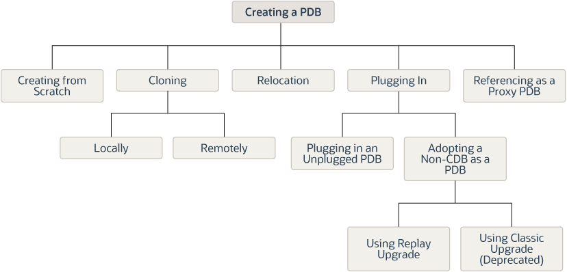

A CDB supports multiple techniques for creating PDBs.

The created PDB automatically includes a full data dictionary including metadata and internal links to system-supplied objects in the CDB root. You must define every PDB from a single root: either the [CDB root](glossary.md) or an [application root](glossary.md).

Each PDB has a globally unique identifier (GUID). The PDB GUID is primarily used to generate names for directories that store the PDB's files, including both Oracle Managed Files directories and non-Oracle Managed Files directories.

- Current Container and PDB Creation  
	You can use the `CREATE PLUGGABLE DATABASE` statement to create PDBs, application containers, application seeds, and application PDBs.
- Techniques for Creating a PDB  
	You can create a PDB with various techniques, all of which require the `CREATE PLUGGABLE DATABASE` statement.
- PDB Storage  
	However you choose to create a PDB, you must decide on the tablespaces and files that will store the data.
- Service Name Conversion  
	An important aspect of PDB creation is managing the renaming of database services.
- Summary of Clauses for Creating a PDB  
	When you create a PDB with the `CREATE PLUGGABLE DATABASE` statement, various clauses are available based on different factors.
- General Prerequisites for PDB Creation  
	Before creating a PDB, you must meet certain prerequisites.

**Parent topic:** [Creating PDBs and Application Containers](creating-pdbs.md)

### Current Container and PDB Creation

You can use the `CREATE PLUGGABLE DATABASE` statement to create PDBs, application containers, application seeds, and application PDBs.

When you create a PDB, the current container—CDB root or application root—determines the association of the PDB. The SQL statements that create PDBs and application PDBs are the same. For example, when you run `CREATE PLUGGABLE DATABASE` statement in the CDB root, the PDB belongs to the CDB root. When you run `CREATE PLUGGABLE DATABASE` statement in an application root, the application PDB belongs to the application root.

When the CDB root is the current container, create an application root by running a `CREATE PLUGGABLE DATABASE` statement with the `AS APPLICATION CONTAINER` clause. When cloning, relocating, or plugging in a PDB to an application container, the application name and version of the PDB must match the application name and version of the application container.

**Parent topic:** Overview of PDB Creation

### Techniques for Creating a PDB

You can create a PDB with various techniques, all of which require the `CREATE PLUGGABLE DATABASE` statement.

Creating a PDB is the process of associating it with a CDB or an application container.

The following graphic depicts the options for creating a PDB.

Note:

A multitenant container database is the only supported architecture in Oracle Database 21c. While the documentation is being revised, legacy terminology may persist. In most cases, "database" and "non-CDB" refer to a CDB or PDB, depending on context. In some contexts, such as upgrades, "non-CDB" refers to a non-CDB from a previous release.

Figure 6-1 Options for Creating a PDB



> This graphic depicts a flowchart. On the left is "Creating a PDB." Four options flow from "Creating a PDB:" “Relocating,” “Copying." "Plugging In," and “Referencing as a View PDB.”
>
> Two options flow from "Copying:" "Copying Files from the Seed" and "Cloning a PDB." Two options flow from "Cloning a PDB:" "Locally" and "Remotely."
>
> Two options flow from "Remotely:" "From a PDB" and "From a Non-CDB."
>
> Two options flow from "Plugging In:" "Plugging In an Unplugged PDB" and "Plugging in a Non-CDB as a PDB."


The following table describes the creation techniques. An additional technique, which is not covered in this manual, is to use the `DUPLICATE` command in Recovery Manager to copy a PDB from one CDB to another CDB.

Table 6-1 Techniques for Creating a PDB

| Technique | Description | More Information |
| --- | --- | --- |
| Create a PDB from scratch | Create a PDB in a CDB using the files of the PDB seed or application seed. This technique copies the files associated with the seed to a new location and associates the copied files with the new PDB. This is the default creation mechanism. The other techniques require either a source PDB or XML. | " [Creating a PDB from Scratch](creating-a-pdb-from-scratch.md) " |
| Clone an existing PDB | Create a PDB by cloning a source PDB. A source can be a PDB in the local CDB, a PDB in a remote CDB, or a PDB in a local or remote application container. This technique copies the files associated with the source to a new location and associates the copied files with the new PDB. | " [Cloning a PDB](cloning-a-pdb.md) " |
| Relocate a PDB to a different CDB | Create a PDB by relocating it from one CDB to another. This technique moves the files associated with the PDB to a new location. | " [Relocating a PDB](relocating-a-pdb.md) " |
| Plug an unplugged PDB into a CDB | Create a PDB by using the XML metadata file that describes the PDB and the files associated with the PDB to plug it into the CDB. | " [Plugging In an Unplugged PDB](plugging-in-a-pdb.md) " |
| Reference a PDB as a proxy PDB | Create a PDB as a proxy PDB by referencing a different PDB with a database link. The referenced PDB can be in the same CDB as the proxy PDB, or it can be in a different CDB. | " [Creating a PDB as a Proxy PDB](creating-a-proxy-pdb.md) " |
| Adopting a non-CDB as a PDB using Replay Upgrade | When adopting a non-CDB from a previous release as a PDB in an Oracle Database 21c CDB, the upgrade occurs automatically when the PDB is opened normally. The Replay Upgrade feature automatically captures necessary `CREATE OR                                                   REPLACE` statements, replays the statements only for changed objects, and converts the data dictionary. The replay mechanism is the same one used in application synchronization.  If you disable Replay Upgrade by executing `ALTER DATABASE UPGRADE SYNC OFF`, which is not recommended, then you can run `catctl.pl` with the `-t` option for classic upgrade. In this case, you must resolve any compatibility errors manually. | [Oracle Database Upgrade Guide](https://docs.oracle.com/pls/topic/lookup?ctx=en/database/oracle/oracle-database/21/multi&id=GUID-77BA4A1D-447F-46FB-B3EE-C58B8546FEB0) to learn how to adopt a non-CDB as a PDB using Replay Upgrade |

You can unplug a PDB when you want to plug it into a different CDB. You can unplug or drop a PDB when you no longer need it. An unplugged PDB is not usable until it is plugged into a CDB.

See Also:

- " [Creating and Removing Application Containers and Seeds](creating-removing-application-containers-seeds-with-sql-plus.md) "
- " [Unplugging a PDB from a CDB](removing-a-pdb.md) "
- " [Dropping a PDB](removing-a-pdb.md) "
- [Oracle Database Backup and Recovery User’s Guide](https://docs.oracle.com/pls/topic/lookup?ctx=en/database/oracle/oracle-database/21/multi&id=BRADV-GUID-F31F9FCE-B610-49EB-B9DB-44B9AA4E838F) to learn how to copy a PDB using the `DUPLICATE` command
- [Oracle Database SQL Language Reference](https://docs.oracle.com/pls/topic/lookup?ctx=en/database/oracle/oracle-database/21/multi&id=SQLRF55686) for more information about the `CREATE PLUGGABLE DATABASE` statement

**Parent topic:** Overview of PDB Creation

### PDB Storage

However you choose to create a PDB, you must decide on the tablespaces and files that will store the data.

- Storage Limits  
	The optional `STORAGE` clause of the `CREATE PLUGGABLE DATABASE` statement specifies storage limits for PDBs.
- Default Tablespace  
	The `DEFAULT TABLESPACE` clause of the `CREATE PLUGGABLE DATABASE` statement specifies the default tablespace for the new PDB.
- User Tablespaces  
	The `USER_TABLESPACES` clause of the `CREATE PLUGGABLE DATABASE` statement specifies which tablespaces are available in the new PDB. You can use this clause to separate the data for multiple schemas into different PDBs.
- PDB File Locations  
	In the `CREATE PLUGGABLE DATABASE` statement, you can specify the locations of files used by the new PDB.

**Parent topic:** Overview of PDB Creation

#### Storage Limits

The optional `STORAGE` clause of the `CREATE PLUGGABLE DATABASE` statement specifies storage limits for PDBs.

The `STORAGE` clause specifies the following limits:

- The amount of storage that can be used by all tablespaces that belong to the PDB
	Use `MAXSIZE` and a size clause to specify a limit, or set `MAXSIZE` to `UNLIMITED` to indicate no limit.
- The amount of storage that can be used by unified audit OS spillover (.bin format) files in the PDB
	Use `MAX_AUDIT_SIZE` and a size clause to specify a limit, or set `MAX_AUDIT_SIZE` to `UNLIMITED` to indicate no limit.
- The amount of diagnostics (trace files and incident dumps) in the Automatic Diagnostic Repository (ADR) that can be used by the PDB
	Use `MAX_DIAG_SIZE` and a size clause to specify a limit, or set `MAX_DIAG_SIZE` to `UNLIMITED` to indicate no limit.

If `STORAGE UNLIMITED` is set, or if there is no `STORAGE` clause, then there are no storage limits for the PDB.

The following are examples that use the `STORAGE` clause.

Example 6-1 STORAGE Clause That Specifies a Storage Limit

This `STORAGE` clause specifies that the storage used by all tablespaces that belong to the PDB must not exceed 2 gigabytes.

```
STORAGE (MAXSIZE 2G)
```

Example 6-2 STORAGE Clause That Specifies Unlimited Storage

This `STORAGE` clause specifies unlimited storage for all tablespaces that belong to the PDB.

```
STORAGE (MAXSIZE UNLIMITED)
```

See Also:

[Oracle Database SQL Language Reference](https://docs.oracle.com/pls/topic/lookup?ctx=en/database/oracle/oracle-database/21/multi&id=SQLRF55694) for the syntax of the `STORAGE` clause

**Parent topic:** PDB Storage

#### Default Tablespace

The `DEFAULT TABLESPACE` clause of the `CREATE PLUGGABLE DATABASE` statement specifies the default tablespace for the new PDB.

Oracle Database will assign the default tablespace to any non- `SYSTEM` users who do not have a different permanent tablespace specified.

When you create the PDB from the PDB seed or an application seed and specify the `DEFAULT TABLESPACE` clause, Oracle Database creates a smallfile tablespace and sets it as the default tablespace for the PDB. When you create the PDB using a method other than the using the PDB seed or application seed, such as cloning a PDB or plugging in an unplugged PDB, the default tablespace must be a tablespace that already exists in the source PDB.

Example 6-3 DEFAULT TABLESPACE Clause

```
DEFAULT TABLESPACE sales
```

**Parent topic:** PDB Storage

#### User Tablespaces

The `USER_TABLESPACES` clause of the `CREATE PLUGGABLE DATABASE` statement specifies which tablespaces are available in the new PDB. You can use this clause to separate the data for multiple schemas into different PDBs.

You can use this clause to specify one of the following options:

- List one or more tablespaces to include.
- Specify `ALL`, the default, to include all tablespaces.
- Specify `ALL EXCEPT` to include all tablespaces, except for the tablespaces listed.
- Specify `NONE` to exclude all tablespaces.
- If the creation mode of the user tablespaces must be different from the creation mode for the Oracle-supplied tablespaces (such as `SYSTEM` and `SYSAUX`), then specify one of the following in the `USER_TABLESPACES` clause:
	- `COPY`: The files of the tablespaces are copied to a new location.
		- `MOVE`: The files of the tablespaces are moved to a new location.
		- `NOCOPY`: The files of the tablespaces are not copied or moved.
		- `SNAPSHOT COPY`: The tablespaces are cloned with storage snapshots.
		- `NO DATA`: The data model definition of the tablespaces is cloned but not the tablespaces’ data.

When the compatibility level of the CDB is 12.2.0 or higher, the tablespaces that are excluded by this clause are created offline in the new PDB, and they have no data files associated with them. When the compatibility level of the CDB is lower than 12.2.0, the tablespaces that are excluded by this clause are offline in the new PDB, and all data files that belong to these tablespaces are unnamed and offline.

This clause does not apply to the `SYSTEM`, `SYSAUX`, or `TEMP` tablespaces. Do not include these tablespaces in a tablespace list for this clause.

The following are examples that use the `USER_TABLESPACES` clause.

Example 6-4 USER\_TABLESPACES Clause That Includes One Tablespace

Assume that the PDB from which a PDB is being created includes the following tablespaces: `tbs1`, `tbs2`, and `tbs3`. This `USER_TABLESPACES` clause includes the `tbs2` tablespace, but excludes the `tbs1` and `tbs3` tablespaces.

```
USER_TABLESPACES=('tbs2')
```

Example 6-5 USER\_TABLESPACES Clause That Includes a List of Tablespaces

Assume that the PDB from which a PDB is being created includes the following tablespaces: `tbs1`, `tbs2`, `tbs3`, `tbs4`, and `tbs5`. This `USER_TABLESPACES` clause includes the `tbs1`, `tbs4`, and `tbs5` tablespaces, but excludes the `tbs2` and `tbs3` tablespaces.

```
USER_TABLESPACES=('tbs1','tbs4','tbs5')
```

Example 6-6 USER\_TABLESPACES Clause That Includes All Tablespaces Except for Listed Ones

Assume that the PDB from which a PDB is being created includes the following tablespaces: `tbs1`, `tbs2`, `tbs3`, `tbs4`, and `tbs5`. This `USER_TABLESPACES` clause includes the `tbs2` and `tbs3` tablespaces, but excludes the `tbs1`, `tbs4`, and `tbs5` tablespaces.

```
USER_TABLESPACES=ALL EXCEPT('tbs1','tbs4','tbs5')
```

Example 6-7 USER\_TABLESPACES in a Different Creation Mode

This example shows a full `CREATE PLUGGABLE DATABASE` statement that plugs in a PDB and only includes the `tbs3` user tablespace from the PDB. The example copies the files for Oracle-supplied tablespaces (such as `SYSTEM` and `SYSAUX`) to a new location, but moves the files of the `tbs3` user tablespace.

```
CREATE PLUGGABLE DATABASE ncdb USING '/disk1/oracle/ncdb.xml'
  COPY
  FILE_NAME_CONVERT = ('/disk1/oracle/dbs/', '/disk2/oracle/ncdb/')
  USER_TABLESPACES=('tbs3') MOVE;
```

**Parent topic:** PDB Storage

#### PDB File Locations

In the `CREATE PLUGGABLE DATABASE` statement, you can specify the locations of files used by the new PDB.

The term "file name" means both the name and the location of a file. The `CREATE PLUGGABLE DATABASE` statement has the following clauses that indicate the file names of the new PDB being created:

- The `FILE_NAME_CONVERT` clause specifies the names of the PDB's files after the PDB is created.
	Use this clause when the files are not yet at their ultimate destination, and you want to copy or move them during PDB creation. You can use this clause in any `CREATE PLUGGABLE DATABASE` statement.
- The `CREATE_FILE_DEST` clause specifies the default Oracle Managed Files file system directory or Oracle ASM disk group for the PDB's files.
	Use this clause to enable Oracle Managed Files for the new PDB, independent of any Oracle Managed Files default location specified in the root for the CDB. You can use this clause in any `CREATE PLUGGABLE DATABASE` statement.

When necessary, you can use both clauses in the same `CREATE PLUGGABLE DATABASE` statement. In addition, the following initialization parameters can control the location of the new PDB files:

- The `DB_CREATE_FILE_DEST` initialization parameter set in the root
	This initialization parameter specifies the default location for Oracle Managed Files for the CDB. When this parameter is set in a PDB, it specifies the default location for Oracle Managed Files for the PDB.
- The `PDB_FILE_NAME_CONVERT` initialization parameter
	This initialization parameter maps names of existing files to new file names when processing a `CREATE PLUGGABLE DATABASE` statement.

The following table shows the precedence order when both clauses are used in the same `CREATE PLUGGABLE DATABASE` statement, and both initialization parameters are set. For each clause and initialization parameter, the table also shows whether the files created by the `CREATE PLUGGABLE DATABASE` statement will use Oracle Managed Files or not.

Table 6-2 Summary of File Location Clauses and Initialization Parameters

| Clause or Initialization Parameter | Precedence Order | Will the Files Created by CREATE PLUGGABLE DATABASE Use Oracle Managed Files? |
| --- | --- | --- |
| `FILE_NAME_CONVERT` clause | 1 | No |
| `CREATE_FILE_DEST` clause | 2 | Yes |
| `DB_CREATE_FILE_DEST` initialization parameter | 3 | Yes |
| `PDB_FILE_NAME_CONVERT` initialization parameter | 4 | No |

Regarding the use of Oracle Managed Files, the table only applies to files created by the `CREATE PLUGGABLE DATABASE` statement. Files created for the PDB after the PDB has been created might or might not use Oracle Managed Files.

In addition, if `FILE_NAME_CONVERT` and `CREATE_FILE_DEST` are both specified in the `CREATE PLUGGABLE DATABASE` statement, then the `FILE_NAME_CONVERT` setting is used for the files being placed during PDB creation, and the `CREATE_FILE_DEST` setting is used to set the `DB_CREATE_FILE_DEST` initialization parameter in the PDB. In this case, Oracle Managed Files controls the location of the files for the PDB after PDB creation.

Note:

The `PATH_PREFIX` clause does not affect files created by Oracle Managed Files.

- FILE\_NAME\_CONVERT Clause  
	If the PDB will not use Oracle Managed Files, then the `FILE_NAME_CONVERT` clause of the `CREATE PLUGGABLE DATABASE` statement specifies how to generate the names of files (such as data files) using the names of existing files.
- CREATE\_FILE\_DEST Clause  
	The `CREATE_FILE_DEST` clause of the `CREATE PLUGGABLE DATABASE` statement enables Oracle Managed Files for the PDB and specifies the default file system directory or Oracle ASM disk group for the PDB files.
- The PATH\_PREFIX Clause  
	The `PATH_PREFIX` clause of `CREATE PLUGGABLE DATABASE` ensures that all directory object paths associated with the PDB are restricted to the specified directory or its subdirectories.
- Restrictions on PDB File Locations  
	The `PATH_PREFIX` clause of the `CREATE PLUGGABLE DATABASE` statement ensures that all directory object paths associated with the PDB are restricted to the specified directory or its subdirectories.

See Also:

Oracle Database Reference to learn more about [`DB_CREATE_FILE_DEST`](https://docs.oracle.com/pls/topic/lookup?ctx=en/database/oracle/oracle-database/21/multi&id=REFRN10034) and [`PDB_FILE_NAME_CONVERT`](https://docs.oracle.com/pls/topic/lookup?ctx=en/database/oracle/oracle-database/21/multi&id=REFRN10322)

**Parent topic:** PDB Storage

##### FILE\_NAME\_CONVERT Clause

If the PDB will not use Oracle Managed Files, then the `FILE_NAME_CONVERT` clause of the `CREATE PLUGGABLE DATABASE` statement specifies how to generate the names of files (such as data files) using the names of existing files.

You can use this clause to specify one of the following options:

- One or more file name patterns and replacement file name patterns, in the following form:
	```
	'string1' , 'string2' , 'string3' , 'string4' , ...
	```
	The string2 file name pattern replaces the string1 file name pattern, and the string4 file name pattern replaces the string3 file name pattern. You can use as many pairs of file name pattern and replacement file name pattern strings as required.
	If you specify an odd number of strings (the last string has no corresponding replacement string), then an error is returned. Do not specify more than one pattern/replace string that matches a single file name or directory.
- `NONE` when no files should be copied or moved during PDB creation. Omitting the `FILE_NAME_CONVERT` clause is the same as specifying `NONE`.

You can use the `FILE_NAME_CONVERT` clause in any `CREATE PLUGGABLE DATABASE` statement.

When the `FILE_NAME_CONVERT` clause is not specified in a `CREATE PLUGGABLE DATABASE` statement, either Oracle Managed Files or the `PDB_FILE_NAME_CONVERT` initialization parameter specifies how to generate the names of the files. If you use both Oracle Managed Files and the `PDB_FILE_NAME_CONVERT` initialization parameter, then Oracle Managed Files takes precedence. The `FILE_NAME_CONVERT` clause takes precedence when it is specified.

File name patterns specified in the `FILE_NAME_CONVERT` clause cannot match files or directories managed by Oracle Managed Files.

Example 6-8 FILE\_NAME\_CONVERT Clause

This `FILE_NAME_CONVERT` clause generates file names for the new PDB in the `/oracle/pdb5` directory using file names in the `/oracle/dbs` directory.

```
FILE_NAME_CONVERT = ('/oracle/dbs/', '/oracle/pdb5/')
```

**Parent topic:** PDB File Locations

##### CREATE\_FILE\_DEST Clause

The `CREATE_FILE_DEST` clause of the `CREATE PLUGGABLE DATABASE` statement enables Oracle Managed Files for the PDB and specifies the default file system directory or Oracle ASM disk group for the PDB files.

The PDB data files and temp files are restricted to the specified directory and its subdirectories. If a file system directory is specified as the default location in this clause, then the directory must exist. Also, the user who runs the `CREATE PLUGGABLE DATABASE` statement must have the appropriate privileges to create files in the specified directory. Alternatively, you can specify the name of a directory object that exists in the CDB root (`CDB$ROOT`). The directory object points to the file system directory used by `CREATE_FILE_DEST`.

If there is a default Oracle Managed Files location for the CDB set in the CDB root, then the `CREATE_FILE_DEST` setting overrides the CDB root’s setting, and the specified `CREATE_FILE_DEST` setting is used for the PDB.

If `CREATE_FILE_DEST=NONE` is specified, then Oracle Managed Files is disabled for the PDB.

When the `CREATE_FILE_DEST` clause is set to a value other than `NONE`, the `DB_CREATE_FILE_DEST` initialization parameter is set implicitly in the PDB with `SCOPE=SPFILE`.

If the CDB root uses Oracle Managed Files, and this clause is not specified, then the PDB inherits the Oracle Managed Files default location from the CDB root.

Note:

This feature is available starting with Oracle Database 12c Release 1 (12.1.0.2).

Example 6-9 CREATE\_FILE\_DEST Clause

This `CREATE_FILE_DEST` clause specifies /oracle/pdb2/ as the default Oracle Managed Files file system directory for the new PDB.

```
CREATE_FILE_DEST = '/oracle/pdb2/'
```

See Also:

[Oracle Database Administrator’s Guide](https://docs.oracle.com/pls/topic/lookup?ctx=en/database/oracle/oracle-database/21/multi&id=ADMIN-GUID-4A3C4616-0D81-4BBA-8EAD-FCAA8AD5C15A)

**Parent topic:** PDB File Locations

##### The PATH\_PREFIX Clause

The `PATH_PREFIX` clause of `CREATE PLUGGABLE DATABASE` ensures that all directory object paths associated with the PDB are restricted to the specified directory or its subdirectories.

`PATH_PREFIX` also ensures that the following files associated with the PDB are restricted to specified directory:

- The Oracle XML repository for the PDB
- Files created with a `CREATE PFILE` statement
- The export directory for Oracle wallets
- Library object created with a `CREATE LIBRARY` statement

Note:

The library must use a directory object. If a PDB uses a predefined `PATH_PREFIX`, attempts to use a library object that does not use a directory object result in an `ORA-65394` error. The library object is not invalidated, but to make it usable you must recreate it using a directory object.

**Parent topic:** PDB File Locations

##### Restrictions on PDB File Locations

The `PATH_PREFIX` clause of the `CREATE PLUGGABLE DATABASE` statement ensures that all directory object paths associated with the PDB are restricted to the specified directory or its subdirectories.

This clause also ensures that the following files associated with the PDB are restricted to the specified directory: the Oracle XML repository for the PDB, files created with a `CREATE PFILE` statement, and the export directory for Oracle wallets. Use this clause when you want to ensure that a PDB's files reside in a specific directory and its subdirectories.

You can use this clause to specify one of the following options:

- An absolute path that is used as a prefix for all file paths associated with the PDB.
- The name of a directory object that exists in the CDB root (`CDB$ROOT`). The directory object points to the absolute path to be used for `PATH_PREFIX`.
- `NONE` to indicate that there are no restrictions for the file paths. Omitting the `PATH_PREFIX` clause is the same as specifying `NONE`.

After a PDB is created, its `PATH_PREFIX` setting cannot be modified.

You can use the `PATH_PREFIX` clause in any `CREATE PLUGGABLE DATABASE` statement.

Example 6-10 PATH\_PREFIX Clause

This `PATH_PREFIX` clause ensures that all file paths associated with the PDB are restricted to the `/disk1/oracle/dbs/salespdb/` directory.

```
PATH_PREFIX = '/disk1/oracle/dbs/salespdb/'
```

Be sure to specify the path name so that it is properly formed when file names are appended to it. For example, on UNIX systems, be sure to end the path name with a forward slash (/).

Note:

- After the `PATH_PREFIX` clause is specified for a PDB, existing directory objects might not work as expected, since the `PATH_PREFIX` string is always added as a prefix to all local directory objects in the PDB.
- The `PATH_PREFIX` clause does not affect files created by Oracle Managed Files.
- The `PATH_PREFIX` clause only applies to user-created directory objects. It does not apply to Oracle-supplied directory objects.
- The `PATH_PREFIX` clause does not apply to data files or temporary files. If you are using Oracle Managed Files, then use the `CREATE_FILE_DEST` clause to restrict the locations of data files and temporary files.

See Also:

- " [Users, Roles, and Objects in a Multitenant Environment](introduction-to-the-multitenant-architecture.md) "
- " [Viewing Information About the Containers in a CDB](administering-a-cdb-with-sql-plus.md) "

**Parent topic:** PDB File Locations

### Service Name Conversion

An important aspect of PDB creation is managing the renaming of database services.

When the service name of a new PDB conflicts with an existing service name in the CDB, plug-in violations can result. The `SERVICE_NAME_CONVERT` clause of the `CREATE PLUGGABLE DATABASE` statement renames the user-defined services of the new PDB based on the service names of the source PDB. Using this clause, you can rename services and avoid plug-in violations.

You can use this clause to specify one of the following options:

- One or more service names and replacement service names, in the following form:
	```
	'string1' , 'string2' , 'string3' , 'string4' , ...
	```
	The string2 service name replaces the string1 service name, and the string4 service name replaces the string3 service name. You can use as many pairs of service names and replacement service names as required.
	If you specify an odd number of strings (the last string has no corresponding replacement string), then an error is returned.
- `NONE` when no service names need to be renamed. Omitting the `SERVICE_NAME_CONVERT` clause is the same as specifying `NONE`.

You can use the `SERVICE_NAME_CONVERT` clause in any `CREATE PLUGGABLE DATABASE` statement, except for a `CREATE PLUGGABLE DATABASE` statement that creates a PDB from the PDB seed. The PDB seed cannot have user-defined services. However, you can use this statement for a `CREATE PLUGGABLE DATABASE` statement that creates an application PDB from an application seed in an application container.

Note:

This clause does not apply to the default service for the PDB. The default service has the same name as the PDB.

Example 6-11 SERVICE\_NAME\_CONVERT Clause

This `SERVICE_NAME_CONVERT` clause uses renames the `salesrep` service to `salesperson`.

```
SERVICE_NAME_CONVERT = ('salesrep','salesperson')
```

See Also:

[Oracle Database SQL Language Reference](https://docs.oracle.com/pls/topic/lookup?ctx=en/database/oracle/oracle-database/21/multi&id=SQLRF55686)

**Parent topic:** Overview of PDB Creation

### Summary of Clauses for Creating a PDB

When you create a PDB with the `CREATE PLUGGABLE DATABASE` statement, various clauses are available based on different factors.

One factor is the technique you are using to create the PDB. You can determine which clauses to use by answering a series of questions.

The following table describes which `CREATE PLUGGABLE DATABASE` clauses to specify based on different factors.

Table 6-3 Clauses for Creating a PDB

| Question | Yes | No | Clause Can Be Used Only When |
| --- | --- | --- | --- |
| Do you want to create an application container instead of a PDB? | Specify the `AS APPLICATION CONTAINER` clause. | Omit the `AS APPLICATION CONTAINER` clause. | Creating an application container in a CDB |
| Are you plugging a PDB into a CDB that contains one or more PDBs that were created by plugging in the same PDB? | Specify the `AS CLONE` clause to ensure that Oracle Database generates a unique PDB DBID, GUID, and other identifiers expected for the new PDB. The PDB is plugged in as a clone of the unplugged PDB to ensure that all of its identifiers are unique. | Omit the `AS CLONE` clause. | Plugging in an unplugged PDB |
| Do you want to create an application seed in an application container? | Specify the `AS SEED` clause. | Omit the `AS SEED` clause. | Creating an application seed in an application container |
| Do you want to use a `CREATE_FILE_DEST` clause to specify the Oracle Managed Files default location for the PDB files?  When creating a PDB from the PDB seed or an application seed, the source files are the files associated with the seed. | Include a `CREATE_FILE_DEST` clause that specifies the default file system directory or Oracle ASM disk group for the PDB's files. | Omit the `CREATE_FILE_DEST` clause.  Use one of these techniques to specify the target locations of the files:  - `FILE_NAME_CONVERT` clause - Enable Oracle Managed Files for the CDB for it to determine the target locations. - Specify the target locations in the `PDB_FILE_NAME_CONVERT` initialization parameter.  See " PDB File Locations ". | Creating a PDB from the PDB seed or an application seed  Cloning a PDB  Relocating a PDB  Plugging in an unplugged PDB |
| Do you want to specify a default permanent tablespace for the PDB? | Specify a `DEFAULT TABLESPACE` clause with the appropriate limits.  Oracle Database will assign to this tablespace any non- `SYSTEM` users for whom you do not specify a different permanent tablespace.  When creating a PDB from the PDB seed or an application seed, Oracle Database creates a smallfile tablespace and sets it as the default tablespace. When using a technique other than creation from the PDB seed or an application seed, the specified tablespace must exist in the source PDB. | Omit the `DEFAULT TABLESPACE` clause.  If you do not specify this clause, then the `SYSTEM` tablespace is the default permanent tablespace for non- `SYSTEM` users. Using the `SYSTEM` tablespace for non- `SYSTEM` users is not recommended. | Creating a PDB from the PDB seed or an application seed  Cloning a PDB  Relocating a PDB  Plugging in an unplugged PDB |
| Do you want to use a `FILE_NAME_CONVERT` clause to specify the target locations of the files?  When creating a PDB from the PDB seed or an application seed, the source files are the files associated with the seed. | Include a `FILE_NAME_CONVERT` clause that specifies the target locations of the files based on the names of the source files. | Omit the `FILE_NAME_CONVERT` clause.  Use one of these techniques to specify the target locations of the files:  - `CREATE_FILE_DEST` clause - Enable Oracle Managed Files for the CDB for it to determine the target locations. - Specify the target locations in the `PDB_FILE_NAME_CONVERT` initialization parameter.  See " PDB File Locations ". | Creating a PDB from the PDB seed or an application seed  Cloning a PDB  Relocating a PDB  Creating a proxy PDB (Only applies to data files in the `SYSTEM` and `SYSAUX` tablespaces.)  Plugging in an unplugged PDB |
| Is the PDB a reference PDB with a dependent proxy PDB, and is the host name of its listener changing? | Include a `HOST` clause and specify the host name of the listener for the PDB being created.  For example, you might have a listener network for the physical host name and default port and configure a second listener bound to a virtual host name and virtual IP address with a nondefault port number. | Omit the `HOST` clause. | Creating a PDB from the PDB seed or an application seed  Cloning a PDB  Relocating a PDB  Plugging in an unplugged PDB |
| Do you want to specify the logging attribute of the tablespaces in the new PDB? | Include the logging\_clause. | Omit the logging\_clause. | Creating a PDB from the PDB seed or an application seed  Cloning a PDB  Plugging in an unplugged PDB |
| Do you want to copy or move the files to a new location? | Specify `COPY` to copy the files to a new location. `COPY` is the default. Specify `MOVE` to move the files to a new location. Use one of these techniques to specify the target location:  - Include a `FILE_NAME_CONVERT` clause that specifies the target locations based on the names of the source files. - Include a `CREATE_FILE_DEST` clause that specifies the Oracle Managed Files default location for the PDB's files. - Enable Oracle Managed Files for it to determine the target locations. - Specify the target locations in the `PDB_FILE_NAME_CONVERT` initialization parameter.  See " PDB File Locations ". | Specify `NOCOPY`. | Plugging in an unplugged PDB |
| Do you want to specify that the data model definition of the source PDB is cloned but not the data of the source PDB? | Include the `NO DATA` clause. | Omit the `NO DATA` clause. | Cloning a PDB |
| Do you want to use multiple parallel execution servers to parallelize PDB creation? | To let the CDB choose the degree of parallelism, include or omit the `PARALLEL` clause.  To specify the degree of parallelism, specify the `PARALLEL` clause with an integer. For example, specify `PARALLEL 4` to indicate a degree of parallelism of 4. | Specify `PARALLEL 0` or `PARALLEL 1`. | Creating a PDB from the PDB seed or an application seed  Cloning a PDB |
| Do you want to use a `PATH_PREFIX` clause to restrict file paths for the PDB for the following: directory objects, the Oracle XML repository for the PDB, files created with a `CREATE PFILE` statement, and the export directory for Oracle wallets?  The `PATH_PREFIX` clause does not affect files created by Oracle Managed Files. | Include a `PATH_PREFIX` clause that specifies an absolute path. | Set the `PATH_PREFIX` clause to `NONE` or omit it. | Creating a PDB from the PDB seed or an application seed  Cloning a PDB  Relocating a PDB  Plugging in an unplugged PDB |
| Is the PDB a reference PDB with a dependent proxy PDB, and is the port number of its listener changing to a value other than 1521? | Include a `PORT` clause and specify the port number of the listener for the PDB being created.  For example, you might have a listener network for the physical host name and default port and configure a second listener bound to a virtual host name and virtual IP address with a nondefault port number. | Omit the `PORT` clause. | Creating a PDB from the PDB seed or an application seed  Cloning a PDB  Relocating a PDB  Plugging in an unplugged PDB |
| Do you want to be able to refresh the PDB to propagate changes from the source PDB to the clone PDB?  A refreshable PDB must be opened in read-only mode. | Include a `REFRESH MODE MANUAL` or `REFRESH MODE EVERY minutes` clause. | Omit the `REFRESH MODE` clause or include a `REFRESH MODE NONE` clause. | Cloning a PDB |
| Do you want to grant predefined Oracle roles to the `PDB_DBA` role locally in the PDB?  The new administrator for the PDB is granted the `PDB_DBA` common role locally in the PDB. By default, the `CREATE PLUGGABLE DATABASE` statement does not grant the administrator or the role any privileges. | Include the `ROLES` clause and specify the predefined Oracle roles to grant to the `PDB_DBA` role. The specified roles are granted to the `PDB_DBA` role locally in the PDB. The user who runs the `CREATE PLUGGABLE DATABASE` statement does not need to be granted the specified roles. See [Oracle Database Security Guide](https://docs.oracle.com/pls/topic/lookup?ctx=en/database/oracle/oracle-database/21/multi&id=DBSEG4414) for information about predefined Oracle roles. | Omit the `ROLES` clause. | Creating a PDB from the PDB seed or an application seed  Creating a proxy PDB |
| Do you want to use a `SERVICE_NAME_CONVERT` clause to rename the user-defined services of the new PDB based on the service names of the source PDB? | Include a `SERVICE_NAME_CONVERT` clause that specifies the new name of a service and the service name it is replacing. Specify multiple service names and replacement service names if necessary. | Omit the `SERVICE_NAME_CONVERT` clause. | Creating a PDB from the application seed, but not a PDB seed  Cloning a PDB  Relocating a PDB  Creating a proxy PDB (Only applies to data files in the `SYSTEM` and `SYSAUX` tablespaces.)  Plugging in an unplugged PDB |
| Do you want to clone a PDB using a storage-managed snapshot (not a snapshot generated by `ALTER PLUGGABLE DATABASE SNAPSHOT`)? | Specify a `SNAPSHOT COPY` clause to clone a PDB using storage-managed snapshots. `SNAPSHOT COPY` is supported only if the underlying file system supports storage snapshots.  A snapshot copy is nearly instantaneous because it does not require copying the full data files of the source PDB. However, you cannot unplug a snapshot copy PDB from the CDB root or application root. Also, if a snapshot copy PDB exists, then you cannot drop the storage snapshot on which the snapshot copy PDB is based.  The process of **materializing** transforms a snapshot copy PDB, which uses sparse files, into a full PDB. Materialize a PDB by running the `ALTER PLUGGABLE DATABASE MATERIALIZE` command. | Omit the `SNAPSHOT COPY` clause. | Cloning a PDB |
| Do you want to enable PDB-level snapshots using `ALTER PLUGGABLE DATABASE SNAPSHOT`? | Specify a `SNAPSHOT MODE` clause in the `ALTER PLUGGABLE DATABASE SNAPSHOT` command, and specify `MANUAL` or `EVERY snapshot_interval [MINUTES\|HOURS]`. | Omit the `SNAPSHOT MODE` clause or specify `SNAPSHOT MODE NONE`. | Creating a PDB from the PDB seed or an application seed  Cloning a PDB  Relocating a PDB  Creating a proxy PDB (Only applies to data files in the `SYSTEM` and `SYSAUX` tablespaces.)  Plugging in an unplugged PDB |
| Are all source files in a single directory with new file names that would require multiple `SOURCE_FILE_NAME_CONVERT` entries? | Specify the `SOURCE_FILE_DIRECTORY` with the full absolute path to the source files. | Omit the `SOURCE_FILE_DIRECTORY` clause. | Plugging in an unplugged PDB using an XML file directly.  This clause does not apply to plugging in an unplugged PDB with a.pdb archive file. |
| Do the contents of the XML file accurately describe the locations of the source files? | Omit the `SOURCE_FILE_NAME_CONVERT` clause. | Use the `SOURCE_FILE_NAME_CONVERT` clause to specify the source file locations. | Plugging in an unplugged PDB using an XML file directly.  This clause does not apply to plugging in an unplugged PDB with a.pdb archive file. |
| Do you want to include the new PDB in one or more standby CDBs? | Specify `ALL`, `ALL EXCEPT`, or a list of standby CDBs.  When creating a remote clone, you can set the initialization parameter `STANDBY_PDB_SOURCE_FILE_DBLINK` to the name of the database link that points to the source PDB data files. The operation copies the data files only if the source PDB is open read-only. | Omit the `STANDBYS` clause or specify `NONE`. | Creating a PDB from the PDB seed or an application seed  Cloning a PDB  Relocating a PDB  Plugging in an unplugged PDB |
| Do you want to limit the amount of storage that the PDB can use? | Specify a `STORAGE` clause with the appropriate limits. | Omit the `STORAGE` clause, or specify unlimited storage using the `STORAGE` clause. | Creating a PDB from the PDB seed or an application seed  Cloning a PDB  Relocating a PDB  Plugging in an unplugged PDB |
| Do you want to reuse the temp file if a temp file exists in the target location? | Include the `TEMPFILE REUSE` clause. | Omit the `TEMPFILE REUSE` clause.  Ensure that there is no file with the same name as the new temp file in the target location. | Creating a PDB from the PDB seed or an application seed  Cloning a PDB  Relocating a PDB  Plugging in an unplugged PDB |
| Do you want to specify which tablespaces are included in the new PDB and which tablespaces are excluded from the new PDB? | Include the `USER_TABLESPACES` clause and specify the tablespaces that are included in the new PDB. | Omit the `USER_TABLESPACES` clause. | Plugging in an unplugged PDB |
| Do you want to plug an unplugged PDB into a CDB? | Include the `USING filename` clause.  If you are plugging in a PDB to a primary CDB in a Data Guard scenario, then set the `STANDBY_PDB_SOURCE_FILE_DIRECTORY` initialization parameter to a standby location that contains the source data files for instantiating the PDB. If not found, then the standby database tries to locate the files in the OMF location. If not found in the OMF location, then copy the data files to the OMF location, and restart redo apply on the standby database. | Omit the `USING filename` clause. | Plugging in an unplugged PDB |
| Do you want to create a new PDB based on a PDB snapshot? | Include the `USING SNAPSHOT` clause and specify either the PDB snapshot name, SCN, or timestamp. The result is a full, standalone PDB.  A **PDB snapshot** is a point-in-time copy of a PDB. The source PDB can be open read-only or read/write while the snapshot is created. To create PDB-level snapshots manually, specify the `SNAPSHOT` clause of `CREATE PLUGGABLE DATABASE` (or `ALTER PLUGGABLE DATABASE`). Specifying the `EVERY interval` clause configures the PDB to create snapshots automatically.  Note: PDB-level snapshots are different from storage-managed snapshots. | Exclude the `USING SNAPSHOT` clause. | Cloning a PDB snapshot |
| Do you want to clone a PDB that resides in Oracle ASM by splitting a mirror? | Include the `USING MIRROR COPY` clause and specify the name of the mirror copy and the source PDB. | Omit the `USING MIRROR COPY` clause. | Cloning a PDB that uses Oracle ASM storage |

**Parent topic:** Overview of PDB Creation

### General Prerequisites for PDB Creation

Before creating a PDB, you must meet certain prerequisites.

Ensure that the following prerequisites are met before creating a PDB.

Table 6-4 Prerequisites for Creating PDBs

| Prerequisite | See Also |
| --- | --- |
| The CDB must exist. | " [Creating CDBs](creating-and-configuring-a-multitenant-environment.md) " |
| The CDB must be in read/write mode. | " [Modifying the Open Mode of PDBs](administering-pdbs-with-sql-plus.md) " |
| The current user must be a common user whose current container is the CDB root or an application container. | " [Common User Accounts](introduction-to-the-multitenant-architecture.md) " |
| The current user must have the `CREATE PLUGGABLE DATABASE` system privilege. | [Oracle Database Advanced Security Guide](https://docs.oracle.com/pls/topic/lookup?ctx=en/database/oracle/oracle-database/21/multi&id=ASOAG-GUID-0E59AD1E-514A-4F93-9A1F-E5683A535A89) to learn about system privileges |
| You must decide on a unique container name for each container. Each container name must be unique in a single CDB, and each container name must be unique within the scope of all the CDBs whose instances are reached through a specific listener.  The PDB name distinguishes a PDB from other PDBs in the CDB. PDB names follow the same rules as service names, which includes being case-insensitive. | [Oracle Database Net Services Reference](https://docs.oracle.com/pls/topic/lookup?ctx=en/database/oracle/oracle-database/21/multi&id=NETRF-GUID-6DEC930F-6A19-4C75-8E6B-61CF288A2241) to learn the rules for service names |
| If you are creating a PDB in an Oracle Data Guard configuration with a physical standby database, then you must complete additional tasks before creating a PDB. | [Oracle Data Guard Concepts and Administration](https://docs.oracle.com/pls/topic/lookup?ctx=en/database/oracle/oracle-database/21/multi&id=SBYDB5260) for more information |
| If you are creating a PDB that includes data that was encrypted with Transparent Data Encryption, then you must complete additional tasks. | [Oracle Database Advanced Security Guide](https://docs.oracle.com/pls/topic/lookup?ctx=en/database/oracle/oracle-database/21/multi&id=ASOAG-GUID-0E59AD1E-514A-4F93-9A1F-E5683A535A89) for instructions |
| If you are creating a Database Vault-enabled PDB, then you must complete additional tasks. | [Oracle Database Vault Administrator’s Guide](https://docs.oracle.com/pls/topic/lookup?ctx=en/database/oracle/oracle-database/21/multi&id=DVADM71354) for instructions |
| If you are creating a PDB by cloning a non-CDB, and if you want the ability to recover the new PDB using backups of the source non-CDB, then you must execute `DBMS_PDB.EXPORTRMANBACKUP` before cloning. When the source database is opened in read-write mode, execute the procedure as the last step before cloning. This procedure captures all backup metadata in the data dictionary.  When relocating a PDB to a different CDB, executing `DBMS_PDB.EXPORTRMANBACKUP` is not necessary. Unplugging the PDB automatically exports the backup metadata. | [Oracle Database Backup and Recovery User’s Guide](https://docs.oracle.com/pls/topic/lookup?ctx=en/database/oracle/oracle-database/21/multi&id=BRADV-GUID-8D0D3B72-C618-4AD2-902A-6A4064C14C44) for instructions |

See Also:

- " [About the Current Container](administering-a-cdb-with-sql-plus.md) "
- [Oracle Database PL/SQL Packages and Types Reference](https://docs.oracle.com/pls/topic/lookup?ctx=en/database/oracle/oracle-database/21/multi&id=GUID-57089037-1442-4DA9-9564-B9DA8312456B) to learn more about `DBMS_PDB.EXPORTRMANBACKUP`

**Parent topic:** Overview of PDB Creation