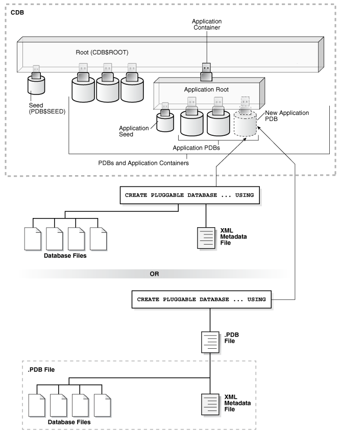

- About PDB Plugin Operations  
	To plug in a PDB, specify the `USING` clause of `CREATE PLUGGABLE DATABASE`. This clause specifies a XML metadata file or a compressed archive file (`.pdb` file).
- Plugging In an Unplugged PDB  
	Plug in a PDB with the `CREATE PLUGGABLE DATABASE ... USING` statement.
- After Plugging in an Unplugged PDB  
	Certain rules regarding users and tablespaces apply after plugging in an unplugged PDB.
- Plugging in an Unplugged PDB: Examples  
	These examples plug in an unplugged PDB named `salespdb` using the `/disk1/usr/salespdb.xml` file or the `/disk1/usr/sales.pdb` file given different factors.

**Parent topic:** [Creating PDBs and Application Containers](creating-pdbs.md)

### About PDB Plugin Operations

To plug in a PDB, specify the `USING` clause of `CREATE PLUGGABLE DATABASE`. This clause specifies a XML metadata file or a compressed archive file (`.pdb` file).

- About the XML File and Archive File  
	An XML metadata file describes the unplugged PDB and the files associated with the PDB (such as the data files and wallet file). An archive file includes both the XML metadata file and the PDB files.
- Source File Locations When Plugging In an Unplugged PDB  
	Use the `CREATE PLUGGABLE DATABASE ... USING` statement to plug an unplugged PDB into a CDB.

**Parent topic:** Plugging In an Unplugged PDB

#### About the XML File and Archive File

An XML metadata file describes the unplugged PDB and the files associated with the PDB (such as the data files and wallet file). An archive file includes both the XML metadata file and the PDB files.

When the XML metadata file is specified, the XML file includes the full paths of the PDB files. When the.pdb archive file is specified, the XML metadata file contains the relative file names only.

The following figure illustrates how to plug in an unplugged PDB.

Figure 10-1 Plugging an Unplugged PDB Into a CDB Root


> This illustration shows a CDB with a `CDB$ROOT` container, a `PDB$SEED` container plugged into the root, and several PDBs plugged into the root. One PDB is a new PDB. The illustration shows two options for creating the new PDB:
>
> - A `CREATE` `PLUGGABLE` `DATABASE` `...` `USING` statement uses the unplugged PDB’s XML metadata file along with the unplugged PDB’s database files to create the new PDB.
> - A `CREATE` `PLUGGABLE` `DATABASE` `...` `USING` statement uses a.PDB archive file to create the new PDB. The.PDB archive file contains the unplugged PDB’s database files and the unplugged PDB’s XML metadata file that are used to create the new PDB.


The following figure illustrates how this technique creates a new application PDB in an application container.

Figure 10-2 Plugging an Unplugged PDB Into an Application Root



> This illustration shows a CDB with a `CDB$ROOT` container, a `PDB$SEED` container plugged into the CDB root, an application container plugged into the CDB root, and several PDBs plugged into the CDB root. The application container has an application root, an application seed plugged into the application root, and several application PDBs plugged into the application root. One PDB is a new application PDB that is plugged into the application root. The illustration shows two options for creating the new PDB:
>
> - A `CREATE` `PLUGGABLE` `DATABASE` `...` `USING` statement uses the unplugged PDB’s XML metadata file along with the unplugged PDB’s database files to create the new application PDB.
> - A `CREATE` `PLUGGABLE` `DATABASE` `...` `USING` statement uses a.PDB archive file to create the new application PDB. The.PDB archive file contains the unplugged PDB’s database files and the unplugged PDB’s XML metadata file that are used to create the new PDB.


Note:

Automatic downgrade of a PDB is not supported. Therefore, you cannot plug in a PDB if the source CDB is a higher Oracle Database release than the target CDB.

When you plug in an unplugged PDB, you must address the questions that apply to plugging in an unplugged PDB in [Table 6-3](overview-of-pdb-creation.md). The table describes which `CREATE PLUGGABLE DATABASE` clauses you must specify based on different factors.

See Also:

- " [PDB Storage](overview-of-pdb-creation.md) "
- " [Creating an Application PDB](creating-application-pdb.md) "

**Parent topic:** About PDB Plugin Operations

#### Source File Locations When Plugging In an Unplugged PDB

Use the `CREATE PLUGGABLE DATABASE ... USING` statement to plug an unplugged PDB into a CDB.

When you use a.pdb archive file when plugging in a PDB, Oracle Database extracts this file when you plug in the PDB, and places the PDB files in the same directory as the.pdb archive file. Therefore, the clauses that specify the source file locations are not required when you use a.pdb archive file.

When you specify an XML metadata file when plugging in a PDB, this file describes the names and locations of an unplugged PDB source files. The XML file might not describe the locations of these files accurately if you transported the unplugged files from one storage system to a different one. The files are in a new location, but the file paths in the XML file still indicate the old location.

When plugging in an unplugged PDB using an XML metadata file (not a.pdb archive file), use either the `SOURCE_FILE_NAME_CONVERT` clause or the `SOURCE_FILE_DIRECTORY` clause. These clauses are mutually exclusive.

- SOURCE\_FILE\_NAME\_CONVERT Clause  
	The `SOURCE_FILE_NAME_CONVERT` clause specifies how to locate PDB files when they reside in a location different from that specified in the XML file.
- SOURCE\_FILE\_DIRECTORY Clause  
	The `SOURCE_FILE_DIRECTORY` clause specifies the source directory of the files that will be used to create the new PDB.

**Parent topic:** About PDB Plugin Operations

##### SOURCE\_FILE\_NAME\_CONVERT Clause

The `SOURCE_FILE_NAME_CONVERT` clause specifies how to locate PDB files when they reside in a location different from that specified in the XML file.

You can use this clause to specify one of the following options:

- One or more file name patterns and replacement file name patterns, in the following form:
	```
	'string1' , 'string2' , 'string3' , 'string4' , ...
	```
	The string2 file name pattern replaces the string1 file name pattern, and the string4 file name pattern replaces the string3 file name pattern. You can use as many pairs of file name pattern and replacement file name pattern strings as required.
	When you use this clause, ensure that the files you want to use for the PDB reside in the replacement file name patterns. Move or copy the files to these locations if necessary.
- `NONE` when no file names need to be located because the PDB's XML file describes the file names accurately. Omitting the `SOURCE_FILE_NAME_CONVERT` clause is the same as specifying `NONE`.

You can use the `SOURCE_FILE_NAME_CONVERT` clause only in a `CREATE` `PLUGGABLE` `DATABASE` statement with a `USING` clause that specifies an XML metadata file. Therefore, you can use this clause only when you are plugging in an unplugged PDB with an XML metadata file. You cannot use this clause when you are plugging in a PDB with a.pdb archive file.

Example 10-1 SOURCE\_FILE\_NAME\_CONVERT Clause

This `SOURCE_FILE_NAME_CONVERT` clause uses the files in the /disk2/oracle/pdb7 directory instead of the /disk1/oracle/pdb7 directory. In this case, the XML file describing a PDB specifies the /disk1/oracle/pdb7 directory, but the PDB should use the files in the /disk2/oracle/pdb7 directory.

```
SOURCE_FILE_NAME_CONVERT = ('/disk1/oracle/pdb7/', '/disk2/oracle/pdb7/')
```

See Also:

- Plugging In an Unplugged PDB
- [Oracle Database SQL Language Reference](https://docs.oracle.com/pls/topic/lookup?ctx=en/database/oracle/oracle-database/21/multi&id=SQLRF55794) for the syntax of the `SOURCE_FILE_NAME_CONVERT` clause

**Parent topic:** Source File Locations When Plugging In an Unplugged PDB

##### SOURCE\_FILE\_DIRECTORY Clause

The `SOURCE_FILE_DIRECTORY` clause specifies the source directory of the files that will be used to create the new PDB.

The clause specifies a directory that contains all of the files listed in the XML file. Using this clause is convenient when you have many data files and specifying a `SOURCE_FILE_NAME_CONVERT` pattern for each file is not feasible.

When you plug in a PDB, if the source files are all present in a single directory, then you can specify the directory name in this clause. The directory is scanned to find the appropriate files based on the unplugged PDB’s XML file.

You can use this clause to specify one of the following options:

- The absolute path of the source file directory.
- `NONE` when no files should be copied or moved during PDB creation. Omitting the `SOURCE_FILE_DIRECTORY` clause is the same as specifying `NONE`.

You can use the `SOURCE_FILE_DIRECTORY` clause only in a `CREATE PLUGGABLE DATABASE` statement with a `USING` clause that specifies an XML metadata file. Therefore, you can use this clause only when you are plugging in an unplugged PDB with an XML metadata file. You cannot use this clause when you are plugging in a PDB with a.pdb archive file.

You can specify this clause for configurations that use Oracle Managed Files and for configurations that do not use Oracle Managed Files.

Example 10-2 SOURCE\_FILE\_DIRECTORY Clause

This `SOURCE_FILE_DIRECTORY` clause generates file names for the new PDB by using the source files in the /oracle/pdb5/ directory.

```
SOURCE_FILE_DIRECTORY = '/oracle/pdb5/'
```

See Also:

- Plugging In an Unplugged PDB
- [Oracle Database SQL Language Reference](https://docs.oracle.com/pls/topic/lookup?ctx=en/database/oracle/oracle-database/21/multi&id=SQLRF57048) for the syntax of the `SOURCE_FILE_DIRECTORY` clause

**Parent topic:** Source File Locations When Plugging In an Unplugged PDB

### Plugging In an Unplugged PDB

Plug in a PDB with the `CREATE PLUGGABLE DATABASE ... USING` statement.

General Prerequisites

To plug in an unplugged PDB, the following prerequisites must be met:

- Complete the prerequisites described in " [General Prerequisites for PDB Creation](overview-of-pdb-creation.md) ".
- Either the XML file that describes the PDB or the.pdb archive file must exist in a location that is accessible to the CDB.
	The `USING` clause must specify the XML file or the.pdb archive file. If the PDB's XML file is unusable or cannot be located, then use the `DBMS_PDB.RECOVER` procedure to generate an XML file using the PDB's data files.
- If an XML file (not a.pdb file) is specified in the `USING` clause, then the files associated with the PDB (such as the data files and wallet file) must exist in a location that is accessible to the CDB.
- If the target database for the plugin operation is the primary database in an Oracle Data Guard configuration, then ensure that the standby database can locate the files for the plugged-in PDB.
	On the standby database, set the `STANDBY_PDB_SOURCE_FILE_DIRECTORY` initialization parameter to a location that contains the source data files for instantiating the PDB. If the files are not found, then the standby database tries to locate the files in the OMF location. If not found in the OMF location, then you must copy the data files to the OMF location on the standby database, and restart redo apply on the standby database.
- The source and target CDB platforms must meet the following requirements:
	- They must have the same endianness.
		- The database options installed on the source platform must be the same as, or a subset of, the database options installed on the target platform.
- If you are creating an application PDB, then the application name and version of the unplugged PDB must match the application name and version of the application container into which the application PDB is being plugged.

Note:

If you are plugging in a PDB that includes data that was encrypted with Transparent Data Encryption, then follow the instructions in [Oracle Database Advanced Security Guide](https://docs.oracle.com/pls/topic/lookup?ctx=en/database/oracle/oracle-database/21/multi&id=ASOAG-GUID-576582FE-7252-49BC-B795-121689258890) for united mode and [Oracle Database Advanced Security Guide](https://docs.oracle.com/pls/topic/lookup?ctx=en/database/oracle/oracle-database/21/multi&id=ASOAG-GUID-83D12D92-1BCD-4365-A801-279CEDEC51C3) for isolated mode.

Character Set Prerequisites

You must meet the following prerequisites for matching the character sets:

- If the character set of the CDB into which the PDB is being plugged is not AL32UTF8, then the CDB that contained the unplugged PDB and the target CDB must have compatible character sets and national character sets. To be compatible, the character sets and national character sets must meet the requirements specified in [Oracle Database Globalization Support Guide](https://docs.oracle.com/pls/topic/lookup?ctx=en/database/oracle/oracle-database/21/multi&id=NLSPG1035).
	If the character set of the CDB into which the PDB is being plugged is AL32UTF8, then this requirement does not apply.
	Note:
	Oracle Multitenant does not support a LOB in one container from being accessed by a container with a different character set using data links, extended data links, or the `CONTAINERS()` clause. For example, if the CDB root and `salespdb` have different character sets, then a `CONTAINERS()` query run in the CDB root should not access LOBs stored in `salespdb`.
- If you are creating an application PDB, then the application PDB must have the same character set and national character set as the application container.
	If the database character set of the CDB is AL32UTF8, then the character set and national character set of the application container can be different from the CDB. However, all application PDBs in an application container must have same character set and national character set, matching that of the application container.

To determine whether the preceding requirements are met, use the `DBMS_PDB.CHECK_PLUG_COMPATIBILITY` function. Step 2 in the following procedure describes using this function.

To plug in a PDB:

1. In SQL\*Plus, ensure that the current container is the CDB root or application root of the target CDB.
	When the current container is the CDB root, the PDB is created in the CDB. When the current container is an application root, the application PDB is created in the application container.
2. (Optional) Run the `DBMS_PDB.CHECK_PLUG_COMPATIBILITY` function to determine whether the unplugged PDB is compatible with the CDB.
	1. If the PDB is not yet unplugged, then run the `DBMS_PDB.DESCRIBE` procedure to produce an XML file that describes the PDB.
		If the PDB is already unplugged, then proceed to Step 2b.
		For example, to generate an XML file named `salespdb.xml` in the /disk1/oracle directory, run the following procedure:
		```
		BEGIN
		  DBMS_PDB.DESCRIBE(
		    pdb_descr_file => '/disk1/oracle/salespdb.xml',
		    pdb_name       => 'SALESPDB');
		END;
		/
		```
		If the PDB is in a remote CDB, then you can include `@` `database_link_name` in the `pdb_name` parameter, where `database_link_name` is the name of a valid database link to the remote CDB or to the PDB. For example, if the database link name to the remote CDB is `rcdb`, then set the `pdb_name` value to `SALESPDB@rcdb`.
		2. Run the `DBMS_PDB.CHECK_PLUG_COMPATIBILITY` function.
		When you run the function, set the following parameters:
		- `pdb_descr_file` - Set this parameter to the full path to the XML file.
				- `pdb_name` - Specify the name of the new PDB. If this parameter is omitted, then the PDB name in the XML file is used.
		For example, to determine whether a PDB described by the `/disk1/usr/salespdb.xml` file is compatible with the current CDB, run the following PL/SQL block:
		```
		SET SERVEROUTPUT ON
		DECLARE
		  compatible CONSTANT VARCHAR2(3) := 
		    CASE DBMS_PDB.CHECK_PLUG_COMPATIBILITY(
		           pdb_descr_file => '/disk1/usr/salespdb.xml',
		           pdb_name       => 'SALESPDB')
		    WHEN TRUE THEN 'YES'
		    ELSE 'NO'
		END;
		BEGIN
		  DBMS_OUTPUT.PUT_LINE(compatible);
		END;
		/
		```
		If the output is `YES`, then the PDB is compatible, and you can continue with the next step. If the output is `NO`, then the PDB is not compatible: check the `PDB_PLUG_IN_VIOLATIONS` view to see why it is not compatible.
	Note:
	You can specify a.pdb archive file in the `pdb_descr_file` parameter.
3. If the PDB is not unplugged, then unplug it.
4. Run the `CREATE PLUGGABLE DATABASE ... USING` statement, specifying the XML file or the.pdb archive file in the `USING` clause. Specify other clauses when they are required.
	After you create the PDB, it is in mounted mode, and its status is `NEW`. You can view the open mode of a PDB by querying the `OPEN_MODE` column in the `V$PDBS` view. You can view the status of a PDB by querying the `STATUS` column of the `CDB_PDBS` or `DBA_PDBS` view.
	A new default service is created for the PDB. The service has the same name as the PDB and can be used to access the PDB. Oracle Net Services must be configured properly for clients to access this service.
5. Open the new PDB in read/write mode.
	You must open the new PDB in read/write mode for Oracle Database to complete the integration of the new PDB into the CDB. An error is returned if you attempt to open the PDB in read-only mode. After the PDB is opened in read/write mode, its status is `NORMAL`.
	Opening a PDB upgrades it automatically when a version mismatch occurs between the PDB and the CDB root. The Replay Upgrade on PDB Open optimization, which is the default, avoids manual error correction by re-executing statements stored in capture tables. The mechanism is the same used in application synchronization. When the PDB is opened, the database automatically performs a Replay Upgrade.
6. Back up the PDB.
	A PDB cannot be recovered unless it is backed up.

Note:

If an error is returned during PDB creation, then the PDB being created might be in an `UNUSABLE` state. You can check a PDB's state by querying the `CDB_PDBS` or `DBA_PDBS` view, and you can learn more about PDB creation errors by checking the alert log. An unusable PDB can only be dropped, and it must be dropped before a PDB with the same name as the unusable PDB can be created.

See Also:

- " [Unplugging a PDB from a CDB](removing-a-pdb.md) "
- " [Modifying the Open Mode of PDBs](administering-pdbs-with-sql-plus.md) " for more information
- [Oracle Database Backup and Recovery User’s Guide](https://docs.oracle.com/pls/topic/lookup?ctx=en/database/oracle/oracle-database/21/multi&id=BRADV-GUID-655DC5F5-FF8D-4A73-B67D-F5AAE20CA382) for information about backing up a PDB
- [Oracle Data Guard Concepts and Administration](https://docs.oracle.com/pls/topic/lookup?ctx=en/database/oracle/oracle-database/21/multi&id=SBYDB-GUID-20D2DEAC-0355-4FBB-ADB8-37BF5F4328E2) to learn more about plugging in a PDB in an Oracle Data Guard environment
- [Oracle Database Reference](https://docs.oracle.com/pls/topic/lookup?ctx=en/database/oracle/oracle-database/21/multi&id=REFRN10322) for information about the `PDB_FILE_NAME_CONVERT` initialization parameter
- [Oracle Database PL/SQL Packages and Types Reference](https://docs.oracle.com/pls/topic/lookup?ctx=en/database/oracle/oracle-database/21/multi&id=ARPLS73527) for more information about this procedure.

**Parent topic:** Plugging In an Unplugged PDB

### After Plugging in an Unplugged PDB

Certain rules regarding users and tablespaces apply after plugging in an unplugged PDB.

The following applies after plugging in an unplugged PDB:

- User accounts in the PDB who used the default temporary tablespace of the source PDB use the default temporary tablespace of the target PDB. User accounts who used nondefault temporary tablespaces in the source PDB continue to use the same local temporary tablespaces in the target PDB.
- Manually created common user accounts that existed in the source CDB but not in the target CDB do not have privileges granted commonly. However, if the target CDB has a common user with the same name as a common user in the PDB, then the latter is linked to the former and has the privileges granted to this common user in the target CDB.
	If the cloned or plugged-in PDB has a common user account that does not exist in the target CDB, and if this user does not own objects in the PDB, then Oracle Database drops the user during the synchronization step; otherwise, the user account is locked in the target PDB. You have the following options regarding locked accounts:
	- Close the PDB, connect to the root, and create a common user account with the same name. When the PDB is opened in read/write mode, differences in roles and privileges granted commonly to the user account are resolved, and you can unlock the account. Privileges and roles granted locally to the user account remain unchanged during this process.
		- Create a new local user account in the PDB and use Data Pump to export/import the locked user's data into the new local user's schema.
		- Leave the user account locked.
		- Drop the user account.

See Also:

- " [Managing Services for PDBs](administering-pdbs-with-sql-plus.md) "
- " [About Managing Tablespaces in a CDB](administering-a-cdb-with-sql-plus.md) "
- [Oracle Database Concepts](https://docs.oracle.com/pls/topic/lookup?ctx=en/database/oracle/oracle-database/21/multi&id=CNCPT89257) for information about common users and local users
- [Oracle Database Security Guide](https://docs.oracle.com/pls/topic/lookup?ctx=en/database/oracle/oracle-database/21/multi&id=DBSEG002) for information about creating common users and local users in a CDB
- [Oracle Database Utilities](https://docs.oracle.com/pls/topic/lookup?ctx=en/database/oracle/oracle-database/21/multi&id=SUTIL4334) for information about using Oracle Data Pump with a CDB

**Parent topic:** Plugging In an Unplugged PDB

### Plugging in an Unplugged PDB: Examples

These examples plug in an unplugged PDB named `salespdb` using the `/disk1/usr/salespdb.xml` file or the `/disk1/usr/sales.pdb` file given different factors.

In each example, the root to which the new PDB belongs depends on the current container when the `CREATE PLUGGABLE DATABASE` statement is run:

- When the current container is the CDB root, the new PDB is created in the CDB.
- When the current container is an application root, the new application PDB is created in the application root’s application container.

Example 10-3 Plugging In an Unplugged PDB Using the NOCOPY Clause

This example assumes the following factors:

- The new PDB is not based on the same unplugged PDB that was used to create an existing PDB in the CDB. Therefore, the `AS` `CLONE` clause is not required.
- The `PATH_PREFIX` clause is not required.
- The XML file accurately describes the current locations of the files. Therefore, the `SOURCE_FILE_NAME_CONVERT` clause or `SOURCE_FILE_DIRECTORY` clause is not required.
- The files are in the correct location. Therefore, `NOCOPY` is included.
- Storage limits are not required for the PDB. Therefore, the `STORAGE` clause is not required.
- A file with the same name as the temp file specified in the XML file exists in the target location. Therefore, the `TEMPFILE REUSE` clause is required.

Given the preceding factors, the following statement plugs in the PDB:

```
CREATE PLUGGABLE DATABASE salespdb USING '/disk1/usr/salespdb.xml' 
  NOCOPY 
  TEMPFILE REUSE;
```

Example 10-4 Plugging In an Unplugged PDB Using the AS CLONE and NOCOPY Clauses

This example assumes the following factors:

- The new PDB is based on the same unplugged PDB that was used to create an existing PDB in the CDB. Therefore, the `AS` `CLONE` clause is required. The `AS` `CLONE` clause ensures that the new PDB has unique identifiers.
- The `PATH_PREFIX` clause is not required.
- The XML file accurately describes the current locations of the files. Therefore, the `SOURCE_FILE_NAME_CONVERT` clause or `SOURCE_FILE_DIRECTORY` clause is not required.
- The files are in the correct location. Therefore, `NOCOPY` is included.
- Storage limits are not required for the PDB. Therefore, the `STORAGE` clause is not required.
- A file with the same name as the temp file specified in the XML file exists in the target location. Therefore, the `TEMPFILE REUSE` clause is required.

Given the preceding factors, the following statement plugs in the PDB:

```
CREATE PLUGGABLE DATABASE salespdb AS CLONE USING '/disk1/usr/salespdb.xml' 
  NOCOPY
  TEMPFILE REUSE;
```

Example 10-5 Plugging In an Unplugged PDB Using the SOURCE\_FILE\_NAME\_CONVERT, NOCOPY, and STORAGE Clauses

This example assumes the following factors:

- The new PDB is not based on the same unplugged PDB that was used to create an existing PDB in the CDB. Therefore, the `AS` `CLONE` clause is not required.
- The `PATH_PREFIX` clause is not required.
- The XML file does not accurately describe the current locations of the files. Therefore, the `SOURCE_FILE_NAME_CONVERT` clause or `SOURCE_FILE_DIRECTORY` clause is required. In this example, the XML file indicates that the files are in /disk1/oracle/sales, but the files are in /disk2/oracle/sales, and the `SOURCE_FILE_NAME_CONVERT` clause is used.
- The files are in the correct location. Therefore, `NOCOPY` is included.
- Storage limits must be enforced for the PDB. Therefore, the `STORAGE` clause is required. Specifically, all tablespaces that belong to the PDB must not exceed 2 gigabytes.
- A file with the same name as the temp file specified in the XML file exists in the target location. Therefore, the `TEMPFILE REUSE` clause is required.

Given the preceding factors, the following statement plugs in the PDB:

```
CREATE PLUGGABLE DATABASE salespdb USING '/disk1/usr/salespdb.xml' 
  SOURCE_FILE_NAME_CONVERT = ('/disk1/oracle/sales/', '/disk2/oracle/sales/')
  NOCOPY
  STORAGE (MAXSIZE 2G)
  TEMPFILE REUSE;
```

Example 10-6 Plugging In an Unplugged PDB With the COPY, PATH\_PREFIX, and FILE\_NAME\_CONVERT Clauses

This example assumes the following factors:

- The new PDB is not based on the same unplugged PDB that was used to create an existing PDB in the CDB. Therefore, the `AS` `CLONE` clause is not required.
- The path prefix must be added to the PDB's directory object paths. Therefore, the `PATH_PREFIX` clause is required. In this example, the path prefix /disk2/oracle/sales/ is added to the PDB’s directory object paths.
- The XML file accurately describes the current locations of the files. Therefore, the `SOURCE_FILE_NAME_CONVERT` clause or `SOURCE_FILE_DIRECTORY` clause is not required.
- The files are not in the correct location. Therefore, `COPY` or `MOVE` must be included. In this example, the files are copied.
	The `CREATE_FILE_DEST` clause is not used, Oracle Managed Files is not enabled, and the `PDB_FILE_NAME_CONVERT` initialization parameter is not set. Therefore, the `FILE_NAME_CONVERT` clause is required. In this example, the files are copied from /disk1/oracle/sales to /disk2/oracle/sales.
- Storage limits are not required for the PDB. Therefore, the `STORAGE` clause is not required.
- There is no file with the same name as the new temp file that will be created in the target location. Therefore, the `TEMPFILE REUSE` clause is not required.

Given the preceding factors, the following statement plugs in the PDB:

```
CREATE PLUGGABLE DATABASE salespdb USING '/disk1/usr/salespdb.xml' 
  COPY
  PATH_PREFIX = '/disk2/oracle/sales/'
  FILE_NAME_CONVERT = ('/disk1/oracle/sales/', '/disk2/oracle/sales/');
```

Example 10-7 Plugging In an Unplugged PDB Using the SOURCE\_FILE\_NAME\_CONVERT, MOVE, FILE\_NAME\_CONVERT, and STORAGE Clauses

This example assumes the following factors:

- The new PDB is not based on the same unplugged PDB that was used to create an existing PDB in the CDB. Therefore, the `AS` `CLONE` clause is not required.
- The `PATH_PREFIX` clause is not required.
- The XML file does not accurately describe the current locations of the files. Therefore, the `SOURCE_FILE_NAME_CONVERT` clause or `SOURCE_FILE_DIRECTORY` clause is required. In this example, the XML file indicates that the files are in /disk1/oracle/sales, but the files are in /disk2/oracle/sales, and the `SOURCE_FILE_NAME_CONVERT` clause is used.
- The files are not in the correct final location for the PDB. Therefore, `COPY` or `MOVE` must be included. In this example, `MOVE` is specified to move the files.
	The `CREATE_FILE_DEST` clause is not used, Oracle Managed Files is not enabled, and the `PDB_FILE_NAME_CONVERT` initialization parameter is not set. Therefore, the `FILE_NAME_CONVERT` clause is required. In this example, the files are moved from /disk2/oracle/sales to /disk3/oracle/sales.
- Storage limits must be enforced for the PDB. Therefore, the `STORAGE` clause is required. Specifically, all tablespaces that belong to the PDB must not exceed 2 gigabytes.
- There is no file with the same name as the new temp file that will be created in the target location. Therefore, the `TEMPFILE REUSE` clause is not required.

Given the preceding factors, the following statement plugs in the PDB:

```
CREATE PLUGGABLE DATABASE salespdb USING '/disk1/usr/salespdb.xml' 
  SOURCE_FILE_NAME_CONVERT = ('/disk1/oracle/sales/', '/disk2/oracle/sales/')
  MOVE
  FILE_NAME_CONVERT = ('/disk2/oracle/sales/', '/disk3/oracle/sales/')
  STORAGE (MAXSIZE 2G);
```

Example 10-8 Plugging In an Unplugged PDB Using the SOURCE\_FILE\_DIRECTORY, MOVE, FILE\_NAME\_CONVERT, and STORAGE Clauses

This example assumes the following factors:

- The new PDB is not based on the same unplugged PDB that was used to create an existing PDB in the CDB. Therefore, the `AS` `CLONE` clause is not required.
- The `PATH_PREFIX` clause is not required.
- The XML file does not accurately describe the current locations of the files. Therefore, the `SOURCE_FILE_NAME_CONVERT` clause or `SOURCE_FILE_DIRECTORY` clause is required. In this example, the XML file indicates that the files are in /disk1/oracle/sales, but the files are in /disk2/oracle/sales, and the `SOURCE_FILE_DIRECTORY` clause is used.
- The files are not in the correct final location for the PDB. Therefore, `COPY` or `MOVE` must be included. In this example, `MOVE` is specified to move the files.
	The `CREATE_FILE_DEST` clause is not used, Oracle Managed Files is not enabled, and the `PDB_FILE_NAME_CONVERT` initialization parameter is not set. Therefore, the `FILE_NAME_CONVERT` clause is required. In this example, the files are moved from /disk2/oracle/sales to /disk3/oracle/sales.
- Storage limits must be enforced for the PDB. Therefore, the `STORAGE` clause is required. Specifically, all tablespaces that belong to the PDB must not exceed 2 gigabytes.
- There is no file with the same name as the new temp file that will be created in the target location. Therefore, the `TEMPFILE REUSE` clause is not required.

Given the preceding factors, the following statement plugs in the PDB:

```
CREATE PLUGGABLE DATABASE salespdb USING '/disk1/usr/salespdb.xml' 
  SOURCE_FILE_DIRECTORY = '/disk2/oracle/sales/'  
  MOVE
  FILE_NAME_CONVERT = ('/disk2/oracle/sales/', '/disk3/oracle/sales/')
  STORAGE (MAXSIZE 2G);
```

Example 10-9 Plugging In an Unplugged PDB Using an Archive File

This example assumes the following factors:

- The unplugged PDB is in a.pdb archive file named `sales.pdb`. The archive file includes the XML metadata file and the PDB’s files (such as the data files and wallet file) in compressed form, and these files are extracted to the current directory of the.pdb archive file when the `CREATE PLUGGABLE DATABASE` statement is run.
- The new PDB is not based on the same unplugged PDB that was used to create an existing PDB in the CDB. Therefore, the `AS` `CLONE` clause is not required.
- The `PATH_PREFIX` clause is not required.
- Storage limits must be enforced for the PDB. Therefore, the `STORAGE` clause is required. Specifically, all tablespaces that belong to the PDB must not exceed 2 gigabytes.
- There is no file with the same name as the new temp file that will be created in the target location. Therefore, the `TEMPFILE REUSE` clause is not required.

Given the preceding factors, the following statement plugs in the PDB using an archive file:

```
CREATE PLUGGABLE DATABASE salespdb USING '/disk1/usr/sales.pdb' 
  STORAGE (MAXSIZE 2G);
```

**Parent topic:** Plugging In an Unplugged PDB