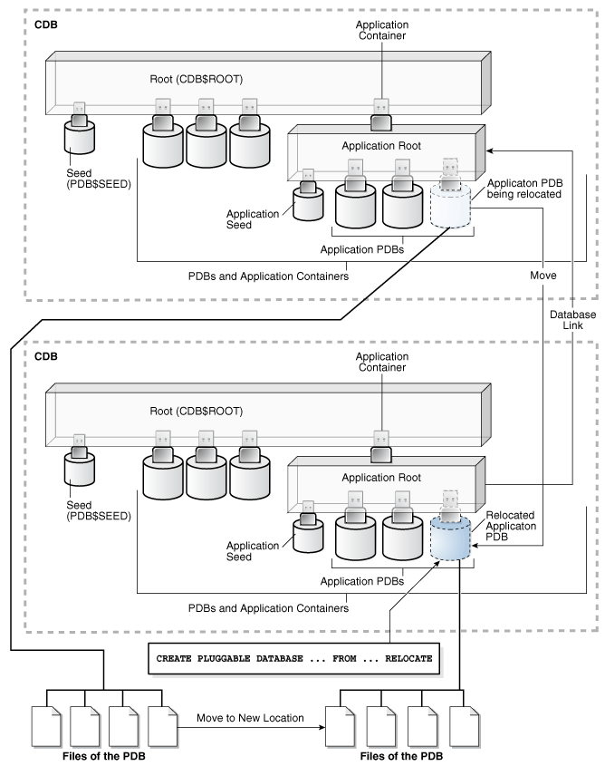

- About PDB Relocation  
	During relocation, the source PDB can be open in read/write mode and fully functional.
- Purpose of PDB Relocation  
	This technique is the fastest way to move a PDB with minimal or no down time. Otherwise, unplugging the source PDB requires a PDB outage until the PDB is plugged in to the target CDB.
- How PDB Relocation Works  
	The operation moves the files associated with the PDB to a new location, adds the PDB to the target CDB, and then opens the PDB.
- User Interface for PDB Relocation  
	You can relocate PDBs on the command line using SQL, the DBCA utility, or the Fleet Patching and Provisioning utility.
- Relocating a PDB Using CREATE PLUGGABLE DATABASE  
	The `CREATE PLUGGABLE DATABASE ... RELOCATE` statement moves a PDB to a different container.
- Relocating a PDB: Examples  
	The examples in this section demonstration relocation using SQL and DBCA.

**Parent topic:** [Creating PDBs and Application Containers](creating-pdbs.md)

### About PDB Relocation

During relocation, the source PDB can be open in read/write mode and fully functional.

PDB relocation executes an online block level copy of the source PDB data files, redo, and undo while the source PDB is open with active sessions. When the target PDB comes online because of an `ALTER PLUGGABLE DATABASE OPEN` statement, Oracle Database terminates the active sessions and closes the source PDB.

The following graphic shows the relocation of a common PDB (that is, not an application PDB) to a new single-instance CDB. The source PDB is plugged in to the CDB root, and the target PDB is plugged in to the CDB root. Note that the `CREATE PLUGGABLE DATABASE ... RELOCATE` statement copies the data blocks, undo blocks, and redo blocks to the new location. A database link is required.

Figure 9-1 Relocate a PDB into the Root Container


> This illustration shows two CDBs. Both CDBs have a `CDB$ROOT` container, a `PDB$SEED` container plugged into the root, and several PDBs plugged into the root. The top CDB has one PDB that is being relocated. The bottom CDB has one new PDB that was relocated from the top CDB. The illustration shows a database link going from the CDB root in the bottom CDB to the CDB root in the top CDB. The illustration shows the files of the PDB being relocated. The illustration shows the PDB’s files moved to a new location. The illustration shows the moved files associated with the new PDB. A `CREATE` `PLUGGABLE` `DATABASE` `...` `FROM``...` `RELOCATE` statement uses these moved files to create the new PDB.


When the target PDB is an application PDB or application root, you have the following options:

- You can relocate a PDB into an application container as an application PDB. The target PDB can be in the same CDB or a different CDB.
- You can relocate an application PDB from one application root to another. The target PDB must be in a different CDB.
- You can relocate an empty application root from one CDB to another, but the application root must not have any hosted application PDBs.

The following graphic illustrates how this technique creates a new application PDB in an application container.

Figure 9-2 Relocate a PDB into an Application Container



> This illustration shows two CDBs. Both CDBs have a `CDB$ROOT` container, a `PDB$SEED` container plugged into the root, and several PDBs plugged into the root. The top CDB also has one application container with an application root, an application seed, and several application PDBs plugged into it. The top CDB has one new application PDB that is being relocated into the application container. The new application PDB was relocated from the bottom CDB. The illustration shows a database link going from the application root in the bottom CDB to the application root in the top CDB. The illustration shows the files of the PDB being relocated moved to a new location. The illustration shows the moved files associated with the new application PDB. A `CREATE` `PLUGGABLE` `DATABASE` `...` `FROM``...` `RELOCATE` statement uses these moved files to create the new application PDB.


When you open the relocated PDB for the first time, Oracle Database drains active sessions on the source PDB and redirects client connections to the relocated PDB services. Opening the relocated PDB initiates the shutdown of the original source PDB. The source and relocated PDBs are never open at the same time.

See Also:

" [PDB Storage](overview-of-pdb-creation.md) "

**Parent topic:** Relocating a PDB

### Purpose of PDB Relocation

This technique is the fastest way to move a PDB with minimal or no down time. Otherwise, unplugging the source PDB requires a PDB outage until the PDB is plugged in to the target CDB.

When moving a PDB between data centers, or from an on-premises environment to a cloud environment, all the data must physically move. For large PDBs, this process may take considerable time, possibly violating availability components of an SLA. PDB relocation eliminates the outage completely. You can relocate the PDB without taking the application offline, changing the application, or changing network connection strings.

**Parent topic:** Relocating a PDB

### How PDB Relocation Works

The operation moves the files associated with the PDB to a new location, adds the PDB to the target CDB, and then opens the PDB.

- Server Session Draining When Relocating or Stopping PDBs  
	A key requirement of planned maintenance is draining or failing over PDB sessions so that application work is not interrupted.
- Stages of PDB Relocation  
	The details of PDB relocation vary depending on the listener networks.

**Parent topic:** Relocating a PDB

#### Server Session Draining When Relocating or Stopping PDBs

A key requirement of planned maintenance is draining or failing over PDB sessions so that application work is not interrupted.

Automatic Session Failover

In database-generic session draining, active sessions can exit gracefully under a timer. After the timer has expired, Oracle Database terminates all active sessions, and then reconnects them to the relocated PDB.

Starting in Oracle Database 21c, during planned maintenance, the database may decide that a session is unlikely to drain in the drain window. In this case, the database invokes Application Continuity and fails over the session automatically. The draining feature is enabled by default for all maintenance operations invoked at the database service and PDB levels: stop service, relocate service, relocate PDB, and stop PDB.

Note:

If your application server user a Purge Pool property, then disable this property because it disrupts sessions that are not ready to drain.

Rules for Session Draining

The database uses an extensible set of rules to determine when to drain a database session, which persists until a rule is satisfied. The rules include the following:

- Standard application server tests for validity
- Custom SQL tests for validity
- Request boundaries are in use and no request is active
- Request boundaries are in use and the current request has ended
- The session has one or more session states that are recoverable, and can be recreated at failover

A typical use case is application servers and pooled applications that test connections when borrowing from connection pools, returning connections to the pool, and at batch commits. When draining sessions, the database automatically intercepts the connection test, closes the connection, and then returns a failed status for the test. After receiving the failed status, the application layer can request a different connection. In this way, the application is not disrupted.

Application Continuity with FAN on Oracle RAC

For an optimal configuration that minimizes the impact on the client, consider configuring Application Continuity with FAN on the Oracle RAC database. In Oracle Clusterware, the Fleet Patching and Provisioning feature automates PDB relocation. An example of finer-grained relocation in an Oracle RAC environment is service relocation between PDB instances. Oracle RAC and Oracle Clusterware offer a rich high availability environment that further minimizes the impact on connected clients during relocation. For example, shared storage may minimize or remove the necessity to copy data files. Transparent Application Continuity, a mode of Application Continuity, is enabled by default in Oracle Cloud.

Note:

In an Oracle Clusterware environment, when relocating a PDB between different CDBs, you must create non-database services using SRVCTL.

See Also:

Oracle Clusterware Administration and Deployment Guide to learn about [Application Continuity](https://docs.oracle.com/pls/topic/lookup?ctx=en/database/oracle/oracle-database/21/multi&id=CWADD-GUID-BD699AEB-9F85-42A8-8687-5A979918938D#GUID-BD699AEB-9F85-42A8-8687-5A979918938D), [SRVCTL](https://docs.oracle.com/pls/topic/lookup?ctx=en/database/oracle/oracle-database/21/multi&id=CWADD-GUID-1DCA9E3F-B929-4555-B673-921FF3588AC3), and [Fleet Patching and Provisioning](https://docs.oracle.com/pls/topic/lookup?ctx=en/database/oracle/oracle-database/21/multi&id=GUID-CCEC5960-EDA4-4A3F-9643-0CA308EA49AA)

**Parent topic:** How PDB Relocation Works

#### Stages of PDB Relocation

The details of PDB relocation vary depending on the listener networks.

- PDB Relocation in a Common Listener Network  
	When the source and target location share a common listener network, forwarding client connections is not necessary because the SQL\*Net layer forwards client connections implicitly.
- PDB Relocation in Isolated Listener Networks  
	When independent listeners do not use cross-registration, the listener in the target CDB and source CDB have no knowledge of each other or of their respective published services.

**Parent topic:** How PDB Relocation Works

##### PDB Relocation in a Common Listener Network

When the source and target location share a common listener network, forwarding client connections is not necessary because the SQL\*Net layer forwards client connections implicitly.

AVAILABILITY NORMAL

When the listener network is common, specify the `AVAILABILITY NORMAL` clause in `CREATE PLUGGABLE DATABASE ... RELOCATE`. This option is the default. The following situations are typical use cases for `AVAILABILITY NORMAL`:

- Shared listener
	If you use the same listener for the PDB in its old and new locations, then new connections are automatically routed to the new location when relocation completes. This situation is typical of a relocation between CDBs in the same host. In this case, the PDB is re-registered with the listener in its new location. Additional connection handling is not required.
- Cross-registered listeners
	If the PDBs use different listeners, and if you employ cross-registration of their respective listeners through configuration of the `local_listener` and `remote_listener` parameters, then relocation is seamless. The availability and location of the PDB’s services are automatically registered with both listeners. This situation is typical of relocation between hosts within a data center, perhaps for load balancing purposes.

In shared and cross registered listener environments, services from all databases are published to the common listener network. For this reason, services for relocated PDBs are immediately known to the common listener network. To avoid service name space collisions, PDB service definitions must be unique in the common listener network.

Stages of Relocation in a Common Listener Network

1. The user issues `CREATE PLUGGABLE DATABASE ... RELOCATE AVAILABILITY NORMAL`.
	This step executes a hot clone of the source PDB from its original location to its target location. The source PDB copies data files, undo blocks, and redo blocks to the target PDB as of an implicit begin SCN marker.
	When this step completes, two transactionally consistent copies of this PDB exist: one in the source container and one in the target container. For the duration of the operation, processing continues uninterrupted on the source PDB. Users of an application or applications connected to the source PDB are unaware that a relocation is underway.
	All existing application connections, and new connections created during this step, continue to connect to the source PDB.
2. The user issues `ALTER PLUGGABLE DATABASE OPEN`.
	The following actions occur in the background:
	1. The target PDB implicitly sets the end SCN marker, and applies any redo or undo required to complete media recovery to satisfy the implicit end SCN marker.
		2. When media recovery occurs on the target PDB, Oracle Database initiates active session draining on the source PDB.
		3. PDB services are registered with the listener and are available on the target CDB.
		4. The source PDB is closed.
		5. The target PDB opens in read/write mode.
		This step completes the relocation of the PDB to the target CDB. At the end of the operation, connections point to the newly relocated PDB.
		After the PDB is opened in read/write mode, its status is `NORMAL`. The database returns an error if you attempt to open the PDB in read-only mode.

See Also:

- [Oracle Database Net Services Administrator's Guide](https://docs.oracle.com/pls/topic/lookup?ctx=en/database/oracle/oracle-database/21/multi&id=NETAG-GUID-63F36312-FDA8-4B20-B8E1-4949AD55707A) for more information about listener redirects
- [Oracle Real Application Clusters Administration and Deployment Guide](https://docs.oracle.com/pls/topic/lookup?ctx=en/database/oracle/oracle-database/21/multi&id=RACAD-GUID-C1EF6BDA-5F90-448F-A1E2-DC15AD5CFE75) to learn more about using Application Continuity to drain and migration sessions before planned maintenance

**Parent topic:** Stages of PDB Relocation

##### PDB Relocation in Isolated Listener Networks

When independent listeners do not use cross-registration, the listener in the target CDB and source CDB have no knowledge of each other or of their respective published services.

AVAILABILITY MAX

The `AVAILABILITY MAX` clause in `CREATE PLUGGABLE DATABASE ... RELOCATE` implicitly instructs the SQL\*Net layer to reconfigure the original listener. This situation may be common when relocating a PDB between data centers. This configuration is intended to be temporary while the Oracle Internet Directory (OID) or LDAP server is updated or the client connections are modified.

If a local listener redirects to a Single Client Access Name (SCAN) listener in an Oracle RAC configuration, then this listener may need to further redirect the client connection request to another cluster node. Multiple redirects are not supported by Oracle Net listeners by default. Because any SCAN listener can route the connection request to any node, set the `ALLOW_MULTIPLE_REDIRECTS_listener_name` parameter to the `listener_name` of every SCAN listener, and set it in every `listener.ora` file in the cluster. For example, if the SCAN listeners are named `listener_scan1`, `listener_scan2`, and `listener_scan3`, then the `listener.ora` file on every destination host should have the following settings:

```
ALLOW_MULTIPLE_REDIRECTS_LISTENER_SCAN1=YES
ALLOW_MULTIPLE_REDIRECTS_LISTENER_SCAN2=YES
ALLOW_MULTIPLE_REDIRECTS_LISTENER_SCAN3=YES
```

Caution:

Do not set the `ALLOW_MULTIPLE_REDIRECTS_listener_name` parameter for node listeners because it may allow infinite redirection loops in certain network configurations.

Stages of Relocation in an Isolated Listener Network

1. The user issues `CREATE PLUGGABLE DATABASE ... RELOCATE AVAILABILITY MAX`.
	This step executes a hot clone of the source PDB from its original location to its target location. The source PDB copies data files, undo blocks, and redo blocks to the target PDB as of an implicit begin SCN marker.
2. The user issues `ALTER PLUGGABLE DATABASE OPEN`.
	The following actions occur in the background:
	1. The target PDB implicitly sets the end SCN marker, and applies any redo or undo required to complete media recovery to satisfy the implicit end SCN marker.
		2. When media recovery occurs on the target PDB, Oracle Database initiates active session draining on the source PDB.
		3. The `LISTENER_NETWORKS` initialization parameter is implicitly updated in the source PDB with the forwarding address, and the listener PDB services for the source CDB are updated with the forwarding address.
		4. The target PDB opens in read-only mode while media recovery completes.
		At this stage, only queries of the target PDB are permitted. Queries behave exactly as if they had been run on the source PDB. However, connections attempting DML do not complete.
		5. Read-only connections are immediately forwarded to the new hosting listener, and new read/write connections are forwarded to the new hosting listener, where they spin until the target PDB is opened in a consistent state.
		6. The source PDB executes a `SHUTDOWN IMMEDIATE`, terminating persistent connections.
		7. The target PDB opens in read/write mode.
		This step completes the relocation of the PDB to the target CDB. At the end of the operation, connections point to the newly relocated PDB.
		After the PDB is opened in read/write mode, its status is `NORMAL`. The database returns an error if you attempt to open the PDB in read-only mode.

Note:

An artifact known as a tombstone PDB remains in the source CDB to protect the PDB’s namespace and preserve the listener forwarding configuration until the updates are complete. In the root of the source CDB, the tombstone PDB is visible in `V$CONTAINERS` with a status of `RELOCATED`. When you change the application connect strings to provide direct connections to the target PDB, you can drop the tombstone PDB from the source CDB.

See Also:

- " [Creating an Application PDB](creating-application-pdb.md) "
- [Oracle Database Net Services Administrator's Guide](https://docs.oracle.com/pls/topic/lookup?ctx=en/database/oracle/oracle-database/21/multi&id=NETAG-GUID-63F36312-FDA8-4B20-B8E1-4949AD55707A) for more information about listener redirects
- [Oracle Real Application Clusters Administration and Deployment Guide](https://docs.oracle.com/pls/topic/lookup?ctx=en/database/oracle/oracle-database/21/multi&id=RACAD-GUID-C1EF6BDA-5F90-448F-A1E2-DC15AD5CFE75) to learn more about using Application Continuity to drain and migration sessions before planned maintenance

**Parent topic:** Stages of PDB Relocation

### User Interface for PDB Relocation

You can relocate PDBs on the command line using SQL, the DBCA utility, or the Fleet Patching and Provisioning utility.

SQL Statement

The form of the SQL statement is as follows:

```
CREATE PLUGGABLE DATABASE ... FROM src_pdb_name@link2src ... RELOCATE AVAILABILITY [MAX | NORMAL]
```

The `FROM` clause identifies the location of the source PDB. For `src_pdb_name`, specify the name of the source PDB. For `link2src`, specify a database link that indicates the location of the source PDB. The database link must have been created in the target CDB, which is the CDB to which the PDB will be relocated. The link can connect either to the root of the remote CDB or to the remote PDB.

The `AVAILABILITY` clause determines how the database handles client connections.

DBCA

You can relocate a PDB by running DBCA in silent mode. The `relocatePDB` command performs the relocation.

Table 9-1 relocatePDB Parameters

| Parameter | Description |
| --- | --- |
| `-remotePDBName remote_pdb_name` | The name of the PDB that you intend to relocate. |
| `-remoteDBConnString remote_db_conn_string` | The net service connection to the remote CDB. |
| `-sysDBAUserName sysdbusername` | The name of the `SYS` user in the local CDB. |
| `-sysDBAPassword sysdbapassowrd` | The password of the `SYS` user in the local CDB. |
| `-remoteDBSYSDBAUserName sysdbusername` | The name of the `SYS` user in the remote CDB. |
| `-remoteDBSYSDBAPassword sysdbapassowrd` | The password of the `SYS` user in the remote CDB. |
| `-dbLinkUsername dblink_common_user_name` | The name of the common user in the remote CDB. |
| `-dbLinkUserPassword dblink_common_username_pwd` | The password of the common user in the remote CDB. |
| `-sourceDB dbname_pdb_toberelocated` | The name of the source PDB. |
| `-pdbName pdbtoberecreated` | The name of the PDB after relocation. |

Fleet Patching and Provisioning Control (RHPCTL)

In Oracle Grid Infrastructure, you can use Fleet Patching and Provisioning to automate relocation of a PDB from one CDB to another.

See Also:

- [Oracle Database SQL Language Reference](https://docs.oracle.com/pls/topic/lookup?ctx=en/database/oracle/oracle-database/21/multi&id=GUID-F2DBA8DD-EEA8-4BB7-A07F-78DC04DB1FFC) for `CREATE PLUGGABLE DATABASE` syntax and semantics
- [Oracle Database Administrator’s Guide](https://docs.oracle.com/pls/topic/lookup?ctx=en/database/oracle/oracle-database/21/multi&id=GUID-5DD346B8-4404-48F1-A811-F39D739E4D05) for the DBCA command reference for silent mode
- [Oracle Clusterware Administration and Deployment Guide](https://docs.oracle.com/pls/topic/lookup?ctx=en/database/oracle/oracle-database/21/multi&id=GUID-CCEC5960-EDA4-4A3F-9643-0CA308EA49AA) to learn more about Fleet Patching and Provisioning

**Parent topic:** Relocating a PDB

### Relocating a PDB Using CREATE PLUGGABLE DATABASE

The `CREATE PLUGGABLE DATABASE ... RELOCATE` statement moves a PDB to a different container.

The target CDB (also called the destination CDB) is the CDB to which the PDB is being relocated. The target PDB is the PDB being relocated. After the `CREATE PLUGGABLE DATABASE ... RELOCATE` operation completes, Oracle Database moves the PDB from the source CDB to the destination CDB.

General Prerequisites

Address the questions that apply to relocating a PDB in " [Table 6-3](overview-of-pdb-creation.md) ". The table describes which `CREATE PLUGGABLE DATABASE` clauses you must specify based on different factors. Also, complete the prerequisites described in " [General Prerequisites for PDB Creation](overview-of-pdb-creation.md) ".

Database Mode and State Prerequisites

You must meet the following prerequisites:

- The source CDB must be in local undo mode.
- In the source CDB, you must save the service and open state of the PDBs in all database instances. Log in to the CDB root as an administrator and issue the following statement:
	```
	ALTER PLUGGABLE DATABASE ALL SAVE STATE INSTANCES=ALL;
	```
	This step ensures that the PDB relocation operation automatically starts the PDB services in the target CDB.
- If the target CDB is not in `ARCHIVELOG` mode, then the target PDB must be opened read-only during the operation. This requirement does not apply if the target CDB is in `ARCHIVELOG` mode.

User Privilege Prerequisites

You must meet the following prerequisites:

- In the target CDB, the current user must have the `CREATE PLUGGABLE DATABASE` system privilege in the CDB root.
- The following prerequisites apply to the database link:
	- A database link must enable a connection from the destination CDB to the source CDB.
		- If the target is a standard PDB, then the database link must connect to the root of the source CDB. If the target PDB is an application PDB, then the database link must connect to its application root.
		- If the database link user connects to the CDB root in the source CDB, then this user must be a common user. If the database link connects to the application root, then this user can be either a CDB-wide common user or an application common user.
		- The database link user must have either the `CREATE PLUGGABLE DATABASE` system privilege or the `SYSOPER` administrative privilege.

Platform and Character Set Prerequisites

You must meet the following prerequisites:

- The platforms of the source CDB and the destination CDB must meet the following requirements:
	- They must have the same endianness.
		- The database options installed on the source platform must be the same as, or a subset of, the database options installed on the destination platform.
- If the character set of the destination CDB is not AL32UTF8, then the source CDB and destination CDB must have compatible character sets and national character sets.
	If the character set of the destination CDB is AL32UTF8, then this requirement does not apply.
	Note:
	Oracle Multitenant does not support a LOB in one container from being accessed by a container with a different character set using data links, extended data links, or the `CONTAINERS()` clause. For example, if the CDB root and `salespdb` have different character sets, then a `CONTAINERS()` query run in the CDB root should not access LOBs stored in `salespdb`.

Application Name and Version Prerequisites

If you are creating an application PDB, then the source PDB and target application container must have the same application name and version.

To relocate a PDB:

1. In SQL\*Plus, log in to the target CDB as a user with the `CREATE PLUGGABLE DATABASE` system privilege.
2. Ensure that the current container is the root of the target CDB or target application container.
3. Run the `CREATE PLUGGABLE DATABASE ... RELOCATE` statement with the `FROM` clause.
	Specify the source PDB in the `FROM` clause, and include the `RELOCATE` clause. To redirect connections from the old location of the PDB to the new location, specify the `AVAILABILITY MAX` clause. Specify other clauses when they are required.
	After you relocate the PDB, it is in mounted mode, and its status is `RELOCATING`. You can view the open mode of a PDB by querying the `OPEN_MODE` column in the `V$PDBS` view. You can view the status of a PDB by querying the `STATUS` column of the `CDB_PDBS` or `DBA_PDBS` view.
	A new default service is created for the PDB. The service has the same name as the PDB and can be used to access the PDB. Oracle Net Services must be configured properly for clients to access this service.
4. Optionally, to determine the status of the file copy operation, query `V$SESSION_LONGOPS`.
	The `OPNAMES` column shows `kpdbfCopyTaskCbk` for the data file copy and `kcrfremnoc` for the redo file copy.
5. Open the new PDB in read/write mode.
	This step is required to complete the integration of the new PDB into the CDB. After the PDB is opened in read/write mode, its status is `NORMAL`. An error is returned if you attempt to open the PDB in read-only mode.
6. Back up the PDB.
	A PDB cannot be recovered unless it is backed up.
	Note:
	If an error is returned during PDB relocation, then the PDB being created might be in an `UNUSABLE` state. You can check the PDB state by querying the `CDB_PDBS` or `DBA_PDBS` view, and you can learn more about PDB creation errors by checking the alert log. An unusable PDB can only be dropped, and it must be dropped before a PDB with the same name as the unusable PDB can be created.

See Also:

- " [About the CDB Undo Mode](administering-a-cdb-with-sql-plus.md) "
- " [Modifying the Open Mode of PDBs](administering-pdbs-with-sql-plus.md) "
- [Oracle Database Globalization Support Guide](https://docs.oracle.com/pls/topic/lookup?ctx=en/database/oracle/oracle-database/21/multi&id=NLSPG1035) for the compatibility requirements for character sets and national character sets
- [Oracle Database Backup and Recovery User’s Guide](https://docs.oracle.com/pls/topic/lookup?ctx=en/database/oracle/oracle-database/21/multi&id=BRADV-GUID-655DC5F5-FF8D-4A73-B67D-F5AAE20CA382) for information about backing up a PDB

**Parent topic:** Relocating a PDB

### Relocating a PDB: Examples

The examples in this section demonstration relocation using SQL and DBCA.

- Relocating a PDB from a Remote CDB  
	This example relocates a PDB named `pdb1` from a remote CDB to the current CDB.
- Relocating a PDB Using DBCA: Example  
	This example uses DBCA to relocate a PDB named `pdb1` from a remote CDB to the local CDB, where it will be renamed `relpdb1`.

**Parent topic:** Relocating a PDB

#### Relocating a PDB from a Remote CDB

This example relocates a PDB named `pdb1` from a remote CDB to the current CDB.

In this example, the root to which the new PDB belongs depends on the current container when the `CREATE PLUGGABLE DATABASE` statement is run:

- When the current container is the CDB root, the new PDB is created in the CDB root.
- When the current container is an application root in an application container, the new PDB is created as an application PDB in the application root.

This example relocates a PDB named `pdb1` from a remote CDB given different factors. This example assumes the following factors:

- The current user has the `CREATE PLUGGABLE DATABASE` system privilege in the root of the target CDB.
- The database link name to the source CDB is `lnk2src`. This database link was created with the following SQL statement:
	`CREATE PUBLIC DATABASE LINK lnk2src CONNECT TO c##myadmin IDENTIFIED BY password USING 'MYCDB';`
	The common user `c##myadmin` has `SYSOPER` administrative privilege and `CREATE PLUGGABLE DATABASE` system privilege in the source CDB.
- The `PATH_PREFIX` clause is not required.
- The `FILE_NAME_CONVERT` clause and the `CREATE_FILE_DEST` clause are not required.
	Either Oracle Managed Files is enabled, or the `PDB_FILE_NAME_CONVERT` initialization parameter is set. The files will be moved to a new location based on the Oracle Managed Files configuration or the initialization parameter setting.
- Storage limits are not required for the PDB. Therefore, the `STORAGE` clause is not required.
- There is no file with the same name as the new temp file that will be created in the target location. Therefore, the `TEMPFILE REUSE` clause is not required.
- Connections should be relocated automatically from the source PDB to the relocated PDB. Therefore, the `AVAILABILITY MAX` clause is included.

The following statement relocates the `pdb1` PDB from the source CDB to the current CDB:

```
CREATE PLUGGABLE DATABASE pdb1 FROM pdb1@lnk2src RELOCATE AVAILABILITY MAX;
```

**Parent topic:** Relocating a PDB: Examples

#### Relocating a PDB Using DBCA: Example

This example uses DBCA to relocate a PDB named `pdb1` from a remote CDB to the local CDB, where it will be renamed `relpdb1`.

Prerequisites

This scenario assumes the following:

- The user in the local database has the `CREATE PLUGGABLE DATABASE` privilege in the root container.
- The remote CDB is in local undo mode.
- The remote and local CDBs are in `ARCHIVELOG` mode.
- The common user in the remote CDB to whom the database link connects has the `CREATE PLUGGABLE DATABASE`, `SESSION`, and `SYSOPER` privilege.
- The local and remote CDBs have the same options installed.

Assumptions

This scenario assumes the following:

- You are running DBCA on the host of the CDB that will contain the relocated PDB. The local CDB is named `loccdb1`.
- The remote (source) CDB is named `remcdb1` and resides on host `remcdb1host`. The instance name for the remote CDB is `reminst`.
- The remote PDB, which is the PDB to be relocated, is named `rempdb1`.
- The common user `c##adminuser_remcdb1` resides in `remcdb1`.
- The administrative user `locSYS` has `SYSDBA` privileges on `loccdb1`, which is the CDB to which the PDB is being relocated.
- The administrative user `remSYS` has `SYSDBA` privileges on `remcdb1`, which is the CDB that contains the PDB to be relocated.
- After relocation to `loccdb1`, the PDB will be renamed `relpdb1`.

This following silent command relocates `rempdb1` to `loccdb1`:

```
./dbca -silent 
  -relocatePDB
  -sourceDB remcdb1  
  -remotePDBName rempdb1 
  -remoteDBConnString remcdb1host:1521/reminst 
  -remoteDBSYSDBAUserName remSYS 
      -remoteDBSYSDBAUserPassword remsyspwd 
  -dbLinkUsername c##adminuser_remcdb1 
      -dbLinkUserPassword pwd4dblinkusr 
  -sysDBAUserName locSYS 
      -sysDBAPassword locsyspwd
  -pdbName relpdb1
```

See Also:

[Oracle Database Administrator’s Guide](https://docs.oracle.com/pls/topic/lookup?ctx=en/database/oracle/oracle-database/21/multi&id=GUID-5DD346B8-4404-48F1-A811-F39D739E4D05) for syntax and semantics of DBCA commands

**Parent topic:** Relocating a PDB: Examples