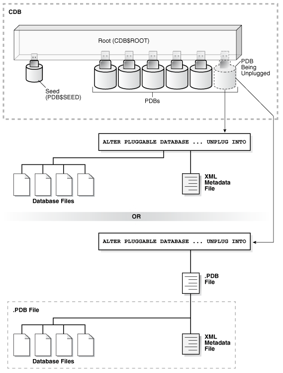
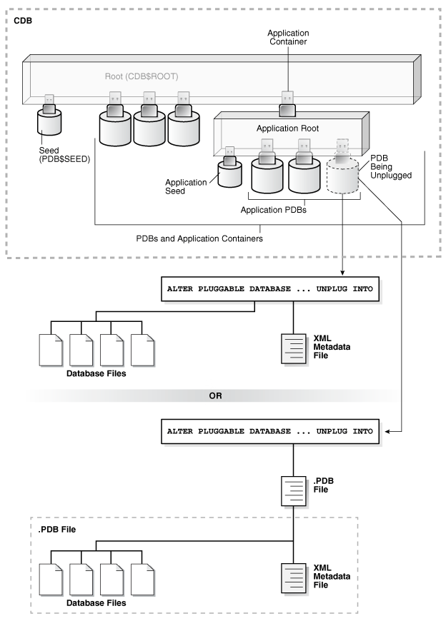

You can remove a plugged-in PDB from a CDB by unplugging it, dropping it, or relocating it.

- Unplugging a PDB from a CDB  
	Just as you can plug a PDB into a CDB, you can unplug a PDB from a CDB.
- Dropping a PDB  
	Drop a PDB when you want to move the PDB to a new CDB or when you no longer need it.

See Also:

" [Relocating a PDB](relocating-a-pdb.md) "

**Parent topic:** [Creating PDBs and Application Containers](creating-pdbs.md)

### Unplugging a PDB from a CDB

Just as you can plug a PDB into a CDB, you can unplug a PDB from a CDB.

- About Unplugging a PDB  
	Unplugging a PDB disassociates the PDB from a CDB. A PDB is usable only when it is plugged into a CDB.
- Unplugging a PDB  
	Unplug a PDB with a `ALTER PLUGGABLE DATABASE ... UNPLUG INTO` statement.

**Parent topic:** Removing a PDB

#### About Unplugging a PDB

Unplugging a PDB disassociates the PDB from a CDB. A PDB is usable only when it is plugged into a CDB.

Unplug a PDB when you want to do any of the following:

- Move the PDB to a different CDB
- Archive the PDB for later use
- Make the PDB unavailable for use

To unplug a PDB, connect to its CDB root or application root and use the `ALTER PLUGGABLE DATABASE` statement to specify either of the following:

- XML file
	An XML file (.xml extension) contains metadata about the PDB after it is unplugged. This metadata contains the required information to enable a `CREATE PLUGGABLE DATABASE` statement on a target CDB to plug in the PDB.
- .pdb file
	A.pdb file contains a compressed archive of the XML file that describes the PDB and the files used by the PDB (such as the data files and wallet file). A.pdb file enables you to copy a single, compressed file (instead of multiple files) to a new location to plug the PDB into a CDB.

Figure 13-1 Unplug a PDB



> This illustration shows a CDB with a `CDB$ROOT` container, a `PDB$SEED` container plugged into the root, and several PDBs plugged into the root. One PDB is being unplugged from the CDB. The illustration shows two ways to unplug the PDB:
>
> - One way shows the database files and the XML metadata file of the unplugged PDB. An `ALTER` `PLUGGABLE` `DATABASE` `...` `UNPLUG` `INTO` statement unplugs the PDB.
> - Another way shows the database files and the XML metadata file of the unplugged PDB in a single.PDB file. An `ALTER` `PLUGGABLE` `DATABASE` `...` `UNPLUG` `INTO` statement unplugs the PDB.


The following illustration shows how this technique unplugs an application PDB from an application container.



> This illustration shows a CDB with a `CDB$ROOT` container, a `PDB$SEED` container plugged into the root, and several PDBs plugged into the root. There is an application container plugged into the CDB root. The application container has an application seed and several application PDBs plugged into it. One application PDB is being unplugged from the application container. The illustration shows two ways to unplug the application PDB:
>
> - One way shows the database files and the XML metadata file of the unplugged application PDB. An `ALTER` `PLUGGABLE` `DATABASE` `...` `UNPLUG` `INTO` statement unplugs the application PDB.
> - Another way shows the database files and the XML metadata file of the unplugged application PDB in a single.PDB file. An `ALTER` `PLUGGABLE` `DATABASE` `...` `UNPLUG` `INTO` statement unplugs the application PDB.


The PDB must be closed before it can be unplugged. When you unplug a PDB, the unplugged PDB is in mounted mode. The unplug operation makes some changes in the PDB's data files to record, for example, that the PDB was successfully unplugged. Because it is still part of the CDB, the unplugged PDB is included in an RMAN backup of the entire CDB. Such a backup provides a convenient way to archive the unplugged PDB in case it is needed in the future.

To completely remove the PDB from the CDB, drop the PDB. The only operation supported on an unplugged PDB is dropping the PDB. The PDB must be dropped from the CDB before it can be plugged back into the same CDB.

Note:

You can unplug an application container only if no application PDBs belong to it.

See Also:

- " Dropping a PDB "
- " [Modifying the Open Mode of PDBs](administering-pdbs-with-sql-plus.md) " for information about closing a PDB
- " [Modifying a PDB at the System Level](administering-pdbs-with-sql-plus.md) " for information about initialization parameters and unplugged PDBs
- [Oracle Database Security Guide](https://docs.oracle.com/pls/topic/lookup?ctx=en/database/oracle/oracle-database/21/multi&id=DBSEG573) for information about common users and local users

**Parent topic:** Unplugging a PDB from a CDB

#### Unplugging a PDB

Unplug a PDB with a `ALTER PLUGGABLE DATABASE ... UNPLUG INTO` statement.

Prerequisites

The following prerequisites must be met:

- The current user must have `SYSDBA` or `SYSOPER` administrative privilege, and the privilege must be either commonly granted or locally granted in the PDB. The user must exercise the privilege using `AS SYSDBA` or `AS SYSOPER` at connect time.
- The PDB must have been opened at least once.

Note:

If you are unplugging a PDB that includes data that was encrypted with Transparent Data Encryption, then follow the instructions in [Oracle Database Advanced Security Guide](https://docs.oracle.com/pls/topic/lookup?ctx=en/database/oracle/oracle-database/21/multi&id=ASOAG-GUID-576582FE-7252-49BC-B795-121689258890) for united mode and [Oracle Database Advanced Security Guide](https://docs.oracle.com/pls/topic/lookup?ctx=en/database/oracle/oracle-database/21/multi&id=ASOAG-GUID-83D12D92-1BCD-4365-A801-279CEDEC51C3) for isolated mode.

To unplug a PDB:

1. In SQL\*Plus, ensure that the current container is the root of the PDB.
	If the PDB is plugged into the CDB root, then the current container must be the CDB root. If the PDB is plugged into an application root, then the current container must be the application root.
	If you are unplugging an application container, then the current container must be the CDB root, and the application container must not have any application PDBs plugged into it.
2. Close the PDB.
	In an Oracle Real Application Clusters (Oracle RAC) environment, the PDB must be closed on all instances.
3. Run the `ALTER PLUGGABLE DATABASE` statement with the `UNPLUG INTO` clause, and specify the PDB to unplug and the name and location of the PDB's XML metadata file or.pdb file.

Example 13-1 Unplugging PDB salespdb Into an XML Metadata File

This `ALTER PLUGGABLE DATABASE` statement unplugs the PDB `salespdb` and creates the `salespdb.xml` metadata file in the `/oracle/data/` directory:

```
ALTER PLUGGABLE DATABASE salespdb UNPLUG INTO '/oracle/data/salespdb.xml';
```

Example 13-2 Unplugging PDB salespdb Into an Archive File

This `ALTER PLUGGABLE DATABASE` statement unplugs the PDB `salespdb` and creates the `sales.pdb` archive file in the `/oracle/data/` directory. The `sales.pdb` archive file is a compressed file that includes the XML metadata file and the PDB’s files (such as the data files and wallet file).

```
ALTER PLUGGABLE DATABASE salespdb UNPLUG INTO '/oracle/data/sales.pdb';
```

**Parent topic:** Unplugging a PDB from a CDB

### Dropping a PDB

Drop a PDB when you want to move the PDB to a new CDB or when you no longer need it.

When you drop a PDB, the control file of the CDB is modified to eliminate all references to the dropped PDB. Archived redo log files and backups associated with the PDB are not removed, but you can use Oracle Recovery Manager (RMAN) to remove them.

When dropping a PDB, you can either keep or delete the PDB's data files by using one of the following clauses of the `DROP PLUGGABLE DATABASE` statement:

- `KEEP DATAFILES`, the default, retains the data files.
	The PDB temp file is removed even when `KEEP DATAFILES` is specified because the temp file is no longer needed.
	When `KEEP DATAFILES` is specified, the PDB must be unplugged.
- `INCLUDING DATAFILES` removes the data files from disk.
	If a PDB was created with the `SNAPSHOT COPY` clause, then you must specify `INCLUDING DATAFILES` when you drop the PDB.

Prerequisites

The following prerequisites must be met:

- The PDB must be in mounted mode, or it must be unplugged.
	See " [Modifying the Open Mode of PDBs](administering-pdbs-with-sql-plus.md) ".
	See " Unplugging a PDB from a CDB ".
- The current user must have `SYSDBA` or `SYSOPER` administrative privilege, and the privilege must be either commonly granted or locally granted in the PDB. The user must exercise the privilege using `AS SYSDBA` or `AS SYSOPER` at connect time.

Note:

This operation is destructive.

To drop a PDB:

1. In SQL\*Plus, ensure that the current container is the CDB root, or, for an application PDB, the application root that contains the application PDB.
	If the PDB is plugged into the CDB root, then the current container must be the CDB root. If the PDB is plugged into an application root, then the current container must be that application root or the CDB root.
	If you are dropping an application container, then the current container must be the CDB root, and the application container must not have any application PDBs plugged into it.
2. Run the `DROP PLUGGABLE DATABASE` statement and specify the PDB to drop.

Example 13-3 Dropping PDB salespdb While Keeping Its Data Files

```
DROP PLUGGABLE DATABASE salespdb
  KEEP DATAFILES;
```

Example 13-4 Dropping PDB salespdb and Its Data Files

```
DROP PLUGGABLE DATABASE salespdb
  INCLUDING DATAFILES;
```

**Parent topic:** Removing a PDB