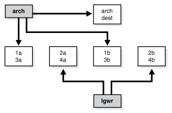
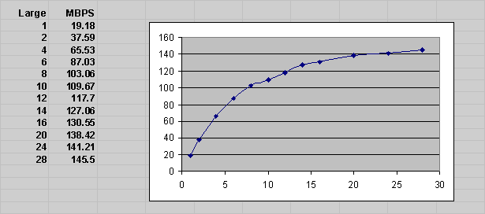
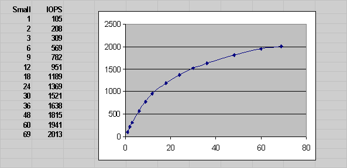
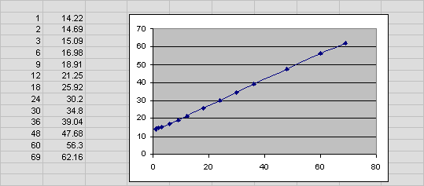

The I/O subsystem is a vital component of an Oracle database. This chapter introduces fundamental I/O concepts, discusses the I/O requirements of different parts of the database, and provides sample configurations for I/O subsystem design.

This chapter includes the following topics:

### About I/O

Every Oracle database reads or writes data on disk, thus generating disk I/O. The performance of many software applications is inherently limited by disk I/O. Applications that spend majority of their CPU time waiting for I/O activity to complete are said to be I/O-bound.

Oracle Database is designed so that if an application is well written, its performance should not be limited by I/O. Tuning I/O can enhance the performance of the application if the I/O system is operating at or near capacity and is not able to service the I/O requests within an acceptable time. However, tuning I/O cannot help performance if the application is not I/O-bound (for example, when CPU is the limiting factor).

Consider the following database requirements when designing an I/O system:

- Storage, such as minimum disk capacity
- Availability, such as continuous (24 x 7) or business hours only
- Performance, such as I/O throughput and application response times

Many I/O designs plan for storage and availability requirements with the assumption that performance will not be an issue. This is not always the case. Optimally, the number of disks and controllers to be configured should be determined by I/O throughput and redundancy requirements. The size of disks can then be determined by the storage requirements.

When developing an I/O design plan, consider using Oracle Automatic Storage Management (Oracle ASM). Oracle ASM is an integrated, high-performance database file system and disk manager that is based on the principle that the database should manage storage instead of requiring an administrator to do it.

Oracle recommends that you use Oracle ASM for your database file storage, instead of raw devices or the operating system file system. Oracle ASM provides the following key benefits:

- Striping
- Mirroring
- Online storage reconfiguration and dynamic rebalancing
- Managed file creation and deletion

See Also:

[Oracle Automatic Storage Management Administrator's Guide](https://docs.oracle.com/pls/topic/lookup?ctx=en/database/oracle/oracle-database/21/tgdba&id=OSTMG036) for additional information about Oracle ASM

### I/O Configuration

This section describes the basic information to be gathered and decisions to be made when defining a system's I/O configuration. You want to keep the configuration as simple as possible, while maintaining the required availability, recoverability, and performance. The more complex a configuration becomes, the more difficult it is to administer, maintain, and tune.

This section contains the following topics:

- Lay Out the Files Using Operating System or Hardware Striping
- Manually Distributing I/O
- When to Separate Files
- Three Sample Configurations
- Oracle Managed Files
- Choosing Data Block Size

#### Lay Out the Files Using Operating System or Hardware Striping

If your operating system has LVM software or hardware-based striping, then it is possible to distribute I/O using these tools. Decisions to be made when using an LVM or hardware striping include **stripe depth** and **stripe width**.

- Stripe depth is the size of the stripe, sometimes called stripe unit.
- Stripe width is the product of the stripe depth and the number of drives in the striped set.

Choose these values wisely so that the system is capable of sustaining the required throughput. For an Oracle database, reasonable stripe depths range from 256 KB to 1 MB. Different types of applications benefit from different stripe depths. The optimal stripe depth and stripe width depend on the following:

- Requested I/O Size
- Concurrency of I/O Requests
- Alignment of Physical Stripe Boundaries with Block Size Boundaries
- Manageability of the Proposed System

##### Requested I/O Size

Table 17-1 lists the Oracle Database and operating system parameters that you can use to set I/O size:

Table 17-1 Oracle Database and Operating System Operational Parameters

| Parameter | Description |
| --- | --- |
| `DB_BLOCK_SIZE ` | The size of single-block I/O requests. This parameter is also used in combination with multiblock parameters to determine multiblock I/O request size. |
| OS block size | Determines I/O size for redo log and archive log operations. |
| Maximum OS I/O size | Places an upper bound on the size of a single I/O request. |
| `DB_FILE_MULTIBLOCK_READ_COUNT ` | The maximum I/O size for full table scans is computed by multiplying this parameter with `DB_BLOCK_SIZE`. (the upper value is subject to operating system limits). If this value is not set explicitly (or is set to 0), the default value corresponds to the maximum I/O size that can be efficiently performed and is platform-dependent. |
| `SORT_AREA_SIZE ` | Determines I/O sizes and concurrency for sort operations. |
| `HASH_AREA_SIZE ` | Determines the I/O size for hash operations. |

In addition to I/O size, the degree of concurrency also helps in determining the ideal stripe depth. Consider the following when choosing stripe width and stripe depth:

- On low-concurrency (sequential) systems, ensure that no single I/O visits the same disk twice. For example, assume that the stripe width is four disks, and the stripe depth is 32K. If a single 1MB I/O request (for example, for a full table scan) is issued by an Oracle server process, then each disk in the stripe must perform eight I/Os to return the requested data. To avoid this situation, the size of the average I/O should be smaller than the stripe width multiplied by the stripe depth. If this is not the case, then a single I/O request made by Oracle Database to the operating system results in multiple physical I/O requests to the same disk.
- On high-concurrency (random) systems, ensure that no single I/O request is broken up into multiple physical I/O calls. Failing to do this multiplies the number of physical I/O requests performed in your system, which in turn can severely degrade the I/O response times.

##### Concurrency of I/O Requests

In a system with a high degree of concurrent small I/O requests, such as in a traditional OLTP environment, it is beneficial to keep the stripe depth large. Using stripe depths larger than the I/O size is called coarse grain striping. In high-concurrency systems, the stripe depth can be as follows, where `n` > 1:

```
n * DB_BLOCK_SIZE
```

Coarse grain striping allows a disk in the array to service several I/O requests. In this way, a large number of concurrent I/O requests can be serviced by a set of striped disks with minimal I/O setup costs. Coarse grain striping strives to maximize overall I/O throughput. Multiblock reads, as in full table scans, will benefit when stripe depths are large and can be serviced from one drive. Parallel query in a data warehouse environment is also a candidate for coarse grain striping because many individual processes each issue separate I/Os. If coarse grain striping is used in systems that do not have high concurrent requests, then hot spots could result.

In a system with a few large I/O requests, such as in a traditional DSS environment or a low-concurrency OLTP system, then it is beneficial to keep the stripe depth small. This is called fine grain striping. In such systems, the stripe depth is as follows, where `n` is smaller than the multiblock read parameters, such as `DB_FILE_MULTIBLOCK_READ_COUNT`:

```
n * DB_BLOCK_SIZE
```

Fine grain striping allows a single I/O request to be serviced by multiple disks. Fine grain striping strives to maximize performance for individual I/O requests or response time.

##### Alignment of Physical Stripe Boundaries with Block Size Boundaries

On some Oracle Database ports, a database block boundary may not align with the stripe. If your stripe depth is the same size as the database block, then a single I/O issued by Oracle Database may result in two physical I/O operations.

This is not optimal in an OLTP environment. To ensure a higher probability of one logical I/O resulting in no more than one physical I/O, the minimum stripe depth should be at least twice the Oracle block size. Table 17-2 shows recommended minimum stripe depth for random access and for sequential reads.

Table 17-2 Minimum Stripe Depth

| Disk Access | Minimum Stripe Depth |
| --- | --- |
| Random reads and writes | The minimum stripe depth is twice the Oracle block size. |
| Sequential reads | The minimum stripe depth is twice the value of `DB_FILE_MULTIBLOCK_READ_COUNT`, multiplied by the Oracle block size. |

See Also:

The specific documentation for your platform

##### Manageability of the Proposed System

With an LVM, the simplest configuration to manage is one with a single striped volume over all available disks. In this case, the stripe width encompasses all available disks. All database files reside within that volume, effectively distributing the load evenly. This single-volume layout provides adequate performance in most situations.

A single-volume configuration is viable only when used in conjunction with RAID technology that allows easy recoverability, such as RAID 1. Otherwise, losing a single disk means losing all files concurrently and, hence, performing a full database restore and recovery.

In addition to performance, there is a manageability concern: the design of the system must allow disks to be added simply, to allow for database growth. The challenge is to do so while keeping the load balanced evenly.

For example, an initial configuration can involve the creation of a single striped volume over 64 disks, each disk being 16 GB. This is total disk space of 1 terabyte (TB) for the primary data. Sometime after the system is operational, an additional 80 GB (that is, five disks) must be added to account for future database growth.

The options for making this space available to the database include creating a second volume that includes the five new disks. However, an I/O bottleneck might develop, if these new disks are unable to sustain the I/O throughput required for the files placed on them.

Another option is to increase the size of the original volume. LVMs are becoming sophisticated enough to allow dynamic reconfiguration of the stripe width, which allows disks to be added while the system is online. This begins to make the placement of all files on a single striped volume feasible in a production environment.

If your LVM cannot support dynamically adding disks to the stripe, then it is likely that you need to choose a smaller, more manageable stripe width. Then, when new disks are added, the system can grow by a stripe width.

In the preceding example, eight disks might be a more manageable stripe width. This is only feasible if eight disks are capable of sustaining the required number of I/Os each second. Thus, when extra disk space is required, another eight-disk stripe can be added, keeping the I/O balanced across the volumes.

Note:

The smaller the stripe width becomes, the more likely it is that you will need to spend time distributing the files on the volumes, and the closer the procedure becomes to manually distributing I/O.

#### Manually Distributing I/O

If your system does not have an LVM or hardware striping, then I/O must be manually balanced across the available disks by distributing the files according to each file's I/O requirements. In order to make decisions on file placement, you should be familiar with the I/O requirements of the database files and the capabilities of the I/O system. If you are not familiar with this data and do not have a representative workload to analyze, you can make a first guess and then tune the layout as the usage becomes known.

To stripe disks manually, you need to relate a file's storage requirements to its I/O requirements.

1. Evaluate database disk-storage requirements by checking the size of the files and the disks.
2. Identify the expected I/O throughput for each file. Determine which files have the highest I/O rate and which do not have many I/Os. Lay out the files on all the available disks so as to even out the I/O rate.

One popular approach to manual I/O distribution suggests separating a frequently used table from its index. This is not correct. During the course of a transaction, the index is read first, and then the table is read. Because these I/Os occur sequentially, the table and index can be stored on the same disk without contention. It is not sufficient to separate a data file simply because the data file contains indexes or table data. The decision to segregate a file should be made only when the I/O rate for that file affects database performance.

#### When to Separate Files

Regardless of whether you use operating system striping or manual I/O distribution, if the I/O system or I/O layout is not able to support the I/O rate required, then you need to separate files with high I/O rates from the remaining files. You can identify such files either at the planning stage or after the system is live.

The decision to segregate files should only be driven by I/O rates, recoverability concerns, or manageability issues. (For example, if your LVM does not support dynamic reconfiguration of stripe width, then you might need to create smaller stripe widths to be able to add n disks at a time to create a new stripe of identical configuration.)

Before segregating files, verify that the bottleneck is truly an I/O issue. The data produced from investigating the bottleneck identifies which files have the highest I/O rates.

The following sections describe how to segregate the following file types:

- Tables, Indexes, and TEMP Tablespaces
- Redo Log Files
- Archived Redo Logs

##### Tables, Indexes, and TEMP Tablespaces

If the files with high I/O are data files belonging to tablespaces that contain tables and indexes, then identify whether the I/O for those files can be reduced by tuning SQL or application code.

If the files with high-I/O are data files that belong to the `TEMP` tablespace, then investigate whether to tune the SQL statements performing disk sorts to avoid this activity, or to tune the sorting.

After the application has been tuned to avoid unnecessary I/O, if the I/O layout is still not able to sustain the required throughput, then consider segregating the high-I/O files.

##### Redo Log Files

If the high-I/O files are redo log files, then consider splitting the redo log files from the other files. Possible configurations can include the following:

- Placing all redo logs on one disk without any other files. Also consider availability; members of the same group should be on different physical disks and controllers for recoverability purposes.
- Placing each redo log group on a separate disk that does not store any other files.
- Striping the redo log files across several disks, using an operating system striping tool. (Manual striping is not possible in this situation.)
- Avoiding the use of RAID 5 for redo logs.

Redo log files are written sequentially by the Log Writer (LGWR) process. This operation can be made faster if there is no concurrent activity on the same disk. Dedicating a separate disk to redo log files usually ensures that LGWR runs smoothly with no further tuning necessary. If your system supports asynchronous I/O but this feature is not currently configured, then test to see if using this feature is beneficial. Performance bottlenecks related to LGWR are rare.

##### Archived Redo Logs

If the archiver is slow, then it might be prudent to prevent I/O contention between the archiver process and LGWR by ensuring that archiver reads and LGWR writes are separated. This is achieved by placing logs on alternating drives.

For example, suppose a system has four redo log groups, each group with two members. To create separate-disk access, the eight log files should be labeled 1a, 1b, 2a, 2b, 3a, 3b, 4a, and 4b. This requires at least four disks, plus one disk for archived files.

The following figure illustrates how redo members should be distributed across disks to minimize contention.

Figure 17-1 Distributing Redo Members Across Disks



> This illustration depicts the archiver reading two log groups: one with log files 1a and 3a, and the other with log files 1b and 3b. The archiver is also writing to the archive destination.
>
> The LGWR is writing to two log groups: one with log files 2a and 4a, and the other with log files 2b and 4b.
>
> End of image description.


In this example, LGWR switches out of log group 1 (member 1a and 1b) and writes to log group 2 (2a and 2b). Concurrently, the archiver process reads from group 1 and writes to its archive destination. Note how the redo log files are isolated from contention.

Note:

Mirroring redo log files, or maintaining multiple copies of each redo log file on separate disks, does not slow LGWR considerably. LGWR writes to each disk in parallel and waits until each part of the parallel write is complete. Thus, a parallel write does not take longer than the longest possible single-disk write.

Because redo logs are written serially, drives dedicated to redo log activity generally require limited head movement. This significantly accelerates log writing.

#### Three Sample Configurations

This section contains three high-level examples of configuring I/O systems. These examples include sample calculations that define the disk topology, stripe depths, and so on:

- Stripe Everything Across Every Disk
- Move Archive Logs to Different Disks
- Move Redo Logs to Separate Disks

##### Stripe Everything Across Every Disk

The simplest approach to I/O configuration is to build one giant volume, striped across all available disks. To account for recoverability, the volume is mirrored (RAID 1). The striping unit for each disk should be larger than the maximum I/O size for the frequent I/O operations. This provides adequate performance for most cases.

##### Move Archive Logs to Different Disks

If archived redo log files are striped on the same set of disks as other files, then any I/O requests on those disks could suffer when the database is archiving the redo logs. Moving archived redo log files to separate disks provides the following benefits:

- The archive can be performed at very high rate (using sequential I/O).
- Nothing else is affected by the degraded response time on the archive destination disks.

The number of disks for archive logs is determined by the rate of archive log generation and the amount of archive storage required.

##### Move Redo Logs to Separate Disks

In high-update OLTP systems, the redo logs are write-intensive. Moving the redo log files to disks that are separate from other disks and from archived redo log files has the following benefits:

- Writing redo logs is performed at the highest possible rate. Hence, transaction processing performance is at its best.
- Writing of the redo logs is not impaired with any other I/O.

The number of disks for redo logs is mostly determined by the redo log size, which is generally small compared to current technology disk sizes. Typically, a configuration with two disks (possibly mirrored to four disks for fault tolerance) is adequate. In particular, by having the redo log files alternating on two disks, writing redo log information to one file does not interfere with reading a completed redo log for archiving.

#### Oracle Managed Files

When file systems can contain all Oracle Database data, database administration is simplified by using Oracle Managed Files. Oracle Database internally uses standard file system interfaces to create and delete files as needed for tablespaces, temp files, online logs, and control files. Administrators only specify the file system directory to be used for a particular type of file. You can specify one default location for data files and up to five multiplexed locations for the control and online redo log files.

Oracle Database ensures that a unique file is created and then deleted when it is no longer needed. This reduces corruption caused by administrators specifying the wrong file, reduces wasted disk space consumed by obsolete files, and simplifies creation of test and development databases. It also makes development of portable third-party tools easier, because it eliminates the need to put operating system-specific file names in SQL scripts.

New files can be created as Oracle Managed Files, while old ones are administered in the old way. Thus, a database can have a mixture of Oracle Managed Files and user-managed files.

Note:

Oracle Managed Files cannot be used with raw devices.

Several points should be considered when tuning Oracle Managed Files:

- Because Oracle Managed Files require the use of a file system, DBAs give up control over how the data is laid out. Therefore, it is important to correctly configure the file system.
- Build the file system for Oracle Managed Files on top of an LVM that supports striping. For load balancing and improved throughput, stripe the disks in the file system.
- Oracle Managed Files work best if used on an LVM that supports dynamically extensible logical volumes. Otherwise, configure the logical volumes as large as possible.
- Oracle Managed Files work best if the file system provides large extensible files.
	See Also:
	[Oracle Database Administrator's Guide](https://docs.oracle.com/pls/topic/lookup?ctx=en/database/oracle/oracle-database/21/tgdba&id=ADMIN-GUID-4A3C4616-0D81-4BBA-8EAD-FCAA8AD5C15A) for detailed information about using Oracle Managed Files

#### Choosing Data Block Size

One logical data block corresponds to a specific number of bytes of persistent storage. Data blocks are the smallest units of storage that Oracle Database can use or allocate.

A block size of 8 KB is optimal for most systems. However, OLTP systems occasionally use smaller block sizes and DSS systems occasionally use larger block sizes.

Traditionally, data files have been stored on magnetic disk. Alternative forms of non-volatile data storage are also supported, such as directly mapped buffer cache. \[From a (database) software rather than a hardware perspective, the buffer cache contains the mapping of blocks in the form of hash chain entries, and some of those entries point to PMEM (persistent memory).\] However the underlying data is physically stored, Oracle processes always read and write logical data blocks.

This section discusses considerations when choosing database block size for optimal performance and contains the following topics:

- Reads
- Writes
- Block Size Advantages and Disadvantages

Note:

The use of multiple block sizes in a single database instance is not encouraged because of manageability issues.

##### Reads

Regardless of the size of the data, the goal is to minimize the number of reads required to retrieve the desired data.

- If the rows are small and access is predominantly random, then choose a smaller block size.
- If the rows are small and access is predominantly sequential, then choose a larger block size.
- If the rows are small and access is both random and sequential, then it might be effective to choose a larger block size.
- If the rows are large, such as rows containing large object (LOB) data, then choose a larger block size.

##### Writes

For high-concurrency OLTP systems, consider appropriate values for `INITRANS`, `MAXTRANS`, and `FREELISTS` when using a larger block size. These parameters affect the degree of update concurrency allowed within a block. However, you do not need to specify the value for `FREELISTS` when using automatic segment-space management.

If you are uncertain about which block size to choose, then try a database block size of 8 KB for most systems that process a large number of transactions. This represents a good compromise and is usually effective. Only systems processing LOB data need more than 8 KB.

See Also:

The Oracle Database installation documentation specific to your operating system for information about the minimum and maximum block size on your platform

##### Block Size Advantages and Disadvantages

Table 17-3 lists the advantages and disadvantages of different block sizes.

Table 17-3 Block Size Advantages and Disadvantages

| Block Size | Advantages | Disadvantages |
| --- | --- | --- |
| Smaller | Good for small rows with lots of random access.  Reduces block contention. | Has relatively large space overhead due to metadata (that is, block header).  Not recommended for large rows. There might only be a few rows stored for each block, or worse, row chaining if a single row does not fit into a block, |
| Larger | Has lower overhead, so there is more room to store data.  Permits reading several rows into the buffer cache with a single I/O (depending on row size and block size).  Good for sequential access or very large rows (such as LOB data). | Wastes space in the buffer cache, if you are doing random access to small rows and have a large block size. For example, with an 8 KB block size and 50 byte row size, you waste 7,950 bytes in the buffer cache when doing random access.  Not good for index blocks used in an OLTP environment, because they increase block contention on the index leaf blocks. |

### I/O Calibration Inside the Database

The I/O calibration feature of Oracle Database enables you to assess the performance of the storage subsystem, and determine whether I/O performance problems are caused by the database or the storage subsystem. Unlike other external I/O calibration tools that issue I/Os sequentially, the I/O calibration feature of Oracle Database issues I/Os randomly using Oracle data files to access the storage media, producing results that more closely match the actual performance of the database.

The section describes how to use the I/O calibration feature of Oracle Database and contains the following topics:

- Prerequisites for I/O Calibration
- Running I/O Calibration

Oracle Database also provides Orion, an I/O calibration tool. Orion is a tool for predicting the performance of an Oracle database without having to install Oracle or create a database. Unlike other I/O calibration tools, Oracle Orion is expressly designed for simulating Oracle database I/O workloads using the same I/O software stack as Oracle. Orion can also simulate the effect of striping performed by Oracle Automatic Storage Management. For more information, see " I/O Calibration with the Oracle Orion Calibration Tool ".

#### Prerequisites for I/O Calibration

Before running I/O calibration, ensure that the following requirements are met:

- The user must be granted the `SYSDBA` privilege
- `timed_statistics` must be set to `TRUE`
- Asynchronous I/O must be enabled
	When using file systems, asynchronous I/O can be enabled by setting the `FILESYSTEMIO_OPTIONS` initialization parameter to `SETALL`.
- Ensure that asynchronous I/O is enabled for data files by running the following query:
	```
	COL NAME FORMAT A50
	SELECT NAME,ASYNCH_IO FROM V$DATAFILE F,V$IOSTAT_FILE I
	WHERE  F.FILE#=I.FILE_NO
	AND    FILETYPE_NAME='Data File';
	```

Additionally, only one calibration can be performed on a database instance at a time.

#### Running I/O Calibration

The I/O calibration feature of Oracle Database is accessed using the `DBMS_RESOURCE_MANAGER`.`CALIBRATE_IO` procedure. This procedure issues an I/O intensive read-only workload, made up of one megabyte of random of I/Os, to the database files to determine the maximum IOPS (I/O requests per second) and MBPS (megabytes of I/O per second) that can be sustained by the storage subsystem.

The I/O calibration occurs in two steps:

- In the first step of I/O calibration with the `DBMS_RESOURCE_MANAGER`.`CALIBRATE_IO` procedure, the procedure issues random database-block-sized reads, by default, 8 KB, to all data files from all database instances. This step provides the maximum IOPS, in the output parameter `max_iops`, that the database can sustain. The value `max_iops` is an important metric for OLTP databases. The output parameter `actual_latency` provides the average latency for this workload. When you need a specific target latency, you can specify the target latency with the input parameter `max_latency` (specifies the maximum tolerable latency in milliseconds for database-block-sized IO requests).
- The second step of calibration using the `DBMS_RESOURCE_MANAGER`.`CALIBRATE_IO` procedure issues random, 1 MB reads to all data files from all database instances. The second step yields the output parameter `max_mbps`, which specifies the maximum MBPS of I/O that the database can sustain. This step provides an important metric for data warehouses.

The calibration runs more efficiently if the user provides the `num_physical_disks` input parameter, which specifies the approximate number of physical disks in the database storage system.

Due to the overhead from running the I/O workload, I/O calibration should only be performed when the database is idle, or during off-peak hours, to minimize the impact of the I/O workload on the normal database workload.

To run I/O calibration and assess the I/O capability of the storage subsystem used by Oracle Database, use the `DBMS_RESOURCE_MANAGER`.`CALIBRATE_IO` procedure:

```
SET SERVEROUTPUT ON
DECLARE
  lat  NUMBER;
  iops INTEGER;
  mbps INTEGER;
BEGIN
-- DBMS_RESOURCE_MANAGER.CALIBRATE_IO (<DISKS>, <MAX_LATENCY>, iops, mbps, lat);
   DBMS_RESOURCE_MANAGER.CALIBRATE_IO (2, 10, iops, mbps, lat);
 
end;
/
```

When running the `DBMS_RESOURCE_MANAGER`.`CALIBRATE_IO` procedure, consider the following:

- Only run one calibration at a time on databases that use the same storage subsystem. If you simultaneously run the calibration across separate databases that use the same storage subsystem, the calibration will fail.
- Quiesce the database to minimize I/O on the instance.
- For Oracle Real Application Clusters (Oracle RAC) configurations, ensure that all instances are opened to calibrate the storage subsystem across nodes.
- For an Oracle Real Application Clusters (Oracle RAC) database, the workload is simultaneously generated from all instances.
- The `num_physical_disks` input parameter is optional. By setting the `num_physical_disks` parameter to the approximate number of physical disks in the database's storage system, the calibration can be faster and more accurate.
- In some cases, asynchronous I/O is permitted for data files, but the I/O subsystem for submitting asynchronous I/O may be maximized, and I/O calibration cannot continue. In such cases, refer to the port-specific documentation for information about checking the maximum limit for asynchronous I/O on the system.

At any time during the I/O calibration process, you can query the calibration status in the `V$IO_CALIBRATION_STATUS` view. After I/O calibration is successfully completed, you can view the results in the `DBA_RSRC_IO_CALIBRATE` table.

See Also:

- [Oracle Database PL/SQL Packages and Types Reference](https://docs.oracle.com/pls/topic/lookup?ctx=en/database/oracle/oracle-database/21/tgdba&id=ARPLS-GUID-90D0674E-6A10-41A9-ABBD-783F908502C3) for more information about running the `DBMS_RESOURCE_MANAGER`.`CALIBRATE_IO` procedure
- Oracle Database Reference for more information about the [`V$IO_CALIBRATION_STATUS`](https://docs.oracle.com/pls/topic/lookup?ctx=en/database/oracle/oracle-database/21/tgdba&id=REFRN-GUID-E7D2C4C2-7EE6-4A7F-A4EE-01686C6CF576) view and [`DBA_RSRC_IO_CALIBRATE`](https://docs.oracle.com/pls/topic/lookup?ctx=en/database/oracle/oracle-database/21/tgdba&id=REFRN-GUID-A833CB61-D035-4786-B971-F5AB67C499ED) table

### I/O Calibration with the Oracle Orion Calibration Tool

This section describes the Oracle Orion Calibration Tool and includes the following sections:

- Introduction to the Oracle Orion Calibration Tool
- Getting Started with Orion
- Orion Input Files
- Orion Parameters
- Orion Output Files
- Orion Troubleshooting

#### Introduction to the Oracle Orion Calibration Tool

Oracle Orion is a tool for predicting the performance of an Oracle database without having to install Oracle or create a database. Unlike other I/O calibration tools, Oracle Orion is expressly designed for simulating Oracle database I/O workloads using the same I/O software stack as Oracle. Orion can also simulate the effect of striping performed by Oracle Automatic Storage Management.

Table 17-4 lists the types of I/O workloads that Orion supports.

For each type of workload shown in Table 17-4, Orion can run tests using different I/O loads to measure performance metrics such as MBPS, IOPS, and I/O latency. Load is expressed in terms of the number of outstanding asynchronous I/Os. Internally, for each such load level, the Orion software keeps issuing I/O requests as fast as they complete to maintain the I/O load at that level. For random workloads, using either large or small sized I/Os, the load level is the number of outstanding I/Os. For large sequential workloads, the load level is a combination of the number of sequential streams and the number of outstanding I/Os per stream. Testing a given workload at a range of load levels can help you understand how performance is affected by load.

Note the following when you use Orion:

- Run Orion when the storage is idle (or pretty close to idle). Orion calibrates the performance of the storage based on the I/O load it generates; Orion is not able to properly assess the performance if non-Orion I/O workloads run simultaneously.
- If a database has been created on the storage, the storage can alternatively be calibrated using the PL/SQL routine `dbms_resource_manager.calibrate_io()`.

Table 17-4 Orion I/O Workload Support

| Workload | Description |
| --- | --- |
| Small Random I/O | OLTP applications typically generate random reads and writes whose size is equivalent to the database block size, typically 8 KB. Such applications typically care about the throughput in I/Os Per Second (IOPS) and about the average latency (I/O turn-around time) per request. These parameters translate to the transaction rate and transaction turn-around time at the application layer.  Orion simulates a random I/O workload with a given percentage of reads compared to writes, a given I/O size, and a given number of outstanding I/Os. In this Orion workload simulation, the I/Os are distributed across all disks. |
| Large Sequential I/O | Data warehousing applications, data loads, backups, and restores generate sequential read and write streams composed of multiple outstanding 1 MB I/Os. Such applications are processing large amounts of data, such as a whole table or a whole database and they typically care about the overall data throughput in MegaBytes Per Second (MBPS).  Orion can simulate a given number of sequential read or write streams of a given I/O size with a given number of outstanding I/Os. Orion can optionally simulate Oracle Automatic Storage Management striping when testing sequential streams. |
| Large Random I/O | A sequential stream typically accesses the disks concurrently with other database traffic. With striping, a sequential stream is spread across many disks. Consequently, at the disk level, multiple sequential streams are seen as random 1 MB I/Os. |
| Mixed Workloads | Orion can simulate two simultaneous workloads: Small Random I/O and either Large Sequential I/O or Large Random I/O. This workload type enables you to simulate, for example, an OLTP workload of 8 KB random reads and writes with a backup workload of four sequential read streams of 1 MB I/Os. |

Each Orion data point is a test for a specific mix of small and large I/O loads sustained for a duration. An Orion test consists of multiple data point tests. These data point tests can be represented as a two-dimensional matrix. Each column in the matrix represents data point tests with the same small I/O load, but varying large I/O loads. Each row represents data point tests with the same large I/O load, but varying small I/O loads. An Orion test can be for a single point, a single row, a single column, or for the whole matrix.

##### Orion Test Targets

You can use Orion to test any disk-based character device that supports asynchronous I/O. Orion has been tested on the following types of targets:

- DAS (direct-attached) storage: You can use Orion to test the performance of one or more local disks, volumes, or files on the local host.
- SAN (storage-area network) storage: Orion can be run on any host that has all or parts of the SAN storage mapped as character devices. The devices can correspond to striped or un-striped volumes exported by the storage array(s), or individual disks, or one or more whole arrays.
- NAS (network-attached storage): You can use Orion to test the performance on data files on NAS storage. In general, the performance results on NAS storage are dependent on the I/O patterns with which the data files have been created and updated. Therefore, you should initialize the data files appropriately before running Orion.

##### Orion for Oracle Administrators

Oracle administrators can use Orion to evaluate and compare different storage arrays, based on the expected workloads. Oracle administrators can also use Orion to determine the optimal number of network connections, storage arrays, storage array controllers, and disks for the expected peak workloads.

#### Getting Started with Orion

To get started using Orion, do the following:

1. Select a test name to use with the Orion `–testname` parameter. This parameter specifies a unique identifier for your Orion run. For example, use the test name "mytest". For more information, see " Orion Parameters ".
2. Create an Orion input file, based on the test name. For example, create a file named `mytest.lun`. In the input file list the raw volumes or files to test. Add one volume name per line. Do not put comments or anything else in the `.lun` file.
	For example, an Orion input file could contain the following:
	```
	/dev/raw/raw1
	/dev/raw/raw2
	/dev/raw/raw3
	/dev/raw/raw4
	/dev/raw/raw5
	/dev/raw/raw6
	/dev/raw/raw7
	/dev/raw/raw8
	```
	For more information, see " Orion Input Files ".
3. Verify that the all volumes specified in the input file, for example mytest.lun, are accessible using the command `dd` or another equivalent file viewing utility. For example, for a typical sanity-check try the following on a Linux system:
	```
	$ dd if=/dev/raw/raw1 of=/dev/null bs=32k count=1024
	```
	Depending on your platform, the file viewing utility you use and its interface may be different.
4. Verify that your platform has the necessary libraries installed to do asynchronous I/Os. The Orion test is completely dependent on asynchronous I/O. On Linux and Solaris, the library `libaio` must be in the standard `lib` directories or accessible through the shell environment's library path variable (usually `LD_LIBRARY_PATH` or `LIBPATH`, depending on your shell). Windows has built-in asynchronous I/O libraries, so this issue does not apply.
5. As a first test with Orion, use `–run` with either the `oltp` or `dss` option. If the database is primarily OLTP, then use `–run oltp`. If the database is primarily for data warehousing or analytics, then use `–run dss`.
	For example, use the following command to run an OLTP-like workload using the default input file name, `orion.lun`:
	```
	$ ./orion -run oltp
	```
	The I/O load levels generated by Orion take into account the number of disk spindles being tested (or specified with the `–num_disks` parameter). Keep in mind that the number of spindles may or may not be related to the number of volumes specified in the input file, depending on how these volumes are mapped.
6. The section " Orion Output Files " provides sample results showing the Orion output files. Using the sample file `mytest_summary.txt` is a good starting point for verifying the input parameters and analyzing the output. The sample files `mytest_*.csv` contain comma-delimited values for several I/O performance measures.

#### Orion Input Files

When you specify the Orion `–testname` \<testname> parameter, this sets the test name prefix for the Orion input and output filenames. The default value for the `–testname` option is "orion".

The Orion input file, \<testname>.`lun` should contain a carriage-return-separated list of LUNs.

#### Orion Parameters

Use the Orion command parameters to specify the I/O workload type and to specify other Orion options.

##### Orion Required Parameter

The `–run` parameter is required with the Orion command. Table 17-5 describes the `–run` parameter.

Table 17-5 Required Orion Parameter

| Option | Description | Default |
| --- | --- | --- |
| `–run` level | Specifies the test run level to be level. This option provides the run level and allows complex commands to be specified at the advanced level. If not set as `–run advanced`, then setting any other parameter, besides `–cache_size` or `–verbose`, results in an error.  Except advanced, all of the `–run` level settings use a pre-specified set of parameters.  The level must be one of:  - oltp 	Tests with random small (8K) I/Os at increasing loads to determine the maximum IOPS. 	This parameter corresponds to the following Orion invocation: 	``` 	%> ./orion -run advanced \ 	    -num_large 0 -size_small 8 -type rand \ 	    -simulate concat -write 0 -duration 60 \ 	    -matrix row 	``` - dss 	Tests with random large (1M) I/Os at increasing loads to determine the maximum throughput. 	This parameter corresponds to the following Orion invocation: 	``` 	%> ./orion -run advanced \ 	    -num_small 0 -size_large 1024 -type rand \ 	    -simulate concat -write 0 -duration 60 \ 	    -matrix column 	``` - simple 	Generates the Small Random I/O and the Large Random I/O workloads for a range of load levels. In this option, small and large I/Os are tested in isolation. The only optional parameters that can be specified at this run level are `–cache_size` and `–verbose`. 	This parameter corresponds to the following Orion invocation: 	``` 	%> ./orion -run advanced \ 	-size_small 8 -size_large 1024 -type rand \ 	-simulate concat -write 0 -duration 60 \ 	-matrix basic 	``` - normal 	Same as `simple`, but also generates combinations of the small random I/O and large random I/O workloads for a range of loads. The only optional parameters that can be specified at this run level are `–cache_size` and `–verbose`. 	This parameter corresponds to the following Orion invocation: 	``` 	%> ./orion -run advanced \ 	-size_small 8 -size_large 1024 -type rand \ 	-simulate concat -write 0 -duration 60 \ 	-matrix detailed 	``` - advanced 	Tests the workload you specify with optional parameters. Any of the optional parameters can be specified at this run level. | `normal` |

##### Orion Optional Parameters

Table 17-6 Optional Orion Parameters

| Option | Description | Default |
| --- | --- | --- |
| `–cache_size` num | Size of the storage array's read or write cache (in MB). For Large Sequential I/O workloads, Orion warms the cache by doing random large I/Os before each data point. Orion uses the cache size to determine the duration for this cache warming operation. If set to 0, do not perform cache warming.  Unless this option is set to 0, Orion issues several unmeasured, random I/Os before each large sequential data point. These I/Os fill up the storage array's cache, if any, with random data so that I/Os from one data point do not result in cache hits for the next data point. Read tests are preceded with junk reads and write tests are preceded with junk writes. If specified, this 'cache warming' is performed until num MBs of I/O have been read or written. | Default Value:  If not specified, warming occurs for a default amount of time (two minutes). That is, issue two minutes of unmeasured random I/Os before each data point. |
| `–duration` num\_seconds | Set the duration to test each data point in seconds to the value num\_seconds. | Default Value: `60` |
| `–help` | Prints Orion help information. All other options are ignored with help set. |  |
| `–matrix` type | Type of mixed workloads to test over a range of loads. An Orion test consists of multiple data point tests. The data point tests can be represented as a two-dimensional matrix.  Each column in the matrix represents data point tests with the same small I/O load, but varying large I/O loads. Each row represents data point tests with the same large I/O load, but varying small I/O loads. An Orion test can be for a single point, a single row, a single column, or the whole matrix, depending on the matrix type:  - basic: No mixed workload. The Small Random and Large Random/Sequential workloads are tested separately. Test small I/Os only, then large I/Os only. - detailed: Small Random and Large Random/Sequential workloads are tested in combination. Test entire matrix. - point: A single data point with S outstanding Small Random I/Os and L outstanding Large Random I/Os or sequential streams. S is set by the `–num_small` parameter. L is set by the `–num_large` parameter. Test with `–num_small` small I/Os, `–num_large` large I/Os. - col: Large Random/Sequential workloads only. Test a varying large I/O load with `–num_small ` small I/Os. - row: Small Random workloads only. Test a varying small I/O load with `–num_large` large I/Os. - max: Same as detailed, but only tests the workload at the maximum load, specified by the `–num_small` and `–num_large` parameters. Test varying loads up to the `–num_small` and `–num_large` limits. | Default Value: `basic` |
| – `num_disks` value | Specify the number of physical disks used by the test. Used to generate a range for the load. Specifies the number of disks (physical spindles). This number value is used to gauge the range of loads that Orion should test at. Increasing this parameter results in Orion using heavier I/O loads. | Default Value: the number of LUNs in \<testname>.lun. |
| `–num_large` value | Controls the large I/O load.  Note, this option only applies when `–matrix` is specified as: `row`, `point`, or `max`.  When the `–type` option is set to `rand`, the parameter argument value specifies the number of outstanding large I/Os.  When the `–type` option is set to `seq`, the parameter argument value specifies the number of sequential I/O streams. | Default Value: no default |
| `–num_smal` l | Specify the maximum number of outstanding I/Os for the Small Random I/O workload.  Note: this only applies when `–matrix` is specified as `col`, `point`, or `max`. | Default Value: no default |
| – `num_streamIO` num | Specify the number of concurrent I/Os per stream as num.  Note: this parameter is only used if `–type` is `seq`. | Default Value: `4` |
| `–simulate` type | Data layout to simulate for Large Sequential I/O workload. Orion tests on a virtual LUN formed by combining specified LUNs in one of these ways. The type is one:  - concat: A virtual volume is simulated by serially chaining the specified LUNs. A sequential test over this virtual volume will go from some point to the end of each one LUN, followed by the beginning to end of the next LUN, and so on. - raid0: A virtual volume is simulated by striping across the specified LUNs. Each sequential stream issues I/Os across all LUNs using raid0 striping. The stripe depth is 1M by default, to match the Oracle Automatic Storage Management stripe depth, and can be changed with the `–stripe` parameter.  The offsets for I/Os are determined as follows:  For Small Random and Large Random workloads:  - The LUNs are concatenated into a single virtual LUN (VLUN) and random offsets are chosen within the VLUN.  For Large Sequential workloads:  - With striping (`–simulate` `raid0`). The LUNs are used to create a single striped VLUN. With no concurrent Small Random workload, the sequential streams start at fixed offsets within the striped VLUN. For n streams, stream i start at offset VLUNsize \* (i + 1) / (n + 1), unless n is 1, in which case the single stream start at offset 0. With a concurrent Small Random workload, streams start at random offsets within the striped VLUN. - Without striping (`–simulate` `CONCAT`). The LUNs are concatenated into a single VLUN. The streams start at random offsets within the single VLUN.  This parameter is typically only used if `–type` is `seq`. | Default Value: `concat` |
| `–size_large` num | Specify the num, size of the I/Os (in KB) for the Large Random or Sequential I/O workload. | Default Value: `1024` |
| `–size_small` num | Specify the num, size of the I/Os (in KB) for the Small Random I/O workload. | Default Value: `8` |
| `–storax` type | API to use for testing I/O workload.  - skgfr: Use operating system I/O layer. - oss: Use OSS API for I/O with Cell server in an Exadata machine. - asmlib: Use ASMLIB disk devices based storage API for I/O. - odmlib: Use Direct NFS storage based API for I/O. | Default Value: `skgfr` |
| `–testname` tname | Specify the tname identifier for the test run. When specified, the input file containing the LUN disk or file names must be named \<tname>.lun.  The output files are named with the prefix \<tname>\_. | Default Value: `orion` |
| `–type` \[`rand` \| `seq`\] | Type of the Large I/O workload.  - rand: Randomly distributed large I/Os. - seq: Sequential streams of large I/Os. | Default Value: `rand` |
| `–verbose` | Prints status and tracing information to standard output. | Default Value: option not set |
| `–write` num\_write | Specify the percentage of I/Os that are writes to num\_write; the rest being reads.  This parameter applies to both the Large and Small I/O workloads. For Large Sequential I/Os, each stream is either read-only or write-only; the parameter specifies the percentage of streams that are write-only. The data written to disk is garbage and unrelated to any existing data on the disk.  Caution: write tests obliterate all data on the specified LUNS. | Default Value: `0` |

Note:

Write tests obliterate all data on the specified LUNS.

##### Orion Command Line Samples

The following provides sample Orion commands for different types of I/O workloads:

1. To evaluate storage for an OLTP database:
	```
	-run oltp
	```
2. To evaluate storage for a data warehouse:
	```
	-run dss
	```
3. For a basic set of data:
	```
	-run normal
	```
4. To understand your storage performance with read-only, small and large random I/O workload:
	```
	$ orion -run simple
	```
5. To understand your storage performance with a mixed small and large random I/O workload:
	```
	$ orion -run normal
	```
6. To generate combinations of 32KB and 1MB reads to random locations:
	```
	$ orion -run advanced -size_small 32 \
	-size_large 1024 -type rand -matrix detailed
	```
7. To generate multiple sequential 1 MB write streams, simulating 1 MB RAID-0 stripes:
	```
	$ orion -run advanced -simulate raid0 \
	-stripe 1024 -write 100 -type seq -matrix col -num_small 0
	```
8. To generate combinations of 32 KB and 1 MB reads to random locations:
	```
	-run advanced -size_small 32 -size_large 1024 -type rand -matrix detailed
	```
9. To generate multiple sequential 1 MB write streams, simulating RAID0 striping:
	```
	-run advanced -simulate raid0 -write 100 -type seq -matrix col -num_small 0
	```

#### Orion Output Files

The output files for a test run are prefixed by \<testname>\_\<date> where date is yyyymmdd\_hhmm.

Table 17-7 lists the Orion output files.

Table 17-7 Orion Generated Output Files

| Output File | Description |
| --- | --- |
| \<testname>\_\<date>\_hist.csv | Histogram of I/O latencies. |
| \<testname>\_\<date>\_iops.csv | Performance results of small I/Os in IOPS. |
| \<testname>\_\<date>\_lat.csv | Latency of small I/Os in microseconds. |
| \<testname>\_\<date>\_mbps.csv | Performance results of large I/Os in MBPS. |
| \<testname>\_\<date>\_summary.txt | Summary of the input parameters, along with the minimum small I/O latency (in secs), the maximum MBPS, and the maximum IOPS observed. |
| \<testname>\_\<date>\_trace.txt | Extended, unprocessed output. |

Note:

If you are performing write tests, be prepared to lose any data stored on the LUNs.

##### Orion Sample Output Files

Orion creates several output files as specified in Table 17-7. For the sample "mytest" shown in the section, " Getting Started with Orion ", the output files are:

- mytest\_summary.txt: This file contains:
	- Input parameters
		- Maximum throughput observed for the Large Random/Sequential workload
		- Maximum I/O rate observed for the Small Random workload
		- Minimum latency observed for the Small Random workload
- mytest\_mbps.csv: comma-delimited value file containing the data transfer rate (MBPS) results for the Large Random/Sequential workload. In the general case, this and all other CSV files contains a two-dimensional table. Each row in the table corresponds to a large I/O load level and each column corresponds to a specific small I/O load level. Thus, the column headings are the number of outstanding small I/Os and the row headings are the number of outstanding large I/Os (for random large I/O tests) or the number of sequential streams (for sequential large I/O tests).
	The following example shows the first few data points of the Orion MBPS output CSV file for "mytest". The simple mytest command-line does not test combinations of large and small I/Os. Hence, the MBPS file has just one column corresponding to 0 outstanding small I/Os. In this example, at a load level of 8 outstanding large reads and no small I/Os, the report data indicates a throughput of 103.06 MBPS.
	```
	Large/Small,       0
	1,   19.18
	2,   37.59
	4,   65.53
	6,   87.03
	8,  103.06
	10,  109.67
	. .   . . .
	. .   . . .
	```
	The following graph shows a sample data transfer rate measured at different large I/O load levels. This graph can be generated by loading `mytest_mbps.csv` into a spreadsheet and graphing the data points. Orion does not directly generate such graphs. The x-axis corresponds to the number of outstanding large reads and the y-axis corresponds to the throughput observed.
	The graph shows typical storage system behavior. As the number of outstanding I/O requests is increased, the throughput increases. However, at a certain point the throughput level stabilizes, indicating the storage system's maximum throughput value.
	Figure 17-2 Sample I/O Load Levels
	

> Shows the sample I/O load levels.

- mytest\_iops.csv: Comma-delimited value file containing the I/O throughput (in IOPS) results for the Small Random workload. Like in the MBPS file, the column headings are the number of outstanding small I/Os and the row headings are the number of outstanding large I/Os, when testing large random, or the number of sequential streams (for large sequential).
	In the general case, a CSV file contains a two-dimensional table. However, for a simple test where you are not testing combinations of large and small I/Os the results file has just one row. Hence, the IOPS results file just has one row with 0 large I/Os. As shown in the following example, data point with 12 outstanding small reads and no large I/Os provides a sample throughput of 951 IOPS.
	```
	Large/Small,     1,     2,     3,     6,     9,    12 . . . .
	0,             105,   208,   309,   569,   782,   951 . . . .
	```
	The following graph is generated by loading `mytest_iops.csv` into Excel and charting the data. This graph illustrates the IOPS throughput seen at different small I/O load levels.
	The graph shows typical storage system behavior. As the number of outstanding I/O requests is increased, the throughput increases. However, at a certain point, the throughput level stabilizes, indicating the storage system reaches a maximum throughput value. At higher throughput levels, the latency for the I/O requests also increase significantly. Therefore, it is important to view this data with the latency data provided in the generated latency results in mytest\_lat.csv.
	Figure 17-3 I/O Throughput at Different Small I/O Load Levels
	

> I/O throughput at different small I/O load levels.

- mytest\_lat.csv: Comma-delimited value file containing the latency results for the Small Random workload. As with the MBPS and IOPS files, the column headings are the number of outstanding small I/Os and the row headings are the number of outstanding large I/Os (when testing large random I/Os) or the number of sequential streams.
	In the general case, a CSV file contains a two-dimensional table. However, for a simple test where you are not testing combinations of large and small I/Os the results file has just one row. Hence, the IOPS results file just has one row with 0 large I/Os. In the following example, at a sustained load level of 12 outstanding small reads and no large I/Os, the generated results show an I/O turn-around latency of 22.25 milliseconds.
	```
	Large/Small, 1, 2, 3, 6, 9, 12 . . . .
	0, 14.22, 14.69, 15.09, 16.98, 18.91, 21.25 . . . .
	```
	The following graph is generated by loading `mytest_lat.csv` into Excel and charting the data. This graph illustrates the small I/O latency at different small I/O load levels for mytest.
	Figure 17-4 I/O Latency at Small I/O Load Levels
	

> I/O latency at small I/O load levels.

- mytest\_trace.txt: Contains the extended, unprocessed test output.
	Note:
	Orion reports errors that occur during a test on standard output.

#### Orion Troubleshooting

1. If you are getting an I/O error on one or more of the volumes specified in the \<testname>.lun file:
	- Verify that you can access the volume in the same mode as the test, read or write, using a file copy program such as `dd`.
		- Verify that your host operating system version can do asynchronous I/O.
		- On Linux and Solaris, the library `libaio` must be in the standard lib directories or accessible through the shell environment's library path variable (usually LD\_LIBRARY\_PATH or LIBPATH, depending on your shell).
2. If you run on NAS storage:
	- The file system must be properly mounted for Orion to run. Please consult your Oracle Installation Guide for directions (for example, the section, Appendix B "Using NAS Devices" in the Database Installation Guide for Linux x86).
		- The mytest.lun file should contain one or more paths of existing files. Orion does not work on directories or mount points. The file has to be large enough for a meaningful test. The size of this file should represent the eventual expected size of your datafiles (say, after a few years of use).
		- You may see poor performance doing asynchronous I/O over NFS on Linux (including 2.6 kernels).
		- If you are doing read tests and the reads are hitting untouched blocks of the file that were not initialized or previously written, some smart NAS systems may "fake" the read by returning zeroed-out blocks. When this occurs, you see unexpectedly good performance.
		The workaround is to write all blocks, using a tool such as `dd`, before performing the read test.
3. If you run Orion on Windows: Testing on raw partitions requires temporarily mapping the partitions to drive letters and specifying these drive letters in the test.lun file.
4. If you run Orion 32-bit Linux/x86 binary on an x86\_64 system: Please copy a 32-bit libaio.so file from a 32-bit computer running the same Linux version.
5. If you are testing with a lot of disks (`num_disks` greater than around 30):
	- You should use the -duration option (see the optional parameters section for more details) to specify a long duration (like 120 seconds or more) for each data point. Since Orion tries to keep all the spindles running at a particular load level, each data point requires a ramp-up time, which implies a longer duration for the test.
		- You may get the following error message, instructing you to increase the duration value:
		```
		Specify a longer -duration value.
		```
		A duration of 2x the number of spindles seems to be a good rule of thumb. Depending on your disk technology, your platform may need more or less time.
6. If you get an error about libraries being used by Orion:
	- Linux/Solaris: See I/O error troubleshooting.
		- NT-Only: Do not move/remove the Oracle libraries included in the distribution. These must be in the same directory as orion.exe.
7. If you are seeing performance numbers that are "unbelievably good":
	- You may have a large read or write cache, or read and write cache somewhere between the Orion program and the disk spindles. Typically, the storage array controller has the biggest effect. Find out the size of this cache and use the -cache\_size advanced option to specify it to Orion (see the optional parameters section for more details).
		- The total size of your volumes may be really small compared to one or more caches along the way. Try to turn off the cache. This is needed if the other volumes sharing your storage show significant I/O activity in a production environment (and end up using large parts of the shared cache).
8. If Orion is reporting a long estimated run time:
	- The run time increases when `-num_disks` is high. Orion internally uses a linear formula to determine how long it takes to saturate the given number of disks.
		- The `-cache_size` parameter affects the run time, even when it is not specified. Orion does cache warming for two minutes per data point by default. If you have turned off the cache, specify `-cache_size 0`.
		- The run time increases when a long -duration value is specified, as expected.