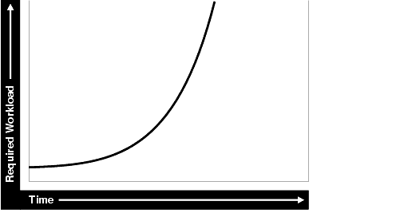

Optimal system performance begins with design and continues throughout the life of your system. Carefully consider performance issues during the initial design phase so that you can tune your system more easily during production.

This chapter contains the following sections:

### Oracle Methodology

System performance has become increasingly important as computer systems get larger and more complex as the Internet plays a bigger role in business applications. To accommodate this, Oracle has produced a performance methodology based on years of designing and performance experience. This methodology explains clear and simple activities that can dramatically improve system performance.

Performance strategies vary in their effectiveness, and systems with different purposes—such as operational systems and decision support systems—require different performance skills. This book examines the considerations that any database designer, administrator, or performance expert should focus their efforts on.

System performance is designed and built into a system. It does not just happen. Performance problems are usually the result of contention for, or exhaustion of, some system resource. When a system resource is exhausted, the system cannot scale to higher levels of performance. This new performance methodology is based on careful planning and design of the database, to prevent system resources from becoming exhausted and causing down-time. By eliminating resource conflicts, systems can be made scalable to the levels required by the business.

### Understanding Investment Options

With the availability of relatively inexpensive, high-powered processors, memory, and disk drives, there is a temptation to buy more system resources to improve performance. In many situations, new CPUs, memory, or more disk drives can indeed provide an immediate performance improvement. However, any performance increases achieved by adding hardware should be considered a short-term relief to an immediate problem. If the demand and load rates on the application continue to grow, then the chance of the same problem occurring soon is likely.

In other situations, additional hardware does not improve the system's performance at all. Poorly designed systems perform poorly no matter how much extra hardware is allocated. Before purchasing additional hardware, ensure that serialization or single threading is not occurring within the application. Long-term, it is generally more valuable to increase the efficiency of your application in terms of the number of physical resources used for each business transaction.

### Understanding Scalability

The word scalability is used in many contexts in development environments. The following section provides an explanation of scalability that is aimed at application designers and performance specialists.

This section covers the following topics:

- What is Scalability?
- System Scalability
- Factors Preventing Scalability

#### What is Scalability?

Scalability is a system's ability to process more workload, with a proportional increase in system resource usage.

In a scalable system, if you double the workload, then the system uses twice as many system resources. This sounds obvious, but due to conflicts within the system, the resource usage might exceed twice the original workload.

Examples of poor scalability due to resource conflicts include the following:

- Applications requiring significant concurrency management as user populations increase
- Increased locking activities
- Increased data consistency workload
- Increased operating system workload
- Transactions requiring increases in data access as data volumes increase
- Poor SQL and index design resulting in a higher number of logical I/Os for the same number of rows returned
- Reduced availability, because database objects take longer to maintain

An application is said to be unscalable if it exhausts a system resource to the point where no more throughput is possible when its workload is increased. Such applications result in fixed throughputs and poor response times.

Examples of resource exhaustion include the following:

- Hardware exhaustion
- Table scans in high-volume transactions causing inevitable disk I/O shortages
- Excessive network requests, resulting in network and scheduling bottlenecks
- Memory allocation causing paging and swapping
- Excessive process and thread allocation causing operating system thrashing

This means that application designers must create a design that uses the same resources, regardless of user populations and data volumes, and does not put loads on the system resources beyond their limits.

#### System Scalability

Applications that are accessible through the Internet have more complex performance and availability requirements.

Some applications are designed and written only for Internet use, but even typical back-office applications—such as a general ledger application—might require some or all data to be available online.

Characteristics of Internet age applications include the following:

- Availability 24 hours a day, 365 days a year
- Unpredictable and imprecise number of concurrent users
- Difficulty in capacity planning
- Availability for any type of query
- Multitier architectures
- Stateless middleware
- Rapid development timescale
- Minimal time for testing

The following figure illustrates the classic workload growth curve, with demand growing at an increasing rate. Applications must scale with the increase of workload and also when additional hardware is added to support increasing demand. Design errors can cause the implementation to reach its maximum, regardless of additional hardware resources or re-design efforts.

Figure 2-1 Workload Growth Curve



> This diagram shows a line graph of the Internet Workload Growth Curve, with Time along the horizontal axis and Required Workload along the vertical axis.
>
> As time passes, the required workload grows at an increasing rate and the line in the graph rises rapidly.
>
> End of image description.


Applications are challenged by very short development timeframes with limited time for testing and evaluation. However, bad design typically means that you must later rearchitect and reimplement the system. If you deploy an application with known architectural and implementation limitations on the Internet, and if the workload exceeds the anticipated demand, then failure is a real possibility. From a business perspective, poor performance can mean a loss of customers. If Web users do not get a response in seven seconds, then the user's attention could be lost forever.

In many cases, the cost of re-designing a system with the associated downtime costs in migrating to new implementations exceeds the costs of properly building the original system. The moral of the story is simple: design and implement with scalability in mind from the start.

#### Factors Preventing Scalability

When building applications, designers and architects should aim for as close to perfect scalability as possible. This is sometimes called linear scalability, where system throughput is directly proportional to the number of CPUs.

In the real world, linear scalability is impossible for reasons beyond a designer's control. However, making the application design and implementation as scalable as possible should ensure that current and future performance objectives can be achieved through expansion of hardware components and the evolution of CPU technology.

Factors that may prevent linear scalability include:

- Poor application design, implementation, and configuration
	The application has the biggest impact on scalability. For example:
	- Poor schema design can cause expensive SQL that do not scale.
		- Poor transaction design can cause locking and serialization problems.
		- Poor connection management can cause poor response times and unreliable systems.
	However, the design is not the only problem. The physical implementation of the application can be the weak link. For example:
	- Systems can move to production environments with bad I/O strategies.
		- The production environment could might different execution plans from those generated in testing.
		- Memory-intensive applications that allocate a large amount of memory without much thought for freeing the memory at run time can cause excessive memory usage.
		- Inefficient memory usage and memory leaks put a high stress on the operating virtual memory subsystem. This impacts performance and availability.
- Incorrect sizing of hardware components
	Bad capacity planning of all hardware components is becoming less of a problem as relative hardware prices decrease. However, too much capacity can mask scalability problems as the workload is increased on a system.
- Limitations of software components
	All software components have scalability and resource usage limitations. This applies to application servers, database servers, and operating systems. Application design should not place demands on the software beyond what it can handle.
- Limitations of hardware components
	Hardware is not perfectly scalable. Most multiprocessor computers can get close to linear scaling with a finite number of CPUs, but after a certain point each additional CPU can increase performance overall, but not proportionately. There might come a time when an additional CPU offers no increase in performance, or even degrades performance. This behavior is very closely linked to the workload and the operating system setup.
	Note:
	These factors are based on Oracle Server Performance group's experience of tuning unscalable systems.

### System Architecture

There are two main parts to a system's architecture:

- Hardware and Software Components
- Configuring the Right System Architecture for Your Requirements

#### Hardware and Software Components

A system architecture mainly contains hardware and software components.

- Hardware Components
- Software Components

##### Hardware Components

Today's designers and architects are responsible for sizing and capacity planning of hardware at each tier in a multitier environment. It is the architect's responsibility to achieve a balanced design. This is analogous to a bridge designer who must consider all the various payload and structural requirements for the bridge. A bridge is only as strong as its weakest component. As a result, a bridge is designed in balance, such that all components reach their design limits simultaneously.

The following are the main hardware components of a system.

CPU

There can be one or more CPUs, and they can vary in processing power from simple CPUs found in hand-held devices to high-powered server CPUs. Sizing of other hardware components is usually a multiple of the CPUs on the system.

Memory

Database and application servers require considerable amounts of memory to cache data and avoid time-consuming disk access.

I/O Subsystem

The I/O subsystem can vary between the hard disk on a client PC and high performance disk arrays. Disk arrays can perform thousands of I/Os each second and provide availability through redundancy in terms of multiple I/O paths and hot pluggable mirrored disks.

Network

All computers in a system are connected to a network, from a modem line to a high speed internal LAN. The primary concerns with network specifications are bandwidth (volume) and latency (speed).

##### Software Components

The same way computers have common hardware components, applications have common functional components. By dividing software development into functional components, it is possible to better comprehend the application design and architecture. Some components of the system are performed by existing software bought to accelerate application implementation, or to avoid re-development of common components.

The difference between software components and hardware components is that while hardware components only perform one task, a piece of software can perform the roles of various software components. For example, a disk drive only stores and retrieves data, but a client program can manage the user interface and perform business logic.

Most applications involve the following software components:

User Interface

This component is the most visible to application users, and includes the following functions:

- Displaying the screen to the user
- Collecting user data and transferring it to business logic
- Validating data entry
- Navigating through levels or states of the application

Business Logic

This component implements core business rules that are central to the application function. Errors made in this component can be very costly to repair. This component is implemented by a mixture of declarative and procedural approaches. An example of a declarative activity is defining unique and foreign keys. An example of procedure-based logic is implementing a discounting strategy.

Common functions of this component include:

- Moving a data model to a relational table structure
- Defining constraints in the relational table structure
- Coding procedural logic to implement business rules

Resources for Managing User Requests

This component is implemented in all pieces of software. However, there are some requests and resources that can be influenced by the application design and some that cannot.

In a multiuser application, most resource allocation by user requests are handled by the database server or the operating system. However, in a large application where the number of users and their usage pattern is unknown or growing rapidly, the system architect must be proactive to ensure that no single software component becomes overloaded and unstable.

Common functions of this component include:

- Connection management with the database
- Executing SQL efficiently (cursors and SQL sharing)
- Managing client state information
- Balancing the load of user requests across hardware resources
- Setting operational targets for hardware and software components
- Persistent queuing for asynchronous execution of tasks

Data and Transactions

This component is largely the responsibility of the database server and the operating system.

Common functions of this component include:

- Providing concurrent access to data using locks and transactional semantics
- Providing optimized access to the data using indexes and memory cache
- Ensuring that data changes are logged in the event of a hardware failure
- Enforcing any rules defined for the data

#### Configuring the Right System Architecture for Your Requirements

Configuring the initial system architecture is a largely iterative process. System architects must satisfy the system requirements within budget and schedule constraints. If the system requires interactive users transacting business-making decisions based on the contents of a database, then user requirements drive the architecture. If there are few interactive users on the system, then the architecture is process-driven.

Examples of interactive user applications:

- Accounting and bookkeeping applications
- Order entry systems
- Email servers
- Web-based retail applications
- Trading systems

Examples of process-driven applications:

- Utility billing systems
- Fraud detection systems
- Direct mail

In many ways, process-driven applications are easier to design than multiuser applications because the user interface element is eliminated. However, because the objectives are process-oriented, system architects not accustomed to dealing with large data volumes and different success factors can become confused. Process-driven applications draw from the skills sets used in both user-based applications and data warehousing. Therefore, this book focuses on evolving system architectures for interactive users.

Note:

Generating a system architecture is not a deterministic process. It requires careful consideration of business requirements, technology choices, existing infrastructure and systems, and actual physical resources, such as budget and manpower.

The following questions should stimulate thought on system architecture, though they are not a definitive guide to system architecture. These questions demonstrate how business requirements can influence the architecture, ease of implementation, and overall performance and availability of a system. For example:

- How many users must the system support?
	Most applications fall into one of the following categories:
	- Very few users on a lightly-used or exclusive computer
		For this type of application, there is usually one user. The focus of the application design is to make the single user as productive as possible by providing good response time, yet make the application require minimal administration. Users of these applications rarely interfere with each other and have minimal resource conflicts.
		- A medium to large number of users in a corporation using shared applications
		For this type of application, the users are limited by the number of employees in the corporation actually transacting business through the system. Therefore, the number of users is predictable. However, delivering a reliable service is crucial to the business. The users must share a resource, so design efforts must address response time under heavy system load, escalation of resource for each session usage, and room for future growth.
		- An infinite user population distributed on the Internet
		For this type of application, extra engineering effort is required to ensure that no system component exceeds its design limits. This creates a bottleneck that halts or destabilizes the system. These applications require complex load balancing, stateless application servers, and efficient database connection management. In addition, use statistics and governors to ensure that the user receives feedback if the database cannot satisfy their requests because of system overload.
- What will be the user interaction method?
	The choices of user interface range from a simple Web browser to a custom client program.
- Where are the users located?
	The distance between users influences how the application is engineered to cope with network latencies. The location also affects which times of the day are busy, when it is impossible to perform batch or system maintenance functions.
- What is the network speed?
	Network speed affects the amount of data and the conversational nature of the user interface with the application and database servers. A highly conversational user interface can communicate with back-end servers on every key stroke or field level validation. A less conversational interface works on a screen-sent and a screen-received model. On a slow network, it is impossible to achieve high data entry speeds with a highly conversational user interface.
- How much data will the user access, and how much of that data is largely read only?
	The amount of data queried online influences all aspects of the design, from table and index design to the presentation layers. Design efforts must ensure that user response time is not a function of the size of the database. If the application is largely read only, then replication and data distribution to local caches in the application servers become a viable option. This also reduces workload on the core transactional server.
- What is the user response time requirement?
	Consideration of the user type is important. If the user is an executive who requires accurate information to make split second decisions, then user response time cannot be compromised. Other types of users, such as users performing data entry activities, might not need such a high level of performance.
- Do users expect 24 hour service?
	This is mandatory for today's Internet applications where trade is conducted 24 hours a day. However, corporate systems that run in a single time zone might be able to tolerate after-hours downtime. You can use this after-hours downtime to run batch processes or to perform system administration. In this case, it might be more economic not to run a fully-available system.
- Must all changes be made in real time?
	It is important to determine whether transactions must be executed within the user response time, or if they can be queued for asynchronous execution.

The following are secondary questions, which can also influence the design, but really have more impact on budget and ease of implementation. For example:

- How big will the database be?
	This influences the sizing of the database server. On servers with a very large database, it might be necessary to have a bigger computer than dictated by the workload. This is because the administration overhead with large databases is largely a function of the database size. As tables and indexes grow, it takes proportionately more CPUs to allow table reorganizations and index builds to complete in an acceptable time limit.
- What is the required throughput of business transactions?
- What are the availability requirements?
- Do skills exist to build and administer this application?
- What compromises are forced by budget constraints?

### Application Design Principles

This section describes the following design decisions that are involved in building applications:

- Simplicity In Application Design
- Data Modeling
- Table and Index Design
- Using Views
- SQL Execution Efficiency
- Implementing the Application
- Trends in Application Development

#### Simplicity In Application Design

Applications are no different than any other designed and engineered product. Well-designed structures, computers, and tools are usually reliable, easy to use and maintain, and simple in concept. In the most general terms, if the design looks correct, then it probably is. This principle should always be kept in mind when building applications.

Consider the following design issues:

- If the table design is so complicated that nobody can fully understand it, then the table is probably poorly designed.
- If SQL statements are so long and involved that it would be impossible for any optimizer to effectively optimize it in real time, then there is probably a bad statement, underlying transaction, or table design.
- If there are indexes on a table and the same columns are repeatedly indexed, then there is probably a poor index design.
- If queries are submitted without suitable qualification for rapid response for online users, then there is probably a poor user interface or transaction design.
- If the calls to the database are abstracted away from the application logic by many layers of software, then there is probably a bad software development method.

#### Data Modeling

Data modeling is important to successful relational application design. You must perform this modeling in a way that quickly represents the business practices. Heated debates may occur about the correct data model. The important thing is to apply greatest modeling efforts to those entities affected by the most frequent business transactions. In the modeling phase, there is a great temptation to spend too much time modeling the non-core data elements, which results in increased development lead times. Use of modeling tools can then rapidly generate schema definitions and can be useful when a fast prototype is required.

#### Table and Index Design

Table design is largely a compromise between flexibility and performance of core transactions. To keep the database flexible and able to accommodate unforeseen workloads, the table design should be very similar to the data model, and it should be normalized to at least 3rd normal form. However, certain core transactions required by users can require selective denormalization for performance purposes.

Examples of this technique include storing tables pre-joined, the addition of derived columns, and aggregate values. Oracle Database provides numerous options for storage of aggregates and pre-joined data by clustering and materialized view functions. These features allow a simpler table design to be adopted initially.

Again, focus and resources should be spent on the business critical tables, so that optimal performance can be achieved. For non-critical tables, shortcuts in design can be adopted to enable a more rapid application development. However, if prototyping and testing a non-core table becomes a performance problem, then remedial design effort should be applied immediately.

Index design is also a largely iterative process, based on the SQL generated by application designers. However, it is possible to make a sensible start by building indexes that enforce primary key constraints and indexes on known access patterns, such as a person's name. As the application evolves, and as you perform testing on realistic amounts of data, you may need to improve the performance of specific queries by building a better index. Consider the following list of indexing design ideas when building a new index:

- Appending Columns to an Index or Using Index-Organized Tables
- Using a Different Index Type
- Finding the Cost of an Index
- Serializing within Indexes
- Ordering Columns in an Index

##### Appending Columns to an Index or Using Index-Organized Tables

One of the easiest ways to speed up a query is to reduce the number of logical I/Os by eliminating a table access from the execution plan. This can be done by appending to the index all columns referenced by the query. These columns are the select list columns, and any required join or sort columns. This technique is particularly useful in speeding up online applications response times when time-consuming I/Os are reduced. This is best applied when testing the application with properly sized data for the first time.

The most aggressive form of this technique is to build an index-organized table (IOT). However, you must be careful that the increased leaf size of an IOT does not undermine the efforts to reduce I/O.

##### Using a Different Index Type

There are several index types available, and each index has benefits for certain situations. The following list gives performance ideas associated with each index type.

B-Tree Indexes

These indexes are the standard index type, and they are excellent for primary key and highly-selective indexes. Used as concatenated indexes, the database can use B-tree indexes to retrieve data sorted by the index columns.

Bitmap Indexes

These indexes are suitable for columns that have a relatively low number of distinct values, where the benefit of adding a B-tree index is likely to be limited. These indexes are suitable for data warehousing applications where there is low DML activity and ad hoc filtering patterns. Combining bitmap indexes on columns allows efficient `AND` and `OR` operations with minimal I/O. Further, through compression techniques they can generate a large number of rowids with minimal I/Os. Bitmap indexes are particularly efficient in queries with `COUNT()`, because the query can be satisfied within the index.

Function-based Indexes

These indexes allow access through a B-tree on a value derived from a function on the base data. Function-based indexes have some limitations with regards to the use of nulls, and they require that you have the query optimizer enabled.

Function-based indexes are particularly useful when querying on composite columns to produce a derived result or to overcome limitations in the way data is stored in the database. An example is querying for line items in an order exceeding a certain value derived from (sales price - discount) x quantity, where these were columns in the table. Another example is to apply the `UPPER` function to the data to allow case-insensitive searches.

Partitioned Indexes

Partitioning a global index allows partition pruning to take place within an index access, which results in reduced I/Os. By definition of good range or list partitioning, fast index scans of the correct index partitions can result in very fast query times.

Reverse Key Indexes

These indexes are designed to eliminate index hot spots on insert applications. These indexes are excellent for insert performance, but they are limited because the database cannot use them for index range scans.

##### Finding the Cost of an Index

Building and maintaining an index structure can be expensive, and it can consume resources such as disk space, CPU, and I/O capacity. Designers must ensure that the benefits of any index outweigh the negatives of index maintenance.

Use this simple estimation guide for the cost of index maintenance: each index maintained by an `INSERT`, `DELETE`, or `UPDATE` of the indexed keys requires about three times as much resource as the actual DML operation on the table. Thus, if you `INSERT` into a table with three indexes, then the insertion is approximately 10 times slower than an `INSERT` into a table with no indexes. For DML, and particularly for `INSERT` -heavy applications, the index design should be seriously reviewed, which might require a compromise between the query and `INSERT` performance.

See Also:

[Oracle Database Administrator's Guide](https://docs.oracle.com/pls/topic/lookup?ctx=en/database/oracle/oracle-database/21/tgdba&id=ADMIN11735) to learn how to monitor index usage

##### Serializing within Indexes

Use of sequences or timestamps to generate key values that are indexed themselves can lead to database hotspot problems, which affect response time and throughput. This is usually the result of a monotonically growing key that results in a right-growing index. To avoid this problem, try to generate keys that insert over the full range of the index so as to make a workload more scalable. You can achieve this by using any of the following methods:

- using a reverse key index
- using a hash partitioned index
- using a cycling sequence to prefix sequence values
- using a scalable sequence

See Also:

[Oracle Database Administrator's Guide](https://docs.oracle.com/pls/topic/lookup?ctx=en/database/oracle/oracle-database/21/tgdba&id=ADMIN-GUID-700340BB-7517-4994-B9DA-348E6113DD57) for more information about the scalable sequences

##### Ordering Columns in an Index

Designers should be flexible in defining any rules for index building. Depending on your circumstances, use one of the following two ways to order the keys in an index:

- Order columns with most selectivity first. This method is the most commonly used because it provides the fastest access with minimal I/O to the actual rowids required. This technique is used mainly for primary keys and for very selective range scans.
- Order columns to reduce I/O by clustering or sorting data. In large range scans, I/Os can usually be reduced by ordering the columns in the least selective order, or in a manner that sorts the data in the way it should be retrieved.

#### Using Views

Views can speed up and simplify application design. A simple view definition can mask data model complexity from the programmers whose priorities are to retrieve, display, collect, and store data.

However, while views provide clean programming interfaces, they can cause sub-optimal, resource-intensive queries. The worst type of view use is when a view references other views, and when they are joined in queries. In many cases, developers can satisfy the query directly from the table without using a view. Usually, because of their inherent properties, views make it difficult for the optimizer to generate the optimal execution plan.

#### SQL Execution Efficiency

In the design and architecture phase of any system development, care should be taken to ensure that the application developers understand SQL execution efficiency. To achieve this goal, the development environment must support the following characteristics:

- Good database connection management
	Connecting to the database is an expensive operation that is highly unscalable. Therefore, the number of concurrent connections to the database should be minimized as much as possible. A simple system, where a user connects at application initialization, is ideal. However, in a Web-based or multitiered application, where application servers are used to multiplex database connections to users, this can be difficult. With these types of applications, design efforts should ensure that database connections are pooled and are not reestablished for each user request.
- Good cursor usage and management
	Maintaining user connections is equally important to minimizing the parsing activity on the system. Parsing is the process of interpreting a SQL statement and creating an execution plan for it. This process has many phases, including syntax checking, security checking, execution plan generation, and loading shared structures into the shared pool. There are two types of parse operations:
	- Hard parsing
		A SQL statement is submitted for the first time, and no match is found in the shared pool. Hard parses are the most resource-intensive and unscalable, because they perform all the operations involved in a parse.
		- Soft parsing
		A SQL statement is submitted for the first time, and a match is found in the shared pool. The match can be the result of previous execution by another user. The SQL statement is shared, which is good for performance. However, soft parses are not ideal, because they still require syntax and security checking, which consume system resources.
	Because parsing should be minimized as much as possible, application developers should design their applications to parse SQL statements once and execute them many times. This is done through cursors. Experienced SQL programmers should be familiar with the concept of opening and re-executing cursors.
	Application developers must also ensure that SQL statements are shared within the shared pool. To achieve this goal, use bind variables to represent the parts of the query that change from execution to execution. If this is not done, then the SQL statement is likely to be parsed once and never re-used by other users. To ensure that SQL is shared, use bind variables and do not use string literals with SQL statements. For example:
	Statement with string literals:
	```
	SELECT * FROM employees 
	  WHERE last_name LIKE 'KING';
	```
	Statement with bind variables:
	```
	SELECT * FROM employees 
	  WHERE last_name LIKE :1;
	```
	The following example shows the results of some tests on a simple OLTP application:
	```
	Test                         #Users Supported
	No Parsing all statements           270 
	Soft Parsing all statements         150
	Hard Parsing all statements          60
	Re-Connecting for each Transaction   30
	```
	These tests were performed on a four-CPU computer. The differences increase as the number of CPUs on the system increase.

#### Implementing the Application

The choice of development environment and programming language is largely a function of the skills available in the development team and architectural decisions made when specifying the application. There are, however, some simple performance management rules that can lead to scalable, high-performance applications.

1. Choose a development environment suitable for software components, and do not let it limit your design for performance decisions. If it does, then you probably chose the wrong language or environment.
	- User interface
		The programming model can vary between HTML generation and calling the windowing system directly. The development method should focus on response time of the user interface code. If HTML or Java is being sent over a network, then try to minimize network volume and interactions.
		- Business logic
		Interpreted languages, such as Java and PL/SQL, are ideal to encode business logic. They are fully portable, which makes upgrading logic relatively easy. Both languages are syntactically rich to allow code that is easy to read and interpret. If business logic requires complex mathematical functions, then a compiled binary language might be needed. The business logic code can be on the client computer, the application server, and the database server. However, the application server is the most common location for business logic.
		- User requests and resource allocation
		Most of this is not affected by the programming language, but tools and fourth generation languages that mask database connection and cursor management might use inefficient mechanisms. When evaluating these tools and environments, check their database connection model and their use of cursors and bind variables.
		- Data management and transactions
		Most of this is not affected by the programming language.
2. When implementing a software component, implement its function and not the functionality associated with other components. Implementing another component's functionality results in sub-optimal designs and implementations. This applies to all components.
3. Do not leave gaps in functionality or have software components under-researched in design, implementation, or testing. In many cases, gaps are not discovered until the application is rolled out or tested at realistic volumes. This is usually a sign of poor architecture or initial system specification. Data archival and purge modules are most frequently neglected during initial system design, build, and implementation.
4. When implementing procedural logic, implement in a procedural language, such as C, Java, or PL/SQL. When implementing data access (queries) or data changes (DML), use SQL. This rule is specific to the business logic modules of code where procedural code is mixed with data access (nonprocedural SQL) code. There is great temptation to put procedural logic into the SQL access. This tends to result in poor SQL that is resource-intensive. SQL statements with `DECODE` case statements are very often candidates for optimization, as are statements with a large amount of `OR` predicates or set operators, such as `UNION` and `MINUS`.
5. Cache frequently accessed, rarely changing data that is expensive to retrieve on a repeated basis. However, make this cache mechanism easy to use, and ensure that it is indeed cheaper than accessing the data in the original method. This is applicable to all modules where frequently used data values should be cached or stored locally, rather than be repeatedly retrieved from a remote or expensive data store.
	The most common examples of candidates for local caching include the following:
	- Today's date. `SELECT` `SYSDATE` `FROM` `DUAL` can account for over 60% of the workload on a database.
		- The current user name.
		- Repeated application variables and constants, such as tax rates, discounting rates, or location information.
		- Caching data locally can be further extended into building a local data cache into the application server middle tiers. This helps take load off the central database servers. However, care should be taken when constructing local caches so that they do not become so complex that they cease to give a performance gain.
		- Local sequence generation.
	The design implications of using a cache should be considered. For example, if a user is connected at midnight and the date is cached, then the user's date value becomes invalid.
6. Optimize the interfaces between components, and ensure that all components are used in the most scalable configuration. This rule requires minimal explanation and applies to all modules and their interfaces.
7. Use foreign key references. Enforcing referential integrity through an application is expensive. You can maintain a foreign key reference by selecting the column value of the child from the parent and ensuring that it exists. The foreign key constraint enforcement supplied by Oracle—which does not use SQL—is fast, easy to declare, and does not create network traffic.
8. Consider setting up action and module names in the application to use with End to End Application Tracing. This allows greater flexibility in tracing workload problems.

#### Trends in Application Development

The two biggest challenges in application development today are the increased use of Java to replace compiled C or C++ applications, and increased use of object-oriented techniques, influencing the schema design.

Java provides better portability of code and availability to programmers. However, there are several performance implications associated with Java. Because Java is an interpreted language, it is slower at executing similar logic than compiled languages, such as C. As a result, resource usage of client computers increases. This requires more powerful CPUs to be applied in the client or middle-tier computers and greater care from programmers to produce efficient code.

Because Java is an object-oriented language, it encourages insulation of data access into classes not performing the business logic. As a result, programmers might invoke methods without knowledge of the efficiency of the data access method being used. This tends to result in minimal database access and uses the simplest and crudest interfaces to the database.

With this type of software design, queries do not always include all the `WHERE` predicates to be efficient, and row filtering is performed in the Java program. This is very inefficient. In addition, for DML operations—and especially for `INSERT` s—single `INSERT` s are performed, making use of the array interface impossible. In some cases, this is made more inefficient by procedure calls. More resources are used moving the data to and from the database than in the actual database calls.

In general, it is best to place data access calls next to the business logic to achieve the best overall transaction design.

The acceptance of object-orientation at a programming level has led to the creation of object-oriented databases within the Oracle Server. This has manifested itself in many ways, from storing object structures within `BLOB` s and only using the database effectively as an indexed card file to the use of the Oracle Database object-relational features.

If you adopt an object-oriented approach to schema design, then ensure that you do not lose the flexibility of the relational storage model. In many cases, the object-oriented approach to schema design ends up in a heavily denormalized data structure that requires considerable maintenance and `REF` pointers associated with objects. Often, these designs represent a step backward to the hierarchical and network database designs that were replaced with the relational storage method.

In summary, if you are storing your data in your database for the long-term, and if you anticipate a degree of ad hoc queries or application development on the same schema, then the relational storage method probably gives the best performance and flexibility.

### Workload Testing, Modeling, and Implementation

#### Sizing Data

You could experience errors in your sizing estimates when dealing with variable length data if you work with a poor sample set. As data volumes grow, your key lengths could grow considerably, altering your assumptions for column sizes.

When the system becomes operational, it becomes more difficult to predict database growth, especially for indexes. Tables grow over time, and indexes are subject to the individual behavior of the application in terms of key generation, insertion pattern, and deletion of rows. The worst case is where you insert using an ascending key, and then delete most rows from the left-hand side but not all the rows. This leaves gaps and wasted space. If you have index use like this, then ensure that you know how to use the online index rebuild facility.

DBAs should monitor space allocation for each object and look for objects that may grow out of control. A good understanding of the application can highlight objects that may grow rapidly or unpredictably. This is a crucial part of both performance and availability planning for any system. When implementing the production database, the design should attempt to ensure that minimal space management takes place when interactive users are using the application. This applies for all data, temp, and rollback segments.

#### Estimating Workloads

Considering the number of variables involved, estimation of workloads for capacity planning and testing purposes is extremely difficult. However, designers must specify computers with CPUs, memory, and disk drives, and eventually roll out an application. There are several techniques used for sizing, and each technique has merit. When sizing, it is best to use the following methods to validate your decision-making process and provide supporting documentation.

Extrapolating From a Similar System

This is an entirely empirical approach where an existing system of similar characteristics and known performance is used as a basis system. The specification of this system is then modified by the sizing specialist according to the known differences. This approach has merit in that it correlates with an existing system, but it provides little assistance when dealing with the differences.

This approach is used in nearly all large engineering disciplines when preparing the cost of an engineering project, such as a large building, a ship, a bridge, or an oil rig. If the reference system is an order of magnitude different in size from the anticipated system, then some components may have exceeded their design limits.

Benchmarking

The benchmarking process is both resource and time consuming, and it might not produce the correct results. By simulating an application in early development or prototype form, there is a danger of measuring something that has no resemblance to the actual production system. This sounds strange, but over the many years of benchmarking customer applications with the database development organization, Oracle has yet to see reliable correlation between the benchmark application and the actual production system. This is mainly due to the number of application inefficiencies introduced in the development process.

However, benchmarks have been used successfully to size systems to an acceptable level of accuracy. In particular, benchmarks are very good at determining the actual I/O requirements and testing recovery processes when a system is fully loaded.

Benchmarks by their nature stress all system components to their limits. As the benchmark stresses all components, be prepared to see all errors in application design and implementation manifest themselves while benchmarking. Benchmarks also test database, operating system, and hardware components. Because most benchmarks are performed in a rush, expect setbacks and problems when a system component fails. Benchmarking is a stressful activity, and it takes considerable experience to get the most out of a benchmarking exercise.

#### Application Modeling

Modeling the application can range from complex mathematical modeling exercises to the classic simple calculations performed on the back of an envelope. Both methods have merit, with one attempting to be very precise and the other making gross estimates. The downside of both methods is that they do not allow for implementation errors and inefficiencies.

The estimation and sizing process is an imprecise science. However, by investigating the process, some intelligent estimates can be made. The whole estimation process makes no allowances for application inefficiencies introduced by poor SQL, index design, or cursor management. A sizing engineer should build in margin for application inefficiencies. A performance engineer should discover the inefficiencies and make the estimates look realistic. The Oracle performance method describes how to discover the application inefficiencies.

#### Testing, Debugging, and Validating a Design

The testing process mainly consists of functional and stability testing. At some point in the process, performance testing is performed.

The following list describes some simple rules for performance testing an application. If correctly documented, then this list provides important information for the production application and the capacity planning process after the application has gone live.

- Use the Automatic Database Diagnostic Monitor (ADDM) and SQL Tuning Advisor for design validation
- Test with realistic data volumes and distributions
	All testing must be done with fully populated tables. The test database should contain data representative of the production system in terms of data volume and cardinality between tables. All the production indexes should be built and the schema statistics should be populated correctly.
- Use the correct optimizer mode
	Perform all testing with the optimizer mode that you plan to use in production. All Oracle Database research and development effort is focused on the query optimizer. Therefore, the use of the query optimizer is recommended.
- Test a single user performance
	Test a single user on an idle or lightly-used database for acceptable performance. If a single user cannot achieve acceptable performance under ideal conditions, then multiple users cannot achieve acceptable performance under real conditions.
- Obtain and document plans for all SQL statements
	Obtain an execution plan for each SQL statement. Use this process to verify that the optimizer is obtaining an optimal execution plan, and that the relative cost of the SQL statement is understood in terms of CPU time and physical I/Os. This process assists in identifying the heavy use transactions that require the most tuning and performance work in the future.
- Attempt multiuser testing
	This process is difficult to perform accurately, because user workload and profiles might not be fully quantified. However, transactions performing DML statements should be tested to ensure that there are no locking conflicts or serialization problems.
- Test with the correct hardware configuration
	Test with a configuration as close to the production system as possible. Using a realistic system is particularly important for network latencies, I/O subsystem bandwidth, and processor type and speed. Failing to use this approach may result in an incorrect analysis of potential performance problems.
- Measure steady state performance
	When benchmarking, it is important to measure the performance under steady state conditions. Each benchmark run should have a ramp-up phase, where users are connected to the application and gradually start performing work on the application. This process allows for frequently cached data to be initialized into the cache and single execution operations—such as parsing—to be completed before the steady state condition. Likewise, at the end of a benchmark run, there should be a ramp-down period, where resources are freed from the system and users cease work and disconnect.

### Deploying New Applications

#### Rollout Strategies

When new applications are rolled out, two strategies are commonly adopted:

- Big Bang approach - all users migrate to the new system at once
- Trickle approach - users slowly migrate from existing systems to the new one

Both approaches have merits and disadvantages. The Big Bang approach relies on reliable testing of the application at the required scale, but has the advantage of minimal data conversion and synchronization with the old system, because it is simply switched off. The Trickle approach allows debugging of scalability issues as the workload increases, but might mean that data must be migrated to and from legacy systems as the transition takes place.

It is difficult to recommend one approach over the other, because each method has associated risks that could lead to system outages as the transition takes place. Certainly, the Trickle approach allows profiling of real users as they are introduced to the new application, and allows the system to be reconfigured while only affecting the migrated users. This approach affects the work of the early adopters, but limits the load on support services. This means that unscheduled outages only affect a small percentage of the user population.

The decision on how to roll out a new application is specific to each business. Any adopted approach has its own unique pressures and stresses. The more testing and knowledge that you derive from the testing process, the more you realize what is best for the rollout.

#### Performance Checklist

To assist in the rollout, build a list of tasks that increase the chance of optimal performance in production and enable rapid debugging of the application. Do the following:

1. When you create the control file for the production database, allow for growth by setting `MAXINSTANCES`, `MAXDATAFILES`, `MAXLOGFILES`, `MAXLOGMEMBERS`, and `MAXLOGHISTORY` to values higher than what you anticipate for the rollout. This technique results in more disk space usage and larger control files, but saves time later should these need extension in an emergency.
2. Set block size to the value used to develop the application. Export the schema statistics from the development or test environment to the production database if the testing was done on representative data volumes and the current SQL execution plans are correct.
3. Set the minimal number of initialization parameters. Ideally, most other parameters should be left at default. If there is more tuning to perform, then this appears when the system is under load.
4. Be prepared to manage block contention by setting storage options of database objects. Tables and indexes that experience high `INSERT` / `UPDATE` / `DELETE` rates should be created with automatic segment space management. To avoid contention of rollback segments, use automatic undo management.
5. All SQL statements should be verified to be optimal and their resource usage understood.
6. Validate that middleware and programs that connect to the database are efficient in their connection management and do not logon or logoff repeatedly.
7. Validate that the SQL statements use cursors efficiently. The database should parse each SQL statement once and then execute it multiple times. The most common reason this does not happen is because bind variables are not used properly and `WHERE` clause predicates are sent as string literals. If you use precompilers to develop the application, then make sure to reset the parameters `MAXOPENCURSORS`, `HOLD_CURSOR`, and `RELEASE_CURSOR` from the default values before precompiling the application.
8. Validate that all schema objects have been correctly migrated from the development environment to the production database. This includes tables, indexes, sequences, triggers, packages, procedures, functions, Java objects, synonyms, grants, and views. Ensure that any modifications made in testing are made to the production system.
9. As soon as the system is rolled out, establish a baseline set of statistics from the database and operating system. This first set of statistics validates or corrects any assumptions made in the design and rollout process.
10. Start anticipating the first bottleneck (which is inevitable) and follow the Oracle performance method to make performance improvement.