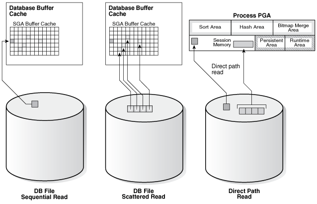

After the initial configuration of a database, monitoring and tuning an instance regularly is important to eliminate any potential performance bottlenecks. This chapter discusses the tuning process using Oracle `V$` performance views.

This chapter contains the following sections:

### Instance Tuning Steps

These are the main steps in the Oracle performance method for instance tuning:

1. Define the Problem
	Get candid feedback from users about the scope of the performance problem.
2. Examine the Host System and Examine the Oracle Database Statistics
	- After obtaining a full set of operating system, database, and application statistics, examine the data for any evidence of performance problems.
	- Consider the list of common performance errors to see whether the data gathered suggests that they are contributing to the problem.
	- Build a conceptual model of what is happening on the system using the performance data gathered.
3. Implement and Measure Change
	Propose changes to be made and the expected result of implementing the changes. Then, implement the changes and measure application performance.
4. Determine whether the performance objective defined in step 1 has been met. If not, then repeat steps 2 and 3 until the performance goals are met.

The remainder of this chapter discusses instance tuning using the Oracle Database dynamic performance views. However, Oracle recommends using Automatic Workload Repository (AWR) and Automatic Database Diagnostic Monitor (ADDM) for statistics gathering, monitoring, and tuning due to the extended feature list.

Note:

If your site does not have AWR and ADDM features, then you can use Statspack to gather Oracle database instance statistics.

#### Define the Problem

It is vital to develop a good understanding of the purpose of the tuning exercise and the nature of the problem before attempting to implement a solution. Without this understanding, it is virtually impossible to implement effective changes. The data gathered during this stage helps determine the next step to take and what evidence to examine.

Gather the following data:

1. Identify the performance objective.
	What is the measure of acceptable performance? How many transactions an hour, or seconds, response time will meet the required performance level?
2. Identify the scope of the problem.
	What is affected by the slowdown? For example, is the whole instance slow? Is it a particular application, program, specific operation, or a single user?
3. Identify the time frame when the problem occurs.
	Is the problem only evident during peak hours? Does performance deteriorate over the course of the day? Was the slowdown gradual (over the space of months or weeks) or sudden?
4. Quantify the slowdown.
	This helps identify the extent of the problem and also acts as a measure for comparison when deciding whether changes implemented to fix the problem have actually made an improvement. Find a consistently reproducible measure of the response time or job run time. How much worse are the timings than when the program was running well?
5. Identify any changes.
	Identify what has changed since performance was acceptable. This may narrow the potential cause quickly. For example, has the operating system software, hardware, application software, or Oracle Database release been upgraded? Has more data been loaded into the system, or has the data volume or user population grown?

At the end of this phase, you should have a good understanding of the symptoms. If the symptoms can be identified as local to a program or set of programs, then the problem is handled in a different manner from instance-wide performance issues.

#### Examine the Host System

Look at the load on the database server and the database instance. Consider the operating system, the I/O subsystem, and network statistics, because examining these areas helps determine what might be worth further investigation. In multitier systems, also examine the application server middle-tier hosts.

Examining the host hardware often gives a strong indication of the bottleneck in the system. This determines which Oracle Database performance data could be useful for cross-reference and further diagnosis.

Data to examine includes the following:

- CPU Usage
- Identifying I/O Problems
- Identifying Network Issues

##### CPU Usage

If there is a significant amount of idle CPU, then there could be an I/O, application, or database bottleneck. Note that wait I/O should be considered as idle CPU.

If there is high CPU usage, then determine whether the CPU is being used effectively. Is the majority of CPU usage attributable to a small number of high-CPU using programs, or is the CPU consumed by an evenly distributed workload?

If a small number of high-usage programs use the CPU, then look at the programs to determine the cause. Check whether some processes alone consume the full power of one CPU. Depending on the process, this could indicate a CPU or process-bound workload that can be tackled by dividing or parallelizing process activity.

###### Non-Oracle Processes

If the programs are not Oracle programs, then identify whether they are legitimately requiring that amount of CPU. If so, determine whether their execution be delayed to off-peak hours. Identifying these CPU intensive processes can also help narrowing what specific activity, such as I/O, network, and paging, is consuming resources and how can it be related to the database workload.

###### Oracle Processes

If a small number of Oracle processes consumes most of the CPU resources, then use `SQL_TRACE` and `TKPROF` to identify the SQL or PL/SQL statements to see if a particular query or PL/SQL program unit can be tuned. For example, a SELECT statement could be CPU-intensive if its execution involves many reads of data in cache (logical reads) that could be avoided with better SQL optimization.

###### Oracle Database CPU Statistics

Oracle Database CPU statistics are available in several `V$` views:

- `V$SYSSTAT` shows Oracle Database CPU usage for all sessions. The `CPU` `used` `by` `this` `session` statistic shows the aggregate CPU used by all sessions. The `parse` `time` `cpu` statistic shows the total CPU time used for parsing.
- `V$SESSTAT` shows Oracle Database CPU usage for each session. Use this view to determine which particular session is using the most CPU.
- `V$RSRC_CONSUMER_GROUP` shows CPU utilization statistics for each consumer group when the Oracle Database Resource Manager is running.

###### Interpreting CPU Statistics

It is important to recognize that CPU time and real time are distinct. With eight CPUs, for any given minute in real time, there are eight minutes of CPU time available. On Windows and UNIX, this can be either user time or system time (privileged mode on Windows). Thus, average CPU time utilized by all processes (threads) on the system could be greater than one minute for every one minute real time interval.

At any given moment, you know how much time Oracle Database has used on the system. So, if eight minutes are available and Oracle Database uses four minutes of that time, then you know that 50% of all CPU time is used by Oracle. If your process is not consuming that time, then some other process is. Identify the processes that are using CPU time, figure out why, and then attempt to tune them.

If the CPU usage is evenly distributed over many Oracle server processes, examine the `V$SYS_TIME_MODEL` view to help get a precise understanding of where most time is spent.

See Also:

" Table 10-1 " for more information about various wait events and their possible causes

##### Identifying I/O Problems

An overly active I/O system can be evidenced by disk queue lengths greater than two, or disk service times that are over 20-30ms. If the I/O system is overly active, then check for potential hot spots that could benefit from distributing the I/O across more disks. Also identify whether the load can be reduced by lowering the resource requirements of the programs using those resources. If the I/O problems are caused by Oracle Database, then I/O tuning can begin. If Oracle Database is not consuming the available I/O resources, then identify the process that is using up the I/O. Determine why the process is using up the I/O, and then tune this process.

I/O problems can be identified using `V$` views in Oracle Database and monitoring tools in the operating system, as described in the following sections:

- Identifying I/O Problems Using V$ Views
- Identifying I/O Problems Using Operating System Monitoring Tools

###### Identifying I/O Problems Using V$ Views

Check the Oracle wait event data in `V$SYSTEM_EVENT` to see whether the top wait events are I/O related. I/O related events include `db` `file` `sequential` `read`, `db` `file` `scattered` `read`, `db` `file` `single` `write`, `db` `file` `parallel` `write`, and `log` `file` `parallel` `write`. These are all events corresponding to I/Os performed against data files and log files. If any of these wait events correspond to high average time, then investigate the I/O contention.

Cross reference the host I/O system data with the I/O sections in the Automatic Repository report to identify hot data files and tablespaces. Also compare the I/O times reported by the operating system with the times reported by Oracle Database to see if they are consistent.

An I/O problem can also manifest itself with non-I/O related wait events. For example, the difficulty in finding a free buffer in the buffer cache or high wait times for logs to be flushed to disk can also be symptoms of an I/O problem. Before investigating whether the I/O system should be reconfigured, determine if the load on the I/O system can be reduced.

To reduce I/O load caused by Oracle Database, examine the I/O statistics collected for all I/O calls made by the database using the following views:

- `V$IOSTAT_CONSUMER_GROUP`
	The `V$IOSTAT_CONSUMER_GROUP` view captures I/O statistics for consumer groups. If Oracle Database Resource Manager is enabled, I/O statistics for all consumer groups that are part of the currently enabled resource plan are captured.
- `V$IOSTAT_FILE`
	The `V$IOSTAT_FILE` view captures I/O statistics of database files that are or have been accessed. The `SMALL_SYNC_READ_LATENCY` column displays the latency for single block synchronous reads (in milliseconds), which translates directly to the amount of time that clients need to wait before moving onto the next operation. This defines the responsiveness of the storage subsystem based on the current load. If there is a high latency for critical data files, you may want to consider relocating these files to improve their service time. To calculate latency statistics, `timed_statistics` must be set to `TRUE`.
- `V$IOSTAT_FUNCTION`
	The `V$IOSTAT_FUNCTION` view captures I/O statistics for database functions (such as the LGWR and DBWR).
	An I/O can be issued by various Oracle processes with different functionalities. The top database functions are classified in the `V$IOSTAT_FUNCTION` view. In cases when there is a conflict of I/O functions, the I/O is placed in the bucket with the lower `FUNCTION_ID`. For example, if XDB issues an I/O from the buffer cache, the I/O would be classified as an XDB I/O because it has a lower `FUNCTION_ID` value. Any unclassified function is placed in the Others bucket. You can display the `FUNCTION_ID` hierarchy by querying the `V$IOSTAT_FUNCTION` view:
	```
	select FUNCTION_ID, FUNCTION_NAME
	from v$iostat_function
	order by FUNCTION_ID;
	FUNCTION_ID FUNCTION_NAME
	----------- ------------------
	           0 RMAN
	           1 DBWR
	           2 LGWR
	           3 ARCH
	           4 XDB
	           5 Streams AQ
	           6 Data Pump
	           7 Recovery
	           8 Buffer Cache Reads
	           9 Direct Reads
	          10 Direct Writes
	          11 Others
	```

These `V$IOSTAT` views contains I/O statistics for both single and multi block read and write operations. Single block operations are small I/Os that are less than or equal to 128 kilobytes. Multi block operations are large I/Os that are greater than 128 kilobytes. For each of these operations, the following statistics are collected:

- Identifier
- Total wait time (in milliseconds)
- Number of waits executed (for consumer groups and functions)
- Number of requests for each operation
- Number of single and multi block bytes read
- Number of single and multi block bytes written

You should also look at SQL statements that perform many physical reads by querying the `V$SQLAREA` view, or by reviewing the "SQL ordered by Reads" section of the Automatic Workload Repository report. Examine these statements to see how they can be tuned to reduce the number of I/Os.

See Also:

[Oracle Database Reference](https://docs.oracle.com/pls/topic/lookup?ctx=en/database/oracle/oracle-database/21/tgdba&id=REFRN) for more information about the views `V$IOSTAT_CONSUMER_GROUP`, `V$IOSTAT_FUNCTION`, `V$IOSTAT_FILE`, and `V$SQLAREA`

###### Identifying I/O Problems Using Operating System Monitoring Tools

Use operating system monitoring tools to determine what processes are running on the system as a whole and to monitor disk access to all files. Remember that disks holding data files and redo log files can also hold files that are not related to Oracle Database. Reduce any heavy access to disks that contain database files. You can monitor access to non-database files only through operating system facilities, rather than through the `V$` views.

Utilities, such as `sar` `-d` (or `iostat`) on many UNIX systems and the administrative performance monitoring tool on Windows systems, examine I/O statistics for the entire system.

See Also:

Your operating system documentation for the tools available on your platform

##### Identifying Network Issues

Using operating system utilities, look at the network round-trip ping time and the number of collisions. If the network is causing large delays in response time, then investigate possible causes.

To identify network I/O caused by remote access of database files, examine the `V$IOSTAT_NETWORK` view. This view contains network I/O statistics caused by accessing files on a remote database instance, including:

- Database client initiating the network I/O (such as RMAN and PLSQL)
- Number of read and write operations issued
- Number of kilobytes read and written
- Total wait time in milliseconds for read operations
- Total wait in milliseconds for write operations

After the cause of the network issue is identified, network load can be reduced by scheduling large data transfers to off-peak times, or by coding applications to batch requests to remote hosts, rather than accessing remote hosts once (or more) for one request.

#### Examine the Oracle Database Statistics

Examine Oracle Database statistics and cross-reference them with operating system statistics to ensure a consistent diagnosis of the problem. Operating system statistics can indicate a good place to begin tuning. However, if the goal is to tune the Oracle database instance, then look at the Oracle Database statistics to identify the resource bottleneck from a database perspective before implementing corrective action.

This section contains the following topics.

- Setting the Level of Statistics Collection
- Wait Events
- Dynamic Performance Views Containing Wait Event Statistics
- System Statistics
- Segment-Level Statistics

See Also:

" Interpreting Oracle Database Statistics "

##### Setting the Level of Statistics Collection

Oracle Database provides the initialization parameter `STATISTICS_LEVEL`, which controls all major statistics collections or advisories in the database. This parameter sets the statistics collection level for the database.

Depending on the setting of `STATISTICS_LEVEL`, certain advisories or statistics are collected, as follows:

- `BASIC`: No advisories or statistics are collected. Monitoring and many automatic features are disabled. Oracle does not recommend this setting because it disables important Oracle Database features.
- `TYPICAL`: This is the default value and ensures collection for all major statistics while providing best overall database performance. This setting should be adequate for most environments.
- `ALL`: All of the advisories or statistics that are collected with the `TYPICAL` setting are included, plus timed operating system statistics and row source execution statistics.

See Also:

- [Oracle Database Reference](https://docs.oracle.com/pls/topic/lookup?ctx=en/database/oracle/oracle-database/21/tgdba&id=REFRN10214) for more information on the `STATISTICS_LEVEL` initialization parameter.
- [Oracle Database Reference](https://docs.oracle.com/pls/topic/lookup?ctx=en/database/oracle/oracle-database/21/tgdba&id=REFRN30264) for information about the `V$STATISTICS_LEVEL` view. This view lists the status of the statistics or advisories controlled by the `STATISTICS_LEVEL` initialization parameter.

##### Wait Events

Wait events are statistics that are incremented by a server process or thread to indicate that it had to wait for an event to complete before being able to continue processing. Wait event data reveals various symptoms of problems that might be impacting performance, such as latch contention, buffer contention, and I/O contention. Remember that these are only symptoms of problems, not the actual causes.

Wait events are grouped into classes. The wait event classes include: Administrative, Application, Cluster, Commit, Concurrency, Configuration, Idle, Network, Other, Scheduler, System I/O, and User I/O.

A server process can wait for the following:

- A resource to become available, such as a buffer or a latch.
- An action to complete, such as an I/O.
- More work to do, such as waiting for the client to provide the next SQL statement to execute. Events that identify that a server process is waiting for more work are known as idle events.

Wait event statistics include the number of times an event was waited for and the time waited for the event to complete. If the initialization parameter `TIMED_STATISTICS` is set to `true`, then you can also see how long each resource was waited for.

To minimize user response time, reduce the time spent by server processes waiting for event completion. Not all wait events have the same wait time. Therefore, it is more important to examine events with the most total time waited rather than wait events with a high number of occurrences. Usually, it is best to set the dynamic parameter `TIMED_STATISTICS` to `true` at least while monitoring performance.

See Also:

- " Wait Events Statistics "
- " [Using Wait Events with Timed Statistics](measuring-database-performance.md) "
- [Oracle Database Reference](https://docs.oracle.com/pls/topic/lookup?ctx=en/database/oracle/oracle-database/21/tgdba&id=REFRN101) for more information about Oracle Database wait events

##### Dynamic Performance Views Containing Wait Event Statistics

These dynamic performance views can be queried for wait event statistics:

- `V$ACTIVE_SESSION_HISTORY`
	The `V$ACTIVE_SESSION_HISTORY` view displays active database session activity, sampled once every second.
- `V$SESS_TIME_MODEL` and `V$SYS_TIME_MODEL`
	The `V$SESS_TIME_MODEL` and `V$SYS_TIME_MODEL` views contain time model statistics, including `DB` `time` which is the total time spent in database calls.
- `V$SESSION_WAIT `
	The `V$SESSION_WAIT` view displays information about the current or last wait for each session (such as wait ID, class, and time).
- `V$SESSION`
	The `V$SESSION` view displays information about each current session and contains the same wait statistics as those found in the `V$SESSION_WAIT` view. If applicable, this view also contains detailed information about the object that the session is currently waiting for (such as object number, block number, file number, and row number), the blocking session responsible for the current wait (such as the blocking session ID, status, and type), and the amount of time waited.
- `V$SESSION_EVENT `
	The `V$SESSION_EVENT` view provides summary of all the events the session has waited for since it started.
- `V$SESSION_WAIT_CLASS `
	The `V$SESSION_WAIT_CLASS` view provides the number of waits and the time spent in each class of wait events for each session.
- `V$SESSION_WAIT_HISTORY `
	The `V$SESSION_WAIT_HISTORY` view displays information about the last ten wait events for each active session (such as event type and wait time).
- `V$SYSTEM_EVENT `
	The `V$SYSTEM_EVENT` view provides a summary of all the event waits on the instance since it started.
- `V$EVENT_HISTOGRAM `
	The `V$EVENT_HISTOGRAM` view displays a histogram of the number of waits, the maximum wait, and total wait time on an event basis.
- `V$FILE_HISTOGRAM `
	The `V$FILE_HISTOGRAM` view displays a histogram of times waited during single block reads for each file.
- `V$SYSTEM_WAIT_CLASS `
	The `V$SYSTEM_WAIT_CLASS` view provides the instance wide time totals for the number of waits and the time spent in each class of wait events.
- `V$TEMP_HISTOGRAM`
	The `V$TEMP_HISTOGRAM` view displays a histogram of times waited during single block reads for each temporary file.

Investigate wait events and related timing data when performing reactive performance tuning. The events with the most time listed against them are often strong indications of the performance bottleneck. For example, by looking at `V$SYSTEM_EVENT`, you might notice lots of `buffer` `busy` `waits`. It might be that many processes are inserting into the same block and must wait for each other before they can insert. The solution could be to use automatic segment space management or partitioning for the object in question.

See Also:

- " Wait Events Statistics " for differences among the views `V$SESSION_WAIT`, `V$SESSION_EVENT`, and `V$SYSTEM_EVENT`
- [Oracle Database Reference](https://docs.oracle.com/pls/topic/lookup?ctx=en/database/oracle/oracle-database/21/tgdba&id=REFRN003) for information about the dynamic performance views

##### System Statistics

System statistics are typically used in conjunction with wait event data to find further evidence of the cause of a performance problem.

For example, if `V$SYSTEM_EVENT` indicates that the largest wait event (in terms of wait time) is the event `buffer` `busy` `waits`, then look at the specific buffer wait statistics available in the view `V$WAITSTAT` to see which block type has the highest wait count and the highest wait time.

After the block type has been identified, also look at `V$SESSION` real-time while the problem is occurring or `V$ACTIVE_SESSION_HISTORY` and `DBA_HIST_ACTIVE_SESS_HISTORY` views after the problem has been experienced to identify the contended-for objects using the object number indicated. The combination of this data indicates the appropriate corrective action.

Statistics are available in many `V$` views. The following are some of the `V$` views that contain system statistics.

V$ACTIVE\_SESSION\_HISTORY

This view displays active database session activity, sampled once every second.

V$SYSSTAT

This contains overall statistics for many different parts of Oracle Database, including rollback, logical and physical I/O, and parse data. Data from `V$SYSSTAT` is used to compute ratios, such as the buffer cache hit ratio.

V$FILESTAT

This contains detailed file I/O statistics for each file, including the number of I/Os for each file and the average read time.

V$ROLLSTAT

This contains detailed rollback and undo segment statistics for each segment.

V$ENQUEUE\_STAT

This contains detailed enqueue statistics for each enqueue, including the number of times an enqueue was requested and the number of times an enqueue was waited for, and the wait time.

V$LATCH

This contains detailed latch usage statistics for each latch, including the number of times each latch was requested and the number of times the latch was waited for.

See Also:

[Oracle Database Reference](https://docs.oracle.com/pls/topic/lookup?ctx=en/database/oracle/oracle-database/21/tgdba&id=REFRN003) for information about dynamic performance views

##### Segment-Level Statistics

You can gather segment-level statistics to help you spot performance problems associated with individual segments. Collecting and viewing segment-level statistics is a good way to effectively identify hot tables or indexes in an instance.

After viewing wait events and system statistics to identify the performance problem, you can use segment-level statistics to find specific tables or indexes that are causing the problem. Consider, for example, that `V$SYSTEM_EVENT` indicates that buffer busy waits cause a fair amount of wait time. You can select from `V$SEGMENT_STATISTICS` the top segments that cause the buffer busy waits. Then you can focus your effort on eliminating the problem in those segments.

You can query segment-level statistics through the following dynamic performance views:

- `V$SEGSTAT_NAME: `This view lists the segment statistics being collected and the properties of each statistic (for instance, if it is a sampled statistic).
- `V$SEGSTAT: `This is a highly efficient, real-time monitoring view that shows the statistic value, statistic name, and other basic information.
- `V$SEGMENT_STATISTICS: `This is a user-friendly view of statistic values. In addition to all the columns of `V$SEGSTAT`, it has information about such things as the segment owner and table space name. It makes the statistics easy to understand, but it is more costly.
	See Also:
	[Oracle Database Reference](https://docs.oracle.com/pls/topic/lookup?ctx=en/database/oracle/oracle-database/21/tgdba&id=REFRN003) for information about dynamic performance views

#### Implement and Measure Change

Often at the end of a tuning exercise, it is possible to identify two or three changes that could potentially alleviate the problem. To identify which change provides the most benefit, it is recommended that only one change be implemented at a time. The effect of the change should be measured against the baseline data measurements found in the problem definition phase.

Typically, most sites with dire performance problems implement several overlapping changes at once, and thus cannot identify which changes provided any benefit. Although this is not immediately an issue, this becomes a significant hindrance if similar problems subsequently appear, because it is not possible to know which of the changes provided the most benefit and which efforts to prioritize.

If it is not possible to implement changes separately, then try to measure the effects of dissimilar changes. For example, measure the effect of making an initialization change to optimize redo generation separately from the effect of creating a new index to improve the performance of a modified query. It is impossible to measure the benefit of performing an operating system upgrade if SQL is tuned, the operating system disk layout is changed, and the initialization parameters are also changed at the same time.

Performance tuning is an iterative process. It is unlikely to find a 'silver bullet' that solves an instance-wide performance problem. In most cases, excellent performance requires iteration through the performance tuning phases, because solving one bottleneck often uncovers another (sometimes worse) problem.

Knowing when to stop tuning is also important. The best measure of performance is user perception, rather than how close the statistic is to an ideal value.

### Interpreting Oracle Database Statistics

Gather statistics that cover the time when the instance had the performance problem. If you previously captured baseline data for comparison, then you can compare the current data to the data from the baseline that most represents the problem workload.

When comparing two reports, ensure that the two reports are from times where the system was running comparable workloads.

#### Examine Load

Usually, wait events are the first data examined. However, if you have a baseline report, then check to see if the load has changed. Regardless of whether you have a baseline, it is useful to see whether the resource usage rates are high.

Load-related statistics to examine include `redo` `size`, `session` `logical` `reads`, `db` `block` `changes`, `physical` `reads`, `physical read total bytes, physical` `writes`, `physical write total bytes, parse` `count` (`total`), `parse` `count` (`hard`), and `user` `calls`. This data is queried from `V$SYSSTAT`. It is best to normalize this data over seconds and over transactions. It is also useful to examine the total I/O load in MB per second by using the sum of physical read total bytes and physical write total bytes. The combined value includes the I/O's used to buffer cache, redo logs, archive logs, by Recovery Manager (RMAN) backup and recovery and any Oracle Database background process.

In the AWR report, look at the Load Profile section. The data has been normalized over transactions and over seconds.

Changing Load

The load profile statistics over seconds show the changes in throughput (that is, whether the instance is performing more work each second). The statistics over transactions identify changes in the application characteristics by comparing these to the corresponding statistics from the baseline report.

High Rates of Activity

Examine the statistics normalized over seconds to identify whether the rates of activity are very high. It is difficult to make blanket recommendations on high values, because the thresholds are different on each site and are contingent on the application characteristics, the number and speed of CPUs, the operating system, the I/O system, and the Oracle Database release.

The following are some generalized examples (acceptable values vary at each site):

- A hard parse rate of more than 100 a second indicates that there is a very high amount of hard parsing on the system. High hard parse rates cause serious performance issues and must be investigated. Usually, a high hard parse rate is accompanied by latch contention on the shared pool and library cache latches.
- Check whether the sum of the wait times for library cache and shared pool latch events (latch: library cache, latch: library cache pin, latch: library cache lock and latch: shared pool) is significant compared to statistic `DB` `time` found in `V$SYSSTAT`. If so, examine the `SQL` `ordered` `by` `Parse` `Calls` section of the AWR report.
- A high soft parse rate could be in the rate of 300 a second or more. Unnecessary soft parses also limit application scalability. Optimally, a SQL statement should be soft parsed once in each session and executed many times.

#### Using Wait Event Statistics to Drill Down to Bottlenecks

Whenever an Oracle process waits for something, it records the wait using one of a set of predefined wait events. These wait events are grouped in wait classes. The Idle wait class groups all events that a process waits for when it does not have work to do and is waiting for more work to perform. Non-idle events indicate nonproductive time spent waiting for a resource or action to complete.

Note:

Not all symptoms can be evidenced by wait events. See " Additional Statistics " for the statistics that can be checked.

The most effective way to use wait event data is to order the events by the wait time. This is only possible if `TIMED_STATISTICS` is set to `true`. Otherwise, the wait events can only be ranked by the number of times waited, which is often not the ordering that best represents the problem.

To get an indication of where time is spent, follow these steps:

1. Examine the data collection for `V$SYSTEM_EVENT`. The events of interest should be ranked by wait time.
	Identify the wait events that have the most significant percentage of wait time. To determine the percentage of wait time, add the total wait time for all wait events, excluding idle events, such as `Null event`, `SQL*Net message from client`, `SQL*Net message to client`, and `SQL*Net more data to client`. Calculate the relative percentage of the five most prominent events by dividing each event's wait time by the total time waited for all events.
	Alternatively, look at the Top 5 Timed Events section at the beginning of the Automatic Workload Repository report. This section automatically orders the wait events (omitting idle events), and calculates the relative percentage:
	```
	Top 5 Timed Events
	~~~~~~~~~~~~~~~~~~                                                % Total
	Event                                         Waits    Time (s) Call Time
	-------------------------------------- ------------ ----------- ---------
	CPU time                                                    559     88.80
	log file parallel write                       2,181          28      4.42
	SQL*Net more data from client               516,611          27      4.24
	db file parallel write                       13,383          13      2.04
	db file sequential read                         563           2       .27
	```
	In some situations, there might be a few events with similar percentages. This can provide extra evidence if all the events are related to the same type of resource request (for example, all I/O related events).
2. Look at the number of waits for these events, and the average wait time. For example, for I/O related events, the average time might help identify whether the I/O system is slow. The following example of this data is taken from the Wait Event section of the AWR report:
	```
	Avg
	                                                Total Wait   wait     Waits
	Event                           Waits  Timeouts   Time (s)   (ms)      /txn
	--------------------------- --------- --------- ---------- ------ ---------
	log file parallel write         2,181         0         28     13      41.2
	SQL*Net more data from clie   516,611         0         27      0   9,747.4
	db file parallel write         13,383         0         13      1     252.5
	```
3. The top wait events identify the next places to investigate. A table of common wait events is listed in Table 10-1. It is usually a good idea to also have quick look at high-load SQL.
4. Examine the related data indicated by the wait events to see what other information this data provides. Determine whether this information is consistent with the wait event data. In most situations, there is enough data to begin developing a theory about the potential causes of the performance bottleneck.
5. To determine whether this theory is valid, cross-check data you have examined with other statistics available for consistency. The appropriate statistics vary depending on the problem, but usually include load profile-related data in `V$SYSSTAT`, operating system statistics, and so on. Perform cross-checks with other data to confirm or refute the developing theory.

#### Table of Wait Events and Potential Causes

Table 10-1 links wait events to possible causes and gives an overview of the Oracle data that could be most useful to review next.

Table 10-1 Wait Events and Potential Causes

| Wait Event | General Area | Possible Causes | Look for / Examine |
| --- | --- | --- | --- |
| `buffer busy waits` | Buffer cache, DBWR | Depends on buffer type. For example, waits for an index block may be caused by a primary key that is based on an ascending sequence. | Examine `V$SESSION` while the problem is occurring to determine the type of block in contention. |
| `free buffer waits` | Buffer cache, DBWR, I/O | Slow DBWR (possibly due to I/O?)  Cache too small | Examine write time using operating system statistics. Check buffer cache statistics for evidence of too small cache. |
| `db file scattered read` | I/O, SQL statement tuning | Poorly tuned SQL  Slow I/O system | Investigate `V$SQLAREA` to see whether there are SQL statements performing many disk reads. Cross-check I/O system and `V$FILESTAT` for poor read time. |
| `db file sequential read` | I/O, SQL statement tuning | Poorly tuned SQL  Slow I/O system | Investigate `V$SQLAREA` to see whether there are SQL statements performing many disk reads. Cross-check I/O system and `V$FILESTAT` for poor read time. |
| `enqueue` waits (waits starting with `enq:`) | Locks | Depends on type of enqueue | Look at `V$ENQUEUE_STAT`. |
| library cache latch waits: `library` `cache`, `library` `cache` `pin`, and `library` `cache` `lock` | Latch contention | SQL parsing or sharing | Check `V$SQLAREA` to see whether there are SQL statements with a relatively high number of parse calls or a high number of child cursors (column `VERSION_COUNT`). Check parse statistics in `V$SYSSTAT` and their corresponding rate for each second. |
| `log buffer space` | Log buffer, I/O | Log buffer small  Slow I/O system | Check the statistic `redo` `buffer` `allocation` `retries` in `V$SYSSTAT`. Check configuring log buffer section in configuring memory chapter. Check the disks that house the online redo logs for resource contention. |
| `log file sync` | I/O, over- committing | Slow disks that store the online logs  Un-batched commits | Check the disks that house the online redo logs for resource contention. Check the number of transactions (`commits` + `rollbacks`) each second, from `V$SYSSTAT`. |

See Also:

- " Wait Events Statistics " for detailed information on each event listed in " Table 10-1 " and for other information to cross-check
- [Oracle Database Reference](https://docs.oracle.com/pls/topic/lookup?ctx=en/database/oracle/oracle-database/21/tgdba&id=REFRN003) for information about dynamic performance views
- My Oracle Support notices on `buffer busy waits` (34405.1) and `free buffer waits` (62172.1). You can also access these notices and related notices by searching for "busy buffer waits" and "free buffer waits" on My Oracle Support website.

#### Additional Statistics

There are several statistics that can indicate performance problems that do not have corresponding wait events.

Redo Log Space Requests Statistic

The `V$SYSSTAT` statistic `redo` `log` `space` `requests` indicates how many times a server process had to wait for space in the online redo log, not for space in the redo log buffer. Use this statistic and the wait events as an indication that you must tune checkpoints, DBWR, or archiver activity, not LGWR. Increasing the size of the log buffer does not help.

Read Consistency

Your system might spend excessive time rolling back changes to blocks in order to maintain a consistent view. Consider the following scenarios:

- If there are many small transactions and an active long-running query is running in the background on the same table where the changes are happening, then the query might need to roll back those changes often, in order to obtain a read-consistent image of the table. Compare the following `V$SYSSTAT` statistics to determine whether this is happening:
	- `consistent`: `changes` statistic indicates the number of times a database block has rollback entries applied to perform a consistent read on the block. Workloads that produce a great deal of `consistent` `changes` can consume a great deal of resources.
		- `consistent gets`: statistic counts the number of logical reads in consistent mode.
- If there are few very, large rollback segments, then your system could be spending a lot of time rolling back the transaction table during delayed block cleanout in order to find out exactly which system change number (SCN) a transaction was committed. When Oracle Database commits a transaction, all modified blocks are not necessarily updated with the commit SCN immediately. In this case, it is done later on demand when the block is read or updated. This is called delayed block cleanout.
	The ratio of the following `V$SYSSTAT` statistics should be close to one:
	```
	ratio = transaction tables consistent reads - undo records applied /
	        transaction tables consistent read rollbacks
	```
	The recommended solution is to use automatic undo management.
- If there are insufficient rollback segments, then there is rollback segment (header or block) contention. Evidence of this problem is available by the following:
	- Comparing the number of `WAITS` to the number of `GETS` in `V$ROLLSTAT`; the proportion of `WAITS` to `GETS` should be small.
		- Examining `V$WAITSTAT` to see whether there are many `WAITS` for buffers of `CLASS` ' `undo` `header` '.
	The recommended solution is to use automatic undo management.

Table Fetch by Continued Row

You can detect migrated or chained rows by checking the number of `table` `fetch` `continued` `row` statistic in `V$SYSSTAT`. A small number of chained rows (less than 1%) is unlikely to impact system performance. However, a large percentage of chained rows can affect performance.

Chaining on rows larger than the block size is inevitable. Consider using a tablespace with a larger block size for such data.

However, for smaller rows, you can avoid chaining by using sensible space parameters and good application design. For example, do not insert a row with key values filled in and nulls in most other columns, then update that row with the real data, causing the row to grow in size. Rather, insert rows filled with data from the start.

If an `UPDATE` statement increases the amount of data in a row so that the row no longer fits in its data block, then Oracle Database tries to find another block with enough free space to hold the entire row. If such a block is available, then Oracle Database moves the entire row to the new block. This operation is called row migration. If the row is too large to fit into any available block, then the database splits the row into multiple pieces and stores each piece in a separate block. This operation is called row chaining. The database can also chain rows when they are inserted.

Migration and chaining are especially detrimental to performance with the following:

- `UPDATE` statements that cause migration and chaining to perform poorly
- Queries that select migrated or chained rows because these must perform additional input and output

The definition of a sample output table named `CHAINED_ROWS` appears in a SQL script available on your distribution medium. The common name of this script is `UTLCHN1`.`SQL`, although its exact name and location varies depending on your platform. Your output table must have the same column names, data types, and sizes as the `CHAINED_ROWS` table.

Increasing `PCTFREE` can help to avoid migrated rows. If you leave more free space available in the block, then the row has room to grow. You can also reorganize or re-create tables and indexes that have high deletion rates. If tables frequently have rows deleted, then data blocks can have partially free space in them. If rows are inserted and later expanded, then the inserted rows might land in blocks with deleted rows but still not have enough room to expand. Reorganizing the table ensures that the main free space is totally empty blocks.

Note:

`PCTUSED` is not the opposite of `PCTFREE`.

See Also:

- [Oracle Database Concepts](https://docs.oracle.com/pls/topic/lookup?ctx=en/database/oracle/oracle-database/21/tgdba&id=CNCPT-GUID-71C6DECB-E7D0-4511-9BA1-127AAE8851EF) for more information on `PCTUSED`
- [Oracle Database Administrator's Guide](https://docs.oracle.com/pls/topic/lookup?ctx=en/database/oracle/oracle-database/21/tgdba&id=ADMIN-GUID-92361F74-4796-407D-A3B9-569C6E544E34) to learn how to reorganize tables

Parse-Related Statistics

The more your application parses, the more potential for contention exists, and the more time your system spends waiting. If `parse` `time` `CPU` represents a large percentage of the CPU time, then time is being spent parsing instead of executing statements. If this is the case, then it is likely that the application is using literal SQL and so SQL cannot be shared, or the shared pool is poorly configured.

There are several statistics available to identify the extent of time spent parsing by Oracle. Query the parse related statistics from `V$SYSSTAT`. For example:

```
SELECT NAME, VALUE
  FROM V$SYSSTAT
 WHERE NAME IN (  'parse time cpu', 'parse time elapsed',
                  'parse count (hard)', 'CPU used by this session' );
```

There are various ratios that can be computed to assist in determining whether parsing may be a problem:

- parse time CPU / parse time elapsed
	This ratio indicates how much of the time spent parsing was due to the parse operation itself, rather than waiting for resources, such as latches. A ratio of one is good, indicating that the elapsed time was not spent waiting for highly contended resources.
- parse time CPU / CPU used by this session
	This ratio indicates how much of the total CPU used by Oracle server processes was spent on parse-related operations. A ratio closer to zero is good, indicating that the majority of CPU is not spent on parsing.

### Wait Events Statistics

The `V$SESSION`, `V$SESSION_WAIT`, `V$SESSION_HISTORY`, `V$SESSION_EVENT`, and `V$SYSTEM_EVENT` views provide information on what resources were waited for, and, if the configuration parameter `TIMED_STATISTICS` is set to `true`, how long each resource was waited for.

See Also:

- " Setting the Level of Statistics Collection " for information about the `STATISTICS_LEVEL` settings
- [Oracle Database Reference](https://docs.oracle.com/pls/topic/lookup?ctx=en/database/oracle/oracle-database/21/tgdba&id=REFRN-GUID-03BFEEFB-1020-4F3F-8CF8-A23E7026684B) for information about the `V$` views containing wait event statistics

Investigate wait events and related timing data when performing reactive performance tuning. The events with the most time listed against them are often strong indications of the performance bottleneck.

The following views contain related, but different, views of the same data:

- `V$SESSION` lists session information for each current session. It lists either the event currently being waited for, or the event last waited for on each session. This view also contains information about blocking sessions, the wait state, and the wait time.
- `V$SESSION_WAIT` is a current state view. It lists either the event currently being waited for, or the event last waited for on each session, the wait state, and the wait time.
- `V$SESSION_WAIT_HISTORY` lists the last 10 wait events for each current session and the associated wait time.
- `V$SESSION_EVENT` lists the cumulative history of events waited for on each session. After a session exits, the wait event statistics for that session are removed from this view.
- `V$SYSTEM_EVENT` lists the events and times waited for by the whole instance (that is, all session wait events data rolled up) since instance startup.

Because `V$SESSION_WAIT` is a current state view, it also contains a finer-granularity of information than `V$SESSION_EVENT` or `V$SYSTEM_EVENT`. It includes additional identifying data for the current event in three parameter columns: `P1`, `P2`, and `P3`.

For example, `V$SESSION_EVENT` can show that session 124 (SID=124) had many waits on the `db` `file` `scattered` `read`, but it does not show which file and block number. However, `V$SESSION_WAIT` shows the file number in `P1`, the block number read in `P2`, and the number of blocks read in `P3` (`P1` and `P2` let you determine for which segments the wait event is occurring).

This section concentrates on examples using `V$SESSION_WAIT`. However, Oracle recommends capturing performance data over an interval and keeping this data for performance and capacity analysis. This form of rollup data is queried from the `V$SYSTEM_EVENT` view by AWR.

Most commonly encountered events are described in this chapter, listed in case-sensitive alphabetical order. Other event-related data to examine is also included. The case used for each event name is that which appears in the `V$SYSTEM_EVENT` view.

#### Changes to Wait Event Statistics from Past Releases

Starting with Oracle Database 11g, Oracle Database accumulates wait counts and time outs for wait events (such as in the `V$SYSTEM_EVENT` view) differently than in past releases. Continuous waits for certain types of resources (such as enqueues) are internally divided into a set of shorter wait calls. In releases prior to Oracle Database 11g, each individual internal wait call was counted as a separate wait. Starting with Oracle Database 11g, a single resource wait is recorded as a single wait, irrespective of the number of internal time outs experienced by the session during the wait.

This change allows Oracle Database to display a more representative wait count, and an accurate total time spent waiting for the resource. Time outs now refer to the resource wait, instead of the individual internal wait calls. This change also affects the average wait time and the maximum wait time. For example, if a user session must wait for an enqueue in order for a transaction row lock to update a single row in a table, and it takes 10 seconds to acquire the enqueue, Oracle Database breaks down the enqueue wait into 3-second wait calls. In this example, there will be three 3-second wait calls, followed by a 1-second wait call. From the session's perspective, however, there is only one wait on an enqueue.

In releases prior to Oracle Database 11g, the `V$SYSTEM_EVENT` view would represent this wait scenario as follows:

- `TOTAL_WAITS`: 4 waits (three 3-second waits, one 1-second wait)
- `TOTAL_TIMEOUTS`: 3 time outs (the first three waits time out and the enqueue is acquired during the final wait)
- `TIME_WAITED`: 10 seconds (sum of the times from the 4 waits)
- `AVERAGE_WAIT`: 2.5 seconds
- `MAX_WAIT`: 3 seconds

Starting with Oracle Database 11g, this wait scenario is represented as:

- `TOTAL_WAITS`: 1 wait (one 10-second wait)
- `TOTAL_TIMEOUTS`: 0 time outs (the enqueue is acquired during the resource wait)
- TIME\_WAITED: 10 seconds (time for the resource wait)
- `AVERAGE_WAIT`: 10 seconds
- `MAX_WAIT`: 10 seconds

The following common wait events are affected by this change:

- Enqueue waits (such as `enq: name - reason` waits)
- Library cache lock waits
- Library cache pin waits
- Row cache lock waits

The following statistics are affected by this change:

- Wait counts
- Wait time outs
- Average wait time
- Maximum wait time

The following views are affected by this change:

- `V$EVENT_HISTOGRAM`
- `V$EVENTMETRIC`
- `V$SERVICE_EVENT`
- `V$SERVICE_WAIT_CLASS`
- `V$SESSION_EVENT`
- `V$SESSION_WAIT`
- `V$SESSION_WAIT_CLASS`
- `V$SESSION_WAIT_HISTORY`
- `V$SYSTEM_EVENT`
- `V$SYSTEM_WAIT_CLASS`
- `V$WAITCLASSMETRIC`
- `V$WAITCLASSMETRIC_HISTORY`

See Also:

[Oracle Database Reference](https://docs.oracle.com/pls/topic/lookup?ctx=en/database/oracle/oracle-database/21/tgdba&id=REFRN-GUID-65909323-09BD-48D1-B573-FF64BFA82C9A) for a description of the `V$SYSTEM_EVENT` view

#### buffer busy waits

This wait indicates that there are some buffers in the buffer cache that multiple processes are attempting to access concurrently. Query `V$WAITSTAT` for the wait statistics for each class of buffer. Common buffer classes that have buffer busy waits include `data` `block`, `segment` `header`, `undo` `header`, and `undo` `block`.

Check the following `V$SESSION_WAIT` parameter columns:

- `P1`: File ID
- `P2`: Block ID
- `P3`: Class ID

Causes

To determine the possible causes, first query `V$SESSION` to identify the value of `ROW_WAIT_OBJ#` when the session waits for `buffer` `busy` `waits`. For example:

```
SELECT row_wait_obj# 
  FROM V$SESSION 
 WHERE EVENT = 'buffer busy waits';
```

To identify the object and object type contended for, query `DBA_OBJECTS` using the value for `ROW_WAIT_OBJ#` that is returned from `V$SESSION`. For example:

```
SELECT owner, object_name, subobject_name, object_type
  FROM DBA_OBJECTS
 WHERE data_object_id = &row_wait_obj;
```

Actions

The action required depends on the class of block contended for and the actual segment.

Segment Header

If the contention is on the segment header, then this is most likely free list contention.

Automatic segment-space management in locally managed tablespaces eliminates the need to specify the `PCTUSED`, `FREELISTS`, and `FREELIST` `GROUPS` parameters. If possible, switch from manual space management to automatic segment-space management (ASSM).

The following information is relevant if you are unable to use ASSM (for example, because the tablespace uses dictionary space management).

A free list is a list of free data blocks that usually includes blocks existing in several different extents within the segment. Free lists are composed of blocks in which free space has not yet reached PCTFREE or used space has shrunk below PCTUSED. Specify the number of process free lists with the `FREELISTS` parameter. The default value of `FREELISTS` is one. The maximum value depends on the data block size.

To find the current setting for free lists for that segment, run the following:

```
SELECT SEGMENT_NAME, FREELISTS
  FROM DBA_SEGMENTS
 WHERE SEGMENT_NAME = segment name
   AND SEGMENT_TYPE = segment type;
```

Set free lists, or increase the number of free lists. If adding more free lists does not alleviate the problem, then use free list groups (even in single instance this can make a difference). If using Oracle RAC, then ensure that each instance has its own free list group(s).

See Also:

[Oracle Database Concepts](https://docs.oracle.com/pls/topic/lookup?ctx=en/database/oracle/oracle-database/21/tgdba&id=CNCPT-GUID-13CE5EDA-8C66-4CA0-87B5-4069215A368D) for information about automatic segment-space management, free lists, `PCTFREE`, and `PCTUSED`

Data Block

If the contention is on tables or indexes (not the segment header):

- Check for right-hand indexes. These are indexes that are inserted into at the same point by many processes. For example, those that use sequence number generators for the key values.
- Consider using ASSM, global hash partitioned indexes, or increasing free lists to avoid multiple processes attempting to insert into the same block.

Undo Header

For contention on rollback segment header:

- If you are not using automatic undo management, then add more rollback segments.

Undo Block

For contention on rollback segment block:

- If you are not using automatic undo management, then consider making rollback segment sizes larger.

#### db file scattered read

This event signifies that the user process is reading buffers into the SGA buffer cache and is waiting for a physical I/O call to return. A `db file scattered read` issues a scattered read to read the data into multiple discontinuous memory locations. A scattered read is usually a multiblock read. It can occur for a fast full scan (of an index) in addition to a full table scan.

The `db` `file` `scattered` `read` wait event identifies that a full scan is occurring. When performing a full scan into the buffer cache, the blocks read are read into memory locations that are not physically adjacent to each other. Such reads are called scattered read calls, because the blocks are scattered throughout memory. This is why the corresponding wait event is called 'db file scattered read'. multiblock (up to `DB_FILE_MULTIBLOCK_READ_COUNT` blocks) reads due to full scans into the buffer cache show up as waits for 'db file scattered read'.

Check the following `V$SESSION_WAIT` parameter columns:

- `P1`: The absolute file number
- `P2`: The block being read
- `P3`: The number of blocks (should be greater than 1)

Actions

On a healthy system, physical read waits should be the biggest waits after the idle waits. However, also consider whether there are direct read waits (signifying full table scans with parallel query) or `db` `file` `scattered` `read` waits on an operational (OLTP) system that should be doing small indexed accesses.

Other things that could indicate excessive I/O load on the system include the following:

- Poor buffer cache hit ratio
- These wait events accruing most of the wait time for a user experiencing poor response time

Managing Excessive I/O

There are several ways to handle excessive I/O waits. In the order of effectiveness, these are as follows:

- Reduce the I/O activity by SQL tuning.
- Reduce the need to do I/O by managing the workload.
- Gather system statistics with `DBMS_STATS` package, allowing the query optimizer to accurately cost possible access paths that use full scans.
- Use Automatic Storage Management.
- Add more disks to reduce the number of I/Os for each disk.
- Alleviate I/O hot spots by redistributing I/O across existing disks.

The first course of action should be to find opportunities to reduce I/O. Examine the SQL statements being run by sessions waiting for these events and statements causing high physical I/Os from `V$SQLAREA`. Factors that can adversely affect the execution plans causing excessive I/O include the following:

- Improperly optimized SQL
- Missing indexes
- High degree of parallelism for the table (skewing the optimizer toward scans)
- Lack of accurate statistics for the optimizer
- Setting the value for `DB_FILE_MULTIBLOCK_READ_COUNT` initialization parameter too high which favors full scans

Inadequate I/O Distribution

Besides reducing I/O, also examine the I/O distribution of files across the disks. Is I/O distributed uniformly across the disks, or are there hot spots on some disks? Are the number of disks sufficient to meet the I/O needs of the database?

See the total I/O operations (reads and writes) by the database, and compare those with the number of disks used. Remember to include the I/O activity of LGWR and ARCH processes.

Finding the SQL Statement executed by Sessions Waiting for I/O

Use the following query to determine, at a point in time, which sessions are waiting for I/O:

```
SELECT SQL_ADDRESS, SQL_HASH_VALUE
  FROM V$SESSION 
 WHERE EVENT LIKE 'db file%read';
```

Finding the Object Requiring I/O

To determine the possible causes, first query `V$SESSION` to identify the value of `ROW_WAIT_OBJ#` when the session waits for `db` `file` `scattered` `read`. For example:

```
SELECT row_wait_obj# 
  FROM V$SESSION 
 WHERE EVENT = 'db file scattered read';
```

To identify the object and object type contended for, query `DBA_OBJECTS` using the value for `ROW_WAIT_OBJ#` that is returned from `V$SESSION`. For example:

```
SELECT owner, object_name, subobject_name, object_type
  FROM DBA_OBJECTS
 WHERE data_object_id = &row_wait_obj;
```

#### db file sequential read

This event signifies that the user process is reading a buffer into the SGA buffer cache and is waiting for a physical I/O call to return. A sequential read is a single-block read.

Single block I/Os are usually the result of using indexes. Rarely, full table scan calls could get truncated to a single block call because of extent boundaries, or buffers present in the buffer cache. These waits would also show up as `db file sequential read`.

Check the following `V$SESSION_WAIT` parameter columns:

- `P1`: The absolute file number
- `P2`: The block being read
- `P3`: The number of blocks (should be 1)
	See Also:
	" db file scattered read " for information about managing excessive I/O, inadequate I/O distribution, and finding the SQL causing the I/O and the segment the I/O is performed on.

Actions

On a healthy system, physical read waits should be the biggest waits after the idle waits. However, also consider whether there are `db` `file` `sequential` `reads` on a large data warehouse that should be seeing mostly full table scans with parallel query.

The following figure shows differences between these wait events:

- `db` `file` `sequential` `read` (single block read into one SGA buffer)
- `db` `file` `scattered` `read` (multiblock read into many discontinuous SGA buffers)
- `direct` `read` (single or multiblock read into the PGA, bypassing the SGA)

Figure 10-1 Scattered Read, Sequential Read, and Direct Path Read



> This illustration depicts data from a buffer being read into the SGA Buffer Cache and the Process PGA.
>
> The data being read into the SGA Buffer Cache is acquired either by a DB file sequential read or a DB file scattered read.
>
> The data being read into the Process PGA is acquired by a direct path read.
>
> End of image description.


#### direct path read and direct path read temp

When a session is reading buffers from disk directly into the PGA (opposed to the buffer cache in SGA), it waits on this event. If the I/O subsystem does not support asynchronous I/Os, then each wait corresponds to a physical read request.

If the I/O subsystem supports asynchronous I/O, then the process is able to overlap issuing read requests with processing the blocks existing in the PGA. When the process attempts to access a block in the PGA that has not yet been read from disk, it then issues a wait call and updates the statistics for this event. Hence, the number of waits is not necessarily the same as the number of read requests (unlike `db` `file` `scattered` `read` and `db` `file` `sequential` `read`).

Check the following `V$SESSION_WAIT` parameter columns:

- `P1`: File\_id for the read call
- `P2`: Start block\_id for the read call
- `P3`: Number of blocks in the read call

Causes

This situation occurs in the following situations:

- The sorts are too large to fit in memory and some of the sort data is written out directly to disk. This data is later read back in, using direct reads.
- Parallel execution servers are used for scanning data.
- The server process is processing buffers faster than the I/O system can return the buffers. This can indicate an overloaded I/O system.

Actions

The `file_id` shows if the reads are for an object in `TEMP` tablespace (sorts to disk) or full table scans by parallel execution servers. This wait is the largest wait for large data warehouse sites. However, if the workload is not a Decision Support Systems (DSS) workload, then examine why this situation is happening.

Sorts to Disk

Examine the SQL statement currently being run by the session experiencing waits to see what is causing the sorts. Query `V$TEMPSEG_USAGE` to find the SQL statement that is generating the sort. Also query the statistics from `V$SESSTAT` for the session to determine the size of the sort. See if it is possible to reduce the sorting by tuning the SQL statement. If `WORKAREA_SIZE_POLICY` is `MANUAL`, then consider increasing the `SORT_AREA_SIZE` for the system (if the sorts are not too big) or for individual processes. If `WORKAREA_SIZE_POLICY` is `AUTO`, then investigate whether to increase `PGA_AGGREGATE_TARGET`.

Full Table Scans

If tables are defined with a high degree of parallelism, then this setting could skew the optimizer to use full table scans with parallel execution servers. Check the object being read into using the direct path reads. If the full table scans are a valid part of the workload, then ensure that the I/O subsystem is adequate for the degree of parallelism. Consider using disk striping if you are not already using it or Oracle Automatic Storage Management (Oracle ASM).

Hash Area Size

For query plans that call for a hash join, excessive I/O could result from having `HASH_AREA_SIZE` too small. If `WORKAREA_SIZE_POLICY` is `MANUAL`, then consider increasing the `HASH_AREA_SIZE` for the system or for individual processes. If `WORKAREA_SIZE_POLICY` is `AUTO`, then investigate whether to increase `PGA_AGGREGATE_TARGET`.

See Also:

- "Managing Excessive I/O" in the section " db file scattered read "

#### direct path write and direct path write temp

When a process is writing buffers directly from PGA (as opposed to the DBWR writing them from the buffer cache), the process waits on this event for the write call to complete. Operations that could perform direct path writes include sorts on disk, parallel DML operations, direct-path `INSERT` s, parallel create table as select, and some LOB operations.

Like direct path reads, the number of waits is not the same as number of write calls issued if the I/O subsystem supports asynchronous writes. The session waits if it has processed all buffers in the PGA and cannot continue work until an I/O request completes.

See Also:

[Oracle Database Administrator's Guide](https://docs.oracle.com/pls/topic/lookup?ctx=en/database/oracle/oracle-database/21/tgdba&id=ADMIN01509) for information about direct-path inserts

Check the following `V$SESSION_WAIT` parameter columns:

- `P1`: File\_id for the write call
- `P2`: Start block\_id for the write call
- `P3`: Number of blocks in the write call

Causes

This happens in the following situations:

- Sorts are too large to fit in memory and are written to disk
- Parallel DML are issued to create/populate objects
- Direct path loads

Actions

For large sorts see "Sorts To Disk".

For parallel DML, check the I/O distribution across disks and ensure that the I/O subsystem is adequately configured for the degree of parallelism.

#### enqueue (enq:) waits

Enqueues are locks that coordinate access to database resources. This event indicates that the session is waiting for a lock that is held by another session.

The name of the enqueue is included as part of the wait event name, in the form `enq:` `enqueue` \_ `type` `-` `related` \_ `details`. In some cases, the same enqueue type can be held for different purposes, such as the following related `TX` types:

- `enq:` `TX` `-` `allocate` `ITL` `entry`
- `enq:` `TX` `-` `contention`
- `enq:` `TX` `-` `index` `contention`
- `enq:` `TX` `-` `row` `lock` `contention`

The `V$EVENT_NAME` view provides a complete list of all the `enq:` wait events.

You can check the following `V$SESSION_WAIT` parameter columns for additional information:

- `P1`: Lock `TYPE` (or name) and `MODE`
- `P2`: Resource identifier ID1 for the lock
- `P3`: Resource identifier ID2 for the lock

See Also:

[Oracle Database Reference](https://docs.oracle.com/pls/topic/lookup?ctx=en/database/oracle/oracle-database/21/tgdba&id=REFRN102) for more information about Oracle Database enqueues

Finding Locks and Lock Holders

Query `V$LOCK` to find the sessions holding the lock. For every session waiting for the event enqueue, there is a row in `V$LOCK` with `REQUEST` <> `0`. Use one of the following two queries to find the sessions holding the locks and waiting for the locks.

If there are enqueue waits, you can see these using the following statement:

```
SELECT * FROM V$LOCK WHERE request > 0;
```

To show only holders and waiters for locks being waited on, use the following:

```
SELECT DECODE(request,0,'Holder: ','Waiter: ') || 
          sid sess, id1, id2, lmode, request, type
   FROM V$LOCK
 WHERE (id1, id2, type) IN (SELECT id1, id2, type FROM V$LOCK WHERE request > 0)
   ORDER BY id1, request;
```

Actions

The appropriate action depends on the type of enqueue.

If the contended-for enqueue is the ST enqueue, then the problem is most likely to be dynamic space allocation. Oracle Database dynamically allocates an extent to a segment when there is no more free space available in the segment. This enqueue is only used for dictionary managed tablespaces.

To solve contention on this resource:

- Check to see whether the temporary (that is, sort) tablespace uses `TEMPFILES`. If not, then switch to using `TEMPFILES`.
- Switch to using locally managed tablespaces if the tablespace that contains segments that are growing dynamically is dictionary managed.
- If it is not possible to switch to locally managed tablespaces, then ST enqueue resource usage can be decreased by changing the next extent sizes of the growing objects to be large enough to avoid constant space allocation. To determine which segments are growing constantly, monitor the `EXTENTS` column of the `DBA_SEGMENTS` view for all `SEGMENT_NAMEs`.
- Preallocate space in the segment, for example, by allocating extents using the `ALTER` `TABLE` `ALLOCATE` `EXTENT` SQL statement.

The HW enqueue is used to serialize the allocation of space beyond the high water mark of a segment.

- `V$SESSION_WAIT.P2` / `V$LOCK.ID1` is the tablespace number.
- `V$SESSION_WAIT.P3` / `V$LOCK.ID2` is the relative data block address (dba) of segment header of the object for which space is being allocated.

If this is a point of contention for an object, then manual allocation of extents solves the problem.

The most common reason for waits on TM locks tend to involve foreign key constraints where the constrained columns are not indexed. Index the foreign key columns to avoid this problem.

These are acquired exclusive when a transaction initiates its first change and held until the transaction does a `COMMIT` or `ROLLBACK`.

- Waits for TX in mode 6: occurs when a session is waiting for a row level lock that is held by another session. This occurs when one user is updating or deleting a row, which another session wants to update or delete. This type of TX enqueue wait corresponds to the wait event `enq:` `TX` `-` `row` `lock` `contention`.
	The solution is to have the first session holding the lock perform a `COMMIT` or `ROLLBACK`.
- Waits for TX in mode 4 can occur if the session is waiting for an ITL (interested transaction list) slot in a block. This happens when the session wants to lock a row in the block but one or more other sessions have rows locked in the same block, and there is no free ITL slot in the block. Usually, Oracle Database dynamically adds another ITL slot. This may not be possible if there is insufficient free space in the block to add an ITL. If so, the session waits for a slot with a TX enqueue in mode 4. This type of TX enqueue wait corresponds to the wait event `enq:` `TX` `-` `allocate` `ITL` `entry`.
	The solution is to increase the number of ITLs available, either by changing the `INITRANS` or `MAXTRANS` for the table (either by using an `ALTER` statement, or by re-creating the table with the higher values).
- Waits for TX in mode 4 can also occur if a session is waiting due to potential duplicates in `UNIQUE` index. If two sessions try to insert the same key value the second session has to wait to see if an `ORA-0001` should be raised or not. This type of TX enqueue wait corresponds to the wait event `enq:` `TX` `-` `row` `lock` `contention`.
	The solution is to have the first session holding the lock perform a `COMMIT` or `ROLLBACK`.
- Waits for TX in mode 4 can also occur if the session is waiting due to shared bitmap index fragment. Bitmap indexes index key values and a range of rowids. Each entry in a bitmap index can cover many rows in the actual table. If two sessions want to update rows covered by the same bitmap index fragment, then the second session waits for the first transaction to either `COMMIT` or `ROLLBACK` by waiting for the TX lock in mode 4. This type of TX enqueue wait corresponds to the wait event `enq:` `TX` `-` `row` `lock` `contention`.
- Waits for TX in Mode 4 can also occur waiting for a `PREPARED` transaction.
- Waits for TX in mode 4 also occur when a transaction inserting a row in an index has to wait for the end of an index block split being done by another transaction. This type of TX enqueue wait corresponds to the wait event `enq:` `TX` `-` `index` `contention`.

See Also:

[Oracle Database Development Guide](https://docs.oracle.com/pls/topic/lookup?ctx=en/database/oracle/oracle-database/21/tgdba&id=ADFNS007) for more information about referential integrity and locking data explicitly

#### events in wait class other

This event belong to Other wait class and typically should not occur on a system. This event is an aggregate of all other events in the Other wait class, such as `latch free`, and is used in the `V$SESSION_EVENT` and `V$SERVICE_EVENT` views only. In these views, the events in the Other wait class will not be maintained individually in every session. Instead, these events will be rolled up into this single event to reduce the memory used for maintaining statistics on events in the Other wait class.

#### free buffer waits

This wait event indicates that a server process was unable to find a free buffer and has posted the database writer to make free buffers by writing out dirty buffers. A dirty buffer is a buffer whose contents have been modified. Dirty buffers are freed for reuse when DBWR has written the blocks to disk.

Causes

DBWR may not be keeping up with writing dirty buffers in the following situations:

- The I/O system is slow.
- There are resources it is waiting for, such as latches.
- The buffer cache is so small that DBWR spends most of its time cleaning out buffers for server processes.
- The buffer cache is so big that one DBWR process is not enough to free enough buffers in the cache to satisfy requests.

Actions

If this event occurs frequently, then examine the session waits for DBWR to see whether there is anything delaying DBWR.

If it is waiting for writes, then determine what is delaying the writes and fix it. Check the following:

- Examine `V$FILESTAT` to see where most of the writes are happening.
- Examine the host operating system statistics for the I/O system. Are the write times acceptable?

If I/O is slow:

- Consider using faster I/O alternatives to speed up write times.
- Spread the I/O activity across large number of spindles (disks) and controllers.

It is possible DBWR is very active because the cache is too small. Investigate whether this is a probable cause by looking to see if the buffer cache hit ratio is low. Also use the `V$DB_CACHE_ADVICE` view to determine whether a larger cache size would be advantageous.

If the cache size is adequate and the I/O is evenly spread, then you can potentially modify the behavior of DBWR by using asynchronous I/O or by using multiple database writers.

Consider Multiple Database Writer (DBWR) Processes or I/O Slaves

Configuring multiple database writer processes, or using I/O slaves, is useful when the transaction rates are high or when the buffer cache size is so large that a single DBWn process cannot keep up with the load.

The `DB_WRITER_PROCESSES` initialization parameter lets you configure multiple database writer processes (from DBW0 to DBW9 and from DBWa to DBWj). Configuring multiple DBWR processes distributes the work required to identify buffers to be written, and it also distributes the I/O load over these processes. Multiple db writer processes are highly recommended for systems with multiple CPUs (at least one db writer for every 8 CPUs) or multiple processor groups (at least as many db writers as processor groups).

Based upon the number of CPUs and the number of processor groups, Oracle Database either selects an appropriate default setting for `DB_WRITER_PROCESSES` or adjusts a user-specified setting.

If it is not practical to use multiple DBWR processes, then Oracle Database provides a facility whereby the I/O load can be distributed over multiple slave processes. The DBWR process is the only process that scans the buffer cache LRU list for blocks to be written out. However, the I/O for those blocks is performed by the I/O slaves. The number of I/O slaves is determined by the parameter `DBWR_IO_SLAVES`.

`DBWR_IO_SLAVES` is intended for scenarios where you cannot use multiple `DB_WRITER_PROCESSES` (for example, where you have a single CPU). I/O slaves are also useful when asynchronous I/O is not available, because the multiple I/O slaves simulate nonblocking, asynchronous requests by freeing DBWR to continue identifying blocks in the cache to be written. Asynchronous I/O at the operating system level, if you have it, is generally preferred.

DBWR I/O slaves are allocated immediately following database open when the first I/O request is made. The DBWR continues to perform all of the DBWR-related work, apart from performing I/O. I/O slaves simply perform the I/O on behalf of DBWR. The writing of the batch is parallelized between the I/O slaves.

Note:

Implementing `DBWR_IO_SLAVES` requires that extra shared memory be allocated for I/O buffers and request queues. Multiple DBWR processes cannot be used with I/O slaves. Configuring I/O slaves forces only one DBWR process to start.

Configuring multiple DBWR processes benefits performance when a single DBWR process cannot keep up with the required workload. However, before configuring multiple DBWR processes, check whether asynchronous I/O is available and configured on the system. If the system supports asynchronous I/O but it is not currently used, then enable asynchronous I/O to see if this alleviates the problem. If the system does not support asynchronous I/O, or if asynchronous I/O is configured and there is still a DBWR bottleneck, then configure multiple DBWR processes.

Note:

If asynchronous I/O is not available on your platform, then asynchronous I/O can be disabled by setting the `DISK_ASYNCH_IO` initialization parameter to `FALSE`.

Using multiple DBWRs parallelizes the gathering and writing of buffers. Therefore, multiple DBWn processes should deliver more throughput than one DBWR process with the same number of I/O slaves. For this reason, the use of I/O slaves has been deprecated in favor of multiple DBWR processes. I/O slaves should only be used if multiple DBWR processes cannot be configured.

#### Idle Wait Events

These events belong to Idle wait class and indicate that the server process is waiting because it has no work. This usually implies that if there is a bottleneck, then the bottleneck is not for database resources. The majority of the idle events should be ignored when tuning, because they do not indicate the nature of the performance bottleneck. Some idle events can be useful in indicating what the bottleneck is not. An example of this type of event is the most commonly encountered idle wait-event `SQL Net message from client`. This and other idle events (and their categories) are listed in Table 10-2.

Table 10-2 Idle Wait Events

| Wait Name | Background Process Idle Event | User Process Idle Event | Parallel Query Idle Event | Shared Server Idle Event | Oracle Real Application Clusters Idle Event |
| --- | --- | --- | --- | --- | --- |
| `dispatcher timer ` | . | . | . | X | . |
| `pipe get ` | . | X | . | . | . |
| `pmon timer ` | X | . | . | . | . |
| `PX Idle Wait ` | . | . | X | . | . |
| `PX Deq Credit: need buffer ` | . | . | X | . | . |
| `rdbms ipc message ` | X | . | . | . | . |
| `shared server idle wait ` | . | . | . | X | . |
| `smon timer ` | X | . | . | . | . |
| `SQL*Net message from client ` | . | X | . | . | . |

See Also:

[Oracle Database Reference](https://docs.oracle.com/pls/topic/lookup?ctx=en/database/oracle/oracle-database/21/tgdba&id=REFRN-GUID-2FDDFAA4-24D0-4B80-A157-A907AF5C68E2) for explanations of each idle wait event

#### latch events

A latch is a low-level internal lock used by Oracle Database to protect memory structures. The latch free event is updated when a server process attempts to get a latch, and the latch is unavailable on the first attempt.

There is a dedicated latch-related wait event for the more popular latches that often generate significant contention. For those events, the name of the latch appears in the name of the wait event, such as `latch:` `library` `cache` or `latch:` `cache` `buffers` `chains`. This enables you to quickly figure out if a particular type of latch is responsible for most of the latch-related contention. Waits for all other latches are grouped in the generic `latch` `free` wait event.

See Also:

[Oracle Database Concepts](https://docs.oracle.com/pls/topic/lookup?ctx=en/database/oracle/oracle-database/21/tgdba&id=CNCPT-GUID-E926E638-0161-4389-887B-4A31A529478A) for more information on latches and internal locks

Actions

This event should only be a concern if latch waits are a significant portion of the wait time on the system as a whole, or for individual users experiencing problems.

- Examine the resource usage for related resources. For example, if the library cache latch is heavily contended for, then examine the hard and soft parse rates.
- Examine the SQL statements for the sessions experiencing latch contention to see if there is any commonality.

Check the following `V$SESSION_WAIT` parameter columns:

- `P1`: Address of the latch
- `P2`: Latch number
- `P3`: Number of times process has slept, waiting for the latch

Example: Find Latches Currently Waited For

```
SELECT EVENT, SUM(P3) SLEEPS, SUM(SECONDS_IN_WAIT) SECONDS_IN_WAIT
  FROM V$SESSION_WAIT
 WHERE EVENT LIKE 'latch%'
  GROUP BY EVENT;
```

A problem with the previous query is that it tells more about session tuning or instant instance tuning than instance or long-duration instance tuning.

The following query provides more information about long duration instance tuning, showing whether the latch waits are significant in the overall database time.

```
SELECT EVENT, TIME_WAITED_MICRO, 
       ROUND(TIME_WAITED_MICRO*100/S.DBTIME,1) PCT_DB_TIME 
  FROM V$SYSTEM_EVENT, 
   (SELECT VALUE DBTIME FROM V$SYS_TIME_MODEL WHERE STAT_NAME = 'DB time') S
 WHERE EVENT LIKE 'latch%'
 ORDER BY PCT_DB_TIME ASC;
```

A more general query that is not specific to latch waits is the following:

```
SELECT EVENT, WAIT_CLASS, 
      TIME_WAITED_MICRO,ROUND(TIME_WAITED_MICRO*100/S.DBTIME,1) PCT_DB_TIME
  FROM V$SYSTEM_EVENT E, V$EVENT_NAME N,
    (SELECT VALUE DBTIME FROM V$SYS_TIME_MODEL WHERE STAT_NAME = 'DB time') S
   WHERE E.EVENT_ID = N.EVENT_ID
    AND N.WAIT_CLASS NOT IN ('Idle', 'System I/O')
  ORDER BY PCT_DB_TIME ASC;
```

Table 10-3 Latch Wait Event

| Latch | SGA Area | Possible Causes | Look For: |
| --- | --- | --- | --- |
| Shared pool, library cache | Shared pool | Lack of statement reuse  Statements not using bind variables  Insufficient size of application cursor cache  Cursors closed explicitly after each execution  Frequent logins and logoffs  Underlying object structure being modified (for example truncate)  Shared pool too small | Sessions (in `V$SESSTAT`) with high:  - `parse time CPU` - `parse` `time` `elapse` d - Ratio of `parse count (hard)` / `execute` `coun` t - Ratio of `parse count (total)` / `execute` `count`  Cursors (in `V$SQLAREA` / `V$SQLSTATS`) with:  - High ratio of `PARSE_CALLS` / `EXECUTIONS` - `EXECUTIONS ` = 1 differing only in literals in the `WHERE` clause (that is, no bind variables used) - High `RELOADS` - High `INVALIDATIONS` - Large (> 1mb) `SHARABLE_MEM` |
| cache buffers lru chain | Buffer cache LRU lists | Excessive buffer cache throughput. For example, inefficient SQL that accesses incorrect indexes iteratively (large index range scans) or many full table scans  DBWR not keeping up with the dirty workload; hence, foreground process spends longer holding the latch looking for a free buffer  Cache may be too small | Statements with very high logical I/O or physical I/O, using unselective indexes |
| cache buffers chains | Buffer cache buffers | Repeated access to a block (or small number of blocks), known as a hot block | Sequence number generation code that updates a row in a table to generate the number, rather than using a sequence number generator  Index leaf chasing from very many processes scanning the same unselective index with very similar predicate  Identify the segment the hot block belongs to |
| row cache objects |  |  |  |

Shared Pool and Library Cache Latch Contention

A main cause of shared pool or library cache latch contention is parsing. There are several techniques that you can use to identify unnecessary parsing and several types of unnecessary parsing:

This method identifies similar SQL statements that could be shared if literals were replaced with bind variables. The idea is to either:

- Manually inspect SQL statements that have only one execution to see whether they are similar:
	```
	SELECT SQL_TEXT
	  FROM V$SQLSTATS
	 WHERE EXECUTIONS < 4
	 ORDER BY SQL_TEXT;
	```
- Or, automate this process by grouping what may be similar statements. Estimate the number of bytes of a SQL statement that are likely the same, and group the SQL statements by this number of bytes. For example, the following example groups statements that differ only after the first 60 bytes.
	```
	SELECT SUBSTR(SQL_TEXT, 1, 60), COUNT(*)
	  FROM V$SQLSTATS
	 WHERE EXECUTIONS < 4 
	 GROUP BY SUBSTR(SQL_TEXT, 1, 60)
	 HAVING COUNT(*) > 1;
	```
- Or report distinct SQL statements that have the same execution plan. The following query selects distinct SQL statements that share the same execution plan at least four times. These SQL statements are likely to be using literals instead of bind variables.
	```
	SELECT SQL_TEXT FROM V$SQLSTATS WHERE PLAN_HASH_VALUE IN
	  (SELECT PLAN_HASH_VALUE 
	     FROM V$SQLSTATS 
	    GROUP BY PLAN_HASH_VALUE HAVING COUNT(*) > 4)
	  ORDER BY PLAN_HASH_VALUE;
	```

Check the `V$SQLSTATS` view. Enter the following query:

```
SELECT SQL_TEXT, PARSE_CALLS, EXECUTIONS 
  FROM V$SQLSTATS
ORDER BY PARSE_CALLS;
```

When the `PARSE_CALLS` value is close to the `EXECUTIONS` value for a given statement, you might be continually reparsing that statement. Tune the statements with the higher numbers of parse calls.

Identify unnecessary parse calls by identifying the session in which they occur. It might be that particular batch programs or certain types of applications do most of the reparsing. To achieve this goal, run the following query:

```
SELECT pa.SID, pa.VALUE "Hard Parses", ex.VALUE "Execute Count" 
  FROM V$SESSTAT pa, V$SESSTAT ex 
 WHERE pa.SID = ex.SID 
   AND pa.STATISTIC#=(SELECT STATISTIC# 
       FROM V$STATNAME WHERE NAME = 'parse count (hard)') 
   AND ex.STATISTIC#=(SELECT STATISTIC# 
       FROM V$STATNAME WHERE NAME = 'execute count') 
   AND pa.VALUE > 0;
```

The result is a list of all sessions and the amount of reparsing they do. For each session identifier (SID), go to `V$SESSION` to find the name of the program that causes the reparsing.

Note:

Because this query counts all parse calls since instance startup, it is best to look for sessions with high rates of parse. For example, a connection which has been up for 50 days might show a high parse figure, but a second connection might have been up for 10 minutes and be parsing at a much faster rate.

The output is similar to the following:

```
SID  Hard Parses  Execute Count
------  -----------  -------------
     7            1             20
     8            3          12690
     6           26            325
    11           84           1619
```

The `cache` `buffers` `lru` `chain` latches protect the lists of buffers in the cache. When adding, moving, or removing a buffer from a list, a latch must be obtained.

For symmetric multiprocessor (SMP) systems, Oracle Database automatically sets the number of LRU latches to a value equal to one half the number of CPUs on the system. For non-SMP systems, one LRU latch is sufficient.

Contention for the LRU latch can impede performance on SMP computers with a large number of CPUs. LRU latch contention is detected by querying `V$LATCH`, `V$SESSION_EVENT`, and `V$SYSTEM_EVENT`. To avoid contention, consider tuning the application, bypassing the buffer cache for DSS jobs, or redesigning the application.

The `cache` `buffers` `chains` latches are used to protect a buffer list in the buffer cache. These latches are used when searching for, adding, or removing a buffer from the buffer cache. Contention on this latch usually means that there is a block that is greatly contended for (known as a hot block).

To identify the heavily accessed buffer chain, and hence the contended for block, look at latch statistics for the `cache` `buffers` `chains` latches using the view `V$LATCH_CHILDREN`. If there is a specific `cache` `buffers` `chains` child latch that has many more `GETS`, `MISSES`, and `SLEEPS` when compared with the other child latches, then this is the contended for child latch.

This latch has a memory address, identified by the `ADDR` column. Use the value in the `ADDR` column joined with the `X$BH` table to identify the blocks protected by this latch. For example, given the address (`V$LATCH_CHILDREN.ADDR`) of a heavily contended latch, this queries the file and block numbers:

```
SELECT OBJ data_object_id, FILE#, DBABLK,CLASS, STATE, TCH
  FROM X$BH
 WHERE HLADDR = 'address of latch'
  ORDER BY TCH;
```

`X$BH.TCH` is a touch count for the buffer. A high value for `X$BH.TCH` indicates a hot block.

Many blocks are protected by each latch. One of these buffers will probably be the hot block. Any block with a high `TCH` value is a potential hot block. Perform this query several times, and identify the block that consistently appears in the output. After you have identified the hot block, query `DBA_EXTENTS` using the file number and block number, to identify the segment.

After you have identified the hot block, you can identify the segment it belongs to with the following query:

```
SELECT OBJECT_NAME, SUBOBJECT_NAME
  FROM DBA_OBJECTS
 WHERE DATA_OBJECT_ID = &obj;
```

In the query, `&obj` is the value of the `OBJ` column in the previous query on `X$BH`.

The `row` `cache` `objects` latches protect the data dictionary.

#### log file parallel write

This event involves writing redo records to the redo log files from the log buffer.

#### library cache pin

This event manages library cache concurrency. Pinning an object causes the heaps to be loaded into memory. If a client wants to modify or examine the object, the client must acquire a pin after the lock.

#### library cache lock

This event controls the concurrency between clients of the library cache. It acquires a lock on the object handle so that either:

- One client can prevent other clients from accessing the same object
- The client can maintain a dependency for a long time which does not allow another client to change the object

This lock is also obtained to locate an object in the library cache.

#### log buffer space

This event occurs when server processes are waiting for free space in the log buffer, because all the redo is generated faster than LGWR can write it out.

Actions

Modify the redo log buffer size. If the size of the log buffer is reasonable, then ensure that the disks on which the online redo logs reside do not suffer from I/O contention. The `log` `buffer` `space` wait event could be indicative of either disk I/O contention on the disks where the redo logs reside, or of a too-small log buffer. Check the I/O profile of the disks containing the redo logs to investigate whether the I/O system is the bottleneck. If the I/O system is not a problem, then the redo log buffer could be too small. Increase the size of the redo log buffer until this event is no longer significant.

#### log file switch

There are two wait events commonly encountered:

- log file switch (archiving needed)
- log file switch (checkpoint incomplete)

In both of the events, the LGWR cannot switch into the next online redo log file. All the commit requests wait for this event.

Actions

For the `log` `file` `switch` (`archiving` `needed`) event, examine why the archiver cannot archive the logs in a timely fashion. It could be due to the following:

- Archive destination is running out of free space.
- Archiver is not able to read redo logs fast enough (contention with the LGWR).
- Archiver is not able to write fast enough (contention on the archive destination, or not enough ARCH processes). If you have ruled out other possibilities (such as slow disks or a full archive destination) consider increasing the number of ARCn processes. The default is 2.
- If you have mandatory remote shipped archive logs, check whether this process is slowing down because of network delays or the write is not completing because of errors.

Depending on the nature of bottleneck, you might need to redistribute I/O or add more space to the archive destination to alleviate the problem. For the `log` `file` `switch` (`checkpoint` `incomplete`) event:

- Check if DBWR is slow, possibly due to an overloaded or slow I/O system. Check the DBWR write times, check the I/O system, and distribute I/O if necessary.
- Check if there are too few, or too small redo logs. If you have a few redo logs or small redo logs (for example, 2 x 100k logs), and your system produces enough redo to cycle through all of the logs before DBWR has been able to complete the checkpoint, then increase the size or number of redo logs.

#### log file sync

When a user session commits (or rolls back), the session's redo information must be flushed to the redo logfile by LGWR. The server process performing the `COMMIT` or `ROLLBACK` waits under this event for the write to the redo log to complete.

Actions

If this event's waits constitute a significant wait on the system or a significant amount of time waited by a user experiencing response time issues or on a system, then examine the average time waited.

If the average time waited is low, but the number of waits are high, then the application might be committing after every `INSERT`, rather than batching `COMMIT` s. Applications can reduce the wait by committing after 50 rows, rather than every row.

If the average time waited is high, then examine the session waits for the log writer and see what it is spending most of its time doing and waiting for. If the waits are because of slow I/O, then try the following:

- Reduce other I/O activity on the disks containing the redo logs, or use dedicated disks.
- Alternate redo logs on different disks to minimize the effect of the archiver on the log writer.
- Move the redo logs to faster disks or a faster I/O subsystem (for example, switch from RAID 5 to RAID 1).
- Consider using raw devices (or simulated raw devices provided by disk vendors) to speed up the writes.
- Depending on the type of application, it might be possible to batch `COMMIT` s by committing every N rows, rather than every row, so that fewer log file syncs are needed.

#### rdbms ipc reply

This event is used to wait for a reply from one of the background processes.

#### SQL\*Net Events

The following events signify that the database process is waiting for acknowledgment from a database link or a client process:

- `SQL*Net break/reset to client`
- `SQL*Net break/reset to dblink`
- `SQL*Net message from client`
- `SQL*Net message from dblink`
- `SQL*Net message to client`
- `SQL*Net message to dblink`
- `SQL*Net more data from client`
- `SQL*Net more data from dblink`
- `SQL*Net more data to client`
- `SQL*Net more data to dblink`

If these waits constitute a significant portion of the wait time on the system or for a user experiencing response time issues, then the network or the middle-tier could be a bottleneck.

Events that are client-related should be diagnosed as described for the event `SQL*Net` `message` `from` `client`. Events that are dblink-related should be diagnosed as described for the event `SQL*Net` `message` `from` `dblink`.

SQL\*Net message from client

Although this is an idle event, it is important to explain when this event can be used to diagnose what is not the problem. This event indicates that a server process is waiting for work from the client process. However, there are several situations where this event could accrue most of the wait time for a user experiencing poor response time. The cause could be either a network bottleneck or a resource bottleneck on the client process.

A network bottleneck can occur if the application causes a lot of traffic between server and client and the network latency (time for a round-trip) is high. Symptoms include the following:

- Large number of waits for this event
- Both the database and client process are idle (waiting for network traffic) most of the time

To alleviate network bottlenecks, try the following:

- Tune the application to reduce round trips.
- Explore options to reduce latency (for example, terrestrial lines opposed to `VSAT` links).
- Change system configuration to move higher traffic components to lower latency links.

If the client process is using most of the resources, then there is nothing that can be done in the database. Symptoms include the following:

- Number of waits might not be large, but the time waited might be significant
- Client process has a high resource usage

In some cases, you can see the wait time for a waiting user tracking closely with the amount of CPU used by the client process. The term client here refers to any process other than the database process (middle-tier, desktop client) in the n-tier architecture.

SQL\*Net message from dblink

This event signifies that the session has sent a message to the remote node and is waiting for a response from the database link. This time could go up because of the following:

- Network bottleneck
	For information, see " SQL\*Net message from client ".
- Time taken to execute the SQL on the remote node
	It is useful to see the SQL being run on the remote node. Login to the remote database, find the session created by the database link, and examine the SQL statement being run by it.
- Number of round trip messages
	Each message between the session and the remote node adds latency time and processing overhead. To reduce the number of messages exchanged, use array fetches and array inserts.

SQL\*Net more data to client

The server process is sending more data or messages to the client. The previous operation to the client was also a send.

See Also:

[Oracle Database Net Services Administrator's Guide](https://docs.oracle.com/pls/topic/lookup?ctx=en/database/oracle/oracle-database/21/tgdba&id=NETAG-GUID-FC114CA9-4166-4195-8EFD-DB4FE8733D3F) for a detailed discussion on network optimization

### Tuning Instance Recovery Performance: Fast-Start Fault Recovery

This section describes instance recovery, and how Oracle's Fast-Start Fault Recovery improves availability in the event of a crash or instance failure. It also offers guidelines for tuning the time required to perform crash and instance recovery.

This section contains the following topics:

- About Instance Recovery
- Configuring the Duration of Cache Recovery: FAST\_START\_MTTR\_TARGET
- Tuning FAST\_START\_MTTR\_TARGET and Using MTTR Advisor

#### About Instance Recovery

Instance and crash recovery are the automatic application of redo log records to Oracle data blocks after a crash or system failure. During normal operation, if an instance is shut down cleanly (as when using a `SHUTDOWN IMMEDIATE` statement), rather than terminated abnormally, then the in-memory changes that have not been written to the data files on disk are written to disk as part of the checkpoint performed during shutdown.

However, if a single instance database crashes or if all instances of an Oracle RAC configuration crash, then Oracle Database performs crash recovery at the next startup. If one or more instances of an Oracle RAC configuration crash, then a surviving instance performs instance recovery automatically. Instance and crash recovery occur in two steps: cache recovery followed by transaction recovery.

The database can be opened as soon as cache recovery completes, so improving the performance of cache recovery is important for increasing availability.

##### Cache Recovery (Rolling Forward)

During the cache recovery step, Oracle Database applies all committed and uncommitted changes in the redo log files to the affected data blocks. The work required for cache recovery processing is proportional to the rate of change to the database (update transactions each second) and the time between checkpoints.

##### Transaction Recovery (Rolling Back)

To make the database consistent, the changes that were not committed at the time of the crash must be undone (in other words, rolled back). During the transaction recovery step, Oracle Database applies the rollback segments to undo the uncommitted changes.

##### Checkpoints and Cache Recovery

Periodically, Oracle Database records a checkpoint. A checkpoint is the highest system change number (SCN) such that all data blocks less than or equal to that SCN are known to be written out to the data files. If a failure occurs, then only the redo records containing changes at SCNs higher than the checkpoint need to be applied during recovery. The duration of cache recovery processing is determined by two factors: the number of data blocks that have changes at SCNs higher than the SCN of the checkpoint, and the number of log blocks that need to be read to find those changes.

How Checkpoints Affect Performance

Frequent checkpointing writes dirty buffers to the data files more often than otherwise, and so reduces cache recovery time in the event of an instance failure. If checkpointing is frequent, then applying the redo records in the redo log between the current checkpoint position and the end of the log involves processing relatively few data blocks. This means that the cache recovery phase of recovery is fairly short.

However, in a high-update system, frequent checkpointing can reduce run-time performance, because checkpointing causes DBWn processes to perform writes.

Fast Cache Recovery Tradeoffs

To minimize the duration of cache recovery, you must force Oracle Database to checkpoint often, thus keeping the number of redo log records to be applied during recovery to a minimum. However, in a high-update system, frequent checkpointing increases the overhead for normal database operations.

If daily operational efficiency is more important than minimizing recovery time, then decrease the frequency of writes to data files due to checkpoints. This should improve operational efficiency, but also increase cache recovery time.

#### Configuring the Duration of Cache Recovery: FAST\_START\_MTTR\_TARGET

The Fast-Start Fault Recovery feature reduces the time required for cache recovery, and makes the recovery bounded and predictable by limiting the number of dirty buffers and the number of redo records generated between the most recent redo record and the last checkpoint.

The foundation of Fast-Start Fault Recovery is the Fast-Start checkpointing architecture. Instead of conventional event-driven (that is, log switching) checkpointing, which does bulk writes, fast-start checkpointing occurs incrementally. Each DBWn process periodically writes buffers to disk to advance the checkpoint position. The oldest modified blocks are written first to ensure that every write lets the checkpoint advance. Fast-Start checkpointing eliminates bulk writes and the resultant I/O spikes that occur with conventional checkpointing.

With the Fast-Start Fault Recovery feature, the `FAST_START_MTTR_TARGET` initialization parameter simplifies the configuration of recovery time from instance or system failure. `FAST_START_MTTR_TARGET` specifies a target for the expected mean time to recover (MTTR), that is, the time (in seconds) that it should take to start up the instance and perform cache recovery. After `FAST_START_MTTR_TARGET` is set, the database manages incremental checkpoint writes in an attempt to meet that target. If you have chosen a practical value for `FAST_START_MTTR_TARGET`, you can expect your database to recover, on average, in approximately the number of seconds you have chosen.

Note:

You must disable or remove the `FAST_START_IO_TARGET`, `LOG_CHECKPOINT_INTERVAL`, and `LOG_CHECKPOINT_TIMEOUT` initialization parameters when using `FAST_START_MTTR_TARGET`. Setting these parameters interferes with the mechanisms used to manage cache recovery time to meet `FAST_START_MTTR_TARGET.`

##### Practical Values for FAST\_START\_MTTR\_TARGET

The maximum value for `FAST_START_MTTR_TARGET` is 3600 seconds (one hour). If you set the value to more than 3600, then Oracle Database rounds it to 3600.

The following example shows how to set the value of `FAST_START_MTTR_TARGET`:

```
SQL> ALTER SYSTEM SET FAST_START_MTTR_TARGET=30;
```

In principle, the minimum value for `FAST_START_MTTR_TARGET ` is one second. However, the fact that you can set `FAST_START_MTTR_TARGET` this low does not mean that this target can be achieved. There are practical limits to the minimum achievable MTTR target, due to such factors as database startup time.

The MTTR target that your database can achieve given the current value of `FAST_START_MTTR_TARGET` is called the effective MTTR target. You can view your current effective MTTR by viewing the `TARGET_MTTR` column of the `V$INSTANCE_RECOVERY` view.

The practical range of MTTR target values for your database is defined to be the range between the lowest achievable effective MTTR target for your database and the longest that startup and cache recovery will take in the worst-case scenario (that is, when the whole buffer cache is dirty). " Determine the Practical Range for FAST\_START\_MTTR\_TARGET " describes the procedure for determining the range of achievable MTTR target values, one step in the process of tuning your `FAST_START_MTTR_TARGET` value.

Note:

It is usually not useful to set your `FAST_START_MTTR_TARGET` to a value outside the practical range. If your `FAST_START_MTTR_TARGET` value is shorter than the lower limit of the practical range, the effect is as if you set it to the lower limit of the practical range. In such a case, the effective MTTR target will be the best MTTR target the system can achieve, but checkpointing will be at a maximum, which can affect normal database performance. If you set `FAST_START_MTTR_TARGET` to a time longer than the practical range, the MTTR target will be no better than the worst-case situation.

##### Reducing Checkpoint Frequency to Optimize Run-Time Performance

To reduce the checkpoint frequency and optimize run-time performance, you can do the following:

- Set the value of `FAST_START_MTTR_TARGET` to 3600. This enables Fast-Start checkpointing and the Fast-Start Fault Recovery feature, but minimizes its effect on run-time performance while avoiding the need for performance tuning of `FAST_START_MTTR_TARGET`.
- Size your online redo log files according to the amount of redo your system generates. Try to switch logs at most every twenty minutes. Having your log files too small can increase checkpoint activity and reduce performance. Also note that all redo log files should be the same size.
	See Also:
	[Oracle Database Concepts](https://docs.oracle.com/pls/topic/lookup?ctx=en/database/oracle/oracle-database/21/tgdba&id=CNCPT-GUID-A6959126-0ECF-40A2-880D-D74A1BFB5BC4) for detailed information about checkpoints

##### Monitoring Cache Recovery with V$INSTANCE\_RECOVERY

The `V$INSTANCE_RECOVERY` view displays the current recovery parameter settings. You can also use statistics from this view to determine which factor has the greatest influence on checkpointing.

The following table lists those columns most useful in monitoring predicted cache recovery performance:

Table 10-4 V$INSTANCE\_RECOVERY Columns

| Column | Description |
| --- | --- |
| `TARGET_MTTR` | Effective MTTR target in seconds. This field is 0 if `FAST_START_MTTR_TARGET` is not specified. |
| `ESTIMATED_MTTR` | The current estimated MTTR in seconds, based on the current number of dirty buffers and log blocks. This field is always calculated, whether `FAST_START_MTTR_TARGET` is specified. |

As part of the ongoing monitoring of your database, you can periodically compare `V$INSTANCE_RECOVERY.TARGET_MTTR` to your `FAST_START_MTTR_TARGET`. The two values should generally be the same if the `FAST_START_MTTR_TARGET` value is in the practical range. If `TARGET_MTTR ` is consistently longer than `FAST_START_MTTR_TARGET`, then set `FAST_START_MTTR_TARGET` to a value no less than `TARGET_MTTR`. If `TARGET_MTTR` is consistently shorter, then set `FAST_START_MTTR_TARGET` to a value no greater than `TARGET_MTTR`.

See Also:

[Oracle Database Reference](https://docs.oracle.com/pls/topic/lookup?ctx=en/database/oracle/oracle-database/21/tgdba&id=REFRN30106) for more information about the `V$INSTANCE_RECOVERY` view

#### Tuning FAST\_START\_MTTR\_TARGET and Using MTTR Advisor

To determine the appropriate value for `FAST_START_MTTR_TARGET` for your database, use the following four step process:

- Calibrate the FAST\_START\_MTTR\_TARGET
- Determine the Practical Range for FAST\_START\_MTTR\_TARGET
- Evaluate Different Target Values with MTTR Advisor
- Determine the Optimal Size for Redo Logs

##### Calibrate the FAST\_START\_MTTR\_TARGET

The `FAST_START_MTTR_TARGET` initialization parameter causes the database to calculate internal system trigger values, in order to limit the length of the redo log and the number of dirty data buffers in the data cache. This calculation uses estimated time to read a redo block, estimates of the time to read and write a data block and characteristics of typical workload of the system, such as how many dirty buffers corresponds to how many change vectors, and so on.

Initially, internal defaults are used in the calculation. These defaults are replaced over time by data gathered on I/O performance during system operation and actual cache recoveries.

You will have to perform several instance recoveries in order to calibrate your `FAST_START_MTTR_TARGET` value properly. Before starting calibration, you must decide whether `FAST_START_MTTR_TARGET` is being calibrated for a database crash or a hardware crash. This is a consideration if your database files are stored in a file system or if your I/O subsystem has a memory cache, because there is a considerable difference in the read and write time to disk depending on whether the files are cached. The appropriate value for `FAST_START_MTTR_TARGET` will depend upon which type of crash is more important to recover from quickly.

To effectively calibrate `FAST_START_MTTR_TARGET`, ensure that you run the typical workload of the system for long enough, and perform several instance recoveries to ensure that the time to read a redo block and the time to read or write a data block during recovery are recorded accurately.

##### Determine the Practical Range for FAST\_START\_MTTR\_TARGET

After calibration, you can perform tests to determine the practical range for `FAST_START_MTTR_TARGET` for your database.

###### Determining Lower Bound for FAST\_START\_MTTR\_TARGET: Scenario

To determine the lower bound of the practical range, set `FAST_START_MTTR_TARGET` to 1, and start up your database. Then check the value of `V$INSTANCE_RECOVERY.TARGET_MTTR`, and use this value as a good lower bound for `FAST_START_MTTR_TARGET`. Database startup time, rather than cache recovery time, is usually the dominant factor in determining this limit.

For example, set the `FAST_START_MTTR_TARGET` to 1:

```
SQL> ALTER SYSTEM SET FAST_START_MTTR_TARGET=1;
```

Then, execute the following query immediately after opening the database:

```
SQL> SELECT TARGET_MTTR, ESTIMATED_MTTR 
    FROM V$INSTANCE_RECOVERY;
```

Oracle Database responds with the following:

```
TARGET_MTTR ESTIMATED_MTTR 
18          15
```

The `TARGET_MTTR` value of 18 seconds is the minimum MTTR target that the system can achieve, that is, the lowest practical value for `FAST_START_MTTR_TARGET`. This minimum is calculated based on the average database startup time.

The `ESTIMATED_MTTR` field contains the estimated mean time to recovery based on the current state of the running database. Because the database has just opened, the system contains few dirty buffers, so not much cache recovery would be required if the instance failed at this moment. That is why `ESTIMATED_MTTR` can, for the moment, be lower than the minimum possible `TARGET_MTTR`.

`ESTIMATED_MTTR` can be affected in the short term by recent database activity. Assume that you query `V$INSTANCE_RECOVERY` immediately after a period of heavy update activity in the database. Oracle Database responds with the following:

```
TARGET_MTTR ESTIMATED_MTTR 
18          30
```

Now the effective MTTR target is still 18 seconds, and the estimated MTTR (if a crash happened at that moment) is 30 seconds. This is an acceptable result. This means that some checkpoints writes might not have finished yet, so the buffer cache contains more dirty buffers than targeted.

Now wait for sixty seconds and reissue the query to `V$INSTANCE_RECOVERY`. Oracle Database responds with the following:

```
TARGET_MTTR ESTIMATED_MTTR 
18          25
```

The estimated MTTR at this time has dropped to 25 seconds, because some of the dirty buffers have been written out during this period

###### Determining Upper Bound for FAST\_START\_MTTR\_TARGET

To determine the upper bound of the practical range, set `FAST_START_MTTR_TARGET` to 3600, and operate your database under a typical workload for a while. Then check the value of `V$INSTANCE_RECOVERY.TARGET_MTTR`. This value is a good upper bound for `FAST_START_MTTR_TARGET`.

The procedure is substantially similar to that in " Determining Lower Bound for FAST\_START\_MTTR\_TARGET: Scenario ".

###### Selecting Preliminary Value for FAST\_START\_MTTR\_TARGET

After you have determined the practical bounds for the `FAST_START_MTTR_TARGET` parameter, select a preliminary value for the parameter. Choose a higher value within the practical range if your concern is with database performance, and a lower value within the practical range if your priority is shorter recovery times. The narrower the practical range, of course, the easier the choice becomes.

For example, if you discovered that the practical range was between 17 and 19 seconds, it would be quite simple to choose 19, because it makes relatively little difference in recovery time and at the same time minimizes the effect of checkpointing on system performance. However, if you found that the practical range was between 18 and 40 seconds, you might choose a compromise value of 30, and set the parameter accordingly:

```
SQL> ALTER SYSTEM SET FAST_START_MTTR_TARGET=30;
```

You might then go on to use the MTTR Advisor to determine an optimal value.

##### Evaluate Different Target Values with MTTR Advisor

After you have selected a preliminary value for `FAST_START_MTTR_TARGET`, you can use MTTR Advisor to evaluate the effect of different `FAST_START_MTTR_TARGET` settings on system performance, compared to your chosen setting.

###### Enabling MTTR Advisor

To enable MTTR Advisor, set the two initialization parameters `STATISTICS_LEVEL` and `FAST_START_MTTR_TARGET`.

`STATISTICS_LEVEL` governs whether all advisors are enabled and is not specific to MTTR Advisor. Ensure that it is set to `TYPICAL` or `ALL`. Then, when `FAST_START_MTTR_TARGET` is set to a nonzero value, the MTTR Advisor is enabled.

###### Using MTTR Advisor

After enabling MTTR Advisor, run a typical database workload for a while. When MTTR Advisor is ON, the database simulates checkpoint queue behavior under the current value of `FAST_START_MTTR_TARGET`, and up to four other different MTTR settings within the range of valid `FAST_START_MTTR_TARGET` values. (The database will in this case determine the valid range for `FAST_START_MTTR_TARGET` itself before testing different values in the range.)

###### Viewing MTTR Advisor Results: V$MTTR\_TARGET\_ADVICE

The dynamic performance view `V$MTTR_TARGET_ADVICE` lets you view statistics or advisories collected by MTTR Advisor.

The database populates `V$MTTR_TARGET_ADVICE` with advice about the effects of each of the `FAST_START_MTTR_TARGET` settings for your database. For each possible value of ` FAST_START_MTTR_TARGET`, the row contains details about how many cache writes would be performed under the workload tested for that value of FAST\_START\_MTTR\_TARGET.

Specifically, each row contains information about cache writes, total physical writes (including direct writes), and total I/O (including reads) for that value of `FAST_START_MTTR_TARGET`, expressed both as a total number of operations and a ratio compared to the operations under your chosen ` FAST_START_MTTR_TARGET` value. For instance, a ratio of 1.2 indicates 20% more cache writes.

Knowing the effect of different `FAST_START_MTTR_TARGET` settings on cache write activity and other I/O enables you to decide better which `FAST_START_MTTR_TARGET` value best fits your recovery and performance needs.

If MTTR Advisor is currently on, then `V$MTTR_TARGET_ADVICE` shows the Advisor information collected. If MTTR Advisor is currently `OFF`, then the view shows information collected the last time MTTR Advisor was `ON ` since database startup, if any. If the database has been restarted since the last time the MTTR Advisor was used, or if it has never been used, the view will not show any rows.

See Also:

[Oracle Database Reference](https://docs.oracle.com/pls/topic/lookup?ctx=en/database/oracle/oracle-database/21/tgdba&id=REFRN-GUID-9B817E47-F636-4626-9486-67EB97987C28) for the column details of the `V$MTTR_TARGET_ADVICE` view

##### Determine the Optimal Size for Redo Logs

You can use the `V$INSTANCE_RECOVERY` view column `OPTIMAL_LOGFILE_SIZE` to determine the size of your online redo logs. This field shows the redo log file size in megabytes that is considered optimal based on the current setting of `FAST_START_MTTR_TARGET`. If this field consistently shows a value greater than the size of your smallest online log, then you should configure all your online logs to be at least this size.

Note, however, that the redo log file size affects the MTTR. In some cases, you may be able to refine your choice of the optimal `FAST_START_MTTR_TARGET` value by re-running the MTTR Advisor with your suggested optimal log file size.