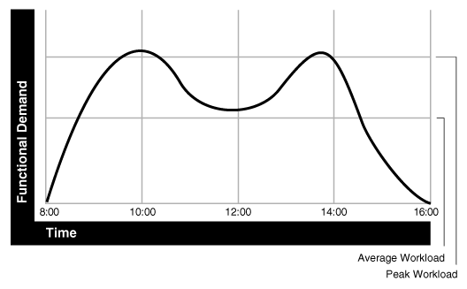

This chapter explains how to tune the operating system for optimal performance of Oracle Database.

This chapter contains the following sections:

See Also:

- Your operating system documentation
- Your Oracle Database platform-specific documentation, which contains tuning information specific to your platform

### Understanding Operating System Performance Issues

Operating system performance issues commonly involve process management, memory management, and scheduling. If you have tuned the Oracle database instance and still need to improve performance, verify your work or try to reduce system time. Ensure that there is enough I/O bandwidth, CPU power, and swap space. Do not expect, however, that further tuning of the operating system will have a significant effect on application performance. Changes in the Oracle Database configuration or in the application are likely to result in a more significant difference in operating system efficiency than simply tuning the operating system.

For example, if an application experiences excessive buffer busy waits, then the number of system calls increases. If you reduce the buffer busy waits by tuning the application, then the number of system calls decreases.

This section covers the following topics related to operating system performance issues:

- Using Operating System Caches
- Memory Usage
- Using Operating System Resource Managers

#### Using Operating System Caches

Operating systems and device controllers provide data caches that do not directly conflict with Oracle Database cache management. Nonetheless, these structures can consume resources while offering little or no performance benefit. This situation is most noticeable when database files are stored in a Linux or UNIX file system. By default, all database I/O goes through the file system cache.

On some Linux and UNIX systems, direct I/O is available to the filestore. This arrangement allows the database files to be accessed within the file system, bypassing the file system cache. Direct I/O saves CPU resources and allows the file system cache to be dedicated to non-database activity, such as program texts and spool files.

Note:

This problem does not occur on Windows. All file requests by the database bypass the caches in the file system.

Although the operating system cache is often redundant because the Oracle Database buffer cache buffers blocks, in some cases the database does not use the database buffer cache. In these cases, using direct I/O or raw devices may yield worse performance than using operating system buffering. Examples include:

- Reads or writes to the `TEMP` tablespace
- Data stored in `NOCACHE` LOBs
- Parallel execution servers reading data
	Note:
	In some cases the database can cache parallel query data in the database buffer cache instead of performing direct reads from disk into the PGA. This configuration may be appropriate when the database servers have a large amount of memory. See [Oracle Database VLDB and Partitioning Guide](https://docs.oracle.com/pls/topic/lookup?ctx=en/database/oracle/oracle-database/21/tgdba&id=VLDBG010) to learn more using parallel execution.

You may want to cache but not all files at the operating system level.

##### Asynchronous I/O

With synchronous I/O, when an I/O request is submitted to the operating system, the writing process blocks until the write is confirmed as complete. It can then continue processing. With asynchronous I/O, processing continues while the I/O request is submitted and processed. Use asynchronous I/O when possible to avoid bottlenecks.

Some platforms support asynchronous I/O by default, others need special configuration, and some only support asynchronous I/O for certain underlying file system types.

##### FILESYSTEMIO\_OPTIONS Initialization Parameter

You can use the `FILESYSTEMIO_OPTIONS` initialization parameter to enable or disable asynchronous I/O or direct I/O on file system files. This parameter is platform-specific and has a default value that is best for a particular platform.

`FILESYSTEMIO_OPTIONS` can be set to one of the following values:

- `ASYNCH:` enable asynchronous I/O on file system files, which has no timing requirement for transmission.
- `DIRECTIO:` enable direct I/O on file system files, which bypasses the buffer cache.
- `SETALL:` enable both asynchronous and direct I/O on file system files.
- `NONE:` disable both asynchronous and direct I/O on file system files.
	See Also:
	Your platform-specific documentation for more details

##### Limiting Asynchronous I/O in NFS Server Environments

In some Network File Storage (NFS) server environments, performance may be impaired if a large number of asynchronous I/O requests are made within a short period of time. In such cases, use the `DNFS_BATCH_SIZE` initialization parameter to improve performance and increase stability on your system by limiting the number of I/Os issued by an Oracle process.

The `DNFS_BATCH_SIZE` initialization parameter controls the number of asynchronous I/Os that can be queued by an Oracle foreground process when Direct NFS Client is enabled. In environments where the NFS server cannot handle a large number of outstanding asynchronous I/O requests, Oracle recommends setting this parameter to a value of 128. You can then increase or decrease its value based on the performance of your NFS server.

Note:

The default setting for the `DNFS_BATCH_SIZE` initialization parameter is 4096. The recommended value of 128 is only applicable on systems where the NFS server cannot handle a large number of asynchronous I/O requests and severe latency is detected.

See Also:

[Oracle Database Reference](https://docs.oracle.com/pls/topic/lookup?ctx=en/database/oracle/oracle-database/21/tgdba&id=REFRN10334) for information about the `DNFS_BATCH_SIZE` initialization parameter

##### Improving I/O Performance Using Direct NFS Client

Direct NFS Client integrates the NFS client functionality directly in Oracle Database. Because Direct NFS Client is a specialized NFS client for Oracle Database, it is highly optimized. Direct NFS Client considerably improves database performance over NFS as compared to the traditional operating system NFS client.

Parallel NFS is an optional feature of Direct NFS Client that is introduced in NFS version 4.1 and is supported by Oracle Database 12c Release 2 (12.2) and later. Parallel NFS is a highly scalable distributed storage protocol, where clients, server, and storage devices are responsible for managing file access. In the NFS versions earlier to 4.1, only the server is responsible for managing file access. Thus, Parallel NFS enables highly scalable distributed NAS storage for better I/O performance.

Starting with Oracle Database 12c Release 2 (12.2), you can also use the Direct NFS dispatcher feature of Direct NFS Client. The Direct NFS dispatcher consolidates the TCP connections that are created from a database instance to an NFS server. In large database deployments, using Direct NFS dispatcher improves scalability and network performance. Therefore, for a large number of TCP connections, Oracle recommends using Direct NFS dispatcher along with Parallel NFS for a Direct NFS Client deployment.

The Direct NFS Client supports the following NFS protocol versions: `NFSv3`, `NFSv4`, `NFSv4.1`, and `pNFS`. The default version is `NFSv3`. `pNFS` is used for Direct NFS with Parallel NFS. Direct NFS supports only the default `sys` security authentication with Parallel NFS. Direct NFS does not support Parallel NFS when combined with any of the Kerberos authentication parameters.

See Also:

- [Oracle Database Installation Guide](https://docs.oracle.com/pls/topic/lookup?ctx=en/database/oracle/oracle-database/21/tgdba&id=LADBI-GUID-C16A1AF8-CCC5-46C2-875E-4276C2CCCF22) for information about enabling the Parallel NFS feature for Direct NFS Client by setting the value for the `nfs_version` parameter to `pNFS` in the Direct NFS configuration file `oranfstab`.
- [Oracle Database Reference](https://docs.oracle.com/pls/topic/lookup?ctx=en/database/oracle/oracle-database/21/tgdba&id=REFRN-GUID-2209E40B-1280-4C38-ADD8-324EAACF3501) for information about enabling the Direct NFS dispatcher feature for the Direct NFS Client by setting the value for the `ENABLE_DNFS_DISPATCHER` initialization parameter to `true`.

#### Memory Usage

Memory usage is affected by both buffer cache limits and initialization parameters.

##### Buffer Cache Limits

The UNIX buffer cache consumes operating system memory resources. Although in some versions of UNIX, the UNIX buffer cache may be allocated a set amount of memory, it is common today for more sophisticated memory management mechanisms to be used. Typically, these will allow free memory pages to be used to cache I/O. In such systems, it is common for operating system reporting tools to show that there is no free memory, which is not generally a problem. If processes require more memory, the memory caching I/O data is usually released to allow the process memory to be allocated.

##### Parameters Affecting Memory Usage

The memory required by any one Oracle Database session depends on many factors. Typically the major contributing factors are:

- Number of open cursors
- Memory used by PL/SQL, such as PL/SQL tables
- `SORT_AREA_SIZE` initialization parameter

In Oracle Database, the `PGA_AGGREGATE_TARGET` initialization parameter gives greater control over a session's memory usage.

#### Using Operating System Resource Managers

Some platforms provide operating system resource managers. These are designed to reduce the impact of peak load use patterns by prioritizing access to system resources. They usually implement administrative policies that govern which resources users can access and how much of those resources each user is permitted to consume.

Operating system resource managers are different from domains or other similar facilities. Domains provide one or more completely separated environments within one system. Disk, CPU, memory, and all other resources are dedicated to each domain and cannot be accessed from any other domain. Other similar facilities completely separate just a portion of system resources into different areas, usually separate CPU or memory areas. Like domains, the separate resource areas are dedicated only to the processing assigned to that area; processes cannot migrate across boundaries. Unlike domains, all other resources (usually disk) are accessed by all partitions on a system.

Oracle Database runs within domains, and within these other less complete partitioning constructs, as long as the allocation of partitioned memory (RAM) resources is fixed, not dynamic.

Operating system resource managers prioritize resource allocation within a global pool of resources, usually a domain or an entire system. Processes are assigned to groups, which are in turn assigned resources anywhere within the resource pool.

Note:

- If you have multiple instances on a node, and you want to distribute resources among them, then each instance should be assigned to a dedicated operating-system resource manager group or managed entity. To run multiple instances in the managed entity, use instance caging to manage how the CPU resources within the managed entity should be distributed among the instances. When Oracle Database Resource Manager is managing CPU resources, it expects a fixed amount of CPU resources for the instance. Without instance caging, it expects the available CPU resources to be equal to the number of CPUs in the managed entity. With instance caging, it expects the available CPU resources to be equal to the value of the `CPU_COUNT` initialization parameter. If there are less CPU resources than expected, then Oracle Database Resource Manager is not as effective at enforcing the resource allocations in the resource plan.
- Oracle Database is not supported for use with any UNIX operating system resource manager's memory management and allocation facility. Oracle Database Resource Manager, which provides resource allocation capabilities within an Oracle database instance, cannot be used with any operating system resource manager.
	For a complete list of operating system resource management and resource allocation and deallocation features that work with Oracle Database and Oracle Database Resource Manager, see your systems vendor and your Oracle representative. Oracle does not certify these system features for compatibility with specific release levels.

See Also:

- [Oracle Database Administrator's Guide](https://docs.oracle.com/pls/topic/lookup?ctx=en/database/oracle/oracle-database/21/tgdba&id=ADMIN027) for information about Oracle Database Resource Manager
- [Oracle Database Administrator's Guide](https://docs.oracle.com/pls/topic/lookup?ctx=en/database/oracle/oracle-database/21/tgdba&id=ADMIN13332) for information about instance caging

### Resolving Operating System Issues

This section provides hints for tuning various systems by explaining the following topics:

- Performance Hints on UNIX-Based Systems
- Performance Hints on Windows Systems
- Performance Hints on HP OpenVMS Systems

Familiarize yourself with platform-specific issues so that you know what performance options the operating system provides.

See Also:

Your Oracle platform-specific documentation and your operating system vendor's documentation

#### Performance Hints on UNIX-Based Systems

On UNIX systems, try to establish a good ratio between the amount of time the operating system spends fulfilling system calls and doing process scheduling and the amount of time the application runs. The goal should be to run most of the time in application mode, also called user mode, rather than system mode.

The ratio of time spent in each mode is only a symptom of the underlying problem, which might involve the following:

- Paging or swapping
- Executing too many operating system calls
- Running too many processes

If such conditions exist, then there is less time available for the application to run. The more time you can release from the operating system side, the more transactions an application can perform.

#### Performance Hints on Windows Systems

On Windows systems, as with UNIX-based systems, establish an appropriate ratio between time in application mode and time in system mode. You can easily monitor many factors with the Windows administrative performance tool: CPU, network, I/O, and memory are all displayed on the same graph to assist you in avoiding bottlenecks in any of these areas.

#### Performance Hints on HP OpenVMS Systems

Consider the paging parameters on a mainframe, and remember that Oracle Database can exploit a very large working set.

Free memory in HP OpenVMS environments is actually memory that is not mapped to any operating system process. On a busy system, free memory likely contains a page belonging to one or more currently active process. When that access occurs, a `soft page fault` takes place, and the page is included in the working set for the process. If the process cannot expand its working set, then one of the pages currently mapped by the process must be moved to the free set.

Any number of processes might have pages of shared memory within their working sets. The sum of the sizes of the working sets can thus markedly exceed the available memory. When the Oracle server is running, the SGA, the Oracle Database kernel code, and the Oracle Forms run-time executable are normally all sharable and account for perhaps 80% or 90% of the pages accessed.

### Understanding CPU

To address CPU problems, first establish appropriate expectations for the amount of CPU resources your system should be using. Then, determine whether sufficient CPU resources are available and recognize when your system is consuming too many resources. Begin by determining the amount of CPU resources the Oracle database instance utilizes with your system in the following three cases:

- System is idle, when little Oracle Database and non-Oracle activity exists
- System at average workloads
- System at peak workloads

You can capture various workload snapshots using the Automatic Workload Repository, Statspack, or the `UTLBSTAT` / `UTLESTAT` utility. Operating system utilities—such as `vmstat`, `sar`, and `iostat` on UNIX and the administrative performance monitoring tool on Windows—can be used along with the `V$OSSTAT` or `V$SYSMETRIC_HISTORY` view during the same time interval as Automatic Workload Repository, Statspack, or `UTLBSTAT` / `UTLESTAT` to provide a complimentary view of the overall statistics.

Workload is an important factor when evaluating your system's level of CPU utilization. During peak workload hours, 90% CPU utilization with 10% idle and waiting time can be acceptable. Even 30% utilization at a time of low workload can be understandable. However, if your system shows high utilization at normal workload, then there is no room for a peak workload. For example, The following figure illustrates workload over time for an application having peak periods at 10:00 AM and 2:00 PM.

Figure 18-1 Average Workload and Peak Workload



> This illustration shows a graph that has Time along the horizontal axis and Functional Demand along the vertical axis. The graph start at 8:00 and a functional demand of zero.
>
> By 10:00, the functional demand is at the peak workload; by 12:00, the functional demand has dropped a little above the average workload. A little before 14:00, the functional demand is at the peak workload again; by 16:00, the functional demand has dropped back to zero.
>
> End of image description.


This example application has 100 users working 8 hours a day. Each user entering one transaction every 5 minutes translates into 9,600 transactions daily. Over an 8-hour period, the system must support 1,200 transactions an hour, which is an average of 20 transactions a minute. If the demand rate were constant, then you could build a system to meet this average workload.

However, usage patterns are not constant and in this context, 20 transactions a minute can be understood as merely a minimum requirement. If the peak rate you need to achieve is 120 transactions a minute, then you must configure a system that can support this peak workload.

For this example, assume that at peak workload, Oracle Database uses 90% of the CPU resource. For a period of average workload, then, Oracle Database uses no more than about 15% of the available CPU resource, as illustrated in the following equation:

```
20 tpm / 120 tpm * 90% = 15% of available CPU resource
```

where `tpm` is transactions a minute.

If the system requires 50% of the CPU resource to achieve 20 tpm, then a problem exists: the system cannot achieve 120 transactions a minute using 90% of the CPU. However, if you tuned this system so that it achieves 20 tpm using only 15% of the CPU, then, assuming linear scalability, the system might achieve 120 transactions a minute using 90% of the CPU resources.

As users are added to an application, the workload can rise to what had previously been peak levels. No further CPU capacity is then available for the new peak rate, which is actually higher than the previous.

### Resolving CPU Issues

You can resolve CPU capacity issues by:

- Detecting and solving CPU problems from excessive consumption, as described in " Finding and Tuning CPU Utilization ".
- Reducing the impact of peak load use patterns by prioritizing CPU resource allocation using Oracle Database Resource Manager, as described in " Managing CPU Resources Using Oracle Database Resource Manager ".
- Using instance caging to limit the number of CPUs that a database instance can use simultaneously when running multiple database instances on a multi-CPU system, as described in " Managing CPU Resources Using Instance Caging ".
- Increasing hardware capacity and improving the system architecture.

#### Finding and Tuning CPU Utilization

Every process running on your system affects the available CPU resources. Therefore, tuning non-database factors can also improve database performance.

Use the `V$OSSTAT` or `V$SYSMETRIC_HISTORY` view to monitor system utilization statistics from the operating system. Useful statistics contained in `V$OSSTAT` and `V$SYSMETRIC_HISTORY` include:

- Number of CPUs
- CPU utilization
- Load
- Paging
- Physical memory

See Also:

[Oracle Database Reference](https://docs.oracle.com/pls/topic/lookup?ctx=en/database/oracle/oracle-database/21/tgdba&id=REFRN30321) for more information on `V$OSSTAT` and `V$SYSMETRIC_HISTORY`

You can use operating system monitoring tools to determine which processes run on the system as a whole. If the system is too heavily loaded, check the memory, I/O, and process management areas described later in this section.

You can use tools such as `sar` `-u` on many UNIX-based systems to examine the level of CPU utilization on the system. In UNIX, statistics show user time, system time, idle time, and time waiting for I/O. A CPU problem exists if idle time and time waiting for I/O are both close to zero (less than 5%) at a normal or low workload.

On Windows, you can use the administrative performance tool to monitor CPU utilization. This utility provides statistics on processor time, user time, privileged time, interrupt time, and DPC time.

Related topics:

- Checking Memory Management
- Checking I/O Management
- Checking Network Management
- Checking Process Management

Note:

This document describes how to check system CPU utilization on most UNIX-based and Windows systems. For other platforms, see your operating system documentation.

##### Checking Memory Management

Check the following memory management areas:

- Paging and Swapping
- Oversize Page Tables

###### Paging and Swapping

Use the `V$OSSTAT` view, utilities such as `sar` or `vmstat` on UNIX, or the administrative performance tool on Windows, to investigate the cause of paging and swapping.

###### Oversize Page Tables

On UNIX, if the processing space becomes too large, then it can result in the page tables becoming too large. This is not an issue on Windows systems.

##### Checking I/O Management

Thrashing is an I/O management issue. Ensure that your workload fits into memory, so the computer is not thrashing (swapping and paging processes in and out of memory). The operating system allocates fixed portions of time during which CPU resources are available to your process. If the process wastes a large portion of each time period checking to ensure that it can run and ensuring that all necessary components are in the computer, then the process might be using only 50% of the time allotted to actually perform work.

##### Checking Network Management

Check client/server round trips. There is an overhead in processing messages. When an application generates many messages that need to be sent through the network, the latency of sending a message can result in CPU overload. To alleviate this problem, bundle multiple messages rather than perform lots of round trips. For example, you can use array inserts, array fetches, and so on.

##### Checking Process Management

Several process management issues discussed in this section should be checked.

- Scheduling and Switching
- Context Switching
- Starting New Operating System Processes

###### Scheduling and Switching

The operating system can spend excessive time scheduling and switching processes. Examine the way in which you are using the operating system, because it is possible that too many processes are in use. On Windows systems, do not overload the server with too many non-database processes.

###### Context Switching

Due to operating system specific characteristics, your system could be spending a lot of time in context switches. Context switching can be expensive, especially with a large SGA. Context switching is not an issue on Windows, which has only one process for each instance. All threads share the same page table.

Oracle Database has several features for context switching:

- Post-wait driver
	An Oracle process must be able to post another Oracle process (give it a message) and also must be able to wait to be posted. For example, a foreground process may need to post LGWR to tell it to write out all blocks up to a given point so that it can acknowledge a commit.
	Often this post-wait mechanism is implemented through UNIX Semaphores, but these can be resource intensive. Therefore, some platforms supply a post-wait driver, typically a kernel device driver that is a lightweight method of implementing a post-wait interface.
- Memory-mapped system timer
	Oracle Database often needs to query the system time for timing information. This can involve an operating system call that incurs a relatively costly context switch. Some platforms implement a memory-mapped timer that uses an address within the processes virtual address space to contain the current time information. Reading the time from this memory-mapped timer is less expensive than the overhead of a context switch for a system call.
- List I/O interfaces to submit multiple asynchronous I/Os in One Call
	List I/O is an application programming interface that allows several asynchronous I/O requests to be submitted in a single system call, rather than submitting several I/O requests through separate system calls. The main benefit of this feature is to reduce the number of context switches required.

###### Starting New Operating System Processes

There is a high cost in starting new operating system processes. Developers often create a single-purpose process, exit the process, and then create a new one. This technique re-creates and destroys the process each time, consuming excessive amounts of CPU, especially in applications that have large SGAs. The CPU is needed to build the page tables each time. The problem is aggravated when you pin or lock shared memory because you must access every page.

For example, if you have a 1 gigabyte SGA, then you might have page table entries for every 4 KB, and a page table entry might be 8 bytes. You could end up with (1 GB / 4 KB) \* 8 byte entries. This becomes expensive, because you need to continually ensure that the page table is loaded.

#### Managing CPU Resources Using Oracle Database Resource Manager

Oracle Database Resource Manager allocates and manages CPU resources among database users and applications in the following ways:

- Preventing CPU saturation
	If the CPUs run at 100%, then you can use Oracle Database Resource Manager to allocate a maximum amount of CPU to sessions in each consumer group. This feature can ensure that high-priority sessions can run immediately and lower the CPU consumption of low-priority sessions.
- Limiting CPU usage for a consumer group
	You can use the Resource Manager directive `max_utilization_limit` to place a hard limit on the percentage of CPU that a consumer group can use. This feature restricts the CPU consumption of low-priority sessions and can help provide more consistent performance for the workload in a consumer group.
- Limiting damage from runaway queries
	Starting with Oracle Database 11g Release 2 (11.2.0.2), Oracle Database Resource Manager can limit the damage from runaway queries by limiting the maximum execution time for a call, or by moving a long-running query to a lower-priority consumer group.
- Limiting the parallel statement activity for a consumer group
	Starting with Oracle Database 11g Release 2 (11.2.0.2), you can use the Resource Manager directive `parallel_target_percentage` to prevent one consumer group from monopolizing all parallel servers. The database queues parallel statements if they would cause this limit to be exceeded.
	For example, assume that the target number of parallel servers is 64, and the consumer group `ETL` has this directive set to 50%. If consumer group `ETL` is using 30 parallel servers, and if a new parallel statement needs 4 parallel servers, then the database would queue this statement.

See Also:

- [Oracle Database Administrator's Guide](https://docs.oracle.com/pls/topic/lookup?ctx=en/database/oracle/oracle-database/21/tgdba&id=ADMIN027) to learn how to use Oracle Database Resource Manager
- [Oracle Database VLDB and Partitioning Guide](https://docs.oracle.com/pls/topic/lookup?ctx=en/database/oracle/oracle-database/21/tgdba&id=VLDBG010) to learn how to use parallel query

#### Managing CPU Resources Using Instance Caging

When running multiple database instances on a single system, the instances compete for CPU resources. One resource-intensive database instance may significantly degrade the performance of the other instances. To avoid this problem, you can use instance caging to limit the number of CPUs that can used by each instance. Oracle Database Resource Manager then allocates CPU among the various database sessions according to the resource plan that you set for the instance, thereby minimizing the likelihood of the instance becoming CPU-bound.

See Also:

[Oracle Database Administrator's Guide](https://docs.oracle.com/pls/topic/lookup?ctx=en/database/oracle/oracle-database/21/tgdba&id=ADMIN13333) for information about using instance caging