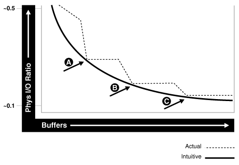
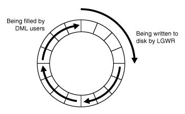

This chapter describes how to tune the database buffer cache. If you are using automatic memory management to manage the database memory on your system, there is no need to manually tune the memory caches described in this chapter.

This chapter contains the following topics:

### About the Database Buffer Cache

For many types of operations, Oracle Database uses the buffer cache to store data blocks read from disk. Oracle Database bypasses the buffer cache for particular operations, such as sorting and parallel reads.

To use the database buffer cache effectively, tune SQL statements for the application to avoid unnecessary resource consumption. To meet this goal, verify that frequently executed SQL statements and SQL statements that perform many buffer gets are well-tuned.

When using parallel query, consider configuring the database to use the database buffer cache instead of performing direct reads into the Program Global Area (PGA). This configuration may be appropriate when the system has a large amount of memory.

See Also:

- [Oracle Database SQL Tuning Guide](https://docs.oracle.com/pls/topic/lookup?ctx=en/database/oracle/oracle-database/21/tgdba&id=TGSQL-GUID-B653E5F3-F078-4BBC-9516-B892960046A2) for information about tuning SQL statements
- [Oracle Database VLDB and Partitioning Guide](https://docs.oracle.com/pls/topic/lookup?ctx=en/database/oracle/oracle-database/21/tgdba&id=VLDBG010) for information about parallel execution

### Configuring the Database Buffer Cache

When configuring a new database instance, it is impossible to know the correct size for the buffer cache. Typically, a database administrator makes a first estimate for the cache size, then runs a representative workload on the instance and examines the relevant statistics to see whether the cache is under-configured or over-configured.

This section describes how to configure the database buffer cache. If you are using automatic shared memory management to configure the Shared Global Area (SGA), there is no need to manually tune the database buffer cache as described in this section.

This section contains the following topics:

- Using the V$DB\_CACHE\_ADVICE View
- Calculating the Buffer Cache Hit Ratio
- Interpreting the Buffer Cache Hit Ratio
- Increasing Memory Allocated to the Database Buffer Cache
- Reducing Memory Allocated to the Database Buffer Cache

#### Using the V$DB\_CACHE\_ADVICE View

The `V$DB_CACHE_ADVICE` view shows the simulated miss rates for a range of potential buffer cache sizes. This view assists in cache sizing by providing information that predicts the number of physical reads for each potential cache size. The data also includes a physical read factor, which is a factor by which the current number of physical reads is estimated to change if the buffer cache is resized to a given value.

However, physical reads do not necessarily indicate disk reads in Oracle Database, because physical reads may be accomplished by reading from the file system cache. Hence, the relationship between successfully finding a block in the cache and the size of the cache is not always a smooth distribution. When sizing the buffer pool, avoid using additional buffers that do not contribute (or contribute very little) to the cache hit ratio.

The following figure illustrates the relationship between physical I/O ratio and buffer cache size.

Figure 13-1 Physical I/O Ratio and Buffer Cache Size



> This illustration shows a graph that has Buffers along the horizontal axis and Physical I/O Ratio along the vertical axis. The values of the physical I/O ratio shown are between approximately 0.1 and 0.5.
>
> The graph of the intuitive values is a smooth curve showing that as the number of buffers increases, the physical I/O ratio decreases.
>
> The graph of the actual values shows that at some values (points A, B, and C in the illustration), the physical I/O ratio stays about the same as the number of buffers increases, then decreases quickly at a higher number of buffers.
>
> End of image description.


Examining the example illustrated in the above figure leads to the following observations:

- As the number of buffers increases, the physical I/O ratio decreases.
- The decrease in the physical I/O between points A and B and points B and C is not smooth, as indicated by the dotted line in the graph.
- The benefit from increasing buffers from point A to point B is considerably higher than from point B to point C.
- The benefit from increasing buffers decreases as the number of buffers increases.

There is some overhead associated with using this advisory view. When the advisory is enabled, there is a small increase in CPU usage, because additional bookkeeping is required. To reduce both the CPU and memory overhead associated with bookkeeping, Oracle Database uses sampling to gather cache advisory statistics. Sampling is not used if the number of buffers in a buffer pool is small to begin with.

To use the V$DB\_CACHE\_ADVICE view:

1. Set the value of the `DB_CACHE_ADVICE` initialization parameter to `ON`.
	This enables the advisory view. The `DB_CACHE_ADVICE` parameter is dynamic, so the advisory can be enabled and disabled dynamically to enable you to collect advisory data for a specific workload.
2. Run a representative workload on the database instance.
	Allow the workload to stabilize before querying the `V$DB_CACHE_ADVICE` view.
3. Query the `V$DB_CACHE_ADVICE` view.

The following example shows a query of this view that returns the predicted I/O requirement for the default buffer pool for various cache sizes.

```
COLUMN size_for_estimate          FORMAT 999,999,999,999 heading 'Cache Size (MB)'
COLUMN buffers_for_estimate       FORMAT 999,999,999 heading 'Buffers'
COLUMN estd_physical_read_factor  FORMAT 999.90 heading 'Estd Phys|Read Factor'
COLUMN estd_physical_reads        FORMAT 999,999,999 heading 'Estd Phys| Reads'

SELECT size_for_estimate, buffers_for_estimate, estd_physical_read_factor,
       estd_physical_reads
FROM   V$DB_CACHE_ADVICE
WHERE  name = 'DEFAULT'
  AND  block_size = (SELECT value FROM V$PARAMETER WHERE name = 'db_block_size')
  AND  advice_status = 'ON';
```

The output of this query might look like the following:

```
Estd Phys    Estd Phys
 Cache Size (MB)      Buffers Read Factor        Reads
---------------- ------------ ----------- ------------
              30        3,802       18.70  192,317,943      10% of Current Size 
              60        7,604       12.83  131,949,536
              91       11,406        7.38   75,865,861
             121       15,208        4.97   51,111,658
             152       19,010        3.64   37,460,786
             182       22,812        2.50   25,668,196
             212       26,614        1.74   17,850,847
             243       30,416        1.33   13,720,149
             273       34,218        1.13   11,583,180
             304       38,020        1.00   10,282,475      Current Size 
             334       41,822         .93    9,515,878
             364       45,624         .87    8,909,026
             395       49,426         .83    8,495,039
             424       53,228         .79    8,116,496
             456       57,030         .76    7,824,764
             486       60,832         .74    7,563,180
             517       64,634         .71    7,311,729
             547       68,436         .69    7,104,280
             577       72,238         .67    6,895,122
             608       76,040         .66    6,739,731      200% of Current Size
```

In this example, the output shows that if the cache was 212 MB instead of the current size of 304 MB, the estimated number of physical reads would increase by a factor of 1.74, or 74%. Hence, it is not advisable to decrease the cache size to 212MB.

However, increasing the cache size to 334MB may potentially decrease reads by a factor of.93, or 7%. If an additional 30MB memory is available on the system and the value of the `SGA_MAX_SIZE` parameter allows for the increment, it is advisable to increase the default buffer cache pool size to 334MB.

#### Calculating the Buffer Cache Hit Ratio

The buffer cache hit ratio calculates how often a requested block has been found in the buffer cache without requiring disk access. This ratio is computed using data selected from the `V$SYSSTAT` performance view. Use the buffer cache hit ratio to verify the physical I/O as predicted by the `V$DB_CACHE_ADVICE` view.

Table 13-1 lists the statistics from the `V$SYSSTAT` view used to calculate the buffer cache hit ratio.

Table 13-1 Statistics for Calculating the Buffer Cache Hit Ratio

| Statistic | Description |
| --- | --- |
| `consistent gets from cache` | Number of times a consistent read was requested for a block from the buffer cache. |
| `db block gets from cache` | Number of times a `CURRENT` block was requested from the buffer cache. |
| `physical reads cache` | Total number of data blocks read from disk into buffer cache. |

Example 13-1 shows a query of this view.

Example 13-1 Querying the V$SYSSTAT View

```
SELECT name, value
FROM V$SYSSTAT
WHERE name IN ('db block gets from cache', 'consistent gets from cache', 
'physical reads cache');
```

In this example, the query is simplified by using values selected directly from the `V$SYSSTAT` view, rather than over an interval. It is recommended to calculate the delta of these statistics over an interval while the application is running, then use these delta values to determine the buffer cache hit ratio. For information about collecting statistics over an interval, see [Automatic Performance Diagnostics](automatic-performance-diagnostics.md) .

Using the values from the output of this query, calculate the hit ratio for the buffer cache using the following formula:

```
1 - (('physical reads cache') / ('consistent gets from cache' + 
'db block gets from cache'))
```

See Also:

[Oracle Database Reference](https://docs.oracle.com/pls/topic/lookup?ctx=en/database/oracle/oracle-database/21/tgdba&id=REFRN-GUID-250136E5-E07E-4A78-9F67-28C0D3C6E922) for information about the `V$SYSSTAT` view

#### Interpreting the Buffer Cache Hit Ratio

Before deciding whether to increase or decrease the buffer cache size, you should first examine the buffer cache hit ratio.

A low cache hit ratio does not necessarily imply that increasing the size of the buffer cache will benefit performance. Moreover, a high cache hit ratio may wrongly indicate that the buffer cache is adequately sized for the workload.

To interpret the buffer cache hit ratio, consider the following factors:

- Avoid repeated scanning of frequently accessed data by performing the processing in a single pass or by optimizing the SQL statement.
	Repeated scanning of the same large table or index can artificially inflate a low cache hit ratio. Examine frequently executed SQL statements with a large number of buffer gets, to ensure that the execution plans for these SQL statements are optimal.
- Avoid requerying the same data by caching frequently accessed data in the client program or middle tier.
- In large databases running OLTP applications, many rows are accessed only once (or never). Hence, there is no purpose in keeping the block in memory following its use.
- Do not continuously increase the buffer cache size.
	Continuous increases of the buffer cache size have no effect if the database is performing full table scans or operations that do not use the buffer cache.
- Consider poor hit ratios when large full table scans are occurring.
	Database blocks accessed during a long full table scan are placed on the tail end of the Least Recently Used (LRU) list and not on the head of the list. Therefore, the blocks age out faster than blocks read when performing indexed lookups or small table scans.
	Note:
	Short table scans are scans performed on tables under a certain size threshold. The definition of a small table is the maximum of 2% of the buffer cache or 20, whichever is bigger.

#### Increasing Memory Allocated to the Database Buffer Cache

If the cache hit ratio is low and your application is tuned to avoid performing full table scans, consider increasing the size of the buffer cache. If possible, resize the buffer pools dynamically, rather than shutting down the instance to perform this change.

To increase the size of the database buffer cache:

1. Set the value of the `DB_CACHE_ADVICE` initialization parameter to `ON`.
2. Allow the buffer cache statistics to stabilize.
3. Examine the advisory data in the `V$DB_CACHE_ADVICE` view to determine the next increment required to significantly decrease the amount of physical I/O performed, as described in " Using the V$DB\_CACHE\_ADVICE View ".
4. If it is possible to allocate the extra memory required to the buffer cache without causing the system to page, then allocate this memory.
5. To increase the amount of memory allocated to the buffer cache, increase the value of the `DB_CACHE_SIZE` initialization parameter.
	The `DB_CACHE_SIZE` parameter specifies the size of the default cache for the database's standard block size. To create and use tablespaces with block sizes other than the database's standard block sizes (such as for transportable tablespaces), configure a separate cache for each block size used. Use the `DB_nK_CACHE_SIZE` parameter to configure the nonstandard block size needed (where `n` is 2, 4, 8, 16 or 32 and not the standard block size).

Note:

- The process of choosing a cache size is the same, regardless of whether the cache is the default standard block size cache, the `KEEP` or `RECYCLE` cache, or a nonstandard block size cache.
- When the cache is resized significantly (greater than 20%), the old cache advisory value is discarded and the cache advisory is set to the new size. Otherwise, the old cache advisory value is adjusted to the new size by the interpolation of existing values.

See Also:

For more information about the `DB_nK_CACHE_SIZE` parameter, see:

- [Oracle Database Administrator's Guide](https://docs.oracle.com/pls/topic/lookup?ctx=en/database/oracle/oracle-database/21/tgdba&id=ADMIN-GUID-A789CECE-226C-4280-8BC4-39F064036965)
- [Oracle Database Reference](https://docs.oracle.com/pls/topic/lookup?ctx=en/database/oracle/oracle-database/21/tgdba&id=REFRN-GUID-025ECEB2-E535-49D2-9721-268E3925FE09)

#### Reducing Memory Allocated to the Database Buffer Cache

If the cache hit ratio is high, then the buffer cache is likely large enough to store the most frequently accessed data. If this is the case and memory is required for another memory structure, consider reducing the size of the buffer cache.

To reduce the size of the database buffer cache:

1. Examine the advisory data in the `V$DB_CACHE_ADVICE` view to determine if decreasing the size of the buffer cache will significantly increase the number of physical I/Os, as described in " Using the V$DB\_CACHE\_ADVICE View ".
2. To reduce the amount of memory allocated to the buffer cache, decrease the value of the `DB_CACHE_SIZE` initialization parameter.

### Configuring Multiple Buffer Pools

For most systems, a single default buffer pool is generally adequate. However, database administrators with detailed knowledge of an application's buffer pool may benefit from configuring multiple buffer pools.

For segments that have atypical access patterns, consider storing blocks from these segments in two separate buffer pools: the `KEEP` pool and the `RECYCLE` pool. A segment's access pattern may be atypical if it is constantly accessed (sometimes referred to as hot) or infrequently accessed (such as a large segment that is accessed by a batch job only once a day).

Using multiple buffer pools enables you to address these irregularities. You can use the `KEEP` pool to maintain frequently accessed segments in the buffer cache, and the `RECYCLE` pool to prevent objects from consuming unnecessary space in the buffer cache. When an object is associated with a buffer cache, all blocks from that object are placed in that cache. Oracle Database maintains a `DEFAULT` buffer pool for objects that are not assigned to a specific buffer pool. The default buffer pool size is determined by the `DB_CACHE_SIZE` initialization parameter. Each buffer pool uses the same LRU replacement policy. For example, if the `KEEP` pool is not large enough to store all of the segments allocated to it, then the oldest blocks age out of the cache.

By allocating objects to appropriate buffer pools, you can:

- Reduce or eliminate I/Os
- Isolate or limit an object to a separate cache

This section describes how to configure multiple buffer pools and contains the following topics:

- Considerations for Using Multiple Buffer Pools
- Using Multiple Buffer Pools
- Using the V$DB\_CACHE\_ADVICE View for Individual Buffer Pools
- Calculating the Buffer Pool Hit Ratio for Individual Buffer Pools
- Examining the Buffer Cache Usage Pattern
- Configuring the KEEP Pool
- Configuring the RECYCLE Pool

#### Considerations for Using Multiple Buffer Pools

When using multiple buffer pools, take the following considerations into account:

- Random Access to Large Segments
- Oracle Real Application Cluster Instances

##### Random Access to Large Segments

A problem may occur with an LRU aging method when a very large segment (compared to the size of the buffer cache) is accessed with a large or unbounded index range scan. Any single segment that accounts for a substantial portion (more than 10%) of nonsequential physical reads can be considered very large. Random reads to a large segment may cause buffers that contain data for other segments to be aged out of the cache. The large segment ends up consuming a large percentage of the buffer cache, but it does not benefit from the cache.

Very frequently accessed segments are not affected by large segment reads because their buffers are warmed frequently enough that they do not age out of the buffer cache. However, the problem affects warm segments that are not accessed frequently enough to survive the buffer aging caused by the large segment reads. There are three options for solving this problem:

- If the object accessed is an index, determine whether the index is selective. If not, tune the SQL statement to use a more selective index.
- If the SQL statement is tuned, move the large segment into a separate `RECYCLE` cache so it does not affect the other segments. The `RECYCLE` cache should be smaller than the `DEFAULT` buffer pool, and it should reuse buffers more quickly.
- Alternatively, consider moving the small, warm segments into a separate `KEEP` cache that is not used for large segments. Size the `KEEP` cache to minimize misses in the cache. You can make the response times for specific queries more predictable by storing the segments accessed by the queries in the `KEEP` cache to ensure that they do not age out.

##### Oracle Real Application Cluster Instances

In an Oracle Real Application Cluster (Oracle RAC) environment, consider creating multiple buffer pools for each database instance. It is not necessary to define the same set of buffer pools for each instance of the database. Among instances, the buffer pools can be different sizes or undefined. Tune each instance according to the application requirements for that instance.

#### Using Multiple Buffer Pools

To define a default buffer pool for an object, use the `BUFFER_POOL` keyword of the `STORAGE` clause. This clause is valid for the following SQL statements:

- `CREATE TABLE`
- `CREATE CLUSTER`
- `CREATE INDEX`
- `ALTER TABLE`
- `ALTER CLUSTER`
- `ALTER INDEX`

After a buffer pool is defined, all subsequent blocks read for the object are placed in that pool. If a buffer pool is defined for a partitioned table or index, then each partition of the object inherits the buffer pool from the table or index definition, unless if it is overridden by a specific buffer pool.

When the buffer pool of an object is changed using the `ALTER` statement, all buffers currently containing blocks of the altered segment remain in the buffer pool they were in before the `ALTER` statement. Newly loaded blocks and any blocks that age out and are reloaded are placed into the new buffer pool.

See Also:

[Oracle Database SQL Language Reference](https://docs.oracle.com/pls/topic/lookup?ctx=en/database/oracle/oracle-database/21/tgdba&id=SQLRF-GUID-C5A67610-3160-41E9-8D48-03206BD5ED15) for information about specifying `BUFFER_POOL` in the `STORAGE` clause

#### Using the V$DB\_CACHE\_ADVICE View for Individual Buffer Pools

As with the default buffer pool, you can use `V$DB_CACHE_ADVICE` view to assist in cache sizing of other pools. After estimating the initial cache size and running a representative workload, query the `V$DB_CACHE_ADVICE` view for the pool you want to use.

For more information about using the `V$DB_CACHE_ADVICE` view, see " Using the V$DB\_CACHE\_ADVICE View ".

Example 13-2 shows a query of this view that queries data from the `KEEP` pool:

Example 13-2 Querying the V$DB\_CACHE\_ADVICE View for the KEEP Pool

```
SELECT size_for_estimate, buffers_for_estimate, estd_physical_read_factor, 
       estd_physical_reads
  FROM V$DB_CACHE_ADVICE
 WHERE name = 'KEEP'
   AND block_size = (SELECT value FROM V$PARAMETER WHERE name = 'db_block_size')
   AND advice_status = 'ON';
```

#### Calculating the Buffer Pool Hit Ratio for Individual Buffer Pools

The data in the `V$SYSSTAT` view reflects the logical and physical reads for all buffer pools within one set of statistics. To determine the hit ratio for the buffer pools individually, query the `V$BUFFER_POOL_STATISTICS` view. This view maintains statistics on the number of logical reads and writes for each pool.

See Also:

- " Calculating the Buffer Cache Hit Ratio " for more information about calculating hit ratios
- [Oracle Database Reference](https://docs.oracle.com/pls/topic/lookup?ctx=en/database/oracle/oracle-database/21/tgdba&id=REFRN-GUID-1E914318-C648-4A72-9AA9-711F8CAA92FB) for more information about `V$BUFFER_POOL_STATISTICS` view

The following query calculates the hit ratio using the `V$BUFFER_POOL_STATISTICS` view.

Example 13-3 Querying the V$BUFFER\_POOL\_STATISTICS View

```
SELECT name, physical_reads, db_block_gets, consistent_gets,
       1 - (physical_reads / (db_block_gets + consistent_gets)) "Hit Ratio"
  FROM V$BUFFER_POOL_STATISTICS;
```

#### Examining the Buffer Cache Usage Pattern

The `V$BH` view shows the data object ID of all blocks that currently reside in the SGA. To determine which segments have many buffers in the pool, use this view to examine the buffer cache usage pattern. You can either examine the buffer cache usage pattern for all segments or a specific segment, as described in the following sections:

- Examining the Buffer Cache Usage Pattern for All Segments
- Examining the Buffer Cache Usage Pattern for a Specific Segment

##### Examining the Buffer Cache Usage Pattern for All Segments

One method to determine which segments have many buffers in the pool is to query the number of blocks for all segments that reside in the buffer cache at a given time. Depending on buffer cache size, this might require a lot of sort space.

Example 13-4 shows a query that counts the number of blocks for all segments.

Example 13-4 Querying the Number of Blocks for All Segments

```
COLUMN object_name FORMAT A40
COLUMN number_of_blocks FORMAT 999,999,999,999

SELECT o.object_name, COUNT(*) number_of_blocks
  FROM DBA_OBJECTS o, V$BH bh
 WHERE o.data_object_id = bh.OBJD
   AND o.owner != 'SYS'
 GROUP BY o.object_Name
 ORDER BY COUNT(*);
```

The output of this query might look like the following:

```
OBJECT_NAME                              NUMBER_OF_BLOCKS
---------------------------------------- ----------------
OA_PREF_UNIQ_KEY                                        1
SYS_C002651                                             1
..
DS_PERSON                                              78
OM_EXT_HEADER                                         701
OM_SHELL                                            1,765
OM_HEADER                                           5,826
OM_INSTANCE                                        12,644
```

##### Examining the Buffer Cache Usage Pattern for a Specific Segment

Another method to determine which segments have many buffers in the pool is to calculate the percentage of the buffer cache used by an individual object at a given time.

To calculate the percentage of the buffer cache used by an individual object:

1. Find the Oracle Database internal object number of the segment by querying the `DBA_OBJECTS` view:
	```
	SELECT data_object_id, object_type
	FROM DBA_OBJECTS 
	WHERE object_name = UPPER('segment_name');
	```
	Because two objects can have the same name (if they are different types of objects), use the `OBJECT_TYPE` column to identify the object of interest.
2. Find the number of buffers in the buffer cache for `SEGMENT_NAME`:
	```
	SELECT COUNT(*) buffers
	FROM V$BH
	WHERE objd = data_object_id_value;
	```
	For `data_object_id_value`, use the value of `DATA_OBJECT_ID` from the previous step.
3. Find the number of buffers in the database instance:
	```
	SELECT name, block_size, SUM(buffers)
	FROM V$BUFFER_POOL
	GROUP BY name, block_size
	HAVING SUM(buffers) > 0;
	```
4. Calculate the ratio of buffers to total buffers to obtain the percentage of the cache currently used by `SEGMENT_NAME`:
	```
	% cache used by segment_name = [buffers(Step2)/total buffers(Step3)]
	```

Note:

This method works only for a single segment. For a partitioned object, run the query for each partition.

#### Configuring the KEEP Pool

The purpose of the `KEEP` buffer pool is to retain objects in memory, thus avoiding I/O operations. Each object kept in memory results in a trade-off. It is more beneficial to keep frequently-accessed blocks in the cache. Avoid retaining infrequently-used blocks in the cache, as this results in less space for other, more active blocks

If there are certain segments in your application that are referenced frequently, then consider storing the blocks from those segments in the `KEEP` buffer pool. Typical segments that are kept in the `KEEP` pool are small, frequently-used reference tables. To determine which tables are candidates, check the number of blocks from candidate tables by querying the `V$BH` view, as described in " Examining the Buffer Cache Usage Pattern ".

To configure the KEEP pool:

1. Compute an approximate size for the `KEEP` buffer pool.
	The size of the `KEEP` buffer pool depends on the objects to be kept in the buffer cache. To estimate its size, add the blocks used by all objects assigned to this pool.
	If you gathered statistics on the segments, query `DBA_TABLES.BLOCKS` and `DBA_TABLES`.`EMPTY_BLOCKS` to determine the number of blocks used.
2. Taking two snapshots of system performance at different times.
	Query data from the `KEEP` pool for each snapshot using the `V$DB_CACHE_ADVICE` view, as described in " Using the V$DB\_CACHE\_ADVICE View for Individual Buffer Pools ".
3. Subtract the more recent values for `physical` `reads`, `block` `gets`, and ` consistent` `gets` from the older values, and use the results to calculate the hit ratio.
	A buffer pool hit ratio of 100% may not be optimal. Oftentimes, you can decrease the size of the `KEEP` buffer pool and still maintain a sufficiently high hit ratio. Allocate blocks removed from the `KEEP` buffer pool to other buffer pools.
4. Allocate memory to the `KEEP` buffer pool by setting the value of the `DB_KEEP_CACHE_SIZE` parameter to the required size.
	The memory for the `KEEP` pool is not a subset of the default pool.

Note:

If an object grows in size, then it might no longer fit in the `KEEP` buffer pool. You will begin to lose blocks out of the cache.

#### Configuring the RECYCLE Pool

You can configure a `RECYCLE` buffer pool for blocks belonging to those segments that you do not want to keep in memory. The purpose of the `RECYCLE` pool is to retain segments that are scanned rarely or are not referenced frequently. If an application randomly accesses the blocks of a very large object, then it is unlikely for a block stored in the buffer pool to be reused before it is aged out. This is true regardless of the size of the buffer pool (given the constraint of the amount of available physical memory). Consequently, the object's blocks do not need to be cached; the cache buffers can be allocated to other objects.

Do not discard blocks from memory too quickly. If the buffer pool is too small, then blocks can age out of the cache before the transaction or SQL statement completes its execution. For example, an application might select a value from a table, use the value to process some data, and then update the record. If the block is removed from the cache after the `SELECT` statement, then it must be read from disk again to perform the update. The block should be retained for the duration of the user transaction.

To configure the RECYCLE POOL:

- Allocate memory to the `RECYCLE` buffer pool by setting the value of the `DB_RECYCLE_CACHE_SIZE` parameter to the required size.
	The memory for the `RECYCLE` pool is not a subset of the default pool.

### Configuring the Redo Log Buffer

Server processes making changes to data blocks in the buffer cache generate redo data into the log buffer. The log writer process (LGWR) begins writing to copy entries from the redo log buffer to the online redo log if any of the following conditions are true:

- The redo log buffer becomes at least one-third full
- LGWR is posted by a server process performing a `COMMIT` or `ROLLBACK`
- A database writer process (DBWR) posts LGWR to do so

When LGWR writes redo entries from the redo log buffer to a redo log file or disk, user processes can copy new entries over the entries in memory that are written to disk, as illustrated in the following figure.

Figure 13-2 Redo Log Buffer



> This illustration shows a circular process in which the redo log buffer is being filled by DML users while the LGWR is writing a portion of the buffer to disk.
>
> End of image description.


LGWR attempts to write fast enough to ensure that space is available in the redo log buffer for new entries, even if it is frequently accessed. Having a larger redo log buffer makes it more likely that there is space for new entries, and also enables LGWR to efficiently process redo records. On a system with large updates, if the redo log buffer is too small, LGWR will continuously flush redo to disk so that it remains two-thirds empty.

On systems with fast processors and relatively slow disks, the processors might be filling the rest of the redo log buffer in the time it takes the redo log writer to move a portion of the redo log buffer to disk. In this situation, a larger redo log buffer can temporarily mask the effects of slower disks. Alternatively, consider either improving:

- The checkpointing or archiving process
- The performance of LGWR by moving all online logs to fast raw devices

To improve the performance of the redo log buffer, ensure that you are:

- Batching commit operations for batch jobs, so that LGWR is able to write redo log entries efficiently
- Using `NOLOGGING` operations when loading large quantities of data

This section describes how to configure the redo log buffer and contains the following topics:

- Sizing the Redo Log Buffer
- Using Redo Log Buffer Statistics

#### Sizing the Redo Log Buffer

The default size of the redo log buffer is calculated as follows:

```
MAX(0.5M, (128K * number of cpus))
```

Applications that insert, modify, or delete large volumes of data may require changing the default size of the redo log buffer. Oracle recommends setting the redo log buffer size to minimum of 8 MB. Set it to a minimum of 64 MB for databases using flashback functionality and having 4GB or higher SGAs. Set it to a minimum of 256 MB if you are using Oracle Data Guard with asynchronous redo transport and have a high redo generation rate.

To determine if the size of the redo log buffer is too small, monitor the redo log buffer statistics, as described in " Using Redo Log Buffer Statistics ". You can also check if the `log` `buffer` `space` wait event is a significant factor in the wait time for the database instance. If it is not, then the log buffer size is most likely adequately-sized.

To size the redo log buffer:

- Set the size of the redo log buffer by setting the value of the `LOG_BUFFER` initialization parameter to the required size.
	The value of this parameter is expressed in bytes.
	Note:
	The size of the redo log buffer cannot be modified after instance startup.

#### Using Redo Log Buffer Statistics

The `REDO` `BUFFER` `ALLOCATION` `RETRIES` statistic reflects the number of times a user process waits for space in the redo log buffer. This statistic can be queried using the `V$SYSSTAT` performance view.

You should monitor the `redo buffer allocation retries` statistic over a period while the application is running. The value of this statistic should be near zero over an interval. If this value increases consistently, then it means user processes had to wait for space in the redo log buffer to become available. The wait can be caused by the redo log buffer being too small or by checkpointing. In this case, consider one of the following options:

- Increase the size of the redo log buffer, as described in " Sizing the Redo Log Buffer "
- Improve the checkpointing or archiving process

Example 13-5 shows a query of the `V$SYSSTAT` view for this statistic.

Example 13-5 Querying the V$SYSSTAT View

```
SELECT name, value
  FROM V$SYSSTAT
 WHERE name = 'redo buffer allocation retries';
```

### Configuring the Database Caching Mode

Starting with Oracle Database 12c Release 1 (12.1.0.2), there are two database caching modes: the default database caching mode used in previous versions of Oracle Database, and the force full database caching mode that is new to this release. In default caching mode, Oracle Database does not always cache the underlying data when a user queries a large table. In force full database caching mode, Oracle Database assumes that the buffer cache is large enough to cache the full database and tries to cache all the blocks that are accessed by queries.

This section contains the following topics:

- Default Database Caching Mode
- Force Full Database Caching Mode
- Determining When to Use Force Full Database Caching Mode
- Verifying the Database Caching Mode

Note:

Force full database caching mode is available starting with Oracle Database 12c Release 1 (12.1.0.2).

#### Default Database Caching Mode

By default, Oracle Database uses the default database caching mode when performing full table scans. In default caching mode, Oracle Database does not always cache the underlying data when a user queries a large table, because doing so might remove more useful data from the buffer cache.

If the Oracle Database instance determines that there is enough space to cache the full database in the buffer cache and that it would be beneficial to do so, then the instance automatically caches the full database in the buffer cache.

If the Oracle Database instance determines that there is not enough space to cache the full database in the buffer cache, then:

- Smaller tables are loaded into memory only when the table size is less than 2 percent of the buffer cache size.
- For medium tables, Oracle Database analyzes the interval between the last table scan and the aging timestamp of the buffer cache. If the size of the table reused in the last table scan is greater than the remaining buffer cache size, then the table is cached.
- Large tables are typically not loaded into memory, unless if you explicitly declare the table for the KEEP buffer pool.

Note:

In default caching mode, Oracle Database instance does not cache `NOCACHE` LOBs in the buffer cache.

See Also:

[Oracle Database Concepts](https://docs.oracle.com/pls/topic/lookup?ctx=en/database/oracle/oracle-database/21/tgdba&id=CNCPT94672) for information about the default database caching mode

#### Force Full Database Caching Mode

As more memory is added to a database, buffer cache sizes may continually grow. In some cases, the size of the buffer cache may become so large that the entire database can fit into memory. The ability to cache an entire database in memory can drastically improve database performance when performing full table scans or accessing LOBs.

In force full database caching mode, Oracle Database caches the entire database in memory when the size of the database is smaller than the database buffer cache size. All data files, including `NOCACHE` LOBs and LOBS that use SecureFiles, are loaded into the buffer cache as they are being accessed.

See Also:

- [Oracle Database Concepts](https://docs.oracle.com/pls/topic/lookup?ctx=en/database/oracle/oracle-database/21/tgdba&id=CNCPT94675)
- [Oracle Database Administrator's Guide](https://docs.oracle.com/pls/topic/lookup?ctx=en/database/oracle/oracle-database/21/tgdba&id=ADMIN14235)

#### Determining When to Use Force Full Database Caching Mode

To improve database performance for table scans and LOB data access, especially for workloads that are limited by I/O throughput or response time, consider using force full database caching mode whenever the size of the database buffer cache is greater than the size of the database.

Consider using force full database caching mode in the following situations:

- The logical database size (or actual used space) is smaller than the individual buffer cache of each database instance in an Oracle RAC environment. This is applicable for non-Oracle RAC database as well.
- The logical database size is smaller than 80% of the combined buffer cache sizes of all the database instances for well-partitioned workloads (by instance access) in an Oracle RAC environment.
- The database uses SGA\_TARGET or MEMORY\_TARGET.
- The `NOCACHE` LOBs need to be cached. The `NOCACHE` LOBs are never cached unless force full database caching is used.

For the first three situations, you should monitor the system performance periodically to verify that the performance figures are according to your expectations.

When one Oracle RAC database instance uses force full database caching mode, then all the other database instances in the Oracle RAC environment will also use force full database caching mode.

In a multitenant environment, force full database caching mode applies to the entire container database (CDB), including all of its pluggable databases (PDBs).

#### Verifying the Database Caching Mode

By default, Oracle Database runs in the default database caching mode.

To verify if force full database caching mode is enabled:

- Query the `V$DATABASE` view as shown:
	```
	SELECT FORCE_FULL_DB_CACHING FROM V$DATABASE;
	```
	If the query returns a value of `YES`, then force full database caching mode is enabled on the database. If the query returns a value of `NO`, then force full database caching mode is disabled and the database is in default database caching mode.
	Note:
	To enable force full database caching mode, use the following `ALTER DATABASE` command:
	```
	ALTER DATABASE FORCE FULL DATABASE CACHING;
	```

See Also:

- [Oracle Database Administrator's Guide](https://docs.oracle.com/pls/topic/lookup?ctx=en/database/oracle/oracle-database/21/tgdba&id=ADMIN14235) for more information about enabling and disabling force full database caching mode
- [Oracle Database Reference](https://docs.oracle.com/pls/topic/lookup?ctx=en/database/oracle/oracle-database/21/tgdba&id=REFRN30047) for more information about the `V$DATABASE` view