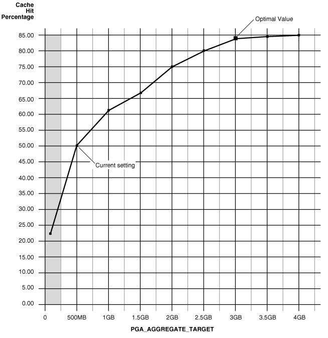

This chapter describes how to tune the Program Global Area (PGA). If you are using automatic memory management to manage the database memory on your system, then you do not need to manually tune the PGA as described in this chapter.

This chapter contains the following topics:

### About the Program Global Area

The Program Global Area (PGA) is a private memory region that contains the data and control information for a server process. Only a server process can access the PGA. Oracle Database reads and writes information in the PGA on behalf of the server process. An example of such information is the run-time area of a cursor. Each time a cursor is executed, a new run-time area is created for that cursor in the PGA memory region of the server process executing that cursor.

Note:

Part of the run-time area can be located in the Shared Global Area (SGA) when using shared servers.

For complex queries (such as decision support queries), a big portion of the run-time area is dedicated to work areas allocated by memory intensive operators, including:

- Sort-based operators, such as `ORDER` `BY`, `GROUP` `BY`, `ROLLUP`, and window functions
- Hash-join
- Bitmap merge
- Bitmap create
- Write buffers used by bulk load operations

A sort operator uses a work area (the sort area) to perform the in-memory sorting of a set of rows. Similarly, a hash-join operator uses a work area (the hash area) to build a hash table from its left input.

#### Work Area Sizes

Oracle Database enables you to control and tune the sizes of work areas. Generally, bigger work areas can significantly improve the performance of a particular operator at the cost of higher memory consumption. The available work area sizes include:

- Optimal
	Optimal size is when the size of a work area is large enough that it can accommodate the input data and auxiliary memory structures allocated by its associated SQL operator. This is the ideal size for the work area.
- One-pass
	One-pass size is when the size of the work area is below optimal size and an extra pass is performed over part of the input data. With one-pass size, the response time is increased.
- Multi-pass
	Multi-pass size is when the size of the work area is below the one-pass threshold and multiple passes over the input data are needed. With multi-pass size, the response time is dramatically increased because the size of the work area is too small compared to the input data size.

For example, a serial sort operation that must sort 10 GB of data requires a little more than 10 GB to run as optimal size and at least 40 MB to run as one-pass size. If the work area is less than 40 MB, then the sort operation must perform several passes over the input data.

When sizing the work area, the goal is to have most work areas running with optimal size (more than 90%, or even 100% for pure OLTP systems), and only a small number of them running with one-pass size (less than 10%). Multi-pass executions should be avoided for the following reasons:

- Multi-pass executions can severely degrade performance.
	A high number of multi-pass work areas has an exponentially adverse effect on the response time of its associated SQL operator.
- Running one-pass executions does not require a large amount of memory.
	Only 22 MB is required to sort 1 GB of data in one-pass size.

Even for DSS systems running large sorts and hash-joins, the memory requirement for one-pass executions is relatively small. A system configured with a reasonable amount of PGA memory should not need to perform multiple passes over the input data.

### Sizing the Program Global Area Using Automatic Memory Management

Automatic PGA memory management simplifies and improves the way PGA memory is allocated. By default, PGA memory management is enabled. In this mode, Oracle Database automatically sizes the PGA by dynamically adjusting the portion of the PGA memory dedicated to work areas, based on 20% of the SGA memory size. The minimum value is 10MB.

Note:

For backward compatibility, automatic PGA memory management can be disabled by setting the value of the `PGA_AGGREGATE_TARGET` initialization parameter to 0. When automatic PGA memory management is disabled, the maximum size of a work area can be sized with the associated `_AREA_SIZE` parameter, such as the `SORT_AREA_SIZE` initialization parameter.

This section describes how to size the PGA using automatic PGA memory management and contains the following topics:

- Configuring Automatic PGA Memory Management
- Setting the Initial Value for PGA\_AGGREGATE\_TARGET
- Monitoring Automatic PGA Memory Management
- Tuning PGA\_AGGREGATE\_TARGET

#### Configuring Automatic PGA Memory Management

When running Oracle Database in automatic PGA memory management mode, sizing of work areas for all sessions is automatic, and the `*_AREA_SIZE` parameters are ignored by all sessions running in this mode. Oracle Database automatically derives the total amount of PGA memory available to active work areas from the `PGA_AGGREGATE_TARGET` initialization parameter. The amount of PGA memory is set to the value of `PGA_AGGREGATE_TARGET` minus the amount of PGA memory allocated to other components of the system (such as PGA memory allocated by sessions). Oracle Database then assigns the resulting PGA memory to individual active work areas based on their specific memory requirements.

Oracle Database attempts to adhere to the `PGA_AGGREGATE_TARGET` value set by the DBA by dynamically controlling the amount of PGA memory allotted to work areas. To accomplish this, Oracle Database first tries to maximize the number of optimal work areas for all memory-intensive SQL operations. The rest of the work areas are executed in one-pass mode, unless the PGA memory limit set by the DBA (using the `PGA_AGGREGATE_TARGET` parameter) is so low that multi-pass execution is required to reduce memory consumption to honor the PGA target limit.

When configuring a new database instance, it can be difficult to determine the appropriate setting for `PGA_AGGREGATE_TARGET`.

To configure automatic PGA memory management:

1. Make an initial estimate for the value of the `PGA_AGGREGATE_TARGET` parameter, as described in " Setting the Initial Value for PGA\_AGGREGATE\_TARGET ".
2. Run a representative workload on the database instance and monitor its performance, as described in " Monitoring Automatic PGA Memory Management ".
3. Tune the value of the `PGA_AGGREGATE_TARGET` parameter using Oracle PGA advice statistics, as described in " Tuning PGA\_AGGREGATE\_TARGET ".

See Also:

[Oracle Database Reference](https://docs.oracle.com/pls/topic/lookup?ctx=en/database/oracle/oracle-database/21/tgdba&id=REFRN-GUID-DEBBD3F7-9F6D-4AC8-952C-0E0B2E62312D) for information about the `PGA_AGGREGATE_TARGET` initialization parameter

#### Setting the Initial Value for PGA\_AGGREGATE\_TARGET

Set the initial value of the `PGA_AGGREGATE_TARGET` initialization parameter based on the amount of available memory for the Oracle database instance. This value can then be tuned and dynamically modified at the instance level. By default, Oracle Database uses 20% of the SGA size for this value. However, this setting may be too low for a large DSS system.

To set the initial value for PGA\_AGGREGATE\_TARGET:

1. Determine how much of the total physical memory to reserve for the operating system and other non-Oracle applications running on the same system.
	For example, you might decide to reserve 20% of the total physical memory for the operating system and other non-Oracle applications, dedicating 80% of the memory on the system to the Oracle database instance.
2. Divide the remaining available memory between the SGA and the PGA:
	- For OLTP systems, the PGA memory typically makes up a small fraction of the available memory, leaving most of the remaining memory for the SGA.
		Oracle recommends initially dedicating 20% of the available memory to the PGA, and 80% to the SGA. Therefore, the initial value of the `PGA_AGGREGATE_TARGET` parameter for an OLTP system can be calculated as:
		`PGA_AGGREGATE_TARGET` = (`total_mem` \* 0.8) \* 0.2 where `total_mem` is the total amount of physical memory available on the system.
		- For DSS systems running large, memory-intensive queries, PGA memory can typically use up to 70% of the available memory.
		Oracle recommends initially dedicating 50% of the available memory to the PGA, and 50% to the SGA. Therefore, the initial value of the `PGA_AGGREGATE_TARGET` parameter for a DSS system can be calculated as:
		`PGA_AGGREGATE_TARGET` = (`total_mem` \* 0.8) \* 0.5 where `total_mem` is the total amount of physical memory available on the system.

For example, if an Oracle database instance is configured to run on a system with 4 GB of physical memory, and if 80% (or 3.2 GB) of the memory is dedicated to the Oracle database instance, then initially set `PGA_AGGREGATE_TARGET` to 640 MB for an OLTP system, or 1,600 MB for a DSS system.

#### Monitoring Automatic PGA Memory Management

Before starting the tuning process, run a representative workload on the database instance and monitor its performance. PGA statistics collected by Oracle Database enable you to determine if the maximum PGA size is under-configured or over-configured. Monitoring these statistics enables you to assess the performance of automatic PGA memory management and tune the value of the `PGA_AGGREGATE_TARGET` parameter accordingly.

This section describes how to use performance views to monitor automatic PGA memory management and contains the following topics:

- Using the V$PGASTAT View
- Using the V$PROCESS View
- Using the V$PROCESS\_MEMORY View
- Using the V$SQL\_WORKAREA\_HISTOGRAM View
- Using the V$WORKAREA\_ACTIVE View
- Using the V$SQL\_WORKAREA View

##### Using the V$PGASTAT View

The `V$PGASTAT` view provides instance-level statistics about PGA memory usage and the automatic PGA memory manager.

The following example shows a query of this view.

```
SELECT *
  FROM V$PGASTAT;
```

The output of this query might look like the following:

```
NAME                                                          VALUE UNIT
-------------------------------------------------------- ---------- ------------
aggregate PGA target parameter                             41156608 bytes
aggregate PGA auto target                                  21823488 bytes
global memory bound                                         2057216 bytes
total PGA inuse                                            16899072 bytes
total PGA allocated                                        35014656 bytes
maximum PGA allocated                                     136795136 bytes
total freeable PGA memory                                    524288 bytes
PGA memory freed back to OS                              1713242112 bytes
total PGA used for auto workareas                                 0 bytes
maximum PGA used for auto workareas                         2383872 bytes
total PGA used for manual workareas                               0 bytes
maximum PGA used for manual workareas                       8470528 bytes
over allocation count                                           291
bytes processed                                          2124600320 bytes
extra bytes read/written                                   39949312 bytes
cache hit percentage                                          98.15 percent
```

Table 16-1 describes the main statistics shown in the `V$PGASTAT` view.

Table 16-1 Statistics in the V$PGASTAT View

| Statistic | Description |
| --- | --- |
| `aggregate PGA target parameter` | This statistic shows the current value of the `PGA_AGGREGATE_TARGET` parameter. The default value is 20% of the SGA size. Setting this parameter to 0 disables automatic PGA memory management. |
| `aggregate PGA auto target` | This statistic shows the amount of PGA memory Oracle Database can use for work areas running in automatic mode. This amount is dynamically derived from the value of the `PGA_AGGREGATE_TARGET` parameter and the current work area workload. Hence, it is continuously adjusted by Oracle Database. If this value is small compared to the `PGA_AGGREGATE_TARGET` value, then most of PGA memory is used by other system components (such as PL/SQL or Java) and little is left for work areas. Ensure that enough PGA memory remains for work areas running in automatic mode. |
| `global memory bound` | This statistic shows the maximum size of a work area executed in automatic mode. This value is continuously adjusted by Oracle Database to reflect the current state of the work area workload. The global memory bound generally decreases when the number of active work areas increases in the system. As a rule of thumb, the value of the global bound should not decrease to less than 1 MB. If it does, increase the value of the `PGA_AGGREGATE_TARGET` parameter. |
| `total PGA allocated` | This statistic shows the current amount of PGA memory allocated by the database instance. Oracle Database tries to keep this number less than the `PGA_AGGREGATE_TARGET` value. However, if the work area workload is increasing rapidly or the `PGA_AGGREGATE_TARGET` parameter is set to a value that is too low, it is possible for the PGA allocated to exceed this value by a small percentage and for a short time. |
| `total freeable PGA memory` | This statistic indicates how much allocated PGA memory can be freed. |
| `total PGA used for auto workareas` | This statistic indicates how much PGA memory is currently consumed by work areas running in automatic mode. Use this number to determine how much memory is consumed by other consumers of the PGA memory (such as PL/SQL or Java):  ``` PGA other = total PGA allocated - total PGA used for auto workareas ``` |
| `over allocation count` | This statistic is cumulative from instance startup. Over-allocating PGA memory can happen if the `PGA_AGGREGATE_TARGET` value is too small to accommodate the `PGA other` component and the minimum memory required to execute the work area workload. In this case, Oracle Database cannot honor the `PGA_AGGREGATE_TARGET` value, and extra PGA memory must be allocated. If over-allocation occurs, increase the value of the `PGA_AGGREGATE_TARGET` parameter using the information provided by the `V$PGA_TARGET_ADVICE` view, as described in " Using the V$PGA\_TARGET\_ADVICE View ". |
| `total bytes processed` | This statistic indicates the number of bytes processed by memory-intensive SQL operators since instance startup. For example, the number of bytes processed is the input size for a sort operation. This number is used to compute the `cache` `hit` `percentage` metric. |
| `extra bytes read/written` | When a work area cannot run optimally, one or more extra passes is performed over the input data. This statistic represents the number of bytes processed during these extra passes since instance startup. This number is also used to compute the `cache` `hit` `percentage` metric. Ideally, it should be small compared to `total bytes processed`. |
| `cache hit percentage` | This metric is computed by Oracle Database to reflect the performance of the PGA memory component. It is cumulative from instance startup. A value of 100% means that all work areas executed by the system since instance startup are using an optimal amount of PGA memory. This is ideal but rarely happens except for pure OLTP systems. Typically, some work areas run one-pass or even multi-pass, depending on the overall size of the PGA memory. When a work area cannot run optimally, one or more extra passes are performed over the input data. This reduces the `cache` `hit` `percentage` in proportion to the size of the input data and the number of extra passes performed. For an example of how this metric is calculated, see Example 16-1. |

Example 16-1 shows how extra passes affect the `cache` `hit` `percentage` metric.

Example 16-1 Calculating Cache Hit Percentage

Four sort operations have been executed, three were small (1 MB of input data) and one was bigger (100 MB of input data). The total number of bytes processed (BP) by the four operations is 103 MB. If one of the small sorts runs one-pass, an extra pass over 1 MB of input data is performed. This 1 MB value is the number of `extra` `bytes` `read/written`, or EBP.

The `cache` `hit` `percentage` is calculated using the following formula:

```
BP x 100 / (BP + EBP)
```

In this example, the `cache` `hit` `percentage` is 99.03%. This value reflects that only one of the small sort operations performed an extra pass, while all other sort operations were able to run in optimal size. Therefore, the `cache` `hit` `percentage` is almost 100%, because the extra pass over 1 MB represents a tiny overhead. However, if the bigger sort operation runs in one-pass size, then the EBP is 100 MB instead of 1 MB, and the `cache` `hit` `percentage` falls to 50.73%, because the extra pass has a much bigger impact.

##### Using the V$PROCESS View

The `V$PROCESS` view contains one row for each Oracle process connected to the database instance. Use the following columns in this view to monitor the PGA memory usage of these processes:

- `PGA_USED_MEM`
- `PGA_ALLOC_MEM`
- `PGA_FREEABLE_MEM`
- `PGA_MAX_MEM`

Example 16-2 shows a query of this view.

Example 16-2 Querying the V$PROCESS View

```
SELECT program, pga_used_mem, pga_alloc_mem, pga_freeable_mem, pga_max_mem
  FROM V$PROCESS;
```

The output of this query might look like the following:

```
PROGRAM                 PGA_USED_MEM PGA_ALLOC_MEM PGA_FREEABLE_MEM PGA_MAX_MEM
----------------------- ------------ ------------- ---------------- -----------
PSEUDO                             0             0                0           0
oracle@examp1690 (PMON)       314540        685860                0      685860
oracle@examp1690 (MMAN)       313992        685860                0      685860
oracle@examp1690 (DBW0)       696720       1063112                0     1063112
oracle@examp1690 (LGWR)     10835108      22967940                0    22967940
oracle@examp1690 (CKPT)       352716        710376                0      710376
oracle@examp1690 (SMON)       541508        948004                0     1603364
oracle@examp1690 (RECO)       323688        685860                0      816932
oracle@examp1690 (q001)       233508        585128                0      585128
oracle@examp1690 (QMNC)       314332        685860                0      685860
oracle@examp1690 (MMON)       885756       1996548           393216     1996548
oracle@examp1690 (MMNL)       315068        685860                0      685860
oracle@examp1690 (q000)       330872        716200            65536      716200
oracle@examp1690 (CJQ0)       533476       1013540                0     1144612
```

##### Using the V$PROCESS\_MEMORY View

The `V$PROCESS_MEMORY` view displays dynamic PGA memory usage by named component categories for each Oracle process. This view contains up to six rows for each Oracle process, one row for:

- Each named component category:
	- Java
		- PL/SQL
		- OLAP
		- SQL
- Freeable
	Memory that has been allocated to the process by the operating system, but not to a specific category
- Other
	Memory that has been allocated to a category, but not to a named category

Use the following columns in this view to dynamically monitor the PGA memory usage of Oracle processes for each of the six categories:

- `CATEGORY`
- `ALLOCATED`
- `USED`
- `MAX_ALLOCATED`

Note:

The `V$PROCESS_MEMORY_DETAIL` view displays dynamic PGA memory usage for the Oracle processes that exceed 500 MB of PGA usage. The `V$PROCESS_MEMORY_DETAIL` view is available starting with Oracle Database 12c Release 2.

See Also:

Oracle Database Reference for more information about the [`V$PROCESS_MEMORY`](https://docs.oracle.com/pls/topic/lookup?ctx=en/database/oracle/oracle-database/21/tgdba&id=REFRN-GUID-D16BB4C3-C11D-4EAD-BA06-F96A5450F8E8) and [`V$PROCESS_MEMORY_DETAIL`](https://docs.oracle.com/pls/topic/lookup?ctx=en/database/oracle/oracle-database/21/tgdba&id=REFRN-GUID-D16BB4C3-C11D-4EAD-BA06-F96A5450F8E8) views

##### Using the V$SQL\_WORKAREA\_HISTOGRAM View

The `V$SQL_WORKAREA_HISTOGRAM` view shows the number of work areas executed with optimal, one-pass, and multi-pass memory size since instance startup. Statistics in this view are divided into buckets. The buckets are defined by the optimal memory requirements of the work areas. Each bucket is identified by a range of optimal memory requirements, specified by the values in the `LOW_OPTIMAL_SIZE` and `HIGH_OPTIMAL_SIZE` columns.

For example, a sort operation may require 3 MB of memory to run in optimal size (cached). Statistics about the work area used by this sort operation are placed in the bucket defined by:

- `LOW_OPTIMAL_SIZE` = 2097152 (2 MB)
- `HIGH_OPTIMAL_SIZE` = 4194303 (4 MB minus 1 byte)

Statistics are segmented by work area size, because the performance impact of running a work area in optimal, one-pass or multi-pass size depends mainly on the size of the work area. In this example, statistics about the work area are placed in this bucket because 3 MB lies within that range of optimal sizes.

Example 16-3 and Example 16-4 show two methods for querying this view.

Example 16-3 Querying the V$SQL\_WORKAREA\_HISTOGRAM View: Non-Empty Buckets

The following query shows statistics for all non-empty buckets:

```
SELECT low_optimal_size/1024 low_kb,
       (high_optimal_size+1)/1024 high_kb,
       optimal_executions, onepass_executions, multipasses_executions
  FROM V$SQL_WORKAREA_HISTOGRAM
 WHERE total_executions != 0;
```

The result of the query might look like the following:

```
LOW_KB HIGH_KB OPTIMAL_EXECUTIONS ONEPASS_EXECUTIONS MULTIPASSES_EXECUTIONS
------ ------- ------------------ ------------------ ----------------------
     8      16             156255                  0                      0
    16      32                150                  0                      0
    32      64                 89                  0                      0
    64     128                 13                  0                      0
   128     256                 60                  0                      0
   256     512                  8                  0                      0
   512    1024                657                  0                      0
  1024    2048                551                 16                      0
  2048    4096                538                 26                      0
  4096    8192                243                 28                      0
  8192   16384                137                 35                      0
 16384   32768                 45                107                      0
 32768   65536                  0                153                      0
 65536  131072                  0                 73                      0
131072  262144                  0                 44                      0
262144  524288                  0                 22                      0
```

In this example, the output shows that—in the 1 MB to 2 MB bucket—551 work areas ran in optimal size, while 16 ran in one-pass size and none ran in multi-pass size. It also shows that all work areas under 1 MB were able to run in optimal size.

Example 16-4 Querying the V$SQL\_WORKAREA\_HISTOGRAM View: Percent Optimal

The following query shows the percentage of times work areas are executed in optimal, one-pass, or multi-pass size since startup. This query only considers work areas of a certain size, with an optimal memory requirement of at least 64 KB:

```
SELECT optimal_count, ROUND(optimal_count*100/total, 2) optimal_perc, 
       onepass_count, ROUND(onepass_count*100/total, 2) onepass_perc,
       multipass_count, ROUND(multipass_count*100/total, 2) multipass_perc
FROM
 (SELECT DECODE(SUM(total_executions), 0, 1, SUM(total_executions)) total,
         SUM(optimal_executions) optimal_count,
         SUM(onepass_executions) onepass_count,
         SUM(multipass_executions) multipass_count
    FROM V$SQL_WORKAREA_HISTOGRAM
   WHERE low_optimal_size >= 64*1024);
```

The output of this query might look like the following:

```
OPTIMAL_COUNT OPTIMAL_PERC ONEPASS_COUNT ONEPASS_PERC MULTIPASS_COUNT MULTIPASS_PERC
------------- ------------ ------------- ------------ --------------- --------------
         2239        81.63           504        18.37               0              0
```

In this example, the output shows that 81.63% of the work areas were able to run in optimal size. The remaining work areas (18.37%) ran in one-pass size and none of them ran in multi-pass size.

##### Using the V$WORKAREA\_ACTIVE View

The `V$WORKAREA_ACTIVE` view displays the work areas that are active (or executing) in the database instance. Small, active sort operations (under 64 KB) are excluded from this view. Use this view to precisely monitor the size of all active work areas and to determine whether these active work areas spill to a temporary segment.

Example 16-5 shows a query of this view.

Example 16-5 Querying the V$WORKAREA\_ACTIVE View

```
SELECT TO_NUMBER(DECODE(sid, 65535, null, sid)) sid,
       operation_type operation,
       TRUNC(expected_size/1024) esize,
       TRUNC(actual_mem_used/1024) mem,
       TRUNC(max_mem_used/1024) "max mem",
       number_passes pass,
       TRUNC(TEMPSEG_SIZE/1024) tsize
  FROM V$SQL_WORKAREA_ACTIVE
 ORDER BY 1,2;
```

The output of this query might look like the following:

```
SID         OPERATION     ESIZE       MEM   MAX MEM  PASS   TSIZE
--- ----------------- --------- --------- --------- ----- -------
  8   GROUP BY (SORT)       315       280       904     0
  8         HASH-JOIN      2995      2377      2430     1   20000
  9   GROUP BY (SORT)     34300     22688     22688     0
 11         HASH-JOIN     18044     54482     54482     0
 12         HASH-JOIN     18044     11406     21406     1  120000
```

In this example, the output shows that:

- Session 12 (`SID` column) is running a hash-join operation (`OPERATION` column) in a work area running in one-pass size (`PASS` column)
- The maximum amount of memory that the PGA memory manager expects this hash-join operation to use is 18044 KB (`ESIZE` column)
- The work area is currently using 11406 KB of memory (`MEM` column)
- The work area used up to 21406 KB of PGA memory (`MAX` `MEM` column) in the past
- The work area spilled to a temporary segment of 120000 KB (`TSIZE` column)

When the work area is deallocated—or when the execution of its associated SQL operator is complete—it is automatically removed from this view.

##### Using the V$SQL\_WORKAREA View

Oracle Database maintains cumulative work area statistics for each loaded cursor whose execution plan uses one or more work areas. Each time a work area is deallocated, the `V$SQL_WORKAREA` view is updated with execution statistics for that work area.

You can join the `V$SQL_WORKAREA` view with the `V$SQL` view to relate a work area to a cursor, and with the `V$SQL_PLAN` view to precisely determine which operator in the plan uses a work area.

Example 16-6 shows three queries of this view.

Example 16-6 Querying the V$SQL\_WORKAREA View

The following query finds the top 10 work areas that require the most cache memory:

```
SELECT *
FROM   (SELECT workarea_address, operation_type, policy, estimated_optimal_size
        FROM V$SQL_WORKAREA
        ORDER BY estimated_optimal_size DESC)
 WHERE ROWNUM <= 10;
```

The following query finds the cursors with one or more work areas that have been executed in one or multiple passes:

```
col sql_text format A80 wrap 
SELECT sql_text, sum(ONEPASS_EXECUTIONS) onepass_cnt,
       sum(MULTIPASSES_EXECUTIONS) mpass_cnt 
FROM V$SQL s, V$SQL_WORKAREA wa 
WHERE s.address = wa.address 
GROUP BY sql_text 
HAVING sum(ONEPASS_EXECUTIONS+MULTIPASSES_EXECUTIONS)>0;
```

Using the hash value and address of a particular cursor, the following query displays the cursor execution plan, including information about the associated work areas:

```
col "O/1/M" format a10
col name format a20
SELECT operation, options, object_name name, trunc(bytes/1024/1024) "input(MB)",
       TRUNC(last_memory_used/1024) last_mem,
       TRUNC(estimated_optimal_size/1024) optimal_mem, 
       TRUNC(estimated_onepass_size/1024) onepass_mem, 
       DECODE(optimal_executions, null, null, 
              optimal_executions||'/'||onepass_executions||'/'||
              multipasses_executions) "O/1/M"
  FROM V$SQL_PLAN p, V$SQL_WORKAREA w 
 WHERE p.address=w.address(+) 
   AND p.hash_value=w.hash_value(+) 
   AND p.id=w.operation_id(+) 
   AND p.address='88BB460C'
   AND p.hash_value=3738161960;
```

The output of this query might look like the following:

```
OPERATION    OPTIONS  NAME     input(MB) LAST_MEM OPTIMAL_ME ONEPASS_ME O/1/M 
------------ -------- -------- --------- -------- ---------- ---------- ------
SELECT STATE                                                                  
HASH         GROUP BY               4582        8         16         16 16/0/0
HASH JOIN    SEMI                   4582     5976       5194       2187 16/0/0
TABLE ACCESS FULL     ORDERS          51                                      
TABLE ACCESS FUL      LINEITEM      1000
```

You can get the address and hash value from the `V$SQL` view by specifying a pattern in the query, as shown in the following query:

```
SELECT address, hash_value 
  FROM V$SQL 
 WHERE sql_text LIKE '%my_pattern%';
```

#### Tuning PGA\_AGGREGATE\_TARGET

To help you tune the value of the `PGA_AGGREGATE_TARGET` initialization parameter, Oracle Database provides two PGA performance advisory views: `V$PGA_TARGET_ADVICE` and `V$PGA_TARGET_ADVICE_HISTOGRAM`. By using these views, you do not need to use an empirical approach to tune the value of the `PGA_AGGREGATE_TARGET` parameter. Instead, you can use these views to predict how changing the value of the `PGA_AGGREGATE_TARGET` parameter will affect key PGA statistics.

This section describes how to tune the value of the `PGA_AGGREGATE_TARGET` initialization parameter and contains the following topics:

- Enabling Automatic Generation of PGA Performance Advisory Views
- Using the V$PGA\_TARGET\_ADVICE View
- Using the V$PGA\_TARGET\_ADVICE\_HISTOGRAM View
- Using the V$SYSSTAT and V$SESSTAT Views
- Tutorial: How to Tune PGA\_AGGREGATE\_TARGET

##### Enabling Automatic Generation of PGA Performance Advisory Views

Oracle Database generates the `V$PGA_TARGET_ADVICE` and `V$PGA_TARGET_ADVICE_HISTOGRAM` views by recording the workload history, and then simulating this history for different values of the `PGA_AGGREGATE_TARGET` parameter. The values of the `PGA_AGGREGATE_TARGET` parameter are derived from fractions and multiples of its current value to assess possible higher and lower values. These values are used for the prediction and range from 10 MB to a maximum of 256 GB. The simulation process happens in the background and continuously updates the workload history to produce the simulation result. You can view the result at any time by querying these views.

To enable automatic generation of PGA performance advice views:

1. Set the `PGA_AGGREGATE_TARGET` parameter to enable automatic PGA memory management.
	Setting this parameter to 0 disables automatic PGA memory management and is not recommended. For information about setting this parameter, see " Setting the Initial Value for PGA\_AGGREGATE\_TARGET ".
2. Set the `STATISTICS_LEVEL` parameter to `TYPICAL` (the default) or `ALL`.
	Setting this parameter to `BASIC` disables generation of the PGA performance advice views and is not recommended.

Note:

The contents of the PGA advice performance views are reset at instance startup or when the value of the `PGA_AGGREGATE_TARGET` parameter is changed.

##### Using the V$PGA\_TARGET\_ADVICE View

The `V$PGA_TARGET_ADVICE` view predicts how changing the value of the `PGA_AGGREGATE_TARGET` initialization parameter will affect the following statistics in the `V$PGASTAT` view:

- cache hit percentage
- over allocation count

The following example shows a query of this view.

```
SELECT ROUND(pga_target_for_estimate/1024/1024) target_mb,
       estd_pga_cache_hit_percentage cache_hit_perc,
       estd_overalloc_count
  FROM V$PGA_TARGET_ADVICE;
```

The output of this query might look like the following:

```
TARGET_MB  CACHE_HIT_PERC  ESTD_OVERALLOC_COUNT
----------  --------------  --------------------
        63              23                   367
       125              24                    30
       250              30                     3
       375              39                     0
       500              58                     0
       600              59                     0
       700              59                     0
       800              60                     0
       900              60                     0
      1000              61                     0
      1500              67                     0
      2000              76                     0
      3000              83                     0
      4000              85                     0
```

The following figure illustrates how the result of this query can be plotted.

Figure 16-1 Graphical Representation of V$PGA\_TARGET\_ADVICE



> The illustration shows a line representation of V$PGA\_TARGET\_ADVICE. The content of the graph shows the cache hit percentage as related to the value of the PGA\_AGGREGATE\_TARGET parameter.
>
> The current setting and optimal value are displayed on the graph. At the optimal setting, the cache hit percentage is nearly 85%, approximately 35% higher than the current setting.
>
> End of image description.


The curve shows how PGA `cache` `hit` `percentage` improves as the value of the `PGA_AGGREGATE_TARGET` parameter increases. The shaded zone in the graph represents the `over` `allocation` zone, where the value of the `ESTD_OVERALLOCATION_COUNT` column is non-zero. This area indicates that the value of the `PGA_AGGREGATE_TARGET` parameter is too small to meet the minimum PGA memory requirements. If the value of the `PGA_AGGREGATE_TARGET` parameter is set within the `over` `allocation` zone, then the memory manager will over-allocate memory and the actual PGA memory consumed will exceed the limit that was set. It is therefore meaningless to set a value of the `PGA_AGGREGATE_TARGET` parameter in that zone. In this particular example, the `PGA_AGGREGATE_TARGET` parameter should be set to at least 375 MB.

Beyond the `over` `allocation` zone, the value of the PGA `cache` `hit` `percentage` increases rapidly. This is due to an increase in the number of optimal or one-pass work areas and a decrease in the number of multi-pass executions. At some point, around 500 MB in this example, an inflection in the curve corresponds to the point where most (probably all) work areas can run in optimal or at least one-pass size. Beyond this point, the `cache` `hit` `percentage` keeps increasing, though at a lower pace, up to the point where it starts to taper off and only slight improvement is achieved with increase in the value of the `PGA_AGGREGATE_TARGET` parameter. In the figure, this happens when `PGA_AGGREGATE_TARGET` reaches 3 GB. At this point, the `cache` `hit` `percentage` is 83% and only marginal improvement (by 2%) is achieved with one extra gigabyte of PGA memory. In this example, 3 GB is the optimal value for the `PGA_AGGREGATE_TARGET` parameter.

Note:

Although the theoretical maximum for the PGA `cache` `hit` `percentage` is 100%, a practical limit exists on the maximum size of a work area that may prevent this theoretical maximum from being reached, even when the value of the `PGA_AGGREGATE_TARGET` parameter is further increased. This should happen only in large DSS systems where the optimal memory requirement is large and may cause the value of the `cache` `hit` `percentage` to taper off at a lower percentage, such as 90%.

Ideally, the value of the `PGA_AGGREGATE_TARGET` parameter should be set to the optimal value, or at least to the maximum value possible in the region beyond the `over` `allocation` zone. As a rule of thumb, the PGA `cache` `hit` `percentage` should be higher than 60%, because at 60% the system is almost processing double the number of bytes it actually needs to process in an ideal situation. In this example, the value of the `PGA_AGGREGATE_TARGET` parameter should be set to at least 500 MB, and as close to 3 GB as possible. However, the correct setting for the `PGA_AGGREGATE_TARGET` parameter depends on how much memory can be dedicated to the PGA component. Generally, adding PGA memory requires reducing memory for some SGA components—like the shared pool or buffer cache—because the overall memory dedicated to the database instance is often bound by the amount of physical memory available on the system. Therefore, any decisions to increase PGA memory must be taken in the larger context of the available memory in the system and the performance of the various SGA components (which you can monitor with shared pool advisory and buffer cache advisory statistics). If you cannot reduce memory from the SGA components, consider adding more physical memory to the system.

##### Using the V$PGA\_TARGET\_ADVICE\_HISTOGRAM View

The `V$PGA_TARGET_ADVICE_HISTOGRAM` view predicts how changing the value of the `PGA_AGGREGATE_TARGET` initialization parameter will affect the statistics in the `V$SQL_WORKAREA_HISTOGRAM` view. Use this view to display detailed information about the predicted number of optimal, one-pass, and multi-pass work area executions for the `PGA_AGGREGATE_TARGET` values used for the prediction.

The `V$PGA_TARGET_ADVICE_HISTOGRAM` view is identical to the `V$SQL_WORKAREA_HISTOGRAM` view, with two additional columns to represent the `PGA_AGGREGATE_TARGET` values used for the prediction. Therefore, any query executed against the `V$SQL_WORKAREA_HISTOGRAM` view can be used on this view, with an additional predicate to select the desired value of the `PGA_AGGREGATE_TARGET` parameter.

Example 16-7 shows a query of this view that displays the predicted content of the `V$SQL_WORKAREA_HISTOGRAM` view for a value of the `PGA_AGGREGATE_TARGET` parameter set to twice its current value.

Example 16-7 Querying the V$PGA\_TARGET\_ADVICE\_HISTOGRAM View

```
SELECT low_optimal_size/1024 low_kb, (high_optimal_size+1)/1024 high_kb,
       estd_optimal_executions estd_opt_cnt,
       estd_onepass_executions estd_onepass_cnt,
       estd_multipasses_executions estd_mpass_cnt
  FROM V$PGA_TARGET_ADVICE_HISTOGRAM
 WHERE pga_target_factor = 2
   AND estd_total_executions != 0
 ORDER BY 1;
```

The output of this query might look like the following:

```
LOW_KB   HIGH_KB   ESTD_OPTIMAL_CNT   ESTD_ONEPASS_CNT   ESTD_MPASS_CNT
------   -------   ----------------   ----------------   --------------
     8        16             156107                  0                0
    16        32                148                  0                0
    32        64                 89                  0                0
    64       128                 13                  0                0
   128       256                 58                  0                0
   256       512                 10                  0                0
   512      1024                653                  0                0
  1024      2048                530                  0                0
  2048      4096                509                  0                0
  4096      8192                227                  0                0
  8192     16384                176                  0                0
 16384     32768                133                 16                0
 32768     65536                 66                103                0
 65536    131072                 15                 47                0
131072    262144                  0                 48                0
262144    524288                  0                 23                0
```

In this example, the output shows that increasing the value of the `PGA_AGGREGATE_TARGET` parameter by a factor of 2 will enable all work areas under 16 MB to execute in optimal size.

##### Using the V$SYSSTAT and V$SESSTAT Views

Statistics in the `V$SYSSTAT` and `V$SESSTAT` views show the total number of work areas executed with optimal, one-pass, and multi-pass memory size. These statistics are cumulative since the instance or the session was started.

Example 16-8 shows a query of the `V$SYSSTAT` view that displays the total number and the percentage of times work areas were executed in these three sizes since the instance was started:

Example 16-8 Querying the V$SYSSTAT View

```
SELECT name profile, cnt, DECODE(total, 0, 0, ROUND(cnt*100/total)) percentage
  FROM (SELECT name, value cnt, (SUM(value) over ()) total
  FROM V$SYSSTAT
 WHERE name
  LIKE 'workarea exec%');
```

The output of this query might look like the following:

```
PROFILE                                    CNT PERCENTAGE
----------------------------------- ---------- ----------
workarea executions - optimal             5395         95
workarea executions - onepass              284          5
workarea executions - multipass              0          0
```

In this example, the output shows that 5,395 work area executions (or 95%) were executed in optimal size, and 284 work area executions (or 5%) were executed in one-pass size.

##### Tutorial: How to Tune PGA\_AGGREGATE\_TARGET

This tutorial provides a guideline for tuning the value of the `PGA_AGGREGATE_TARGET` parameter using the various views discussed in this chapter.

To tune PGA\_AGGREGATE\_TARGET:

1. Set the value of the `PGA_AGGREGATE_TARGET` parameter to avoid memory over-allocation.
	Use the `V$PGA_TARGET_ADVICE` view to ensure that the `PGA_AGGREGATE_TARGET` value is not set within the over-allocation zone, as described in " Using the V$PGA\_TARGET\_ADVICE View ". In Example 16–8, the `PGA_AGGREGATE_TARGET` value should be set to at least 375 MB.
2. Maximize the PGA `cache` `hit` `percentage`, based on response time requirements and memory constraints.
	Use the `V$PGA_TARGET_ADVICE` view to determine the optimal value for the `PGA_AGGREGATE_TARGET` parameter and set its value to the optimal value, or to the maximum value possible, as described in " Using the V$PGA\_TARGET\_ADVICE View ".
	Assume a limit X on the memory that can be allocated to PGA:
	- If limit X is higher than the optimal value, set the value of the `PGA_AGGREGATE_TARGET` parameter to the optimal value.
		In Example 16–8, if you have 10 GB to dedicate to PGA, set the value of the `PGA_AGGREGATE_TARGET` parameter to 3 GB and dedicate the remaining 7 GB to the SGA.
		- If limit X is less than the optimal value, set the value of the `PGA_AGGREGATE_TARGET` parameter to X.
		In Example 16–8, if you have only 2 GB to dedicate to PGA, set the value of the `PGA_AGGREGATE_TARGET` parameter to 2 GB and accept a `cache` `hit` `percentage` of 75%.
3. Verify that the new value of the `PGA_AGGREGATE_TARGET` parameter will result in the desired number of optimal and one-pass work area executions and avoid any multi-pass work area executions.
	Use the `V$PGA_TARGET_ADVICE_HISTOGRAM` view to predict the number of optimal, one-pass, and multi-pass work area executions, as described in " Using the V$PGA\_TARGET\_ADVICE\_HISTOGRAM View ".
4. If more PGA memory is required, then increase PGA memory by either reducing memory from SGA components or adding more physical memory to the system.
5. At any time, ensure the number of optimal, one-pass, and multi-pass work area executions matches predictions and tune the value of the `PGA_AGGREGATE_TARGET` parameter if necessary.
	Use the `V$SYSSTAT` and `V$SESSTAT` views to verify the total number of work areas executed with optimal, one-pass, and multi-pass memory size since instance or session startup, respectively, as described in " Using the V$SYSSTAT and V$SESSTAT Views ".

### Sizing the Program Global Area by Specifying an Absolute Limit

In automatic PGA memory management mode, Oracle Database attempts to adhere to the `PGA_AGGREGATE_TARGET` value by dynamically controlling the amount of PGA memory allotted to work areas. However, PGA memory usage may exceed the `PGA_AGGREGATE_TARGET` setting at times due to the following reasons:

- The `PGA_AGGREGATE_TARGET` setting acts as a target, and not a limit.
- `PGA_AGGREGATE_TARGET` only controls allocations of tunable memory.

Excessive PGA usage can lead to high rates of swapping. When this occurs, the system may become unresponsive and unstable. In that case, consider using any of the following methods to specify an absolute limit on the PGA memory usage:
- Use `PGA_AGGREGATE_LIMIT` parameter to set an absolute limit on the overall PGA memory usage.
	See " Sizing the Program Global Area Using the PGA\_AGGREGATE\_LIMIT Parameter "
- Use the Resource Manager procedure `DBMS_RESOURCE_MANAGER.CREATE_PLAN_DIRECTIVE` to set an absolute limit on the PGA memory usage for each session in a particular consumer group.
	See " Sizing the Program Global Area Using the Resource Manager "

#### Sizing the Program Global Area Using the PGA\_AGGREGATE\_LIMIT Parameter

The `PGA_AGGREGATE_LIMIT` initialization parameter enables you to specify an absolute limit on the PGA memory usage. If the `PGA_AGGREGATE_LIMIT` value is exceeded, Oracle Database aborts or terminates the sessions or processes that are consuming the most untunable PGA memory in the following order:

- Calls for sessions that are consuming the most untunable PGA memory are aborted.
- If PGA memory usage is still over the `PGA_AGGREGATE_LIMIT`, then the sessions and processes that are consuming the most untunable PGA memory are terminated.

In determining the sessions and processes to abort or terminate, Oracle Database treats parallel queries as a single unit.

By default, the `PGA_AGGREGATE_LIMIT` parameter is set to the greater of 2 GB, 200% of the `PGA_AGGREGATE_TARGET` value, or 3 MB times the value of the `PROCESSES` parameter. However, it will not exceed 120% of the physical memory size minus the total SGA size. The default value is printed into the alert log. A warning message is printed in the alert log if the amount of physical memory on the system cannot be determined.

To set PGA\_AGGREGATE\_LIMIT:

- Set the `PGA_AGGREGATE_LIMIT` initialization parameter to a desired value in number of bytes.
	The value is expresses as a number followed by `K` (for kilobytes), `M` (for megabytes), or `G` (for gigabytes). Setting the value to 0 disables the hard limit on PGA memory.

See Also:

- [Oracle Database Reference](https://docs.oracle.com/pls/topic/lookup?ctx=en/database/oracle/oracle-database/21/tgdba&id=REFRN10328) for information about the `PGA_AGGREGATE_LIMIT` initialization parameter
- [Oracle Database Reference](https://docs.oracle.com/pls/topic/lookup?ctx=en/database/oracle/oracle-database/21/tgdba&id=REFRN30180) for information about the `V$PGASTAT` view
- [Oracle Database Administrator's Guide](https://docs.oracle.com/pls/topic/lookup?ctx=en/database/oracle/oracle-database/21/tgdba&id=ADMIN027) for information about Oracle Database Resource Manager and consumer groups

#### Sizing the Program Global Area Using the Resource Manager

You can set an absolute limit on the amount of PGA memory that can be allocated to each session in a particular consumer group using the `SESSION_PGA_LIMIT` parameter of the `DBMS_RESOURCE_MANAGER.CREATE_PLAN_DIRECTIVE` procedure of the Oracle Database Resource Manager. If a session exceeds the PGA memory limit set for its consumer group, then that session is terminated with the `ORA-10260` error message.

See Also:

- Oracle Database Administration Guide topics:
	- ["Program Global Area (PGA)"](https://docs.oracle.com/pls/topic/lookup?ctx=en/database/oracle/oracle-database/21/tgdba&id=ADMIN-GUID-6D549CB5-9AEB-43F2-9901-0092C7B76115) for more information about limiting the PGA memory for each session in a consumer group.
		- ["Creating Resource Plan Directives"](https://docs.oracle.com/pls/topic/lookup?ctx=en/database/oracle/oracle-database/21/tgdba&id=ADMIN-GUID-3BDCC024-22DD-479D-A7C3-92E7145C854F) for more information about creating resource plan directives using the `DBMS_RESOURCE_MANAGER.CREATE_PLAN_DIRECTIVE` procedure.
- [Oracle Database PL/SQL Packages and Types Reference](https://docs.oracle.com/pls/topic/lookup?ctx=en/database/oracle/oracle-database/21/tgdba&id=ARPLS-GUID-8EC6C735-338D-46D4-B346-AD16D0622B30) for the syntax of the `DBMS_RESOURCE_MANAGER.CREATE_PLAN_DIRECTIVE` procedure.