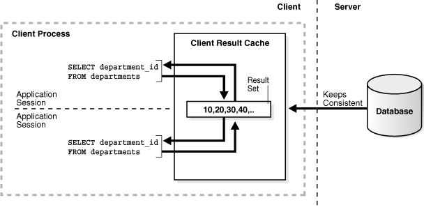

This chapter describes how to tune the result cache and contains the following topics:

### About the Result Cache

A result cache is an area of memory, either in the Shared Global Area (SGA) or client application memory, that stores the results of a database query or query block for reuse. The cached rows are shared across SQL statements and sessions unless they become stale.

This section describes the two types of result cache and contains the following topics:

- Server Result Cache Concepts
- Client Result Cache Concepts

#### Server Result Cache Concepts

The server result cache is a memory pool within the shared pool. This memory pool consists of the SQL query result cache—which stores results of SQL queries—and the PL/SQL function result cache, which stores values returned by PL/SQL functions.

This section describes the server result cache and contains the following topics:

- Benefits of Using the Server Result Cache
- Understanding How the Server Result Cache Works

See Also:

- [Oracle Database Concepts](https://docs.oracle.com/pls/topic/lookup?ctx=en/database/oracle/oracle-database/21/tgdba&id=CNCPT1919) for information about the server result cache
- [Oracle Database PL/SQL Language Reference](https://docs.oracle.com/pls/topic/lookup?ctx=en/database/oracle/oracle-database/21/tgdba&id=LNPLS00817) for information about the PL/SQL function result cache

##### Benefits of Using the Server Result Cache

The benefits of using the server result cache depend on the application. OLAP applications can benefit significantly from its use. Good candidates for caching are queries that access a high number of rows but return a small number, such as those in a data warehouse. For example, you can use advanced query rewrite with equivalences to create materialized views that materialize queries in the result cache instead of using tables.

##### Understanding How the Server Result Cache Works

When a query executes, the database searches the cache memory to determine whether the result exists in the result cache. If the result exists, then the database retrieves the result from memory instead of executing the query. If the result is not cached, then the database executes the query, returns the result as output, and stores the result in the result cache.

When users execute queries and functions repeatedly, the database retrieves rows from the cache, decreasing response time. Cached results become invalid when data in dependent database objects is modified.

The following sections contains examples of how to retrieve results from the server result cache:

- How Results are Retrieved in a Query
- How Results are Retrieved in a View

###### How Results are Retrieved in a Query

The following example shows a query of `hr.employees` that uses the `RESULT_CACHE` hint to retrieve rows from the server result cache.

```
SELECT /*+ RESULT_CACHE */ department_id, AVG(salary)
  FROM hr.employees
 GROUP BY department_id;
```

A portion of the execution plan of this query might look like the following:

```
--------------------------------------------------------------
| Id | Operation          | Name                       |Rows
--------------------------------------------------------------
| 0 | SELECT STATEMENT    |                            | 11
| 1 |  RESULT CACHE       | 8fpza04gtwsfr6n595au15yj4y |
| 2 |   HASH GROUP BY     |                            | 11
| 3 |    TABLE ACCESS FULL| EMPLOYEES                  | 107
--------------------------------------------------------------
```

In this example, the results are retrieved directly from the cache, as indicated in step 1 of the execution plan. The value in the `Name` column is the cache ID of the result.

The following example shows a query of the `V$RESULT_CACHE_OBJECTS` view to retrieve detailed statistics about the cached result.

```
SELECT id, type, creation_timestamp, block_count,
       column_count, pin_count, row_count
  FROM V$RESULT_CACHE_OBJECTS
 WHERE cache_id = '8fpza04gtwsfr6n595au15yj4y';
```

In this example, the value of `CACHE_ID` is the cache ID obtained from the explain plan in the earlier example. The output of this query might look like the following:

```
ID TYPE       CREATION_ BLOCK_COUNT COLUMN_COUNT  PIN_COUNT  ROW_COUNT
---------- ---------- --------- ----------- ------------ ---------- ----------
         2 Result     06-NOV-11           1            2          0         12
```

###### How Results are Retrieved in a View

Example 15-1 shows a query that uses the `RESULT_CACHE` hint within a `WITH` clause view.

Example 15-1 RESULT\_CACHE Hint Specified in a WITH View

```
WITH summary AS
( SELECT /*+ RESULT_CACHE */ department_id, avg(salary) avg_sal
    FROM hr.employees
   GROUP BY department_id )
SELECT d.*, avg_sal
  FROM hr.departments d, summary s
 WHERE d.department_id = s.department_id;
```

A portion of the execution plan of this query might look like the following:

```
------------------------------------------------------------------------------------------------
| Id| Operation             | Name                      | Rows | Bytes | Cost (%CPU)| Time     |
------------------------------------------------------------------------------------------------
|  0| SELECT STATEMENT      |                           |   11 |   517 |     7  (29)| 00:00:01 |
|* 1|  HASH JOIN            |                           |   11 |   517 |     7  (29)| 00:00:01 |
|  2|   VIEW                |                           |   11 |   286 |     4  (25)| 00:00:01 |
|  3|    RESULT CACHE       | 8nknkh64ctmz94a5muf2tyb8r |      |       |            |          |
|  4|     HASH GROUP BY     |                           |   11 |    77 |     4  (25)| 00:00:01 |
|  5|      TABLE ACCESS FULL| EMPLOYEES                 |  107 |   749 |     3   (0)| 00:00:01 |
|  6|   TABLE ACCESS FULL   | DEPARTMENTS               |   27 |   567 |     2   (0)| 00:00:01 |
------------------------------------------------------------------------------------------------
```

In this example, the `summary` view results are retrieved directly from the cache, as indicated in step 3 of the execution plan. The value in the `Name` column is the cache ID of the result.

#### Client Result Cache Concepts

The Oracle Call Interface (OCI) client result cache is a memory area inside a client process that caches SQL query result sets for OCI applications. This client cache exists for each client process and is shared by all sessions inside the process. Oracle recommends client result caching for queries of read-only or read-mostly tables.

Note:

The client result cache is distinct from the server result cache, which resides in the SGA. When client result caching is enabled, the query result set can be cached on the client, server, or both. Client caching can be enabled even if the server result cache is disabled.

This section describes the client result cache and contains the following topics:

- Benefits of Using the Client Result Cache
- Understanding How the Client Result Cache Works

##### Benefits of Using the Client Result Cache

OCI drivers, such as OCCI, the JDBC OCI driver, and ODP.NET, support client result caching. Performance benefits of using the client result cache include:

- Reduced query response time
	When queries are executed repeatedly, the application retrieves results directly from the client cache memory, resulting in faster query response time.
- More efficient use of database resources
	The reduction in server round trips may result in substantial performance savings of server resources, such as server CPU and I/O. These resources are freed for other tasks, thereby making the server more scalable.
- Reduced memory cost
	The result cache uses client memory, which may be less expensive than server memory.

##### Understanding How the Client Result Cache Works

The client result cache stores the results of the outermost query, which are the columns defined by the OCI application. Subqueries and query blocks are not cached.

The following figure illustrates a client process with a database login session. This client process has one client result cache shared amongst multiple application sessions running in the client process. If the first application session runs a query, then it retrieves rows from the database and caches them in the client result cache. If other application sessions run the same query, then they also retrieve rows from the client result cache.

Figure 15-1 Client Result Cache



> This graphic shows a client process with two sessions. Each session executes the same SQL statement: SELECT department\_id FROM departments. Each session retrieves the result set from the client result cache. The result set contains the values 10,20,30,40, and so on. A vertical dotted line divides this part of the diagram, labeled Client, from the part labeled Server. A database icon is shown interacting with the cache, with the label "Keeps Consistent."
>
> End of image description.


The client result cache transparently keeps the result set consistent with session state or database changes that affect it. When a transaction changes the data or metadata of database objects used to build the cached result, the database sends an invalidation to the OCI client on its next round trip to the server.

See Also:

[Oracle Call Interface Programmer's Guide](https://docs.oracle.com/pls/topic/lookup?ctx=en/database/oracle/oracle-database/21/tgdba&id=LNOCI10103) for details about the client result cache

### Configuring the Result Cache

This section describes how to configure the server and client result cache and contains the following topics:

- Configuring the Server Result Cache
- Configuring the Client Result Cache
- Setting the Result Cache Mode
- Requirements for the Result Cache

#### Configuring the Server Result Cache

By default, on database startup, Oracle Database allocates memory to the server result cache in the shared pool. The memory size allocated depends on the memory size of the shared pool and the selected memory management system:

- Automatic shared memory management
	If you are managing the size of the shared pool using the `SGA_TARGET` initialization parameter, Oracle Database allocates 0.50% of the value of the `SGA_TARGET` parameter to the result cache.
- Manual shared memory management
	If you are managing the size of the shared pool using the `SHARED_POOL_SIZE` initialization parameter, then Oracle Database allocates 1% of the shared pool size to the result cache.

Note:

Oracle Database will not allocate more than 75% of the shared pool to the server result cache.

The size of the server result cache grows until it reaches the maximum size. Query results larger than the available space in the cache are not cached. The database employs a Least Recently Used (LRU) algorithm to age out cached results, but does not otherwise automatically release memory from the server result cache.

This section describes how to configure the server result cache and contains the following topics:

- Sizing the Server Result Cache Using Initialization Parameters
- Managing the Server Result Cache Using DBMS\_RESULT\_CACHE

##### Sizing the Server Result Cache Using Initialization Parameters

Table 15-1 lists the database initialization parameters that control the server result cache.

Table 15-1 Server Result Cache Initialization Parameters

| Parameter | Description |
| --- | --- |
| `RESULT_CACHE_MAX_SIZE` | Specifies the memory allocated to the server result cache. To disable the server result cache, set this parameter to 0. |
| `RESULT_CACHE_MAX_RESULT` | Specifies the maximum amount of server result cache memory (in percent) that can be used for a single result. Valid values are between 1 and 100. The default value is 5%. You can set this parameter at the system or session level. |
| `RESULT_CACHE_REMOTE_EXPIRATION` | Specifies the expiration time (in minutes) for a result in the server result cache that depends on remote database objects. The default value is 0, which specifies that results using remote objects will not be cached. If a non-zero value is set for this parameter, DML on the remote database does not invalidate the server result cache. |

See Also:

[Oracle Database Reference](https://docs.oracle.com/pls/topic/lookup?ctx=en/database/oracle/oracle-database/21/tgdba&id=REFRN) for more information about these initialization parameters

To change the memory allocated to the server result cache:

- Set the value of the `RESULT_CACHE_MAX_SIZE` initialization parameter to the desired size.
	In an Oracle Real Application Clusters (Oracle RAC) environment, the result cache is specific to each database instance and can be sized differently on each instance. However, invalidations work across instances. To disable the server result cache in a cluster, you must explicitly set this parameter to 0 for each instance startup.

##### Managing the Server Result Cache Using DBMS\_RESULT\_CACHE

The `DBMS_RESULT_CACHE` package provides statistics, information, and operators that enable you to manage memory allocation for the server result cache. Use the `DBMS_RESULT_CACHE` package to perform operations such as retrieving statistics on the cache memory usage and flushing the cache.

This section describes how to manage the server result cache using the `DBMS_RESULT_CACHE` package and contains the following topics:

- Viewing Memory Usage Statistics for the Server Result Cache
- Flushing the Server Result Cache

###### Viewing Memory Usage Statistics for the Server Result Cache

This section describes how to view memory allocation statistics for the result cache using the `DBMS_RESULT_CACHE` package.

To view memory usage statistics for the result cache:

- Execute the `DBMS_RESULT_CACHE`.`MEMORY_REPORT` procedure.
	Example 15-2 shows an execution of this procedure.

Example 15-2 Using the DBMS\_RESULT\_CACHE Package

```
SQL> SET SERVEROUTPUT ON
SQL> EXECUTE DBMS_RESULT_CACHE.MEMORY_REPORT
```

The output of this command might look like the following:

```
R e s u l t  C a c h e  M e m o r y  R e p o r t
[Parameters]
Block Size = 1024 bytes
Maximum Cache Size = 950272 bytes (928 blocks)
Maximum Result Size = 47104 bytes (46 blocks)
[Memory]
Total Memory = 46340 bytes [0.048% of the Shared Pool]
... Fixed Memory = 10696 bytes [0.011% of the Shared Pool]
... State Object Pool = 2852 bytes [0.003% of the Shared Pool]
... Cache Memory = 32792 bytes (32 blocks) [0.034% of the Shared Pool]
....... Unused Memory = 30 blocks
....... Used Memory = 2 blocks
........... Dependencies = 1 blocks
........... Results = 1 blocks
............... SQL = 1 blocks

PL/SQL procedure successfully completed.
```

###### Flushing the Server Result Cache

This section describes how to remove all existing results and purge the result cache memory using the `DBMS_RESULT_CACHE` package.

To flush the server result cache:

- Execute the `DBMS_RESULT_CACHE.FLUSH` procedure.

See Also:

[Oracle Database PL/SQL Packages and Types Reference](https://docs.oracle.com/pls/topic/lookup?ctx=en/database/oracle/oracle-database/21/tgdba&id=ARPLS-GUID-A9E6A34A-A277-41F2-AF0B-54E5DE624299) for information about the `DBMS_RESULT_CACHE` package

#### Configuring the Client Result Cache

Table 15-2 lists the database initialization parameters that enable or influence the behavior of the client result cache.

Table 15-2 Client Result Cache Initialization Parameters

| Parameter | Description |
| --- | --- |
| `CLIENT_RESULT_CACHE_SIZE` | Specifies the maximum size of the client result cache for each client process. To enable the client result cache, set the size to 32768 bytes or greater. A lesser value, including the default of 0, disables the client result cache.  Note: If the `CLIENT_RESULT_CACHE_SIZE` setting disables the client cache, then a client node cannot enable it. If the `CLIENT_RESULT_CACHE_SIZE` setting enables the client cache, however, then a client node can override the setting. For example, a client node can disable client result caching or increase the size of its cache. |
| `CLIENT_RESULT_CACHE_LAG` | Specifies the amount of lag time (in milliseconds) for the client result cache. The default value is 3000 (3 seconds). If the OCI application does not perform any database calls for a period of time, then this setting forces the next statement execution call to check for validations.  If the OCI application accesses the database infrequently, then setting this parameter to a low value results in more round trips from the OCI client to the database to keep the client result cache synchronized with the database. |
| `COMPATIBLE` | Specifies the release with which Oracle Database must maintain compatibility. For the client result cache to be enabled, this parameter must be set to 11.0.0.0 or higher. For client caching on views, this parameter must be set to 11.2.0.0.0 or higher. |

An optional client configuration file overrides client result cache initialization parameters set in the server parameter file.

Note:

The client result cache lag can only be set with the `CLIENT_RESULT_CACHE_LAG` initialization parameter.

See Also:

- [Oracle Call Interface Programmer's Guide](https://docs.oracle.com/pls/topic/lookup?ctx=en/database/oracle/oracle-database/21/tgdba&id=LNOCI10103) for information about the parameters that can be set in the client configuration file
- [Oracle Database Reference](https://docs.oracle.com/pls/topic/lookup?ctx=en/database/oracle/oracle-database/21/tgdba&id=REFRN) for more information about these client result cache initialization parameters

#### Setting the Result Cache Mode

The result cache mode is a database setting that determines which queries are eligible to store result sets in the server and client result caches. If a query is eligible for caching, then the application checks the result cache to determine whether the query result set exists in the cache. If it exists, then the result is retrieved directly from the result cache. Otherwise, the database executes the query and returns the result as output and stores it in the result cache. Oracle recommends result caching for queries of read-only or read-mostly database objects.

To set the result cache mode:

- Set the value of the `RESULT_CACHE_MODE` initialization parameter to determine the behavior of the result cache.
	You can set this parameter for the instance (`ALTER SYSTEM`), session (`ALTER SESSION`), or in the server parameter file.
	Table 15-3 describes the values for this parameter.
- The `RESULT_CACHE_MAX_TEMP_SIZE` parameter controls the maximum amount of temporary tablespace that the result cache will consume in a database. Defaults to 10 times the default or initialized value of `RESULT_CACHE_MAX_SIZE`. This can only be modified on the system level, not the session.
	In addition, this value cannot be modified to be lower than `RESULT_CACHE_MAX_TEMP_RESULT`.
- The `RESULT_CACHE_MAX_TEMP_RESULT` parameter controls the maximum size of temporary tablespace that one cached query result can consume. This is similar to `RESULT_CACHE_MAX_RESULT`. This value cannot be modified to be higher than `RESULT_CACHE_MAX_TEMP_SIZE`. The default is 5% of the default or initialized value of `RESULT_CACHE_MAX_TEMP_SIZE`. This can only be modified on the system level, not the session.

Note:

When any `/+ result_cache */` hint is used, it overrides the value of `result_cache_mode`.

Do not over-zealously increase the value of `RESULT_CACHE_MAX_TEMP`. A large allocation of temporary space for result cache can increase the size of the temporary tablespace significantly and reduce the amount of temporary space for database operations such as hash joins, sorts, and user-created temporary tables.

The recommendation is to only use temporary segments for result caching through the usage of hints. Creating temporary segments on disk incur additional write operations that can be measurable in highly volatile environments. Using hints ensures this functionality is deployed for only queries that are known to be expensive to compute, reused often, and mostly non-volatile.

Table 15-3 Values for the RESULT\_CACHE\_MODE Parameter

| Value | Description |
| --- | --- |
| `MANUAL` | Query results can only be stored in the result cache by using a query hint or table annotation. This is the default and recommended value. |
| `FORCE` | All results are stored in the result cache. If a query result is not in the cache, then the database executes the query and stores the result in the cache. Subsequent executions of the same SQL statement that include the hint `/*+ RESULT_CACHE */` retrieve data from the cache. Sessions use these results if possible. To exclude query results from the cache, the `/*+ NO_RESULT_CACHE */` query hint must be used.  Note: `FORCE` mode is not recommended because the database and clients will attempt to cache all queries, which may create significant performance and latching overhead. Moreover, because queries that call non-deterministic PL/SQL functions are also cached, enabling the result cache in such a broad-based manner may cause material changes to the results. |
| `MANUAL_TEMP` | Query results can only be stored in the result cache by using a query hint or table annotation.  All hinted queries are allowed to leverage temporary segments on disk unless explicitly prohibited by using the `/*+ result_cache (temp=false) */` hint |
| `FORCE_TEMP` | All results are stored in the result cache. All queries are allowed to leverage temporary segments on disk unless explicitly prohibited by a hint. |

Note:

When the result cache is enabled, the database also caches queries that call non-deterministic PL/SQL functions. When caching `SELECT` statements that call such functions, the result cache tracks data dependencies for the PL/SQL functions and the database objects. However, if the function uses data that are not being tracked (such as sequences, `SYSDATE`, `SYS_CONTEXT`, and package variables), using the result cache on queries that call this function can produce stale results. In this regard, the behavior of the result cache is identical to caching PL/SQL functions. Therefore, always consider data accuracy, as well as performance, when choosing to enable the result cache.

See Also:

[Oracle Database Reference](https://docs.oracle.com/pls/topic/lookup?ctx=en/database/oracle/oracle-database/21/tgdba&id=REFRN10270) for information about the `RESULT_CACHE_MODE` initialization parameter.

#### Requirements for the Result Cache

Enabling the result cache does not guarantee that a specific result set will be included in the server or client result cache. In order for results to be cached, the following requirements must be met:

- Read Consistency Requirements
- Query Parameter Requirements
- Restrictions for the Result Cache

##### Read Consistency Requirements

For a snapshot to be reusable, it must have read consistency. For a result set to be eligible for caching, at least one of the following conditions must be true:

- The read-consistent snapshot used to build the result must retrieve the most current, committed state of the data.
- The query points to an explicit point in time using flashback query.

If the current session has an active transaction referencing objects in a query, then the results from this query are not eligible for caching.

##### Query Parameter Requirements

Cache results can be reused if they are parameterized with variable values when queries are equivalent and the parameter values are the same. Different values or bind variable names may cause cache misses. Results are parameterized if any of the following constructs are used in the query:

- Bind variables
- The SQL functions `DBTIMEZONE`, `SESSIONTIMEZONE`, `USERENV/SYS_CONTEXT` (with constant variables), `UID`, and `USER`
- NLS parameters

##### Restrictions for the Result Cache

Results cannot be cached when the following objects or functions are in a query:

- Temporary tables and tables in the `SYS` or `SYSTEM` schemas
- Sequence `CURRVAL` and `NEXTVAL` pseudo columns
- SQL functions `CURRENT_DATE`, `CURRENT_TIMESTAMP`, `LOCAL_TIMESTAMP`, `USERENV/SYS_CONTEXT ` (with non-constant variables), `SYS_GUID`, `SYSDATE`, and `SYSTIMESTAMP`

The client result cache has additional restrictions for result caching.

Note:

Result cache does not work on an Active Data Guard standby database opened in read-only mode.

See Also:

[Oracle Call Interface Programmer's Guide](https://docs.oracle.com/pls/topic/lookup?ctx=en/database/oracle/oracle-database/21/tgdba&id=LNOCI10103) for information about additional restrictions for the client result cache

### Specifying Queries for Result Caching

This section describes how to specify queries for result caching and contains the following topics:

- Using SQL Result Cache Hints
- Using Result Cache Table Annotations

#### Using SQL Result Cache Hints

Use result cache hints at the application level to control caching behavior. The SQL result cache hints take precedence over the result cache mode and result cache table annotations.

This section describes how to use SQL result cache hints and contains the following topics:

- Using the RESULT\_CACHE Hint
- Using the NO\_RESULT\_CACHE Hint
- Using the RESULT\_CACHE Hint in Views

See Also:

[Oracle Database SQL Language Reference](https://docs.oracle.com/pls/topic/lookup?ctx=en/database/oracle/oracle-database/21/tgdba&id=SQLRF-GUID-06C047B1-133B-4211-9949-5FE9C0659D44) for information about the `RESULT_CACHE` and `NO_RESULT_CACHE` hints, and to specify whether or not the result can spill to disk.

##### Using the RESULT\_CACHE Hint

When the result cache mode is `MANUAL`, the `/*+ RESULT_CACHE */` hint instructs the database to cache the results of a query block and to use the cached results in future executions.

Example 15-3 shows a query that uses the `RESULT_CACHE` hint.

Example 15-3 Using the RESULT\_CACHE Hint

```
SELECT /*+ RESULT_CACHE (TEMP=true) */ prod_id, SUM(amount_sold)
  FROM sales 
 GROUP BY prod_id
 ORDER BY prod_id;
```

In this example, the query instructs the database to cache rows for a query of the `sales` table and allows the database to store the result on disk in the temporary tablespace.

##### Using the NO\_RESULT\_CACHE Hint

The `/*+ NO_RESULT_CACHE */` hint instructs the database not to cache the results in either the server or client result caches.

Example 15-4 shows a query that uses the `NO_RESULT_CACHE` hint.

Example 15-4 Using the NO\_RESULT\_CACHE Hint

```
SELECT /*+ NO_RESULT_CACHE */ prod_id, SUM(amount_sold) 
  FROM sales 
 GROUP BY prod_id
 ORDER BY prod_id;
```

In this example, the query instructs the database not to cache rows for a query of the `sales` table.

##### Using the RESULT\_CACHE Hint in Views

The `RESULT_CACHE` hint applies only to the query block in which the hint is specified. If the hint is specified only in a view, then only these results are cached. View caching has the following characteristics:

- The view must be one of the following types:
	- A standard view (a view created with the `CREATE ... VIEW` statement)
		- An inline view specified in the `FROM` clause of a `SELECT` statement
		- An inline view created with the `WITH` clause
- The result of a view query with a correlated column (a reference to an outer query block) cannot be cached.
- Query results are stored in the server result cache, not the client result cache.
- A caching view is not merged into its outer (or referring) query block.
	Adding the `RESULT_CACHE` hint to inline views disables optimizations between the outer query and inline view to maximize reusability of the cached result.

The following example shows a query of the inline view `view1`.

```
SELECT *
  FROM ( SELECT /*+ RESULT_CACHE */ department_id, manager_id, count(*) count
           FROM hr.employees 
          GROUP BY department_id, manager_id ) view1
 WHERE department_id = 30;
```

In this example, the `SELECT` statement from `view1` is the outer block, whereas the `SELECT` statement from `employees` is the inner block. Because the `RESULT_CACHE` hint is specified only in the inner block, the results of the inner query are stored in the server result cache, but the results of the outer query are not cached.

Assume that the same session run a query of the view `view2` as shown in the following example.

```
WITH view2 AS
( SELECT /*+ RESULT_CACHE */ department_id, manager_id, count(*) count
    FROM hr.employees 
   GROUP BY department_id, manager_id ) 
SELECT *
  FROM view2 
 WHERE count BETWEEN 1 and 5;
```

In this example, because the `RESULT_CACHE` hint is specified only in the query block in the `WITH` clause, the results of the `employees` query are eligible to be cached. Because these results are cached from the query in the first example, the `SELECT` statement in the `WITH` clause in the second example can retrieve the cached rows.

#### Using Result Cache Table Annotations

You can also use table annotations to control result caching. Table annotations affect the entire query, not query segments. The primary benefit of using table annotations is avoiding the necessity of adding result cache hints to queries at the application level. Because a table annotation has a lower precedence than a SQL result cache hint, you can override table and session settings by using hints at the query level.

Table 15-4 describes the valid values for the `RESULT_CACHE` table annotation.

Table 15-4 Values for the RESULT\_CACHE Table Annotation

| Value | Description |
| --- | --- |
| `DEFAULT` | If at least one table in a query is set to `DEFAULT`, then result caching is not enabled at the table level for this query, unless if the `RESULT_CACHE_MODE` initialization parameter is set to `FORCE` or the `RESULT_CACHE` hint is specified. This is the default value. |
| `FORCE` | If all the tables of a query are marked as `FORCE`, then the query result is considered for caching. The table annotation `FORCE` takes precedence over the `RESULT_CACHE_MODE` parameter value of `MANUAL` set at the session level. |

This section describes how to use the `RESULT_CACHE` table annotations and contains the following topics:

- Using the DEFAULT Table Annotation
- Using the FORCE Table Annotation

##### Using the DEFAULT Table Annotation

The `DEFAULT` table annotation prevents the database from caching results at the table level.

Example 15-5 shows a `CREATE` `TABLE` statement that uses the `DEFAULT` table annotation to create a table `sales` and a query of this table.

Example 15-5 Using the DEFAULT Table Annotation

```
CREATE TABLE sales (...) RESULT_CACHE (MODE DEFAULT);

SELECT prod_id, SUM(amount_sold)
  FROM sales 
 GROUP BY prod_id 
 ORDER BY prod_id;
```

In this example, the `sales` table is created with a table annotation that disables result caching. The example also shows a query of the `sales` table, whose results are not considered for caching because of the table annotation.

See Also:

[Oracle Database SQL Language Reference](https://docs.oracle.com/pls/topic/lookup?ctx=en/database/oracle/oracle-database/21/tgdba&id=SQLRF01402) for information about the `CREATE` `TABLE` statement and its syntax

##### Using the FORCE Table Annotation

The FORCE table annotation forces the database to cache results at the table level.

Using the `sales` table created in Example 15-5, assume that you decide to force result caching for this table, you can do so by using the `FORCE` table annotation.

Example 15-6 shows an `ALTER` `TABLE` statement that uses the `FORCE` table annotation on the `sales` table.

Example 15-6 Using the FORCE Table Annotation

```
ALTER TABLE sales RESULT_CACHE (MODE FORCE);

SELECT prod_id, SUM(amount_sold)
  FROM sales 
 GROUP BY prod_id 
HAVING prod_id=136;

SELECT /*+ NO_RESULT_CACHE */ * 
  FROM sales
 ORDER BY time_id DESC;
```

This example includes two queries of the `sales` table. The first query, which is frequently used and returns few rows, is eligible for caching because of the table annotation. The second query, which is a one-time query that returns many rows, uses a hint to prevent result caching.

### Monitoring the Result Cache

To view information about the server and client result caches, query the relevant database views and tables.

Table 15-5 describes the most useful views and tables for monitoring the result cache.

Table 15-5 Views and Tables with Information About the Result Cache

| View/Table | Description |
| --- | --- |
| `V$RESULT_CACHE_STATISTICS` | Lists various server result cache settings and memory usage statistics. |
| `V$RESULT_CACHE_MEMORY` | Lists all the memory blocks in the server result cache and their corresponding statistics. |
| `V$RESULT_CACHE_OBJECTS` | Lists all the objects whose results are in the server result cache along with their attributes. |
| `V$RESULT_CACHE_DEPENDENCY` | Lists the dependency details between the results in the server result cache and dependencies among these results. |
| `CLIENT_RESULT_CACHE_STATS$` | Stores cache settings and memory usage statistics for the client result caches obtained from the OCI client processes. This statistics table contains entries for each client process that uses result caching. After the client processes terminate, the database removes their entries from this table. The client table contains information similar to `V$RESULT_CACHE_STATISTICS`. |
| `DBA_TABLES`, `USER_TABLES`, `ALL_TABLES` | Contains a `RESULT_CACHE` column that shows the result cache mode annotation for the table. If the table is not annotated, then this column shows `DEFAULT`. This column applies to both server and client result caches. |

See Also:

[Oracle Database Reference](https://docs.oracle.com/pls/topic/lookup?ctx=en/database/oracle/oracle-database/21/tgdba&id=REFRN) for more information about these views and tables.

The following example shows a query of the `V$RESULT_CACHE_STATISTICS` view to monitor server result cache statistics.

```
COLUMN name FORMAT a20
SELECT name, value
  FROM V$RESULT_CACHE_STATISTICS;
```

The output of this query might look like the following:

```
NAME                          VALUE
--------------------     ----------
Block Size (Bytes)             1024
Block Count Maximum            3136
Block Count Current              32
Result Size Maximum (Blocks)    156
Create Count Success              2
Create Count Failure              0
Find Count                        0
Invalidation Count                0
Delete Count Invalid              0
Delete Count Valid                0
```

The following example shows a query of the `CLIENT_RESULT_CACHE_STATS$` table to monitor the client result cache statistics.

```
SELECT stat_id, SUBSTR(name,1,20), value, cache_id
  FROM CLIENT_RESULT_CACHE_STATS$
 ORDER BY cache_id, stat_id;
```

The output of this query might look like the following:

```
STAT_ID    NAME OF STATISTICS      VALUE   CACHE_ID
=======    ==================      =====   ========
    1      Block Size               256         124
    2      Block Count Max          256         124
    3      Block Count Current      128         124
    4      Hash Bucket Count       1024         124
    5      Create Count Success      10         124
    6      Create Count Failure       0         124
    7      Find Count                12         124
    8      Invalidation Count         8         124
    9      Delete Count Invalid       0         124
   10      Delete Count Valid         0         124
```

The `CLIENT_RESULT_CACHE_STATS$` table contains statistics entries for each active client process performing client result caching. Every client process has a unique cache ID.

To find the client connection information for the sessions performing client caching:

1. Obtain the session IDs from the `CLIENT_REGID` column in the `GV$SESSION_CONNECT_INFO` view that corresponds to the `CACHE_ID` column in the `CLIENT_RESULT_CACHE_STATS$` table.
2. Query the relevant columns from the `GV$SESSION_CONNECT_INFO` and `GV$SESSION` views.

For both server and client result cache statistics, a database that is optimized for result caching should show relatively low values for the `Create Count Failure` and `Delete Count Valid` statistics, while showing relatively high values for the `Find Count` statistic.