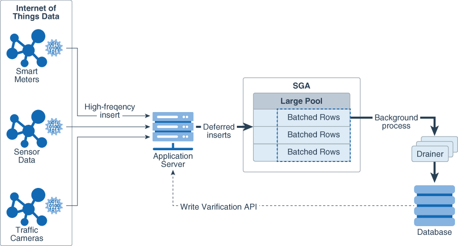

This chapter describes how to tune the System Global Area (SGA). If you are using automatic memory management to manage the database memory on your system, then there is no need to tune the SGA as described in this chapter.

This chapter contains the following topics:

### Using Automatic Shared Memory Management

Automatic shared memory management simplifies the configuration of the SGA by automatically distributing the memory in the SGA for the following memory pools:

- Database buffer cache (default pool)
- Shared pool
- Large pool
- Java pool
- Streams pool

Automatic shared memory management is controlled by the `SGA_TARGET` parameter. Changes in the value of the `SGA_TARGET` parameter automatically resize these memory pools. If these memory pools are set to nonzero values, then automatic shared memory management uses these values as minimum levels. Oracle recommends that you set the minimum values based on the minimum amount of memory an application component requires to function properly.

The following memory caches are manually-sized components and are not controlled by automatic shared memory management:

- Redo log buffer
	The redo log buffer is sized using the `LOG_BUFFER` initialization parameter, as described in " [Configuring the Redo Log Buffer](tuning-database-buffer-cache.md) ".
- Other buffer caches (such as `KEEP`, `RECYCLE`, and other nondefault block size)
	The `KEEP` pool is sized using the `DB_KEEP_CACHE_SIZE` initialization parameter, as described in " [Configuring the KEEP Pool](tuning-database-buffer-cache.md) ".
	The `RECYCLE` pool is sized using the `DB_RECYCLE_CACHE_SIZE` initialization parameter, as described in " [Configuring the RECYCLE Pool](tuning-database-buffer-cache.md) ".
- Fixed SGA and other internal allocations
	Fixed SGA and other internal allocations are sized using the `DB_nK_CACHE_SIZE` initialization parameter.

The memory allocated to these memory caches is deducted from the value of the `SGA_TARGET` parameter when automatic shared memory management computes the values of the automatically-tuned memory pools.

The following sections describe how to access and set the value of the `SGA_TARGET` parameter:

- User Interfaces for Setting the SGA\_TARGET Parameter
- Setting the SGA\_TARGET Parameter

See Also:

- [Oracle Database Concepts](https://docs.oracle.com/pls/topic/lookup?ctx=en/database/oracle/oracle-database/21/tgdba&id=CNCPT802) for information about the SGA
- [Oracle Database Administrator's Guide](https://docs.oracle.com/pls/topic/lookup?ctx=en/database/oracle/oracle-database/21/tgdba&id=ADMIN00207) for information about managing the SGA
- [Oracle Database Administrator's Guide](https://docs.oracle.com/pls/topic/lookup?ctx=en/database/oracle/oracle-database/21/tgdba&id=ADMIN002) for information about using initialization parameters

#### User Interfaces for Setting the SGA\_TARGET Parameter

This section describes the user interfaces for setting the value of the `SGA_TARGET` parameter.

This section contains the following topics:

- Setting the SGA\_TARGET Parameter in Oracle Enterprise Manager Cloud Control
- Setting the SGA\_TARGET Parameter in the Command-Line Interface

##### Setting the SGA\_TARGET Parameter in Oracle Enterprise Manager Cloud Control

You can change the value of the `SGA_TARGET` parameter in Oracle Enterprise Manager Cloud Control (Cloud Control) by accessing the SGA Size Advisor from the Memory Parameters SGA page.

##### Setting the SGA\_TARGET Parameter in the Command-Line Interface

You can change the value of the `SGA_TARGET` parameter in the command-line interface by querying the `V$SGA_TARGET_ADVICE` view and using the `ALTER` `SYSTEM` command.

### Unified Program Global Area

The unified program global area (PGA) pool is a shared global area (SGA) component that is used for PGA work areas by certain pluggable databases (PDBs) that have smaller SGA target values per-CPU compared to the multi-tenant container database (CDB).

The PGA allows the replacement of an Autonomous Transaction Processing (ATP) pluggable database (PDB) with an Autonomous Data Warehouse (ADW) PDB. This is achieved by transparently allocating some PGA for the ADW PDB from the SGA.

In an ATP-D environment, the memory is split between SGA and PGA usage. The SGA is supported by the large pages that are typically reserved during the virtual machine or host start-up time or in the early stage before the memory is fragmented. The SGA portion of system memory is configured based on transaction process requirements, typically 65% for SGA and 35% for PGA. However, ADW pluggable databases require more private memory and are typically in the range of 35% for SGA and 65% for PGA. Unfortunately, because the system is configured for ATP, the memory from huge pages (configured for SGA) cannot be released for PGA needs. It is difficult to reclaim the large pages in the future once it is fragmented.

The unified PGA pool is a new construct that allows the shared global area (SGA) to be used for pluggable databases' (PDB) program global area (PGA). The unified PGA only requests full granules from the buffer cache when it needs to grow, and it gives up full granules when no longer needed. At instance start-up, the PGA can have a minimum size of 0 or the size defined by an underscore size parameter.

Note:

Because only full granules can be consumed by the unified PGA pool, care is taken as to how often the granules are requested for growth and how soon they are given back to the system list.

### Sizing the SGA Components Manually

If the system is not using automatic memory management or automatic shared memory management, then you must manually configure the sizes of the following SGA components:

- Database buffer cache
	The database buffer cache is sized using the `DB_CACHE_SIZE` initialization parameter, as described in " [Configuring the Database Buffer Cache](tuning-database-buffer-cache.md) ".
- Shared pool
	The shared pool is sized using the `SHARED_POOL_SIZE` initialization parameter, as described in " [Configuring the Shared Pool](tuning-shared-pool-and-large-pool.md) ".
- Large pool
	The large pool is sized using the `LARGE_POOL_SIZE` initialization parameter, as described in " [Configuring the Large Pool](tuning-shared-pool-and-large-pool.md) ".
- Java pool
	The Java pool is sized using the `JAVA_POOL_SIZE` initialization parameter.
- Streams pool
	The Streams pool is sized using the `STREAMS_POOL_SIZE` initialization parameter.
- IM column store
	The IM column store is sized using the `INMEMORY_SIZE` initialization parameter.

The values for these parameters are also dynamically configurable using the `ALTER` `SYSTEM` statement.

Before configuring the sizes of these SGA components, take the following considerations into account:

- SGA Sizing Unit
- Maximum Size of the SGA
- Application Considerations
- Operating System Memory Use
- Iteration During Configuration

See Also:

- [Oracle Database Java Developer's Guide](https://docs.oracle.com/pls/topic/lookup?ctx=en/database/oracle/oracle-database/21/tgdba&id=JJDEV-GUID-0E6A9749-5505-4009-AEC6-47C84947DCFA) for information about Java memory usage and the `JAVA_POOL_SIZE` initialization parameter
- [Oracle Database In-Memory Guide](https://docs.oracle.com/pls/topic/lookup?ctx=en/database/oracle/oracle-database/21/tgdba&id=INMEM-GUID-3CC8549A-A394-49CC-A907-AEB471A19CB3) for information about the `INMEMORY_SIZE` initialization parameter

#### SGA Sizing Unit

Memory for the buffer cache, shared pool, large pool, and Java pool is allocated in units of granules. If the SGA size is less than 1 GB, then the granule size is 4MB. If the SGA size is greater than 1 GB, the granule size changes to 16MB. The granule size is calculated and fixed when the database instance starts up. The size does not change during the lifetime of the instance.

To view the granule size that is currently being used for the SGA, use the `V$SGA_DYNAMIC_COMPONENTS` view. The same granule size is used for all dynamic components in the SGA.

#### Maximum Size of the SGA

The maximum amount of memory usable by the database instance is determined at instance startup by the value of the `SGA_MAX_SIZE` initialization parameter. You can expand the total SGA size to a value equal to the `SGA_MAX_SIZE` parameter. The value of the `SGA_MAX_SIZE` parameter defaults to the aggregate setting of all the SGA components.

If the value of the `SGA_MAX_SIZE` parameter is not set, then decrease the size of one cache and reallocate that memory to another cache if necessary. Alternatively, you can set the value of the `SGA_MAX_SIZE` parameter to be larger than the sum of all of the SGA components, such as the buffer cache and the shared pool. Doing so enables you to dynamically increase a cache size without having to decrease the size of another cache.

Note:

The value of the `SGA_MAX_SIZE` parameter cannot be dynamically resized.

#### Application Considerations

When configuring memory, size the memory caches appropriately based on the application's needs. Conversely, tuning the application's use of the memory caches can greatly reduce resource requirements. Efficient use of the memory caches also reduces the load on related resources, such as latches, CPU, and the I/O system.

For optimal performance, consider the following:

- Design the cache to use the operating system and database resources in the most efficient manner.
- Allocate memory to Oracle Database memory structures to best reflect the needs of the application.
- If changes or additions are made to an existing application, resize Oracle Database memory structures to meet the needs of the modified application.
- If the application uses Java, investigate whether the default configuration for the Java pool needs to be modified.

See Also:

[Oracle Database Java Developer's Guide](https://docs.oracle.com/pls/topic/lookup?ctx=en/database/oracle/oracle-database/21/tgdba&id=JJDEV-GUID-D660F569-3654-4C5F-9D25-5D5A3E05E9AD) for information about Java memory usage

#### Operating System Memory Use

For most operating systems, it is important to consider the following when configuring memory:

- Reduce Paging
- Fit the SGA into Main Memory
- Allow Adequate Memory to Individual Users

See Also:

Your operating system hardware and software documentation, and the Oracle documentation specific to your operating system, for more information on tuning operating system memory usage

##### Reduce Paging

Paging occurs when an operating system transfers memory-resident pages to disk solely to load new pages into memory. Many operating systems page to accommodate large amounts of information that do not fit into real memory. On most operating systems, paging reduces performance.

To determine whether significant paging is occurring on the host system, use operating system utilities to examine the operating system. If significant paging is occurring, then the total system memory may not be large enough to hold the memory caches for which memory is allocated. Consider either increasing the total memory on the system, or decreasing the amount of memory allocated.

##### Fit the SGA into Main Memory

Because the purpose of the SGA is to store data in memory for fast access, the SGA should reside in the main memory. If pages of the SGA are swapped to disk, then the data is no longer quickly accessible. On most operating systems, the disadvantage of paging significantly outweighs the advantage of a large SGA.

This section contains the following topics:

- Viewing SGA Memory Allocation
- Locking the SGA into Physical Memory

###### Viewing SGA Memory Allocation

To view how much memory is allocated to the SGA and each of its internal structures, use the `SHOW SGA` statement in SQL\*Plus as shown in the following example:

```
SQL> SHOW SGA
```

The output of this statement might look like the following:

```
Total System Global Area  840205000 bytes
Fixed Size                   279240 bytes
Variable Size             520093696 bytes
Database Buffers          318767104 bytes
Redo Buffers                1064960 bytes
```

###### Locking the SGA into Physical Memory

To prevent the SGA from being paged out, consider locking the SGA into physical memory by enabling the `LOCK_SGA` parameter. The database does not use the `MEMORY_TARGET` and `MEMORY_MAX_TARGET` parameters when the `LOCK_SGA` parameter is enabled.

##### Allow Adequate Memory to Individual Users

When sizing the SGA, ensure that you allow enough memory for the individual server processes and any other programs running on the system.

#### Iteration During Configuration

Configuring memory allocation involves distributing available memory to Oracle Database memory structures, depending on the needs of the application. The distribution of memory to Oracle Database structures can affect the amount of physical I/O necessary for Oracle Database to operate properly. Having a proper initial memory configuration provides an indication of whether the I/O system is effectively configured.

After the initial pass through the memory configuration process, it may be necessary to repeat the steps of memory allocation. Subsequent passes enable you to make adjustments to earlier steps, based on changes in subsequent steps. For example, decreasing the size of the buffer cache enables you to increase the size of another memory structure, such as the shared pool.

### Monitoring Shared Memory Management

Table 12-1 lists the views that provide information about SGA resize operations.

Table 12-1 Shared Memory Management Views

| View | Description |
| --- | --- |
| `V$SGA_CURRENT_RESIZE_OPS` | Displays information about SGA resize operations that are currently in progress. |
| `V$SGA_RESIZE_OPS` | Displays information about the last 800 completed SGA resize operations. This does not include operations that are currently in progress. |
| `V$SGA_DYNAMIC_COMPONENTS` | Displays information about the dynamic components in the SGA. This view summarizes information of all completed SGA resize operations that occurred after instance startup. |
| `V$SGA_DYNAMIC_FREE_MEMORY` | Displays information about the amount of SGA memory available for future dynamic SGA resize operations. |

See Also:

[Oracle Database Reference](https://docs.oracle.com/pls/topic/lookup?ctx=en/database/oracle/oracle-database/21/tgdba&id=REFRN) for information about these views

### Improving Query Performance with the In-Memory Column Store

The In-Memory Column Store (IM column store) is an optional portion of the system global area (SGA) that stores copies of tables, partitions, and other database objects in columnar format, and this columnar data is optimized for rapid scans. Because the IM column store puts database objects in memory, Oracle Database can perform scans, queries, joins, and aggregates on that data much faster than on data stored in row format.

Note:

- The IM column store and database buffer cache store the same data, but in different formats. The IM column store does not replace the row-based storage in the database buffer cache, but supplements it for achieving better query performance.

In-memory scans are also permitted when not all columns in a table have been populated into the IM column store. This situation can occur when columns have been specified as `NO INMEMORY` to save space.

In-memory hybrid scans can access some data from the IM column store, and some data from the row store, improving performance by orders of magnitude over pure row store queries. The query is divided into two parts, with one part scanning the IM column store to perform filters, and the other part scanning the row store to project the filtered query results.

See Also:

[Oracle Database In-Memory Guide](https://docs.oracle.com/pls/topic/lookup?ctx=en/database/oracle/oracle-database/21/tgdba&id=INMEM-GUID-BFA53515-7643-41E5-A296-654AB4A9F9E7) for more information about the IM column store

### Enabling High Performance Data Streaming with the Memoptimized Rowstore

The Memoptimized Rowstore enables high performance data streaming for applications, such as Internet of Things (IoT).

This section contains the following topics:

- About the Memoptimized Rowstore
- Using Fast Ingest
- Using Fast Lookup

#### About the Memoptimized Rowstore

The Memoptimized Rowstore enables high performance data streaming for applications, such as Internet of Things (IoT) applications, which typically stream small amounts of data in single-row inserts from a large number of clients simultaneously and also query data for clients at a very high frequency.

The Memoptimized Rowstore provides the following functionality:

- Fast ingest
	Fast ingest optimizes the processing of high-frequency, single-row data inserts into a database. Fast ingest uses the large pool for buffering the inserts before writing them to disk, so as to improve data insert performance.
- Fast lookup
	Fast lookup enables fast retrieval of data from a database for high-frequency queries. Fast lookup uses a separate memory area in the SGA called the memoptimize pool for buffering the data queried from tables, so as to improve query performance.
	Note:
	For using fast lookup, you must allocate appropriate memory size to the memoptimize pool using the `MEMOPTIMIZE_POOL_SIZE` initialization parameter.

See Also:

- " Using Fast Ingest "
- " Using Fast Lookup "

#### Using Fast Ingest

Fast ingest optimizes the processing of high-frequency, single-row data inserts into database from applications, such as Internet of Things (IoT) applications.

Fast ingest uses `MEMOPTIMIZE_WRITE` to insert data into tables specified as `MEMOPTIMIZE FOR WRITE` hint. The database temporarily buffers these inserts in the large pool and automatically commits the changes at the time of writing these buffered inserts to disk. The changes cannot be rolled back.

The inserts using fast ingest are also known as deferred inserts, because they are initially buffered in the large pool and later written to disk asynchronously by background processes.

Steps for using fast ingest for inserting data into a table

The following are the steps for using fast ingest for inserting data into a table:

1. Enable a table for fast ingest by specifying the `MEMOPTIMIZE FOR WRITE` hint in the `CREATE TABLE` or `ALTER TABLE` statement.
	```
	SQL> create table test_fast_ingest (
	id number primary key,
	test_col varchar2(15))
	memoptimize for write;
	Table created.
	```
	See " Enabling a Table for Fast Ingest " for more information.
2. Enable fast ingest for inserts by specifying the `MEMOPTIMIZE_WRITE` hint in the `INSERT` statement.
	The following is not how fast ingest is meant to be used, but demonstrates the mechanism.
	```
	SQL> insert /*+ memoptimize_write */ into test_fast-ingest vlaues (1, 'test');
	1 row created
	SQL> insert /** memotimize_write */ into test_fast_ingest values (2, 'test');
	1 row created
	```
	See " Specifying a Hint for Using Fast Ingest for Data Inserts " for more information.

The result of the two inserts above is to write data to the ingest buffer in the large pool of the SGA. At some point, that data is flushed to the `TEST_FAST_INGEST` table. Until that happens, the data is not durable.

Because the purpose of fast-ingest is to support high performance data streaming, a more realistic architecture would involve having one or more application or ingest servers collecting data and batching inserts to the database.

The first time an insert is run, the fast ingest area is allocated from the large pool. The amount of memory allocated is written to the `alert.log`.

Details about fast ingest

The intent of fast-ingest is to support applications that generate lots of informational data that has important value in the aggregate but that doesn't necessarily require full ACID requirements. Many applications in the Internet of Things (IoT) have a rapid "fire and forget" type workload, such as sensor data, smart meter data or even traffic cameras. For these applications, data might be collected and written to the database in high volumes for later analysis.

The following diagram shows how this might work with the Memoptimized Rowstore – Fast Ingest feature.

Figure 12-1 Fast-Ingest with high-frequency inserts.



> The illustration shows on the left three sources of data collection in the Internet of Things: smart meters, sensor data, and traffic cameras. These sources send high-frequency inserts to the application server.
>
> The application server sends deferred inserts to the SGA and its Large Pool. The ingested data is batched in the database in the large pool and is not immediately written. The ingest process is very fast. A background process later writes to the database.


The ingested data is batched in the large pool and is not immediately written to the database. Thus, the ingest process is very fast. Very large volumes of data can be ingested efficiently without having to process individual rows. However, if the database goes down before the ingested data is written out to the database files, it is possible to lose data.

Fast ingest is very different from normal Oracle Database transaction processing where data is logged and never lost once "written" to the database (i.e. committed). In order to achieve the maximum ingest throughput, the normal Oracle transaction mechanisms are bypassed, and it is the responsibility of the application to check to see that all data was indeed written to the database. Special APIs have been added that can be called to check if the data has been written to the database.

The `commit` operation has no meaning in the context of fast ingest, because it is not a transaction in the traditional Oracle sense. There is no ability to rollback the inserts. You also cannot query the data until it has been flushed from the fast ingest buffers to disk. You can see some administrative information about the fast ingest buffers by querying the view `V$MEMOPTIMIZE_WRITE_AREA`.

You can also use the packages `DBMS_MEMOPTIMIZE` and `DBMS_MEMOPTIMIZE_ADMIN` to perform functions like flushing fast ingest data from the large pool and determining the sequence id of data that has been written.

Index operations and constraint checking is done only when the data is written from the fast ingest area in the large pool to disk. If primary key violations occur when the background processes write data to disk, then the database will not write those rows to the database.

Assuming (for most applications but not all) that all inserted data needs to be written to the database, it is critical that the application insert process checks to see that the inserted data has actually been written to the database before destroying that data. Only when that confirmation has occurred can the data be deleted from the inserting process.

Limitations for using fast ingest

Tables with the following characteristics cannot use fast ingest:

- Tables with:
	- disk compression
		- in-memory compression
		- column default vales
		- encryption
		- functional indexes
		- domain indexes
		- bitmap indexes
		- bitmap join indexes
		- ref types
		- varray types
		- OID$ types
		- unused columns
		- virtual columns
		- LOBs
		- triggers
		- binary columns
		- foreign keys
		- row archival
		- invisible columns
- Temporary tables
- Nested tables
- Index organized tables
- External tables
- Materialized views with on-demand refresh
- Sub-partitioning is not supported.
- The following partitioning types are not supported.
	- REFERENCE
		- SYSTEM
		- INTERVAL
		- AUTOLIST

The following are some additional considerations for fast ingest:

- Because fast ingest buffers data in the large pool, there is a possibility of data loss in the event of a system failure. To avoid data loss, a client must keep a local copy of the data after performing inserts, so that it can replay the inserts in the event of a system failure before the data is written to disk. A client can use the `DBMS_MEMOPTIMIZE` package subprograms to track the durability of the inserts. After inserts are written to disk, a client can destroy its local copy of the inserted data.
- Queries do not read data from the large pool, hence data inserted using fast ingest cannot be queried until it is written to disk.
- Parent-child transactions must be synchronized to avoid errors. For example, foreign key inserts and updates of rows inserted into the large pool can return errors, if the parent data is not yet written to disk.
- Index operations are supported by fast ingest similar to the regular inserts. However, for fast ingest, database performs index operations while writing data to disk, and not while writing data into the large pool.
- JSON is only supported stored as a 4K `VARCHAR2` and not as a `LOB`. Extended 32K string lengths are not supported (i.e. `max_string_size=extended`).
- The size allocated to the fast ingest buffers in the Large pool is fixed once created. If the buffer fills, further ingest waits until the background processes drain the buffer.

Note:

A table can be configured for using both fast ingest and fast lookup.

See Also:

- Enabling a Table for Fast Ingest
- Specifying a Hint for Using Fast Ingest for Data Inserts
- Managing Fast Ingest Data in the Large Pool
- Disabling a Table for Fast Ingest
- [Oracle Database Concepts](https://docs.oracle.com/pls/topic/lookup?ctx=en/database/oracle/oracle-database/21/tgdba&id=CNCPT-GUID-07D4439A-8E4E-4FBC-A403-1B0F0B9E0058) for more information about the deferred insert mechanism

##### Enabling a Table for Fast Ingest

You can enable a table for fast ingest by specifying the `MEMOPTIMIZE FOR WRITE` clause in the `CREATE TABLE` or `ALTER TABLE` statement.

To enable a table for fast ingest:

1. In SQL\*Plus, log in to the database as a user with `ALTER TABLE` privileges.
2. Run the `CREATE TABLE` or `ALTER TABLE` statement with the `MEMOPTIMIZE FOR WRITE` clause.
	The following example creates a new table `test_fast_ingest` and enables it for fast ingest:
	```
	CREATE TABLE test_fast_ingest (
	     id        NUMBER(5) PRIMARY KEY,
	     test_col  VARCHAR2(15))
	  MEMOPTIMIZE FOR WRITE;
	```
	The following example enables the existing table `hr.employees` for fast ingest:
	```
	ALTER TABLE hr.employees MEMOPTIMIZE FOR WRITE;
	```

##### Specifying a Hint for Using Fast Ingest for Data Inserts

You can use fast ingest for data inserts by specifying the `MEMOPTIMIZE_WRITE` hint in `INSERT` statements.

Prerequisites

This task assumes that a table is already enabled for fast ingest.

To use fast ingest for data inserts:

1. In SQL\*Plus, log in to the database as a user with the privileges to insert data into tables.
2. Run the `INSERT` statement with the `MEMOPTIMIZE_WRITE` hint for a table that is already enabled for fast ingest.
	For example:
	```
	INSERT  /*+ MEMOPTIMIZE_WRITE */ INTO test_fast_ingest VALUES (1,'test');
	```

See Also:

" Enabling a Table for Fast Ingest "

##### Disabling a Table for Fast Ingest

You can disable a table for fast ingest by specifying the `NO MEMOPTIMIZE FOR WRITE` clause in the `ALTER TABLE` statement.

To disable a table for fast ingest:

1. In SQL\*Plus, log in to the database as a user with the `ALTER TABLE` privileges.
2. Run the `ALTER TABLE` statement with the `NO MEMOPTIMIZE FOR WRITE` clause.
	The following example disables the table `hr.employees` for fast ingest:
	```
	ALTER TABLE hr.employees NO MEMOPTIMIZE FOR WRITE;
	```

##### Managing Fast Ingest Data in the Large Pool

You can view the fast ingest data in the large pool using the `V$MEMOPTIMIZE_WRITE_AREA` view. You can also view and control the fast ingest data in the large pool using the subprograms of the packages `DBMS_MEMOPTIMIZE` and `DBMS_MEMOPTIMIZE_ADMIN`.

Overview of the V$MEMOPTIMIZE\_WRITE\_AREA view

The `V$MEMOPTIMIZE_WRITE_AREA` view provides the following information about the memory usage and data inserts in the large pool by fast ingest:

- Total amount of memory allocated for fast ingest data in the large pool
- Total amount of memory currently used by fast ingest data in the large pool
- Total amount of memory currently free for storing fast ingest data in the large pool
- Number of fast ingest insert operations for which data is still in the large pool and is yet to be written to disk
- Number of clients currently using fast ingest for inserting data into the database

See Also:

[Oracle Database Reference](https://docs.oracle.com/pls/topic/lookup?ctx=en/database/oracle/oracle-database/21/tgdba&id=REFRN-GUID-C6904827-0F5B-436B-8C2D-0E487EB8BE70) for information about the `V$MEMOPTIMIZE_WRITE_AREA` view

Overview of the DBMS\_MEMOPTIMIZE package subprograms

You can use the following subprograms of the `DBMS_MEMOPTIMIZE` package to view and control the fast ingest data in the large pool:

| Subprogram | Description |
| --- | --- |
| `GET_APPLY_HWM_SEQID` | Returns the low high-water mark (low HWM) of sequence numbers of data records that are successfully written to disk by all the sessions. |
| `GET_WRITE_HWM_SEQID` | Returns the high-water mark (HWM) sequence number of the data record that is written to the large pool for the current session. |
| `WRITE_END` | Flushes all the fast ingest data from the large pool to disk for the current session. |

See Also:

[Oracle Database PL/SQL Packages and Types Reference](https://docs.oracle.com/pls/topic/lookup?ctx=en/database/oracle/oracle-database/21/tgdba&id=ARPLS-GUID-49F0E799-97F0-41E7-9CD3-24AE3CAA8105) for information about the `DBMS_MEMOPTIMIZE` package

Overview of the DBMS\_MEMOPTIMIZE\_ADMIN package subprograms

You can use the following subprograms of the `DBMS_MEMOPTIMIZE_ADMIN` package to control the fast ingest data in the large pool:

| Subprogram | Description |
| --- | --- |
| `WRITES_FLUSH` | Flushes all the fast ingest data from the large pool to disk for all the sessions. |

See Also:

[Oracle Database PL/SQL Packages and Types Reference](https://docs.oracle.com/pls/topic/lookup?ctx=en/database/oracle/oracle-database/21/tgdba&id=ARPLS-GUID-8D800B44-7360-4C8D-B91A-EBA7466D43B2) for information about the `DBMS_MEMOPTIMIZE_ADMIN` package

#### Using Fast Lookup

Fast lookup enables fast data retrieval from database tables for applications, such as Internet of Things (IoT) applications.

Fast lookup uses a hash index that is stored in the SGA buffer area called memoptimize pool to provide fast access to blocks of tables permanently pinned in the buffer cache, thus avoiding disk I/O and improving query performance.

Steps for using fast lookup for a table

The following are the steps for using fast lookup for a table:

1. Enable the memoptimize pool
	This task is achieved by setting the `MEMOPTIMIZE_POOL_SIZE` initialization parameter to a non-zero value.
	See " Enabling the Memoptimize Pool " for more information.
2. Enable a table for fast lookup
	This task is achieved by specifying the `MEMOPTIMIZE FOR READ` clause in the `CREATE TABLE` or `ALTER TABLE` statement.
	See " Enabling a Table for Fast Lookup " for more information.

Limitations for using fast lookup

The following are the limitations for using fast lookup:

- Tables enabled for fast lookup cannot be compressed.
- Tables enabled for fast lookup must have a primary key constraint enabled.

Note:

A table can be configured for using both fast ingest and fast lookup.

See Also:

- Enabling the Memoptimize Pool
- Enabling a Table for Fast Lookup
- Disabling a Table for Fast Lookup
- Managing Fast Lookup Data in the Memoptimize Pool
- [Oracle Database Concepts](https://docs.oracle.com/pls/topic/lookup?ctx=en/database/oracle/oracle-database/21/tgdba&id=CNCPT-GUID-D58DC90F-0ABB-4B1E-96C1-6094A04A5E12) for information about the memoptimize pool memory architecture
- [Oracle Database Reference](https://docs.oracle.com/pls/topic/lookup?ctx=en/database/oracle/oracle-database/21/tgdba&id=REFRN-GUID-D33BB2FE-94A7-475F-B8C8-CC9AC61B502F) for information about the `MEMOPTIMIZE_POOL_SIZE` initialization parameter

##### Enabling the Memoptimize Pool

You must enable the memoptimize pool before using fast lookup. The memoptimize pool resides in the SGA, and stores the data and hash index for the tables that are enabled for fast lookup.

Prerequisites

This task assumes that the `COMPATIBLE` initialization parameter is set to `18.0.0` or higher.

To enable the memoptimize pool:

1. In SQL\*Plus, log in to the database as a user with administrative privileges.
2. Set the `MEMOPTIMIZE_POOL_SIZE` initialization parameter to a non-zero value. The minimum setting is `100 MB`. When you set this initialization parameter in a server parameter file (SPFILE) using the `ALTER SYSTEM` statement, you must specify `SCOPE=SPFILE`.
	For example, the following statement sets the memoptimize pool size to 10 GB:
	```
	ALTER SYSTEM SET MEMOPTIMIZE_POOL_SIZE = 10G SCOPE=SPFILE;
	```
3. Restart the database for the change to take effect.

Example: Enabling the Memoptimize Pool

Assume that the `MEMOPTIMIZE_POOL_SIZE` initialization parameter is initially set to 0. The following example enables the memoptimize pool by setting the `MEMOPTIMIZE_POOL_SIZE` to 10 GB:

```
SQL> SHOW PARAMETER MEMOPTIMIZE_POOL_SIZE

NAME                   TYPE         VALUE
---------------------  -----------  -----
memoptimize_pool_size  big integer  0

SQL> ALTER SYSTEM SET MEMOPTIMIZE_POOL_SIZE=10G SCOPE=SPFILE;

System altered.

SQL> SHUTDOWN IMMEDIATE
Database closed.
Database dismounted.
ORACLE instance shut down.

SQL> STARTUP
ORACLE instance started.

Total System Global Area 1.1832E+10 bytes
Fixed Size                  9010864 bytes
Variable Size            1.1799E+10 bytes
Database Buffers           16777216 bytes
Redo Buffers                7766016 bytes
Database mounted.
Database opened.

SQL> SHOW PARAMETER MEMOPTIMIZE_POOL_SIZE

NAME                   TYPE         VALUE
---------------------  -----------  -----
memoptimize_pool_size  big integer  10G
```

Note:

The `MEMOPTIMIZE_POOL_SIZE` value does count toward `SGA_TARGET`, but the database does not grow and shrink the memoptimize pool automatically. For example, if `SGA_TARGET` is 10 GB, and if `MEMOPTIMIZE_POOL_SIZE` is 1 GB, then a total of 9 GB is available for SGA memory other than the memoptimize pool.

See Also:

- [Oracle Database Concepts](https://docs.oracle.com/pls/topic/lookup?ctx=en/database/oracle/oracle-database/21/tgdba&id=CNCPT-GUID-D58DC90F-0ABB-4B1E-96C1-6094A04A5E12) for information about the memoptimize pool memory architecture
- [Oracle Database Reference](https://docs.oracle.com/pls/topic/lookup?ctx=en/database/oracle/oracle-database/21/tgdba&id=REFRN-GUID-D33BB2FE-94A7-475F-B8C8-CC9AC61B502F) for information about the `MEMOPTIMIZE_POOL_SIZE` initialization parameter

##### Enabling a Table for Fast Lookup

You can enable a table for fast lookup by specifying the `MEMOPTIMIZE FOR READ` clause in the `CREATE TABLE` or `ALTER TABLE` statement.

Prerequisites

This task assumes that the memoptimize pool is enabled.

To enable a table for fast lookup:

1. In SQL\*Plus, log in to the database as a user with `ALTER TABLE` privileges.
2. Run the `CREATE TABLE` or `ALTER TABLE` statement with the `MEMOPTIMIZE FOR READ` clause for the table that needs to be enabled for fast lookup.
	The following example creates a new table `test_fast_lookup` and enables it for fast lookup:
	```
	CREATE TABLE test_fast_lookup (
	     id        NUMBER(5) PRIMARY KEY,
	     test_col  VARCHAR2(15))
	  MEMOPTIMIZE FOR READ;
	```
	The following example enables the existing table `hr.employees` for fast lookup:
	```
	ALTER TABLE hr.employees MEMOPTIMIZE FOR READ;
	```

See Also:

- Enabling the Memoptimize Pool
- Disabling a Table for Fast Lookup
- Managing Fast Lookup Data in the Memoptimize Pool

##### Disabling a Table for Fast Lookup

You can disable a table for fast lookup by specifying the `NO MEMOPTIMIZE FOR READ` clause in the `ALTER TABLE` statement.

Prerequisites

This task assumes that a table is already enabled for fast lookup.

To disable a table for fast lookup:

1. In SQL\*Plus, log in to the database as a user with the `ALTER TABLE` privileges.
2. Run the `ALTER TABLE` statement with the `NO MEMOPTIMIZE FOR READ` clause for the table that needs to be disabled for fast lookup.
	The following example disables the `hr.employees` table for fast lookup:
	```
	ALTER TABLE hr.employees NO MEMOPTIMIZE FOR READ;
	```

See Also:

" Enabling a Table for Fast Lookup "

##### Managing Fast Lookup Data in the Memoptimize Pool

The memoptimize pool stores the data (fast lookup data) of all the tables that are enabled for fast lookup. You can explicitly delete or populate fast lookup data for a table in the memoptimize pool using the `DBMS_MEMOPTIMIZE` package subprograms.

Overview of the DBMS\_MEMOPTIMIZE package subprograms

The following are the `DBMS_MEMOPTIMIZE` package subprograms that can be used to delete or populate fast lookup data for a table in the memoptimize pool:

| Subprogram | Description |
| --- | --- |
| `DROP_OBJECT` | Removes fast lookup data for a table from the memoptimize pool. |
| `POPULATE` | Populates fast lookup data for a table in the memoptimize pool. |

See Also:

- " Enabling a Table for Fast Lookup "
- " Enabling the Memoptimize Pool "
- [Oracle Database PL/SQL Packages and Types Reference](https://docs.oracle.com/pls/topic/lookup?ctx=en/database/oracle/oracle-database/21/tgdba&id=ARPLS-GUID-49F0E799-97F0-41E7-9CD3-24AE3CAA8105) for information about the `DBMS_MEMOPTIMIZE` package
- [Oracle Database Concepts](https://docs.oracle.com/pls/topic/lookup?ctx=en/database/oracle/oracle-database/21/tgdba&id=CNCPT-GUID-D58DC90F-0ABB-4B1E-96C1-6094A04A5E12) for information about the memoptimize pool memory architecture